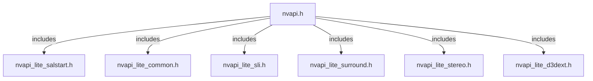
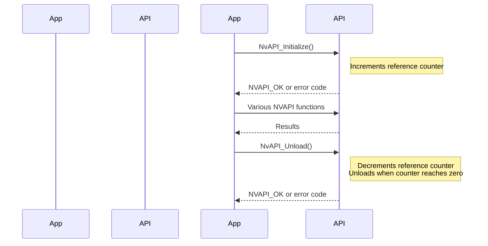
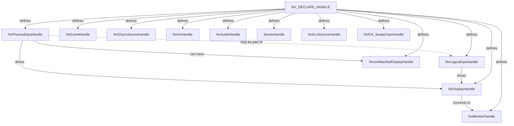
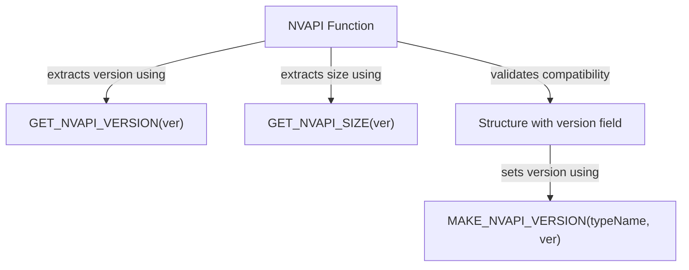
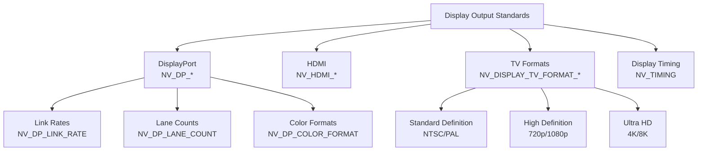
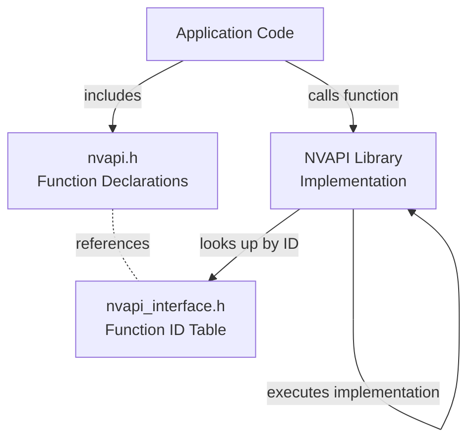
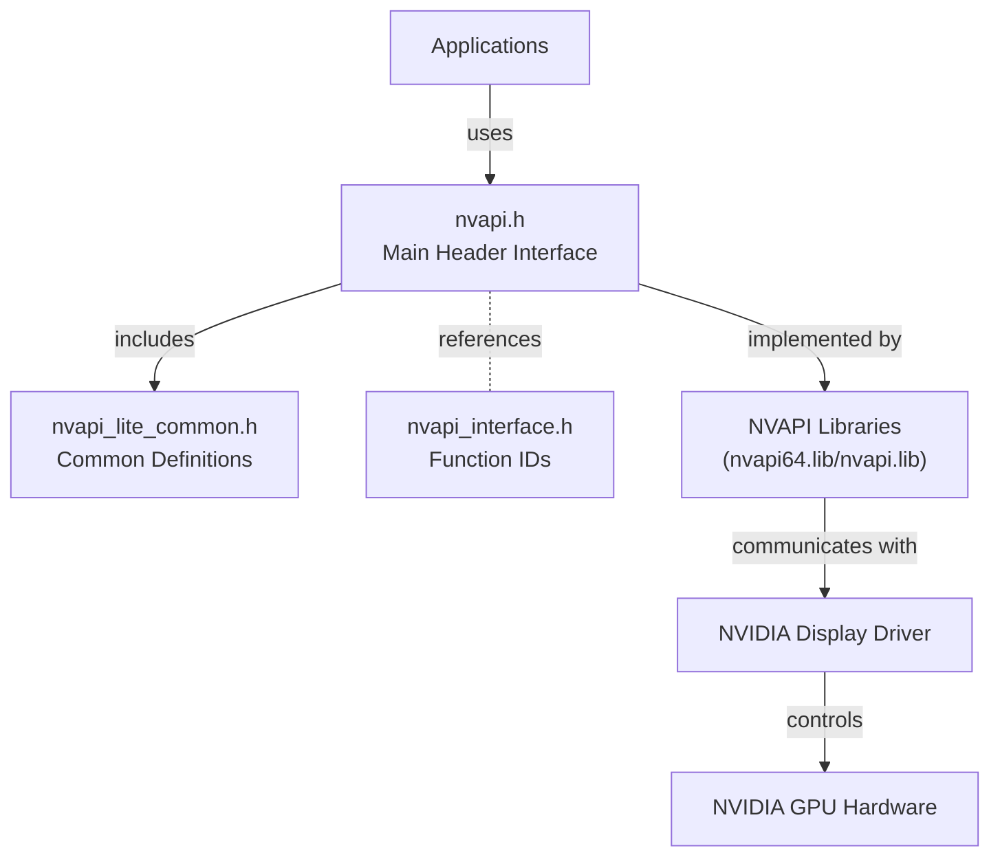

<!-- source: DeepWiki mcp.deepwiki.com · repo NVIDIA/nvapi · page 2.2 Main Header Interface · fetched 2026-10-26 -->

# Main Header Interface

<details>
<summary>Relevant source files</summary>

The following files were used as context for generating this wiki page:

- [nvapi.h](nvapi.h)
- [nvapi_interface.h](nvapi_interface.h)
- [nvapi_lite_common.h](nvapi_lite_common.h)

</details>


The Main Header Interface (`nvapi.h`) serves as the primary interface file for the NVIDIA API (NVAPI). It defines the function prototypes, structure definitions, constants, and type declarations that applications use to interact with NVIDIA GPUs and displays. This header file is the entry point for all NVAPI functionality, providing a standardized way for software to access and control various aspects of NVIDIA hardware.

For information about specific implementations of these interfaces, see [Core Libraries and Interfaces](#2).

Sources: [nvapi.h:26-37]()

## File Structure and Organization

The `nvapi.h` header is organized hierarchically, including several supporting headers that provide common definitions and interface identifiers:



The file is structured into several main sections:
1. Universal NVAPI definitions and types
2. Core API functions (initialization, error handling, version info)
3. Display-related structures and functions
4. GPU-related structures and functions
5. Specialized functionality (Stereo 3D, SLI, etc.)

Sources: [nvapi.h:38-43]()

## Core API Functions

### Initialization and Shutdown

Before using any NVAPI functionality, applications must initialize the API and should unload it when finished:



Key initialization functions:
- `NvAPI_Initialize()`: Initializes the NVAPI library (required before calling other functions)
- `NvAPI_Unload()`: Decrements the reference counter and unloads the library when it reaches zero

Sources: [nvapi.h:68-117]()

### Error Handling and Version Information

All NVAPI functions return a status code of type `NvAPI_Status`. Applications can convert error codes to human-readable messages:

```
NvAPI_Status status = NvAPI_SomeFunction();
if (status != NVAPI_OK)
{
    NvAPI_ShortString errorMessage;
    NvAPI_GetErrorMessage(status, errorMessage);
    // Handle error...
}
```

Key utility functions:
- `NvAPI_GetErrorMessage()`: Converts an error code to a human-readable string
- `NvAPI_GetInterfaceVersionString()`: Returns version information about the NVAPI library
- `NvAPI_GetInterfaceVersionStringEx()`: Extended version of the above function

Sources: [nvapi.h:119-177](), [nvapi_lite_common.h:259-425]()

## Handle Types and Hierarchy

NVAPI uses a system of opaque handles to reference various hardware and software resources. These handles are declared using the `NV_DECLARE_HANDLE` macro:



Main handle types include:
- `NvPhysicalGpuHandle`: Represents a single physical GPU
- `NvLogicalGpuHandle`: Represents one or more physical GPUs acting in concert (SLI)
- `NvDisplayHandle`: Represents a display device driven by NVIDIA GPU(s)
- `NvUnAttachedDisplayHandle`: Represents an unattached display device
- `NvMonitorHandle`: Represents a monitor handle
- Various specialized handles for specific features (GSync, VIO, stereo 3D, etc.)

Sources: [nvapi_lite_common.h:127-165]()

## Structure Versioning System

NVAPI uses a versioning system for structures to maintain backward compatibility. This is implemented through version fields and macros:



The versioning system works as follows:
1. Each structure has a `version` field as its first member
2. The `MAKE_NVAPI_VERSION` macro combines the structure size and version number into a 32-bit value
3. When calling an API function, the application sets the version field
4. The API function validates the version for compatibility

Example of versioned structures:
- `NV_EDID_V1`, `NV_EDID_V2`, `NV_EDID_V3`: Different versions of the EDID structure
- `NV_DISPLAY_PATH_INFO_V1`, `NV_DISPLAY_PATH_INFO_V2`: Different versions of the display path structure

Sources: [nvapi_lite_common.h:239-251](), [nvapi.h:291-324](), [nvapi.h:997-1034]()

## Major Functional Categories

The NVAPI header defines functions across several categories:

### GPU Management

Functions for enumerating and querying information about GPUs:
- `NvAPI_EnumPhysicalGPUs()`: Enumerates physical GPUs in the system
- `NvAPI_GPU_GetEDID()`: Retrieves EDID data from a display connected to a GPU
- `NvAPI_GPU_GetMemoryInfo()`: Retrieves memory information for a GPU

Sources: [nvapi.h:263-327](), [nvapi.h:533-535](), [nvapi_lite_common.h:598-630]()

### Display Management

Functions for configuring and querying displays:
- `NvAPI_SetView()`: Modifies display arrangements in various view modes
- `NvAPI_SetViewEx()`: Extended version with more configuration options
- `NvAPI_DISP_SetDisplayConfig()`: Sets display configuration using path-based approach

Sources: [nvapi.h:677-869]()

### Display Configuration Data Structures

Structures for detailed display configuration:

| Structure Name | Purpose |
|----------------|---------|
| `NV_VIEW_TARGET_INFO` | Basic target display information for SetView |
| `NV_DISPLAY_PATH` | Detailed display path configuration information |
| `NV_DISPLAY_PATH_INFO` | Container for multiple display paths |
| `NV_DISPLAYCONFIG_PATH_INFO` | Advanced display configuration structure |

Sources: [nvapi.h:706-726](), [nvapi.h:772-825](), [nvapi.h:942-1034]()

### Display Output Standards

The API supports various display output standards and formats:



Sources: [nvapi.h:190-257](), [nvapi.h:391-463](), [nvapi.h:591-656]()

## Function Interface Mechanism

NVAPI uses a special mechanism for resolving function addresses:



The function resolution works as follows:
1. Functions are declared in `nvapi.h` with the `NVAPI_INTERFACE` macro
2. Each function has a unique hexadecimal ID defined in `nvapi_interface.h`
3. At runtime, these IDs are used to resolve the actual function pointers

This approach allows NVAPI to maintain binary compatibility across different driver versions.

Sources: [nvapi_interface.h:30-544]()

## Common Data Types and Structures

### Basic Types

NVAPI defines type aliases for standard types to ensure consistent sizes:

| NVAPI Type | Description |
|------------|-------------|
| `NvU8` | 8-bit unsigned integer |
| `NvS8` | 8-bit signed integer |
| `NvU16` | 16-bit unsigned integer |
| `NvS16` | 16-bit signed integer |
| `NvU32` | 32-bit unsigned integer |
| `NvS32` | 32-bit signed integer |
| `NvU64` | 64-bit unsigned integer |
| `NvS64` | 64-bit signed integer |
| `NvF32` | 32-bit floating point |
| `NvF64` | 64-bit floating point |
| `NvBool` | Boolean type (8-bit) |

Sources: [nvapi_lite_common.h:56-116]()

### String Types

Several string types with predefined maximum lengths:

| NVAPI Type | Description |
|------------|-------------|
| `NvAPI_String` | Generic string (4096 chars) |
| `NvAPI_LongString` | Long string (256 chars) |
| `NvAPI_ShortString` | Short string (64 chars) |

Sources: [nvapi_lite_common.h:177-235]()

### Specialized Structures

The header defines many specialized structures for various purposes:

- `NV_EDID`: Contains EDID data for a display
- `NV_TIMING`: Display timing information
- `NV_DISPLAY_DRIVER_VERSION`: Driver version information
- `NV_GPU_MEMORY_INFO_EX`: GPU memory information

Sources: [nvapi.h:287-324](), [nvapi.h:591-656](), [nvapi.h:1339-1348](), [nvapi_lite_common.h:539-567]()

## Integration with NVAPI System

The Main Header Interface integrates with the broader NVAPI system:



The hierarchical structure allows:
1. Clean separation between interface and implementation
2. Version compatibility across driver releases
3. Support for both 32-bit and 64-bit applications
4. Consistent API regardless of underlying hardware changes

Sources: [nvapi.h:38-43](), [nvapi_interface.h:30-31]()

## Key Benefits and Usage Guidelines

Benefits of the Main Header Interface design:
- **Stability**: Applications can rely on consistent API behavior
- **Versioning**: Structure versioning enables backward compatibility
- **Flexibility**: The handle-based design allows opaque references without exposing internal details
- **Extensibility**: New functionality can be added without breaking existing code

Usage guidelines:
1. Always call `NvAPI_Initialize()` before using any other functions
2. Always check return values for errors
3. Use the versioning macros properly when working with structures
4. Properly clean up with `NvAPI_Unload()` when done

Sources: [nvapi.h:68-117]()

---

