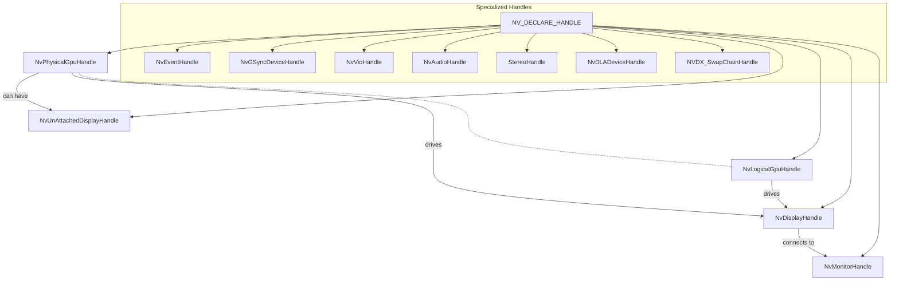

<!-- source: DeepWiki mcp.deepwiki.com · repo NVIDIA/nvapi · page 2.3 Common Types and Definitions · fetched 2026-10-26 -->

# Common Types and Definitions

<details>
<summary>Relevant source files</summary>

The following files were used as context for generating this wiki page:

- [nvapi.h](nvapi.h)
- [nvapi_lite_common.h](nvapi_lite_common.h)

</details>


## Purpose and Scope

This document describes the common data types, handles, constants, and definitions used throughout the NVIDIA API (NVAPI). These fundamental elements form the building blocks for all NVAPI functionality and are defined in the core header files. Understanding these types is essential for effectively working with the API and developing applications that leverage NVIDIA GPU capabilities.

## Basic Data Types

NVAPI defines a set of cross-platform data types to ensure consistency across different environments and compilers.

### Integer Types

| Type    | Description                 | Range                          |
|---------|-----------------------------|---------------------------------|
| NvU8    | Unsigned 8-bit integer      | 0 to 255                        |
| NvS8    | Signed 8-bit integer        | -128 to 127                     |
| NvU16   | Unsigned 16-bit integer     | 0 to 65,535                     |
| NvS16   | Signed 16-bit integer       | -32,768 to 32,767               |
| NvU32   | Unsigned 32-bit integer     | 0 to 4,294,967,295              |
| NvS32   | Signed 32-bit integer       | -2,147,483,648 to 2,147,483,647 |
| NvU64   | Unsigned 64-bit integer     | 0 to 18,446,744,073,709,551,615 |
| NvS64   | Signed 64-bit integer       | -9,223,372,036,854,775,808 to 9,223,372,036,854,775,807 |

### Floating Point Types

| Type    | Description                 | Equivalent C Type               |
|---------|-----------------------------|---------------------------------|
| NvF32   | 32-bit floating point       | float                           |
| NvF64   | 64-bit floating point       | double                          |

### Boolean Type

| Type    | Description                 | Based On                        |
|---------|-----------------------------|---------------------------------|
| NvBool  | Boolean type                | NvU8                            |

Boolean constants are defined as:
```
#define NV_TRUE           ((NvBool)(0 == 0))
#define NV_FALSE          ((NvBool)(0 != 0))
```

Sources: [nvapi_lite_common.h:49-116]()

### String Types

NVAPI defines various string buffer types with different maximum lengths:

| Type                    | Description                | Max Length      |
|-------------------------|----------------------------|-----------------|
| NvAPI_String            | Generic string buffer      | 4096 characters |
| NvAPI_LongString        | Long string buffer         | 256 characters  |
| NvAPI_ShortString       | Short string buffer        | 64 characters   |
| NvAPI_UnicodeShortString| Unicode short string buffer| 64 characters   |

Sources: [nvapi_lite_common.h:177-235]()

## Handle Types

NVAPI uses opaque handles to represent various hardware and software resources like GPUs, displays, and other devices. These are created using the `NV_DECLARE_HANDLE` macro, which defines a pointer to an opaque structure, making the handles type-safe.

```c
#define NV_DECLARE_HANDLE(name) struct name##__ { int unused; }; typedef struct name##__ *name
```

### NVAPI Handle Hierarchy



### Common NVAPI Handles

| Handle Type               | Description                                    |
|---------------------------|------------------------------------------------|
| NvPhysicalGpuHandle       | A single physical GPU                          |
| NvLogicalGpuHandle        | One or more physical GPUs acting in concert (SLI) |
| NvDisplayHandle           | Display device driven by NVIDIA GPU(s)         |
| NvUnAttachedDisplayHandle | Unattached display device driven by NVIDIA GPU(s) |
| NvMonitorHandle           | Monitor handle                                 |
| NvEventHandle             | Event registration instance                    |
| NvGSyncDeviceHandle       | Sync device                                    |
| NvVioHandle               | SDI device                                     |
| NvAudioHandle             | NVIDIA HD Audio Device                         |
| StereoHandle              | Stereo device interface                        |
| NVDX_SwapChainHandle      | DirectX SwapChain objects                      |

Sources: [nvapi_lite_common.h:127-165]()

## Constants and Limits

NVAPI defines various constants and limits that are used throughout the API.

### Numeric Limits

| Constant    | Value                | Description                  |
|-------------|----------------------|------------------------------|
| NV_U8_MAX   | 255                  | Maximum value for NvU8       |
| NV_U16_MAX  | 65,535               | Maximum value for NvU16      |
| NV_S32_MAX  | 2,147,483,647        | Maximum value for NvS32      |
| NV_U32_MIN  | 0                    | Minimum value for NvU32      |
| NV_U32_MAX  | 4,294,967,295        | Maximum value for NvU32      |
| NV_U64_MAX  | 18,446,744,073,709,551,615 | Maximum value for NvU64 |

### Resource Limits

| Constant                    | Value | Description                             |
|-----------------------------|-------|-----------------------------------------|
| NVAPI_MAX_PHYSICAL_GPUS     | 64    | Maximum number of physical GPUs         |
| NVAPI_MAX_LOGICAL_GPUS      | 64    | Maximum number of logical GPUs          |
| NVAPI_PHYSICAL_GPUS         | 32    | Legacy constant for physical GPUs       |
| NVAPI_MAX_DISPLAY_HEADS     | 2     | Maximum display heads per GPU           |
| NVAPI_ADVANCED_DISPLAY_HEADS| 4     | Advanced display heads per GPU          |
| NVAPI_MAX_DISPLAYS          | NVAPI_PHYSICAL_GPUS * NVAPI_ADVANCED_DISPLAY_HEADS | Maximum displays |

Sources: [nvapi_lite_common.h:49-54](), [nvapi_lite_common.h:202-224]()

## Common Structures

### Rectangle and Box Structures

| Structure | Fields                              | Description                           |
|-----------|-------------------------------------|---------------------------------------|
| NV_RECT   | NvU32 left, top, right, bottom      | Rectangle with unsigned 32-bit values |
| NvSBox    | NvS32 sX, sY, sWidth, sHeight       | Box with signed 32-bit values         |

### ID Structures

| Structure | Fields                                     | Description                 |
|-----------|-------------------------------------------|-----------------------------|
| NvGUID    | NvU32 data1, NvU16 data2, NvU16 data3, NvU8 data4[8] | Globally unique identifier |
| NvLUID    | Same as NvGUID                             | Locally unique identifier   |

Sources: [nvapi_lite_common.h:118-198]()

## Version Macros

NVAPI provides macros for creating and extracting version information from structures:

```c
#define MAKE_NVAPI_VERSION(typeName,ver) (NvU32)(sizeof(typeName) | ((ver)<<16))
#define GET_NVAPI_VERSION(ver) (NvU32)((ver)>>16)
#define GET_NVAPI_SIZE(ver) (NvU32)((ver) & 0xffff)
```

These macros are used throughout NVAPI to ensure compatibility between different versions of structures. The version field is typically the first member of NVAPI structures.

Sources: [nvapi_lite_common.h:244-251]()

## DisplayPort Definitions

NVAPI includes several enumerations for configuring DisplayPort connections.

```mermaid
graph TD
    DP["DisplayPort Enumerations"] --> LinkRate["NV_DP_LINK_RATE"]
    DP --> LaneCount["NV_DP_LANE_COUNT"]
    DP --> ColorFormat["NV_DP_COLOR_FORMAT"]
    DP --> Colorimetry["NV_DP_COLORIMETRY"]
    DP --> DynamicRange["NV_DP_DYNAMIC_RANGE"]
    DP --> BPC["NV_DP_BPC"]
    
    LinkRate --> LR162["NV_DP_1_62GBPS (6)"]
    LinkRate --> LR270["NV_DP_2_70GBPS (0xA)"]
    LinkRate --> LR540["NV_DP_5_40GBPS (0x14)"]
    LinkRate --> LR810["NV_DP_8_10GBPS (0x1E)"]
    
    LaneCount --> LC1["NV_DP_1_LANE (1)"]
    LaneCount --> LC2["NV_DP_2_LANE (2)"]
    LaneCount --> LC4["NV_DP_4_LANE (4)"]
    
    ColorFormat --> CFRGB["NV_DP_COLOR_FORMAT_RGB (0)"]
    ColorFormat --> CFYCBCR422["NV_DP_COLOR_FORMAT_YCbCr422 (1)"]
    ColorFormat --> CFYCBCR444["NV_DP_COLOR_FORMAT_YCbCr444 (2)"]
    
    BPC --> BPC_DEF["NV_DP_BPC_DEFAULT (0)"]
    BPC --> BPC_6["NV_DP_BPC_6 (1)"]
    BPC --> BPC_8["NV_DP_BPC_8 (2)"]
    BPC --> BPC_10["NV_DP_BPC_10 (3)"]
    BPC --> BPC_12["NV_DP_BPC_12 (4)"]
    BPC --> BPC_16["NV_DP_BPC_16 (5)"]
```



Sources: [nvapi.h:191-254]()

## GPU Connector Types

NVAPI defines an enumeration `NV_GPU_CONNECTOR_TYPE` for different types of GPU connectors:

| Connector Type                           | Value     | Description                   |
|-----------------------------------------|-----------|-------------------------------|
| NVAPI_GPU_CONNECTOR_VGA_15_PIN          | 0x00000000 | VGA 15-pin connector         |
| NVAPI_GPU_CONNECTOR_DVI_I               | 0x00000030 | DVI-I connector              |
| NVAPI_GPU_CONNECTOR_DVI_D               | 0x00000031 | DVI-D connector              |
| NVAPI_GPU_CONNECTOR_HDMI_A              | 0x00000061 | HDMI Type A connector        |
| NVAPI_GPU_CONNECTOR_HDMI_C_MINI         | 0x00000063 | HDMI Type C (Mini) connector |
| NVAPI_GPU_CONNECTOR_DISPLAYPORT_EXTERNAL| 0x00000046 | DisplayPort external connector |
| NVAPI_GPU_CONNECTOR_DISPLAYPORT_INTERNAL| 0x00000047 | DisplayPort internal connector |
| NVAPI_GPU_CONNECTOR_DISPLAYPORT_MINI_EXT| 0x00000048 | DisplayPort Mini external connector |
| NVAPI_GPU_CONNECTOR_USB_C               | 0x00000071 | USB Type-C connector         |

Sources: [nvapi.h:350-381]()

## Display Configuration Types

### View Modes

The `NV_TARGET_VIEW_MODE` enumeration defines different display layout configurations:

| View Mode              | Value | Description                               |
|------------------------|-------|-------------------------------------------|
| NV_VIEW_MODE_STANDARD  | 0     | Standard view mode (single display)       |
| NV_VIEW_MODE_CLONE     | 1     | Clone view mode (same content on multiple displays) |
| NV_VIEW_MODE_HSPAN     | 2     | Horizontal span view mode                 |
| NV_VIEW_MODE_VSPAN     | 3     | Vertical span view mode                   |
| NV_VIEW_MODE_DUALVIEW  | 4     | Dual view mode                            |
| NV_VIEW_MODE_MULTIVIEW | 5     | Multi-view mode                           |

### Scaling Modes

The `NV_SCALING` enumeration defines different display scaling options:

| Scaling Mode                               | Value | Description                    |
|-------------------------------------------|-------|--------------------------------|
| NV_SCALING_DEFAULT                         | 0     | No change                      |
| NV_SCALING_GPU_SCALING_TO_CLOSEST          | 1     | Balanced - Full Screen         |
| NV_SCALING_GPU_SCALING_TO_NATIVE           | 2     | Force GPU - Full Screen        |
| NV_SCALING_GPU_SCANOUT_TO_NATIVE           | 3     | Force GPU - Centered/No Scaling|
| NV_SCALING_GPU_SCALING_TO_ASPECT_SCANOUT_TO_NATIVE | 5 | Force GPU - Aspect Ratio   |
| NV_SCALING_GPU_INTEGER_ASPECT_SCALING      | 8     | Force GPU - Integer Scaling    |

### Rotation Modes

The `NV_ROTATE` enumeration defines different display rotation options:

| Rotation Mode      | Value | Description                |
|--------------------|-------|----------------------------|
| NV_ROTATE_0        | 0     | No rotation                |
| NV_ROTATE_90       | 1     | Rotate 90 degrees          |
| NV_ROTATE_180      | 2     | Rotate 180 degrees         |
| NV_ROTATE_270      | 3     | Rotate 270 degrees         |
| NV_ROTATE_IGNORED  | 4     | Ignore rotation            |

Sources: [nvapi.h:473-524]()

## EDID Structure

NVAPI provides structures for working with Extended Display Identification Data (EDID):

```c
typedef struct
{
    NvU32   version;        // Structure version
    NvU8    EDID_Data[NV_EDID_DATA_SIZE];
    NvU32   sizeofEDID;
    NvU32   edidId;         // Monotonically increasing counter
    NvU32   offset;         // 256-byte page offset for split-EDID reading
} NV_EDID_V3;

typedef NV_EDID_V3 NV_EDID;
```

The constant `NV_EDID_DATA_SIZE` is defined as 256 bytes, which is the size of a standard EDID block.

Sources: [nvapi.h:287-324]()

## Status Codes

All NVAPI functions return a status code of type `NvAPI_Status` to indicate success or a specific error condition.

```mermaid
graph TD
    Status["NvAPI_Status"] --> Success["Success Code (0)"]
    Status --> GenErr["General Errors (-1 to -15)"]
    Status --> HandleErr["Handle Errors (-100 to -110)"]
    Status --> DispErr["Display Errors (-111 to -130)"]
    Status --> MemErr["Memory Errors (-130 to -140)"]
    Status --> StereoErr["Stereo Errors (-140 to -150)"]
    Status --> MoreErr["Additional Errors (-150 to -250)"]
    
    Success --> OK["NVAPI_OK (0)"]
    
    GenErr --> ERR["NVAPI_ERROR (-1)"]
    GenErr --> LIBNOTFOUND["NVAPI_LIBRARY_NOT_FOUND (-2)"]
    GenErr --> NOIMPL["NVAPI_NO_IMPLEMENTATION (-3)"]
    GenErr --> APINOTINIT["NVAPI_API_NOT_INITIALIZED (-4)"]
    GenErr --> INVALIDARG["NVAPI_INVALID_ARGUMENT (-5)"]
    GenErr --> DEVNOTFOUND["NVAPI_NVIDIA_DEVICE_NOT_FOUND (-6)"]
    
    HandleErr --> EXPLOGICALGPU["NVAPI_EXPECTED_LOGICAL_GPU_HANDLE (-100)"]
    HandleErr --> EXPPHYSICALGPU["NVAPI_EXPECTED_PHYSICAL_GPU_HANDLE (-101)"]
    HandleErr --> EXPDISPLAY["NVAPI_EXPECTED_DISPLAY_HANDLE (-102)"]
    
    DispErr --> EXPTV["NVAPI_EXPECTED_TV_DISPLAY (-111)"]
    DispErr --> EXPTVD["NVAPI_EXPECTED_TV_DISPLAY_ON_DCONNECTOR (-112)"]
    
    MemErr --> OUTOFMEM["NVAPI_OUT_OF_MEMORY (-130)"]
    
    StereoErr --> STEREOINIT["NVAPI_STEREO_NOT_INITIALIZED (-140)"]
    StereoErr --> STEREOREG["NVAPI_STEREO_REGISTRY_ACCESS_FAILED (-141)"]
```



The following table shows the most commonly encountered status codes:

| Status Code                      | Value | Description                                |
|----------------------------------|---------|--------------------------------------------|
| NVAPI_OK                          | 0      | Success. Request is completed.              |
| NVAPI_ERROR                       | -1     | Generic error                              |
| NVAPI_LIBRARY_NOT_FOUND           | -2     | NVAPI support library cannot be loaded     |
| NVAPI_NO_IMPLEMENTATION           | -3     | Not implemented in current driver          |
| NVAPI_API_NOT_INITIALIZED         | -4     | NvAPI_Initialize has not been called       |
| NVAPI_INVALID_ARGUMENT            | -5     | Invalid argument or NULL parameter         |
| NVAPI_NVIDIA_DEVICE_NOT_FOUND     | -6     | No NVIDIA GPU driving a display was found  |
| NVAPI_END_ENUMERATION             | -7     | No more items to enumerate                 |
| NVAPI_INVALID_HANDLE              | -8     | Invalid handle                             |
| NVAPI_INCOMPATIBLE_STRUCT_VERSION | -9     | Structure version not supported            |
| NVAPI_HANDLE_INVALIDATED          | -10    | Handle no longer valid (due to GPU or display reconfiguration) |

Sources: [nvapi_lite_common.h:261-425]()

## Memory Information Structures

NVAPI provides structures for retrieving GPU memory information:

```c
typedef struct
{
    NvU32   version;                           // Structure version
    NvU64   dedicatedVideoMemory;              // Size (in bytes) of physical framebuffer
    NvU64   availableDedicatedVideoMemory;     // Available physical framebuffer
    NvU64   systemVideoMemory;                 // System memory allocated by driver
    NvU64   sharedSystemMemory;                // Shared system memory
    NvU64   curAvailableDedicatedVideoMemory;  // Current available physical framebuffer
    // Additional fields for tracking memory evictions and promotions...
} NV_GPU_MEMORY_INFO_EX;
```

Sources: [nvapi_lite_common.h:540-567]()

## Performance States

NVAPI provides structures and enumerations for GPU performance states:

```c
typedef enum _NV_GPU_PERF_PSTATE_ID
{
    NVAPI_GPU_PERF_PSTATE_P0 = 0,  // Maximum performance
    NVAPI_GPU_PERF_PSTATE_P1,
    NVAPI_GPU_PERF_PSTATE_P2,
    NVAPI_GPU_PERF_PSTATE_P3,
    // ...more performance states...
    NVAPI_GPU_PERF_PSTATE_P15,
    NVAPI_GPU_PERF_PSTATE_UNDEFINED = NVAPI_MAX_GPU_PERF_PSTATES,
    NVAPI_GPU_PERF_PSTATE_ALL,
} NV_GPU_PERF_PSTATE_ID;
```

Sources: [nvapi.h:1088-1108]()

---

