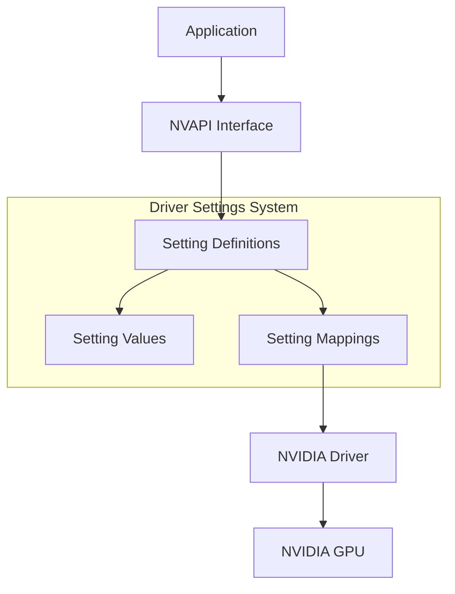
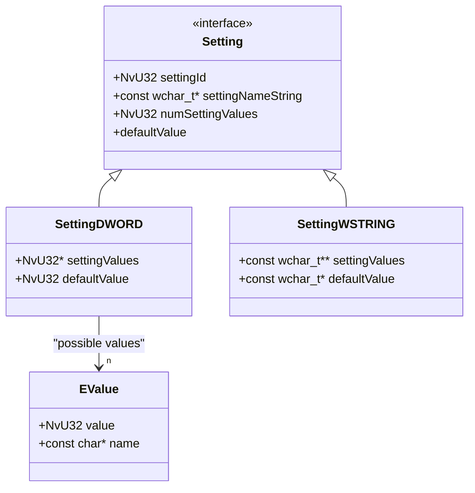
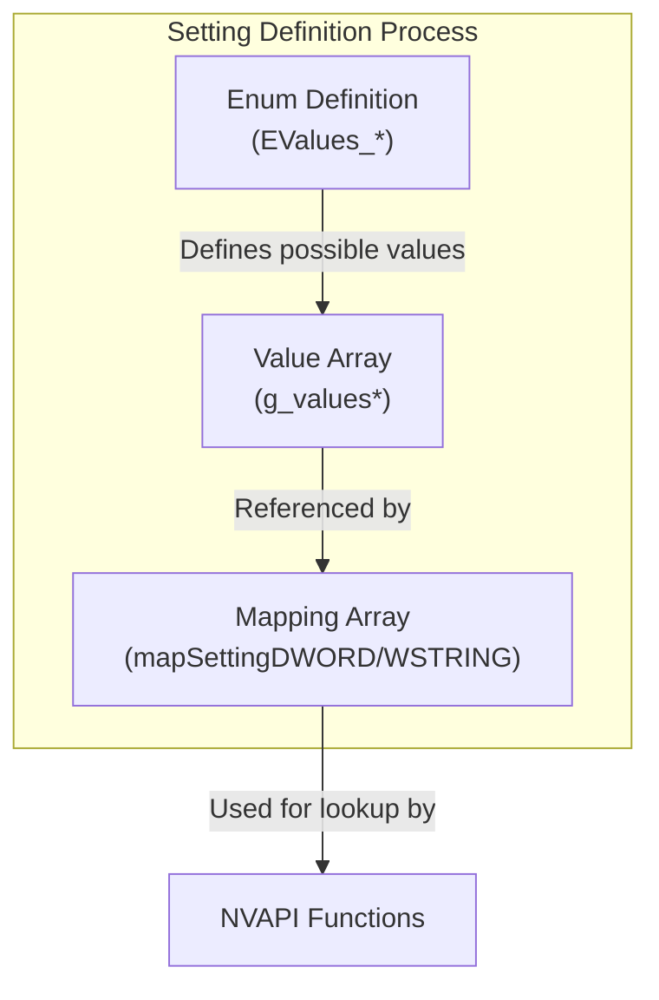
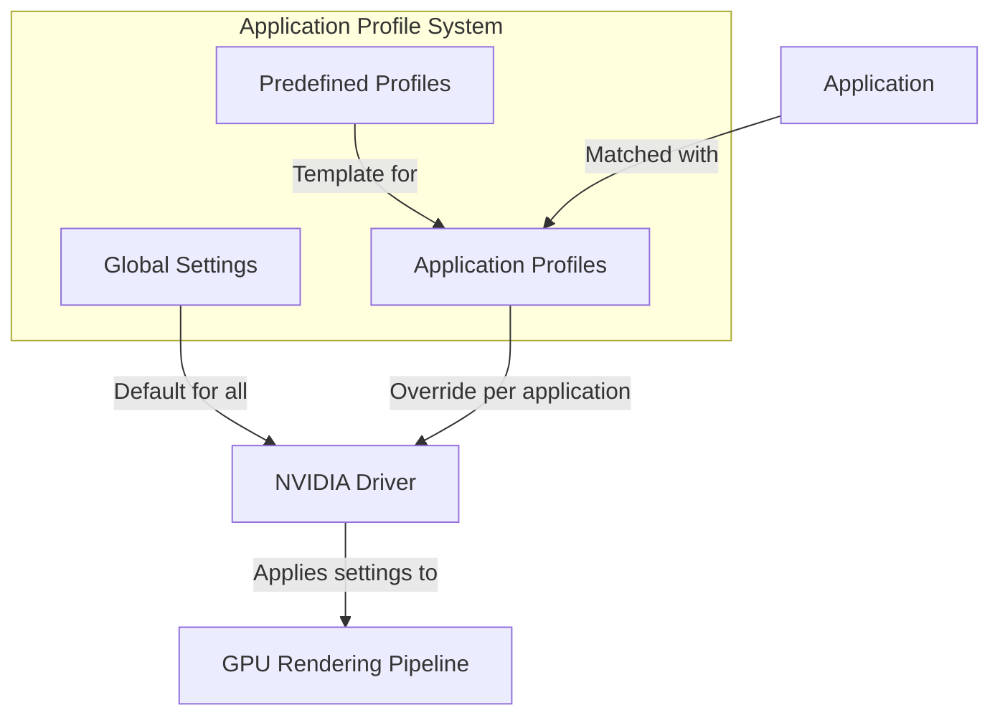

<!-- source: DeepWiki mcp.deepwiki.com · repo NVIDIA/nvapi · page 3 Driver Settings System · fetched 2026-10-26 -->

# Driver Settings System

<details>
<summary>Relevant source files</summary>

The following files were used as context for generating this wiki page:

- [NvApiDriverSettings.c](NvApiDriverSettings.c)
- [NvApiDriverSettings.h](NvApiDriverSettings.h)

</details>


## Purpose and Scope

The NVIDIA Driver Settings System is a core component of the NVIDIA API (NVAPI) that allows applications to query and modify various driver settings that control the behavior of the NVIDIA graphics driver. This system provides a standardized interface for configuring graphics rendering parameters, performance options, power management, and advanced features like DLSS, VRR, and more.

This page documents the structure and functionality of the Driver Settings System as implemented in the NVAPI codebase. For information about the Shader Extensions, see [Shader Extensions](#4).

Sources: [NvApiDriverSettings.h:27-28]()

## Architecture Overview

The Driver Settings System is built around a set of uniquely identified settings that can be queried and modified through the NVAPI interface. Each setting has a unique ID, a human-readable name, a set of possible values, and a default value.



**Driver Settings System Component Relationships**

Sources: [NvApiDriverSettings.h:27-1321](), [NvApiDriverSettings.c:28-29]()

## Setting Structure and Types

The Driver Settings System supports two primary types of settings:

1. **DWORD Settings**: Numerical settings with a fixed set of possible values (enumerations)
2. **WSTRING Settings**: String-based settings for paths, identifiers, or complex data

Each setting is defined with a unique identifier, a name string, a set of possible values, and a default value.



**Setting Type Hierarchy**

Sources: [NvApiDriverSettings.h:1304-1318]()

## Setting Definition and Registration

Settings are defined in two global mapping arrays that associate setting IDs with their corresponding metadata:

1. `mapSettingDWORD`: Maps DWORD settings to their names, possible values, and defaults
2. `mapSettingWSTRING`: Maps string settings to their names, possible values, and defaults



**Setting Definition and Registration Process**

Sources: [NvApiDriverSettings.c:30-1093](), [NvApiDriverSettings.h:148-270]()

## Setting Categories

The Driver Settings System organizes settings into several categories based on their functionality:

### OpenGL Settings

Controls OpenGL-specific behavior including swap intervals, overlay support, threading, and quality enhancements.

```
OGL_AA_LINE_GAMMA_ID
OGL_DEEP_COLOR_SCANOUT_ID
OGL_DEFAULT_SWAP_INTERVAL_ID
OGL_FORCE_STEREO_ID
```

Sources: [NvApiDriverSettings.h:148-169]()

### Anti-Aliasing and Visual Quality

Controls anti-aliasing methods, transparency sampling, anisotropic filtering, and other visual quality settings.

```
AA_BEHAVIOR_FLAGS_ID
AA_MODE_METHOD_ID
AA_MODE_SELECTOR_ID
ANISO_MODE_LEVEL_ID
FXAA_ENABLE_ID
```

Sources: [NvApiDriverSettings.h:170-198](), [NvApiDriverSettings.h:672-683]()

### DLSS and AI Features

Controls NVIDIA's Deep Learning Super Sampling (DLSS) and other AI-enhanced features.

```
NGX_DLAA_OVERRIDE_ID
NGX_DLSS_SR_MODE_ID
NGX_DLSS_RR_MODE_ID
NGX_DLSS_FG_OVERRIDE_ID
```

Sources: [NvApiDriverSettings.h:198-214](), [NvApiDriverSettings.h:700-838]()

### Variable Refresh Rate (VRR) and Display

Controls G-Sync, V-Sync, and variable refresh rate behavior.

```
VRRREQUESTSTATE_ID
VRR_MODE_ID
VRR_APP_OVERRIDE_ID
VSYNCMODE_ID
```

Sources: [NvApiDriverSettings.h:229-236](), [NvApiDriverSettings.h:1027-1061](), [NvApiDriverSettings.h:1283-1293]()

### Performance and Power Management

Controls performance profiles, power states, and frame limiting.

```
PREFERRED_PSTATE_ID
FRL_FPS_ID
PRERENDERLIMIT_ID
```

Sources: [NvApiDriverSettings.h:216-217](), [NvApiDriverSettings.h:657-663](), [NvApiDriverSettings.h:1191-1197]()

### SLI Configuration

Controls SLI rendering modes and GPU configuration.

```
SLI_GPU_COUNT_ID
SLI_RENDERING_MODE_ID
SLI_PREDEFINED_MODE_ID
```

Sources: [NvApiDriverSettings.h:223-228](), [NvApiDriverSettings.h:942-1003]()

## Settings Representation in Code

The Driver Settings System uses a consistent pattern for defining settings and their possible values:

1. Each setting has a unique ID defined in the `ESetting` enum
2. Possible values for each setting are defined in `EValues_*` enums
3. Arrays (`g_values*`) store the possible values for each setting
4. Mapping arrays connect setting IDs to their metadata

Below is an example of how a setting is defined across the files:

**Setting ID in ESetting enum:**
```c
enum ESetting {
    // ...
    PREFERRED_PSTATE_ID = 0x1057EB71,
    // ...
};
```

**Possible values in EValues enum:**
```c
enum EValues_PREFERRED_PSTATE {
    PREFERRED_PSTATE_ADAPTIVE = 0x00000000,
    PREFERRED_PSTATE_PREFER_MAX = 0x00000001,
    // ...
    PREFERRED_PSTATE_DEFAULT = PREFERRED_PSTATE_OPTIMAL_POWER
};
```

**Value array in implementation file:**
```c
EValues_PREFERRED_PSTATE g_valuesPREFERRED_PSTATE[PREFERRED_PSTATE_NUM_VALUES] = 
{
    PREFERRED_PSTATE_ADAPTIVE,
    PREFERRED_PSTATE_PREFER_MAX,
    // ...
};
```

**Mapping in the global array:**
```c
SettingDWORDNameString mapSettingDWORD[TOTAL_DWORD_SETTING_NUM] = 
{
    // ...
    {PREFERRED_PSTATE_ID, PREFERRED_PSTATE_STRING, 8, (NvU32 *)g_valuesPREFERRED_PSTATE, PREFERRED_PSTATE_OPTIMAL_POWER},
    // ...
};
```

Sources: [NvApiDriverSettings.h:861-872](), [NvApiDriverSettings.c:572-582](), [NvApiDriverSettings.c:1037]()

## Usage in Application Profiles

The Driver Settings System is commonly used to create application profiles that customize driver behavior for specific applications. Settings can be:

1. **Global**: Applied to all applications
2. **Per-Application**: Applied to specific applications based on profiles
3. **Predefined**: Standard profiles for game types or rendering engines



**Application Profile System**

Sources: [NvApiDriverSettings.h:608-617](), [NvApiDriverSettings.c:341-349]()

## Setting Value Types and Representation

The Driver Settings System uses several patterns for representing setting values:

### Enumeration Values

Most settings use enumeration values with specific semantic meanings:

```
ENABLE/DISABLE values:
- *_DISABLED (0) / *_ENABLED (1)
- *_OFF (0) / *_ON (1)

Multi-option selectors:
- *_AUTO_SELECT
- *_APP_CONTROLLED
- *_FORCE_*

Performance/Quality options:
- *_QUALITY
- *_BALANCED
- *_PERFORMANCE
```

### Numeric Ranges

Some settings define minimum and maximum values:

```
*_MIN (e.g., LODBIASADJUST_MIN = 0xffffff80)
*_MAX (e.g., LODBIASADJUST_MAX = 128)
```

### Bit Masks and Flags

Some settings use bit masks to combine multiple options:

```
AA_BEHAVIOR_FLAGS_* (e.g., AA_BEHAVIOR_FLAGS_MASK = 0xff1f000f)
```

Sources: [NvApiDriverSettings.h:272-1300]()

## Conclusion

The Driver Settings System is a flexible framework for managing NVIDIA driver behavior through a well-defined set of settings. It provides a standardized way for applications to control rendering quality, performance, power consumption, and advanced features like DLSS and VRR. The system uses a consistent pattern of unique IDs, enumerated values, and mapping arrays to define and manage these settings.

Understanding this system is essential for developers who need to integrate NVIDIA technologies into their applications or optimize performance for specific applications through driver settings.

---

