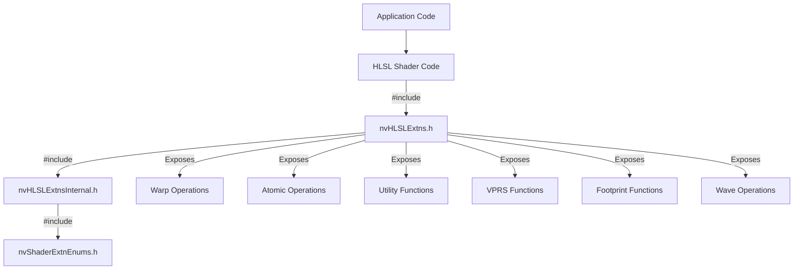
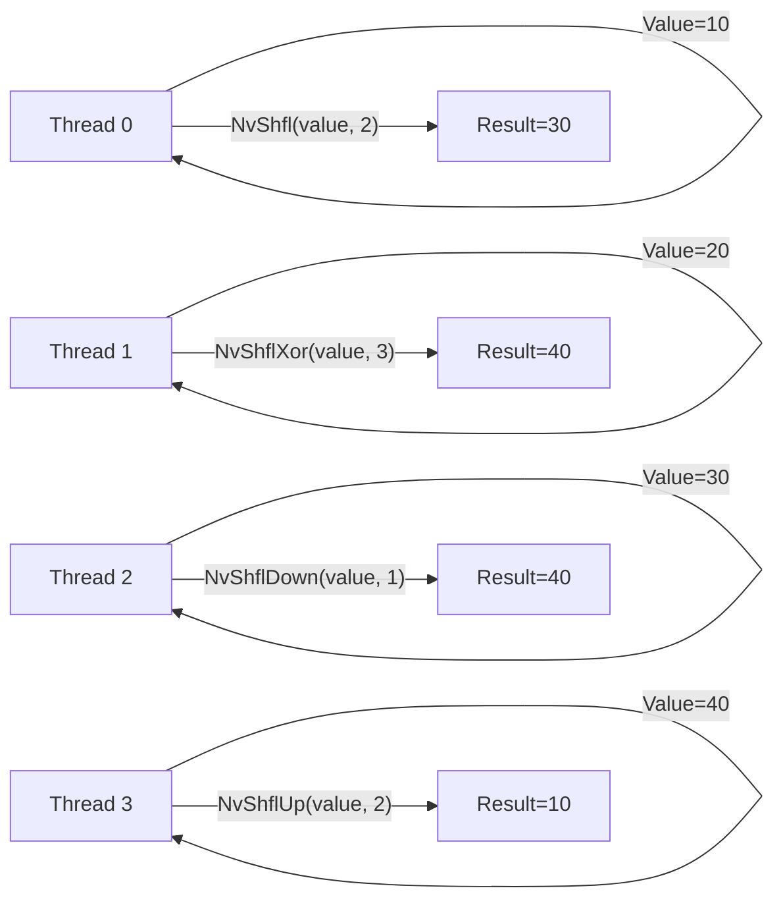
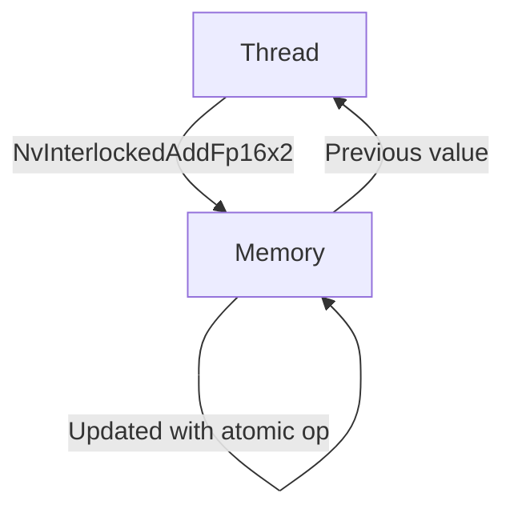
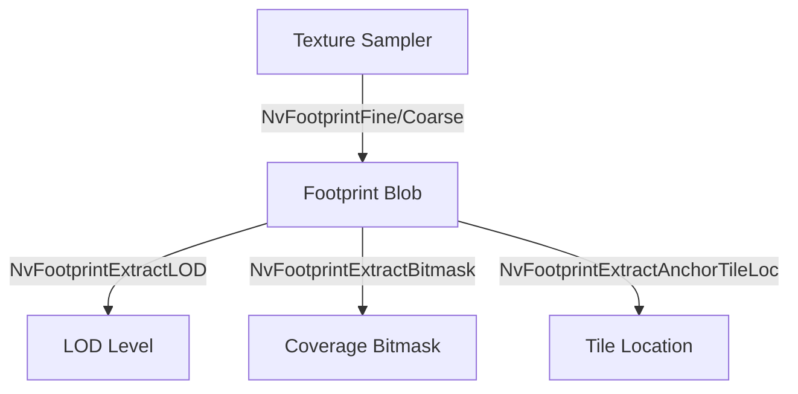
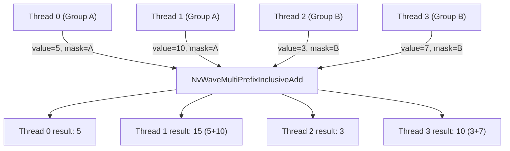

<!-- source: DeepWiki mcp.deepwiki.com · repo NVIDIA/nvapi · page 4 Shader Extensions · fetched 2026-10-26 -->

# Shader Extensions

<details>
<summary>Relevant source files</summary>

The following files were used as context for generating this wiki page:

- [nvHLSLExtns.h](nvHLSLExtns.h)
- [nvHLSLExtnsInternal.h](nvHLSLExtnsInternal.h)
- [nvShaderExtnEnums.h](nvShaderExtnEnums.h)

</details>


NVIDIA Shader Extensions provide a collection of specialized HLSL functions that enable developers to access advanced GPU hardware features directly in shader code. These extensions enhance shader capabilities beyond standard HLSL by exposing warp-level operations, specialized atomic operations, texture footprint queries, and other GPU-specific functionality.

## Overview

The NVIDIA shader extensions system consists of header files that can be included in HLSL shader code. These extensions interact with NVIDIA GPU hardware to provide functionality not available through standard HLSL.



Sources: [nvHLSLExtns.h:27-33](), [nvHLSLExtnsInternal.h:26-32](), [nvShaderExtnEnums.h:27-34]()

## Extension Categories

The shader extensions are organized into several functional categories:

| Category | Description | Key Functions |
|----------|-------------|---------------|
| Warp Shuffle | Data exchange between threads in a warp | `NvShfl`, `NvShflUp`, `NvShflDown`, `NvShflXor` |
| Warp Vote | Voting operations across warp threads | `NvAny`, `NvAll`, `NvBallot` |
| Utility | Lane indices and special registers | `NvGetLaneId`, `NvGetSpecial` |
| FP16 Atomic | Atomic operations on FP16 values | `NvInterlockedAddFp16x2`, `NvInterlockedMinFp16x2`, `NvInterlockedMaxFp16x2` |
| FP32 Atomic | Atomic operations on FP32 values | `NvInterlockedAddFp32` |
| UINT64 Atomic | Atomic operations on UINT64 values | `NvInterlockedAddUint64`, `NvInterlockedMinUint64`, etc. |
| VPRS | Variable-Rate Pixel Shading functions | `NvGetShadingRate`, `NvEvaluateAttributeAtSampleForVPRS` |
| Wave Match | Value matching across threads | `NvWaveMatch` |
| Footprint | Texture footprint information | `NvFootprintFine`, `NvFootprintCoarse` |
| Wave Multi-Prefix | Prefix operations within lane groups | `NvWaveMultiPrefixInclusiveAdd`, `NvWaveMultiPrefixExclusiveAdd` |

## Setup and Integration

To use NVIDIA shader extensions in your application:

1. Include the `nvHLSLExtns.h` header in your HLSL shader code
2. Define the shader extension slot that will be used
3. For SM5.1, define the register space

```hlsl
// In shader code:
#define NV_SHADER_EXTN_SLOT u7
#define NV_SHADER_EXTN_REGISTER_SPACE space2
#include "nvHLSLExtns.h"
```

Your application must call `NvAPI_D3D11_SetNvShaderExtnSlot()` or `NvAPI_D3D12_IsNvShaderExtnOpCodeSupported()` to set up the extension slot before creating any shaders that use NVIDIA extensions.

Sources: [nvHLSLExtnsInternal.h:56-71]()

## Warp Shuffle Functions

Warp shuffle functions allow threads within a warp (typically 32 threads) to exchange data directly without using shared memory.



Key functions include:

- `NvShfl(val, srcLane, width)`: Returns value from the specified source lane
- `NvShflUp(val, delta, width)`: Get value from a lane with a lower ID relative to caller
- `NvShflDown(val, delta, width)`: Get value from a lane with a higher ID relative to caller
- `NvShflXor(val, laneMask, width)`: Get value from a lane based on bitwise XOR of lane IDs

The optional `width` parameter (default: 32) allows subdividing the warp into segments, creating smaller logical groups.

Sources: [nvHLSLExtns.h:36-118]()

## Warp Vote Functions

These functions enable collaborative decision-making among threads in a warp through voting.

- `NvAny(predicate)`: Returns 0xFFFFFFFF if the predicate is true for any thread in the warp, 0 otherwise
- `NvAll(predicate)`: Returns 0xFFFFFFFF if the predicate is true for ALL threads in the warp, 0 otherwise
- `NvBallot(predicate)`: Returns a bitmask with bits set for threads where the predicate is true

Sources: [nvHLSLExtns.h:125-150]()

## Utility Functions

- `NvGetLaneId()`: Returns the lane index of the current thread within the warp (0-31)
- `NvGetSpecial(subOpCode)`: Returns the value of a special register specified by `subOpCode`

Available special registers include thread mask, footprint information, and global timers.

Sources: [nvHLSLExtns.h:158-169](), [nvShaderExtnEnums.h:148-154]()

## Atomic Operations

NVIDIA provides atomic operations for data types not supported by standard HLSL.

### FP16 Atomic Functions

These functions perform atomic operations on half-precision (16-bit) floating-point values. Multiple variants are provided for different resource types and data formats:



- `NvInterlockedAddFp16x2()`: Atomic addition on two FP16 values
- `NvInterlockedMinFp16x2()`: Atomic minimum on two FP16 values
- `NvInterlockedMaxFp16x2()`: Atomic maximum on two FP16 values

These functions operate on two FP16 values packed in a single uint (fp16x2) and work with `RWByteAddressBuffer` and RWTexture resources.

Sources: [nvHLSLExtns.h:175-311]()

### FP32 Atomic Functions

- `NvInterlockedAddFp32()`: Performs atomic addition on 32-bit floating-point values

Sources: [nvHLSLExtns.h:423-448]()

### UINT64 Atomic Functions

These functions perform atomic operations on 64-bit unsigned integer values.

- `NvInterlockedAddUint64()`: Atomic addition
- `NvInterlockedMaxUint64()`: Atomic maximum
- `NvInterlockedMinUint64()`: Atomic minimum
- `NvInterlockedAndUint64()`: Atomic AND
- `NvInterlockedOrUint64()`: Atomic OR
- `NvInterlockedXorUint64()`: Atomic XOR
- `NvInterlockedCompareExchangeUint64()`: Atomic compare-and-exchange
- `NvInterlockedExchangeUint64()`: Atomic exchange

Each function works with `RWByteAddressBuffer` and RWTexture resources. A 64-bit value is represented using a `uint2` type where the x component contains the low 32 bits and the y component contains the high 32 bits.

Sources: [nvHLSLExtns.h:460-625]()

## Variable-Rate Pixel Shading (VPRS) Functions

VPRS enables control over pixel shading rates for improved performance.

- `NvGetShadingRate()`: Returns the shading rate and number of per-pixel shading passes
- `NvEvaluateAttributeAtSampleForVPRS()`: Evaluates an attribute at a specific sample location
- `NvEvaluateAttributeSnappedForVPRS()`: Evaluates an attribute at a snapped position

These functions have variants for different data types (float, float2, float3, float4, int, int2, int3, int4, uint, uint2, uint3, uint4).

Sources: [nvHLSLExtns.h:632-979]()

## Wave Match Functions

These functions identify threads with matching values:

- `NvWaveMatch(value)`: Returns a mask of threads that have the same value

Variants are provided for different data types (uint, uint2, uint4, float, float2, float4).

Sources: [nvHLSLExtns.h:982-1040]()

## Footprint Functions

Footprint functions provide information about texture access patterns without performing actual texture sampling.



Main functions include:

- `NvFootprintFine()` and `NvFootprintCoarse()`: Get texture footprint information at different granularities
- Variants for different sampling methods: bias, level, gradient
- Extraction functions to interpret the footprint blob:
  - `NvFootprintExtractLOD()`
  - `NvFootprintExtractReturnGran()`
  - `NvFootprintExtractAnchorTileLoc2D/3D()`
  - `NvFootprintExtractOffset2D/3D()`
  - `NvFootprintExtractBitmask()`

Sources: [nvHLSLExtns.h:1052-1210](), [nvShaderExtnEnums.h:170-172]()

## Wave Multi-Prefix Functions

These functions perform prefix operations within subgroups of threads in a wave.



Key functions include:

- Inclusive prefix operations:
  - `NvWaveMultiPrefixInclusiveAdd()`
  - `NvWaveMultiPrefixInclusiveAnd()`
  - `NvWaveMultiPrefixInclusiveOr()`
  - `NvWaveMultiPrefixInclusiveXOr()`

- Exclusive prefix operations:
  - `NvWaveMultiPrefixExclusiveAdd()`
  - `NvWaveMultiPrefixExclusiveAnd()`
  - `NvWaveMultiPrefixExclusiveOr()`
  - `NvWaveMultiPrefixExclusiveXOr()`

Each function has variants for different data types (uint, uint2, uint4).

Sources: [nvHLSLExtns.h:1235-1586]()

## Compatibility and Support

Before using any NVIDIA shader extension opcode, your application should check for support using `NvAPI_D3D11_IsNvShaderExtnOpCodeSupported()` or `NvAPI_D3D12_IsNvShaderExtnOpCodeSupported()`. These functions take an opcode from `nvShaderExtnEnums.h` and determine if the current GPU supports it.

The opcode constants are defined in [nvShaderExtnEnums.h:52-148]().

## Performance Considerations

- Warp shuffle operations provide faster inter-thread communication than shared memory
- FP16 atomic operations can offer better performance than equivalent FP32 operations
- VPRS can improve performance by reducing shading work in less important areas
- Footprint functions help optimize texture access patterns
- Wave Multi-Prefix operations are more efficient than multiple separate wave operations

## Implementation Mechanism

NVIDIA shader extensions operate through a structured buffer interface (`NvShaderExtnStruct`) defined in [nvHLSLExtnsInternal.h:32-51](). The extensions use a technique involving a specially designated UAV slot and counter increments to communicate with the driver, which translates these operations to specialized GPU instructions.

---

