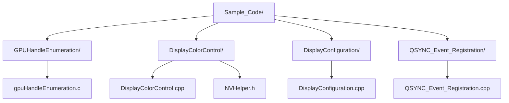
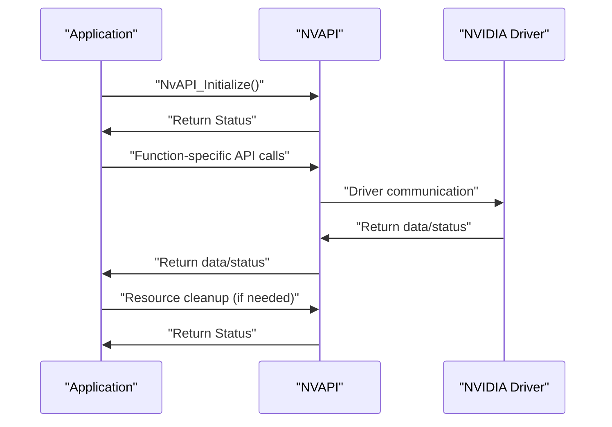
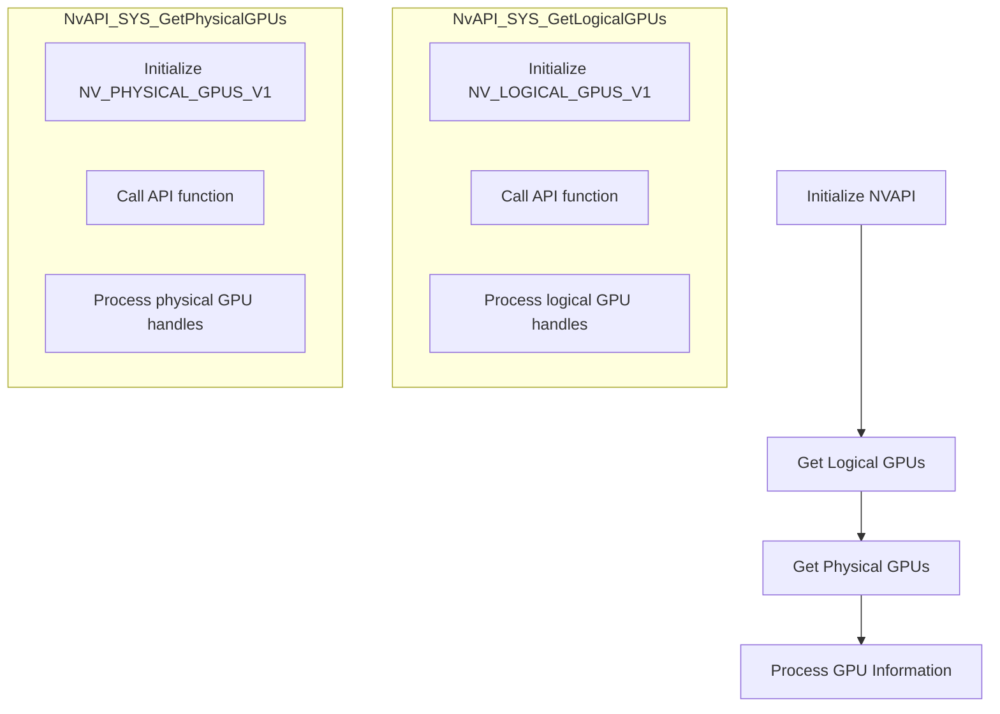
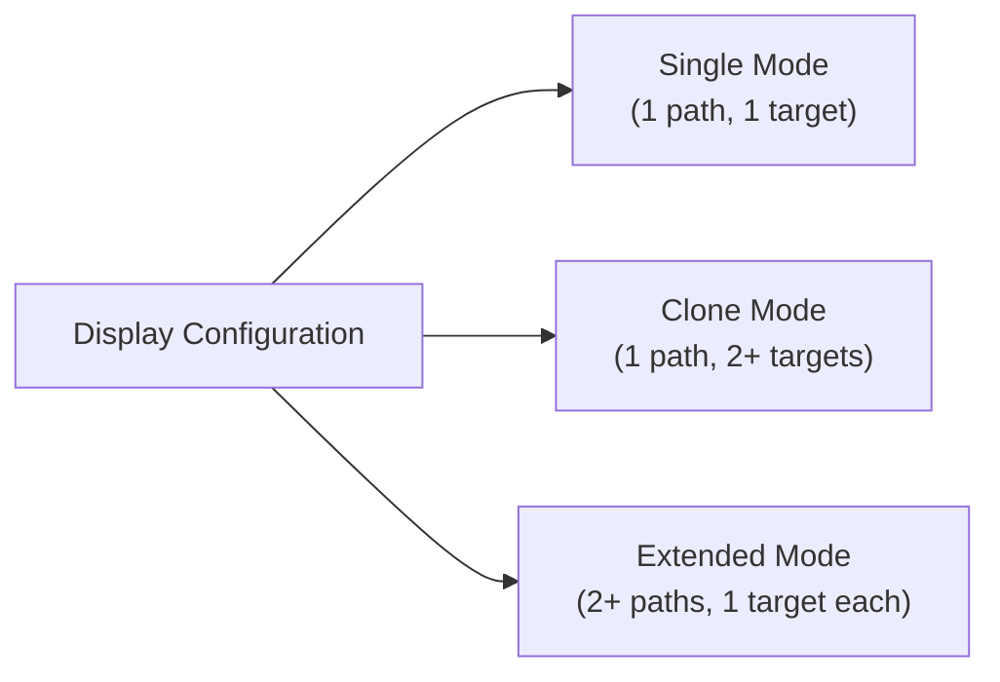
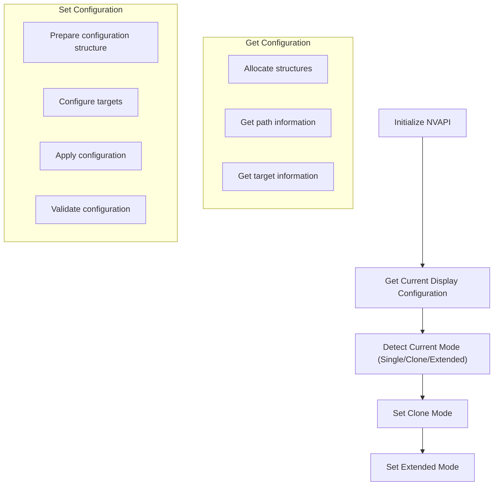
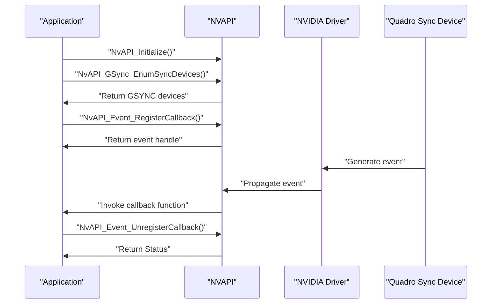
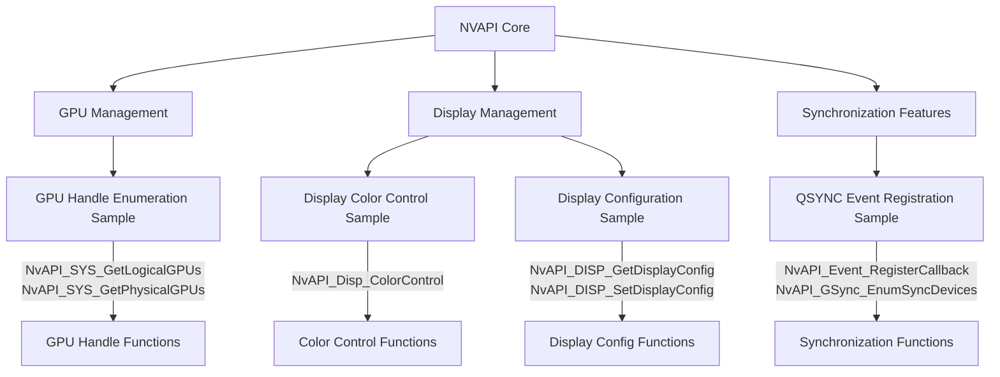

<!-- source: DeepWiki mcp.deepwiki.com · repo NVIDIA/nvapi · page 5 Sample Code and Examples · fetched 2026-10-26 -->

# Sample Code and Examples

<details>
<summary>Relevant source files</summary>

The following files were used as context for generating this wiki page:

- [Sample_Code/DisplayColorControl/DisplayColorControl.cpp](Sample_Code/DisplayColorControl/DisplayColorControl.cpp)
- [Sample_Code/DisplayConfiguration/DisplayConfiguration.cpp](Sample_Code/DisplayConfiguration/DisplayConfiguration.cpp)
- [Sample_Code/GPUHandleEnumeration/gpuHandleEnumeration.c](Sample_Code/GPUHandleEnumeration/gpuHandleEnumeration.c)
- [Sample_Code/QSYNC_Event_Registration/QSYNC_Event_Registration.cpp](Sample_Code/QSYNC_Event_Registration/QSYNC_Event_Registration.cpp)

</details>


## Purpose and Scope

This document provides a comprehensive overview of the sample code included in the NVAPI repository. These samples demonstrate how to properly use the NVAPI functionality across various domains including GPU enumeration, display management, and synchronization features. The examples serve as practical references for developers implementing NVIDIA-specific features in their applications.

For detailed information about specific sample implementations, see the related pages:
- [GPU Handle Enumeration](#5.1)
- [Display Management](#5.2)
- [Synchronization Features](#5.3)

## Sample Code Organization

The NVAPI repository includes a collection of sample code organized in the `Sample_Code` directory. Each sample focuses on demonstrating specific NVAPI functionality and follows a consistent structure with initialization, implementation, and cleanup patterns.

### Sample Code Structure



Sources: [Sample_Code/GPUHandleEnumeration/gpuHandleEnumeration.c:1-101](), [Sample_Code/DisplayColorControl/DisplayColorControl.cpp:1-43](), [Sample_Code/DisplayConfiguration/DisplayConfiguration.cpp:1-436](), [Sample_Code/QSYNC_Event_Registration/QSYNC_Event_Registration.cpp:1-141]()

## Common Implementation Pattern

All sample code follows a common implementation pattern that represents best practices when working with NVAPI.



Sources: [Sample_Code/GPUHandleEnumeration/gpuHandleEnumeration.c:45-57](), [Sample_Code/QSYNC_Event_Registration/QSYNC_Event_Registration.cpp:57-87]()

## GPU Handle Enumeration Sample

The GPU Handle Enumeration sample demonstrates how to enumerate NVIDIA GPU handles, which is fundamental for most NVAPI operations. This sample shows how to obtain both logical and physical GPU handles.

### Key Functions Demonstrated

- `NvAPI_Initialize()`: Initializes the NVAPI interface
- `NvAPI_SYS_GetLogicalGPUs()`: Retrieves logical GPU handles
- `NvAPI_SYS_GetPhysicalGPUs()`: Retrieves physical GPU handles

### Implementation Flow



Sources: [Sample_Code/GPUHandleEnumeration/gpuHandleEnumeration.c:45-100]()

### Code Explanation

The sample initializes the NVAPI interface, then retrieves logical GPU handles using `NvAPI_SYS_GetLogicalGPUs()` with a properly initialized `NV_LOGICAL_GPUS_V1` structure. It then retrieves physical GPU handles using `NvAPI_SYS_GetPhysicalGPUs()` with a properly initialized `NV_PHYSICAL_GPUS_V1` structure. For each handle, it displays the handle value and adapter type.

Key implementation points:
- Structure version initialization is critical
- Error checking after each NVAPI call
- Handles are used as opaque pointers

Sources: [Sample_Code/GPUHandleEnumeration/gpuHandleEnumeration.c:63-98]()

## Display Management Samples

The repository contains two samples related to display management: Display Color Control and Display Configuration.

### Display Color Control

This sample demonstrates how to read and modify display color settings using NVAPI.

#### Key Functions Demonstrated

- `NvAPI_Disp_ColorControl`: Gets/sets display color values
- Functions for manipulating brightness, contrast, gamma, etc.

Sources: [Sample_Code/DisplayColorControl/DisplayColorControl.cpp:23-43]()

### Display Configuration

This sample demonstrates how to work with display configurations, focusing on multi-monitor setups.

#### Key Functions Demonstrated

- `NvAPI_DISP_GetDisplayConfig()`: Retrieves current display configuration
- `NvAPI_DISP_SetDisplayConfig()`: Sets display configuration
- `NvAPI_EnumPhysicalGPUs()`: Enumerates physical GPUs
- `NvAPI_GPU_GetConnectedDisplayIds()`: Gets IDs of connected displays

#### Display Configuration Modes



Sources: [Sample_Code/DisplayConfiguration/DisplayConfiguration.cpp:215-240](), [Sample_Code/DisplayConfiguration/DisplayConfiguration.cpp:282-349](), [Sample_Code/DisplayConfiguration/DisplayConfiguration.cpp:353-432]()

#### Display Configuration Flow



Sources: [Sample_Code/DisplayConfiguration/DisplayConfiguration.cpp:67-146](), [Sample_Code/DisplayConfiguration/DisplayConfiguration.cpp:242-435]()

## Synchronization Features Sample

The QSYNC Event Registration sample demonstrates how to register for and handle Quadro Sync (QSYNC) events.

### Key Functions Demonstrated

- `NvAPI_GSync_EnumSyncDevices()`: Enumerates GSYNC devices
- `NvAPI_Event_RegisterCallback()`: Registers a callback for QSYNC events
- `NvAPI_Event_UnregisterCallback()`: Unregisters the callback

### QSYNC Event Types

| Event Type | Description |
|------------|-------------|
| `NV_QSYNC_EVENT_SYNC_LOSS` | Synchronization has been lost |
| `NV_QSYNC_EVENT_SYNC_GAIN` | Synchronization has been gained |
| `NV_QSYNC_EVENT_HOUSESYNC_GAIN` | House sync has been gained |
| `NV_QSYNC_EVENT_HOUSESYNC_LOSS` | House sync has been lost |
| `NV_QSYNC_EVENT_RJ45_GAIN` | RJ45 connection gained |
| `NV_QSYNC_EVENT_RJ45_LOSS` | RJ45 connection lost |

Sources: [Sample_Code/QSYNC_Event_Registration/QSYNC_Event_Registration.cpp:117-140]()

### QSYNC Event Flow



Sources: [Sample_Code/QSYNC_Event_Registration/QSYNC_Event_Registration.cpp:49-111](), [Sample_Code/QSYNC_Event_Registration/QSYNC_Event_Registration.cpp:114-141]()

## Common Patterns and Best Practices

Across all sample code, several common patterns and best practices emerge:

### 1. NVAPI Initialization

All samples begin with NVAPI initialization:

```
NvAPI_Status status = NvAPI_Initialize();
if (status != NVAPI_OK) {
    // Handle error
}
```

Sources: [Sample_Code/GPUHandleEnumeration/gpuHandleEnumeration.c:51-57](), [Sample_Code/QSYNC_Event_Registration/QSYNC_Event_Registration.cpp:57-63]()

### 2. Proper Structure Initialization

Always initialize API structures with proper version macros:

```
NV_LOGICAL_GPUS_V1 nvLogicalGPUs = { 0 };
nvLogicalGPUs.version = NV_LOGICAL_GPUS_VER1;
```

Sources: [Sample_Code/GPUHandleEnumeration/gpuHandleEnumeration.c:63-64](), [Sample_Code/GPUHandleEnumeration/gpuHandleEnumeration.c:84-85]()

### 3. Error Handling

Always check return status from NVAPI functions:

```
if (status != NVAPI_OK) {
    NvAPI_GetErrorMessage(status, szError);
    printf("\nNvAPI Function failed. The Error code is: %s", szError);
    return -1;
}
```

Sources: [Sample_Code/GPUHandleEnumeration/gpuHandleEnumeration.c:52-57](), [Sample_Code/GPUHandleEnumeration/gpuHandleEnumeration.c:66-71]()

### 4. Resource Cleanup

Release any handles or resources:

```
if (hEventQSYNC != NULL) {
    status = NvAPI_Event_UnregisterCallback(hEventQSYNC);
    // Error handling
    hEventQSYNC = NULL;
}
```

Sources: [Sample_Code/QSYNC_Event_Registration/QSYNC_Event_Registration.cpp:99-108]()

## Relationship Between Samples and NVAPI Functionality



Sources: [Sample_Code/GPUHandleEnumeration/gpuHandleEnumeration.c:63-98](), [Sample_Code/DisplayColorControl/DisplayColorControl.cpp:23-43](), [Sample_Code/DisplayConfiguration/DisplayConfiguration.cpp:67-146](), [Sample_Code/QSYNC_Event_Registration/QSYNC_Event_Registration.cpp:64-87]()

---

