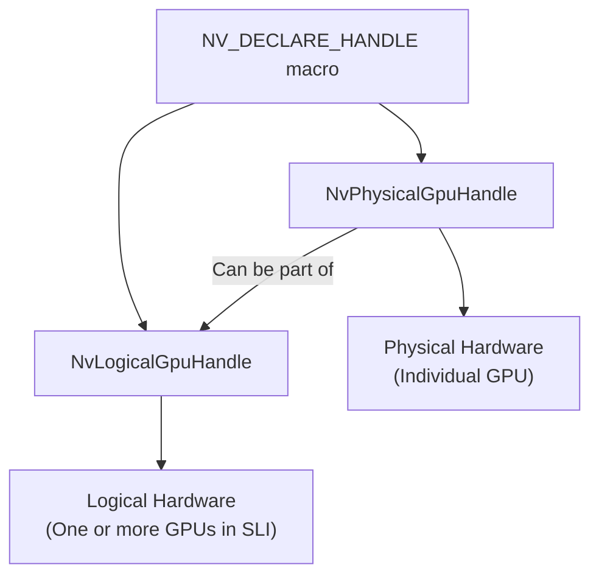
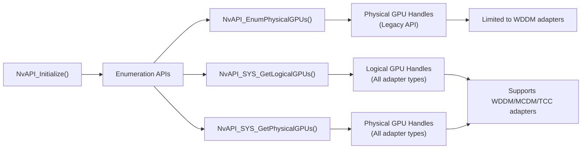
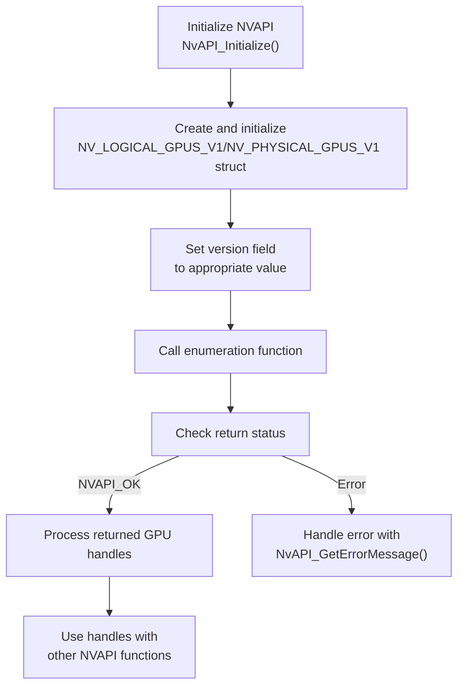
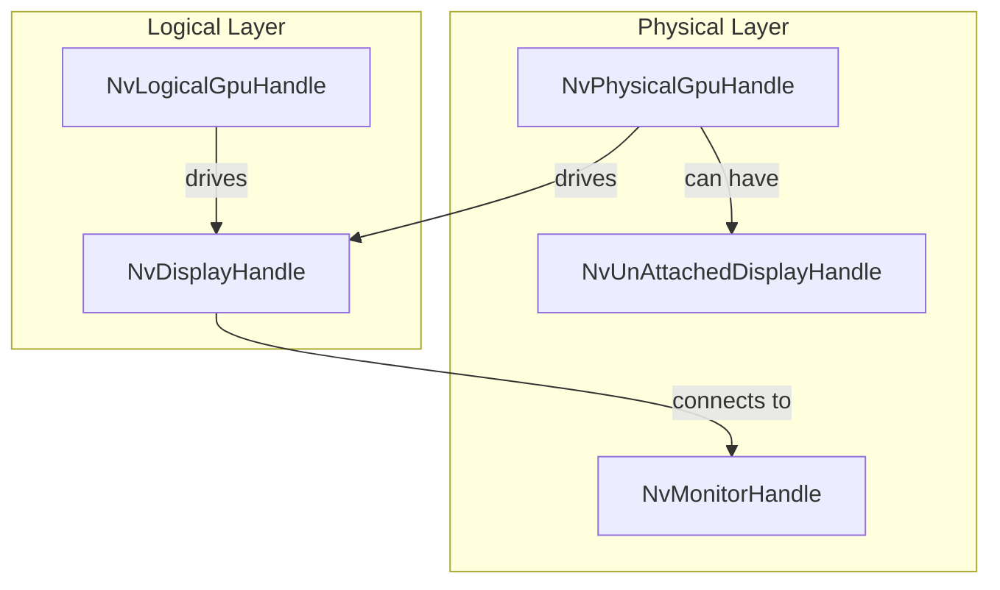

<!-- source: DeepWiki mcp.deepwiki.com · repo NVIDIA/nvapi · page 5.1 GPU Handle Enumeration · fetched 2026-10-26 -->

# GPU Handle Enumeration

<details>
<summary>Relevant source files</summary>

The following files were used as context for generating this wiki page:

- [Sample_Code/GPUHandleEnumeration/gpuHandleEnumeration.c](Sample_Code/GPUHandleEnumeration/gpuHandleEnumeration.c)
- [nvapi.h](nvapi.h)
- [nvapi_lite_common.h](nvapi_lite_common.h)

</details>


## Purpose and Overview

This document explains how to enumerate GPU handles in the NVAPI library. GPU handles are opaque pointers that provide a way to reference NVIDIA graphics hardware in your application. These handles are the foundation for most NVAPI operations, as they allow you to target specific GPUs when calling other functions.

The GPU handle enumeration process involves obtaining either physical or logical GPU handles, which represent different conceptual views of the graphics hardware. This page covers the APIs used for enumeration, their differences, and provides examples of proper usage.

## Handle Types in NVAPI

NVAPI provides two primary handle types for working with GPUs:

1. **Physical GPU Handles** - Represent individual physical GPU hardware units in the system
2. **Logical GPU Handles** - Represent one or more physical GPUs acting in concert (e.g., in SLI configurations)

These handle types are defined as opaque pointers using the `NV_DECLARE_HANDLE` macro in the NVAPI library:



Sources: [nvapi_lite_common.h:127-139]()

Each handle type serves a different purpose:

| Handle Type | Definition | Representation | Use Cases |
|-------------|------------|----------------|-----------|
| `NvPhysicalGpuHandle` | Opaque pointer to physical GPU | A single physical GPU | GPU-specific operations, memory info, performance data |
| `NvLogicalGpuHandle` | Opaque pointer to logical GPU | One or more physical GPUs acting in concert | Display management, SLI configuration |

These handles remain valid until a display reconfiguration (display mode set) or GPU reconfiguration (going into or out of SLI modes) occurs. If you receive `NVAPI_HANDLE_INVALIDATED`, you should discard all handles and re-enumerate them.

Sources: [nvapi_lite_common.h:127-143]()

## Enumeration APIs

NVAPI provides multiple functions for enumerating GPU handles, each serving different scenarios:

### Available Enumeration Functions



Sources: [nvapi.h:598-631](), [Sample_Code/GPUHandleEnumeration/gpuHandleEnumeration.c:29-37]()

### Function Details

1. **NvAPI_EnumPhysicalGPUs**
   - Legacy API for enumerating physical GPU handles
   - Limited to WDDM adapters
   - Defined in `nvapi.h`

   ```
   NvAPI_Status NvAPI_EnumPhysicalGPUs(
       NvPhysicalGpuHandle nvGPUHandle[NVAPI_MAX_PHYSICAL_GPUS], 
       NvU32 *pGpuCount
   );
   ```

2. **NvAPI_SYS_GetLogicalGPUs**
   - Enumerates logical GPU handles for all adapter types
   - Supports WDDM/MCDM/TCC adapters
   - Returns adapter type information

3. **NvAPI_SYS_GetPhysicalGPUs**
   - Enumerates physical GPU handles for all adapter types
   - Supports WDDM/MCDM/TCC adapters
   - Returns adapter type information

Sources: [nvapi.h:630](), [Sample_Code/GPUHandleEnumeration/gpuHandleEnumeration.c:63-98]()

## Handle Enumeration Process

The process for enumerating GPU handles follows these general steps:



Sources: [Sample_Code/GPUHandleEnumeration/gpuHandleEnumeration.c:47-98]()

## Implementation Example

The following sample code demonstrates how to properly enumerate both logical and physical GPU handles:

### Initialization

First, initialize the NVAPI interface:

```c
// Initialize NVAPI
NvAPI_Status status = NvAPI_Initialize();
if (status != NVAPI_OK)
{
    NvAPI_GetErrorMessage(status, szError);
    printf("\nNvAPI_Initialize() failed. The Error code is: %s", szError);
    return -1;
}
```

Sources: [Sample_Code/GPUHandleEnumeration/gpuHandleEnumeration.c:50-57]()

### Enumerating Logical GPUs

To enumerate logical GPU handles:

```c
// Initialize the structure
NV_LOGICAL_GPUS_V1 nvLogicalGPUs = { 0 };
nvLogicalGPUs.version = NV_LOGICAL_GPUS_VER1;

// Call the API
status = NvAPI_SYS_GetLogicalGPUs(&nvLogicalGPUs);
if (status != NVAPI_OK)
{
    NvAPI_GetErrorMessage(status, szError);
    printf("\nNvAPI_SYS_GetLogicalGPUs() failed. The Error code is: %s", szError);
    return -1;
}

// Process the returned handles
for (NvU32 i = 0; i < nvLogicalGPUs.gpuHandleCount; i++)
{
    // Access handle: nvLogicalGPUs.gpuHandleData[i].hLogicalGpu
    // Access adapter type: nvLogicalGPUs.gpuHandleData[i].adapterType
}
```

Sources: [Sample_Code/GPUHandleEnumeration/gpuHandleEnumeration.c:63-78]()

### Enumerating Physical GPUs

To enumerate physical GPU handles:

```c
// Initialize the structure
NV_PHYSICAL_GPUS_V1 nvPhysicalGPUs = { 0 };
nvPhysicalGPUs.version = NV_PHYSICAL_GPUS_VER1;

// Call the API
status = NvAPI_SYS_GetPhysicalGPUs(&nvPhysicalGPUs);
if (status != NVAPI_OK)
{
    NvAPI_GetErrorMessage(status, szError);
    printf("\nNvAPI_SYS_GetPhysicalGPUs() failed. The Error code is: %s", szError);
    return -1;
}

// Process the returned handles
for (NvU32 i = 0; i < nvPhysicalGPUs.gpuHandleCount; i++)
{
    // Access handle: nvPhysicalGPUs.gpuHandleData[i].hPhysicalGpu
    // Access adapter type: nvPhysicalGPUs.gpuHandleData[i].adapterType
}
```

Sources: [Sample_Code/GPUHandleEnumeration/gpuHandleEnumeration.c:84-98]()

## Relationship Between GPUs and Display Output

GPU handles provide access to display functions through a hierarchical relationship:



Sources: [nvapi_lite_common.h:127-143]()

## Best Practices

1. **Initialization**: Always call `NvAPI_Initialize()` before using any NVAPI functions.

2. **Error Handling**: Always check the return status of NVAPI functions and use `NvAPI_GetErrorMessage()` to get human-readable error messages.

3. **Version Fields**: When using structures in NVAPI, always set the version field to the appropriate constant defined in the headers.

4. **Handle Invalidation**: Be prepared to re-enumerate handles if you receive a `NVAPI_HANDLE_INVALIDATED` status code.

5. **Adapter Types**: When enumerating GPUs, check the adapter type to understand what kind of GPU you're working with (WDDM, MCDM, or TCC).

6. **Recommended APIs**: For newer applications, prefer `NvAPI_SYS_GetLogicalGPUs()` and `NvAPI_SYS_GetPhysicalGPUs()` over the legacy `NvAPI_EnumPhysicalGPUs()` function.

Sources: [Sample_Code/GPUHandleEnumeration/gpuHandleEnumeration.c:47-100]()

## Conclusion

GPU handle enumeration is the foundation for working with NVIDIA GPUs through the NVAPI. By understanding the difference between physical and logical GPU handles and properly using the enumeration functions, you can build applications that effectively target and utilize NVIDIA graphics hardware.

The sample code in the NVAPI SDK demonstrates proper handle enumeration and provides a template for implementing this functionality in your own applications.

---

