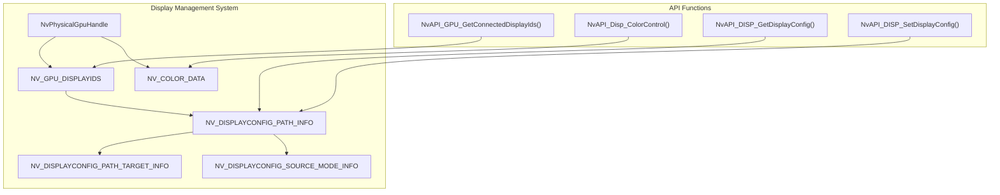
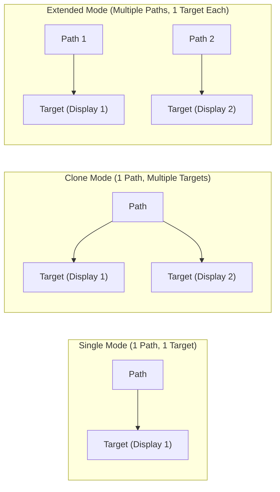
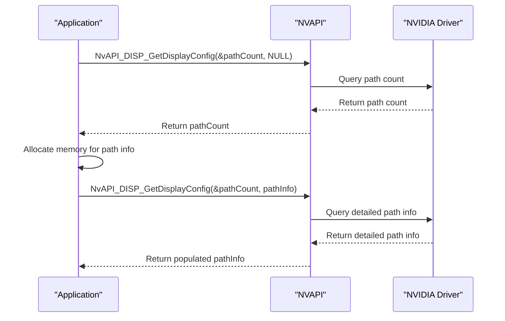
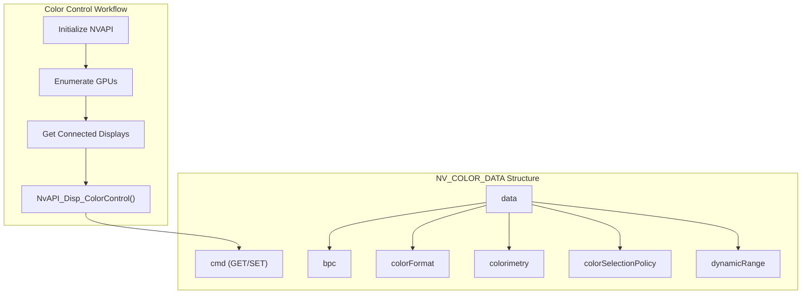
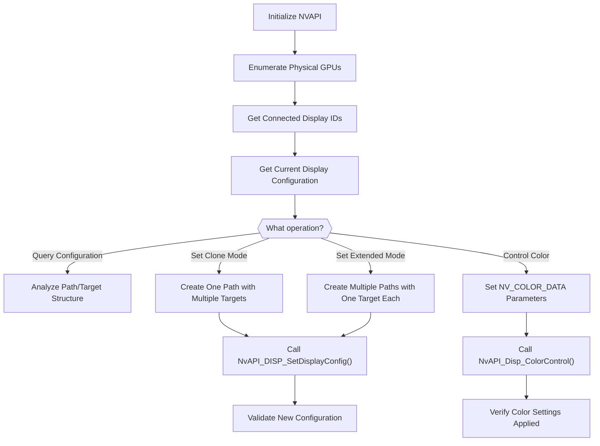

<!-- source: DeepWiki mcp.deepwiki.com · repo NVIDIA/nvapi · page 5.2 Display Management · fetched 2026-10-26 -->

# Display Management

Relevant source files

The following files were used as context for generating this wiki page:

- [Sample_Code/DisplayColorControl/DisplayColorControl.cpp](Sample_Code/DisplayColorControl/DisplayColorControl.cpp)
- [Sample_Code/DisplayColorControl/NVHelper.cpp](Sample_Code/DisplayColorControl/NVHelper.cpp)
- [Sample_Code/DisplayColorControl/NVHelper.h](Sample_Code/DisplayColorControl/NVHelper.h)
- [Sample_Code/DisplayConfiguration/DisplayConfiguration.cpp](Sample_Code/DisplayConfiguration/DisplayConfiguration.cpp)

## Purpose and Scope

This document provides technical guidance on using NVAPI's display management capabilities. It covers display configuration (including single, clone, and extended display modes) and display color control functionality. These features allow applications to query and modify how NVIDIA GPUs handle multiple displays and control color settings on connected displays.

For information about enumerating GPU handles, see [GPU Handle Enumeration](#5.1).

Sources: [Sample_Code/DisplayConfiguration/DisplayConfiguration.cpp:24-34](), [Sample_Code/DisplayColorControl/DisplayColorControl.cpp:24-27]()

## Display Management Architecture

NVAPI's display management system is built around several key abstractions:

The diagram illustrates the primary data structures in the display management system and their relationships. Display configuration begins with physical GPU handles, which connect to display IDs representing connected displays. These are organized into paths and targets when managing display configurations.

Sources: [Sample_Code/DisplayConfiguration/DisplayConfiguration.cpp:68-146](), [Sample_Code/DisplayColorControl/NVHelper.cpp:73-106]()

## Display Configuration Concepts

### Display Paths and Targets

Display configurations in NVAPI are represented through paths and targets:

- **Path**: Represents a source of display data from the GPU
- **Target**: Represents a physical display connected to the GPU
- **Display Modes**:
  - **Single Mode**: One path connecting to one target
  - **Clone Mode**: One path connecting to multiple targets (showing identical content)
  - **Extended Mode**: Multiple paths, each connecting to a different target (independent displays)

Sources: [Sample_Code/DisplayConfiguration/DisplayConfiguration.cpp:215-240](), [Sample_Code/DisplayConfiguration/DisplayConfiguration.cpp:282-349](), [Sample_Code/DisplayConfiguration/DisplayConfiguration.cpp:353-433]()

### Display Configuration Structures

The key structures used in display configuration are:

| Structure | Purpose | Key Fields |
|-----------|---------|------------|
| `NV_DISPLAYCONFIG_PATH_INFO` | Contains display path information | `version`, `sourceModeInfo`, `targetInfo`, `targetInfoCount` |
| `NV_DISPLAYCONFIG_PATH_TARGET_INFO` | Contains display target information | `displayId`, `details` |
| `NV_DISPLAYCONFIG_SOURCE_MODE_INFO` | Contains source mode information | `bGDIPrimary` (determines primary display) |
| `NV_DISPLAYCONFIG_PATH_ADVANCED_TARGET_INFO` | Contains advanced target details | Version-specific details |

Sources: [Sample_Code/DisplayConfiguration/DisplayConfiguration.cpp:100-134]()

## Display Configuration Management

### Querying Current Configuration

To retrieve the current display configuration:

1. Call `NvAPI_DISP_GetDisplayConfig` with null parameters to retrieve path count
2. Allocate memory for path info structures
3. Call `NvAPI_DISP_GetDisplayConfig` again to populate the structures
4. Analyze the data to determine the current display mode

Sources: [Sample_Code/DisplayConfiguration/DisplayConfiguration.cpp:68-146](), [Sample_Code/DisplayConfiguration/DisplayConfiguration.cpp:208-214]()

### Setting Display Configuration

To set a display configuration:

1. Retrieve and modify existing configuration or create a new one
2. Set up path and target structures appropriately for desired mode:
   - For clone mode: One path with multiple targets
   - For extended mode: Multiple paths with one target each
3. Call `NvAPI_DISP_SetDisplayConfig` with the modified structures

The sample code demonstrates setting both clone mode and extended mode:

Sources: [Sample_Code/DisplayConfiguration/DisplayConfiguration.cpp:282-349](), [Sample_Code/DisplayConfiguration/DisplayConfiguration.cpp:353-433]()

## Display Color Management

Display color management in NVAPI enables control of color-related parameters through the `NvAPI_Disp_ColorControl` function.

### Color Control Parameters

The `NV_COLOR_DATA` structure allows setting and getting various color parameters:

| Parameter | Description | Example Values |
|-----------|-------------|----------------|
| `bpc` | Bits per color/component | `NV_BPC_10` (10-bit color) |
| `colorFormat` | Color format | `NV_COLOR_FORMAT_DEFAULT` |
| `colorimetry` | Color standard | `NV_COLOR_COLORIMETRY_DEFAULT` |
| `colorSelectionPolicy` | Who controls color settings | `NV_COLOR_SELECTION_POLICY_USER` |
| `dynamicRange` | Dynamic range setting | `NV_DYNAMIC_RANGE_AUTO` |

Sources: [Sample_Code/DisplayColorControl/NVHelper.cpp:158-174]()

### Getting and Setting Color Control

Color control operations follow this pattern:

1. Initialize the `NV_COLOR_DATA` structure with proper version
2. Set command to `NV_COLOR_CMD_GET` to retrieve current settings or `NV_COLOR_CMD_SET` to modify settings
3. When setting, populate the desired values in the data fields
4. Call `NvAPI_Disp_ColorControl` with the display ID and color data structure

Sources: [Sample_Code/DisplayColorControl/NVHelper.cpp:108-192]()

## Usage Examples

### Example: Display Configuration

The sample code demonstrates how to:

1. Query the current display configuration
2. Detect if displays are in single, clone, or extended mode
3. Set displays to clone mode (one path with multiple targets)
4. Set displays to extended mode (multiple paths with one target each)

The code handles multiple displays and provides validation to ensure configurations are applied correctly.

Sources: [Sample_Code/DisplayConfiguration/DisplayConfiguration.cpp:33-435]()

### Example: Display Color Control

The color control sample demonstrates:

1. Initializing NVAPI
2. Getting current color settings from connected displays
3. Setting new color parameters including bits per color, color format, colorimetry, etc.

The sample sets 10-bit color depth and various other color parameters.

Sources: [Sample_Code/DisplayColorControl/NVHelper.cpp:194-206](), [Sample_Code/DisplayColorControl/DisplayColorControl.cpp:33-43]()

## Common Display Management Workflow

This workflow illustrates the common pattern for display management operations, showing how the various tasks follow a similar initialization sequence before branching into specific operations.

Sources: [Sample_Code/DisplayConfiguration/DisplayConfiguration.cpp:242-435](), [Sample_Code/DisplayColorControl/NVHelper.cpp:108-206]()

---

