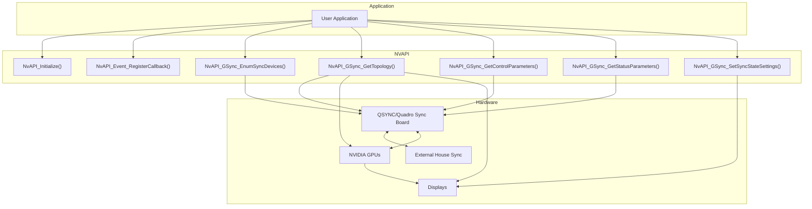
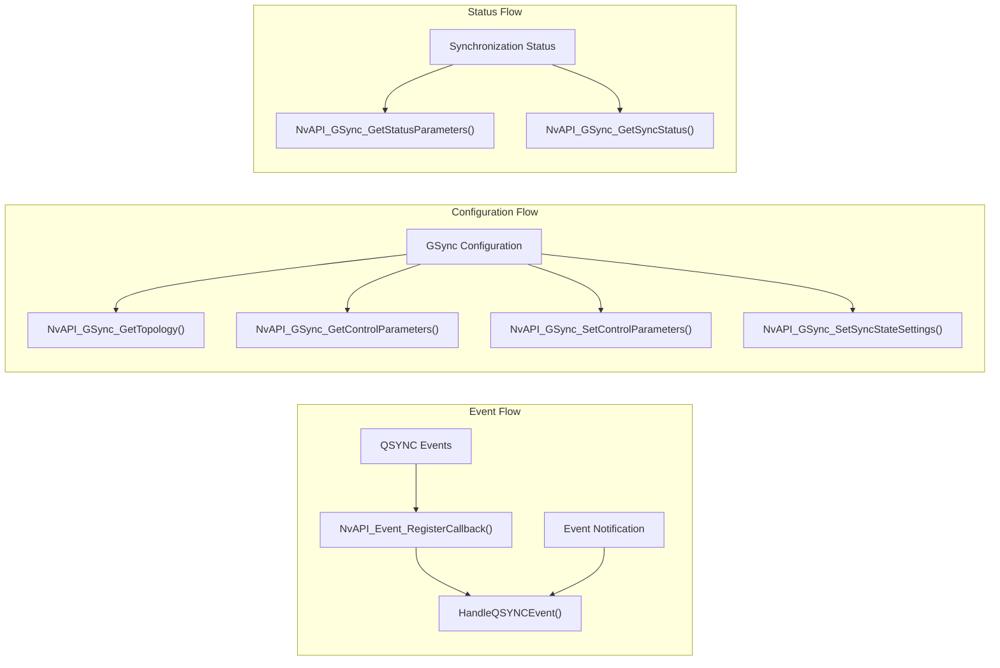
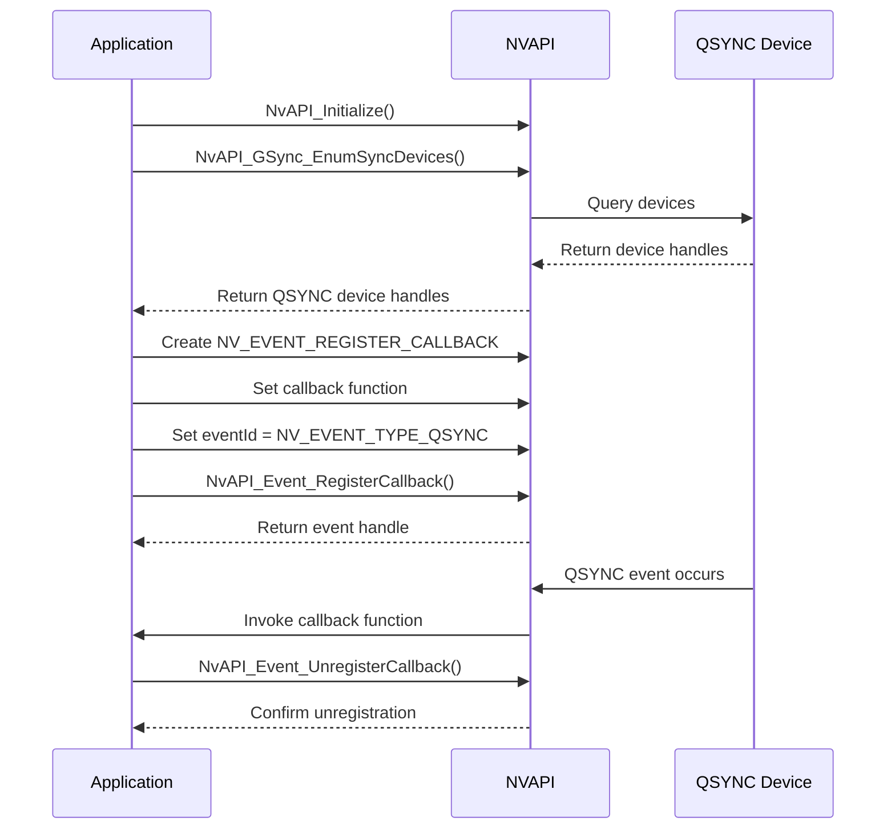
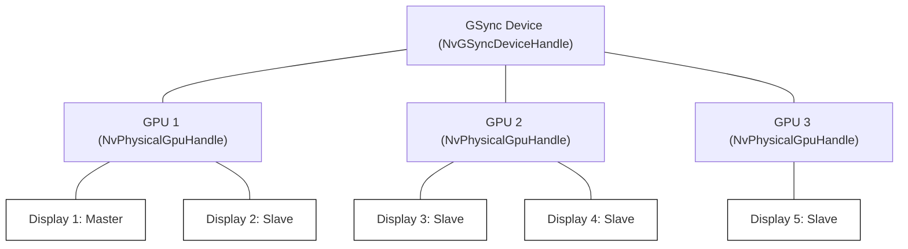
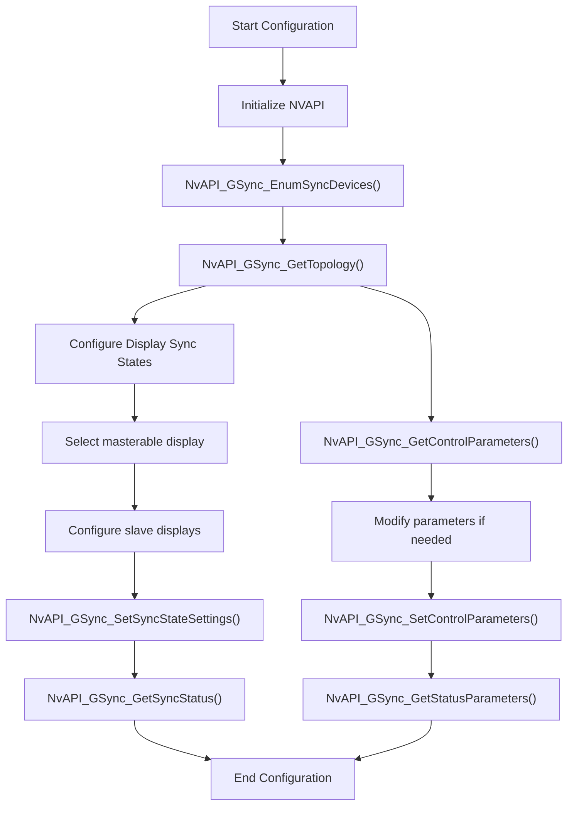

<!-- source: DeepWiki mcp.deepwiki.com · repo NVIDIA/nvapi · page 5.3 Synchronization Features · fetched 2026-10-26 -->

# Synchronization Features

<details>
<summary>Relevant source files</summary>

The following files were used as context for generating this wiki page:

- [Sample_Code/QSYNC_Event_Registration/QSYNC_Event_Registration.cpp](Sample_Code/QSYNC_Event_Registration/QSYNC_Event_Registration.cpp)
- [Sample_Code/Sync_Configuration/Sync_Configuration.cpp](Sample_Code/Sync_Configuration/Sync_Configuration.cpp)

</details>


## Purpose and Scope

This document provides a comprehensive guide to the synchronization features available in the NVAPI, specifically focusing on QSYNC (Quadro Sync) and GSync technologies. These technologies enable precise frame synchronization across multiple displays and GPUs, which is critical for professional visualization applications requiring frame-accurate output.

This page covers how to detect synchronization hardware, configure synchronization parameters, set up master/slave relationships between displays, handle synchronization events, and monitor synchronization status through the NVAPI interface.

Sources: [Sample_Code/QSYNC_Event_Registration/QSYNC_Event_Registration.cpp:24-33]()

## Synchronization Technologies Overview

NVIDIA provides two primary synchronization technologies that are accessible through NVAPI:

| Technology | Primary Purpose | Hardware | Use Cases |
|------------|----------------|----------|-----------|
| QSYNC (Quadro Sync) | Frame synchronization across multiple professional GPUs | Quadro Sync board | Multi-display walls, simulation environments, broadcast |
| GSync | Display synchronization and genlock capabilities | GSync device | Professional video production, broadcast, visualization |

The synchronization system enables developers to:
- Synchronize frames across multiple displays
- Lock to external timing sources (house sync)
- Register for and respond to synchronization events
- Configure master/slave relationships between displays

Sources: [Sample_Code/QSYNC_Event_Registration/QSYNC_Event_Registration.cpp:24-33](), [Sample_Code/Sync_Configuration/Sync_Configuration.cpp:24-52]()

## Synchronization Architecture

### System Architecture Diagram



Sources: [Sample_Code/QSYNC_Event_Registration/QSYNC_Event_Registration.cpp:46-108](), [Sample_Code/Sync_Configuration/Sync_Configuration.cpp:63-107]()

### Synchronization Data Flow Diagram



Sources: [Sample_Code/QSYNC_Event_Registration/QSYNC_Event_Registration.cpp:46-108](), [Sample_Code/Sync_Configuration/Sync_Configuration.cpp:259-286]()

## Core Components and Data Structures

### Key Handles

The NVAPI synchronization system uses the following handle types to reference hardware and software resources:

| Handle Type | Purpose | Related Functions |
|-------------|---------|-------------------|
| `NvGSyncDeviceHandle` | References a GSync/QSYNC hardware device | `NvAPI_GSync_EnumSyncDevices()` |
| `NvEventHandle` | References a registered event notification | `NvAPI_Event_RegisterCallback()`, `NvAPI_Event_UnregisterCallback()` |
| `NvPhysicalGpuHandle` | References a physical GPU connected to the sync device | `NvAPI_SYS_GetPhysicalGpuFromDisplayId()` |

Sources: [Sample_Code/QSYNC_Event_Registration/QSYNC_Event_Registration.cpp:52-53](), [Sample_Code/Sync_Configuration/Sync_Configuration.cpp:39-61]()

### Key Data Structures

```mermaid
classDiagram
    class NV_GSYNC_GPU {
        +NvPhysicalGpuHandle hPhysicalGpu
        +NvPhysicalGpuHandle hProxyPhysicalGpu
        +NV_GSYNC_GPU_TOPOLOGY_CONNECTOR connector
        +NvU32 isSynced
    }
    
    class NV_GSYNC_DISPLAY {
        +NvU32 version
        +NvU32 displayId
        +NV_GSYNC_DISPLAY_SYNC_STATE syncState
        +NvU32 isMasterable
    }
    
    class NV_GSYNC_CONTROL_PARAMS {
        +NvU32 version
        +NVAPI_GSYNC_POLARITY polarity
        +NVAPI_GSYNC_VIDEO_MODE vmode
        +NvU32 interval
        +NVAPI_GSYNC_SYNC_SOURCE source
    }
    
    class NV_GSYNC_STATUS_PARAMS {
        +NvU32 version
        +NvU32 refreshRate
        +NvU32 houseSyncIncoming
        +NvU32 bHouseSync
        +NVAPI_GSYNC_RJ45_IO RJ45_IO[2]
        +NvU32 RJ45_Ethernet[2]
    }
    
    class NV_QSYNC_EVENT_DATA {
        +NV_QSYNC_EVENT qsyncEvent
    }
    
    class NV_EVENT_REGISTER_CALLBACK {
        +version
        +eventId
        +nvCallBackFunc
    }
```



Sources: [Sample_Code/QSYNC_Event_Registration/QSYNC_Event_Registration.cpp:74-78](), [Sample_Code/Sync_Configuration/Sync_Configuration.cpp:67-71]()

## Working with QSYNC Events

QSYNC events allow applications to respond to changes in synchronization status, such as gaining or losing synchronization signals.

### QSYNC Event Types

| Event Type | Description |
|------------|-------------|
| `NV_QSYNC_EVENT_SYNC_LOSS` | Synchronization has been lost between GPUs |
| `NV_QSYNC_EVENT_SYNC_GAIN` | Synchronization has been established between GPUs |
| `NV_QSYNC_EVENT_HOUSESYNC_GAIN` | House sync signal has been acquired |
| `NV_QSYNC_EVENT_HOUSESYNC_LOSS` | House sync signal has been lost |
| `NV_QSYNC_EVENT_RJ45_GAIN` | RJ45 connector signal has been gained |
| `NV_QSYNC_EVENT_RJ45_LOSS` | RJ45 connector signal has been lost |

Sources: [Sample_Code/QSYNC_Event_Registration/QSYNC_Event_Registration.cpp:117-140]()

### QSYNC Event Registration Process



Sources: [Sample_Code/QSYNC_Event_Registration/QSYNC_Event_Registration.cpp:49-111]()

### Example: QSYNC Event Registration

To register for QSYNC events:

1. Initialize NVAPI using `NvAPI_Initialize()`
2. Check for QSYNC devices using `NvAPI_GSync_EnumSyncDevices()`
3. Create an `NV_EVENT_REGISTER_CALLBACK` structure
4. Set the event callback function
5. Register the callback using `NvAPI_Event_RegisterCallback()`
6. When done, unregister using `NvAPI_Event_UnregisterCallback()`

The code in [Sample_Code/QSYNC_Event_Registration/QSYNC_Event_Registration.cpp:49-111]() provides a complete example of event registration.

Sources: [Sample_Code/QSYNC_Event_Registration/QSYNC_Event_Registration.cpp:74-87]()

### QSYNC Event Handling

When a QSYNC event occurs, the registered callback function is invoked with an `NV_QSYNC_EVENT_DATA` parameter that indicates the event type. The callback can then take appropriate action based on the event type.

The code in [Sample_Code/QSYNC_Event_Registration/QSYNC_Event_Registration.cpp:115-141]() shows how to handle different types of QSYNC events.

Sources: [Sample_Code/QSYNC_Event_Registration/QSYNC_Event_Registration.cpp:115-141]()

## Working with GSync Configuration

GSync configuration allows applications to query and set parameters that control synchronization between displays.

### GSync Topology Structure



Sources: [Sample_Code/Sync_Configuration/Sync_Configuration.cpp:259-286]()

### GSync Control Parameters

| Parameter | Description | Example Values |
|-----------|-------------|----------------|
| `polarity` | Signal polarity | Positive/Negative |
| `vmode` | Video mode | NTSC/PAL/HDTV/etc. |
| `interval` | Sync interval | Frame rate multiplier |
| `source` | Sync source | House sync/V-sync |

Sources: [Sample_Code/Sync_Configuration/Sync_Configuration.cpp:63-107]()

### GSync Status Parameters

| Parameter | Description |
|-----------|-------------|
| `refreshRate` | Current refresh rate |
| `houseSyncIncoming` | Incoming house sync frequency |
| `bHouseSync` | House sync presence indicator |
| `RJ45_IO` | RJ45 port configuration (input/output/unused) |
| `RJ45_Ethernet` | RJ45 Ethernet connectivity status |

Sources: [Sample_Code/Sync_Configuration/Sync_Configuration.cpp:63-107]()

### GSync Display States

| State | Description |
|-------|-------------|
| `NVAPI_GSYNC_DISPLAY_SYNC_STATE_UNSYNCED` | Display is not synchronized |
| `NVAPI_GSYNC_DISPLAY_SYNC_STATE_SLAVE` | Display is synchronized as a slave |
| `NVAPI_GSYNC_DISPLAY_SYNC_STATE_MASTER` | Display is the synchronization master |

Sources: [Sample_Code/Sync_Configuration/Sync_Configuration.cpp:32-34]()

### GSync Configuration Process



Sources: [Sample_Code/Sync_Configuration/Sync_Configuration.cpp:297-422]()

## Examples of Common Synchronization Tasks

### Enumerating GSync Devices

```
// Enumerate GSync devices
NvGSyncDeviceHandle nvGSyncHandles[NVAPI_MAX_GSYNC_DEVICES];
NvU32 gsyncCount = 0;
NvAPI_Status status = NvAPI_GSync_EnumSyncDevices(nvGSyncHandles, &gsyncCount);
if (status == NVAPI_NVIDIA_DEVICE_NOT_FOUND || gsyncCount == 0) {
    // No GSync devices found
}
```

Sources: [Sample_Code/Sync_Configuration/Sync_Configuration.cpp:306-317]()

### Querying GSync Parameters

```
// Query control parameters
NV_GSYNC_CONTROL_PARAMS Ctrlparams = {0};
Ctrlparams.version = NV_GSYNC_CONTROL_PARAMS_VER;
status = NvAPI_GSync_GetControlParameters(hNvGSyncDevice, &Ctrlparams);

// Query status parameters
NV_GSYNC_STATUS_PARAMS StatusParams = {0};
StatusParams.version = NV_GSYNC_STATUS_PARAMS_VER;
status = NvAPI_GSync_GetStatusParameters(hNvGSyncDevice, &StatusParams);
```

Sources: [Sample_Code/Sync_Configuration/Sync_Configuration.cpp:67-103]()

### Setting Up Master/Slave Configuration

```
// Configure displays (one master, rest slaves)
for (dispIndex = 0; dispIndex < gsyncSysInfo.dispCount; dispIndex++) {
    gsyncUserSettings.displays[dispIndex].displayId = gsyncSysInfo.displays[dispIndex].displayId;
    
    if (!isMasterableFound && gsyncSysInfo.displays[dispIndex].isMasterable) {
        gsyncUserSettings.displays[dispIndex].syncState = NVAPI_GSYNC_DISPLAY_SYNC_STATE_MASTER;
        isMasterableFound = true;
    } else {
        gsyncUserSettings.displays[dispIndex].syncState = NVAPI_GSYNC_DISPLAY_SYNC_STATE_SLAVE;
    }
}

// Apply the configuration
status = NvAPI_GSync_SetSyncStateSettings(gsyncUserSettings.dispCount, 
                                         gsyncUserSettings.displays, flags);
```

Sources: [Sample_Code/Sync_Configuration/Sync_Configuration.cpp:341-377]()

### Unsynchronizing Displays

```
// Remove synchronization from all displays
GSyncUserSettings gsyncUserSettings = {0};  
gsyncUserSettings.displays[0].version = NV_GSYNC_DISPLAY_VER;
gsyncUserSettings.dispCount = 0;
status = NvAPI_GSync_SetSyncStateSettings(gsyncUserSettings.dispCount, 
                                         gsyncUserSettings.displays, flags);
```

Sources: [Sample_Code/Sync_Configuration/Sync_Configuration.cpp:380-399]()

### Toggling Sync Source

```
// Toggle between house sync and v-sync
gsyncSysInfo.gsyncTopo[0].Ctrlparams.source = 
    (NVAPI_GSYNC_SYNC_SOURCE)!(NvU32)gsyncSysInfo.gsyncTopo[0].Ctrlparams.source;
gsyncSysInfo.gsyncTopo[0].Ctrlparams.version = NV_GSYNC_CONTROL_PARAMS_VER;
status = NvAPI_GSync_SetControlParameters(nvGSyncHandles[0], 
                                         &gsyncSysInfo.gsyncTopo[0].Ctrlparams);
```

Sources: [Sample_Code/Sync_Configuration/Sync_Configuration.cpp:409-419]()

## Best Practices

1. **Always check device availability**: Before configuring synchronization, always enumerate GSync devices to make sure they're present.

2. **Master selection**: When setting up master/slave configurations, choose a display that has the `isMasterable` flag set to true as the master.

3. **Error handling**: Always check the return status of NVAPI functions and handle errors appropriately.

4. **Event registration cleanup**: Always unregister event callbacks when they're no longer needed to prevent memory leaks.

5. **Synchronization verification**: After applying synchronization settings, verify that synchronization has been established by querying the sync status.

Sources: [Sample_Code/QSYNC_Event_Registration/QSYNC_Event_Registration.cpp:98-108](), [Sample_Code/Sync_Configuration/Sync_Configuration.cpp:306-317]()

---

