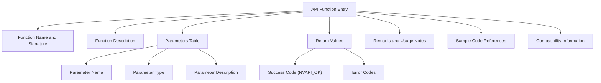
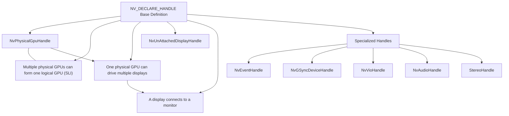
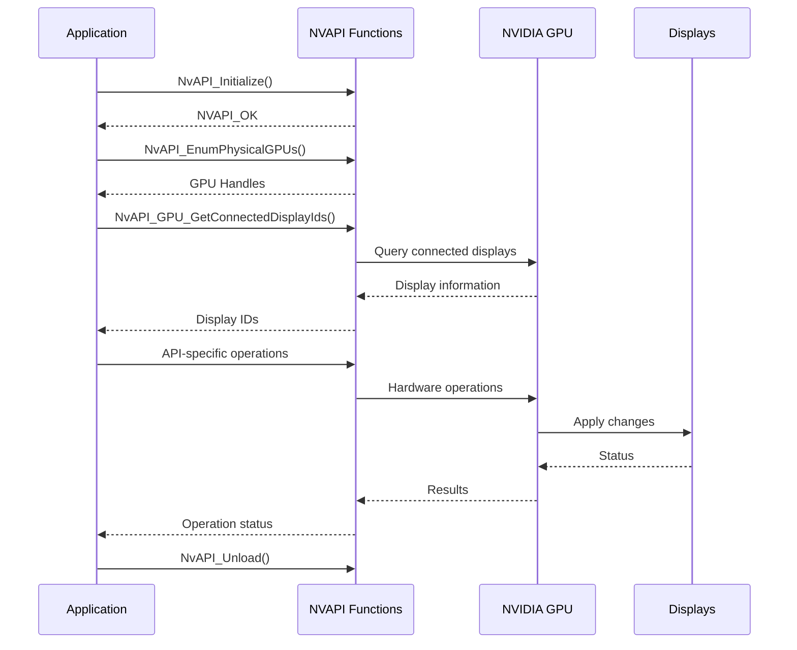
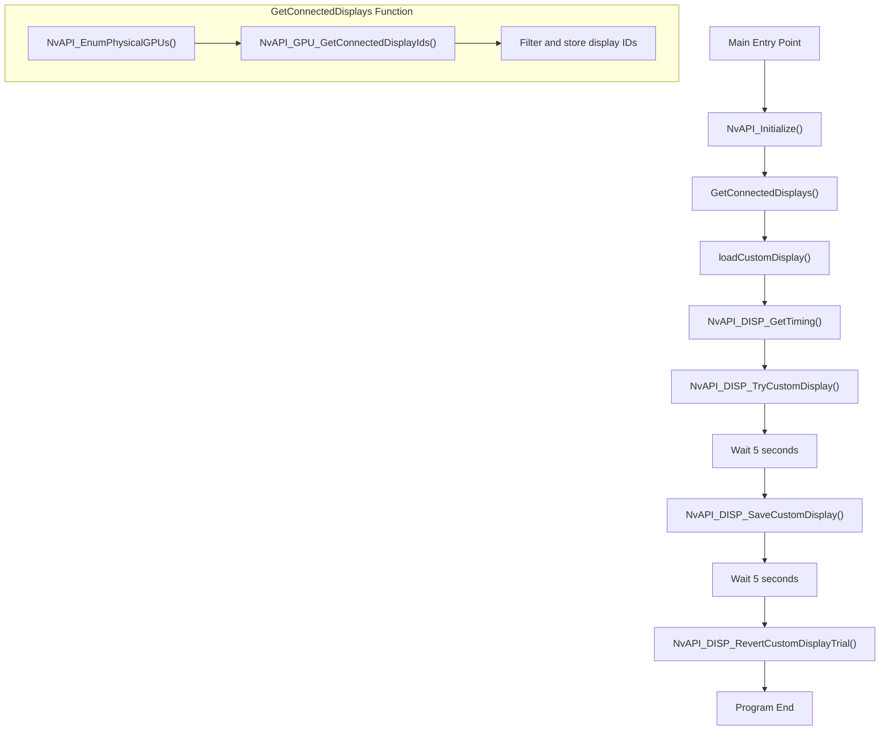

<!-- source: DeepWiki mcp.deepwiki.com · repo NVIDIA/nvapi · page 6 Reference Documentation · fetched 2026-10-26 -->

# Reference Documentation

<details>
<summary>Relevant source files</summary>

The following files were used as context for generating this wiki page:

- [Sample_Code/CustomTiming/CustomTiming.cpp](Sample_Code/CustomTiming/CustomTiming.cpp)
- [docs/NVAPI_Reference_OpenSource.chm](docs/NVAPI_Reference_OpenSource.chm)
- [docs/R570-OpenSource.docx](docs/R570-OpenSource.docx)
- [docs/R570_NVAPI_OpenSource_Release_Notes.pdf](docs/R570_NVAPI_OpenSource_Release_Notes.pdf)

</details>


## Purpose and Scope

This page provides an overview of the official NVIDIA API (NVAPI) reference documentation included in the repository. It covers the comprehensive documentation available in the NVAPI SDK, which developers can use to understand and implement NVAPI functionality in their applications. For specific code examples and implementations, see [Sample Code and Examples](#5).

Sources: [docs/NVAPI_Reference_OpenSource.chm]()

## Documentation Format and Access

The NVAPI documentation is provided as a compiled HTML help file (CHM) named `NVAPI_Reference_OpenSource.chm` located in the `docs` directory. This format provides a searchable, indexed reference with comprehensive information about all NVAPI functions, structures, and constants.

### Accessing the Documentation

To use the CHM documentation:

1. Navigate to the `docs` directory in the NVAPI repository
2. Open the `NVAPI_Reference_OpenSource.chm` file with a compatible CHM viewer
3. Use the table of contents, index, or search functionality to find specific API information

**Note:** On Windows, you may need to right-click the CHM file, select Properties, and click "Unblock" if the file was downloaded from the internet.

Sources: [docs/NVAPI_Reference_OpenSource.chm]()

## Documentation Organization

The NVAPI reference documentation is organized into several major sections that correspond to the functional domains of the API.

### Documentation Structure Diagram

```mermaid
graph TD
    MainDoc["NVAPI Reference Documentation"]
    MainDoc --> Concepts["Concepts"]
    MainDoc --> APIGroups["API Function Groups"]
    MainDoc --> StructDoc["Structure Documentation"]
    MainDoc --> DefineDoc["Defines Documentation"]
    MainDoc --> DeprecatedDoc["Deprecated Features"]
    MainDoc --> HandlesDoc["Handle Types Documentation"]

    APIGroups --> GPUGroup["GPU Management APIs"]
    APIGroups --> DisplayGroup["Display Management APIs"]
    APIGroups --> GraphicsGroup["Graphics Extensions APIs"]
    APIGroups --> SystemGroup["System APIs"]
    APIGroups --> MiscGroup["Miscellaneous APIs"]

    StructDoc --> GPUStructs["GPU Structures"]
    StructDoc --> DisplayStructs["Display Structures"]
    StructDoc --> GraphicsStructs["Graphics Structures"]
    StructDoc --> SystemStructs["System Structures"]

    HandlesDoc --> PhysicalGPUHandle["NvPhysicalGpuHandle"]
    HandlesDoc --> LogicalGPUHandle["NvLogicalGpuHandle"]
    HandlesDoc --> DisplayHandle["NvDisplayHandle"]
    HandlesDoc --> OtherHandles["Other Handle Types"]
```



Sources: [docs/NVAPI_Reference_OpenSource.chm]()

## Key API Groups

The NVAPI reference documentation organizes functions into logical groups based on their functionality. Here are the main API groups:

| API Group | Description | Prefix Example |
|-----------|-------------|----------------|
| GPU APIs | Functions for GPU enumeration, capabilities, and management | `NvAPI_GPU_*` |
| Display APIs | Functions for display control, modes, and color management | `NvAPI_DISP_*` |
| DX (DirectX) APIs | DirectX-specific extensions | `NvAPI_D3D*` |
| System APIs | System information and control functions | `NvAPI_SYS_*` |
| Stereo APIs | Stereoscopic 3D functionality | `NvAPI_Stereo_*` |
| Mosaic APIs | Multi-display configuration | `NvAPI_Mosaic_*` |
| DRS (Driver Settings) APIs | Driver registry settings management | `NvAPI_DRS_*` |

Sources: [docs/NVAPI_Reference_OpenSource.chm]()

## API Documentation Format

Each API function in the reference documentation follows a consistent format that provides detailed information about its usage, parameters, and return values.

### API Entry Structure Diagram



Sources: [docs/NVAPI_Reference_OpenSource.chm]()

## Structure Documentation

The reference documentation provides comprehensive information about NVAPI structures, which are used as parameters for API functions.

### Structure Documentation Example

For each structure, the documentation typically includes:

1. Structure name and members
2. Version macros for versioned structures
3. Member descriptions
4. Usage information
5. Related functions that use the structure

Many structures in NVAPI use a version field that must be properly initialized before using the structure with API functions, as demonstrated in the CustomTiming sample:

```
NV_CUSTOM_DISPLAY cd;
cd.version = NV_CUSTOM_DISPLAY_VER;  // Initialize version
```

Sources: [docs/NVAPI_Reference_OpenSource.chm](), [Sample_Code/CustomTiming/CustomTiming.cpp:93-106]()

## Handles Documentation

NVAPI uses a system of opaque handles to represent various hardware and software resources. The documentation provides detailed information about these handle types and how to use them.

### NVAPI Handle Hierarchy



Sources: [docs/NVAPI_Reference_OpenSource.chm]()

## API Usage Pattern

The reference documentation explains common patterns for using NVAPI functions. A typical usage pattern involves:

1. Initializing NVAPI
2. Enumerating and obtaining handles to resources
3. Performing operations using these handles
4. Proper cleanup

The following diagram illustrates this typical flow:



Sources: [docs/NVAPI_Reference_OpenSource.chm](), [Sample_Code/CustomTiming/CustomTiming.cpp:57-91]()

## Sample Code Integration

The NVAPI reference documentation often refers to sample code that demonstrates practical usage of the API. The repository includes several sample applications in the `Sample_Code` directory that complement the reference documentation.

### Custom Timing Sample

The `CustomTiming` sample demonstrates how to:

1. Initialize NVAPI
2. Enumerate physical GPUs and connected displays
3. Create and apply custom display timings
4. Save and revert custom display settings

This sample illustrates the usage of several key display-related functions:

- `NvAPI_DISP_GetTiming`
- `NvAPI_DISP_TryCustomDisplay`
- `NvAPI_DISP_SaveCustomDisplay`
- `NvAPI_DISP_RevertCustomDisplayTrial`

The following diagram shows the flow of the CustomTiming sample:



Sources: [Sample_Code/CustomTiming/CustomTiming.cpp:24-36](), [Sample_Code/CustomTiming/CustomTiming.cpp:165-265]()

## Error Handling

The NVAPI reference documentation provides detailed information about error handling and return values. All NVAPI functions return an `NvAPI_Status` value that indicates success or failure.

### Common Error Codes

| Error Code | Description |
|------------|-------------|
| NVAPI_OK | Function completed successfully |
| NVAPI_ERROR | Generic error |
| NVAPI_INVALID_ARGUMENT | One or more arguments are invalid |
| NVAPI_NOT_SUPPORTED | Requested feature is not supported |
| NVAPI_NO_IMPLEMENTATION | No implementation exists for this function |
| NVAPI_API_NOT_INITIALIZED | NVAPI was not initialized before calling this function |
| NVAPI_INCOMPATIBLE_STRUCT_VERSION | Structure version is not compatible |

The documentation provides specific error codes for each function and explains the conditions under which they might occur.

Sources: [docs/NVAPI_Reference_OpenSource.chm](), [Sample_Code/CustomTiming/CustomTiming.cpp:60-66]()

## Documentation Updates

The NVAPI reference documentation is updated with each new driver release. The current documentation reflects the API as of the release version indicated in the documentation header. When using the API, it's important to check for newer versions of the documentation that might cover additional functionality.

Sources: [docs/NVAPI_Reference_OpenSource.chm](), [docs/R570-OpenSource.docx]()