# Page: Overview

# Overview

<details>
<summary>Relevant source files</summary>

The following files were used as context for generating this wiki page:

- [amd64/nvapi64.lib](amd64/nvapi64.lib)
- [docs/NVAPI_Reference_OpenSource.chm](docs/NVAPI_Reference_OpenSource.chm)
- [docs/R570_NVAPI_OpenSource_Release_Notes.pdf](docs/R570_NVAPI_OpenSource_Release_Notes.pdf)
- [nvapi.h](nvapi.h)
- [nvapi_lite_common.h](nvapi_lite_common.h)
- [x86/nvapi.lib](x86/nvapi.lib)

</details>


The NVIDIA API (NVAPI) is NVIDIA's proprietary programming interface that provides direct access to NVIDIA GPU driver and hardware features. It allows developers to leverage NVIDIA-specific capabilities beyond what standard graphics APIs (like DirectX, OpenGL, and Vulkan) offer. This repository contains the interface definitions, header files, and library binaries needed to integrate NVAPI into applications.

For detailed implementation examples, see [Sample Code and Examples](#5), and for comprehensive reference documentation, see [Reference Documentation](#6).

## Core Architecture

NVAPI follows a layered architecture design that provides a robust interface between applications and NVIDIA GPU hardware. The architecture consists of the following key components:

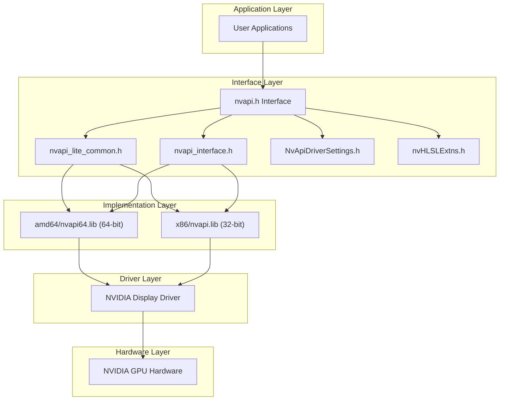

At the core of NVAPI is the `nvapi.h` header file, which serves as the main entry point for applications. This header includes several component headers that define various aspects of the API:

- `nvapi_lite_common.h`: Defines common data types, constants, and handle definitions.
- `nvapi_interface.h`: Contains interface function declarations and access methods.
- `NvApiDriverSettings.h`: Provides driver configuration and settings control.
- `nvHLSLExtns.h`: Defines shader extensions specific to NVIDIA hardware.

The implementation is contained in the platform-specific libraries:
- `nvapi64.lib` for 64-bit (AMD64) applications
- `nvapi.lib` for 32-bit (x86) applications

These libraries communicate with the NVIDIA display driver, which in turn interacts with the GPU hardware.

Sources: [nvapi.h:38-44](), [nvapi_lite_common.h:27-37](), [amd64/nvapi64.lib](), [x86/nvapi.lib]()

## Handle System and Object Model

NVAPI uses a handle-based design pattern to reference and interact with various hardware and software components. Handles are opaque pointers that represent resources such as GPUs, displays, and specialized features.

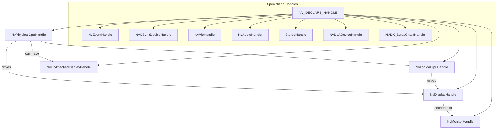

The handle system represents the hardware and software topology:

- **NvPhysicalGpuHandle**: Represents a single physical GPU in the system.
- **NvLogicalGpuHandle**: Represents one or more physical GPUs acting together (e.g., in SLI configuration).
- **NvDisplayHandle**: Represents a display device connected to an NVIDIA GPU.
- **NvUnAttachedDisplayHandle**: Represents a potential display output that's not currently connected.
- **NvMonitorHandle**: Represents a monitor connected to a display output.

Specialized handles exist for specific features like GSync (for monitor synchronization), VIO (video input/output), stereo 3D, and more.

Sources: [nvapi_lite_common.h:127-165]()

## Functional Domains

NVAPI organizes its functionality into several domains, each addressing specific aspects of GPU and display management:

```mermaid
graph TD
    subgraph "NVAPI Core"
        Init["Initialization (NvAPI_Initialize)"]
        Unload["Unloading (NvAPI_Unload)"]
        Error["Error Handling (NvAPI_GetErrorMessage)"]
        Version["Version Info (NvAPI_GetInterfaceVersionString)"]
    end
    
    subgraph "GPU Management"
        GPUEnum["GPU Enumeration
        NvAPI_EnumPhysicalGPUs
        NvAPI_EnumLogicalGPUs"]
        
        GPUInfo["GPU Information
        NvAPI_GPU_GetFullName
        NvAPI_GPU_GetGPUType
        NvAPI_GPU_GetPCIIdentifiers"]
        
        GPUPerf["Performance Monitoring
        NvAPI_GPU_GetDynamicPstatesInfoEx
        NvAPI_GPU_GetThermalSettings"]
    end
    
    subgraph "Display Management"
        DispConfig["Display Configuration
        NvAPI_DISP_GetDisplayConfig
        NvAPI_DISP_SetDisplayConfig"]
        
        DispEDID["EDID Management
        NvAPI_GPU_GetEDID
        NvAPI_GPU_SetEDID"]
        
        DispColor["Color Management
        NvAPI_Disp_ColorControl
        NvAPI_Disp_HdrColorControl"]
        
        DispHDR["HDR Capabilities
        NvAPI_Disp_GetHdrCapabilities"]
    end
    
    subgraph "Graphics API Extensions"
        D3D["Direct3D Extensions"]
        OGL["OpenGL Extensions"]
        Vulkan["Vulkan Extensions"]
        HLSL["HLSL Extensions"]
    end
    
    subgraph "Driver Settings"
        DRS["Driver Registry Settings"]
        AA["Anti-Aliasing"]
        DLSS["DLSS Settings"]
    end
    
    Init --> GPUEnum
    Init --> DispConfig
    Init --> D3D
    Init --> DRS
```

The functional domains include:

1. **Core API Functions**: Basic operations like initialization, unloading, error handling, and version information.
2. **GPU Management**: Functions for enumerating GPUs, retrieving information about them, and monitoring performance.
3. **Display Management**: Control of displays, EDID (Extended Display Identification Data) handling, color settings, and HDR capabilities.
4. **Graphics API Extensions**: NVIDIA-specific extensions for Direct3D, OpenGL, Vulkan, and HLSL.
5. **Driver Settings**: Configuration of driver behavior, including anti-aliasing, DLSS, and other graphics settings.
6. **Specialized Features**: Support for technologies like SLI, Stereo 3D, GSync, and more.

Sources: [nvapi.h:67-177](), [nvapi_lite_common.h:258-367]()

## Basic Usage Pattern

NVAPI follows a consistent usage pattern:

1. **Initialization**: Call `NvAPI_Initialize()` to initialize the NVAPI library.
2. **Handle Acquisition**: Enumerate and obtain handles to the resources you need (GPUs, displays, etc.).
3. **API Usage**: Use NVAPI functions with the acquired handles to perform operations.
4. **Cleanup**: When done, call `NvAPI_Unload()` to release NVAPI resources.

Here's a simple flow of NVAPI usage:

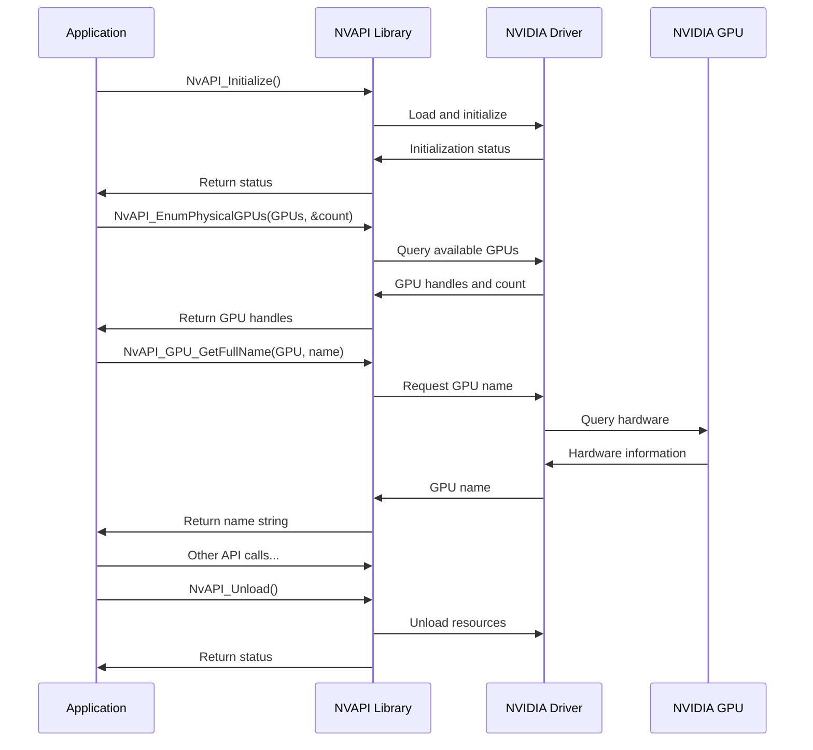

All API functions return an `NvAPI_Status` value, which should be checked to ensure operations were successful. The `NvAPI_GetErrorMessage` function can be used to convert error codes to human-readable messages.

Sources: [nvapi.h:67-118](), [nvapi.h:119-157]()

## Error Handling

NVAPI uses a comprehensive error reporting system through status codes. Every function returns an `NvAPI_Status` value that indicates success or a specific error type.

| Status Range | Description |
|--------------|-------------|
| `NVAPI_OK` (0) | Success |
| -1 to -99 | General errors (initialization, argument validation, etc.) |
| -100 to -199 | Handle and resource errors |
| -200 and beyond | Feature-specific errors |

The `NvAPI_GetErrorMessage` function converts these status codes into human-readable strings for debugging and error reporting purposes.

Sources: [nvapi_lite_common.h:261-371]()

## Platform Support

NVAPI is primarily designed for Windows operating systems:

- Windows 10 and higher
- Both 32-bit (x86) and 64-bit (x64) architectures

The API is distributed in two forms:
- 32-bit library: `x86/nvapi.lib`
- 64-bit library: `amd64/nvapi64.lib`

Applications must link against the appropriate library based on their target architecture.

Sources: [nvapi.h:34-36](), [x86/nvapi.lib](), [amd64/nvapi64.lib]()

---

# Page: Core Libraries and Interfaces

# Core Libraries and Interfaces

<details>
<summary>Relevant source files</summary>

The following files were used as context for generating this wiki page:

- [amd64/nvapi64.lib](amd64/nvapi64.lib)
- [nvapi.h](nvapi.h)
- [nvapi_interface.h](nvapi_interface.h)
- [nvapi_lite_common.h](nvapi_lite_common.h)
- [x86/nvapi.lib](x86/nvapi.lib)

</details>


This page provides a comprehensive explanation of the foundational libraries and interfaces that make up the NVIDIA API (NVAPI). NVAPI is a cross-platform toolset that enables applications to access NVIDIA GPU features and capabilities not exposed through standard operating system or graphics APIs. This document covers the core library structure, interface definitions, and common data types that serve as the foundation for the entire NVAPI.

For more detailed information about the specific library implementations, see [NVAPI Libraries](#2.1). For the main header interface structure, see [Main Header Interface](#2.2). For common data types and definitions, see [Common Types and Definitions](#2.3).

## Core Architecture Overview

The NVAPI is structured around a set of libraries and header files that provide a common interface for applications to interact with NVIDIA GPUs. The core components include the platform-specific libraries (32-bit and 64-bit), the main interface header, and common type definitions.

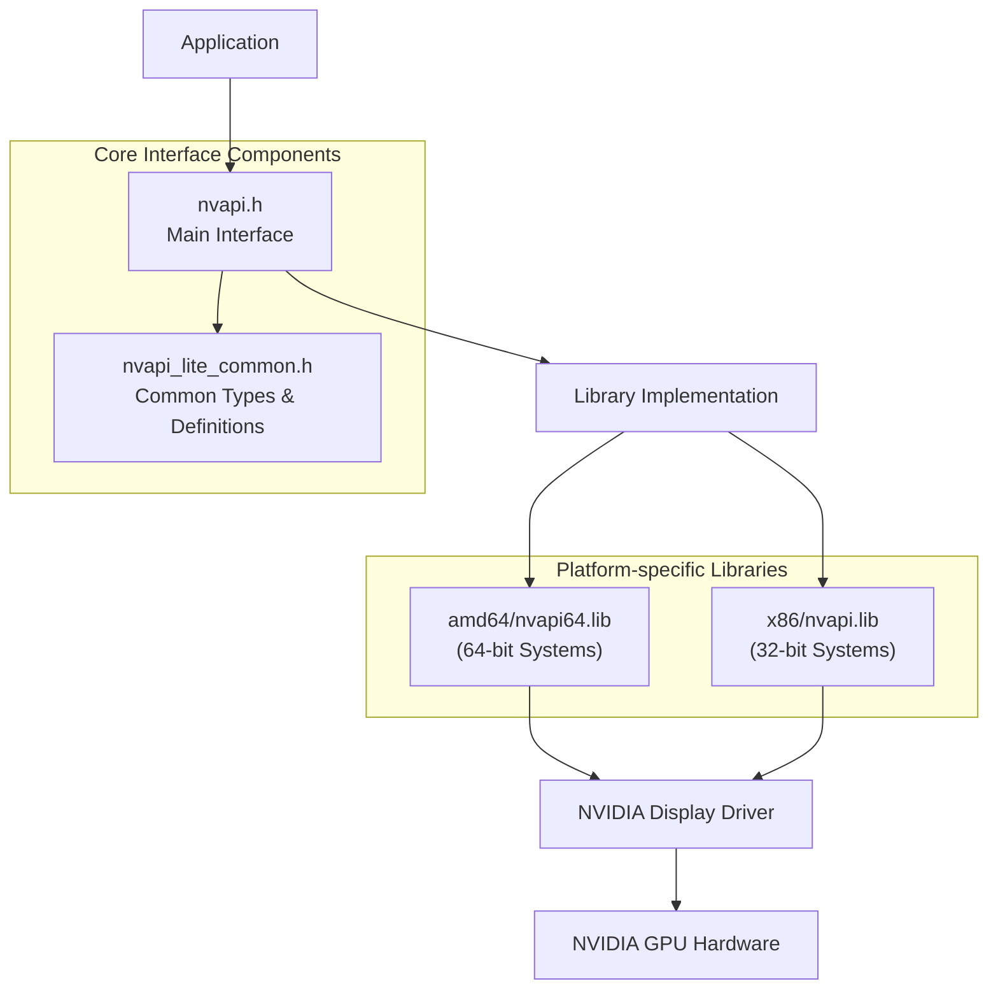

Sources:
- [amd64/nvapi64.lib]()
- [x86/nvapi.lib]()
- [nvapi.h:26-37]()
- [nvapi_lite_common.h:26-32]()

## Library Implementation

NVAPI provides platform-specific library implementations for both 32-bit and 64-bit systems. These libraries contain the actual implementation of the API functions that interface with the NVIDIA driver.

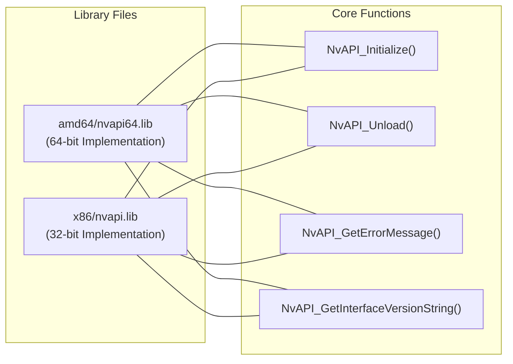

Both libraries implement the same API functions but are compiled for different architectures:

1. **64-bit Library (nvapi64.lib)**:
   - Located in the `amd64` directory
   - Used by 64-bit applications
   - Contains implementations of all NVAPI functions for x64 architecture

2. **32-bit Library (nvapi.lib)**:
   - Located in the `x86` directory
   - Used by 32-bit applications
   - Contains implementations of all NVAPI functions for x86 architecture

Applications don't need to explicitly link to these libraries. Instead, they include the `nvapi.h` header file, which sets up the appropriate library inclusion based on the compilation target architecture.

Sources:
- [amd64/nvapi64.lib]()
- [x86/nvapi.lib]()
- [nvapi.h:86-117]()

## Interface Structure

The NVAPI interface is primarily defined through header files, with `nvapi.h` serving as the main entry point. This header includes other necessary headers and defines the core API functions that applications can use.

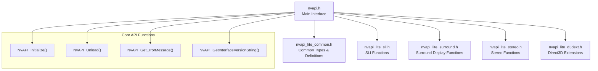

Key components of the interface structure:

1. **Main Header (nvapi.h)**:
   - Serves as the primary interface for applications
   - Includes other supporting headers
   - Defines core API functions
   - Establishes the structure for various GPU operations

2. **Core API Functions**:
   - `NvAPI_Initialize()`: Initializes the NVAPI library
   - `NvAPI_Unload()`: Unloads the NVAPI library
   - `NvAPI_GetErrorMessage()`: Converts error codes to human-readable messages
   - `NvAPI_GetInterfaceVersionString()`: Retrieves API version information

Sources:
- [nvapi.h:38-46]()
- [nvapi.h:86-177]()

## Common Types and Handle System

NVAPI defines a comprehensive set of common types and a handle system to represent various NVIDIA resources. These are primarily defined in `nvapi_lite_common.h`.

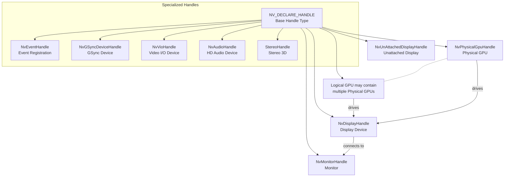

Key aspects of the common types system:

1. **Basic Data Types**:
   - Platform-independent primitive types (NvU32, NvS32, NvU64, etc.)
   - Boolean type (NvBool)
   - String types of various lengths (NvAPI_String, NvAPI_ShortString, etc.)

2. **Handle System**:
   - Opaque handles to represent GPU-related resources
   - Main hierarchy includes physical GPUs, logical GPUs, displays, and monitors
   - Specialized handles for features like GSync, stereo 3D, video I/O, etc.

3. **Status Codes**:
   - Comprehensive set of error and status codes through the `_NvAPI_Status` enumeration
   - Used by all API functions to indicate success or specific failure reasons

The table below shows the primary handle types and their purposes:

| Handle Type | Description | Role |
|-------------|-------------|------|
| NvPhysicalGpuHandle | Single physical GPU | Represents individual graphics hardware |
| NvLogicalGpuHandle | One or more physical GPUs acting in concert | Represents SLI configurations |
| NvDisplayHandle | Display device driven by NVIDIA GPU | Represents an attached display |
| NvUnAttachedDisplayHandle | Unattached display device | Represents available but not connected displays |
| NvMonitorHandle | Monitor handle | Represents the physical display monitor |
| NvEventHandle | Event registration | Used for event notification system |
| NvGSyncDeviceHandle | GSync device | For frame synchronization across displays |
| NvVioHandle | Video input/output | For professional video capture/output |
| StereoHandle | Stereo 3D | Interface for stereoscopic 3D features |

Sources:
- [nvapi_lite_common.h:127-165]()
- [nvapi_lite_common.h:91-111]()
- [nvapi_lite_common.h:260-397]()

## API Status and Error Handling

NVAPI includes a comprehensive error handling system based on status codes returned by API functions. These status codes are defined in the `_NvAPI_Status` enumeration.

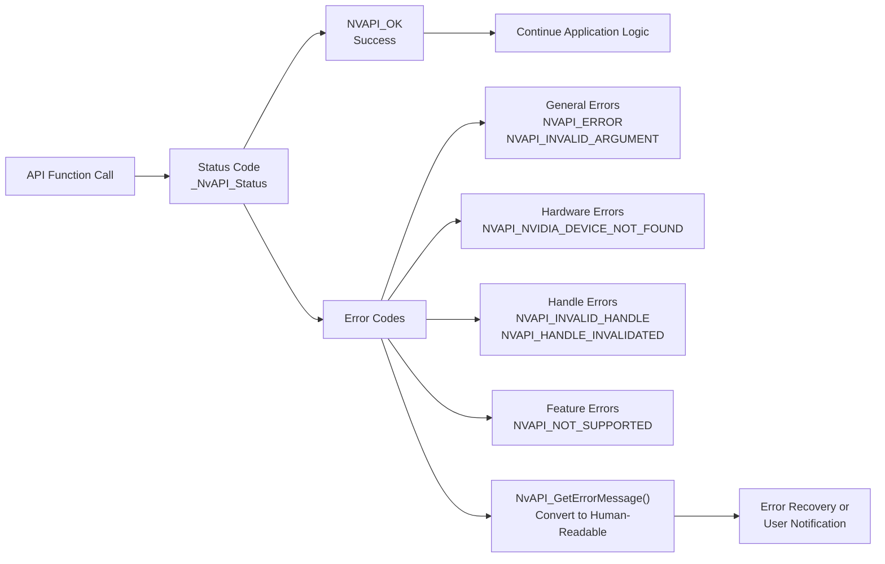

Key components of the error handling system:

1. **Status Enumeration**:
   - Defined in `nvapi_lite_common.h`
   - Ranges from success (`NVAPI_OK = 0`) to various error conditions
   - Grouped by error categories (general, hardware, handle-related, etc.)

2. **Error Message Function**:
   - `NvAPI_GetErrorMessage()` converts status codes to human-readable strings
   - Allows applications to present meaningful error messages to users

3. **Common Error Patterns**:
   - Initialization errors: `NVAPI_API_NOT_INITIALIZED`, `NVAPI_LIBRARY_NOT_FOUND`
   - Hardware errors: `NVAPI_NVIDIA_DEVICE_NOT_FOUND`
   - Parameter errors: `NVAPI_INVALID_ARGUMENT`, `NVAPI_INVALID_POINTER`
   - Handle errors: `NVAPI_INVALID_HANDLE`, `NVAPI_HANDLE_INVALIDATED`
   - Feature support: `NVAPI_NOT_SUPPORTED`, `NVAPI_NO_IMPLEMENTATION`

Example usage pattern for error handling:

```
NvAPI_Status status = NvAPI_SomeFunction(parameters);
if (status != NVAPI_OK) {
    NvAPI_ShortString errorMessage;
    NvAPI_GetErrorMessage(status, errorMessage);
    // Handle error or display message
}
```

Sources:
- [nvapi_lite_common.h:260-397]()
- [nvapi.h:123-137]()

## Version and Compatibility System

NVAPI includes a versioning system to handle structure versioning and API compatibility. This allows for forward and backward compatibility as the API evolves.

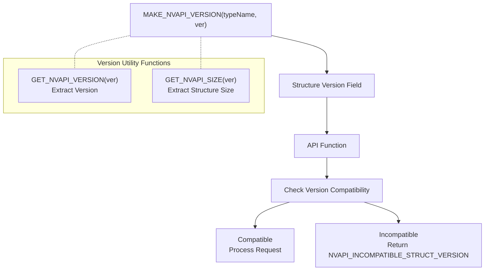

Key aspects of the versioning system:

1. **Structure Versioning Macro**:
   - `MAKE_NVAPI_VERSION(typeName, ver)` combines structure size with version number
   - Each structure includes a `version` field initialized with this macro
   - Allows API functions to verify both structure size and version

2. **Version Extraction**:
   - `GET_NVAPI_VERSION(ver)` extracts the version number
   - `GET_NVAPI_SIZE(ver)` extracts the structure size

3. **Version Utility Functions**:
   - `NvAPI_GetInterfaceVersionString()` returns human-readable API version
   - `NvAPI_GetInterfaceVersionStringEx()` enhanced version information

This versioning system allows NVAPI to evolve while maintaining compatibility with applications built against older versions of the API.

Sources:
- [nvapi_lite_common.h:244-251]()
- [nvapi.h:157-177]()

## Core API Lifecycle

The NVAPI has a specific lifecycle that applications must follow to properly initialize, use, and clean up the API.

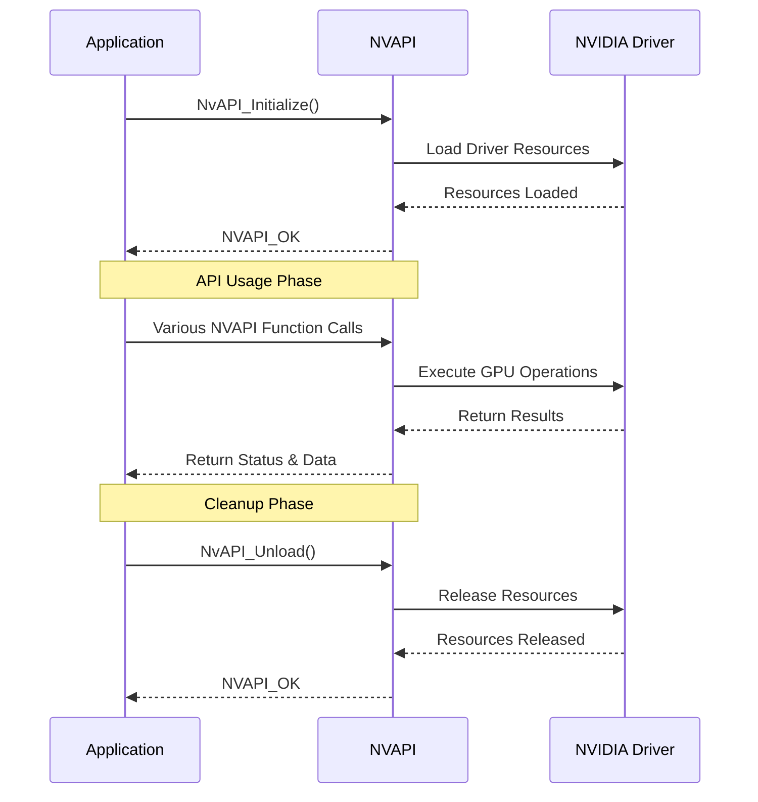

Key aspects of the API lifecycle:

1. **Initialization**:
   - Application must call `NvAPI_Initialize()` before any other function
   - Initializes internal state and loads appropriate libraries
   - Returns `NVAPI_OK` on success or an error code on failure

2. **Usage**:
   - Application can call any NVAPI functions
   - Each function returns a status code indicating success or failure
   - Some resources may be allocated during API usage

3. **Cleanup**:
   - Application should call `NvAPI_Unload()` when done with NVAPI
   - Releases resources and decrements internal reference counter
   - When counter reaches zero, unloads NVAPI library

It's important to note that initialization and unloading are reference-counted, meaning they can be called multiple times as long as each call to `NvAPI_Initialize()` is matched with a call to `NvAPI_Unload()`.

Sources:
- [nvapi.h:69-117]()

## Conclusion

The Core Libraries and Interfaces form the foundation of the NVIDIA API, providing a consistent and robust interface for applications to interact with NVIDIA GPUs. The architecture is designed to support both 32-bit and 64-bit platforms, provide comprehensive error handling, ensure forward and backward compatibility, and manage resources properly throughout the API lifecycle.

By understanding these core components, developers can effectively use NVAPI to access advanced NVIDIA GPU features in their applications, while ensuring proper initialization, error handling, and cleanup.

---

# Page: NVAPI Libraries

# NVAPI Libraries

<details>
<summary>Relevant source files</summary>

The following files were used as context for generating this wiki page:

- [amd64/nvapi64.lib](amd64/nvapi64.lib)
- [x86/nvapi.lib](x86/nvapi.lib)

</details>


This page details the NVIDIA API (NVAPI) library implementation, focusing on the 32-bit and 64-bit libraries that form the core binary components of the NVAPI. These libraries provide the executable code that bridges applications and NVIDIA GPU drivers, enabling access to NVIDIA-specific hardware features beyond what standard graphics APIs offer.

For information about the main interface header, see [Main Header Interface](#2.2). For details on common data types used throughout NVAPI, see [Common Types and Definitions](#2.3).

## Library Architecture

NVAPI provides two primary binary libraries:

| Library File | Architecture | Description |
|--------------|--------------|-------------|
| `amd64/nvapi64.lib` | 64-bit (x64) | Library for 64-bit applications |
| `x86/nvapi.lib` | 32-bit (x86) | Library for 32-bit applications |

These libraries act as intermediaries between applications and the NVIDIA graphics driver. They primarily contain function stubs that forward calls to the actual implementations in the driver.

### Architecture Diagram

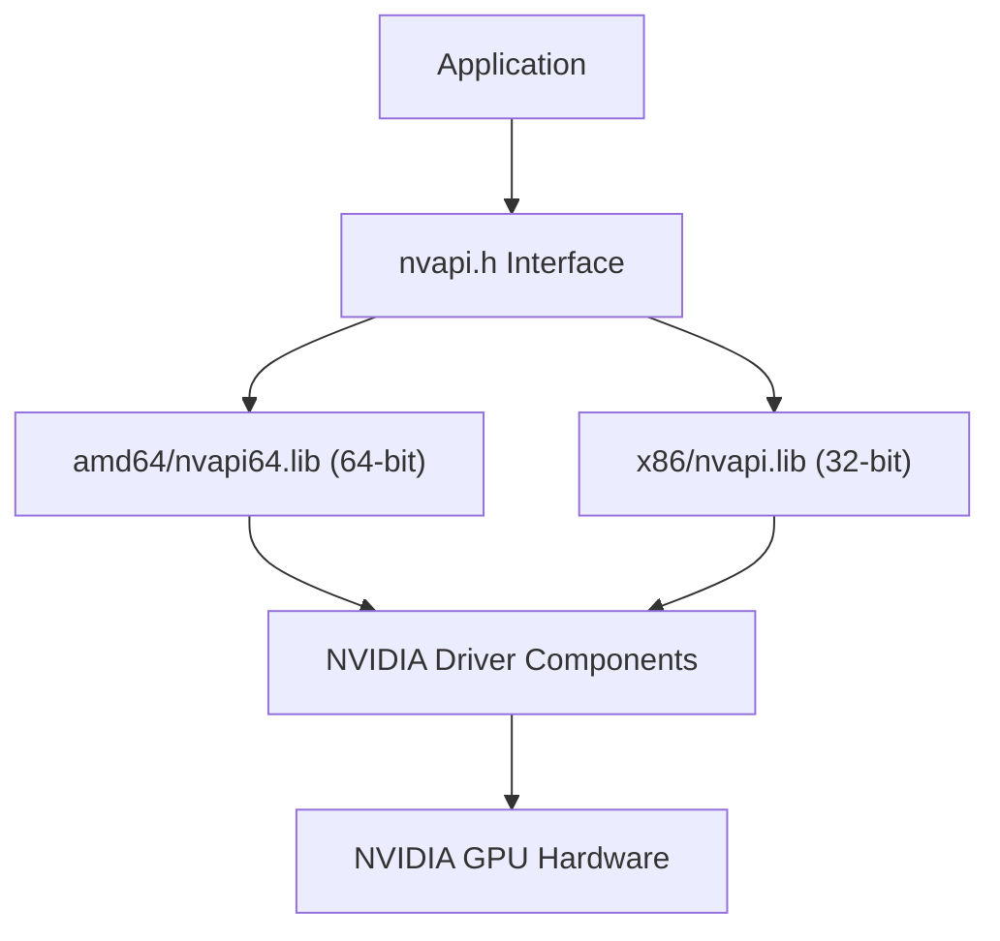

Sources: [amd64/nvapi64.lib]()

## Library Implementation

The NVAPI libraries themselves contain minimal implementation. They primarily:

1. Provide function entry points that applications link against
2. Handle API initialization and module loading from the driver
3. Forward function calls to the appropriate driver implementations
4. Process return values and errors

### Loading and Initialization Process

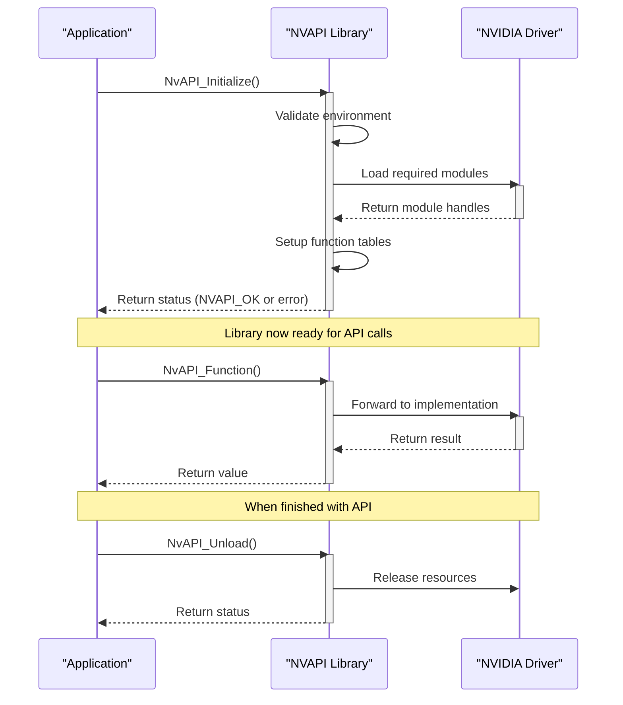

The library initialization is handled by several internal functions:

- `NvAPI_Initialize()` - User-facing initialization function
- `?NvAPI_InitializeEx@@YA?AW4_NvAPI_Status@@W4_NV_DRIVER_TYPE@@@Z` - Extended initialization with driver type specification
- `?LoadModule@@YA?AW4_NvAPI_Status@@W4_NVAPI_MODULE_ID@@W4_NV_DRIVER_TYPE@@@Z` - Dynamic module loading function

Sources: [amd64/nvapi64.lib]()

## Exported Functions

The NVAPI libraries export over 800 functions providing access to various NVIDIA GPU capabilities, organized into functional categories.

### Function Categories

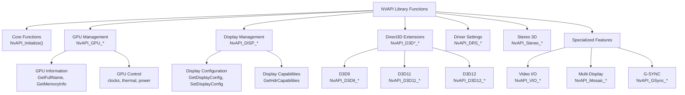

Sources: [amd64/nvapi64.lib]()

### Function Count by Category

| Category | Prefix | Examples |
|----------|--------|----------|
| Direct3D 12 | `NvAPI_D3D12_` | `NvAPI_D3D12_CreateHeap()`, `NvAPI_D3D12_SetDepthBoundsTestValues()` |
| Direct3D 11 | `NvAPI_D3D11_` | `NvAPI_D3D11_CreateDevice()`, `NvAPI_D3D11_SetDepthBoundsTest()` |
| GPU | `NvAPI_GPU_` | `NvAPI_GPU_GetFullName()`, `NvAPI_GPU_GetMemoryInfo()` |
| Stereo 3D | `NvAPI_Stereo_` | `NvAPI_Stereo_Enable()`, `NvAPI_Stereo_SetSeparation()` |
| Display | `NvAPI_DISP_` | `NvAPI_DISP_GetDisplayConfig()`, `NvAPI_DISP_GetMonitorCapabilities()` |
| Driver Settings | `NvAPI_DRS_` | `NvAPI_DRS_CreateProfile()`, `NvAPI_DRS_SetSetting()` |
| Direct3D 9 | `NvAPI_D3D9_` | `NvAPI_D3D9_RegisterResource()`, `NvAPI_D3D9_CreateSwapChain()` |

Sources: [amd64/nvapi64.lib]()

## Internal Components

While most implementation resides in the NVIDIA driver, the libraries contain several internal components:

### Security Mechanisms

The libraries implement security measures to ensure integrity:

1. **Signature Verification**: Functions like `nvVerifyFileSignatureW()` validate the authenticity of NVIDIA components
2. **Secure Loading**: `nvLoadSignedLibraryExA()` and related functions ensure only trusted modules are loaded
3. **Critical Section Management**: `CAutoCriticalSection` and `CSingletonCriticalSection` classes provide thread synchronization

### Module Management

Internal functions handle dynamic loading of NVIDIA driver components:

- **Module Loading**: `?LoadModule@@YA?AW4_NvAPI_Status@@W4_NVAPI_MODULE_ID@@W4_NV_DRIVER_TYPE@@@Z`
- **Module Validation**: `?ValidateModuleHandle@@YA?AW4_NvAPI_Status@@W4_NVAPI_MODULE_ID@@W4_NV_DRIVER_TYPE@@@Z`
- **Module Unloading**: `?NvAPI_UnloadEx@@YA?AW4_NvAPI_Status@@W4_NV_DRIVER_TYPE@@@Z`

### Error Handling

All NVAPI functions return an `NvAPI_Status` value indicating success or failure. Common status codes include:
- `NVAPI_OK` (0): Operation successful
- `NVAPI_ERROR` (-1): Generic error
- `NVAPI_INVALID_ARGUMENT` (-5): One or more arguments are invalid
- `NVAPI_NOT_SUPPORTED` (-12): Requested feature not supported

The library provides `NvAPI_GetErrorMessage()` to convert these codes to human-readable text.

Sources: [amd64/nvapi64.lib]()

## Usage Guidelines

### Initialization and Cleanup

Applications using NVAPI must:

1. Call `NvAPI_Initialize()` before using any other NVAPI functions
2. Check the return status of each NVAPI function call
3. Call `NvAPI_Unload()` when finished to release resources

### Library Selection

- 64-bit applications should link against `amd64/nvapi64.lib`
- 32-bit applications should link against `x86/nvapi.lib`

### Thread Safety

Many NVAPI functions are thread-safe, but developers should:
- Avoid calling `NvAPI_Initialize()` or `NvAPI_Unload()` from multiple threads simultaneously
- Use their own synchronization when accessing shared resources returned by NVAPI
- Check documentation for specific thread safety requirements of individual functions

### Error Handling Example

```c
NvAPI_Status status = NvAPI_Initialize();
if (status != NVAPI_OK) {
    char errorMessage[256];
    NvAPI_GetErrorMessage(status, errorMessage);
    // Log or display error message
    // Handle initialization failure
}
```

Sources: [amd64/nvapi64.lib]()

## Versioning and Compatibility

The NVAPI libraries maintain compatibility with different driver versions through:

1. **Function Discovery**: Applications can query for function pointers using `nvapi_QueryInterface()` to check availability
2. **Version Information**: `NvAPI_GetInterfaceVersionString()` provides version details
3. **Feature Detection**: Many subsystems offer capability query functions to determine feature support

This allows applications to work across multiple driver versions by adapting to available functionality.

Sources: [amd64/nvapi64.lib]()

---

# Page: Main Header Interface

# Main Header Interface

<details>
<summary>Relevant source files</summary>

The following files were used as context for generating this wiki page:

- [nvapi.h](nvapi.h)
- [nvapi_interface.h](nvapi_interface.h)
- [nvapi_lite_common.h](nvapi_lite_common.h)

</details>


The Main Header Interface (`nvapi.h`) serves as the primary interface file for the NVIDIA API (NVAPI). It defines the function prototypes, structure definitions, constants, and type declarations that applications use to interact with NVIDIA GPUs and displays. This header file is the entry point for all NVAPI functionality, providing a standardized way for software to access and control various aspects of NVIDIA hardware.

For information about specific implementations of these interfaces, see [Core Libraries and Interfaces](#2).

Sources: [nvapi.h:26-37]()

## File Structure and Organization

The `nvapi.h` header is organized hierarchically, including several supporting headers that provide common definitions and interface identifiers:

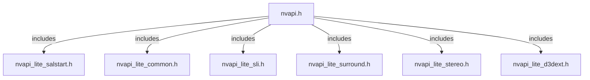

The file is structured into several main sections:
1. Universal NVAPI definitions and types
2. Core API functions (initialization, error handling, version info)
3. Display-related structures and functions
4. GPU-related structures and functions
5. Specialized functionality (Stereo 3D, SLI, etc.)

Sources: [nvapi.h:38-43]()

## Core API Functions

### Initialization and Shutdown

Before using any NVAPI functionality, applications must initialize the API and should unload it when finished:

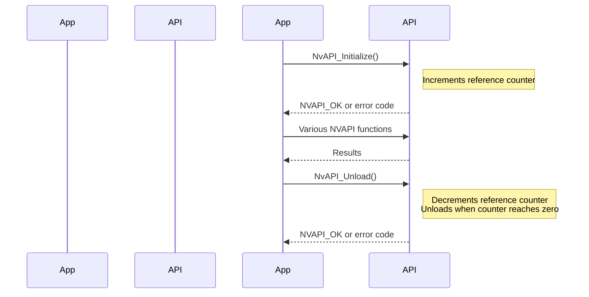

Key initialization functions:
- `NvAPI_Initialize()`: Initializes the NVAPI library (required before calling other functions)
- `NvAPI_Unload()`: Decrements the reference counter and unloads the library when it reaches zero

Sources: [nvapi.h:68-117]()

### Error Handling and Version Information

All NVAPI functions return a status code of type `NvAPI_Status`. Applications can convert error codes to human-readable messages:

```
NvAPI_Status status = NvAPI_SomeFunction();
if (status != NVAPI_OK)
{
    NvAPI_ShortString errorMessage;
    NvAPI_GetErrorMessage(status, errorMessage);
    // Handle error...
}
```

Key utility functions:
- `NvAPI_GetErrorMessage()`: Converts an error code to a human-readable string
- `NvAPI_GetInterfaceVersionString()`: Returns version information about the NVAPI library
- `NvAPI_GetInterfaceVersionStringEx()`: Extended version of the above function

Sources: [nvapi.h:119-177](), [nvapi_lite_common.h:259-425]()

## Handle Types and Hierarchy

NVAPI uses a system of opaque handles to reference various hardware and software resources. These handles are declared using the `NV_DECLARE_HANDLE` macro:

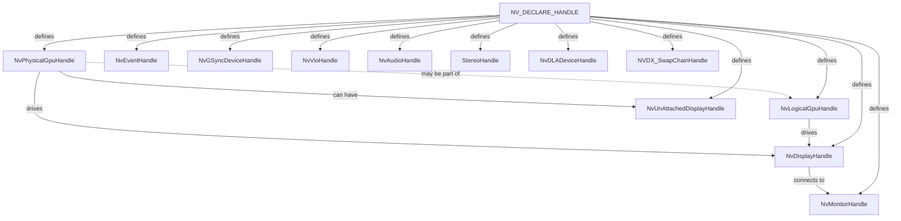

Main handle types include:
- `NvPhysicalGpuHandle`: Represents a single physical GPU
- `NvLogicalGpuHandle`: Represents one or more physical GPUs acting in concert (SLI)
- `NvDisplayHandle`: Represents a display device driven by NVIDIA GPU(s)
- `NvUnAttachedDisplayHandle`: Represents an unattached display device
- `NvMonitorHandle`: Represents a monitor handle
- Various specialized handles for specific features (GSync, VIO, stereo 3D, etc.)

Sources: [nvapi_lite_common.h:127-165]()

## Structure Versioning System

NVAPI uses a versioning system for structures to maintain backward compatibility. This is implemented through version fields and macros:

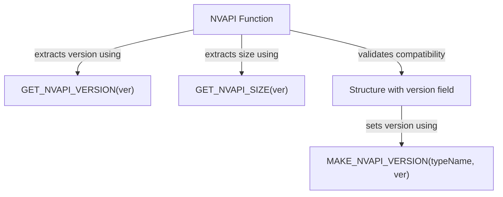

The versioning system works as follows:
1. Each structure has a `version` field as its first member
2. The `MAKE_NVAPI_VERSION` macro combines the structure size and version number into a 32-bit value
3. When calling an API function, the application sets the version field
4. The API function validates the version for compatibility

Example of versioned structures:
- `NV_EDID_V1`, `NV_EDID_V2`, `NV_EDID_V3`: Different versions of the EDID structure
- `NV_DISPLAY_PATH_INFO_V1`, `NV_DISPLAY_PATH_INFO_V2`: Different versions of the display path structure

Sources: [nvapi_lite_common.h:239-251](), [nvapi.h:291-324](), [nvapi.h:997-1034]()

## Major Functional Categories

The NVAPI header defines functions across several categories:

### GPU Management

Functions for enumerating and querying information about GPUs:
- `NvAPI_EnumPhysicalGPUs()`: Enumerates physical GPUs in the system
- `NvAPI_GPU_GetEDID()`: Retrieves EDID data from a display connected to a GPU
- `NvAPI_GPU_GetMemoryInfo()`: Retrieves memory information for a GPU

Sources: [nvapi.h:263-327](), [nvapi.h:533-535](), [nvapi_lite_common.h:598-630]()

### Display Management

Functions for configuring and querying displays:
- `NvAPI_SetView()`: Modifies display arrangements in various view modes
- `NvAPI_SetViewEx()`: Extended version with more configuration options
- `NvAPI_DISP_SetDisplayConfig()`: Sets display configuration using path-based approach

Sources: [nvapi.h:677-869]()

### Display Configuration Data Structures

Structures for detailed display configuration:

| Structure Name | Purpose |
|----------------|---------|
| `NV_VIEW_TARGET_INFO` | Basic target display information for SetView |
| `NV_DISPLAY_PATH` | Detailed display path configuration information |
| `NV_DISPLAY_PATH_INFO` | Container for multiple display paths |
| `NV_DISPLAYCONFIG_PATH_INFO` | Advanced display configuration structure |

Sources: [nvapi.h:706-726](), [nvapi.h:772-825](), [nvapi.h:942-1034]()

### Display Output Standards

The API supports various display output standards and formats:

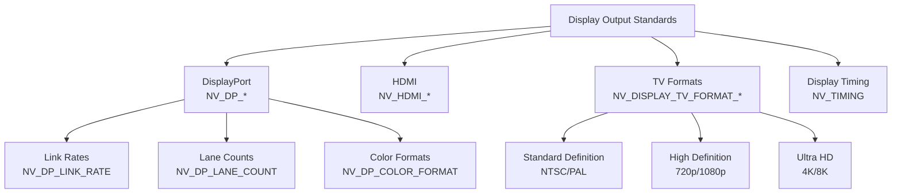

Sources: [nvapi.h:190-257](), [nvapi.h:391-463](), [nvapi.h:591-656]()

## Function Interface Mechanism

NVAPI uses a special mechanism for resolving function addresses:

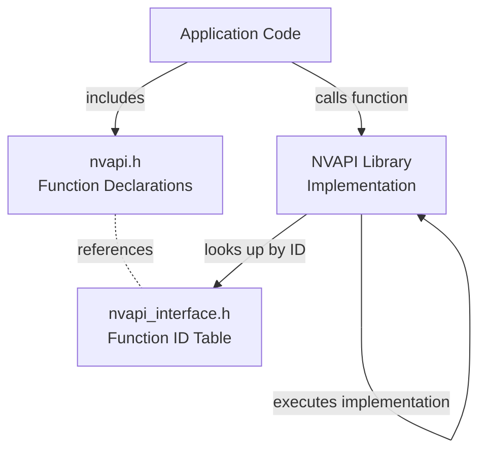

The function resolution works as follows:
1. Functions are declared in `nvapi.h` with the `NVAPI_INTERFACE` macro
2. Each function has a unique hexadecimal ID defined in `nvapi_interface.h`
3. At runtime, these IDs are used to resolve the actual function pointers

This approach allows NVAPI to maintain binary compatibility across different driver versions.

Sources: [nvapi_interface.h:30-544]()

## Common Data Types and Structures

### Basic Types

NVAPI defines type aliases for standard types to ensure consistent sizes:

| NVAPI Type | Description |
|------------|-------------|
| `NvU8` | 8-bit unsigned integer |
| `NvS8` | 8-bit signed integer |
| `NvU16` | 16-bit unsigned integer |
| `NvS16` | 16-bit signed integer |
| `NvU32` | 32-bit unsigned integer |
| `NvS32` | 32-bit signed integer |
| `NvU64` | 64-bit unsigned integer |
| `NvS64` | 64-bit signed integer |
| `NvF32` | 32-bit floating point |
| `NvF64` | 64-bit floating point |
| `NvBool` | Boolean type (8-bit) |

Sources: [nvapi_lite_common.h:56-116]()

### String Types

Several string types with predefined maximum lengths:

| NVAPI Type | Description |
|------------|-------------|
| `NvAPI_String` | Generic string (4096 chars) |
| `NvAPI_LongString` | Long string (256 chars) |
| `NvAPI_ShortString` | Short string (64 chars) |

Sources: [nvapi_lite_common.h:177-235]()

### Specialized Structures

The header defines many specialized structures for various purposes:

- `NV_EDID`: Contains EDID data for a display
- `NV_TIMING`: Display timing information
- `NV_DISPLAY_DRIVER_VERSION`: Driver version information
- `NV_GPU_MEMORY_INFO_EX`: GPU memory information

Sources: [nvapi.h:287-324](), [nvapi.h:591-656](), [nvapi.h:1339-1348](), [nvapi_lite_common.h:539-567]()

## Integration with NVAPI System

The Main Header Interface integrates with the broader NVAPI system:

```mermaid
graph TD
    Applications["Applications"]
    nvapih["nvapi.h<br>Main Header Interface"]
    common["nvapi_lite_common.h<br>Common Definitions"]
    interface["nvapi_interface.h<br>Function IDs"]
    libs["NVAPI Libraries<br>(nvapi64.lib/nvapi.lib)"]
    driver["NVIDIA Display Driver"]
    gpu["NVIDIA GPU Hardware"]
    
    Applications -->|"uses"| nvapih
    nvapih -->|"includes"| common
    nvapih -.-|"references"| interface
    nvapih -->|"implemented by"| libs
    libs -->|"communicates with"| driver
    driver -->|"controls"| gpu
```

The hierarchical structure allows:
1. Clean separation between interface and implementation
2. Version compatibility across driver releases
3. Support for both 32-bit and 64-bit applications
4. Consistent API regardless of underlying hardware changes

Sources: [nvapi.h:38-43](), [nvapi_interface.h:30-31]()

## Key Benefits and Usage Guidelines

Benefits of the Main Header Interface design:
- **Stability**: Applications can rely on consistent API behavior
- **Versioning**: Structure versioning enables backward compatibility
- **Flexibility**: The handle-based design allows opaque references without exposing internal details
- **Extensibility**: New functionality can be added without breaking existing code

Usage guidelines:
1. Always call `NvAPI_Initialize()` before using any other functions
2. Always check return values for errors
3. Use the versioning macros properly when working with structures
4. Properly clean up with `NvAPI_Unload()` when done

Sources: [nvapi.h:68-117]()

---

# Page: Common Types and Definitions

# Common Types and Definitions

<details>
<summary>Relevant source files</summary>

The following files were used as context for generating this wiki page:

- [nvapi.h](nvapi.h)
- [nvapi_lite_common.h](nvapi_lite_common.h)

</details>


## Purpose and Scope

This document describes the common data types, handles, constants, and definitions used throughout the NVIDIA API (NVAPI). These fundamental elements form the building blocks for all NVAPI functionality and are defined in the core header files. Understanding these types is essential for effectively working with the API and developing applications that leverage NVIDIA GPU capabilities.

## Basic Data Types

NVAPI defines a set of cross-platform data types to ensure consistency across different environments and compilers.

### Integer Types

| Type    | Description                 | Range                          |
|---------|-----------------------------|---------------------------------|
| NvU8    | Unsigned 8-bit integer      | 0 to 255                        |
| NvS8    | Signed 8-bit integer        | -128 to 127                     |
| NvU16   | Unsigned 16-bit integer     | 0 to 65,535                     |
| NvS16   | Signed 16-bit integer       | -32,768 to 32,767               |
| NvU32   | Unsigned 32-bit integer     | 0 to 4,294,967,295              |
| NvS32   | Signed 32-bit integer       | -2,147,483,648 to 2,147,483,647 |
| NvU64   | Unsigned 64-bit integer     | 0 to 18,446,744,073,709,551,615 |
| NvS64   | Signed 64-bit integer       | -9,223,372,036,854,775,808 to 9,223,372,036,854,775,807 |

### Floating Point Types

| Type    | Description                 | Equivalent C Type               |
|---------|-----------------------------|---------------------------------|
| NvF32   | 32-bit floating point       | float                           |
| NvF64   | 64-bit floating point       | double                          |

### Boolean Type

| Type    | Description                 | Based On                        |
|---------|-----------------------------|---------------------------------|
| NvBool  | Boolean type                | NvU8                            |

Boolean constants are defined as:
```
#define NV_TRUE           ((NvBool)(0 == 0))
#define NV_FALSE          ((NvBool)(0 != 0))
```

Sources: [nvapi_lite_common.h:49-116]()

### String Types

NVAPI defines various string buffer types with different maximum lengths:

| Type                    | Description                | Max Length      |
|-------------------------|----------------------------|-----------------|
| NvAPI_String            | Generic string buffer      | 4096 characters |
| NvAPI_LongString        | Long string buffer         | 256 characters  |
| NvAPI_ShortString       | Short string buffer        | 64 characters   |
| NvAPI_UnicodeShortString| Unicode short string buffer| 64 characters   |

Sources: [nvapi_lite_common.h:177-235]()

## Handle Types

NVAPI uses opaque handles to represent various hardware and software resources like GPUs, displays, and other devices. These are created using the `NV_DECLARE_HANDLE` macro, which defines a pointer to an opaque structure, making the handles type-safe.

```c
#define NV_DECLARE_HANDLE(name) struct name##__ { int unused; }; typedef struct name##__ *name
```

### NVAPI Handle Hierarchy

```mermaid
graph TD
    NV["NV_DECLARE_HANDLE"] --> PhysGPU["NvPhysicalGpuHandle"]
    NV --> LogGPU["NvLogicalGpuHandle"]
    NV --> DispH["NvDisplayHandle"]
    NV --> UnattDisp["NvUnAttachedDisplayHandle"]
    NV --> MonH["NvMonitorHandle"]
    
    PhysGPU -..- LogGPU
    LogGPU -->|"drives"| DispH
    PhysGPU -->|"drives"| DispH
    DispH -->|"connects to"| MonH
    PhysGPU -->|"can have"| UnattDisp
    
    subgraph "Specialized Handles"
        NV --> EventH["NvEventHandle"]
        NV --> GSyncDev["NvGSyncDeviceHandle"]
        NV --> VioH["NvVioHandle"]
        NV --> AudioH["NvAudioHandle"]
        NV --> Stereo["StereoHandle"]
        NV --> DLA["NvDLADeviceHandle"]
        NV --> NVDX["NVDX_SwapChainHandle"]
    end
```

### Common NVAPI Handles

| Handle Type               | Description                                    |
|---------------------------|------------------------------------------------|
| NvPhysicalGpuHandle       | A single physical GPU                          |
| NvLogicalGpuHandle        | One or more physical GPUs acting in concert (SLI) |
| NvDisplayHandle           | Display device driven by NVIDIA GPU(s)         |
| NvUnAttachedDisplayHandle | Unattached display device driven by NVIDIA GPU(s) |
| NvMonitorHandle           | Monitor handle                                 |
| NvEventHandle             | Event registration instance                    |
| NvGSyncDeviceHandle       | Sync device                                    |
| NvVioHandle               | SDI device                                     |
| NvAudioHandle             | NVIDIA HD Audio Device                         |
| StereoHandle              | Stereo device interface                        |
| NVDX_SwapChainHandle      | DirectX SwapChain objects                      |

Sources: [nvapi_lite_common.h:127-165]()

## Constants and Limits

NVAPI defines various constants and limits that are used throughout the API.

### Numeric Limits

| Constant    | Value                | Description                  |
|-------------|----------------------|------------------------------|
| NV_U8_MAX   | 255                  | Maximum value for NvU8       |
| NV_U16_MAX  | 65,535               | Maximum value for NvU16      |
| NV_S32_MAX  | 2,147,483,647        | Maximum value for NvS32      |
| NV_U32_MIN  | 0                    | Minimum value for NvU32      |
| NV_U32_MAX  | 4,294,967,295        | Maximum value for NvU32      |
| NV_U64_MAX  | 18,446,744,073,709,551,615 | Maximum value for NvU64 |

### Resource Limits

| Constant                    | Value | Description                             |
|-----------------------------|-------|-----------------------------------------|
| NVAPI_MAX_PHYSICAL_GPUS     | 64    | Maximum number of physical GPUs         |
| NVAPI_MAX_LOGICAL_GPUS      | 64    | Maximum number of logical GPUs          |
| NVAPI_PHYSICAL_GPUS         | 32    | Legacy constant for physical GPUs       |
| NVAPI_MAX_DISPLAY_HEADS     | 2     | Maximum display heads per GPU           |
| NVAPI_ADVANCED_DISPLAY_HEADS| 4     | Advanced display heads per GPU          |
| NVAPI_MAX_DISPLAYS          | NVAPI_PHYSICAL_GPUS * NVAPI_ADVANCED_DISPLAY_HEADS | Maximum displays |

Sources: [nvapi_lite_common.h:49-54](), [nvapi_lite_common.h:202-224]()

## Common Structures

### Rectangle and Box Structures

| Structure | Fields                              | Description                           |
|-----------|-------------------------------------|---------------------------------------|
| NV_RECT   | NvU32 left, top, right, bottom      | Rectangle with unsigned 32-bit values |
| NvSBox    | NvS32 sX, sY, sWidth, sHeight       | Box with signed 32-bit values         |

### ID Structures

| Structure | Fields                                     | Description                 |
|-----------|-------------------------------------------|-----------------------------|
| NvGUID    | NvU32 data1, NvU16 data2, NvU16 data3, NvU8 data4[8] | Globally unique identifier |
| NvLUID    | Same as NvGUID                             | Locally unique identifier   |

Sources: [nvapi_lite_common.h:118-198]()

## Version Macros

NVAPI provides macros for creating and extracting version information from structures:

```c
#define MAKE_NVAPI_VERSION(typeName,ver) (NvU32)(sizeof(typeName) | ((ver)<<16))
#define GET_NVAPI_VERSION(ver) (NvU32)((ver)>>16)
#define GET_NVAPI_SIZE(ver) (NvU32)((ver) & 0xffff)
```

These macros are used throughout NVAPI to ensure compatibility between different versions of structures. The version field is typically the first member of NVAPI structures.

Sources: [nvapi_lite_common.h:244-251]()

## DisplayPort Definitions

NVAPI includes several enumerations for configuring DisplayPort connections.

```mermaid
graph TD
    DP["DisplayPort Enumerations"] --> LinkRate["NV_DP_LINK_RATE"]
    DP --> LaneCount["NV_DP_LANE_COUNT"]
    DP --> ColorFormat["NV_DP_COLOR_FORMAT"]
    DP --> Colorimetry["NV_DP_COLORIMETRY"]
    DP --> DynamicRange["NV_DP_DYNAMIC_RANGE"]
    DP --> BPC["NV_DP_BPC"]
    
    LinkRate --> LR162["NV_DP_1_62GBPS (6)"]
    LinkRate --> LR270["NV_DP_2_70GBPS (0xA)"]
    LinkRate --> LR540["NV_DP_5_40GBPS (0x14)"]
    LinkRate --> LR810["NV_DP_8_10GBPS (0x1E)"]
    
    LaneCount --> LC1["NV_DP_1_LANE (1)"]
    LaneCount --> LC2["NV_DP_2_LANE (2)"]
    LaneCount --> LC4["NV_DP_4_LANE (4)"]
    
    ColorFormat --> CFRGB["NV_DP_COLOR_FORMAT_RGB (0)"]
    ColorFormat --> CFYCBCR422["NV_DP_COLOR_FORMAT_YCbCr422 (1)"]
    ColorFormat --> CFYCBCR444["NV_DP_COLOR_FORMAT_YCbCr444 (2)"]
    
    BPC --> BPC_DEF["NV_DP_BPC_DEFAULT (0)"]
    BPC --> BPC_6["NV_DP_BPC_6 (1)"]
    BPC --> BPC_8["NV_DP_BPC_8 (2)"]
    BPC --> BPC_10["NV_DP_BPC_10 (3)"]
    BPC --> BPC_12["NV_DP_BPC_12 (4)"]
    BPC --> BPC_16["NV_DP_BPC_16 (5)"]
```

Sources: [nvapi.h:191-254]()

## GPU Connector Types

NVAPI defines an enumeration `NV_GPU_CONNECTOR_TYPE` for different types of GPU connectors:

| Connector Type                           | Value     | Description                   |
|-----------------------------------------|-----------|-------------------------------|
| NVAPI_GPU_CONNECTOR_VGA_15_PIN          | 0x00000000 | VGA 15-pin connector         |
| NVAPI_GPU_CONNECTOR_DVI_I               | 0x00000030 | DVI-I connector              |
| NVAPI_GPU_CONNECTOR_DVI_D               | 0x00000031 | DVI-D connector              |
| NVAPI_GPU_CONNECTOR_HDMI_A              | 0x00000061 | HDMI Type A connector        |
| NVAPI_GPU_CONNECTOR_HDMI_C_MINI         | 0x00000063 | HDMI Type C (Mini) connector |
| NVAPI_GPU_CONNECTOR_DISPLAYPORT_EXTERNAL| 0x00000046 | DisplayPort external connector |
| NVAPI_GPU_CONNECTOR_DISPLAYPORT_INTERNAL| 0x00000047 | DisplayPort internal connector |
| NVAPI_GPU_CONNECTOR_DISPLAYPORT_MINI_EXT| 0x00000048 | DisplayPort Mini external connector |
| NVAPI_GPU_CONNECTOR_USB_C               | 0x00000071 | USB Type-C connector         |

Sources: [nvapi.h:350-381]()

## Display Configuration Types

### View Modes

The `NV_TARGET_VIEW_MODE` enumeration defines different display layout configurations:

| View Mode              | Value | Description                               |
|------------------------|-------|-------------------------------------------|
| NV_VIEW_MODE_STANDARD  | 0     | Standard view mode (single display)       |
| NV_VIEW_MODE_CLONE     | 1     | Clone view mode (same content on multiple displays) |
| NV_VIEW_MODE_HSPAN     | 2     | Horizontal span view mode                 |
| NV_VIEW_MODE_VSPAN     | 3     | Vertical span view mode                   |
| NV_VIEW_MODE_DUALVIEW  | 4     | Dual view mode                            |
| NV_VIEW_MODE_MULTIVIEW | 5     | Multi-view mode                           |

### Scaling Modes

The `NV_SCALING` enumeration defines different display scaling options:

| Scaling Mode                               | Value | Description                    |
|-------------------------------------------|-------|--------------------------------|
| NV_SCALING_DEFAULT                         | 0     | No change                      |
| NV_SCALING_GPU_SCALING_TO_CLOSEST          | 1     | Balanced - Full Screen         |
| NV_SCALING_GPU_SCALING_TO_NATIVE           | 2     | Force GPU - Full Screen        |
| NV_SCALING_GPU_SCANOUT_TO_NATIVE           | 3     | Force GPU - Centered/No Scaling|
| NV_SCALING_GPU_SCALING_TO_ASPECT_SCANOUT_TO_NATIVE | 5 | Force GPU - Aspect Ratio   |
| NV_SCALING_GPU_INTEGER_ASPECT_SCALING      | 8     | Force GPU - Integer Scaling    |

### Rotation Modes

The `NV_ROTATE` enumeration defines different display rotation options:

| Rotation Mode      | Value | Description                |
|--------------------|-------|----------------------------|
| NV_ROTATE_0        | 0     | No rotation                |
| NV_ROTATE_90       | 1     | Rotate 90 degrees          |
| NV_ROTATE_180      | 2     | Rotate 180 degrees         |
| NV_ROTATE_270      | 3     | Rotate 270 degrees         |
| NV_ROTATE_IGNORED  | 4     | Ignore rotation            |

Sources: [nvapi.h:473-524]()

## EDID Structure

NVAPI provides structures for working with Extended Display Identification Data (EDID):

```c
typedef struct
{
    NvU32   version;        // Structure version
    NvU8    EDID_Data[NV_EDID_DATA_SIZE];
    NvU32   sizeofEDID;
    NvU32   edidId;         // Monotonically increasing counter
    NvU32   offset;         // 256-byte page offset for split-EDID reading
} NV_EDID_V3;

typedef NV_EDID_V3 NV_EDID;
```

The constant `NV_EDID_DATA_SIZE` is defined as 256 bytes, which is the size of a standard EDID block.

Sources: [nvapi.h:287-324]()

## Status Codes

All NVAPI functions return a status code of type `NvAPI_Status` to indicate success or a specific error condition.

```mermaid
graph TD
    Status["NvAPI_Status"] --> Success["Success Code (0)"]
    Status --> GenErr["General Errors (-1 to -15)"]
    Status --> HandleErr["Handle Errors (-100 to -110)"]
    Status --> DispErr["Display Errors (-111 to -130)"]
    Status --> MemErr["Memory Errors (-130 to -140)"]
    Status --> StereoErr["Stereo Errors (-140 to -150)"]
    Status --> MoreErr["Additional Errors (-150 to -250)"]
    
    Success --> OK["NVAPI_OK (0)"]
    
    GenErr --> ERR["NVAPI_ERROR (-1)"]
    GenErr --> LIBNOTFOUND["NVAPI_LIBRARY_NOT_FOUND (-2)"]
    GenErr --> NOIMPL["NVAPI_NO_IMPLEMENTATION (-3)"]
    GenErr --> APINOTINIT["NVAPI_API_NOT_INITIALIZED (-4)"]
    GenErr --> INVALIDARG["NVAPI_INVALID_ARGUMENT (-5)"]
    GenErr --> DEVNOTFOUND["NVAPI_NVIDIA_DEVICE_NOT_FOUND (-6)"]
    
    HandleErr --> EXPLOGICALGPU["NVAPI_EXPECTED_LOGICAL_GPU_HANDLE (-100)"]
    HandleErr --> EXPPHYSICALGPU["NVAPI_EXPECTED_PHYSICAL_GPU_HANDLE (-101)"]
    HandleErr --> EXPDISPLAY["NVAPI_EXPECTED_DISPLAY_HANDLE (-102)"]
    
    DispErr --> EXPTV["NVAPI_EXPECTED_TV_DISPLAY (-111)"]
    DispErr --> EXPTVD["NVAPI_EXPECTED_TV_DISPLAY_ON_DCONNECTOR (-112)"]
    
    MemErr --> OUTOFMEM["NVAPI_OUT_OF_MEMORY (-130)"]
    
    StereoErr --> STEREOINIT["NVAPI_STEREO_NOT_INITIALIZED (-140)"]
    StereoErr --> STEREOREG["NVAPI_STEREO_REGISTRY_ACCESS_FAILED (-141)"]
```

The following table shows the most commonly encountered status codes:

| Status Code                      | Value | Description                                |
|----------------------------------|---------|--------------------------------------------|
| NVAPI_OK                          | 0      | Success. Request is completed.              |
| NVAPI_ERROR                       | -1     | Generic error                              |
| NVAPI_LIBRARY_NOT_FOUND           | -2     | NVAPI support library cannot be loaded     |
| NVAPI_NO_IMPLEMENTATION           | -3     | Not implemented in current driver          |
| NVAPI_API_NOT_INITIALIZED         | -4     | NvAPI_Initialize has not been called       |
| NVAPI_INVALID_ARGUMENT            | -5     | Invalid argument or NULL parameter         |
| NVAPI_NVIDIA_DEVICE_NOT_FOUND     | -6     | No NVIDIA GPU driving a display was found  |
| NVAPI_END_ENUMERATION             | -7     | No more items to enumerate                 |
| NVAPI_INVALID_HANDLE              | -8     | Invalid handle                             |
| NVAPI_INCOMPATIBLE_STRUCT_VERSION | -9     | Structure version not supported            |
| NVAPI_HANDLE_INVALIDATED          | -10    | Handle no longer valid (due to GPU or display reconfiguration) |

Sources: [nvapi_lite_common.h:261-425]()

## Memory Information Structures

NVAPI provides structures for retrieving GPU memory information:

```c
typedef struct
{
    NvU32   version;                           // Structure version
    NvU64   dedicatedVideoMemory;              // Size (in bytes) of physical framebuffer
    NvU64   availableDedicatedVideoMemory;     // Available physical framebuffer
    NvU64   systemVideoMemory;                 // System memory allocated by driver
    NvU64   sharedSystemMemory;                // Shared system memory
    NvU64   curAvailableDedicatedVideoMemory;  // Current available physical framebuffer
    // Additional fields for tracking memory evictions and promotions...
} NV_GPU_MEMORY_INFO_EX;
```

Sources: [nvapi_lite_common.h:540-567]()

## Performance States

NVAPI provides structures and enumerations for GPU performance states:

```c
typedef enum _NV_GPU_PERF_PSTATE_ID
{
    NVAPI_GPU_PERF_PSTATE_P0 = 0,  // Maximum performance
    NVAPI_GPU_PERF_PSTATE_P1,
    NVAPI_GPU_PERF_PSTATE_P2,
    NVAPI_GPU_PERF_PSTATE_P3,
    // ...more performance states...
    NVAPI_GPU_PERF_PSTATE_P15,
    NVAPI_GPU_PERF_PSTATE_UNDEFINED = NVAPI_MAX_GPU_PERF_PSTATES,
    NVAPI_GPU_PERF_PSTATE_ALL,
} NV_GPU_PERF_PSTATE_ID;
```

Sources: [nvapi.h:1088-1108]()

---

# Page: Driver Settings System

# Driver Settings System

<details>
<summary>Relevant source files</summary>

The following files were used as context for generating this wiki page:

- [NvApiDriverSettings.c](NvApiDriverSettings.c)
- [NvApiDriverSettings.h](NvApiDriverSettings.h)

</details>


## Purpose and Scope

The NVIDIA Driver Settings System is a core component of the NVIDIA API (NVAPI) that allows applications to query and modify various driver settings that control the behavior of the NVIDIA graphics driver. This system provides a standardized interface for configuring graphics rendering parameters, performance options, power management, and advanced features like DLSS, VRR, and more.

This page documents the structure and functionality of the Driver Settings System as implemented in the NVAPI codebase. For information about the Shader Extensions, see [Shader Extensions](#4).

Sources: [NvApiDriverSettings.h:27-28]()

## Architecture Overview

The Driver Settings System is built around a set of uniquely identified settings that can be queried and modified through the NVAPI interface. Each setting has a unique ID, a human-readable name, a set of possible values, and a default value.

```mermaid
graph TD
    subgraph "Driver Settings System"
        SettingDefs["Setting Definitions"]
        SettingValues["Setting Values"]
        SettingMappings["Setting Mappings"]
    end

    Application["Application"] --> NVAPI["NVAPI Interface"]
    NVAPI --> SettingDefs
    SettingDefs --> SettingValues
    SettingDefs --> SettingMappings
    SettingMappings --> Driver["NVIDIA Driver"]
    Driver --> GPU["NVIDIA GPU"]

    class Application client
    class NVAPI interface
    class SettingDefs data
    class SettingValues data
    class SettingMappings data
    class Driver system
    class GPU hardware
```

**Driver Settings System Component Relationships**

Sources: [NvApiDriverSettings.h:27-1321](), [NvApiDriverSettings.c:28-29]()

## Setting Structure and Types

The Driver Settings System supports two primary types of settings:

1. **DWORD Settings**: Numerical settings with a fixed set of possible values (enumerations)
2. **WSTRING Settings**: String-based settings for paths, identifiers, or complex data

Each setting is defined with a unique identifier, a name string, a set of possible values, and a default value.

```mermaid
classDiagram
    class Setting {
        <<interface>>
        +NvU32 settingId
        +const wchar_t* settingNameString
        +NvU32 numSettingValues
        +defaultValue
    }

    class SettingDWORD {
        +NvU32* settingValues
        +NvU32 defaultValue
    }

    class SettingWSTRING {
        +const wchar_t** settingValues
        +const wchar_t* defaultValue
    }

    Setting <|-- SettingDWORD
    Setting <|-- SettingWSTRING

    SettingDWORD --> "n" EValue : "possible values"
    EValue : +NvU32 value
    EValue : +const char* name
```

**Setting Type Hierarchy**

Sources: [NvApiDriverSettings.h:1304-1318]()

## Setting Definition and Registration

Settings are defined in two global mapping arrays that associate setting IDs with their corresponding metadata:

1. `mapSettingDWORD`: Maps DWORD settings to their names, possible values, and defaults
2. `mapSettingWSTRING`: Maps string settings to their names, possible values, and defaults

```mermaid
graph TD
    subgraph "Setting Definition Process"
        EnumDef["Enum Definition\n(EValues_*)"]
        ValueArray["Value Array\n(g_values*)"]
        MappingArray["Mapping Array\n(mapSettingDWORD/WSTRING)"]
    end

    EnumDef -->|"Defines possible values"| ValueArray
    ValueArray -->|"Referenced by"| MappingArray
    MappingArray -->|"Used for lookup by"| API["NVAPI Functions"]

    class EnumDef code
    class ValueArray data
    class MappingArray data
    class API interface
```

**Setting Definition and Registration Process**

Sources: [NvApiDriverSettings.c:30-1093](), [NvApiDriverSettings.h:148-270]()

## Setting Categories

The Driver Settings System organizes settings into several categories based on their functionality:

### OpenGL Settings

Controls OpenGL-specific behavior including swap intervals, overlay support, threading, and quality enhancements.

```
OGL_AA_LINE_GAMMA_ID
OGL_DEEP_COLOR_SCANOUT_ID
OGL_DEFAULT_SWAP_INTERVAL_ID
OGL_FORCE_STEREO_ID
```

Sources: [NvApiDriverSettings.h:148-169]()

### Anti-Aliasing and Visual Quality

Controls anti-aliasing methods, transparency sampling, anisotropic filtering, and other visual quality settings.

```
AA_BEHAVIOR_FLAGS_ID
AA_MODE_METHOD_ID
AA_MODE_SELECTOR_ID
ANISO_MODE_LEVEL_ID
FXAA_ENABLE_ID
```

Sources: [NvApiDriverSettings.h:170-198](), [NvApiDriverSettings.h:672-683]()

### DLSS and AI Features

Controls NVIDIA's Deep Learning Super Sampling (DLSS) and other AI-enhanced features.

```
NGX_DLAA_OVERRIDE_ID
NGX_DLSS_SR_MODE_ID
NGX_DLSS_RR_MODE_ID
NGX_DLSS_FG_OVERRIDE_ID
```

Sources: [NvApiDriverSettings.h:198-214](), [NvApiDriverSettings.h:700-838]()

### Variable Refresh Rate (VRR) and Display

Controls G-Sync, V-Sync, and variable refresh rate behavior.

```
VRRREQUESTSTATE_ID
VRR_MODE_ID
VRR_APP_OVERRIDE_ID
VSYNCMODE_ID
```

Sources: [NvApiDriverSettings.h:229-236](), [NvApiDriverSettings.h:1027-1061](), [NvApiDriverSettings.h:1283-1293]()

### Performance and Power Management

Controls performance profiles, power states, and frame limiting.

```
PREFERRED_PSTATE_ID
FRL_FPS_ID
PRERENDERLIMIT_ID
```

Sources: [NvApiDriverSettings.h:216-217](), [NvApiDriverSettings.h:657-663](), [NvApiDriverSettings.h:1191-1197]()

### SLI Configuration

Controls SLI rendering modes and GPU configuration.

```
SLI_GPU_COUNT_ID
SLI_RENDERING_MODE_ID
SLI_PREDEFINED_MODE_ID
```

Sources: [NvApiDriverSettings.h:223-228](), [NvApiDriverSettings.h:942-1003]()

## Settings Representation in Code

The Driver Settings System uses a consistent pattern for defining settings and their possible values:

1. Each setting has a unique ID defined in the `ESetting` enum
2. Possible values for each setting are defined in `EValues_*` enums
3. Arrays (`g_values*`) store the possible values for each setting
4. Mapping arrays connect setting IDs to their metadata

Below is an example of how a setting is defined across the files:

**Setting ID in ESetting enum:**
```c
enum ESetting {
    // ...
    PREFERRED_PSTATE_ID = 0x1057EB71,
    // ...
};
```

**Possible values in EValues enum:**
```c
enum EValues_PREFERRED_PSTATE {
    PREFERRED_PSTATE_ADAPTIVE = 0x00000000,
    PREFERRED_PSTATE_PREFER_MAX = 0x00000001,
    // ...
    PREFERRED_PSTATE_DEFAULT = PREFERRED_PSTATE_OPTIMAL_POWER
};
```

**Value array in implementation file:**
```c
EValues_PREFERRED_PSTATE g_valuesPREFERRED_PSTATE[PREFERRED_PSTATE_NUM_VALUES] = 
{
    PREFERRED_PSTATE_ADAPTIVE,
    PREFERRED_PSTATE_PREFER_MAX,
    // ...
};
```

**Mapping in the global array:**
```c
SettingDWORDNameString mapSettingDWORD[TOTAL_DWORD_SETTING_NUM] = 
{
    // ...
    {PREFERRED_PSTATE_ID, PREFERRED_PSTATE_STRING, 8, (NvU32 *)g_valuesPREFERRED_PSTATE, PREFERRED_PSTATE_OPTIMAL_POWER},
    // ...
};
```

Sources: [NvApiDriverSettings.h:861-872](), [NvApiDriverSettings.c:572-582](), [NvApiDriverSettings.c:1037]()

## Usage in Application Profiles

The Driver Settings System is commonly used to create application profiles that customize driver behavior for specific applications. Settings can be:

1. **Global**: Applied to all applications
2. **Per-Application**: Applied to specific applications based on profiles
3. **Predefined**: Standard profiles for game types or rendering engines

```mermaid
graph TD
    subgraph "Application Profile System"
        GlobalSettings["Global Settings"]
        AppProfiles["Application Profiles"]
        PredefinedProfiles["Predefined Profiles"]
    end

    GlobalSettings -->|"Default for all"| Driver["NVIDIA Driver"]
    AppProfiles -->|"Override per application"| Driver
    PredefinedProfiles -->|"Template for"| AppProfiles
    Application["Application"] -->|"Matched with"| AppProfiles
    Driver -->|"Applies settings to"| GPU["GPU Rendering Pipeline"]

    class GlobalSettings config
    class AppProfiles config
    class PredefinedProfiles template
    class Application client
    class Driver system
    class GPU hardware
```

**Application Profile System**

Sources: [NvApiDriverSettings.h:608-617](), [NvApiDriverSettings.c:341-349]()

## Setting Value Types and Representation

The Driver Settings System uses several patterns for representing setting values:

### Enumeration Values

Most settings use enumeration values with specific semantic meanings:

```
ENABLE/DISABLE values:
- *_DISABLED (0) / *_ENABLED (1)
- *_OFF (0) / *_ON (1)

Multi-option selectors:
- *_AUTO_SELECT
- *_APP_CONTROLLED
- *_FORCE_*

Performance/Quality options:
- *_QUALITY
- *_BALANCED
- *_PERFORMANCE
```

### Numeric Ranges

Some settings define minimum and maximum values:

```
*_MIN (e.g., LODBIASADJUST_MIN = 0xffffff80)
*_MAX (e.g., LODBIASADJUST_MAX = 128)
```

### Bit Masks and Flags

Some settings use bit masks to combine multiple options:

```
AA_BEHAVIOR_FLAGS_* (e.g., AA_BEHAVIOR_FLAGS_MASK = 0xff1f000f)
```

Sources: [NvApiDriverSettings.h:272-1300]()

## Conclusion

The Driver Settings System is a flexible framework for managing NVIDIA driver behavior through a well-defined set of settings. It provides a standardized way for applications to control rendering quality, performance, power consumption, and advanced features like DLSS and VRR. The system uses a consistent pattern of unique IDs, enumerated values, and mapping arrays to define and manage these settings.

Understanding this system is essential for developers who need to integrate NVIDIA technologies into their applications or optimize performance for specific applications through driver settings.

---

# Page: Shader Extensions

# Shader Extensions

<details>
<summary>Relevant source files</summary>

The following files were used as context for generating this wiki page:

- [nvHLSLExtns.h](nvHLSLExtns.h)
- [nvHLSLExtnsInternal.h](nvHLSLExtnsInternal.h)
- [nvShaderExtnEnums.h](nvShaderExtnEnums.h)

</details>


NVIDIA Shader Extensions provide a collection of specialized HLSL functions that enable developers to access advanced GPU hardware features directly in shader code. These extensions enhance shader capabilities beyond standard HLSL by exposing warp-level operations, specialized atomic operations, texture footprint queries, and other GPU-specific functionality.

## Overview

The NVIDIA shader extensions system consists of header files that can be included in HLSL shader code. These extensions interact with NVIDIA GPU hardware to provide functionality not available through standard HLSL.

```mermaid
graph TD
    App["Application Code"] --> ShaderCode["HLSL Shader Code"]
    ShaderCode --> |"#include"| NvHLSL["nvHLSLExtns.h"]
    NvHLSL --> |"#include"| NvInternal["nvHLSLExtnsInternal.h"]
    NvInternal --> |"#include"| NvEnums["nvShaderExtnEnums.h"]
    
    NvHLSL --> |"Exposes"| WarpOps["Warp Operations"]
    NvHLSL --> |"Exposes"| AtomicOps["Atomic Operations"]
    NvHLSL --> |"Exposes"| UtilityOps["Utility Functions"]
    NvHLSL --> |"Exposes"| VPRSOps["VPRS Functions"]
    NvHLSL --> |"Exposes"| FootprintOps["Footprint Functions"]
    NvHLSL --> |"Exposes"| WaveOps["Wave Operations"]
```

Sources: [nvHLSLExtns.h:27-33](), [nvHLSLExtnsInternal.h:26-32](), [nvShaderExtnEnums.h:27-34]()

## Extension Categories

The shader extensions are organized into several functional categories:

| Category | Description | Key Functions |
|----------|-------------|---------------|
| Warp Shuffle | Data exchange between threads in a warp | `NvShfl`, `NvShflUp`, `NvShflDown`, `NvShflXor` |
| Warp Vote | Voting operations across warp threads | `NvAny`, `NvAll`, `NvBallot` |
| Utility | Lane indices and special registers | `NvGetLaneId`, `NvGetSpecial` |
| FP16 Atomic | Atomic operations on FP16 values | `NvInterlockedAddFp16x2`, `NvInterlockedMinFp16x2`, `NvInterlockedMaxFp16x2` |
| FP32 Atomic | Atomic operations on FP32 values | `NvInterlockedAddFp32` |
| UINT64 Atomic | Atomic operations on UINT64 values | `NvInterlockedAddUint64`, `NvInterlockedMinUint64`, etc. |
| VPRS | Variable-Rate Pixel Shading functions | `NvGetShadingRate`, `NvEvaluateAttributeAtSampleForVPRS` |
| Wave Match | Value matching across threads | `NvWaveMatch` |
| Footprint | Texture footprint information | `NvFootprintFine`, `NvFootprintCoarse` |
| Wave Multi-Prefix | Prefix operations within lane groups | `NvWaveMultiPrefixInclusiveAdd`, `NvWaveMultiPrefixExclusiveAdd` |

## Setup and Integration

To use NVIDIA shader extensions in your application:

1. Include the `nvHLSLExtns.h` header in your HLSL shader code
2. Define the shader extension slot that will be used
3. For SM5.1, define the register space

```hlsl
// In shader code:
#define NV_SHADER_EXTN_SLOT u7
#define NV_SHADER_EXTN_REGISTER_SPACE space2
#include "nvHLSLExtns.h"
```

Your application must call `NvAPI_D3D11_SetNvShaderExtnSlot()` or `NvAPI_D3D12_IsNvShaderExtnOpCodeSupported()` to set up the extension slot before creating any shaders that use NVIDIA extensions.

Sources: [nvHLSLExtnsInternal.h:56-71]()

## Warp Shuffle Functions

Warp shuffle functions allow threads within a warp (typically 32 threads) to exchange data directly without using shared memory.

```mermaid
graph LR
    T0["Thread 0"] --> |"Value=10"| T0
    T1["Thread 1"] --> |"Value=20"| T1
    T2["Thread 2"] --> |"Value=30"| T2
    T3["Thread 3"] --> |"Value=40"| T3
    
    T0 --> |"NvShfl(value, 2)"| Result0["Result=30"]
    T1 --> |"NvShflXor(value, 3)"| Result1["Result=40"]
    T2 --> |"NvShflDown(value, 1)"| Result2["Result=40"]
    T3 --> |"NvShflUp(value, 2)"| Result3["Result=10"]
```

Key functions include:

- `NvShfl(val, srcLane, width)`: Returns value from the specified source lane
- `NvShflUp(val, delta, width)`: Get value from a lane with a lower ID relative to caller
- `NvShflDown(val, delta, width)`: Get value from a lane with a higher ID relative to caller
- `NvShflXor(val, laneMask, width)`: Get value from a lane based on bitwise XOR of lane IDs

The optional `width` parameter (default: 32) allows subdividing the warp into segments, creating smaller logical groups.

Sources: [nvHLSLExtns.h:36-118]()

## Warp Vote Functions

These functions enable collaborative decision-making among threads in a warp through voting.

- `NvAny(predicate)`: Returns 0xFFFFFFFF if the predicate is true for any thread in the warp, 0 otherwise
- `NvAll(predicate)`: Returns 0xFFFFFFFF if the predicate is true for ALL threads in the warp, 0 otherwise
- `NvBallot(predicate)`: Returns a bitmask with bits set for threads where the predicate is true

Sources: [nvHLSLExtns.h:125-150]()

## Utility Functions

- `NvGetLaneId()`: Returns the lane index of the current thread within the warp (0-31)
- `NvGetSpecial(subOpCode)`: Returns the value of a special register specified by `subOpCode`

Available special registers include thread mask, footprint information, and global timers.

Sources: [nvHLSLExtns.h:158-169](), [nvShaderExtnEnums.h:148-154]()

## Atomic Operations

NVIDIA provides atomic operations for data types not supported by standard HLSL.

### FP16 Atomic Functions

These functions perform atomic operations on half-precision (16-bit) floating-point values. Multiple variants are provided for different resource types and data formats:

```mermaid
graph TD
    Thread["Thread"] --> |"NvInterlockedAddFp16x2"| Memory["Memory"]
    Memory --> |"Previous value"| Thread
    Memory --> |"Updated with atomic op"| Memory
```

- `NvInterlockedAddFp16x2()`: Atomic addition on two FP16 values
- `NvInterlockedMinFp16x2()`: Atomic minimum on two FP16 values
- `NvInterlockedMaxFp16x2()`: Atomic maximum on two FP16 values

These functions operate on two FP16 values packed in a single uint (fp16x2) and work with `RWByteAddressBuffer` and RWTexture resources.

Sources: [nvHLSLExtns.h:175-311]()

### FP32 Atomic Functions

- `NvInterlockedAddFp32()`: Performs atomic addition on 32-bit floating-point values

Sources: [nvHLSLExtns.h:423-448]()

### UINT64 Atomic Functions

These functions perform atomic operations on 64-bit unsigned integer values.

- `NvInterlockedAddUint64()`: Atomic addition
- `NvInterlockedMaxUint64()`: Atomic maximum
- `NvInterlockedMinUint64()`: Atomic minimum
- `NvInterlockedAndUint64()`: Atomic AND
- `NvInterlockedOrUint64()`: Atomic OR
- `NvInterlockedXorUint64()`: Atomic XOR
- `NvInterlockedCompareExchangeUint64()`: Atomic compare-and-exchange
- `NvInterlockedExchangeUint64()`: Atomic exchange

Each function works with `RWByteAddressBuffer` and RWTexture resources. A 64-bit value is represented using a `uint2` type where the x component contains the low 32 bits and the y component contains the high 32 bits.

Sources: [nvHLSLExtns.h:460-625]()

## Variable-Rate Pixel Shading (VPRS) Functions

VPRS enables control over pixel shading rates for improved performance.

- `NvGetShadingRate()`: Returns the shading rate and number of per-pixel shading passes
- `NvEvaluateAttributeAtSampleForVPRS()`: Evaluates an attribute at a specific sample location
- `NvEvaluateAttributeSnappedForVPRS()`: Evaluates an attribute at a snapped position

These functions have variants for different data types (float, float2, float3, float4, int, int2, int3, int4, uint, uint2, uint3, uint4).

Sources: [nvHLSLExtns.h:632-979]()

## Wave Match Functions

These functions identify threads with matching values:

- `NvWaveMatch(value)`: Returns a mask of threads that have the same value

Variants are provided for different data types (uint, uint2, uint4, float, float2, float4).

Sources: [nvHLSLExtns.h:982-1040]()

## Footprint Functions

Footprint functions provide information about texture access patterns without performing actual texture sampling.

```mermaid
graph TD
    TexSampler["Texture Sampler"] --> |"NvFootprintFine/Coarse"| Footprint["Footprint Blob"]
    Footprint --> |"NvFootprintExtractLOD"| LOD["LOD Level"]
    Footprint --> |"NvFootprintExtractBitmask"| Bitmask["Coverage Bitmask"]
    Footprint --> |"NvFootprintExtractAnchorTileLoc"| TileLocation["Tile Location"]
```

Main functions include:

- `NvFootprintFine()` and `NvFootprintCoarse()`: Get texture footprint information at different granularities
- Variants for different sampling methods: bias, level, gradient
- Extraction functions to interpret the footprint blob:
  - `NvFootprintExtractLOD()`
  - `NvFootprintExtractReturnGran()`
  - `NvFootprintExtractAnchorTileLoc2D/3D()`
  - `NvFootprintExtractOffset2D/3D()`
  - `NvFootprintExtractBitmask()`

Sources: [nvHLSLExtns.h:1052-1210](), [nvShaderExtnEnums.h:170-172]()

## Wave Multi-Prefix Functions

These functions perform prefix operations within subgroups of threads in a wave.

```mermaid
graph TD
    ThreadG1A["Thread 0 (Group A)"] --> |"value=5, mask=A"| MultiPrefix["NvWaveMultiPrefixInclusiveAdd"]
    ThreadG1B["Thread 1 (Group A)"] --> |"value=10, mask=A"| MultiPrefix
    ThreadG2A["Thread 2 (Group B)"] --> |"value=3, mask=B"| MultiPrefix
    ThreadG2B["Thread 3 (Group B)"] --> |"value=7, mask=B"| MultiPrefix
    
    MultiPrefix --> ResultG1A["Thread 0 result: 5"]
    MultiPrefix --> ResultG1B["Thread 1 result: 15 (5+10)"]
    MultiPrefix --> ResultG2A["Thread 2 result: 3"]
    MultiPrefix --> ResultG2B["Thread 3 result: 10 (3+7)"]
```

Key functions include:

- Inclusive prefix operations:
  - `NvWaveMultiPrefixInclusiveAdd()`
  - `NvWaveMultiPrefixInclusiveAnd()`
  - `NvWaveMultiPrefixInclusiveOr()`
  - `NvWaveMultiPrefixInclusiveXOr()`

- Exclusive prefix operations:
  - `NvWaveMultiPrefixExclusiveAdd()`
  - `NvWaveMultiPrefixExclusiveAnd()`
  - `NvWaveMultiPrefixExclusiveOr()`
  - `NvWaveMultiPrefixExclusiveXOr()`

Each function has variants for different data types (uint, uint2, uint4).

Sources: [nvHLSLExtns.h:1235-1586]()

## Compatibility and Support

Before using any NVIDIA shader extension opcode, your application should check for support using `NvAPI_D3D11_IsNvShaderExtnOpCodeSupported()` or `NvAPI_D3D12_IsNvShaderExtnOpCodeSupported()`. These functions take an opcode from `nvShaderExtnEnums.h` and determine if the current GPU supports it.

The opcode constants are defined in [nvShaderExtnEnums.h:52-148]().

## Performance Considerations

- Warp shuffle operations provide faster inter-thread communication than shared memory
- FP16 atomic operations can offer better performance than equivalent FP32 operations
- VPRS can improve performance by reducing shading work in less important areas
- Footprint functions help optimize texture access patterns
- Wave Multi-Prefix operations are more efficient than multiple separate wave operations

## Implementation Mechanism

NVIDIA shader extensions operate through a structured buffer interface (`NvShaderExtnStruct`) defined in [nvHLSLExtnsInternal.h:32-51](). The extensions use a technique involving a specially designated UAV slot and counter increments to communicate with the driver, which translates these operations to specialized GPU instructions.

---

# Page: Sample Code and Examples

# Sample Code and Examples

<details>
<summary>Relevant source files</summary>

The following files were used as context for generating this wiki page:

- [Sample_Code/DisplayColorControl/DisplayColorControl.cpp](Sample_Code/DisplayColorControl/DisplayColorControl.cpp)
- [Sample_Code/DisplayConfiguration/DisplayConfiguration.cpp](Sample_Code/DisplayConfiguration/DisplayConfiguration.cpp)
- [Sample_Code/GPUHandleEnumeration/gpuHandleEnumeration.c](Sample_Code/GPUHandleEnumeration/gpuHandleEnumeration.c)
- [Sample_Code/QSYNC_Event_Registration/QSYNC_Event_Registration.cpp](Sample_Code/QSYNC_Event_Registration/QSYNC_Event_Registration.cpp)

</details>


## Purpose and Scope

This document provides a comprehensive overview of the sample code included in the NVAPI repository. These samples demonstrate how to properly use the NVAPI functionality across various domains including GPU enumeration, display management, and synchronization features. The examples serve as practical references for developers implementing NVIDIA-specific features in their applications.

For detailed information about specific sample implementations, see the related pages:
- [GPU Handle Enumeration](#5.1)
- [Display Management](#5.2)
- [Synchronization Features](#5.3)

## Sample Code Organization

The NVAPI repository includes a collection of sample code organized in the `Sample_Code` directory. Each sample focuses on demonstrating specific NVAPI functionality and follows a consistent structure with initialization, implementation, and cleanup patterns.

### Sample Code Structure

```mermaid
graph TD
    SampleCode["Sample_Code/"]
    GPUEnum["GPUHandleEnumeration/"]
    DispColor["DisplayColorControl/"]
    DispConfig["DisplayConfiguration/"]
    QSYNCEvent["QSYNC_Event_Registration/"]
    
    SampleCode --> GPUEnum
    SampleCode --> DispColor
    SampleCode --> DispConfig
    SampleCode --> QSYNCEvent
    
    GPUEnum --> GPUEnumC["gpuHandleEnumeration.c"]
    DispColor --> DispColorCPP["DisplayColorControl.cpp"]
    DispColor --> NVHelper["NVHelper.h"]
    DispConfig --> DispConfigCPP["DisplayConfiguration.cpp"]
    QSYNCEvent --> QSYNCEventCPP["QSYNC_Event_Registration.cpp"]
```

Sources: [Sample_Code/GPUHandleEnumeration/gpuHandleEnumeration.c:1-101](), [Sample_Code/DisplayColorControl/DisplayColorControl.cpp:1-43](), [Sample_Code/DisplayConfiguration/DisplayConfiguration.cpp:1-436](), [Sample_Code/QSYNC_Event_Registration/QSYNC_Event_Registration.cpp:1-141]()

## Common Implementation Pattern

All sample code follows a common implementation pattern that represents best practices when working with NVAPI.

```mermaid
sequenceDiagram
    participant App as "Application"
    participant NVAPI as "NVAPI"
    participant Driver as "NVIDIA Driver"
    
    App->>NVAPI: "NvAPI_Initialize()"
    NVAPI->>App: "Return Status"
    
    App->>NVAPI: "Function-specific API calls"
    NVAPI->>Driver: "Driver communication"
    Driver->>NVAPI: "Return data/status"
    NVAPI->>App: "Return data/status"
    
    App->>NVAPI: "Resource cleanup (if needed)"
    NVAPI->>App: "Return Status"
```

Sources: [Sample_Code/GPUHandleEnumeration/gpuHandleEnumeration.c:45-57](), [Sample_Code/QSYNC_Event_Registration/QSYNC_Event_Registration.cpp:57-87]()

## GPU Handle Enumeration Sample

The GPU Handle Enumeration sample demonstrates how to enumerate NVIDIA GPU handles, which is fundamental for most NVAPI operations. This sample shows how to obtain both logical and physical GPU handles.

### Key Functions Demonstrated

- `NvAPI_Initialize()`: Initializes the NVAPI interface
- `NvAPI_SYS_GetLogicalGPUs()`: Retrieves logical GPU handles
- `NvAPI_SYS_GetPhysicalGPUs()`: Retrieves physical GPU handles

### Implementation Flow

```mermaid
flowchart TD
    Init["Initialize NVAPI"]
    GetLogical["Get Logical GPUs"]
    GetPhysical["Get Physical GPUs"]
    Process["Process GPU Information"]
    
    Init --> GetLogical
    GetLogical --> GetPhysical
    GetPhysical --> Process
    
    subgraph "NvAPI_SYS_GetLogicalGPUs"
        StructLogical["Initialize NV_LOGICAL_GPUS_V1"]
        CallLogical["Call API function"]
        ProcessLogical["Process logical GPU handles"]
    end
    
    subgraph "NvAPI_SYS_GetPhysicalGPUs"
        StructPhysical["Initialize NV_PHYSICAL_GPUS_V1"]
        CallPhysical["Call API function"]
        ProcessPhysical["Process physical GPU handles"]
    end
```

Sources: [Sample_Code/GPUHandleEnumeration/gpuHandleEnumeration.c:45-100]()

### Code Explanation

The sample initializes the NVAPI interface, then retrieves logical GPU handles using `NvAPI_SYS_GetLogicalGPUs()` with a properly initialized `NV_LOGICAL_GPUS_V1` structure. It then retrieves physical GPU handles using `NvAPI_SYS_GetPhysicalGPUs()` with a properly initialized `NV_PHYSICAL_GPUS_V1` structure. For each handle, it displays the handle value and adapter type.

Key implementation points:
- Structure version initialization is critical
- Error checking after each NVAPI call
- Handles are used as opaque pointers

Sources: [Sample_Code/GPUHandleEnumeration/gpuHandleEnumeration.c:63-98]()

## Display Management Samples

The repository contains two samples related to display management: Display Color Control and Display Configuration.

### Display Color Control

This sample demonstrates how to read and modify display color settings using NVAPI.

#### Key Functions Demonstrated

- `NvAPI_Disp_ColorControl`: Gets/sets display color values
- Functions for manipulating brightness, contrast, gamma, etc.

Sources: [Sample_Code/DisplayColorControl/DisplayColorControl.cpp:23-43]()

### Display Configuration

This sample demonstrates how to work with display configurations, focusing on multi-monitor setups.

#### Key Functions Demonstrated

- `NvAPI_DISP_GetDisplayConfig()`: Retrieves current display configuration
- `NvAPI_DISP_SetDisplayConfig()`: Sets display configuration
- `NvAPI_EnumPhysicalGPUs()`: Enumerates physical GPUs
- `NvAPI_GPU_GetConnectedDisplayIds()`: Gets IDs of connected displays

#### Display Configuration Modes

```mermaid
graph LR
    Config["Display Configuration"]
    Single["Single Mode<br>(1 path, 1 target)"]
    Clone["Clone Mode<br>(1 path, 2+ targets)"]
    Extended["Extended Mode<br>(2+ paths, 1 target each)"]
    
    Config --> Single
    Config --> Clone
    Config --> Extended
```

Sources: [Sample_Code/DisplayConfiguration/DisplayConfiguration.cpp:215-240](), [Sample_Code/DisplayConfiguration/DisplayConfiguration.cpp:282-349](), [Sample_Code/DisplayConfiguration/DisplayConfiguration.cpp:353-432]()

#### Display Configuration Flow

```mermaid
flowchart TD
    Init["Initialize NVAPI"]
    GetConfig["Get Current Display Configuration"]
    DetectMode["Detect Current Mode (Single/Clone/Extended)"]
    SetClone["Set Clone Mode"]
    SetExtended["Set Extended Mode"]
    
    Init --> GetConfig
    GetConfig --> DetectMode
    DetectMode --> SetClone
    SetClone --> SetExtended
    
    subgraph "Get Configuration"
        AllocConfig["Allocate structures"]
        GetPathInfo["Get path information"]
        GetTargetInfo["Get target information"]
    end
    
    subgraph "Set Configuration"
        PrepareStruct["Prepare configuration structure"]
        ConfigTargets["Configure targets"]
        ApplyConfig["Apply configuration"]
        ValidateConfig["Validate configuration"]
    end
```

Sources: [Sample_Code/DisplayConfiguration/DisplayConfiguration.cpp:67-146](), [Sample_Code/DisplayConfiguration/DisplayConfiguration.cpp:242-435]()

## Synchronization Features Sample

The QSYNC Event Registration sample demonstrates how to register for and handle Quadro Sync (QSYNC) events.

### Key Functions Demonstrated

- `NvAPI_GSync_EnumSyncDevices()`: Enumerates GSYNC devices
- `NvAPI_Event_RegisterCallback()`: Registers a callback for QSYNC events
- `NvAPI_Event_UnregisterCallback()`: Unregisters the callback

### QSYNC Event Types

| Event Type | Description |
|------------|-------------|
| `NV_QSYNC_EVENT_SYNC_LOSS` | Synchronization has been lost |
| `NV_QSYNC_EVENT_SYNC_GAIN` | Synchronization has been gained |
| `NV_QSYNC_EVENT_HOUSESYNC_GAIN` | House sync has been gained |
| `NV_QSYNC_EVENT_HOUSESYNC_LOSS` | House sync has been lost |
| `NV_QSYNC_EVENT_RJ45_GAIN` | RJ45 connection gained |
| `NV_QSYNC_EVENT_RJ45_LOSS` | RJ45 connection lost |

Sources: [Sample_Code/QSYNC_Event_Registration/QSYNC_Event_Registration.cpp:117-140]()

### QSYNC Event Flow

```mermaid
sequenceDiagram
    participant App as "Application"
    participant NVAPI as "NVAPI"
    participant Driver as "NVIDIA Driver"
    participant QSYNC as "Quadro Sync Device"
    
    App->>NVAPI: "NvAPI_Initialize()"
    App->>NVAPI: "NvAPI_GSync_EnumSyncDevices()"
    NVAPI->>App: "Return GSYNC devices"
    App->>NVAPI: "NvAPI_Event_RegisterCallback()"
    NVAPI->>App: "Return event handle"
    
    QSYNC->>Driver: "Generate event"
    Driver->>NVAPI: "Propagate event"
    NVAPI->>App: "Invoke callback function"
    
    App->>NVAPI: "NvAPI_Event_UnregisterCallback()"
    NVAPI->>App: "Return Status"
```

Sources: [Sample_Code/QSYNC_Event_Registration/QSYNC_Event_Registration.cpp:49-111](), [Sample_Code/QSYNC_Event_Registration/QSYNC_Event_Registration.cpp:114-141]()

## Common Patterns and Best Practices

Across all sample code, several common patterns and best practices emerge:

### 1. NVAPI Initialization

All samples begin with NVAPI initialization:

```
NvAPI_Status status = NvAPI_Initialize();
if (status != NVAPI_OK) {
    // Handle error
}
```

Sources: [Sample_Code/GPUHandleEnumeration/gpuHandleEnumeration.c:51-57](), [Sample_Code/QSYNC_Event_Registration/QSYNC_Event_Registration.cpp:57-63]()

### 2. Proper Structure Initialization

Always initialize API structures with proper version macros:

```
NV_LOGICAL_GPUS_V1 nvLogicalGPUs = { 0 };
nvLogicalGPUs.version = NV_LOGICAL_GPUS_VER1;
```

Sources: [Sample_Code/GPUHandleEnumeration/gpuHandleEnumeration.c:63-64](), [Sample_Code/GPUHandleEnumeration/gpuHandleEnumeration.c:84-85]()

### 3. Error Handling

Always check return status from NVAPI functions:

```
if (status != NVAPI_OK) {
    NvAPI_GetErrorMessage(status, szError);
    printf("\nNvAPI Function failed. The Error code is: %s", szError);
    return -1;
}
```

Sources: [Sample_Code/GPUHandleEnumeration/gpuHandleEnumeration.c:52-57](), [Sample_Code/GPUHandleEnumeration/gpuHandleEnumeration.c:66-71]()

### 4. Resource Cleanup

Release any handles or resources:

```
if (hEventQSYNC != NULL) {
    status = NvAPI_Event_UnregisterCallback(hEventQSYNC);
    // Error handling
    hEventQSYNC = NULL;
}
```

Sources: [Sample_Code/QSYNC_Event_Registration/QSYNC_Event_Registration.cpp:99-108]()

## Relationship Between Samples and NVAPI Functionality

```mermaid
graph TD
    NVAPI["NVAPI Core"]
    
    GPUMgmt["GPU Management"]
    DispMgmt["Display Management"]
    SyncFeatures["Synchronization Features"]
    
    GPUEnumSample["GPU Handle Enumeration Sample"]
    DispColorSample["Display Color Control Sample"]
    DispConfigSample["Display Configuration Sample"]
    QSYNCSample["QSYNC Event Registration Sample"]
    
    NVAPI --> GPUMgmt
    NVAPI --> DispMgmt
    NVAPI --> SyncFeatures
    
    GPUMgmt --> GPUEnumSample
    DispMgmt --> DispColorSample
    DispMgmt --> DispConfigSample
    SyncFeatures --> QSYNCSample
    
    GPUEnumSample -->|"NvAPI_SYS_GetLogicalGPUs<br>NvAPI_SYS_GetPhysicalGPUs"| GPUFuncs["GPU Handle Functions"]
    DispColorSample -->|"NvAPI_Disp_ColorControl"| ColorFuncs["Color Control Functions"]
    DispConfigSample -->|"NvAPI_DISP_GetDisplayConfig<br>NvAPI_DISP_SetDisplayConfig"| ConfigFuncs["Display Config Functions"]
    QSYNCSample -->|"NvAPI_Event_RegisterCallback<br>NvAPI_GSync_EnumSyncDevices"| EventFuncs["Synchronization Functions"]
```

Sources: [Sample_Code/GPUHandleEnumeration/gpuHandleEnumeration.c:63-98](), [Sample_Code/DisplayColorControl/DisplayColorControl.cpp:23-43](), [Sample_Code/DisplayConfiguration/DisplayConfiguration.cpp:67-146](), [Sample_Code/QSYNC_Event_Registration/QSYNC_Event_Registration.cpp:64-87]()

---

# Page: GPU Handle Enumeration

# GPU Handle Enumeration

<details>
<summary>Relevant source files</summary>

The following files were used as context for generating this wiki page:

- [Sample_Code/GPUHandleEnumeration/gpuHandleEnumeration.c](Sample_Code/GPUHandleEnumeration/gpuHandleEnumeration.c)
- [nvapi.h](nvapi.h)
- [nvapi_lite_common.h](nvapi_lite_common.h)

</details>


## Purpose and Overview

This document explains how to enumerate GPU handles in the NVAPI library. GPU handles are opaque pointers that provide a way to reference NVIDIA graphics hardware in your application. These handles are the foundation for most NVAPI operations, as they allow you to target specific GPUs when calling other functions.

The GPU handle enumeration process involves obtaining either physical or logical GPU handles, which represent different conceptual views of the graphics hardware. This page covers the APIs used for enumeration, their differences, and provides examples of proper usage.

## Handle Types in NVAPI

NVAPI provides two primary handle types for working with GPUs:

1. **Physical GPU Handles** - Represent individual physical GPU hardware units in the system
2. **Logical GPU Handles** - Represent one or more physical GPUs acting in concert (e.g., in SLI configurations)

These handle types are defined as opaque pointers using the `NV_DECLARE_HANDLE` macro in the NVAPI library:

```mermaid
graph TD
    NV["NV_DECLARE_HANDLE macro"] --> PG["NvPhysicalGpuHandle"]
    NV --> LG["NvLogicalGpuHandle"]
    
    PG --> PH["Physical Hardware<br>(Individual GPU)"]
    LG --> LH["Logical Hardware<br>(One or more GPUs in SLI)"]

    PG -- "Can be part of" --> LG
```

Sources: [nvapi_lite_common.h:127-139]()

Each handle type serves a different purpose:

| Handle Type | Definition | Representation | Use Cases |
|-------------|------------|----------------|-----------|
| `NvPhysicalGpuHandle` | Opaque pointer to physical GPU | A single physical GPU | GPU-specific operations, memory info, performance data |
| `NvLogicalGpuHandle` | Opaque pointer to logical GPU | One or more physical GPUs acting in concert | Display management, SLI configuration |

These handles remain valid until a display reconfiguration (display mode set) or GPU reconfiguration (going into or out of SLI modes) occurs. If you receive `NVAPI_HANDLE_INVALIDATED`, you should discard all handles and re-enumerate them.

Sources: [nvapi_lite_common.h:127-143]()

## Enumeration APIs

NVAPI provides multiple functions for enumerating GPU handles, each serving different scenarios:

### Available Enumeration Functions

```mermaid
graph LR
    Init["NvAPI_Initialize()"] --> Enum["Enumeration APIs"]
    
    Enum --> EP["NvAPI_EnumPhysicalGPUs()"]
    Enum --> SL["NvAPI_SYS_GetLogicalGPUs()"]
    Enum --> SP["NvAPI_SYS_GetPhysicalGPUs()"]
    
    EP --> PHG["Physical GPU Handles<br>(Legacy API)"]
    SL --> LHG["Logical GPU Handles<br>(All adapter types)"]
    SP --> PHG2["Physical GPU Handles<br>(All adapter types)"]
    
    PHG --> Legacy["Limited to WDDM adapters"]
    LHG --> AllAdapters["Supports WDDM/MCDM/TCC adapters"]
    PHG2 --> AllAdapters
```

Sources: [nvapi.h:598-631](), [Sample_Code/GPUHandleEnumeration/gpuHandleEnumeration.c:29-37]()

### Function Details

1. **NvAPI_EnumPhysicalGPUs**
   - Legacy API for enumerating physical GPU handles
   - Limited to WDDM adapters
   - Defined in `nvapi.h`

   ```
   NvAPI_Status NvAPI_EnumPhysicalGPUs(
       NvPhysicalGpuHandle nvGPUHandle[NVAPI_MAX_PHYSICAL_GPUS], 
       NvU32 *pGpuCount
   );
   ```

2. **NvAPI_SYS_GetLogicalGPUs**
   - Enumerates logical GPU handles for all adapter types
   - Supports WDDM/MCDM/TCC adapters
   - Returns adapter type information

3. **NvAPI_SYS_GetPhysicalGPUs**
   - Enumerates physical GPU handles for all adapter types
   - Supports WDDM/MCDM/TCC adapters
   - Returns adapter type information

Sources: [nvapi.h:630](), [Sample_Code/GPUHandleEnumeration/gpuHandleEnumeration.c:63-98]()

## Handle Enumeration Process

The process for enumerating GPU handles follows these general steps:

```mermaid
flowchart TD
    A["Initialize NVAPI<br>NvAPI_Initialize()"] --> B["Create and initialize<br>NV_LOGICAL_GPUS_V1/NV_PHYSICAL_GPUS_V1 struct"]
    B --> C["Set version field<br>to appropriate value"]
    C --> D["Call enumeration function"]
    D --> E["Check return status"]
    E -->|"NVAPI_OK"| F["Process returned GPU handles"]
    E -->|"Error"| G["Handle error with<br>NvAPI_GetErrorMessage()"]
    
    F --> H["Use handles with<br>other NVAPI functions"]
```

Sources: [Sample_Code/GPUHandleEnumeration/gpuHandleEnumeration.c:47-98]()

## Implementation Example

The following sample code demonstrates how to properly enumerate both logical and physical GPU handles:

### Initialization

First, initialize the NVAPI interface:

```c
// Initialize NVAPI
NvAPI_Status status = NvAPI_Initialize();
if (status != NVAPI_OK)
{
    NvAPI_GetErrorMessage(status, szError);
    printf("\nNvAPI_Initialize() failed. The Error code is: %s", szError);
    return -1;
}
```

Sources: [Sample_Code/GPUHandleEnumeration/gpuHandleEnumeration.c:50-57]()

### Enumerating Logical GPUs

To enumerate logical GPU handles:

```c
// Initialize the structure
NV_LOGICAL_GPUS_V1 nvLogicalGPUs = { 0 };
nvLogicalGPUs.version = NV_LOGICAL_GPUS_VER1;

// Call the API
status = NvAPI_SYS_GetLogicalGPUs(&nvLogicalGPUs);
if (status != NVAPI_OK)
{
    NvAPI_GetErrorMessage(status, szError);
    printf("\nNvAPI_SYS_GetLogicalGPUs() failed. The Error code is: %s", szError);
    return -1;
}

// Process the returned handles
for (NvU32 i = 0; i < nvLogicalGPUs.gpuHandleCount; i++)
{
    // Access handle: nvLogicalGPUs.gpuHandleData[i].hLogicalGpu
    // Access adapter type: nvLogicalGPUs.gpuHandleData[i].adapterType
}
```

Sources: [Sample_Code/GPUHandleEnumeration/gpuHandleEnumeration.c:63-78]()

### Enumerating Physical GPUs

To enumerate physical GPU handles:

```c
// Initialize the structure
NV_PHYSICAL_GPUS_V1 nvPhysicalGPUs = { 0 };
nvPhysicalGPUs.version = NV_PHYSICAL_GPUS_VER1;

// Call the API
status = NvAPI_SYS_GetPhysicalGPUs(&nvPhysicalGPUs);
if (status != NVAPI_OK)
{
    NvAPI_GetErrorMessage(status, szError);
    printf("\nNvAPI_SYS_GetPhysicalGPUs() failed. The Error code is: %s", szError);
    return -1;
}

// Process the returned handles
for (NvU32 i = 0; i < nvPhysicalGPUs.gpuHandleCount; i++)
{
    // Access handle: nvPhysicalGPUs.gpuHandleData[i].hPhysicalGpu
    // Access adapter type: nvPhysicalGPUs.gpuHandleData[i].adapterType
}
```

Sources: [Sample_Code/GPUHandleEnumeration/gpuHandleEnumeration.c:84-98]()

## Relationship Between GPUs and Display Output

GPU handles provide access to display functions through a hierarchical relationship:

```mermaid
graph TD
    PG["NvPhysicalGpuHandle"] -->|"drives"| Disp["NvDisplayHandle"]
    LG["NvLogicalGpuHandle"] -->|"drives"| Disp
    Disp -->|"connects to"| Mon["NvMonitorHandle"]
    
    PG -->|"can have"| UD["NvUnAttachedDisplayHandle"]
    
    subgraph "Physical Layer"
        PG
        UD
        Mon
    end
    
    subgraph "Logical Layer"
        LG
        Disp
    end
```

Sources: [nvapi_lite_common.h:127-143]()

## Best Practices

1. **Initialization**: Always call `NvAPI_Initialize()` before using any NVAPI functions.

2. **Error Handling**: Always check the return status of NVAPI functions and use `NvAPI_GetErrorMessage()` to get human-readable error messages.

3. **Version Fields**: When using structures in NVAPI, always set the version field to the appropriate constant defined in the headers.

4. **Handle Invalidation**: Be prepared to re-enumerate handles if you receive a `NVAPI_HANDLE_INVALIDATED` status code.

5. **Adapter Types**: When enumerating GPUs, check the adapter type to understand what kind of GPU you're working with (WDDM, MCDM, or TCC).

6. **Recommended APIs**: For newer applications, prefer `NvAPI_SYS_GetLogicalGPUs()` and `NvAPI_SYS_GetPhysicalGPUs()` over the legacy `NvAPI_EnumPhysicalGPUs()` function.

Sources: [Sample_Code/GPUHandleEnumeration/gpuHandleEnumeration.c:47-100]()

## Conclusion

GPU handle enumeration is the foundation for working with NVIDIA GPUs through the NVAPI. By understanding the difference between physical and logical GPU handles and properly using the enumeration functions, you can build applications that effectively target and utilize NVIDIA graphics hardware.

The sample code in the NVAPI SDK demonstrates proper handle enumeration and provides a template for implementing this functionality in your own applications.

---

# Page: Display Management

# Display Management

<details>
<summary>Relevant source files</summary>

The following files were used as context for generating this wiki page:

- [Sample_Code/DisplayColorControl/DisplayColorControl.cpp](Sample_Code/DisplayColorControl/DisplayColorControl.cpp)
- [Sample_Code/DisplayColorControl/NVHelper.cpp](Sample_Code/DisplayColorControl/NVHelper.cpp)
- [Sample_Code/DisplayColorControl/NVHelper.h](Sample_Code/DisplayColorControl/NVHelper.h)
- [Sample_Code/DisplayConfiguration/DisplayConfiguration.cpp](Sample_Code/DisplayConfiguration/DisplayConfiguration.cpp)

</details>


## Purpose and Scope

This document provides technical guidance on using NVAPI's display management capabilities. It covers display configuration (including single, clone, and extended display modes) and display color control functionality. These features allow applications to query and modify how NVIDIA GPUs handle multiple displays and control color settings on connected displays.

For information about enumerating GPU handles, see [GPU Handle Enumeration](#5.1).

Sources: [Sample_Code/DisplayConfiguration/DisplayConfiguration.cpp:24-34](), [Sample_Code/DisplayColorControl/DisplayColorControl.cpp:24-27]()

## Display Management Architecture

NVAPI's display management system is built around several key abstractions:

```mermaid
graph TD
    subgraph "Display Management System"
        GPU["NvPhysicalGpuHandle"] --> DisplayIds["NV_GPU_DISPLAYIDS"]
        DisplayIds --> Paths["NV_DISPLAYCONFIG_PATH_INFO"]
        Paths --> Targets["NV_DISPLAYCONFIG_PATH_TARGET_INFO"]
        Paths --> SourceMode["NV_DISPLAYCONFIG_SOURCE_MODE_INFO"]
        GPU --> ColorControl["NV_COLOR_DATA"]
    end

    subgraph "API Functions"
        GetConfig["NvAPI_DISP_GetDisplayConfig()"]
        SetConfig["NvAPI_DISP_SetDisplayConfig()"]
        GetDisplayIds["NvAPI_GPU_GetConnectedDisplayIds()"]
        ColorControlAPI["NvAPI_Disp_ColorControl()"]
    end

    GetConfig --> Paths
    SetConfig --> Paths
    GetDisplayIds --> DisplayIds
    ColorControlAPI --> ColorControl
```

The diagram illustrates the primary data structures in the display management system and their relationships. Display configuration begins with physical GPU handles, which connect to display IDs representing connected displays. These are organized into paths and targets when managing display configurations.

Sources: [Sample_Code/DisplayConfiguration/DisplayConfiguration.cpp:68-146](), [Sample_Code/DisplayColorControl/NVHelper.cpp:73-106]()

## Display Configuration Concepts

### Display Paths and Targets

```mermaid
graph LR
    subgraph "Single Mode (1 Path, 1 Target)"
        Path1["Path"] --> Target1["Target (Display 1)"]
    end

    subgraph "Clone Mode (1 Path, Multiple Targets)"
        Path2["Path"] --> Target2A["Target (Display 1)"]
        Path2 --> Target2B["Target (Display 2)"]
    end

    subgraph "Extended Mode (Multiple Paths, 1 Target Each)"
        Path3A["Path 1"] --> Target3A["Target (Display 1)"]
        Path3B["Path 2"] --> Target3B["Target (Display 2)"]
    end
```

Display configurations in NVAPI are represented through paths and targets:

- **Path**: Represents a source of display data from the GPU
- **Target**: Represents a physical display connected to the GPU
- **Display Modes**:
  - **Single Mode**: One path connecting to one target
  - **Clone Mode**: One path connecting to multiple targets (showing identical content)
  - **Extended Mode**: Multiple paths, each connecting to a different target (independent displays)

Sources: [Sample_Code/DisplayConfiguration/DisplayConfiguration.cpp:215-240](), [Sample_Code/DisplayConfiguration/DisplayConfiguration.cpp:282-349](), [Sample_Code/DisplayConfiguration/DisplayConfiguration.cpp:353-433]()

### Display Configuration Structures

The key structures used in display configuration are:

| Structure | Purpose | Key Fields |
|-----------|---------|------------|
| `NV_DISPLAYCONFIG_PATH_INFO` | Contains display path information | `version`, `sourceModeInfo`, `targetInfo`, `targetInfoCount` |
| `NV_DISPLAYCONFIG_PATH_TARGET_INFO` | Contains display target information | `displayId`, `details` |
| `NV_DISPLAYCONFIG_SOURCE_MODE_INFO` | Contains source mode information | `bGDIPrimary` (determines primary display) |
| `NV_DISPLAYCONFIG_PATH_ADVANCED_TARGET_INFO` | Contains advanced target details | Version-specific details |

Sources: [Sample_Code/DisplayConfiguration/DisplayConfiguration.cpp:100-134]()

## Display Configuration Management

### Querying Current Configuration

To retrieve the current display configuration:

1. Call `NvAPI_DISP_GetDisplayConfig` with null parameters to retrieve path count
2. Allocate memory for path info structures
3. Call `NvAPI_DISP_GetDisplayConfig` again to populate the structures
4. Analyze the data to determine the current display mode

```mermaid
sequenceDiagram
    participant App as "Application"
    participant NVAPI as "NVAPI"
    participant Driver as "NVIDIA Driver"
    
    App->>NVAPI: NvAPI_DISP_GetDisplayConfig(&pathCount, NULL)
    NVAPI->>Driver: Query path count
    Driver-->>NVAPI: Return path count
    NVAPI-->>App: Return pathCount
    
    App->>App: Allocate memory for path info
    App->>NVAPI: NvAPI_DISP_GetDisplayConfig(&pathCount, pathInfo)
    NVAPI->>Driver: Query detailed path info
    Driver-->>NVAPI: Return detailed path info
    NVAPI-->>App: Return populated pathInfo
```

Sources: [Sample_Code/DisplayConfiguration/DisplayConfiguration.cpp:68-146](), [Sample_Code/DisplayConfiguration/DisplayConfiguration.cpp:208-214]()

### Setting Display Configuration

To set a display configuration:

1. Retrieve and modify existing configuration or create a new one
2. Set up path and target structures appropriately for desired mode:
   - For clone mode: One path with multiple targets
   - For extended mode: Multiple paths with one target each
3. Call `NvAPI_DISP_SetDisplayConfig` with the modified structures

The sample code demonstrates setting both clone mode and extended mode:

Sources: [Sample_Code/DisplayConfiguration/DisplayConfiguration.cpp:282-349](), [Sample_Code/DisplayConfiguration/DisplayConfiguration.cpp:353-433]()

## Display Color Management

Display color management in NVAPI enables control of color-related parameters through the `NvAPI_Disp_ColorControl` function.

```mermaid
graph TD
    subgraph "Color Control Workflow"
        Init["Initialize NVAPI"] --> EnumGPUs["Enumerate GPUs"]
        EnumGPUs --> GetDisplays["Get Connected Displays"]
        GetDisplays --> ColorControl["NvAPI_Disp_ColorControl()"]
    end

    subgraph "NV_COLOR_DATA Structure"
        CMD["cmd (GET/SET)"] 
        Data["data"]
        Data --> BPC["bpc"]
        Data --> Format["colorFormat"]
        Data --> Colorimetry["colorimetry"]
        Data --> Policy["colorSelectionPolicy"]
        Data --> Range["dynamicRange"]
    end

    ColorControl --> CMD
```

### Color Control Parameters

The `NV_COLOR_DATA` structure allows setting and getting various color parameters:

| Parameter | Description | Example Values |
|-----------|-------------|----------------|
| `bpc` | Bits per color/component | `NV_BPC_10` (10-bit color) |
| `colorFormat` | Color format | `NV_COLOR_FORMAT_DEFAULT` |
| `colorimetry` | Color standard | `NV_COLOR_COLORIMETRY_DEFAULT` |
| `colorSelectionPolicy` | Who controls color settings | `NV_COLOR_SELECTION_POLICY_USER` |
| `dynamicRange` | Dynamic range setting | `NV_DYNAMIC_RANGE_AUTO` |

Sources: [Sample_Code/DisplayColorControl/NVHelper.cpp:158-174]()

### Getting and Setting Color Control

Color control operations follow this pattern:

1. Initialize the `NV_COLOR_DATA` structure with proper version
2. Set command to `NV_COLOR_CMD_GET` to retrieve current settings or `NV_COLOR_CMD_SET` to modify settings
3. When setting, populate the desired values in the data fields
4. Call `NvAPI_Disp_ColorControl` with the display ID and color data structure

Sources: [Sample_Code/DisplayColorControl/NVHelper.cpp:108-192]()

## Usage Examples

### Example: Display Configuration

The sample code demonstrates how to:

1. Query the current display configuration
2. Detect if displays are in single, clone, or extended mode
3. Set displays to clone mode (one path with multiple targets)
4. Set displays to extended mode (multiple paths with one target each)

The code handles multiple displays and provides validation to ensure configurations are applied correctly.

Sources: [Sample_Code/DisplayConfiguration/DisplayConfiguration.cpp:33-435]()

### Example: Display Color Control

The color control sample demonstrates:

1. Initializing NVAPI
2. Getting current color settings from connected displays
3. Setting new color parameters including bits per color, color format, colorimetry, etc.

The sample sets 10-bit color depth and various other color parameters.

Sources: [Sample_Code/DisplayColorControl/NVHelper.cpp:194-206](), [Sample_Code/DisplayColorControl/DisplayColorControl.cpp:33-43]()

## Common Display Management Workflow

```mermaid
flowchart TD
    A["Initialize NVAPI"] --> B["Enumerate Physical GPUs"]
    B --> C["Get Connected Display IDs"]
    C --> D["Get Current Display Configuration"]
    
    D --> E{{"What operation?"}}
    E -- "Query Configuration" --> F["Analyze Path/Target Structure"]
    E -- "Set Clone Mode" --> G["Create One Path with Multiple Targets"]
    E -- "Set Extended Mode" --> H["Create Multiple Paths with One Target Each"]
    E -- "Control Color" --> I["Set NV_COLOR_DATA Parameters"]
    
    G --> J["Call NvAPI_DISP_SetDisplayConfig()"]
    H --> J
    I --> K["Call NvAPI_Disp_ColorControl()"]
    
    J --> L["Validate New Configuration"]
    K --> M["Verify Color Settings Applied"]
```

This workflow illustrates the common pattern for display management operations, showing how the various tasks follow a similar initialization sequence before branching into specific operations.

Sources: [Sample_Code/DisplayConfiguration/DisplayConfiguration.cpp:242-435](), [Sample_Code/DisplayColorControl/NVHelper.cpp:108-206]()

---

# Page: Synchronization Features

# Synchronization Features

<details>
<summary>Relevant source files</summary>

The following files were used as context for generating this wiki page:

- [Sample_Code/QSYNC_Event_Registration/QSYNC_Event_Registration.cpp](Sample_Code/QSYNC_Event_Registration/QSYNC_Event_Registration.cpp)
- [Sample_Code/Sync_Configuration/Sync_Configuration.cpp](Sample_Code/Sync_Configuration/Sync_Configuration.cpp)

</details>


## Purpose and Scope

This document provides a comprehensive guide to the synchronization features available in the NVAPI, specifically focusing on QSYNC (Quadro Sync) and GSync technologies. These technologies enable precise frame synchronization across multiple displays and GPUs, which is critical for professional visualization applications requiring frame-accurate output.

This page covers how to detect synchronization hardware, configure synchronization parameters, set up master/slave relationships between displays, handle synchronization events, and monitor synchronization status through the NVAPI interface.

Sources: [Sample_Code/QSYNC_Event_Registration/QSYNC_Event_Registration.cpp:24-33]()

## Synchronization Technologies Overview

NVIDIA provides two primary synchronization technologies that are accessible through NVAPI:

| Technology | Primary Purpose | Hardware | Use Cases |
|------------|----------------|----------|-----------|
| QSYNC (Quadro Sync) | Frame synchronization across multiple professional GPUs | Quadro Sync board | Multi-display walls, simulation environments, broadcast |
| GSync | Display synchronization and genlock capabilities | GSync device | Professional video production, broadcast, visualization |

The synchronization system enables developers to:
- Synchronize frames across multiple displays
- Lock to external timing sources (house sync)
- Register for and respond to synchronization events
- Configure master/slave relationships between displays

Sources: [Sample_Code/QSYNC_Event_Registration/QSYNC_Event_Registration.cpp:24-33](), [Sample_Code/Sync_Configuration/Sync_Configuration.cpp:24-52]()

## Synchronization Architecture

### System Architecture Diagram

```mermaid
graph TD
    subgraph "Application"
        App["User Application"]
    end
    
    subgraph "NVAPI"
        NvAPI_Init["NvAPI_Initialize()"]
        EventRegistration["NvAPI_Event_RegisterCallback()"]
        GSyncEnumeration["NvAPI_GSync_EnumSyncDevices()"]
        GSyncTopology["NvAPI_GSync_GetTopology()"]
        GSyncParams["NvAPI_GSync_GetControlParameters()"]
        GSyncStatusParams["NvAPI_GSync_GetStatusParameters()"]
        GSyncSetSync["NvAPI_GSync_SetSyncStateSettings()"]
    end
    
    subgraph "Hardware"
        QSyncBoard["QSYNC/Quadro Sync Board"]
        GPUs["NVIDIA GPUs"]
        Displays["Displays"]
        HouseSync["External House Sync"]
    end
    
    App --> NvAPI_Init
    App --> EventRegistration
    App --> GSyncEnumeration
    App --> GSyncTopology
    App --> GSyncParams
    App --> GSyncStatusParams
    App --> GSyncSetSync
    
    GSyncEnumeration --> QSyncBoard
    GSyncTopology --> QSyncBoard
    GSyncTopology --> GPUs
    GSyncTopology --> Displays
    GSyncParams --> QSyncBoard
    GSyncStatusParams --> QSyncBoard
    GSyncSetSync --> Displays
    QSyncBoard <--> HouseSync
    QSyncBoard <--> GPUs
    GPUs --> Displays
```

Sources: [Sample_Code/QSYNC_Event_Registration/QSYNC_Event_Registration.cpp:46-108](), [Sample_Code/Sync_Configuration/Sync_Configuration.cpp:63-107]()

### Synchronization Data Flow Diagram

```mermaid
flowchart LR
    subgraph "Event Flow"
        QSyncEvent["QSYNC Events"]
        Event_Register["NvAPI_Event_RegisterCallback()"]
        Event_Handler["HandleQSYNCEvent()"]
        EventNotification["Event Notification"]
    end
    
    subgraph "Configuration Flow"
        GSyncConfig["GSync Configuration"]
        GetTopology["NvAPI_GSync_GetTopology()"]
        GetParams["NvAPI_GSync_GetControlParameters()"]
        SetParams["NvAPI_GSync_SetControlParameters()"]
        SetSyncState["NvAPI_GSync_SetSyncStateSettings()"]
    end
    
    subgraph "Status Flow"
        StatusQuery["Synchronization Status"]
        GetStatus["NvAPI_GSync_GetStatusParameters()"]
        GetSyncStatus["NvAPI_GSync_GetSyncStatus()"]
    end
    
    QSyncEvent --> Event_Register
    Event_Register --> Event_Handler
    EventNotification --> Event_Handler
    
    GSyncConfig --> GetTopology
    GSyncConfig --> GetParams
    GSyncConfig --> SetParams
    GSyncConfig --> SetSyncState
    
    StatusQuery --> GetStatus
    StatusQuery --> GetSyncStatus
```

Sources: [Sample_Code/QSYNC_Event_Registration/QSYNC_Event_Registration.cpp:46-108](), [Sample_Code/Sync_Configuration/Sync_Configuration.cpp:259-286]()

## Core Components and Data Structures

### Key Handles

The NVAPI synchronization system uses the following handle types to reference hardware and software resources:

| Handle Type | Purpose | Related Functions |
|-------------|---------|-------------------|
| `NvGSyncDeviceHandle` | References a GSync/QSYNC hardware device | `NvAPI_GSync_EnumSyncDevices()` |
| `NvEventHandle` | References a registered event notification | `NvAPI_Event_RegisterCallback()`, `NvAPI_Event_UnregisterCallback()` |
| `NvPhysicalGpuHandle` | References a physical GPU connected to the sync device | `NvAPI_SYS_GetPhysicalGpuFromDisplayId()` |

Sources: [Sample_Code/QSYNC_Event_Registration/QSYNC_Event_Registration.cpp:52-53](), [Sample_Code/Sync_Configuration/Sync_Configuration.cpp:39-61]()

### Key Data Structures

```mermaid
classDiagram
    class NV_GSYNC_GPU {
        +NvPhysicalGpuHandle hPhysicalGpu
        +NvPhysicalGpuHandle hProxyPhysicalGpu
        +NV_GSYNC_GPU_TOPOLOGY_CONNECTOR connector
        +NvU32 isSynced
    }
    
    class NV_GSYNC_DISPLAY {
        +NvU32 version
        +NvU32 displayId
        +NV_GSYNC_DISPLAY_SYNC_STATE syncState
        +NvU32 isMasterable
    }
    
    class NV_GSYNC_CONTROL_PARAMS {
        +NvU32 version
        +NVAPI_GSYNC_POLARITY polarity
        +NVAPI_GSYNC_VIDEO_MODE vmode
        +NvU32 interval
        +NVAPI_GSYNC_SYNC_SOURCE source
    }
    
    class NV_GSYNC_STATUS_PARAMS {
        +NvU32 version
        +NvU32 refreshRate
        +NvU32 houseSyncIncoming
        +NvU32 bHouseSync
        +NVAPI_GSYNC_RJ45_IO RJ45_IO[2]
        +NvU32 RJ45_Ethernet[2]
    }
    
    class NV_QSYNC_EVENT_DATA {
        +NV_QSYNC_EVENT qsyncEvent
    }
    
    class NV_EVENT_REGISTER_CALLBACK {
        +version
        +eventId
        +nvCallBackFunc
    }
```

Sources: [Sample_Code/QSYNC_Event_Registration/QSYNC_Event_Registration.cpp:74-78](), [Sample_Code/Sync_Configuration/Sync_Configuration.cpp:67-71]()

## Working with QSYNC Events

QSYNC events allow applications to respond to changes in synchronization status, such as gaining or losing synchronization signals.

### QSYNC Event Types

| Event Type | Description |
|------------|-------------|
| `NV_QSYNC_EVENT_SYNC_LOSS` | Synchronization has been lost between GPUs |
| `NV_QSYNC_EVENT_SYNC_GAIN` | Synchronization has been established between GPUs |
| `NV_QSYNC_EVENT_HOUSESYNC_GAIN` | House sync signal has been acquired |
| `NV_QSYNC_EVENT_HOUSESYNC_LOSS` | House sync signal has been lost |
| `NV_QSYNC_EVENT_RJ45_GAIN` | RJ45 connector signal has been gained |
| `NV_QSYNC_EVENT_RJ45_LOSS` | RJ45 connector signal has been lost |

Sources: [Sample_Code/QSYNC_Event_Registration/QSYNC_Event_Registration.cpp:117-140]()

### QSYNC Event Registration Process

```mermaid
sequenceDiagram
    participant App as Application
    participant NVAPI as NVAPI
    participant QSYNC as QSYNC Device
    
    App->>NVAPI: NvAPI_Initialize()
    App->>NVAPI: NvAPI_GSync_EnumSyncDevices()
    NVAPI->>QSYNC: Query devices
    QSYNC-->>NVAPI: Return device handles
    NVAPI-->>App: Return QSYNC device handles
    
    App->>NVAPI: Create NV_EVENT_REGISTER_CALLBACK
    App->>NVAPI: Set callback function
    App->>NVAPI: Set eventId = NV_EVENT_TYPE_QSYNC
    App->>NVAPI: NvAPI_Event_RegisterCallback()
    NVAPI-->>App: Return event handle
    
    QSYNC->>NVAPI: QSYNC event occurs
    NVAPI->>App: Invoke callback function
    
    App->>NVAPI: NvAPI_Event_UnregisterCallback()
    NVAPI-->>App: Confirm unregistration
```

Sources: [Sample_Code/QSYNC_Event_Registration/QSYNC_Event_Registration.cpp:49-111]()

### Example: QSYNC Event Registration

To register for QSYNC events:

1. Initialize NVAPI using `NvAPI_Initialize()`
2. Check for QSYNC devices using `NvAPI_GSync_EnumSyncDevices()`
3. Create an `NV_EVENT_REGISTER_CALLBACK` structure
4. Set the event callback function
5. Register the callback using `NvAPI_Event_RegisterCallback()`
6. When done, unregister using `NvAPI_Event_UnregisterCallback()`

The code in [Sample_Code/QSYNC_Event_Registration/QSYNC_Event_Registration.cpp:49-111]() provides a complete example of event registration.

Sources: [Sample_Code/QSYNC_Event_Registration/QSYNC_Event_Registration.cpp:74-87]()

### QSYNC Event Handling

When a QSYNC event occurs, the registered callback function is invoked with an `NV_QSYNC_EVENT_DATA` parameter that indicates the event type. The callback can then take appropriate action based on the event type.

The code in [Sample_Code/QSYNC_Event_Registration/QSYNC_Event_Registration.cpp:115-141]() shows how to handle different types of QSYNC events.

Sources: [Sample_Code/QSYNC_Event_Registration/QSYNC_Event_Registration.cpp:115-141]()

## Working with GSync Configuration

GSync configuration allows applications to query and set parameters that control synchronization between displays.

### GSync Topology Structure

```mermaid
graph TD
    GSyncDevice["GSync Device (NvGSyncDeviceHandle)"]
    
    GSyncDevice --- GPU1["GPU 1 (NvPhysicalGpuHandle)"]
    GSyncDevice --- GPU2["GPU 2 (NvPhysicalGpuHandle)"]
    GSyncDevice --- GPU3["GPU 3 (NvPhysicalGpuHandle)"]
    
    GPU1 --- Display1["Display 1: Master"]
    GPU1 --- Display2["Display 2: Slave"]
    GPU2 --- Display3["Display 3: Slave"]
    GPU2 --- Display4["Display 4: Slave"]
    GPU3 --- Display5["Display 5: Slave"]
    
    classDef master fill:white,stroke:black;
    classDef slave fill:white,stroke:black;
    class Display1 master;
    class Display2,Display3,Display4,Display5 slave;
```

Sources: [Sample_Code/Sync_Configuration/Sync_Configuration.cpp:259-286]()

### GSync Control Parameters

| Parameter | Description | Example Values |
|-----------|-------------|----------------|
| `polarity` | Signal polarity | Positive/Negative |
| `vmode` | Video mode | NTSC/PAL/HDTV/etc. |
| `interval` | Sync interval | Frame rate multiplier |
| `source` | Sync source | House sync/V-sync |

Sources: [Sample_Code/Sync_Configuration/Sync_Configuration.cpp:63-107]()

### GSync Status Parameters

| Parameter | Description |
|-----------|-------------|
| `refreshRate` | Current refresh rate |
| `houseSyncIncoming` | Incoming house sync frequency |
| `bHouseSync` | House sync presence indicator |
| `RJ45_IO` | RJ45 port configuration (input/output/unused) |
| `RJ45_Ethernet` | RJ45 Ethernet connectivity status |

Sources: [Sample_Code/Sync_Configuration/Sync_Configuration.cpp:63-107]()

### GSync Display States

| State | Description |
|-------|-------------|
| `NVAPI_GSYNC_DISPLAY_SYNC_STATE_UNSYNCED` | Display is not synchronized |
| `NVAPI_GSYNC_DISPLAY_SYNC_STATE_SLAVE` | Display is synchronized as a slave |
| `NVAPI_GSYNC_DISPLAY_SYNC_STATE_MASTER` | Display is the synchronization master |

Sources: [Sample_Code/Sync_Configuration/Sync_Configuration.cpp:32-34]()

### GSync Configuration Process

```mermaid
flowchart TD
    Start["Start Configuration"] --> Init["Initialize NVAPI"]
    Init --> Enum["NvAPI_GSync_EnumSyncDevices()"]
    Enum --> GetTopo["NvAPI_GSync_GetTopology()"]
    GetTopo --> GetParams["NvAPI_GSync_GetControlParameters()"]
    GetParams --> ModifyParams["Modify parameters if needed"]
    ModifyParams --> SetParams["NvAPI_GSync_SetControlParameters()"]
    
    GetTopo --> ConfigDisplays["Configure Display Sync States"]
    ConfigDisplays --> SelectMaster["Select masterable display"]
    SelectMaster --> ConfigSlaves["Configure slave displays"]
    ConfigSlaves --> ApplySettings["NvAPI_GSync_SetSyncStateSettings()"]
    
    ApplySettings --> VerifySync["NvAPI_GSync_GetSyncStatus()"]
    SetParams --> VerifyParams["NvAPI_GSync_GetStatusParameters()"]
    
    VerifySync --> End["End Configuration"]
    VerifyParams --> End
```

Sources: [Sample_Code/Sync_Configuration/Sync_Configuration.cpp:297-422]()

## Examples of Common Synchronization Tasks

### Enumerating GSync Devices

```
// Enumerate GSync devices
NvGSyncDeviceHandle nvGSyncHandles[NVAPI_MAX_GSYNC_DEVICES];
NvU32 gsyncCount = 0;
NvAPI_Status status = NvAPI_GSync_EnumSyncDevices(nvGSyncHandles, &gsyncCount);
if (status == NVAPI_NVIDIA_DEVICE_NOT_FOUND || gsyncCount == 0) {
    // No GSync devices found
}
```

Sources: [Sample_Code/Sync_Configuration/Sync_Configuration.cpp:306-317]()

### Querying GSync Parameters

```
// Query control parameters
NV_GSYNC_CONTROL_PARAMS Ctrlparams = {0};
Ctrlparams.version = NV_GSYNC_CONTROL_PARAMS_VER;
status = NvAPI_GSync_GetControlParameters(hNvGSyncDevice, &Ctrlparams);

// Query status parameters
NV_GSYNC_STATUS_PARAMS StatusParams = {0};
StatusParams.version = NV_GSYNC_STATUS_PARAMS_VER;
status = NvAPI_GSync_GetStatusParameters(hNvGSyncDevice, &StatusParams);
```

Sources: [Sample_Code/Sync_Configuration/Sync_Configuration.cpp:67-103]()

### Setting Up Master/Slave Configuration

```
// Configure displays (one master, rest slaves)
for (dispIndex = 0; dispIndex < gsyncSysInfo.dispCount; dispIndex++) {
    gsyncUserSettings.displays[dispIndex].displayId = gsyncSysInfo.displays[dispIndex].displayId;
    
    if (!isMasterableFound && gsyncSysInfo.displays[dispIndex].isMasterable) {
        gsyncUserSettings.displays[dispIndex].syncState = NVAPI_GSYNC_DISPLAY_SYNC_STATE_MASTER;
        isMasterableFound = true;
    } else {
        gsyncUserSettings.displays[dispIndex].syncState = NVAPI_GSYNC_DISPLAY_SYNC_STATE_SLAVE;
    }
}

// Apply the configuration
status = NvAPI_GSync_SetSyncStateSettings(gsyncUserSettings.dispCount, 
                                         gsyncUserSettings.displays, flags);
```

Sources: [Sample_Code/Sync_Configuration/Sync_Configuration.cpp:341-377]()

### Unsynchronizing Displays

```
// Remove synchronization from all displays
GSyncUserSettings gsyncUserSettings = {0};  
gsyncUserSettings.displays[0].version = NV_GSYNC_DISPLAY_VER;
gsyncUserSettings.dispCount = 0;
status = NvAPI_GSync_SetSyncStateSettings(gsyncUserSettings.dispCount, 
                                         gsyncUserSettings.displays, flags);
```

Sources: [Sample_Code/Sync_Configuration/Sync_Configuration.cpp:380-399]()

### Toggling Sync Source

```
// Toggle between house sync and v-sync
gsyncSysInfo.gsyncTopo[0].Ctrlparams.source = 
    (NVAPI_GSYNC_SYNC_SOURCE)!(NvU32)gsyncSysInfo.gsyncTopo[0].Ctrlparams.source;
gsyncSysInfo.gsyncTopo[0].Ctrlparams.version = NV_GSYNC_CONTROL_PARAMS_VER;
status = NvAPI_GSync_SetControlParameters(nvGSyncHandles[0], 
                                         &gsyncSysInfo.gsyncTopo[0].Ctrlparams);
```

Sources: [Sample_Code/Sync_Configuration/Sync_Configuration.cpp:409-419]()

## Best Practices

1. **Always check device availability**: Before configuring synchronization, always enumerate GSync devices to make sure they're present.

2. **Master selection**: When setting up master/slave configurations, choose a display that has the `isMasterable` flag set to true as the master.

3. **Error handling**: Always check the return status of NVAPI functions and handle errors appropriately.

4. **Event registration cleanup**: Always unregister event callbacks when they're no longer needed to prevent memory leaks.

5. **Synchronization verification**: After applying synchronization settings, verify that synchronization has been established by querying the sync status.

Sources: [Sample_Code/QSYNC_Event_Registration/QSYNC_Event_Registration.cpp:98-108](), [Sample_Code/Sync_Configuration/Sync_Configuration.cpp:306-317]()

---

# Page: Reference Documentation

# Reference Documentation

<details>
<summary>Relevant source files</summary>

The following files were used as context for generating this wiki page:

- [Sample_Code/CustomTiming/CustomTiming.cpp](Sample_Code/CustomTiming/CustomTiming.cpp)
- [docs/NVAPI_Reference_OpenSource.chm](docs/NVAPI_Reference_OpenSource.chm)
- [docs/R570-OpenSource.docx](docs/R570-OpenSource.docx)
- [docs/R570_NVAPI_OpenSource_Release_Notes.pdf](docs/R570_NVAPI_OpenSource_Release_Notes.pdf)

</details>


## Purpose and Scope

This page provides an overview of the official NVIDIA API (NVAPI) reference documentation included in the repository. It covers the comprehensive documentation available in the NVAPI SDK, which developers can use to understand and implement NVAPI functionality in their applications. For specific code examples and implementations, see [Sample Code and Examples](#5).

Sources: [docs/NVAPI_Reference_OpenSource.chm]()

## Documentation Format and Access

The NVAPI documentation is provided as a compiled HTML help file (CHM) named `NVAPI_Reference_OpenSource.chm` located in the `docs` directory. This format provides a searchable, indexed reference with comprehensive information about all NVAPI functions, structures, and constants.

### Accessing the Documentation

To use the CHM documentation:

1. Navigate to the `docs` directory in the NVAPI repository
2. Open the `NVAPI_Reference_OpenSource.chm` file with a compatible CHM viewer
3. Use the table of contents, index, or search functionality to find specific API information

**Note:** On Windows, you may need to right-click the CHM file, select Properties, and click "Unblock" if the file was downloaded from the internet.

Sources: [docs/NVAPI_Reference_OpenSource.chm]()

## Documentation Organization

The NVAPI reference documentation is organized into several major sections that correspond to the functional domains of the API.

### Documentation Structure Diagram

```mermaid
graph TD
    MainDoc["NVAPI Reference Documentation"]
    MainDoc --> Concepts["Concepts"]
    MainDoc --> APIGroups["API Function Groups"]
    MainDoc --> StructDoc["Structure Documentation"]
    MainDoc --> DefineDoc["Defines Documentation"]
    MainDoc --> DeprecatedDoc["Deprecated Features"]
    MainDoc --> HandlesDoc["Handle Types Documentation"]

    APIGroups --> GPUGroup["GPU Management APIs"]
    APIGroups --> DisplayGroup["Display Management APIs"]
    APIGroups --> GraphicsGroup["Graphics Extensions APIs"]
    APIGroups --> SystemGroup["System APIs"]
    APIGroups --> MiscGroup["Miscellaneous APIs"]

    StructDoc --> GPUStructs["GPU Structures"]
    StructDoc --> DisplayStructs["Display Structures"]
    StructDoc --> GraphicsStructs["Graphics Structures"]
    StructDoc --> SystemStructs["System Structures"]

    HandlesDoc --> PhysicalGPUHandle["NvPhysicalGpuHandle"]
    HandlesDoc --> LogicalGPUHandle["NvLogicalGpuHandle"]
    HandlesDoc --> DisplayHandle["NvDisplayHandle"]
    HandlesDoc --> OtherHandles["Other Handle Types"]
```

Sources: [docs/NVAPI_Reference_OpenSource.chm]()

## Key API Groups

The NVAPI reference documentation organizes functions into logical groups based on their functionality. Here are the main API groups:

| API Group | Description | Prefix Example |
|-----------|-------------|----------------|
| GPU APIs | Functions for GPU enumeration, capabilities, and management | `NvAPI_GPU_*` |
| Display APIs | Functions for display control, modes, and color management | `NvAPI_DISP_*` |
| DX (DirectX) APIs | DirectX-specific extensions | `NvAPI_D3D*` |
| System APIs | System information and control functions | `NvAPI_SYS_*` |
| Stereo APIs | Stereoscopic 3D functionality | `NvAPI_Stereo_*` |
| Mosaic APIs | Multi-display configuration | `NvAPI_Mosaic_*` |
| DRS (Driver Settings) APIs | Driver registry settings management | `NvAPI_DRS_*` |

Sources: [docs/NVAPI_Reference_OpenSource.chm]()

## API Documentation Format

Each API function in the reference documentation follows a consistent format that provides detailed information about its usage, parameters, and return values.

### API Entry Structure Diagram

```mermaid
graph TD
    APIEntry["API Function Entry"]
    APIEntry --> FunctionName["Function Name and Signature"]
    APIEntry --> Description["Function Description"]
    APIEntry --> Parameters["Parameters Table"]
    APIEntry --> ReturnValues["Return Values"]
    APIEntry --> Remarks["Remarks and Usage Notes"]
    APIEntry --> SampleCode["Sample Code References"]
    APIEntry --> Compatibility["Compatibility Information"]
    
    Parameters --> ParamName["Parameter Name"]
    Parameters --> ParamType["Parameter Type"]
    Parameters --> ParamDesc["Parameter Description"]
    
    ReturnValues --> SuccessCode["Success Code (NVAPI_OK)"]
    ReturnValues --> ErrorCodes["Error Codes"]
```

Sources: [docs/NVAPI_Reference_OpenSource.chm]()

## Structure Documentation

The reference documentation provides comprehensive information about NVAPI structures, which are used as parameters for API functions.

### Structure Documentation Example

For each structure, the documentation typically includes:

1. Structure name and members
2. Version macros for versioned structures
3. Member descriptions
4. Usage information
5. Related functions that use the structure

Many structures in NVAPI use a version field that must be properly initialized before using the structure with API functions, as demonstrated in the CustomTiming sample:

```
NV_CUSTOM_DISPLAY cd;
cd.version = NV_CUSTOM_DISPLAY_VER;  // Initialize version
```

Sources: [docs/NVAPI_Reference_OpenSource.chm](), [Sample_Code/CustomTiming/CustomTiming.cpp:93-106]()

## Handles Documentation

NVAPI uses a system of opaque handles to represent various hardware and software resources. The documentation provides detailed information about these handle types and how to use them.

### NVAPI Handle Hierarchy

```mermaid
graph TD
    BaseHandle["NV_DECLARE_HANDLE Base Definition"]
    BaseHandle --> PhysGPU["NvPhysicalGpuHandle"]
    BaseHandle --> LogGPU["NvLogicalGpuHandle"]
    BaseHandle --> DispHandle["NvDisplayHandle"]
    BaseHandle --> UnAttDispHandle["NvUnAttachedDisplayHandle"]
    BaseHandle --> MonHandle["NvMonitorHandle"]
    
    PhysGPU --- LogGPU["Multiple physical GPUs can form one logical GPU (SLI)"]
    PhysGPU --> DispHandle["One physical GPU can drive multiple displays"]
    DispHandle --> MonHandle["A display connects to a monitor"]
    
    BaseHandle --> SpecializedHandles["Specialized Handles"]
    SpecializedHandles --> EventHandle["NvEventHandle"]
    SpecializedHandles --> GSyncHandle["NvGSyncDeviceHandle"]
    SpecializedHandles --> VioHandle["NvVioHandle"]
    SpecializedHandles --> AudioHandle["NvAudioHandle"]
    SpecializedHandles --> StereoHandle["StereoHandle"]
```

Sources: [docs/NVAPI_Reference_OpenSource.chm]()

## API Usage Pattern

The reference documentation explains common patterns for using NVAPI functions. A typical usage pattern involves:

1. Initializing NVAPI
2. Enumerating and obtaining handles to resources
3. Performing operations using these handles
4. Proper cleanup

The following diagram illustrates this typical flow:

```mermaid
sequenceDiagram
    participant App as Application
    participant NVAPI as NVAPI Functions
    participant GPU as NVIDIA GPU
    participant Display as Displays
    
    App->>NVAPI: NvAPI_Initialize()
    NVAPI-->>App: NVAPI_OK
    
    App->>NVAPI: NvAPI_EnumPhysicalGPUs()
    NVAPI-->>App: GPU Handles
    
    App->>NVAPI: NvAPI_GPU_GetConnectedDisplayIds()
    NVAPI->>GPU: Query connected displays
    GPU-->>NVAPI: Display information
    NVAPI-->>App: Display IDs
    
    App->>NVAPI: API-specific operations
    NVAPI->>GPU: Hardware operations
    GPU->>Display: Apply changes
    Display-->>GPU: Status
    GPU-->>NVAPI: Results
    NVAPI-->>App: Operation status
    
    App->>NVAPI: NvAPI_Unload()
```

Sources: [docs/NVAPI_Reference_OpenSource.chm](), [Sample_Code/CustomTiming/CustomTiming.cpp:57-91]()

## Sample Code Integration

The NVAPI reference documentation often refers to sample code that demonstrates practical usage of the API. The repository includes several sample applications in the `Sample_Code` directory that complement the reference documentation.

### Custom Timing Sample

The `CustomTiming` sample demonstrates how to:

1. Initialize NVAPI
2. Enumerate physical GPUs and connected displays
3. Create and apply custom display timings
4. Save and revert custom display settings

This sample illustrates the usage of several key display-related functions:

- `NvAPI_DISP_GetTiming`
- `NvAPI_DISP_TryCustomDisplay`
- `NvAPI_DISP_SaveCustomDisplay`
- `NvAPI_DISP_RevertCustomDisplayTrial`

The following diagram shows the flow of the CustomTiming sample:

```mermaid
graph TD
    Start["Main Entry Point"] --> Initialize["NvAPI_Initialize()"]
    Initialize --> GetDisplays["GetConnectedDisplays()"]
    GetDisplays --> LoadCustom["loadCustomDisplay()"]
    LoadCustom --> GetTiming["NvAPI_DISP_GetTiming()"]
    GetTiming --> TryDisplay["NvAPI_DISP_TryCustomDisplay()"]
    TryDisplay --> Wait1["Wait 5 seconds"]
    Wait1 --> SaveDisplay["NvAPI_DISP_SaveCustomDisplay()"]
    SaveDisplay --> Wait2["Wait 5 seconds"]
    Wait2 --> RevertDisplay["NvAPI_DISP_RevertCustomDisplayTrial()"]
    RevertDisplay --> End["Program End"]
    
    subgraph "GetConnectedDisplays Function"
        EnumGPUs["NvAPI_EnumPhysicalGPUs()"]
        EnumGPUs --> GetIds["NvAPI_GPU_GetConnectedDisplayIds()"]
        GetIds --> FilterIds["Filter and store display IDs"]
    end
```

Sources: [Sample_Code/CustomTiming/CustomTiming.cpp:24-36](), [Sample_Code/CustomTiming/CustomTiming.cpp:165-265]()

## Error Handling

The NVAPI reference documentation provides detailed information about error handling and return values. All NVAPI functions return an `NvAPI_Status` value that indicates success or failure.

### Common Error Codes

| Error Code | Description |
|------------|-------------|
| NVAPI_OK | Function completed successfully |
| NVAPI_ERROR | Generic error |
| NVAPI_INVALID_ARGUMENT | One or more arguments are invalid |
| NVAPI_NOT_SUPPORTED | Requested feature is not supported |
| NVAPI_NO_IMPLEMENTATION | No implementation exists for this function |
| NVAPI_API_NOT_INITIALIZED | NVAPI was not initialized before calling this function |
| NVAPI_INCOMPATIBLE_STRUCT_VERSION | Structure version is not compatible |

The documentation provides specific error codes for each function and explains the conditions under which they might occur.

Sources: [docs/NVAPI_Reference_OpenSource.chm](), [Sample_Code/CustomTiming/CustomTiming.cpp:60-66]()

## Documentation Updates

The NVAPI reference documentation is updated with each new driver release. The current documentation reflects the API as of the release version indicated in the documentation header. When using the API, it's important to check for newer versions of the documentation that might cover additional functionality.

Sources: [docs/NVAPI_Reference_OpenSource.chm](), [docs/R570-OpenSource.docx]()