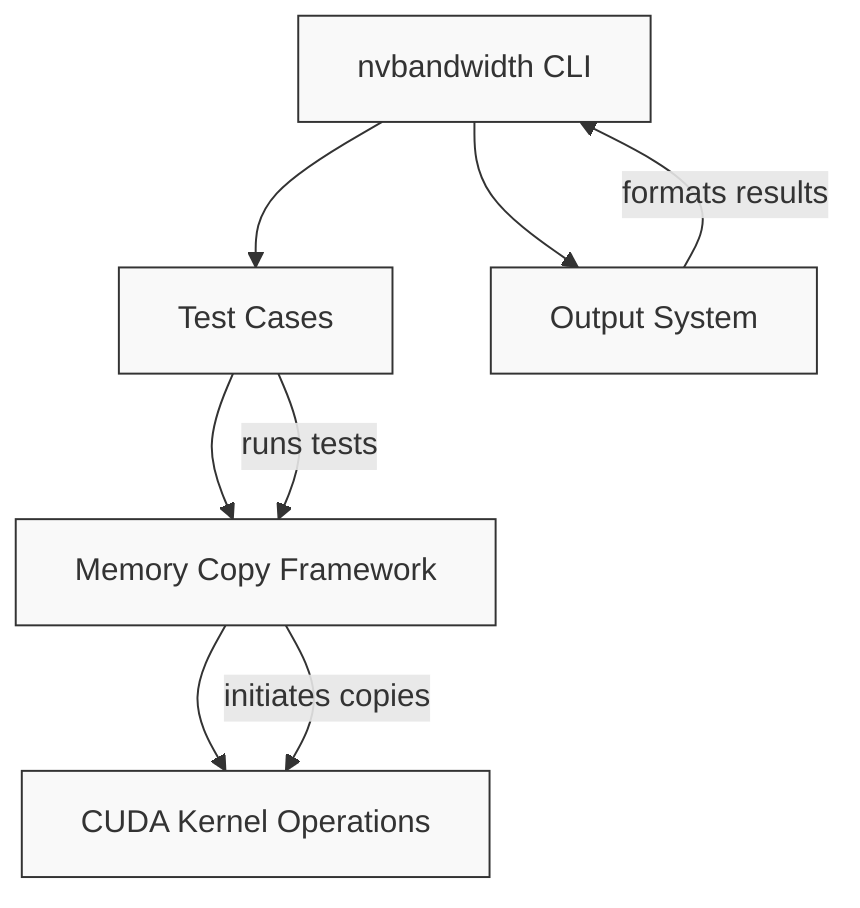
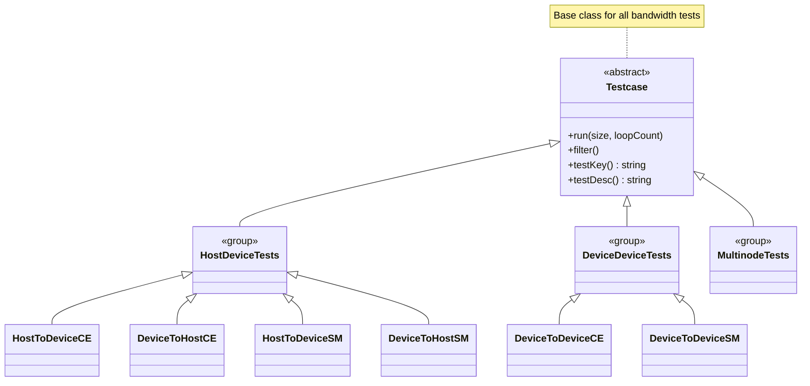
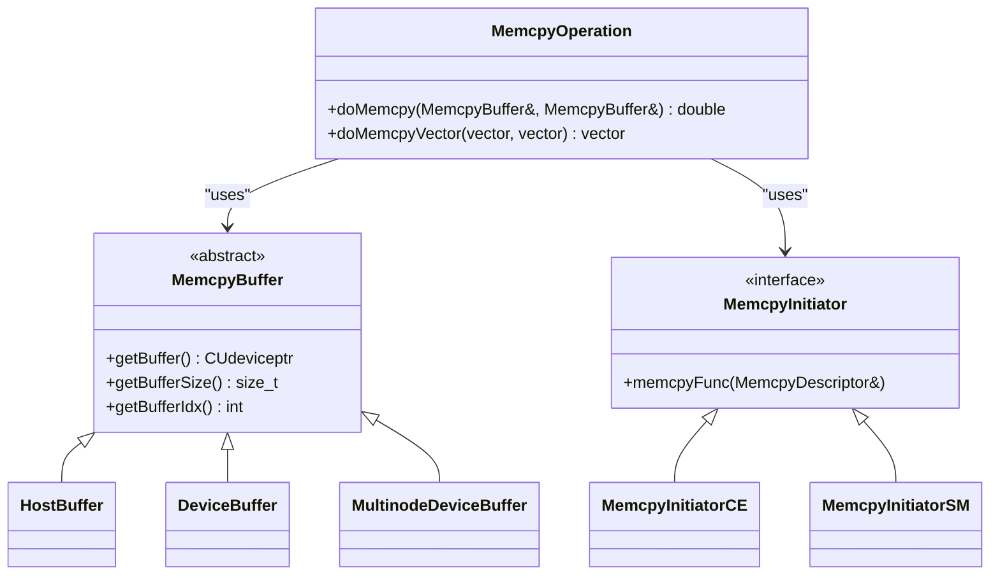
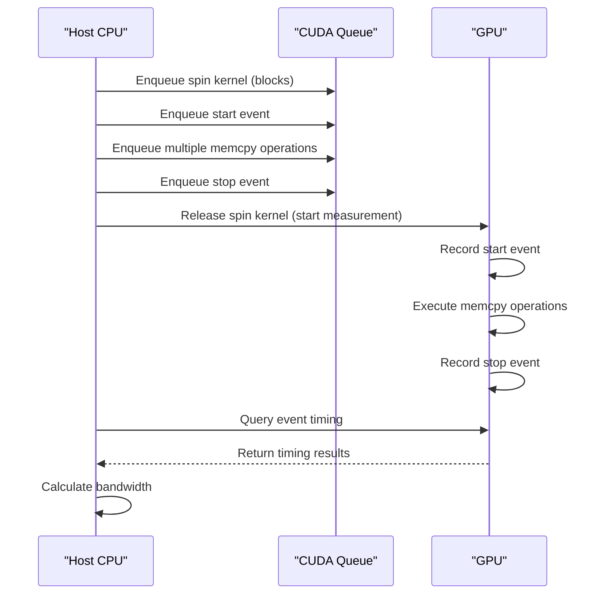

<!-- source: DeepWiki mcp.deepwiki.com · repo NVIDIA/nvbandwidth · page 1 Overview · fetched 2026-10-26 -->

# Overview

<details>
<summary>Relevant source files</summary>

The following files were used as context for generating this wiki page:

- [CHANGELOG.md](CHANGELOG.md)
- [README.md](README.md)
- [version.h](version.h)

</details>


nvbandwidth is a CUDA-based tool for measuring memory bandwidth performance on NVIDIA GPUs. It provides detailed bandwidth measurements for various memory copy patterns across different links using copy engine (CE) or streaming multiprocessor (SM) copy methods. This overview explains what nvbandwidth is, what it does, and when to use it.

For detailed information about the architecture, see [Architecture](#2).

## Purpose

nvbandwidth serves as a diagnostic and benchmarking utility that:

- Measures memory bandwidth between various components (CPU↔GPU, GPU↔GPU)
- Provides accurate benchmarks for different memory copy methods
- Supports both unidirectional and bidirectional bandwidth measurements
- Works in both single-node and multi-node GPU deployments
- Reports bandwidth in a user-friendly format (plain text or JSON)

The tool reports the current measured bandwidth achievable on your system. Additional system-specific tuning may be required to achieve maximal peak bandwidth.

Sources: [README.md:1-5]()

## Key Features

- **Multiple Copy Methods**: Supports both Copy Engine (CE) and Streaming Multiprocessor (SM) based memory copies
- **Comprehensive Transfer Patterns**: Host-to-Device, Device-to-Host, Device-to-Device, and bidirectional transfers
- **Multi-GPU Support**: Tests bandwidth between multiple GPUs within a system
- **Multi-Node Capability**: Measures bandwidth across node boundaries in a cluster
- **Accurate Measurements**: Uses precise timing mechanisms with CUDA events
- **Verification**: Validates copy operations for correctness
- **Configurable Testing**: Control buffer sizes, iteration counts, and specific test cases

Sources: [README.md:1-5](), [README.md:48-64]()

## System Requirements

- CUDA Toolkit (version 11.X or above)
- Multi-node version requires CUDA 12.3 toolkit and 550 driver or above
- C++17 compatible compiler (GCC 7.x or above)
- CMake (version 3.20 or above)
- Boost program options library

Sources: [README.md:7-20]()

## High-Level Architecture

nvbandwidth is built around several core components that work together to provide accurate bandwidth measurements. The following diagram illustrates the primary components and their relationships:



Sources: [README.md:132-153]()

## Core Components

### Test Cases

Test cases define specific bandwidth measurement scenarios. Each test case implements a specific memory transfer pattern (e.g., host-to-device, device-to-device) using either Copy Engine (CE) or Streaming Multiprocessor (SM) methods.



Sources: [README.md:132-154]()

### Memory Copy Framework

The memory copy framework provides the infrastructure for performing memory operations between different types of buffers (host memory, device memory, multi-node memory). It manages buffer allocation, copy operations, and timing.



Sources: [README.md:132-154]()

## Measurement Methodology

nvbandwidth uses a precise methodology to measure bandwidth:

1. A blocking kernel is used to ensure that timing measurements don't include operation enqueuing overhead
2. CUDA events are used to precisely time memory copy operations
3. Multiple iterations are performed to ensure statistical validity
4. By default, the median of 3 measurements is reported (configurable)



Sources: [README.md:144-153]()

## Bandwidth Test Types

nvbandwidth implements several types of bandwidth tests:

### Unidirectional Tests

These measure one-way bandwidth between components:
- Host to Device (H2D)
- Device to Host (D2H)
- Device to Device (D2D)

### Bidirectional Tests

These measure bandwidth when data is flowing in both directions simultaneously:
- Host ↔ Device
- Device ↔ Device

### Multi-node Tests

These measure bandwidth across node boundaries in a cluster:
- All to One (A2O)
- One to All (O2A)
- All to Host (A2H)
- Host to All (H2A)

Sources: [README.md:155-204]()

## Version Information

nvbandwidth is versioned with semantic versioning. The current version is:

```
v0.8
```

Sources: [version.h:21](), [CHANGELOG.md:3]()

## Next Steps

- For a deep dive into the system architecture, see [Architecture](#2)
- To understand the memory copy framework, see [Memory Copy Framework](#3)
- For information about the test cases, see [Test Cases](#5)
- To learn how to build and run nvbandwidth, see [Building and Running](#7)

---

