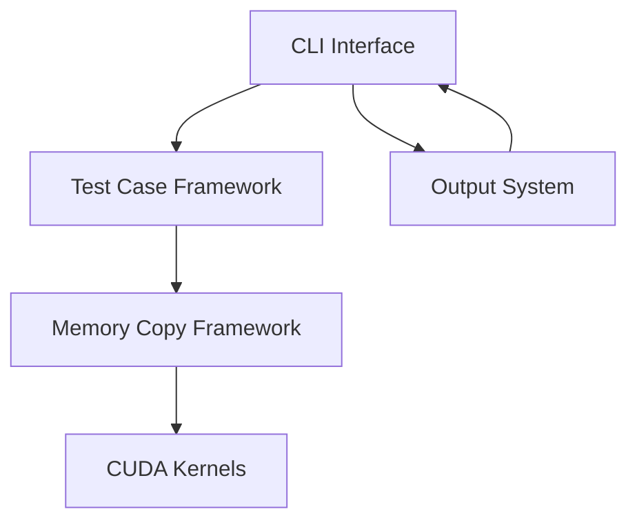
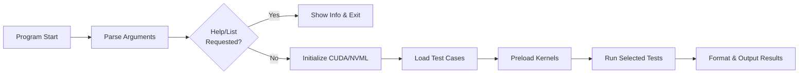
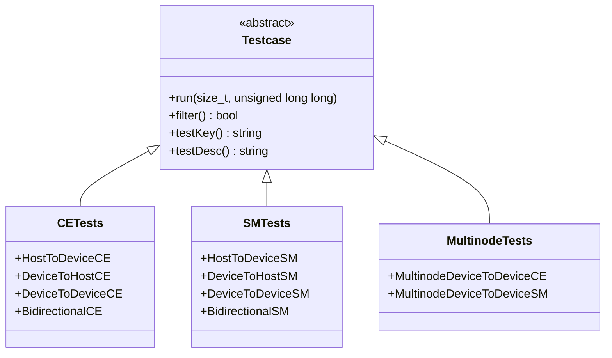
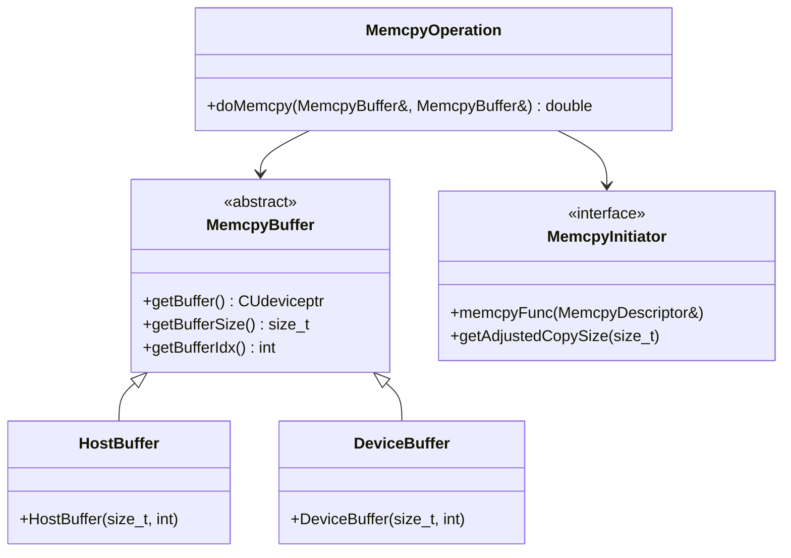
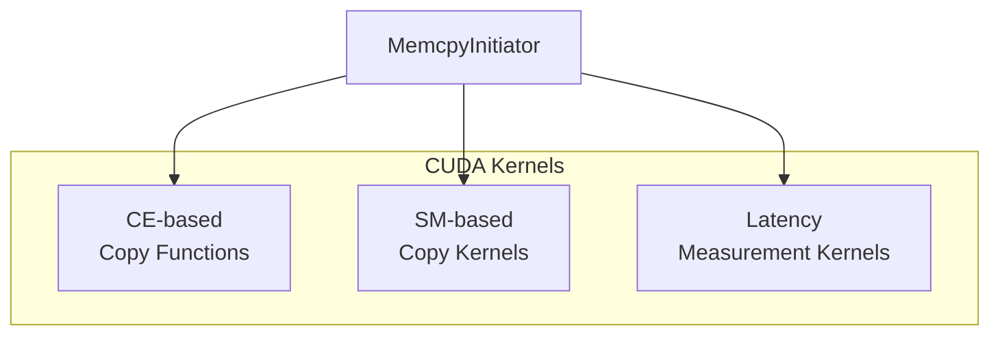
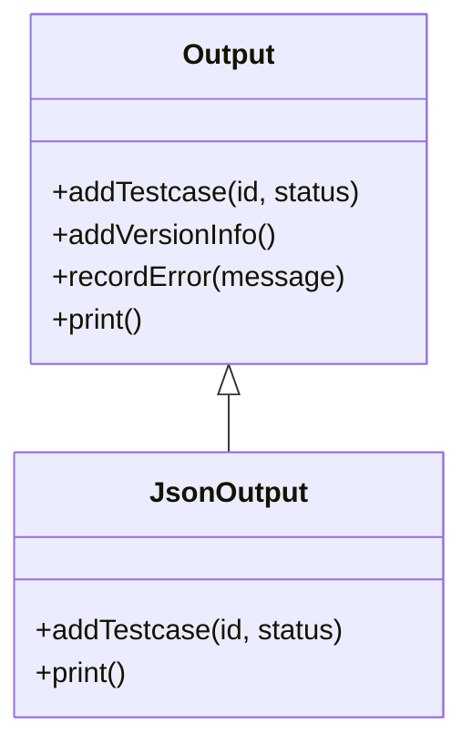
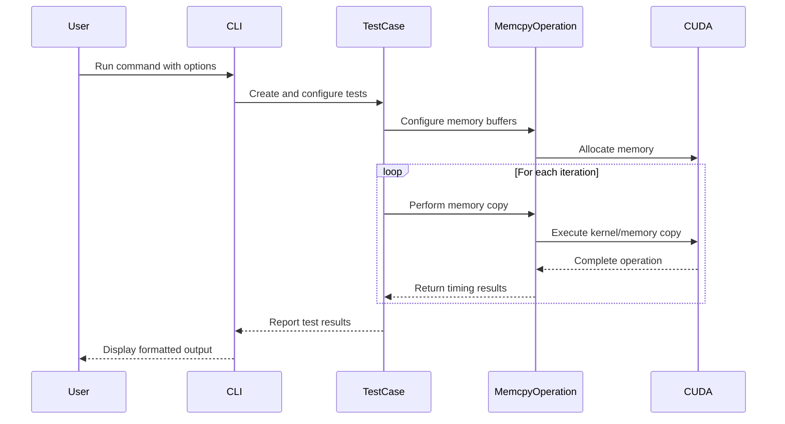
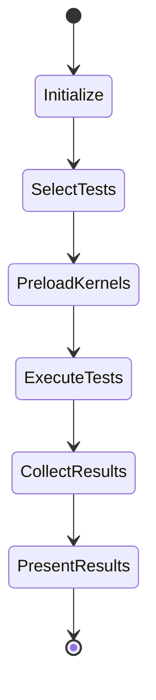
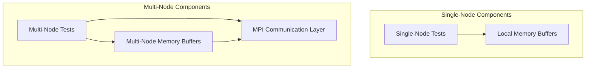

<!-- source: DeepWiki mcp.deepwiki.com · repo NVIDIA/nvbandwidth · page 2 Architecture · fetched 2026-10-26 -->

# Architecture

Relevant source files

The following files were used as context for generating this wiki page:

- [CMakeLists.txt](CMakeLists.txt)
- [common.h](common.h)
- [nvbandwidth.cpp](nvbandwidth.cpp)

This document outlines the high-level architecture of nvbandwidth, explaining the major components and their relationships within the system. For specific implementation details about the Memory Copy Framework, see [Memory Copy Framework](#3).

## Overview

nvbandwidth is a CUDA-based tool designed to measure memory bandwidth and latency performance between different components in NVIDIA GPU systems. The architecture follows a modular design that separates test definition, memory operations, and result reporting into distinct subsystems.

Sources: [nvbandwidth.cpp:178-325](), [CMakeLists.txt:40-52]()

## Core Components

### CLI Interface

The CLI Interface serves as the entry point for nvbandwidth, handling user inputs and orchestrating test execution. It parses command-line arguments using Boost's program_options library, discovers available tests, and dispatches selected test cases.

Key responsibilities:
- Parsing command-line options
- Test case discovery and filtering
- Test execution orchestration
- Result collection and output formatting

Sources: [nvbandwidth.cpp:178-325]()

### Test Case Framework

The Test Case Framework provides a standard interface for defining different bandwidth and latency tests. It uses an inheritance-based design with a base `Testcase` class that defines the common interface and specialized derived classes for specific test scenarios.

Each test case implements:
- `run()`: Executes the test with specified buffer size and iteration count
- `filter()`: Determines if the test is applicable for the current hardware
- `testKey()`: Returns a unique identifier for the test
- `testDesc()`: Returns a human-readable description

Sources: [nvbandwidth.cpp:64-117]()

### Memory Copy Framework

The Memory Copy Framework is the core engine that performs memory operations. It abstracts the complexities of buffer management and memory transfers across different hardware components.

Key components:
- **MemcpyBuffer**: Abstract base class for different memory buffer types
- **MemcpyInitiator**: Interface for different memory copy strategies
- **MemcpyOperation**: Coordinates memory transfers between buffers

For more details on the Memory Copy Framework, see [Memory Copy Framework](#3).

Sources: [common.h:240-249]()

### CUDA Kernels

The CUDA Kernels component includes specialized CUDA kernels for performing memory operations using different strategies:

- **CE (Copy Engine)**: Uses CUDA's built-in asynchronous memory copy functions
- **SM (Streaming Multiprocessor)**: Uses custom CUDA kernels to perform copies through the SM

Sources: [CMakeLists.txt:40-52]()

### Output System

The Output System is responsible for formatting and presenting test results. It supports multiple output formats, including plain text and JSON.

Sources: [nvbandwidth.cpp:181-250]()

## Data Flow

The overall data flow within nvbandwidth follows this pattern:

Sources: [nvbandwidth.cpp:149-176]()

## Test Types and Memory Paths

nvbandwidth includes multiple test types to measure bandwidth across different memory paths:

| Test Category | Description | Implementation Methods |
|---------------|-------------|------------------------|
| Host to Device | Measures bandwidth from CPU memory to GPU memory | CE, SM |
| Device to Host | Measures bandwidth from GPU memory to CPU memory | CE, SM |
| Device to Device | Measures bandwidth between memories on same GPU | CE, SM |
| Bidirectional | Measures concurrent copy bandwidth in both directions | CE, SM |
| All to One | Measures bandwidth when all GPUs copy to one GPU | CE, SM |
| One to All | Measures bandwidth when one GPU copies to all GPUs | CE, SM |
| All to Host | Measures bandwidth when all GPUs copy to host | CE, SM |
| Host to All | Measures bandwidth when host copies to all GPUs | CE, SM |
| Latency | Measures memory access latency rather than bandwidth | SM |
| Multinode | Measures bandwidth across node boundaries (when built with MPI) | CE, SM |

Sources: [nvbandwidth.cpp:64-117]()

## Execution Model

nvbandwidth follows a straightforward execution model:

1. **Initialization**: Parse command-line arguments, initialize CUDA, and discover available GPUs
2. **Test Selection**: Select test cases to run based on user input
3. **Kernel Preloading**: Preload CUDA kernels on all devices to avoid synchronization issues
4. **Test Execution**: Run each selected test case
5. **Result Collection**: Gather performance results from all tests
6. **Result Presentation**: Format and display results according to the selected output format

Sources: [nvbandwidth.cpp:178-325]()

## Design Patterns

The nvbandwidth architecture implements several design patterns:

1. **Strategy Pattern**: Through the `MemcpyInitiator` interface, which allows different memory copy strategies to be implemented and used interchangeably.

2. **Template Method Pattern**: Through the `Testcase` base class, which defines the structure of a test while allowing derived classes to implement specific behaviors.

3. **Factory Method Pattern**: Through the `createTestcases()` function, which creates and returns a collection of test case objects.

4. **Command Pattern**: Each test case encapsulates a specific bandwidth measurement operation that can be executed on demand.

5. **Adapter Pattern**: The output system adapts internal data structures into different output formats (plain text and JSON).

Sources: [nvbandwidth.cpp:64-117](), [nvbandwidth.cpp:178-325]()

## Multi-node Support

When built with MPI support, nvbandwidth includes additional test cases for measuring bandwidth across node boundaries. This functionality uses MPI for process coordination and adds specialized buffer and test case implementations for multi-node scenarios.

Sources: [nvbandwidth.cpp:100-115](), [CMakeLists.txt:72-77]()

## System Integration Points

nvbandwidth integrates with several external systems:

1. **CUDA Driver API**: For low-level GPU control and memory management
2. **CUDA Runtime API**: For higher-level CUDA operations
3. **NVML (NVIDIA Management Library)**: For GPU device information and statistics
4. **Boost Program Options**: For command-line argument parsing
5. **MPI (optional)**: For multi-node support

Sources: [nvbandwidth.cpp:18-32](), [CMakeLists.txt:18-77]()

---

