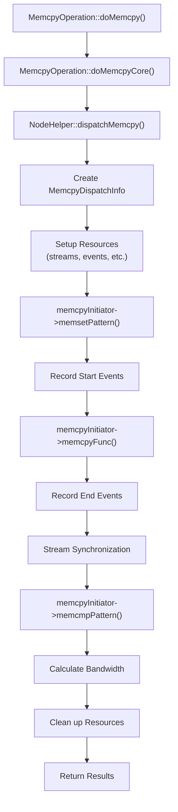
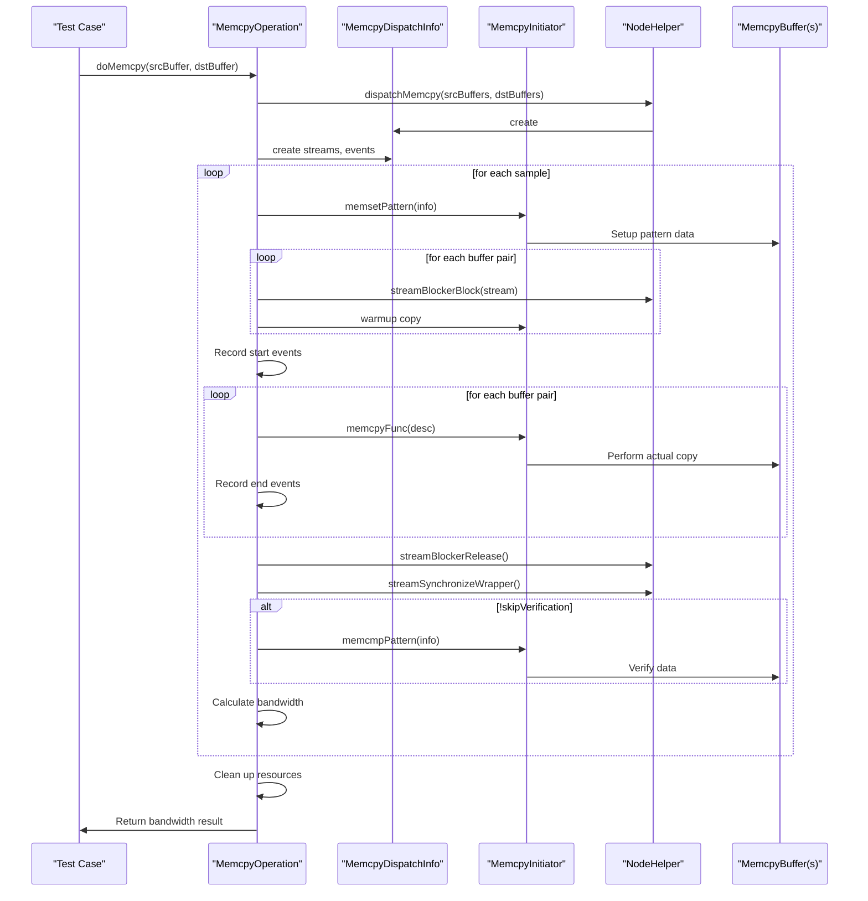

<!-- source: DeepWiki mcp.deepwiki.com · repo NVIDIA/nvbandwidth · page 3 Memory Copy Framework · fetched 2026-10-26 -->

# Memory Copy Framework

<details>
<summary>Relevant source files</summary>

The following files were used as context for generating this wiki page:

- [memcpy.cpp](memcpy.cpp)
- [memcpy.h](memcpy.h)

</details>


## Purpose and Scope

The Memory Copy Framework is a core component of nvbandwidth that provides the infrastructure necessary to measure memory bandwidth across different GPU data paths. It abstracts and manages memory allocation, data transfer operations, and performance timing. This framework serves as the foundation for all bandwidth tests within nvbandwidth, enabling accurate measurements of memory performance across host-to-device, device-to-host, and device-to-device transfers.

For information about the specific test cases built on top of this framework, see [Test Cases](#5).

Sources: [memcpy.h:18-20](), [memcpy.cpp:18-24]()

## Architecture Overview

The Memory Copy Framework is built around several key abstractions that work together to enable flexible memory bandwidth testing:

```mermaid
classDiagram
    class "MemcpyBuffer" {
        <<abstract>>
        +getBuffer()
        +getBufferSize()
        +getBufferIdx()
        +getPrimaryCtx()
        +getBufferString()
    }
    
    class "HostBuffer" {
        +HostBuffer(bufferSize, targetDeviceId)
    }
    
    class "DeviceBuffer" {
        +DeviceBuffer(bufferSize, deviceIdx)
        +enablePeerAccess()
    }
    
    class "MemcpyInitiator" {
        <<interface>>
        +memcpyFunc()
        +getAdjustedCopySize()
        +memsetPattern()
        +memcmpPattern()
        +getAdjustedBandwidth()
    }
    
    class "MemcpyInitiatorCE" {
        +memcpyFunc()
    }
    
    class "MemcpyInitiatorSM" {
        +memcpyFunc()
    }
    
    class "MemcpyOperation" {
        +doMemcpy()
        +doMemcpyCore()
        +doMemcpyVector()
    }
    
    class "NodeHelper" {
        <<interface>>
        +dispatchMemcpy()
        +calculateTotalBandwidth()
        +streamSynchronizeWrapper()
    }
    
    "MemcpyBuffer" <|-- "HostBuffer"
    "MemcpyBuffer" <|-- "DeviceBuffer"
    "MemcpyInitiator" <|.. "MemcpyInitiatorCE"
    "MemcpyInitiator" <|.. "MemcpyInitiatorSM"
    "MemcpyOperation" --> "MemcpyInitiator"
    "MemcpyOperation" --> "NodeHelper"
    "MemcpyOperation" ..> "MemcpyBuffer"
```

Sources: [memcpy.h:24-252](), [memcpy.cpp:33-41]()

The framework is designed around the following key components:

1. **Memory Buffers**: Abstractions representing memory in different locations (host or device)
2. **Copy Initiators**: Strategies for performing memory copies through different mechanisms
3. **Memory Copy Operation**: Coordinates buffers and initiators to perform and time memory transfers
4. **Node Helpers**: Manages node-specific operations in multi-node scenarios

Sources: [memcpy.h:24-252]()

## Memory Buffers

Memory buffers abstract the location and type of memory being used in bandwidth tests. The framework provides classes for different memory types:

```mermaid
classDiagram
    class "MemcpyBuffer" {
        <<abstract>>
        -void* buffer
        -size_t bufferSize
        +CUdeviceptr getBuffer()
        +size_t getBufferSize()
        +virtual int getBufferIdx()
        +virtual CUcontext getPrimaryCtx()
        +virtual std::string getBufferString()
        +virtual CUresult streamSynchronizeWrapper()
        +virtual int getMPIRank()
    }
    
    class "HostBuffer" {
        +HostBuffer(size_t bufferSize, int targetDeviceId)
        +~HostBuffer()
        +int getBufferIdx()
        +CUcontext getPrimaryCtx()
        +std::string getBufferString()
    }
    
    class "DeviceBuffer" {
        -int deviceIdx
        -CUcontext primaryCtx
        +DeviceBuffer(size_t bufferSize, int deviceIdx)
        +~DeviceBuffer()
        +int getBufferIdx()
        +CUcontext getPrimaryCtx()
        +std::string getBufferString()
        +bool enablePeerAcess(DeviceBuffer&)
    }
    
    "MemcpyBuffer" <|-- "HostBuffer"
    "MemcpyBuffer" <|-- "DeviceBuffer"
```

Sources: [memcpy.h:24-69](), [memcpy.cpp:33-41](), [memcpy.cpp:198-283]()

### MemcpyBuffer

The `MemcpyBuffer` class is the abstract base class for all memory buffers. It defines the common interface for accessing memory in different locations:

- `getBuffer()`: Returns a pointer to the underlying memory
- `getBufferSize()`: Returns the size of the buffer
- `getBufferIdx()`: Returns an index identifying the buffer (device ID or 0 for host)
- `getPrimaryCtx()`: Returns the CUDA context associated with the buffer
- `getBufferString()`: Returns a human-readable string describing the buffer

Sources: [memcpy.h:24-41](), [memcpy.cpp:33-41](), [memcpy.cpp:198-207]()

### HostBuffer

The `HostBuffer` class represents host (CPU) memory. Key features include:

- Memory allocation with NUMA affinity optimization for the target device
- Integration with CUDA via `cuMemHostAlloc` for efficient host-device transfers
- Proper cleanup in the destructor

Sources: [memcpy.h:44-53](), [memcpy.cpp:208-239]()

### DeviceBuffer

The `DeviceBuffer` class represents device (GPU) memory. Key features include:

- Allocation of memory on a specific GPU device
- Management of the device's primary CUDA context
- Support for peer access between multiple GPUs via `enablePeerAccess()`

Sources: [memcpy.h:56-69](), [memcpy.cpp:241-283]()

## Copy Initiators

Copy initiators implement different strategies for memory transfers. The framework provides implementations for various transfer mechanisms:

```mermaid
classDiagram
    class "MemcpyInitiator" {
        <<interface>>
        +size_t memcpyFunc(MemcpyDescriptor&)
        +size_t getAdjustedCopySize(size_t, CUstream)
        +void memsetPattern(MemcpyDispatchInfo&)
        +void memcmpPattern(MemcpyDispatchInfo&)
        +unsigned long long getAdjustedBandwidth(unsigned long long)
    }
    
    class "MemcpyInitiatorCE" {
        +size_t memcpyFunc(MemcpyDescriptor&)
        +size_t getAdjustedCopySize(size_t, CUstream)
        +void memsetPattern(MemcpyDispatchInfo&)
        +void memcmpPattern(MemcpyDispatchInfo&)
        +unsigned long long getAdjustedBandwidth(unsigned long long)
    }
    
    class "MemcpyInitiatorSM" {
        +size_t memcpyFunc(MemcpyDescriptor&)
        +size_t getAdjustedCopySize(size_t, CUstream)
        +void memsetPattern(MemcpyDispatchInfo&)
        +void memcmpPattern(MemcpyDispatchInfo&)
        +unsigned long long getAdjustedBandwidth(unsigned long long)
    }
    
    class "MemcpyInitiatorMulticastWrite" {
        +size_t memcpyFunc(MemcpyDescriptor&)
        +size_t getAdjustedCopySize(size_t, CUstream)
        +void memsetPattern(MemcpyDispatchInfo&)
        +void memcmpPattern(MemcpyDispatchInfo&)
        +unsigned long long getAdjustedBandwidth(unsigned long long)
    }
    
    class "MemcpyInitiatorSMSplitWarp" {
        +size_t memcpyFunc(MemcpyDescriptor&)
        +void memsetPattern(MemcpyDispatchInfo&)
        +void memcmpPattern(MemcpyDispatchInfo&)
        +unsigned long long getAdjustedBandwidth(unsigned long long)
    }
    
    "MemcpyInitiator" <|.. "MemcpyInitiatorCE"
    "MemcpyInitiator" <|.. "MemcpyInitiatorSM"
    "MemcpyInitiator" <|.. "MemcpyInitiatorMulticastWrite"
    "MemcpyInitiatorSM" <|-- "MemcpyInitiatorSMSplitWarp"
```

Sources: [memcpy.h:133-197](), [memcpy.cpp:84-196](), [memcpy.cpp:540-590]()

### MemcpyInitiator Interface

The `MemcpyInitiator` interface defines the contract for all copy strategies:

- `memcpyFunc()`: Performs the actual memory copy operation
- `getAdjustedCopySize()`: Calculates adjusted copy sizes (important for SM copies)
- `memsetPattern()`: Fills buffers with test patterns
- `memcmpPattern()`: Verifies buffers against expected patterns
- `getAdjustedBandwidth()`: Adjusts bandwidth measurements for specific copy methods

Sources: [memcpy.h:133-147]()

### Copy Engine (CE) Initiator

The `MemcpyInitiatorCE` class implements memory copies using CUDA's hardware Copy Engine:

- Uses `cuMemcpyAsync()` for hardware-accelerated transfers
- Offers optimal performance for bulk transfers
- Preserves exact copy sizes without truncation

Sources: [memcpy.h:162-173](), [memcpy.cpp:84-90](), [memcpy.cpp:118-120](), [memcpy.cpp:168-173](), [memcpy.cpp:567-578]()

### Streaming Multiprocessor (SM) Initiator

The `MemcpyInitiatorSM` class implements memory copies using custom CUDA kernels on the GPU's Streaming Multiprocessors:

- Uses custom CUDA kernels to perform copies
- May truncate buffer sizes to optimize for SM throughput
- Provides alternative paths for memory transfers that may bypass certain hardware limitations

Sources: [memcpy.h:149-160](), [memcpy.cpp:92-98](), [memcpy.cpp:122-124](), [memcpy.cpp:175-180](), [memcpy.cpp:540-565]()

### Specialized Initiators

Additional initiator implementations include:

- `MemcpyInitiatorMulticastWrite`: Supports one-to-many transfers using the GPU's multicast features
- `MemcpyInitiatorSMSplitWarp`: Implements bidirectional transfers by splitting GPU warps

Sources: [memcpy.h:175-197](), [memcpy.cpp:100-116](), [memcpy.cpp:126-133](), [memcpy.cpp:182-196](), [memcpy.cpp:580-591]()

## Memory Copy Operation

The `MemcpyOperation` class coordinates memory operations, timing, and bandwidth calculation:



Sources: [memcpy.h:207-240](), [memcpy.cpp:288-538]()

### Core Operations

The `MemcpyOperation` class provides several methods for performing memory copies:

- `doMemcpy()`: Performs a single memory copy between two buffers
- `doMemcpyVector()`: Performs multiple memory copies and returns individual bandwidths
- `doMemcpyCore()`: Core implementation that sets up, times, and executes copies

The operation process includes:

1. Setting up resources (streams, events)
2. Initializing memory with patterns for verification
3. Warmup iterations to prime the system
4. Timed execution of memory copies
5. Verification of copy correctness
6. Calculation of bandwidth metrics
7. Resource cleanup

Sources: [memcpy.h:228-240](), [memcpy.cpp:288-538]()

### Bandwidth Calculation Options

The framework supports different methods for calculating bandwidth:

| Mode | Description |
|------|-------------|
| `USE_FIRST_BW` | Use only the bandwidth of the first copy in a multi-copy operation |
| `SUM_BW` | Sum the individual bandwidths of all copies |
| `TOTAL_BW` | Calculate total bandwidth based on total time and total bytes |
| `VECTOR_BW` | Return individual bandwidths as a vector |

Sources: [memcpy.h:210-215](), [memcpy.cpp:525-537]()

## Node Helper

The `NodeHelper` abstraction manages node-specific operations, particularly important for multi-node scenarios:

```mermaid
classDiagram
    class "NodeHelper" {
        <<interface>>
        +MemcpyDispatchInfo dispatchMemcpy()
        +double calculateTotalBandwidth()
        +double calculateSumBandwidth()
        +double calculateFirstBandwidth()
        +std::vector<double> calculateVectorBandwidth()
        +void synchronizeProcess()
        +CUresult streamSynchronizeWrapper()
        +void streamBlockerReset()
        +void streamBlockerRelease()
        +void streamBlockerBlock()
    }
    
    class "NodeHelperSingle" {
        -volatile int* blockingVarHost
        +NodeHelperSingle()
        +~NodeHelperSingle()
        +MemcpyDispatchInfo dispatchMemcpy()
        +double calculateTotalBandwidth()
        +double calculateSumBandwidth()
        +double calculateFirstBandwidth()
        +std::vector<double> calculateVectorBandwidth()
        +void synchronizeProcess()
        +CUresult streamSynchronizeWrapper()
        +void streamBlockerReset()
        +void streamBlockerRelease()
        +void streamBlockerBlock()
    }
    
    "NodeHelper" <|.. "NodeHelperSingle"
```

Sources: [memcpy.h:95-131](), [memcpy.cpp:311-373]()

### NodeHelper Interface

The `NodeHelper` interface defines operations for node coordination:

- `dispatchMemcpy()`: Creates a dispatch info structure with proper contexts
- Bandwidth calculation functions for different strategies
- Stream synchronization and blocking functions for coordinated execution
- Process synchronization for multi-node scenarios

Sources: [memcpy.h:95-111]()

### NodeHelperSingle Implementation

The `NodeHelperSingle` class implements the `NodeHelper` interface for single-node scenarios:

- Creates a dispatch plan for memory copies
- Provides bandwidth calculation methods
- Implements stream blocking mechanisms using a host-side variable
- Provides stream synchronization

Sources: [memcpy.h:113-131](), [memcpy.cpp:311-373]()

## Memory Copy Execution Flow

The complete execution flow of a memory copy operation:



Sources: [memcpy.cpp:375-538]()

## Using the Memory Copy Framework

To use the Memory Copy Framework, clients typically:

1. Create memory buffers (`HostBuffer`, `DeviceBuffer`)
2. Select a copy initiator strategy (`MemcpyInitiatorCE`, `MemcpyInitiatorSM`)
3. Create a `MemcpyOperation` with the chosen initiator
4. Call `doMemcpy()` or `doMemcpyVector()` to perform the copy and get the bandwidth

For complete usage examples, see the test case implementations in the [CE Test Cases](#5.1) and [SM Test Cases](#5.2) sections.

Sources: [memcpy.h:217-240](), [memcpy.cpp:288-305]()

---

