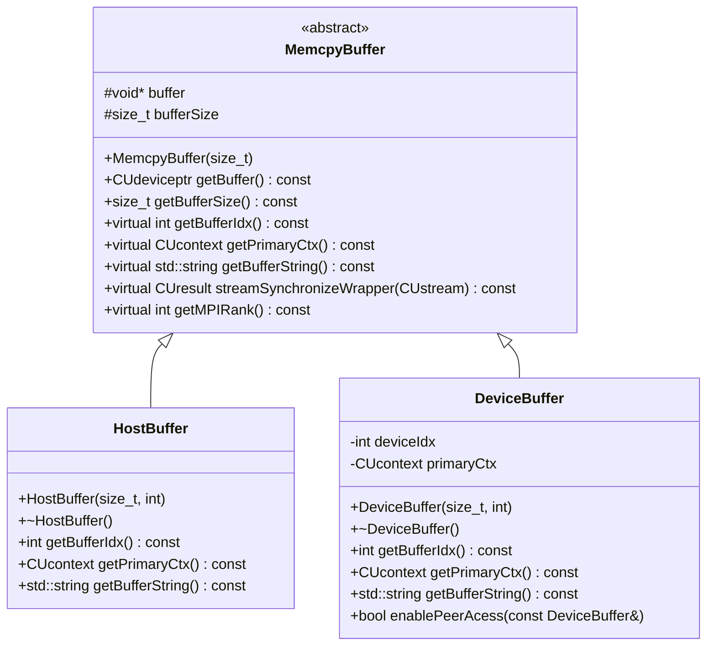
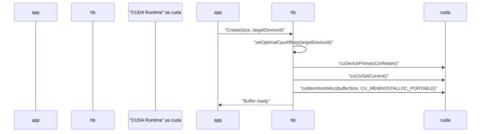
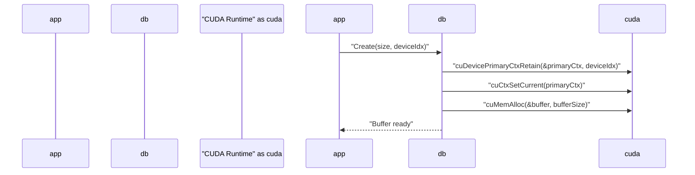
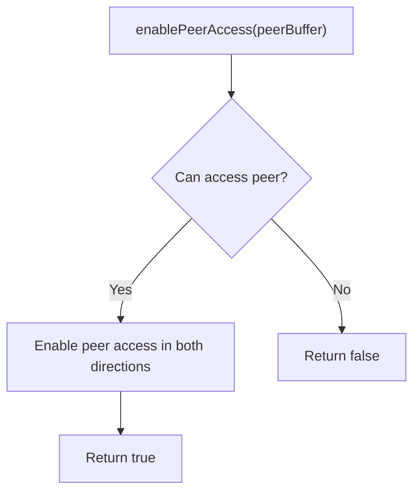
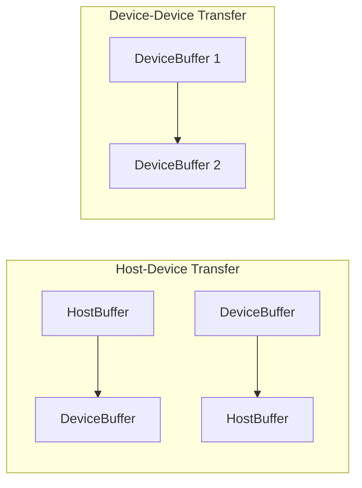
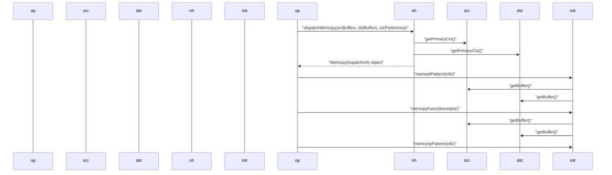

<!-- source: DeepWiki mcp.deepwiki.com · repo NVIDIA/nvbandwidth · page 3.1 Memory Buffers · fetched 2026-10-26 -->

# Memory Buffers

Relevant source files

The following files were used as context for generating this wiki page:

- [memcpy.cpp](memcpy.cpp)
- [memcpy.h](memcpy.h)

## Purpose and Overview

Memory Buffers are a core abstraction in the nvbandwidth framework, providing a uniform interface for managing different types of memory locations (host and device) used in memory bandwidth testing. They abstract away the details of memory allocation, deallocation, and context management, enabling the testing framework to work with different memory configurations consistently.

For information about how these buffers are used by copy operations, see [Copy Initiators](#3.2).

Sources: [memcpy.h:24-41](). [memcpy.h:44-53](). [memcpy.h:56-69]().

## Buffer Class Hierarchy

Memory buffers in nvbandwidth follow an inheritance hierarchy that enables polymorphic handling of different memory types:

Sources: [memcpy.h:24-41](). [memcpy.h:44-53](). [memcpy.h:56-69](). [memcpy.cpp:33-41]().

## Base Class: MemcpyBuffer

The `MemcpyBuffer` abstract class serves as the foundation for all memory buffer types in nvbandwidth. It defines the common interface and functionality for different memory locations.

### Key Properties

- `buffer`: Raw pointer to the allocated memory
- `bufferSize`: Size of the allocated memory in bytes

### Key Methods

| Method | Description |
|--------|-------------|
| `getBuffer()` | Returns the buffer as a `CUdeviceptr` for use with CUDA operations |
| `getBufferSize()` | Returns the size of the buffer |
| `getBufferIdx()` | Virtual method to get an index identifying the buffer location |
| `getPrimaryCtx()` | Virtual method to get the CUDA context associated with this buffer |
| `getBufferString()` | Virtual method to get a string representation of the buffer for reporting |
| `streamSynchronizeWrapper()` | Wrapper for stream synchronization (important for MPI compatibility) |
| `getMPIRank()` | Returns the MPI rank for multi-node configurations |

Sources: [memcpy.h:24-41](). [memcpy.cpp:33-41](). [memcpy.cpp:201-206]().

## Host Buffers

The `HostBuffer` class represents memory allocated on the host (CPU). It optimizes memory allocation by setting NUMA affinity based on the target device ID.

### Initialization

Host buffers are created by specifying:
1. Buffer size in bytes
2. Target device ID (used for NUMA optimization)

### Key Features

- **NUMA-aware allocation**: Host buffers are allocated with memory affinity matching the target GPU to optimize data transfer bandwidth
- **Portable allocation**: Uses `CU_MEMHOSTALLOC_PORTABLE` flag to ensure memory can be accessed by any CUDA context
- **Null context**: Host buffers return `nullptr` for `getPrimaryCtx()` as they don't have a CUDA context

### Cleanup

Host buffers automatically free allocated memory in their destructor using either `cuMemFreeHost()` for CUDA-managed memory or standard `free()` for non-CUDA memory.

Sources: [memcpy.h:44-53](). [memcpy.cpp:208-225](). [memcpy.cpp:227-239]().

## Device Buffers

The `DeviceBuffer` class represents memory allocated on a GPU device. It handles both memory allocation and CUDA context management.

### Initialization

Device buffers are created by specifying:
1. Buffer size in bytes
2. Device index (GPU ID) where memory should be allocated

### Key Features

- **Context management**: Each device buffer retains and manages a primary CUDA context for its device
- **Device identification**: Maintains the device index for identification and peer access
- **Peer access support**: Provides methods to enable peer access between device buffers on different GPUs

### Peer Access

The `enablePeerAcess()` method checks if the current device can directly access memory on another device and enables this access if possible. This is critical for device-to-device bandwidth tests.

### Cleanup

Device buffers automatically free allocated memory and release the primary context in their destructor.

Sources: [memcpy.h:56-69](). [memcpy.cpp:241-283]().

## Memory Buffer Usage in Operations

Memory buffers are used in combination to form the source and destination for bandwidth tests. The `MemcpyOperation` class uses pairs of buffers to perform memory copy operations and measure bandwidth.

### Buffer Pairing Patterns

### Memory Operation Flow

When conducting bandwidth tests, the framework:

1. Creates appropriately sized host and/or device buffers
2. Initializes source buffers with test patterns
3. Performs the copy operation (measuring time)
4. Verifies the copy succeeded by checking patterns in destination buffers

Sources: [memcpy.h:207-240](). [memcpy.cpp:301-538]().

## Pattern Generation and Verification

Memory buffers are filled with deterministic patterns using the `xorshift2MBPattern` function and verified after copy operations to ensure data integrity:

1. **Pattern Generation**: A 2MB pattern is generated using a xorshift algorithm
2. **Memory Set**: Pattern is copied to the entire buffer using a CUDA kernel
3. **Memory Verification**: After copy, destination buffers are verified to contain the expected pattern

This verification ensures that the bandwidth measurements are based on correctly transferred data.

Sources: [memcpy.cpp:43-166]().

---

