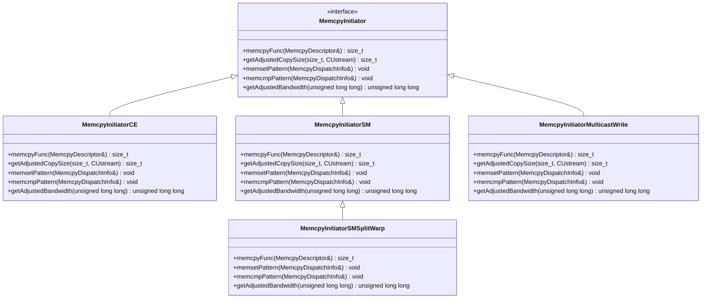
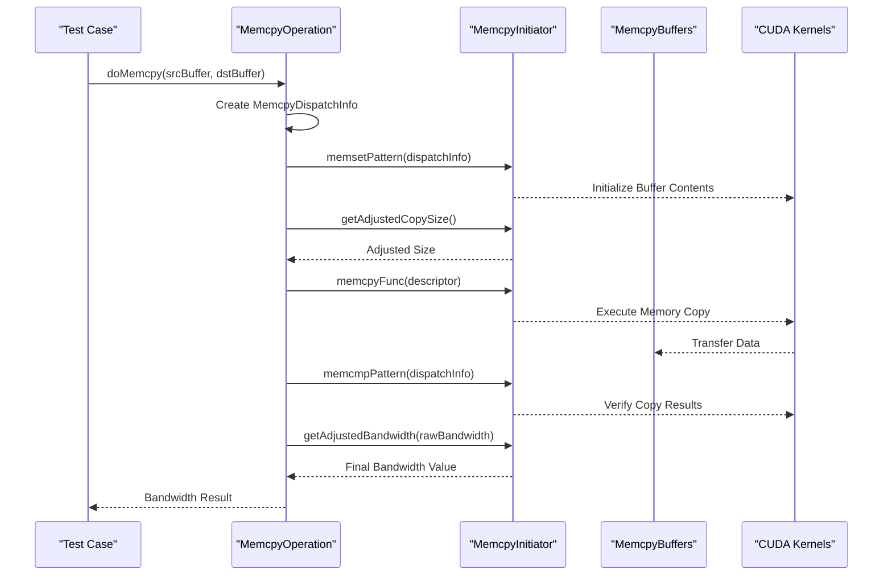
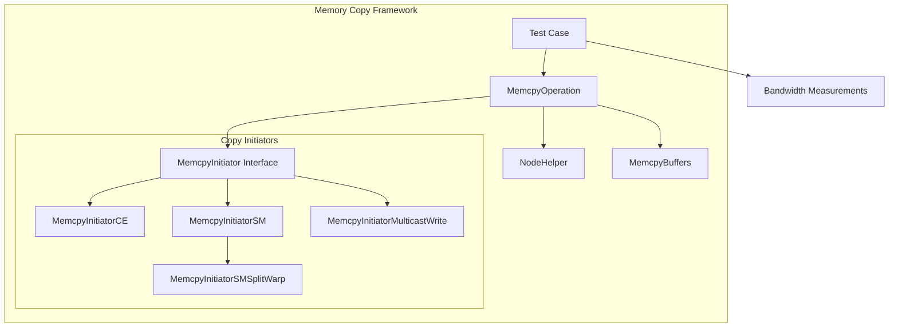

<!-- source: DeepWiki mcp.deepwiki.com · repo NVIDIA/nvbandwidth · page 3.2 Copy Initiators · fetched 2026-10-26 -->

# Copy Initiators

<details>
<summary>Relevant source files</summary>

The following files were used as context for generating this wiki page:

- [memcpy.cpp](memcpy.cpp)
- [memcpy.h](memcpy.h)

</details>


## Purpose and Overview

This document explains the Copy Initiators subsystem within the nvbandwidth tool's memory copy framework. Copy Initiators are responsible for executing memory transfer operations using different hardware mechanisms and strategies. They implement specific memory copy methods that utilize different GPU resources for data movement, enabling nvbandwidth to measure and compare bandwidth across various copy strategies.

This page focuses on the interface and implementations of Copy Initiators. For information about the memory buffers used in copy operations, see [Memory Buffers](#3.1). For details about the overall Memory Copy Framework, see [Memory Copy Framework](#3).

Sources: [memcpy.h:133-147](), [memcpy.cpp:84-132]()

## The MemcpyInitiator Interface

The `MemcpyInitiator` class defines the interface that all copy initiator implementations must follow. This interface enables the memory copy framework to seamlessly work with different copy methods.



The interface defines five core methods:

1. `memcpyFunc`: Executes the actual memory copy operation and returns the actual number of bytes copied
2. `getAdjustedCopySize`: Calculates the effective copy size, accounting for hardware constraints and alignment requirements
3. `memsetPattern`: Fills source and destination buffers with specific patterns for verification
4. `memcmpPattern`: Verifies the results of a copy operation by comparing against expected patterns
5. `getAdjustedBandwidth`: Adjusts the raw bandwidth measurement before reporting (e.g., for bidirectional copies)

Sources: [memcpy.h:133-147]()

## Copy Initiator Implementations

nvbandwidth implements several copy initiators, each utilizing different hardware mechanisms for memory transfers:

### CE-based Copy Initiator (MemcpyInitiatorCE)

The CE-based initiator uses CUDA's Copy Engine hardware via `cuMemcpyAsync()`. This approach offloads memory transfer operations to dedicated copy hardware on the GPU.

Key characteristics:
- Uses dedicated Copy Engines (CEs)
- Preserves the original copy size without adjustments
- Direct hardware-accelerated memory transfers
- Leaves computational resources (SMs) available for other work

```cpp
// CE copy implementation simplified:
size_t MemcpyInitiatorCE::memcpyFunc(MemcpyDescriptor &desc) {
    for (unsigned int l = 0; l < desc.loopCount; l++) {
        cuMemcpyAsync(desc.dst, desc.src, desc.copySize, desc.stream);
    }
    return desc.copySize;
}
```

Sources: [memcpy.h:162-173](), [memcpy.cpp:567-573]()

### SM-based Copy Initiator (MemcpyInitiatorSM)

The SM-based initiator uses the GPU's computational cores (Streaming Multiprocessors) to perform memory transfers via custom CUDA kernels. This approach can sometimes achieve higher bandwidth than CE copies for specific workloads.

Key characteristics:
- Uses Streaming Multiprocessors (SMs) for memory transfers
- May truncate copy sizes to optimize for SM workload distribution
- Copy size depends on number of SMs and threads per block
- Different performance characteristics from CE-based transfers

```cpp
// SM copy size adjustment logic:
size_t MemcpyInitiatorSM::getAdjustedCopySize(size_t size, CUstream stream) {
    // Get device properties
    CUdevice dev;
    CUcontext ctx;
    cuStreamGetCtx(stream, &ctx);
    cuCtxGetDevice(&dev);
    
    // Get SM count
    int numSm;
    cuDeviceGetAttribute(&numSm, CU_DEVICE_ATTRIBUTE_MULTIPROCESSOR_COUNT, dev);
    
    // Calculate total thread count
    unsigned int totalThreadCount = numSm * numThreadPerBlock;
    
    // Adjust size based on small or large buffer
    if (size < (smallBufferThreshold * _MiB)) {
        // Small buffer: round down to 16 bytes
        int numUint4 = size / sizeof(uint4);
        return numUint4 * sizeof(uint4);
    } else {
        // Large buffer: truncate to thread count alignment
        size_t sizeInElement = size / sizeof(uint4);
        sizeInElement = totalThreadCount * (sizeInElement / totalThreadCount);
        return sizeInElement * sizeof(uint4);
    }
}
```

Sources: [memcpy.h:149-160](), [memcpy.cpp:540-565]()

### Split Warp Initiator (MemcpyInitiatorSMSplitWarp)

A specialized SM-based initiator that performs bidirectional copies. It splits CUDA warps, allowing half of the threads to copy in one direction and half in the opposite direction.

Key characteristics:
- Extends SM-based initiator
- Performs bidirectional copies simultaneously
- Halves the reported bandwidth to reflect per-direction performance
- Requires special buffer preparation and validation

Sources: [memcpy.h:188-197](), [memcpy.cpp:108-116](), [memcpy.cpp:189-196](), [memcpy.cpp:589-591]()

### Multicast Write Initiator (MemcpyInitiatorMulticastWrite)

This initiator uses CUDA's multicast capabilities to write to multiple destinations simultaneously from a single source.

Key characteristics:
- Optimized for one-to-many transfer patterns
- May have size constraints based on hardware support
- Uses special comparison kernels for validation

Sources: [memcpy.h:175-186](), [memcpy.cpp:100-106](), [memcpy.cpp:182-187](), [memcpy.cpp:580-587]()

## Memory Copy Flow

The following diagram illustrates how a copy operation flows through the initiator system:



Sources: [memcpy.cpp:375-386](), [memcpy.cpp:388-538]()

## Integration with the Memory Copy Framework

Copy Initiators are a key component in the Memory Copy Framework. They are created and used by the `MemcpyOperation` class, which manages the overall copy process, timing, and bandwidth calculation.



Key integration points:

1. **Construction**: Test cases create an appropriate `MemcpyOperation` with the desired initiator type
2. **Execution**: The `MemcpyOperation` uses the initiator to perform memory copies
3. **Verification**: The initiator handles pattern setting and verification
4. **Measurement**: The initiator may adjust bandwidth measurements based on its specific characteristics

Sources: [memcpy.h:207-240](), [memcpy.cpp:288-296]()

## Key Differences Between Initiators

| Initiator Type | Copy Mechanism | Size Adjustment | Bandwidth Calculation | Main Use Cases |
|----------------|----------------|-----------------|------------------------|----------------|
| CE | Hardware Copy Engine | None (preserves original size) | Direct (no adjustment) | Standard memory copies, baseline measurements |
| SM | CUDA kernel using SMs | Rounds to thread count alignment | Direct (no adjustment) | Testing SM-based memory bandwidth |
| Split Warp | Bidirectional SM kernel | Same as SM | Halves the measured bandwidth | Measuring bidirectional bandwidth |
| Multicast Write | Multicast write operations | Rounds to unsigned int alignment | Direct (no adjustment) | One-to-many copy patterns |

Sources: [memcpy.cpp:118-133](), [memcpy.cpp:544-565](), [memcpy.cpp:567-573](), [memcpy.cpp:580-587]()

## Usage Examples

In practice, Copy Initiators are selected based on the test case requirements:

- CE-based initiators for standard hardware copy engine measurements
- SM-based initiators for measuring SM memory bandwidth capabilities
- Split Warp initiators for bidirectional transfer measurements
- Multicast Write initiators for one-to-many transfer patterns

Test cases instantiate the appropriate `MemcpyOperation` with the desired initiator type:

```cpp
// Example with CE initiator (simplified):
auto memcpyOp = new MemcpyOperation(loopCount, new MemcpyInitiatorCE());
double bandwidth = memcpyOp->doMemcpy(srcBuffer, dstBuffer);

// Example with SM initiator (simplified):
auto memcpyOp = new MemcpyOperation(loopCount, new MemcpyInitiatorSM());
double bandwidth = memcpyOp->doMemcpy(srcBuffer, dstBuffer);
```

Sources: [memcpy.h:230-231](), [memcpy.cpp:300-305]()

---

