<!-- source: DeepWiki mcp.deepwiki.com · repo NVIDIA/nvbandwidth · page 4 CUDA Kernels · fetched 2026-10-26 -->

# CUDA Kernels

Relevant source files

The following files were used as context for generating this wiki page:

- [kernels.cu](kernels.cu)
- [kernels.cuh](kernels.cuh)

## Purpose and Scope

This document describes the CUDA kernels implemented in the NVIDIA nvbandwidth tool. These kernels are the core computational components that execute on the GPU to measure memory bandwidth between different hardware components. They implement various memory transfer patterns and optimizations to achieve accurate bandwidth measurements for different scenarios.

For information about how these kernels are utilized in specific test cases, see [Test Cases](#5) and its child pages. For details on the memory copy framework that orchestrates these kernels, see [Memory Copy Framework](#3).

Sources: [kernels.cuh:17-39]()

## Kernel Architecture Overview

The nvbandwidth tool implements several specialized CUDA kernels that perform different types of memory operations:

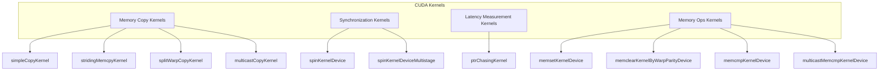

Sources: [kernels.cu:20-399](), [kernels.cuh:27-39]()

## Memory Copy Kernels

Memory copy kernels are the primary components for bandwidth measurement. They implement different memory access patterns to measure bandwidth under various scenarios.

### Simple Copy Kernel

The `simpleCopyKernel` is a basic memory copy kernel used for smaller buffer sizes (less than the small buffer threshold). It uses cache global (CG) memory operations for data transfer.

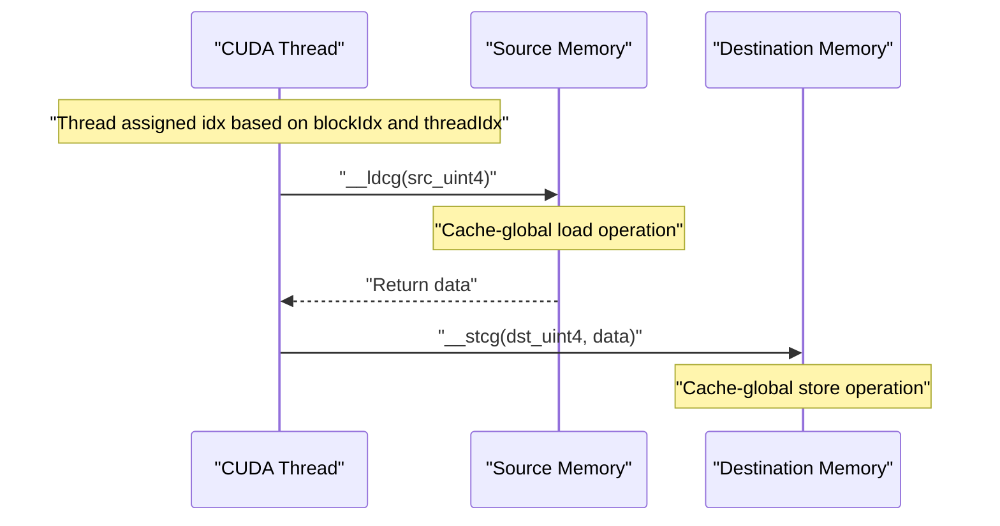

Sources: [kernels.cu:20-28](), [kernels.cu:183-222]()

### Striding Memcpy Kernel

The `stridingMemcpyKernel` is an optimized kernel for larger buffer sizes that uses a striding memory access pattern to maximize memory bandwidth. It employs techniques like memory pipelining and thread striding to achieve high throughput.

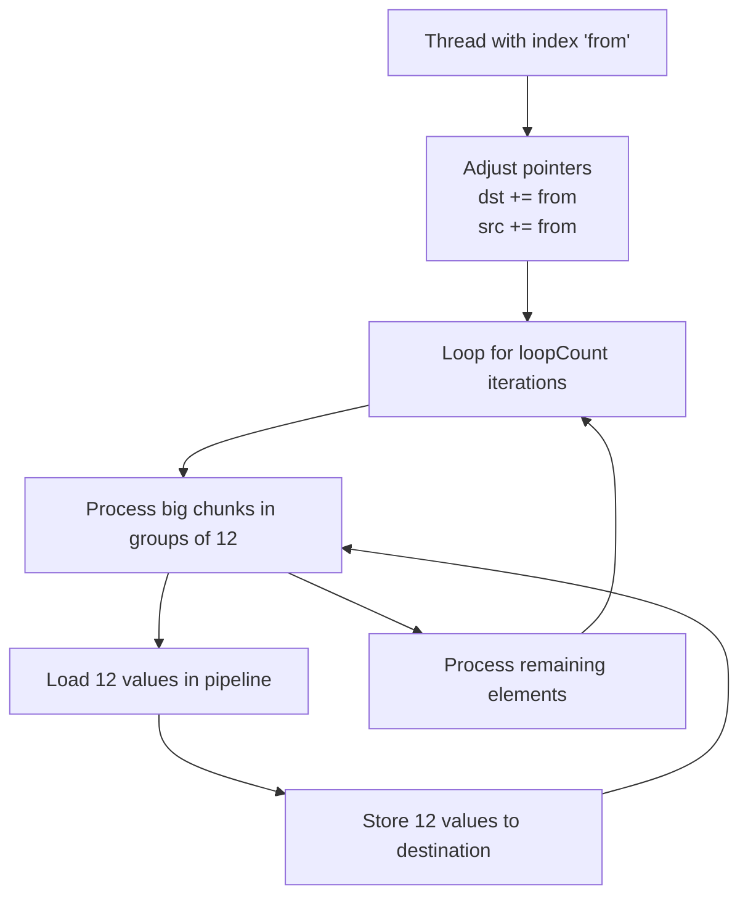

Sources: [kernels.cu:30-74](), [kernels.cu:183-222]()

### Split Warp Copy Kernel

The `splitWarpCopyKernel` performs a split warp copy by alternating copy directions across warps. This pattern is useful for maximizing bidirectional bandwidth between GPU components.

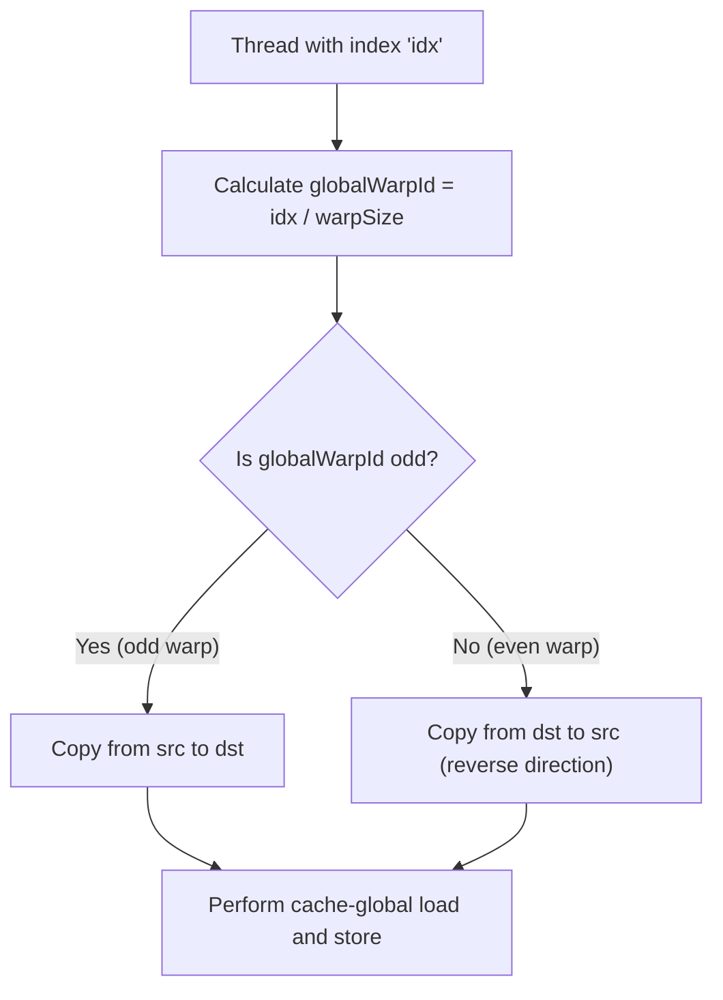

Sources: [kernels.cu:77-98](), [kernels.cu:224-242]()

### Multicast Copy Kernel

The `multicastCopyKernel` is specialized for architectures that support multicast memory operations (Hopper and later). It writes from regular memory to multicast memory regions.

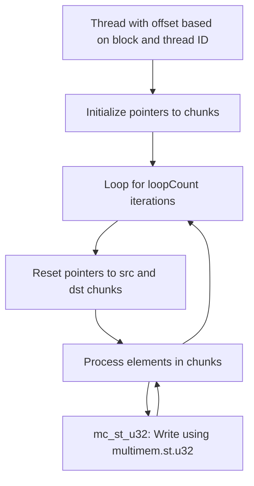

Sources: [kernels.cu:128-146](), [kernels.cu:244-259]()

## Latency Measurement Kernels

### Pointer Chasing Kernel

The `ptrChasingKernel` and its host-side wrapper `latencyPtrChaseKernel` implement a pointer chasing technique to measure memory latency. This approach forces serial memory accesses that cannot be parallelized, allowing accurate latency measurement.

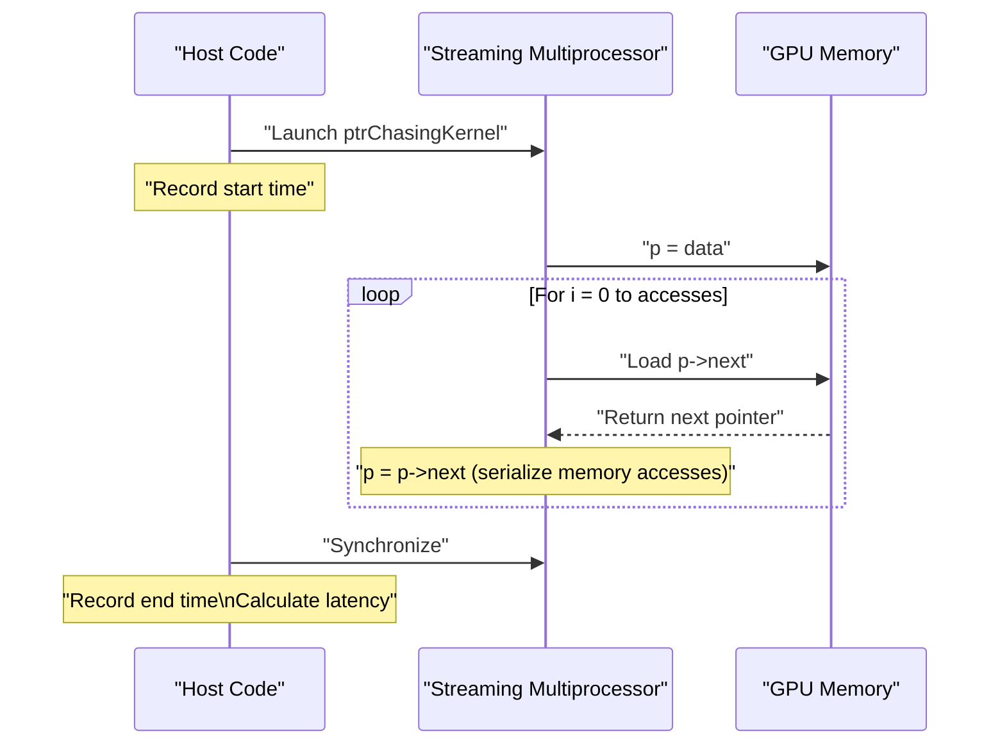

Sources: [kernels.cu:100-111](), [kernels.cu:148-181]()

## Synchronization Kernels

### Spin Kernels

The nvbandwidth tool includes spin kernels for synchronization purposes:

1. `spinKernelDevice`: Simple spin kernel that waits until a latch variable is set or timeout occurs
2. `spinKernelDeviceMultistage`: Two-stage spin kernel for complex multi-node synchronization

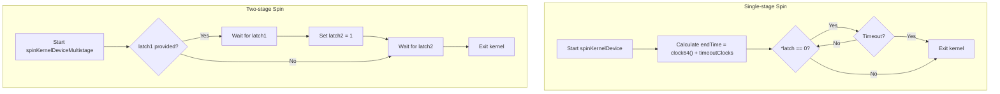

Sources: [kernels.cu:261-331]()

## Memory Initialization and Verification Kernels

The nvbandwidth tool includes several kernels for memory pattern initialization and verification:

### Memory Pattern Operations

1. `memsetKernelDevice`: Sets memory to a specified pattern
2. `memcmpKernelDevice`: Compares memory with a specified pattern
3. `multicastMemcmpKernelDevice`: Compares multicast memory with a pattern
4. `memclearKernelByWarpParityDevice`: Clears memory locations based on warp parity

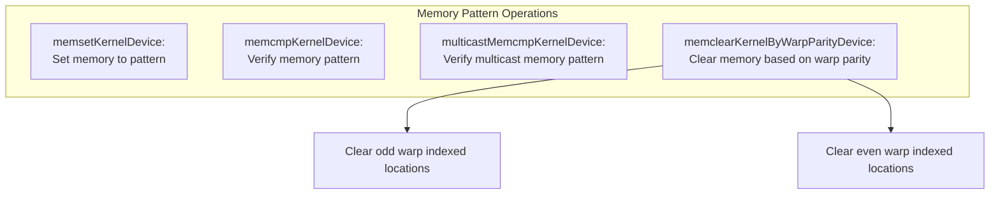

Sources: [kernels.cu:333-447]()

## Kernel Preloading Mechanism

The nvbandwidth tool preloads all kernels on all devices at initialization to reduce kernel launch latency during measurements. This is implemented in the `preloadKernels` function.

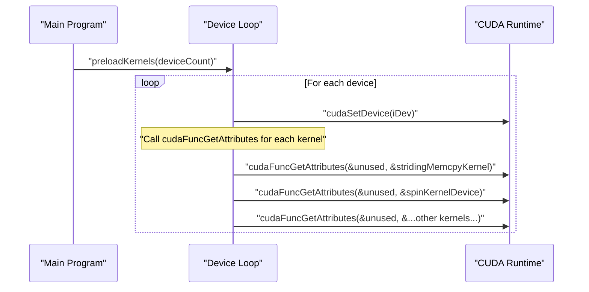

Sources: [kernels.cu:449-465]()

## Kernel Selection Logic

The nvbandwidth tool selects the appropriate kernel based on buffer size and test requirements. The selection logic is primarily implemented in the `copyKernel` function.

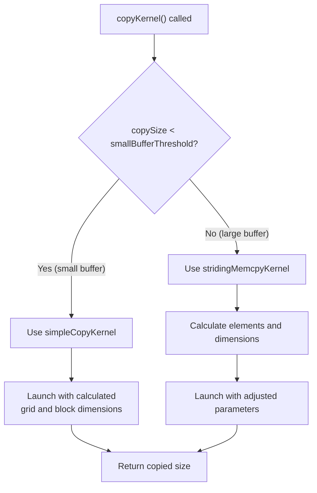

The kernel selection table below summarizes when each kernel is used:

| Kernel Type | Function | Used When | Key Optimizations |
|-------------|----------|-----------|-------------------|
| Simple Copy | `simpleCopyKernel` | Buffer size < threshold | Basic cache-global ops |
| Striding Copy | `stridingMemcpyKernel` | Buffer size ≥ threshold | Memory pipelining, striding |
| Split Warp | `splitWarpCopyKernel` | Bidirectional tests | Alternating warp directions |
| Multicast | `multicastCopyKernel` | Multicast memory tests | Hopper+ multimem ops |

Sources: [kernels.cu:183-222](), [kernels.cu:224-242](), [kernels.cu:244-259]()

## Technical Implementation Details

### Key Parameters and Constants

| Constant | Value | Purpose |
|----------|-------|---------|
| `numThreadPerBlock` | Varies | Threads per block for memory copy |
| `smallBufferThreshold` | Defined in MiB | Threshold for kernel selection |
| `DEFAULT_SPIN_KERNEL_TIMEOUT_MS` | 10000 (10s) | Default timeout for spin kernels |

### Memory Access Instructions

The kernels use specific memory access instructions for optimal performance:

- `__ldcg()`: Cache-global load instruction that caches data globally
- `__stcg()`: Cache-global store instruction that caches data globally
- `multimem.st.u32`: Hopper architecture's multicast store instruction
- `multimem.ld_reduce.and.b32`: Hopper architecture's multicast load instruction

Sources: [kernels.cu:20-28](), [kernels.cu:113-125]()

## Integration with Memory Copy Framework

The CUDA kernels are integrated with the Memory Copy Framework through kernel wrapper functions like `copyKernel`, `copyKernelSplitWarp`, and `multicastCopy`. These functions take a `MemcpyDescriptor` structure or similar parameters and handle the details of launching the appropriate kernel with the right parameters.

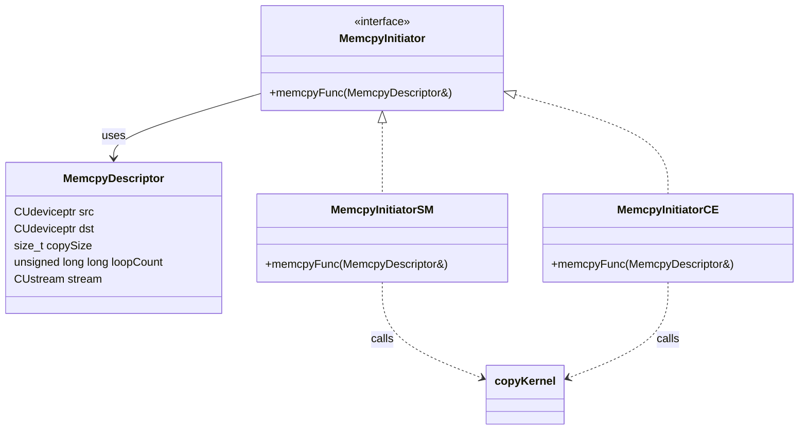

Sources: [kernels.cu:183-222](), [kernels.cuh:27-39]()

---

