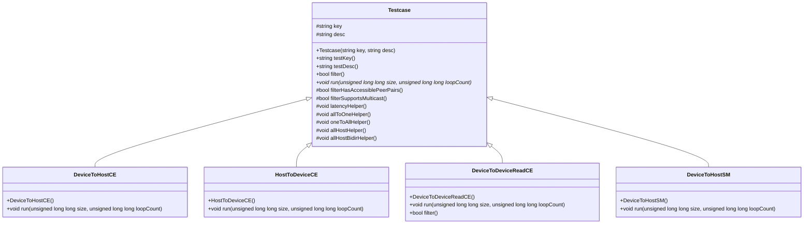
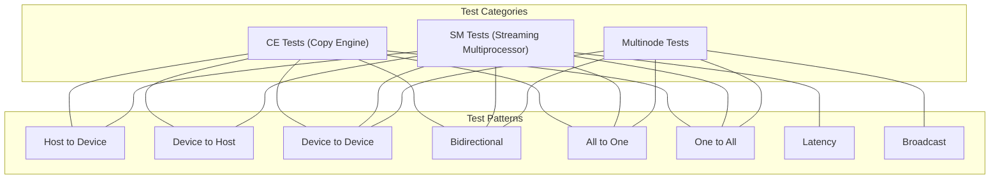
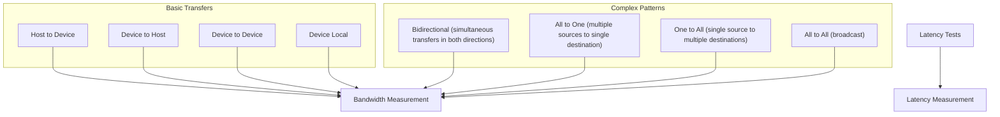
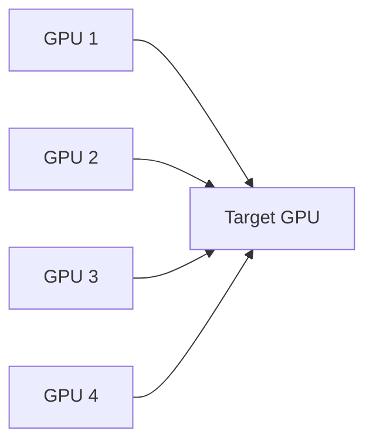
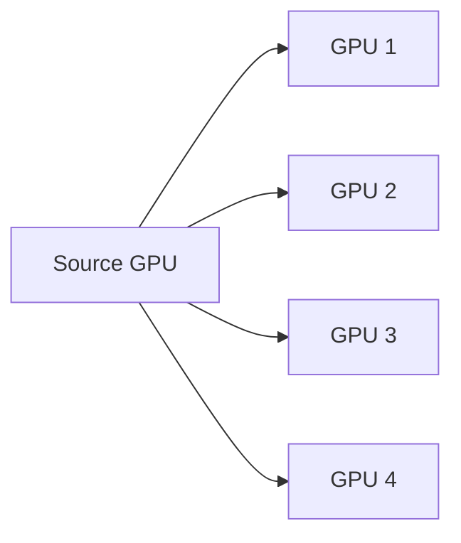
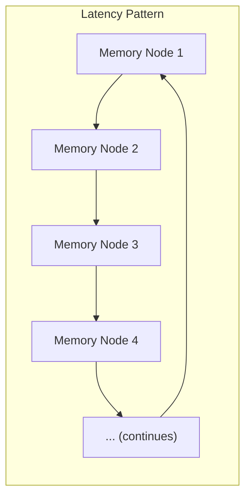

<!-- source: DeepWiki mcp.deepwiki.com · repo NVIDIA/nvbandwidth · page 5 Test Cases · fetched 2026-10-26 -->

# Test Cases

Relevant source files

The following files were used as context for generating this wiki page:

- [testcase.cpp](testcase.cpp)
- [testcase.h](testcase.h)

## Purpose and Scope

This document describes the test case architecture of nvbandwidth, a CUDA-based tool for measuring memory bandwidth performance between various components in NVIDIA GPU systems. The test cases form the core functionality of nvbandwidth, providing specific implementations to measure bandwidth in different memory transfer scenarios. This page focuses on the test case framework, organization, and the types of tests available in the system.

For information about the Memory Copy Framework that powers these tests, see [Memory Copy Framework](#3).

Sources: [testcase.h:18-56]()

## Test Case Architecture

### Base Class Design

The nvbandwidth test cases follow an object-oriented design with a common base class that defines the interface and shared functionality. All specific test implementations inherit from this base class.

Each test case has:
1. A unique key identifier used for selecting tests
2. A description explaining what the test measures
3. A `filter()` method that determines if the test can run on the current system
4. A `run()` method that performs the actual test with specified buffer size and loop count

Sources: [testcase.h:26-56](), [testcase.cpp:23-29]()

### Test Filtering Mechanism

The base `Testcase` class provides several helper methods for filtering tests based on system capabilities:

- `filterHasAccessiblePeerPairs()`: Checks if there are any peer-accessible GPU pairs in the system
- `filterSupportsMulticast()`: Determines if all GPUs in the system support multicast operations
- `filterHasMultipleGPUsMultinode()`: For multinode builds, checks if there are multiple GPUs available across nodes

These filtering methods allow tests to determine if they should be skipped when the required hardware capabilities are not available.

Sources: [testcase.h:31-35](), [testcase.cpp:30-74]()

## Test Categories

nvbandwidth includes three main categories of test cases, each targeting different memory copy mechanisms:

Sources: [testcase.h:59-591]()

### CE Test Cases

CE (Copy Engine) test cases measure bandwidth using CUDA's built-in memory copy operations, primarily through the `cuMemcpyAsync` API. These tests leverage the GPU's dedicated copy engines for data transfer.

Key CE test cases include:
- Host to device transfers (`HostToDeviceCE`)
- Device to host transfers (`DeviceToHostCE`)
- Device to device transfers in both read and write directions (`DeviceToDeviceReadCE`, `DeviceToDeviceWriteCE`)
- Bidirectional transfers (`DeviceToDeviceBidirReadCE`, `DeviceToDeviceBidirWriteCE`)
- Aggregate bandwidth tests (`AllToOneReadCE`, `OneToAllWriteCE`)

Sources: [testcase.h:59-263]()

### SM Test Cases

SM (Streaming Multiprocessor) test cases measure bandwidth using custom CUDA kernels that run on the GPU's compute cores rather than using the dedicated copy engines. This provides an alternative measurement that can be useful for understanding real-world application performance.

Key SM test cases include:
- Host to device transfers (`HostToDeviceSM`)
- Device to host transfers (`DeviceToHostSM`)
- Device to device transfers (`DeviceToDeviceReadSM`, `DeviceToDeviceWriteSM`)
- Latency measurements (`HostDeviceLatencySM`, `DeviceToDeviceLatencySM`)
- Bidirectional transfers (`DeviceToDeviceBidirReadSM`, `DeviceToDeviceBidirWriteSM`)

Sources: [testcase.h:265-440]()

### Multinode Test Cases

When built with multinode support (via the `MULTINODE` flag), additional test cases are available for measuring bandwidth between GPUs across different compute nodes. These tests use MPI (Message Passing Interface) for coordination between nodes.

Key multinode test cases include:
- Cross-node device to device transfers (`MultinodeDeviceToDeviceReadCE`, `MultinodeDeviceToDeviceWriteCE`)
- Broadcast operations (`MultinodeBroadcastOneToAllSM`, `MultinodeBroadcastAllToAllSM`)
- Bisection bandwidth (`MultinodeBisectWriteCE`)

Sources: [testcase.h:442-591]()

## Test Directions and Patterns

The test cases implement various data transfer patterns to measure different aspects of system bandwidth:

### Transfer Directions

Each test case focuses on measuring bandwidth in a specific direction:

1. **Read Operations**: In read operations, the copy is initiated from the target device, reading data from another memory location (device memory or host memory). Read operations are generally denoted by "read" in the test name.

2. **Write Operations**: In write operations, the copy is initiated from the target device, writing data to another memory location. Write operations are generally denoted by "write" in the test name.

Sources: [testcase.h:120-139](), [testcase.h:295-326]()

### Data Transfer Patterns

The test cases implement several patterns of data transfer:

Sources: [testcase.h:66-215](), [testcase.h:216-263](), [testcase.h:354-440](), [testcase.h:535-590]()

## Helper Methods for Complex Patterns

The base `Testcase` class provides several helper methods to support complex data transfer patterns:

### All-to-One Pattern

The `allToOneHelper()` method sets up a pattern where all GPUs send data to a single destination GPU. This tests the maximum inbound or outbound bandwidth a GPU can achieve when receiving from or being read by multiple peers.

Sources: [testcase.cpp:99-144](), [testcase.h:217-239]()

### One-to-All Pattern

The `oneToAllHelper()` method implements a pattern where a single GPU sends data to all other GPUs. This tests the maximum outbound or inbound bandwidth a GPU can achieve when sending to or being written to by multiple peers.

Sources: [testcase.cpp:146-191](), [testcase.h:242-263]()

### Bidirectional Transfers

Several test cases implement bidirectional transfers, where data is transferred simultaneously in both directions. For example, in host-device bidirectional tests, data is transferred from host to device and from device to host at the same time.

These tests are particularly valuable for measuring real-world performance under concurrent workloads and for testing the full duplex capabilities of interconnects like NVLink.

Sources: [testcase.h:79-117](), [testcase.h:142-163](), [testcase.h:185-214](), [testcase.h:329-350]()

## Latency Measurement

In addition to bandwidth tests, nvbandwidth includes test cases for measuring memory access latency:

- `HostDeviceLatencySM`: Measures host-device access latency using a pointer chase kernel
- `DeviceToDeviceLatencySM`: Measures device-to-device access latency between peer GPUs

The latency tests use a pointer chasing technique where each memory location contains the address of the next location to access. This creates a dependent chain of memory accesses that reveals the true latency of the memory subsystem.

Sources: [testcase.cpp:77-97](), [testcase.h:267-274](), [testcase.h:306-315]()

## Test Case Execution Flow

When a test case's `run()` method is called, it typically follows this sequence:

1. **Setup**: Allocate necessary memory buffers (host, device, or both)
2. **Warmup**: Perform a few initial transfers to warm up the system
3. **Timed Execution**: Perform the actual memory transfers while measuring time
4. **Bandwidth Calculation**: Calculate bandwidth based on transfer size and elapsed time
5. **Cleanup**: Free allocated memory resources

For complex patterns (All-to-One, One-to-All, etc.), the test cases use the helper methods to set up the correct buffer configuration before performing the transfers.

Sources: [testcase.h:54-56](), [testcase.cpp:99-271]()

---

