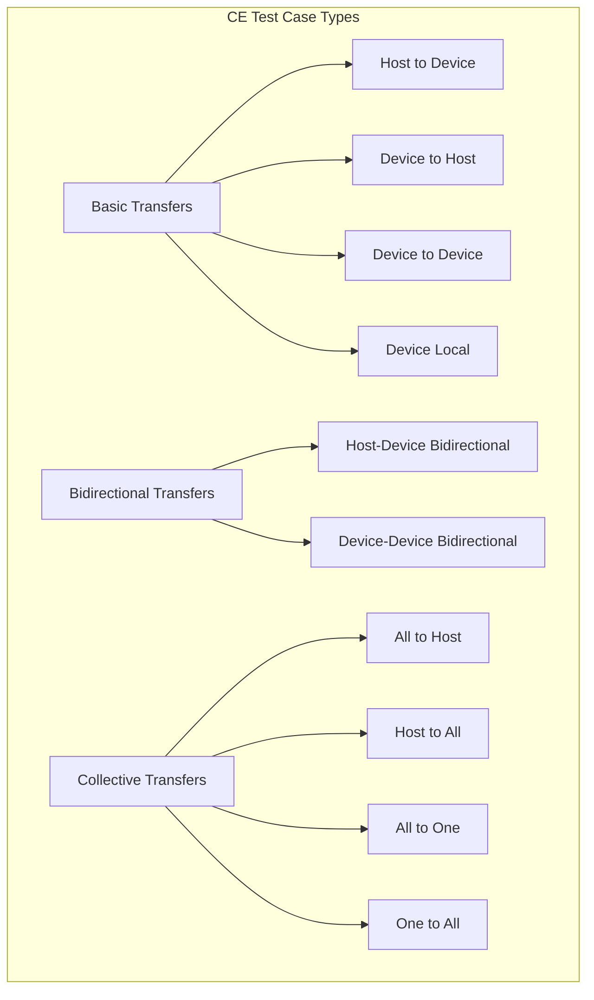
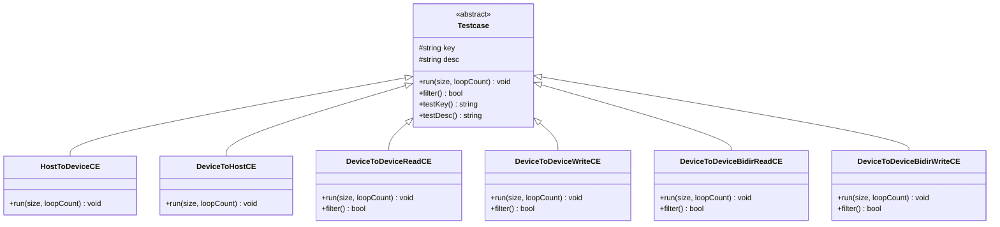
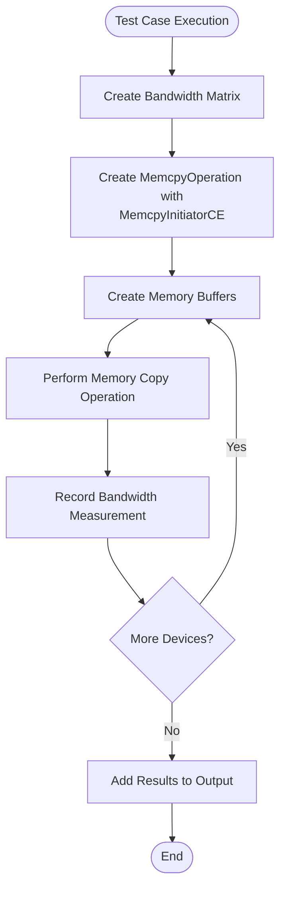
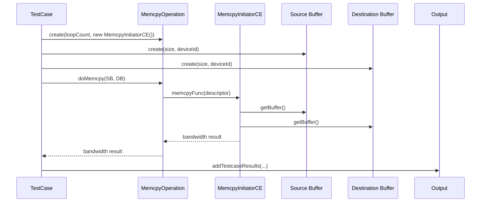
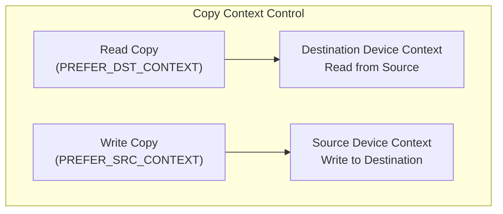
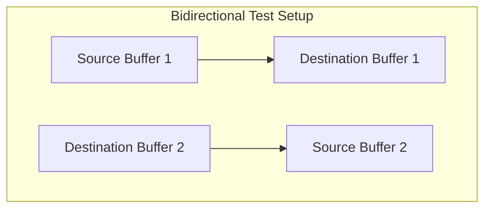

<!-- source: DeepWiki mcp.deepwiki.com · repo NVIDIA/nvbandwidth · page 5.1 CE Test Cases · fetched 2026-10-26 -->

# CE Test Cases

<details>
<summary>Relevant source files</summary>

The following files were used as context for generating this wiki page:

- [testcase.h](testcase.h)
- [testcases_ce.cpp](testcases_ce.cpp)

</details>


## Purpose and Scope

This document covers the Compute Engine (CE) Test Cases in the nvbandwidth tool. These test cases measure memory bandwidth using CUDA's hardware-accelerated copy engine to perform various transfer patterns between host memory and GPU memory, or between multiple GPUs. For tests that use the Streaming Multiprocessor (SM) instead of the Copy Engine, see [SM Test Cases](#5.2).

## Overview of CE Test Cases

CE test cases utilize CUDA's built-in copy mechanisms (primarily cuMemcpyAsync) which use dedicated hardware copy engines on NVIDIA GPUs. These engines are optimized for high-bandwidth data transfers and operate independently of the GPU computation units (SMs).



Sources: [testcase.h:59-263]()

## Implementation Architecture

CE test cases are implemented as concrete classes inheriting from the `Testcase` base class. Each test case implements the `run` method which performs the specific memory transfers and measures bandwidth.



Sources: [testcase.h:26-262]()

## Core CE Test Case Categories

### Basic Transfers

These test cases measure the bandwidth of simple point-to-point transfers:

| Test Case | Description | Implementation |
|-----------|-------------|----------------|
| `HostToDeviceCE` | Measures host to device (CPU to GPU) transfer bandwidth | [testcases_ce.cpp:25-37]() |
| `DeviceToHostCE` | Measures device to host (GPU to CPU) transfer bandwidth | [testcases_ce.cpp:39-51]() |
| `DeviceToDeviceReadCE` | Measures peer-to-peer GPU read bandwidth | [testcases_ce.cpp:90-113]() |
| `DeviceToDeviceWriteCE` | Measures peer-to-peer GPU write bandwidth | [testcases_ce.cpp:116-138]() |
| `DeviceLocalCopy` | Measures bandwidth of copies within the same GPU | [testcases_ce.cpp:214-226]() |

Sources: [testcases_ce.cpp:25-226](), [testcase.h:62-172]()

### Bidirectional Transfers

These test cases measure bandwidth when data transfers occur simultaneously in both directions:

| Test Case | Description | Implementation |
|-----------|-------------|----------------|
| `HostToDeviceBidirCE` | Measures host to device bandwidth with simultaneous device to host transfer | [testcases_ce.cpp:53-69]() |
| `DeviceToHostBidirCE` | Measures device to host bandwidth with simultaneous host to device transfer | [testcases_ce.cpp:71-87]() |
| `DeviceToDeviceBidirReadCE` | Measures bidirectional peer-to-peer read bandwidth | [testcases_ce.cpp:141-175]() |
| `DeviceToDeviceBidirWriteCE` | Measures bidirectional peer-to-peer write bandwidth | [testcases_ce.cpp:178-212]() |

Sources: [testcases_ce.cpp:53-212](), [testcase.h:80-163]()

### Collective Transfers

These test cases measure bandwidth during multi-device data movement patterns:

| Test Case | Description | Implementation |
|-----------|-------------|----------------|
| `AllToHostCE` | Measures bandwidth from a device to host with simultaneous transfers from all other devices to host | [testcases_ce.cpp:228-235]() |
| `AllToHostBidirCE` | Measures bidirectional bandwidth between a device and host with interference from other devices | [testcases_ce.cpp:237-244]() |
| `HostToAllCE` | Measures bandwidth from host to a device with simultaneous transfers from host to all other devices | [testcases_ce.cpp:246-253]() |
| `HostToAllBidirCE` | Measures bidirectional bandwidth between host and a device with interference from other devices | [testcases_ce.cpp:255-262]() |
| `AllToOneWriteCE` | Measures total inbound bandwidth to a single device from all accessible peers | [testcases_ce.cpp:265-271]() |
| `AllToOneReadCE` | Measures total outbound bandwidth from a single device to all accessible peers using read operations | [testcases_ce.cpp:274-280]() |
| `OneToAllWriteCE` | Measures total outbound bandwidth from a single device to all accessible peers using write operations | [testcases_ce.cpp:283-289]() |
| `OneToAllReadCE` | Measures total inbound bandwidth to a single device from all accessible peers using read operations | [testcases_ce.cpp:292-298]() |

Sources: [testcases_ce.cpp:228-298](), [testcase.h:175-263]()

## CE Test Case Execution Flow

The following diagram illustrates the execution flow of a typical CE test case:



Sources: [testcases_ce.cpp:25-37]()

## Implementation Details

### Memory Copy Operation Setup

CE test cases use `MemcpyInitiatorCE` to perform the actual data transfers. This initiator uses CUDA's hardware copy engines rather than executing copy kernels on the SM.



Sources: [testcases_ce.cpp:26-36]()

### Read vs. Write Operations

NVIDIA GPUs distinguish between read and write operations for peer-to-peer transfers:

1. **Read operations**: The destination device reads from the source device (pulls data)
2. **Write operations**: The source device writes to the destination device (pushes data)

The CE test cases test both patterns by controlling which device's context is used to execute the copy:



Sources: [testcases_ce.cpp:92](), [testcases_ce.cpp:118]()

### Special Handling for Bidirectional Tests

For bidirectional tests, the test case creates two copies running in opposite directions:



Sources: [testcases_ce.cpp:62-65](), [testcases_ce.cpp:80-83]()

## CE Test Performance Considerations

1. **CE vs. SM Performance**:
   - CE operations generally provide higher bandwidth for large transfers
   - CE operations run asynchronously from SM computation
   - CE operations have lower CPU overhead compared to launching SM copy kernels

2. **Peer-to-Peer Transfer Requirements**:
   - The devices must support peer access (verified with `enablePeerAccess`)
   - Bandwidth depends on the system topology and interconnect (e.g., NVLink, PCIe)

3. **Read vs Write Performance**:
   - Read and write performance may differ based on hardware architecture
   - Both patterns are tested to identify optimal data movement strategies

Sources: [testcases_ce.cpp:103-105](), [testcases_ce.cpp:129-131]()

## Usage Example

These test cases can be run from the nvbandwidth CLI with specific test keys. For example:

```
./nvbandwidth --testcase=device_to_device_memcpy_read_ce --bufferSize=1GB
```

This would run the `DeviceToDeviceReadCE` test case with a 1GB buffer size.

---

