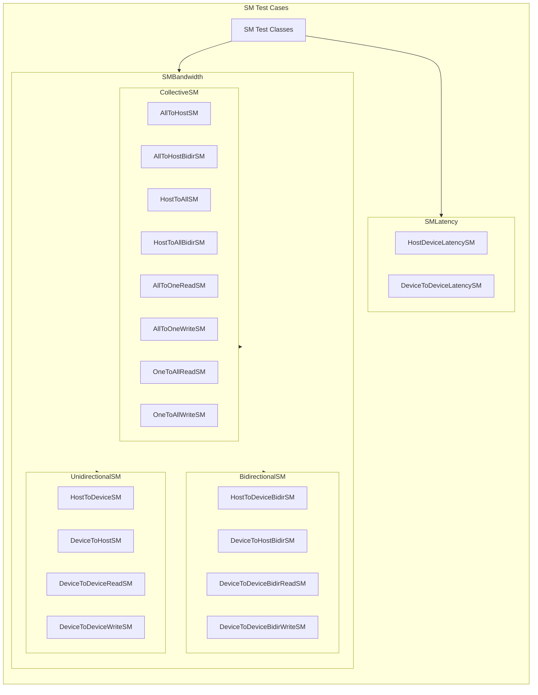
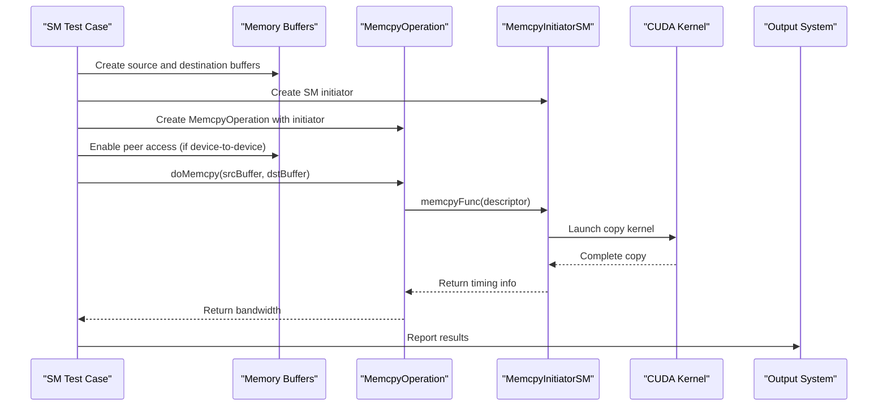
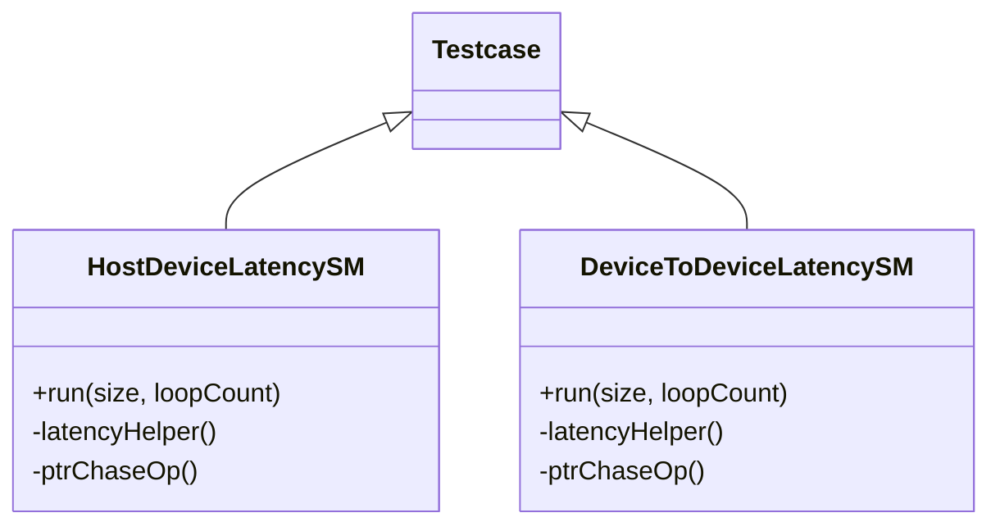
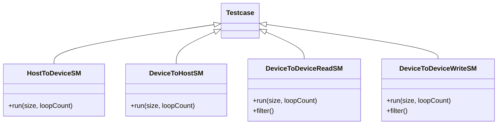
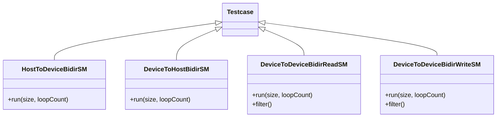
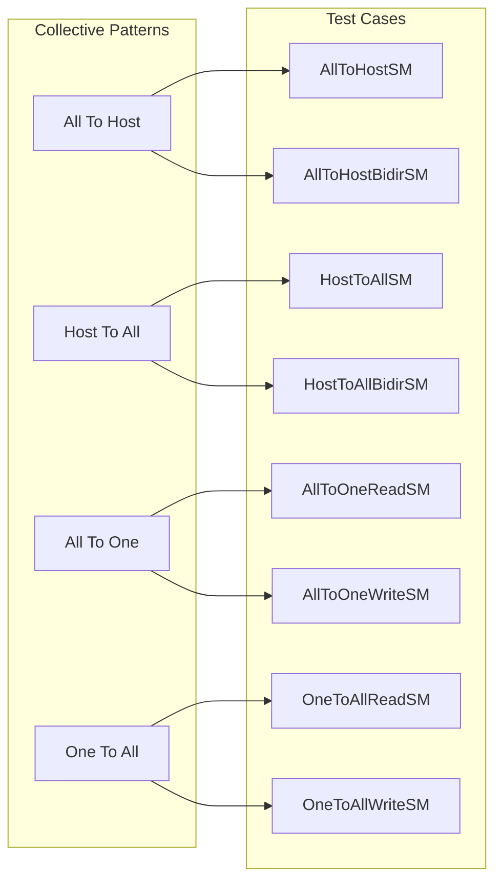
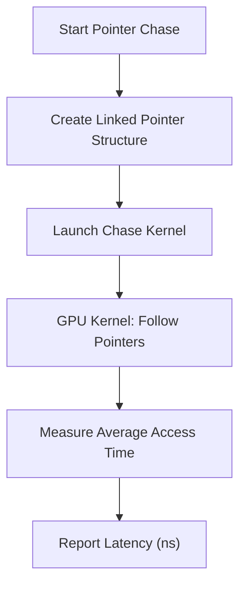
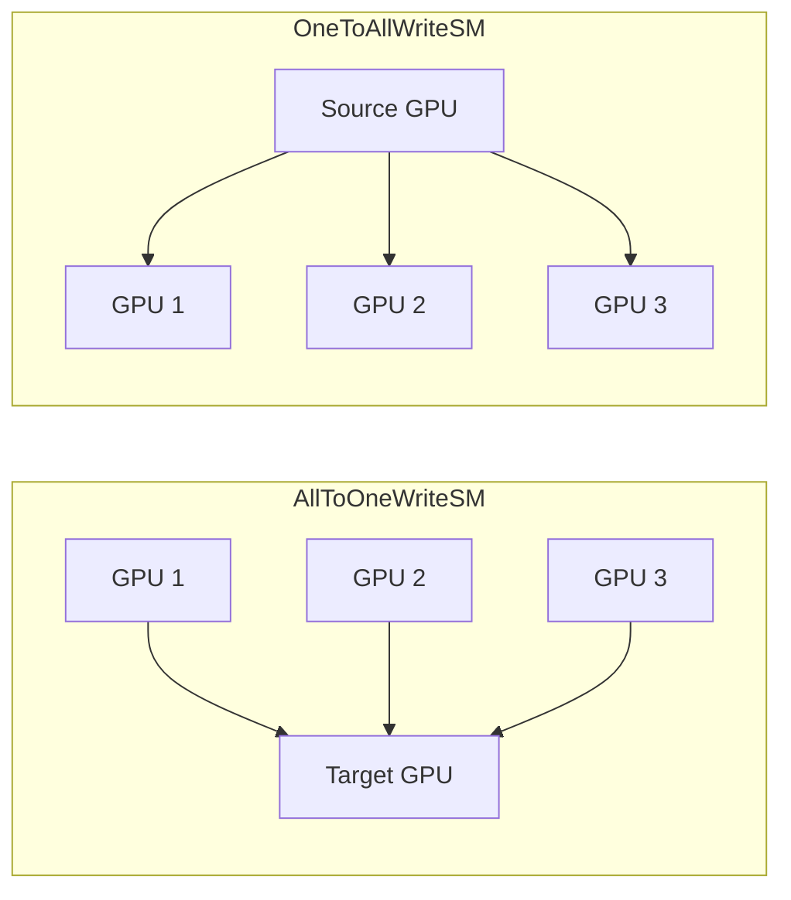

<!-- source: DeepWiki mcp.deepwiki.com · repo NVIDIA/nvbandwidth · page 5.2 SM Test Cases · fetched 2026-10-26 -->

# SM Test Cases

<details>
<summary>Relevant source files</summary>

The following files were used as context for generating this wiki page:

- [testcase.h](testcase.h)
- [testcases_sm.cpp](testcases_sm.cpp)

</details>


## Purpose and Scope

This page documents the Streaming Multiprocessor (SM) test cases in the nvbandwidth tool. These test cases measure memory bandwidth and latency by using custom CUDA kernels that execute on the GPU's Streaming Multiprocessors rather than using the Copy Engine (CE) like the CE tests do (for information about CE-based tests, see [CE Test Cases](#5.1)).

SM tests offer different performance characteristics than CE tests and can help provide a more complete picture of system memory transfer capabilities, especially for understanding how memory transfers perform when initiated directly from compute workloads.

Sources: [testcases_sm.cpp:18-365]()/[testcase.h:265-440]()

## Overview of SM Test Cases

SM test cases in nvbandwidth use specialized CUDA kernels to perform memory operations and measure bandwidth or latency. Unlike CE tests which use the CUDA Driver API's `cuMemcpyAsync()` function, SM tests launch custom kernels to perform the copies, simulating how real applications might move data during computation.



Sources: [testcases_sm.cpp:24-364]()/[testcase.h:265-440]()

## SM Test Case Implementation

SM test cases follow a consistent implementation pattern that involves:

1. Creating data buffers
2. Setting up the memory copy operation with an SM-specific initiator
3. Executing the operation
4. Collecting and reporting bandwidth or latency results



Sources: [testcases_sm.cpp:37-49]()/[testcases_sm.cpp:144-167]()

## Key Components of SM Test Cases

### MemcpyInitiators for SM Tests

SM test cases use specialized memory copy initiators that launch CUDA kernels rather than using the CUDA Driver API's memory copy functions:

| Initiator | Description | Used In |
|-----------|-------------|---------|
| `MemcpyInitiatorSM` | Standard SM copy initiator that launches kernels for unidirectional memory copies | Most SM test cases |
| `MemcpyInitiatorSMSplitWarp` | Special initiator that uses split warps to handle bidirectional copies simultaneously | Bidirectional test cases |

Sources: [testcases_sm.cpp:39]()/[testcases_sm.cpp:67]()/[testcases_sm.cpp:81]()

### Execution Context Selection

SM test cases can specify which GPU context to use when executing transfers:

| Context Preference | Description | Used In |
|-------------------|-------------|---------|
| `PREFER_SRC_CONTEXT` | Use the source buffer's GPU context for the operation | Most write operations |
| `PREFER_DST_CONTEXT` | Use the destination buffer's GPU context for the operation | Most read operations |

This selection impacts how memory operations are executed and can affect observed bandwidth.

Sources: [testcases_sm.cpp:96]()/[testcases_sm.cpp:211]()/[testcases_sm.cpp:147]()

## Types of SM Test Cases

### Latency Test Cases

SM latency tests measure memory access times using pointer-chasing kernels rather than bulk memory transfers:



Sources: [testcases_sm.cpp:24-35]()/[testcases_sm.cpp:119-142]()/[testcase.h:267-274]()/[testcase.h:306-315]()

### Basic Memory Transfer Test Cases

The simplest SM test cases perform transfers between host and device or between devices:



These test cases measure basic bandwidth in a single direction between memory locations. Device-to-device tests require peer access and further distinguish between read and write operations.

Sources: [testcases_sm.cpp:37-63]()/[testcases_sm.cpp:94-117]()/[testcases_sm.cpp:145-167]()/[testcase.h:277-326]()

### Bidirectional Test Cases

Bidirectional tests measure bandwidth when transfers occur simultaneously in both directions:



These tests use `MemcpyInitiatorSMSplitWarp` for host-device transfers and measure multiple transfers simultaneously for device-to-device transfers to assess bidirectional capabilities.

Sources: [testcases_sm.cpp:65-91]()/[testcases_sm.cpp:170-241]()/[testcase.h:100-117]()/[testcase.h:329-350]()

### Collective Test Cases

Collective test cases measure bandwidth in scenarios involving multiple devices:



These tests evaluate bandwidth in more complex scenarios:

- **All-to-Host**: Measure bandwidth from one device to the host while all other devices also copy to the host
- **Host-to-All**: Measure bandwidth from the host to one device while the host also copies to all other devices
- **All-to-One**: Measure combined bandwidth when all devices copy to a single device
- **One-to-All**: Measure combined bandwidth when one device copies to all other devices

Each pattern has read and write variants, with some also having bidirectional versions.

Sources: [testcases_sm.cpp:243-364]()/[testcase.h:353-440]()

## Implementation Details

### Common Test Case Structure

Most SM test cases follow this general structure:

1. Create a matrix to store bandwidth/latency results
2. Create a `MemcpyOperation` instance with appropriate initiator and settings
3. Create source and destination buffers
4. Enable peer access if needed (for device-to-device transfers)
5. Execute the memory operation and measure bandwidth
6. Report results

Example from `HostToDeviceSM`:

```
1. Create PeerValueMatrix
2. Create MemcpyOperation with MemcpyInitiatorSM
3. For each device:
   a. Create host and device buffers
   b. Perform memory copy and measure bandwidth
   c. Store result in matrix
4. Report results
```

Sources: [testcases_sm.cpp:37-49]()

### Read vs. Write Operations

For device-to-device tests, there's an important distinction between read and write operations:

- **Read operations**: The destination device initiates the transfer, reading from the source device
- **Write operations**: The source device initiates the transfer, writing to the destination device

This is controlled by the context preference (`PREFER_SRC_CONTEXT` or `PREFER_DST_CONTEXT`) and affects which GPU executes the transfer.

Sources: [testcases_sm.cpp:96]()/[testcases_sm.cpp:147]()

### Vector Copy Operations

Bidirectional and collective tests often use vector operations to perform multiple transfers simultaneously:

```cpp
// Instead of doMemcpy(srcBuffer, dstBuffer)
std::vector<const MemcpyBuffer*> srcBuffers = {&src1, &src2};
std::vector<const MemcpyBuffer*> dstBuffers = {&dst1, &dst2};
auto results = memcpyInstance.doMemcpyVector(srcBuffers, dstBuffers);
```

Results can be reported individually or combined depending on the test case.

Sources: [testcases_sm.cpp:191-197]()/[testcases_sm.cpp:228-234]()

## Key Test Cases Explained

### Memory Latency Tests

Latency tests (`HostDeviceLatencySM` and `DeviceToDeviceLatencySM`) use a pointer-chasing approach to measure memory access latency rather than bandwidth:



These tests are crucial for understanding memory system performance beyond raw bandwidth.

Sources: [testcases_sm.cpp:24-35]()/[testcases_sm.cpp:119-142]()

### Device-to-Device Transfers

Device-to-device transfers are particularly important for multi-GPU systems. They require peer access to be enabled and come in several variants:

1. **Basic transfers**: `DeviceToDeviceReadSM` and `DeviceToDeviceWriteSM`
2. **Bidirectional transfers**: `DeviceToDeviceBidirReadSM` and `DeviceToDeviceBidirWriteSM`

The bidirectional tests perform copies in both directions simultaneously and report both individual and combined bandwidth.

Sources: [testcases_sm.cpp:94-117]()/[testcases_sm.cpp:145-167]()/[testcases_sm.cpp:170-241]()

### Collective Tests

Collective tests assess performance in multi-GPU scenarios where multiple transfers occur simultaneously:



These tests help understand system behavior under more complex transfer patterns that are common in multi-GPU applications.

Sources: [testcases_sm.cpp:330-364]()

## Comparison with CE Test Cases

SM test cases differ from CE test cases in several important ways:

| Aspect | SM Tests | CE Tests |
|--------|----------|----------|
| Implementation | Custom CUDA kernels | CUDA Runtime/Driver API functions |
| Execution | On Streaming Multiprocessors | On Copy Engines |
| Control | More programmatic control | Relies on driver implementation |
| Use case | Simulates application memory access patterns | Measures raw hardware capabilities |
| Performance characteristics | May have higher latency but can utilize SM parallelism | Optimized for bulk transfers |

Understanding the differences between SM and CE test results can provide valuable insights into system memory architecture and help optimize application memory operations.

Sources: [testcase.h:265-440]()/[testcase.h:59-263]()

## Summary

SM test cases in nvbandwidth provide a comprehensive suite for measuring memory bandwidth and latency using GPU compute resources rather than dedicated copy engines. They cover a wide range of scenarios including:

1. Basic host-device transfers
2. Device-to-device transfers
3. Bidirectional transfers
4. Collective transfers involving multiple devices

These tests help users understand the performance characteristics of memory operations when executed from GPU kernels, which complements the information provided by CE tests and gives a more complete picture of system memory performance.

Sources: [testcases_sm.cpp:18-365]()/[testcase.h:265-440]()

---

