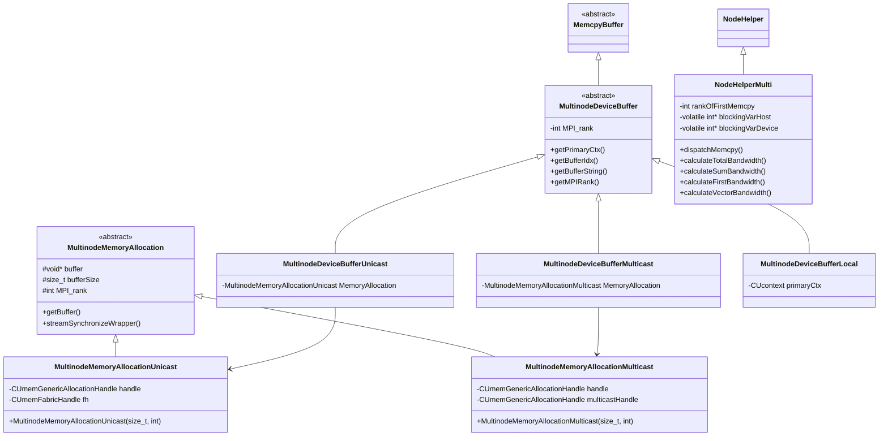
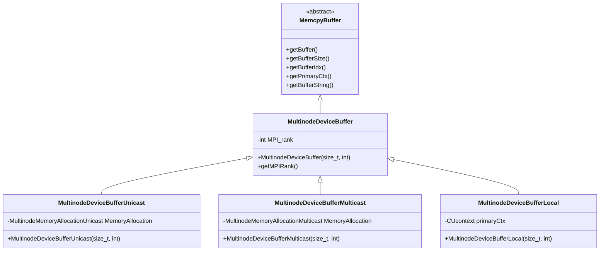
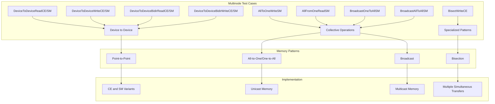

<!-- source: DeepWiki mcp.deepwiki.com · repo NVIDIA/nvbandwidth · page 5.3 Multinode Test Cases · fetched 2026-10-26 -->

# Multinode Test Cases

Relevant source files

The following files were used as context for generating this wiki page:

- [multinode_memcpy.cpp](multinode_memcpy.cpp)
- [multinode_memcpy.h](multinode_memcpy.h)
- [multinode_testcases.cpp](multinode_testcases.cpp)

## Purpose and Scope

This document describes the multinode test cases in nvbandwidth, which measure memory bandwidth performance across multiple nodes in NVIDIA GPU systems connected via technologies like NVLink. These test cases use MPI (Message Passing Interface) to coordinate operations across multiple nodes and leverage CUDA's memory management features, particularly fabric memory and multicast objects. For information about single-node test cases, see [CE Test Cases](#5.1) and [SM Test Cases](#5.2).

## Architecture Overview

The multinode test system consists of several interconnected components that work together to measure bandwidth performance across networked GPU systems:

Sources: [multinode_memcpy.h:28-146](), [multinode_memcpy.cpp:25-326]()

## Memory Allocation Classes

The multinode system uses specialized memory allocation classes to manage memory across multiple nodes:

1. **MultinodeMemoryAllocation** (abstract base class):
   - Base class for multinode memory allocations
   - Manages a buffer pointer, buffer size, and MPI rank
   - Provides synchronization wrappers for coordinating operations

2. **MultinodeMemoryAllocationUnicast**:
   - Allocates memory on one node that can be accessed by other nodes
   - Uses CUDA's fabric memory handles to share memory across nodes
   - Memory physically resides on one node but is mapped to address spaces of other nodes

3. **MultinodeMemoryAllocationMulticast**:
   - Uses CUDA's multicast objects to efficiently distribute memory updates
   - Allows simultaneous writes to be propagated to multiple nodes
   - Optimizes broadcast-type operations

The allocation process involves:
1. Creating the allocation on one node
2. Exporting a shareable handle
3. Broadcasting the handle to other nodes via MPI
4. Importing the handle on other nodes
5. Mapping memory to each node's address space
6. Setting appropriate access permissions

Sources: [multinode_memcpy.h:28-76](), [multinode_memcpy.cpp:25-155]()

## Buffer Classes

Building on the memory allocation classes, the multinode system provides several buffer types:

1. **MultinodeDeviceBuffer** (abstract):
   - Base class for all multinode device buffers
   - Extends the MemcpyBuffer class with multinode capabilities
   - Tracks which MPI rank owns or is associated with the buffer

2. **MultinodeDeviceBufferUnicast**:
   - Buffer using unicast memory allocation
   - Memory physically resides on one node but is accessible remotely from others
   - Used for point-to-point transfers where data is read/written by specific nodes

3. **MultinodeDeviceBufferMulticast**:
   - Buffer using multicast memory allocation
   - Data written by one node is automatically propagated to all nodes
   - Used for broadcast operations where one node needs to share data with many

4. **MultinodeDeviceBufferLocal**:
   - Simple device memory buffer only accessible from the local node
   - Used when a node needs a local source/destination that isn't shared

Sources: [multinode_memcpy.h:80-120](), [multinode_memcpy.cpp:157-211]()

## Node Helper

The `NodeHelperMulti` class facilitates coordination between nodes during bandwidth tests:

1. **Dispatch Management**:
   - Determines which MPI ranks should execute which memory copy operations
   - Routes operations to appropriate contexts (source or destination)
   - Filters operations to be executed only on relevant nodes

2. **Bandwidth Calculation**:
   - `calculateTotalBandwidth`: Computes aggregate bandwidth across all nodes
   - `calculateSumBandwidth`: Sums bandwidth across multiple operations
   - `calculateFirstBandwidth`: Reports bandwidth of designated "first" copy
   - `calculateVectorBandwidth`: Processes vector of bandwidth measurements

3. **Synchronization**:
   - Process-level synchronization using MPI barriers
   - Stream synchronization with MPI integration for event handling
   - Special stream blocking mechanism for coordinated operations

Sources: [multinode_memcpy.h:122-146](), [multinode_memcpy.cpp:213-326]()

## Test Case Types

The multinode test system implements various test cases to measure different aspects of memory bandwidth:

Sources: [multinode_testcases.cpp:29-383]()

### Device-to-Device Operations

These test cases measure bandwidth between pairs of devices across different nodes:

1. **Read Operations**:
   - `MultinodeDeviceToDeviceReadCE/SM`: Measures bandwidth when reading from a remote node
   - Uses destination node's context to initiate the transfer
   - Available in both CE (Copy Engine) and SM (Streaming Multiprocessor) variants

2. **Write Operations**:
   - `MultinodeDeviceToDeviceWriteCE/SM`: Measures bandwidth when writing to a remote node
   - Uses source node's context to initiate the transfer
   - Available in both CE and SM variants

3. **Bidirectional Operations**:
   - `MultinodeDeviceToDeviceBidirReadCE/SM`: Measures bidirectional read bandwidth
   - `MultinodeDeviceToDeviceBidirWriteCE/SM`: Measures bidirectional write bandwidth
   - Tests how well the interconnect handles simultaneous transfers in both directions

The test implementation creates an N×N matrix of bandwidth measurements (where N is the number of nodes), excluding the diagonal (self-to-self transfers).

Sources: [multinode_testcases.cpp:29-241]()

### Collective Operations

These test cases measure bandwidth in many-to-one, one-to-many, and many-to-many patterns:

1. **All-to-One Operations**:
   - `MultinodeAllToOneWriteSM`: Measures aggregate bandwidth when all nodes write to a single node
   - Tests fan-in performance of the interconnect

2. **One-to-All Operations**:
   - `MultinodeAllFromOneReadSM`: Measures aggregate bandwidth when all nodes read from a single node
   - Tests fan-out performance of the interconnect

3. **Broadcast Operations**:
   - `MultinodeBroadcastOneToAllSM`: Measures bandwidth when one node broadcasts to all others using multicast
   - `MultinodeBroadcastAllToAllSM`: Measures bandwidth when all nodes broadcast to all others
   - Uses multicast memory allocation for efficient broadcasts

These tests are particularly important for evaluating the performance of collective operations in parallel applications.

Sources: [multinode_testcases.cpp:243-348]()

### Specialized Patterns

1. **Bisection Bandwidth**:
   - `MultinodeBisectWriteCE`: Measures the bisection bandwidth of the system
   - Creates pairs of nodes that communicate simultaneously
   - Evaluates how well the interconnect handles multiple cross-traffic patterns

This test is helpful for understanding the total cross-sectional bandwidth available in the system.

Sources: [multinode_testcases.cpp:350-381]()

## Implementation Details

### Memory Handling

The multinode test cases leverage CUDA's memory fabric handling capabilities:

1. **Unicast Memory**:
   - Uses `cuMemCreate` and `cuMemExportToShareableHandle` to create and share memory
   - Memory physically resides on one node but is accessible through NVLink from others
   - Implementation in `MultinodeMemoryAllocationUnicast` handles the creation, sharing, and mapping

2. **Multicast Memory**:
   - Uses `cuMulticastCreate` and related functions to create a multicast object
   - Binds local memory from each node to the multicast object
   - Enables efficient broadcast operations where updates from one node are automatically propagated

3. **Synchronization**:
   - Uses MPI barriers to synchronize nodes at key points
   - Custom stream synchronization through `MPIstreamSyncHelper` integrates CUDA stream synchronization with MPI message handling
   - Special stream blocking mechanism for precise timing and coordination

Sources: [multinode_memcpy.cpp:29-41](), [multinode_memcpy.cpp:43-155]()

### Data Collection and Reporting

The test cases collect performance data in several formats:

1. **Matrix Reporting**:
   - Most tests report results as a `PeerValueMatrix` showing bandwidth between each pair of nodes
   - Format clearly shows the bandwidth achievable between any two nodes

2. **Aggregate Bandwidth**:
   - For collective operations, tests often report either:
     - Sum of bandwidths across all transfers
     - Maximum time taken across all nodes (for true aggregate measurement)

3. **Vector Bandwidth**:
   - For bidirectional tests, results are reported for individual transfers and as totals
   - Helps identify asymmetries in read vs. write performance

Sources: [multinode_testcases.cpp:47-68](), [multinode_testcases.cpp:99-101](), [multinode_memcpy.cpp:257-303]()

## Usage Examples

The multinode test cases must be compiled with MPI support by defining the `MULTINODE` preprocessor macro. When executed, these tests typically run across multiple nodes using `mpirun` or a similar launcher.

A typical test execution sequence:

1. Each node initializes its local environment
2. Nodes coordinate through MPI to set up memory allocations
3. Test cases run on the appropriate nodes as determined by the dispatcher
4. Results are collected and combined across all nodes
5. Final results are reported in a matrix or aggregated format

### Example Test Case Implementation Pattern

Most multinode test cases follow this pattern:

1. Create a performance matrix to store results
2. Instantiate a `MemcpyOperation` with appropriate initiator and helper
3. For each relevant node pair or group:
   - Create buffer objects representing source and destination
   - Execute the memory copy operation
   - Store bandwidth results
4. Report results through the output system

This pattern can be seen in all the test case implementations, with variations depending on the specific operation being tested.

Sources: [multinode_testcases.cpp:29-68](), [multinode_testcases.cpp:243-271]()

---

