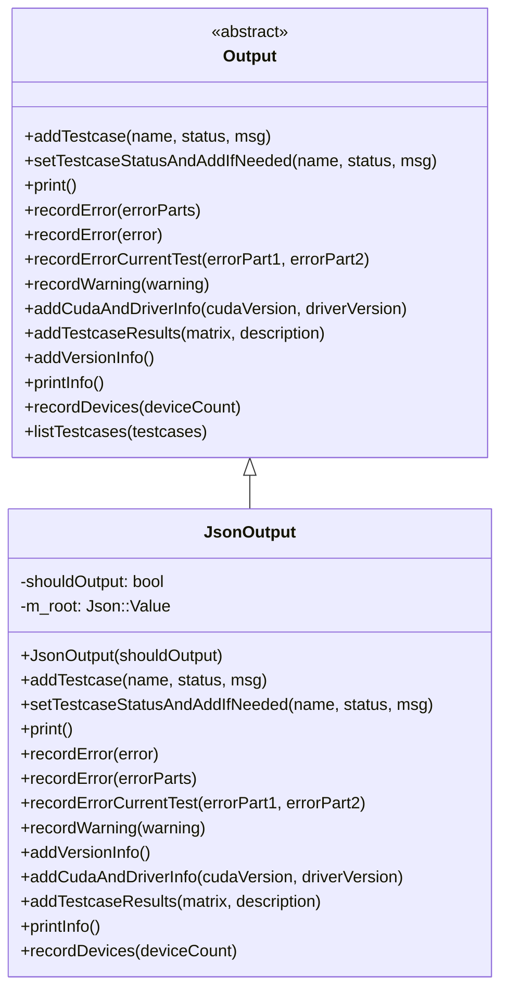
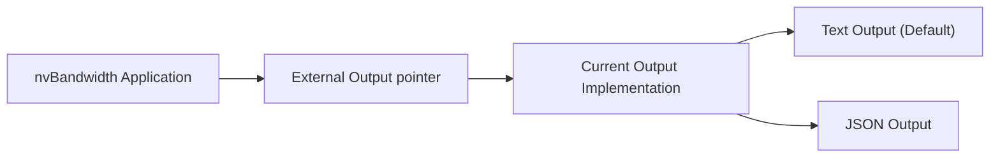
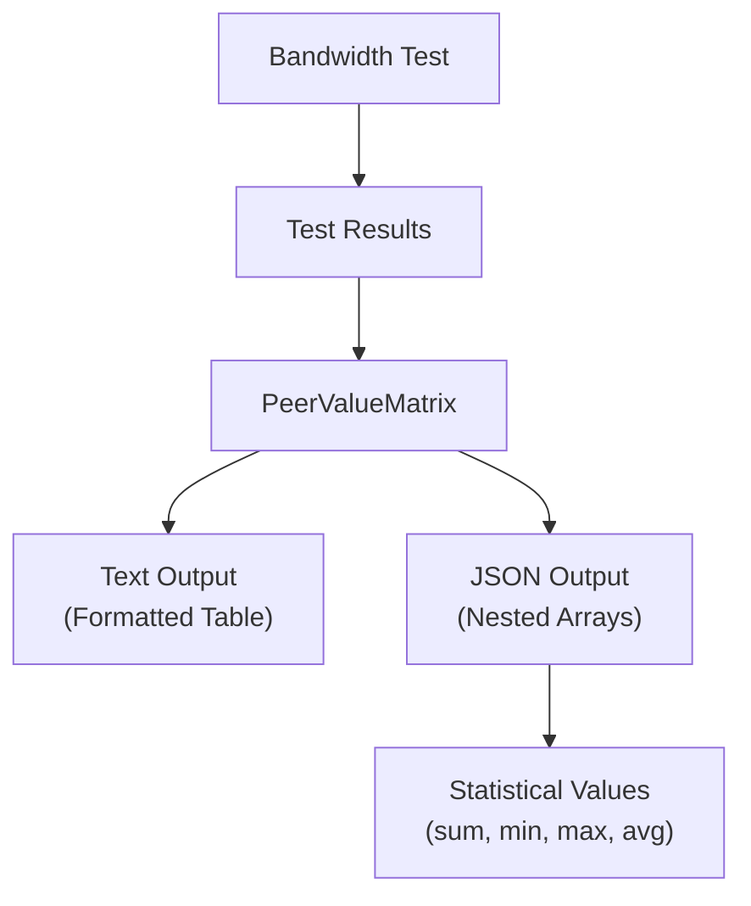
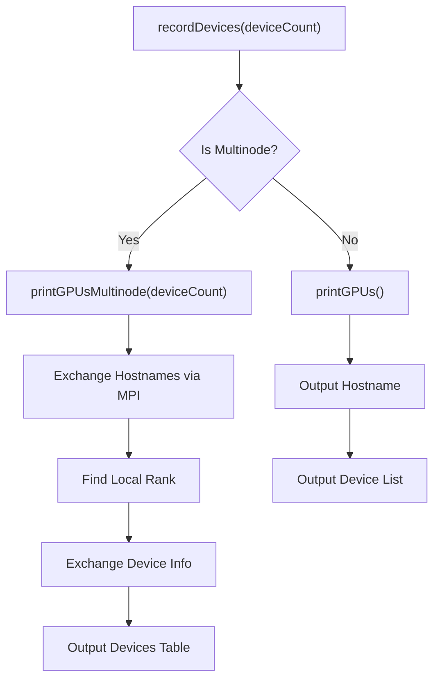
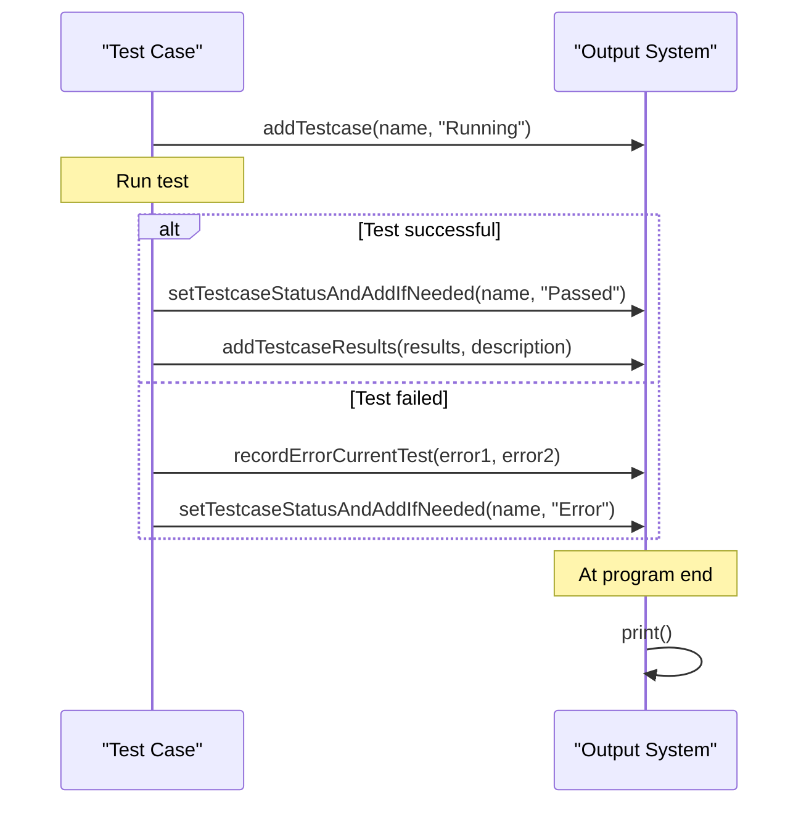

<!-- source: DeepWiki mcp.deepwiki.com · repo NVIDIA/nvbandwidth · page 6 Output System · fetched 2026-10-26 -->

# Output System

<details>
<summary>Relevant source files</summary>

The following files were used as context for generating this wiki page:

- [json/json-forwards.h](json/json-forwards.h)
- [json/json.h](json/json.h)
- [json/jsoncpp.cpp](json/jsoncpp.cpp)
- [json_output.cpp](json_output.cpp)
- [json_output.h](json_output.h)
- [output.cpp](output.cpp)
- [output.h](output.h)

</details>


The Output System in nvbandwidth is responsible for formatting and displaying the results of the bandwidth tests. It provides a consistent interface for reporting test results, errors, warnings, and device information while supporting multiple output formats including plain text and JSON.

## Architecture Overview

The Output System follows a simple inheritance-based design with a base class providing the interface and default implementations, and specialized classes for different output formats.



Sources: [output.h:47-97](), [json_output.h:27-58]()

## Global Output Instance

The output system utilizes a global pointer to the Output class that is shared across the application:



Sources: [output.h:99]()

## Output Constants

The system defines several constants used to standardize status messages and JSON field names:

| Constant | Purpose |
|----------|---------|
| NVB_PASSED | Indicates a test has passed |
| NVB_RUNNING | Indicates a test is currently running |
| NVB_WAIVED | Indicates a test was skipped or waived |
| NVB_NOT_FOUND | Indicates a test could not be found |
| NVB_ERROR_STATUS | Indicates a test has failed with an error |
| NVB_TITLE | JSON field for the title |
| NVB_BW_MATRIX | JSON field for bandwidth matrix data |
| NVB_BW_DESCRIPTION | JSON field for bandwidth description |

Sources: [output.h:26-45](), [json_output.cpp:25-52]()

## Base Output Class

The `Output` class defines the interface for all output implementations and provides a default implementation that outputs plain text to the console.

### Key Methods

#### Error and Warning Handling

```cpp
// Record a global error
virtual void recordError(const std::string &error);

// Record a global error with multiple parts
virtual void recordError(const std::vector<std::string> &errorParts);

// Record an error for the current test
virtual void recordErrorCurrentTest(const std::string &errorPart1, const std::string &errorPart2);

// Record a warning
virtual void recordWarning(const std::string &warning);
```

Sources: [output.h:67-84](), [output.cpp:54-68](), [output.cpp:197-203]()

#### Test Results

```cpp
// Add a test case
virtual void addTestcase(const std::string &name, const std::string &status, const std::string &msg = "");

// Set status for existing test case or add a new one
virtual void setTestcaseStatusAndAddIfNeeded(const std::string &name, const std::string &status, const std::string &msg = "");

// Add test results in matrix form
virtual void addTestcaseResults(const PeerValueMatrix<double> &matrix, const std::string &description);
```

Sources: [output.h:49-59](), [output.h:88](), [output.cpp:175-191]()

#### Informational Output

```cpp
// Add version information
virtual void addVersionInfo();

// Add CUDA and driver information
virtual void addCudaAndDriverInfo(int cudaVersion, const std::string &driverVersion);

// Show available GPU devices
virtual void recordDevices(int deviceCount);

// List all available test cases
void listTestcases(const std::vector<Testcase*> &testcases);
```

Sources: [output.h:90-96](), [output.cpp:30-41](), [output.cpp:48-52](), [output.cpp:70-77](), [output.cpp:167-173]()

## JSON Output Implementation

The `JsonOutput` class extends the `Output` base class to provide output in JSON format. It uses the JsonCpp library to build a structured JSON object containing all test data.

### JSON Structure

The JSON output follows this general structure:

```
{
  "nvbandwidth": {
    "version": "X.Y.Z",
    "git_version": "commit-hash",
    "CUDA Runtime Version": 11800,
    "Driver Version": "X.Y.Z",
    "GPU Device list": ["0: DeviceName (PCI ID): (hostname)"],
    "testcases": [
      {
        "name": "TestName",
        "status": "Passed",
        "bandwidth_description": "Description",
        "bandwidth_matrix": [["value1", "value2"], ["value3", "value4"]],
        "sum": 123.45,
        "min": 10.1,
        "max": 50.2,
        "average": 30.5
      }
    ],
    "error": "Any error message",
    "warning": "Any warning message"
  }
}
```

Sources: [json_output.cpp:25-52](), [json_output.cpp:186-194]()

### Implementation Details

The `JsonOutput` class builds a JSON tree structure stored in the `m_root` member variable. The class overrides all of the `Output` virtual methods to populate this tree instead of printing to the console.

Key implementation details:
- `print()` is called to output the JSON data, which is only done if `shouldOutput` is true
- Test cases are added to a JSON array under the `"testcases"` key
- The matrix of test results is stored as a nested array under each test case
- Statistics like sum, min, max, and average are calculated and stored with the results

Sources: [json_output.h:56-57](), [json_output.cpp:58-97](), [json_output.cpp:99-139](), [json_output.cpp:186-194]()

## Data Visualization

The Output System handles formatting of bandwidth matrices for both text and JSON output:



For text output, the system formats matrices using fixed precision and tabular formatting. For JSON output, it constructs a nested array representation with additional statistics.

Sources: [output.cpp:188-191](), [json_output.cpp:58-97]()

## Device Information Display

The system provides specialized handling for device information display, including multi-node support:



Sources: [output.cpp:99-173]()

## Integration with Test System

The Output System is tightly integrated with the test execution system. As tests run, the Output System records their status and results:



Sources: [output.cpp:175-186](), [output.cpp:188-191](), [output.cpp:197-199](), [json_output.cpp:186-194]()

## Additional Utility Functions

The Output System also provides several utility functions:

| Function | Purpose |
|----------|---------|
| `getDeviceDisplayInfo(deviceOrdinal)` | Formats device name and PCI information |
| `RecordError(errmsg)` | Helper to record errors via the global output pointer |
| `normalizeEOL(begin, end)` | Normalizes line endings in comment text |

Sources: [output.cpp:79-97](), [output.cpp:205-207](), [json_output.cpp:1573-1590]()

---

