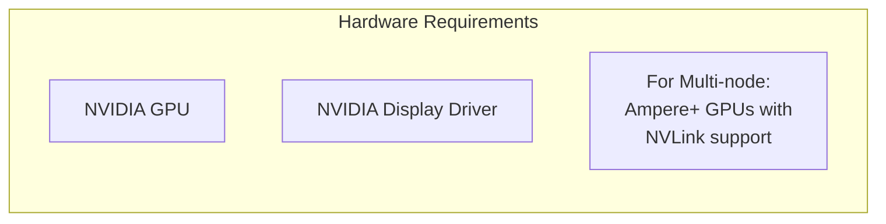
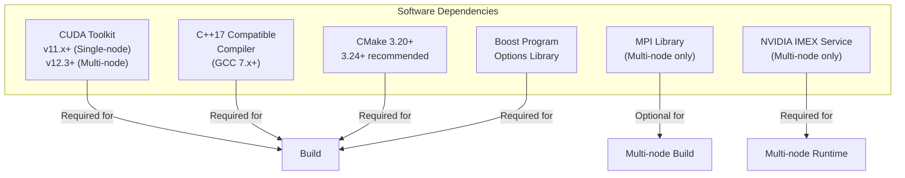
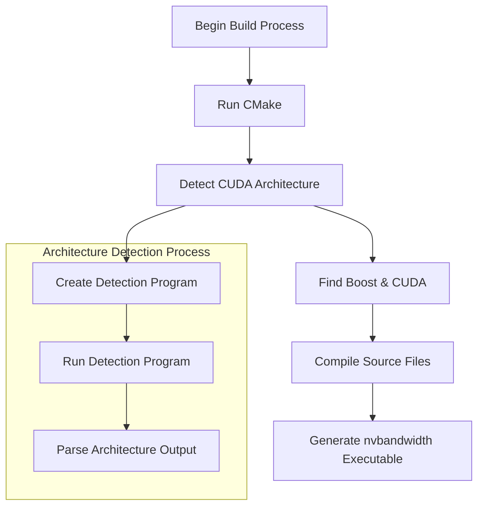
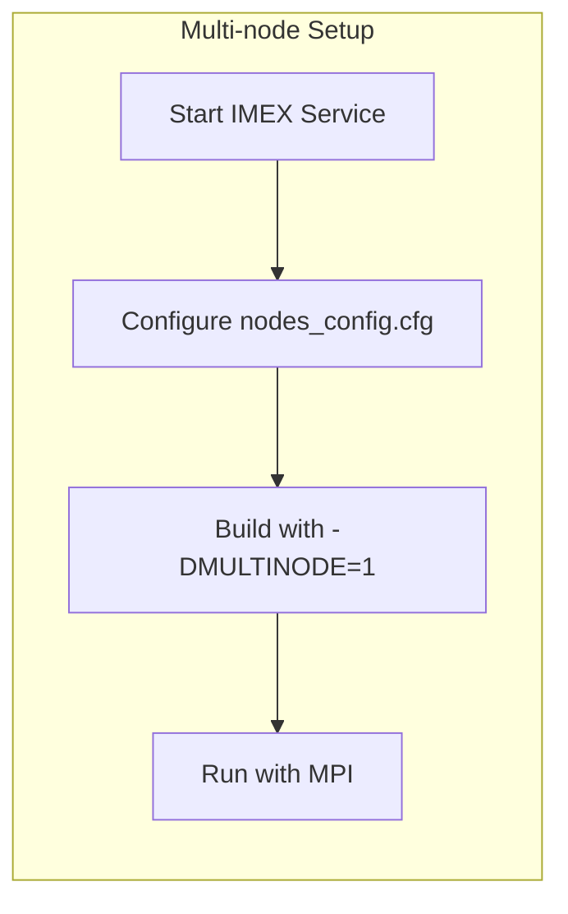
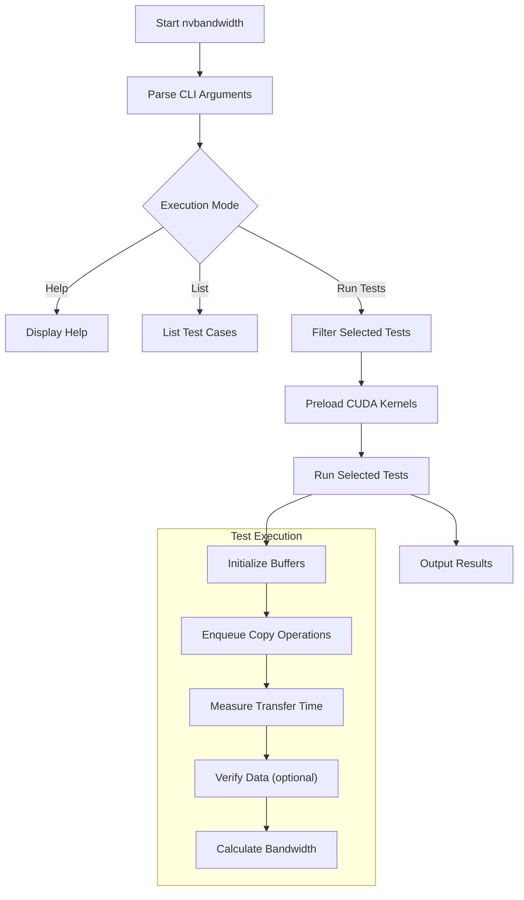

<!-- source: DeepWiki mcp.deepwiki.com · repo NVIDIA/nvbandwidth · page 7 Building and Running · fetched 2026-10-26 -->

# Building and Running

<details>
<summary>Relevant source files</summary>

The following files were used as context for generating this wiki page:

- [CMakeLists.txt](CMakeLists.txt)
- [Licenses.txt](Licenses.txt)
- [README.md](README.md)
- [debian_install.sh](debian_install.sh)
- [detect_cuda_arch.cmake](detect_cuda_arch.cmake)

</details>


This page provides detailed instructions for building and running the nvbandwidth tool. It covers the necessary requirements, build process, and execution options for both single-node and multi-node configurations. For information about the architecture of nvbandwidth, see [Architecture](#2), and for details about test cases, see [Test Cases](#5).

## System Requirements

### Hardware Requirements



Sources: [README.md:8-20]()

- CUDA-enabled NVIDIA GPU
- NVIDIA display driver compatible with the CUDA toolkit version
- For multi-node tests: Ampere architecture or newer GPUs with NVLink multi-node capability

### Software Requirements



Sources: [README.md:8-20](), [CMakeLists.txt:72-77]()

- CUDA toolkit:
  - Version 11.x or above for single-node
  - Version 12.3 or above for multi-node, with 550+ driver
- C++17 compatible compiler (GCC 7.x or above for Linux)
- CMake version 3.20 or above (3.24+ recommended)
- Boost program_options library
- For multi-node: MPI library

## Installing Dependencies

The nvbandwidth tool requires several dependencies to be installed before it can be built and run.

### Linux

#### Ubuntu/Debian

Ubuntu and Debian users can use the provided helper script to install all required dependencies:

```bash
sudo ./debian_install.sh
```

This script:
- Installs build-essential package
- Installs Boost program_options library
- Installs CMake
- Checks if CMake version is sufficient
- Builds nvbandwidth

Alternatively, install dependencies manually:

```bash
sudo apt install build-essential
sudo apt install libboost-program-options-dev
sudo apt install cmake
```

Sources: [debian_install.sh:1-16](), [README.md:25-30]()

#### Fedora

Fedora users can install the required dependencies with:

```bash
sudo dnf -y install boost-devel
```

Sources: [README.md:35-37](), [CMakeLists.txt:30-37]()

### Windows

On Windows:
- Install a compatible CUDA toolkit
- Install a C++17 compatible compiler
- Install CMake 3.20+
- Install Boost libraries
- Set the `BOOST_ROOT` environment variable to tell CMake where to find your Boost installation

Sources: [README.md:46](), [CMakeLists.txt:62-66]()

## Building nvbandwidth

The nvbandwidth tool uses CMake as its build system. The build process automatically detects the available CUDA architectures on your system unless explicitly specified.

### Single-node Build

To build the basic version of nvbandwidth for single-node operation:

```bash
cmake .
make
```

This will create the `nvbandwidth` executable in the current directory.



Sources: [CMakeLists.txt:1-70](), [README.md:40-45](), [detect_cuda_arch.cmake:1-67]()

### Multi-node Build

To build nvbandwidth with multi-node support (requires MPI):

```bash
cmake -DMULTINODE=1 .
make
```

When the `MULTINODE` flag is enabled, the build process:
1. Searches for an MPI installation
2. Includes MPI headers
3. Links against MPI libraries
4. Defines the `MULTINODE` preprocessor directive

Sources: [CMakeLists.txt:72-77](), [README.md:94-99]()

### Advanced Build Configuration

The build system supports several advanced configuration options:

#### CUDA Architecture Selection

By default, the build detects your GPU architecture and builds for it. You can explicitly specify architecture(s) with:

```bash
cmake -DCMAKE_CUDA_ARCHITECTURES="80;86" .
```

The supported architectures are:
- CUDA < 13.0: "52", "70", "75", "80", "86", "89", "90", "100"
- CUDA ≥ 13.0: "70", "75", "80", "86", "89", "90", "100"

Sources: [CMakeLists.txt:11-23](), [detect_cuda_arch.cmake:1-67]()

#### Build Type

By default, the build type is set to "Release". You can change it with:

```bash
cmake -DCMAKE_BUILD_TYPE=Debug .
```

Sources: [CMakeLists.txt:25-27]()

## Running nvbandwidth

Once built, the nvbandwidth tool can be run to measure bandwidth between various memory locations.

### Command-Line Options

The tool provides several command-line options to customize its behavior:

```
nvbandwidth CLI:
  -h [ --help ]                  Produce help message
  -b [ --bufferSize ] arg (=512) Memcpy buffer size in MiB
  -l [ --list ]                  List available testcases
  -t [ --testcase ] arg          Testcase(s) to run (by name or index)
  -p [ --testcasePrefixes ] arg  Testcase(s) to run (by prefix))
  -v [ --verbose ]               Verbose output
  -s [ --skipVerification ]      Skips data verification after copy
  -d [ --disableAffinity ]       Disable automatic CPU affinity control
  -i [ --testSamples ] arg (=3)  Iterations of the benchmark
  -m [ --useMean ]               Use mean instead of median for results
  -j [ --json ]                  Print output in json format instead of plain text
```

Sources: [README.md:48-65]()

### Basic Usage

To run all available testcases:

```bash
./nvbandwidth
```

To list all available testcases:

```bash
./nvbandwidth -l
```

To run a specific testcase by name:

```bash
./nvbandwidth -t device_to_device_memcpy_read_ce
```

To run all testcases matching a prefix:

```bash
./nvbandwidth -p device_to_device
```

Sources: [README.md:66-88]()

### Customizing Test Parameters

You can customize several test parameters:

```bash
# Run with 1GiB buffer size
./nvbandwidth -b 1024

# Run with 10 iterations per test (instead of default 3)
./nvbandwidth -i 10

# Use mean instead of median for result calculation
./nvbandwidth -m

# Output results in JSON format
./nvbandwidth -j
```

Sources: [README.md:90-91]()

## Multi-node Operation

Running nvbandwidth in multi-node mode requires additional setup and configuration.

### Setting up IMEX Service

For multi-node operation, the NVIDIA Internode Memory Exchange Service (IMEX) must be running:

1. Start the IMEX service:
   ```bash
   sudo systemctl start nvidia-imex.service
   ```

2. Configure node addresses in `/etc/nvidia-imex/nodes_config.cfg`:
   ```
   node1-ip
   node2-ip
   ...
   ```

Sources: [README.md:100-107]()



### Running Multi-node Tests

There are two ways to run multi-node tests:

#### Local Testing (Single Machine)

To test multi-node functionality on a single machine with multiple GPUs (Ampere+ required):

```bash
mpirun -n 4 ./nvbandwidth -p multinode
```

This spawns 4 processes (one per GPU) and runs all tests with "multinode" prefix.

Sources: [README.md:113-115]()

#### Cluster Deployment

To run on a multi-node cluster:

```bash
mpirun --allow-run-as-root --map-by ppr:4:node --bind-to core -np 8 --report-bindings \
  -q -mca btl_tcp_if_include enP5p9s0 --hostfile /etc/nvidia-imex/nodes_config.cfg \
  ./nvbandwidth -p multinode
```

This example runs on 2 nodes with 4 GPUs per node.

Important notes for multi-node operation:
1. Run one process per GPU
2. Running less processes than GPUs is valid (consecutive GPUs will be used)
3. Running more processes than GPUs is not valid
4. All ranks must be part of the same multinode clique
5. Only MPI rank 0 will output to stdout
6. It's recommended to only run "multinode*" testcases under MPI

Sources: [README.md:119-131]()

## Execution Flow



Sources: [README.md:134-154]()