# Page: Overview

# Overview

<details>
<summary>Relevant source files</summary>

The following files were used as context for generating this wiki page:

- [CHANGELOG.md](CHANGELOG.md)
- [README.md](README.md)
- [version.h](version.h)

</details>


nvbandwidth is a CUDA-based tool for measuring memory bandwidth performance on NVIDIA GPUs. It provides detailed bandwidth measurements for various memory copy patterns across different links using copy engine (CE) or streaming multiprocessor (SM) copy methods. This overview explains what nvbandwidth is, what it does, and when to use it.

For detailed information about the architecture, see [Architecture](#2).

## Purpose

nvbandwidth serves as a diagnostic and benchmarking utility that:

- Measures memory bandwidth between various components (CPU↔GPU, GPU↔GPU)
- Provides accurate benchmarks for different memory copy methods
- Supports both unidirectional and bidirectional bandwidth measurements
- Works in both single-node and multi-node GPU deployments
- Reports bandwidth in a user-friendly format (plain text or JSON)

The tool reports the current measured bandwidth achievable on your system. Additional system-specific tuning may be required to achieve maximal peak bandwidth.

Sources: [README.md:1-5]()

## Key Features

- **Multiple Copy Methods**: Supports both Copy Engine (CE) and Streaming Multiprocessor (SM) based memory copies
- **Comprehensive Transfer Patterns**: Host-to-Device, Device-to-Host, Device-to-Device, and bidirectional transfers
- **Multi-GPU Support**: Tests bandwidth between multiple GPUs within a system
- **Multi-Node Capability**: Measures bandwidth across node boundaries in a cluster
- **Accurate Measurements**: Uses precise timing mechanisms with CUDA events
- **Verification**: Validates copy operations for correctness
- **Configurable Testing**: Control buffer sizes, iteration counts, and specific test cases

Sources: [README.md:1-5](), [README.md:48-64]()

## System Requirements

- CUDA Toolkit (version 11.X or above)
- Multi-node version requires CUDA 12.3 toolkit and 550 driver or above
- C++17 compatible compiler (GCC 7.x or above)
- CMake (version 3.20 or above)
- Boost program options library

Sources: [README.md:7-20]()

## High-Level Architecture

nvbandwidth is built around several core components that work together to provide accurate bandwidth measurements. The following diagram illustrates the primary components and their relationships:

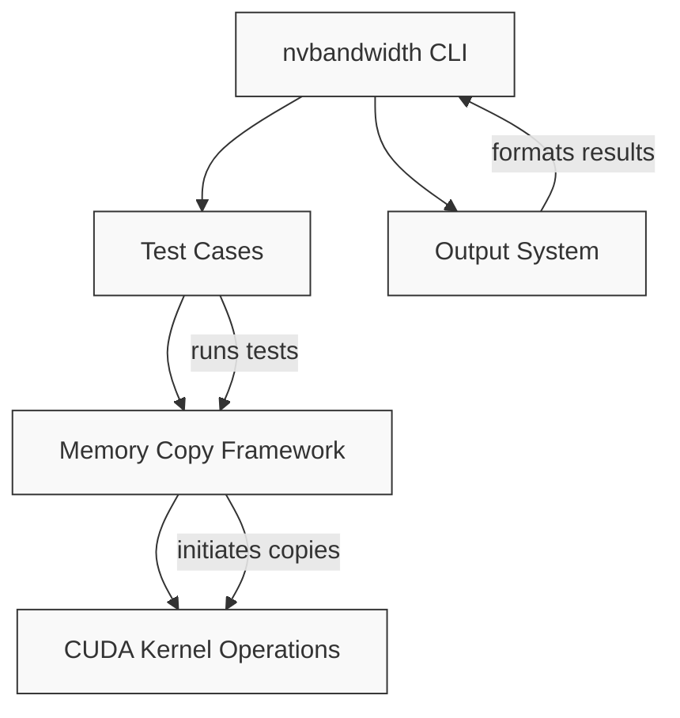

Sources: [README.md:132-153]()

## Core Components

### Test Cases

Test cases define specific bandwidth measurement scenarios. Each test case implements a specific memory transfer pattern (e.g., host-to-device, device-to-device) using either Copy Engine (CE) or Streaming Multiprocessor (SM) methods.

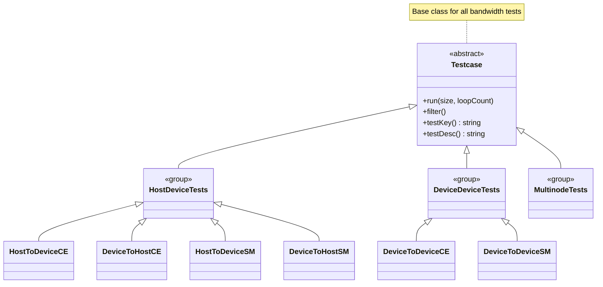

Sources: [README.md:132-154]()

### Memory Copy Framework

The memory copy framework provides the infrastructure for performing memory operations between different types of buffers (host memory, device memory, multi-node memory). It manages buffer allocation, copy operations, and timing.

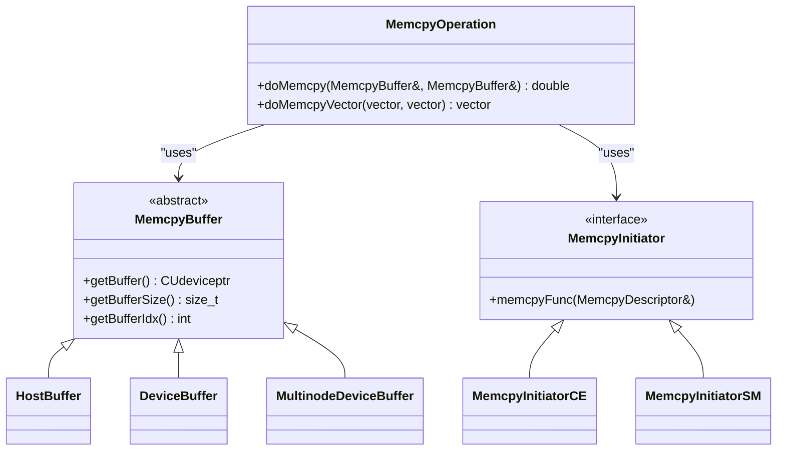

Sources: [README.md:132-154]()

## Measurement Methodology

nvbandwidth uses a precise methodology to measure bandwidth:

1. A blocking kernel is used to ensure that timing measurements don't include operation enqueuing overhead
2. CUDA events are used to precisely time memory copy operations
3. Multiple iterations are performed to ensure statistical validity
4. By default, the median of 3 measurements is reported (configurable)

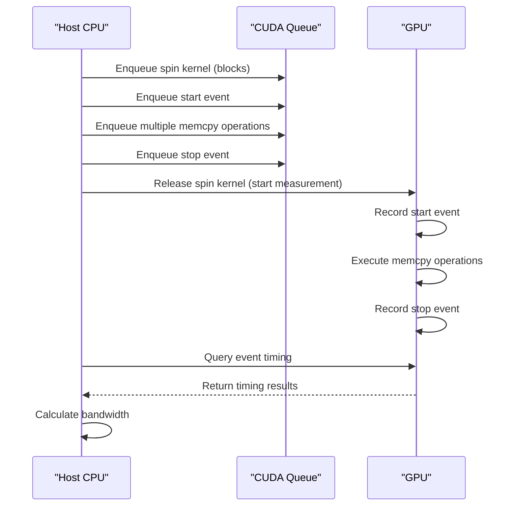

Sources: [README.md:144-153]()

## Bandwidth Test Types

nvbandwidth implements several types of bandwidth tests:

### Unidirectional Tests

These measure one-way bandwidth between components:
- Host to Device (H2D)
- Device to Host (D2H)
- Device to Device (D2D)

### Bidirectional Tests

These measure bandwidth when data is flowing in both directions simultaneously:
- Host ↔ Device
- Device ↔ Device

### Multi-node Tests

These measure bandwidth across node boundaries in a cluster:
- All to One (A2O)
- One to All (O2A)
- All to Host (A2H)
- Host to All (H2A)

Sources: [README.md:155-204]()

## Version Information

nvbandwidth is versioned with semantic versioning. The current version is:

```
v0.8
```

Sources: [version.h:21](), [CHANGELOG.md:3]()

## Next Steps

- For a deep dive into the system architecture, see [Architecture](#2)
- To understand the memory copy framework, see [Memory Copy Framework](#3)
- For information about the test cases, see [Test Cases](#5)
- To learn how to build and run nvbandwidth, see [Building and Running](#7)

---

# Page: Architecture

# Architecture

<details>
<summary>Relevant source files</summary>

The following files were used as context for generating this wiki page:

- [CMakeLists.txt](CMakeLists.txt)
- [common.h](common.h)
- [nvbandwidth.cpp](nvbandwidth.cpp)

</details>


This document outlines the high-level architecture of nvbandwidth, explaining the major components and their relationships within the system. For specific implementation details about the Memory Copy Framework, see [Memory Copy Framework](#3).

## Overview

nvbandwidth is a CUDA-based tool designed to measure memory bandwidth and latency performance between different components in NVIDIA GPU systems. The architecture follows a modular design that separates test definition, memory operations, and result reporting into distinct subsystems.

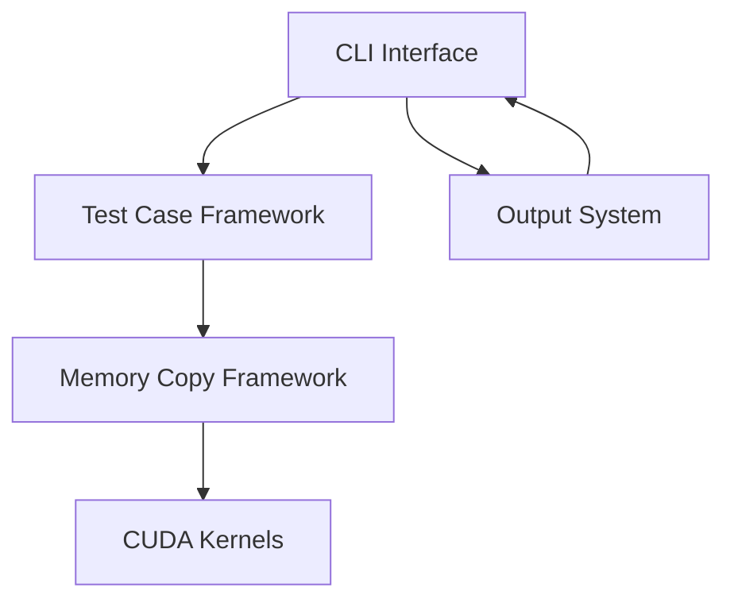

Sources: [nvbandwidth.cpp:178-325](), [CMakeLists.txt:40-52]()

## Core Components

### CLI Interface

The CLI Interface serves as the entry point for nvbandwidth, handling user inputs and orchestrating test execution. It parses command-line arguments using Boost's program_options library, discovers available tests, and dispatches selected test cases.

Key responsibilities:
- Parsing command-line options
- Test case discovery and filtering
- Test execution orchestration
- Result collection and output formatting

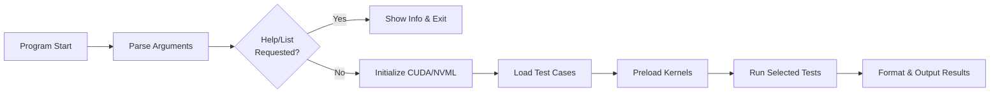

Sources: [nvbandwidth.cpp:178-325]()

### Test Case Framework

The Test Case Framework provides a standard interface for defining different bandwidth and latency tests. It uses an inheritance-based design with a base `Testcase` class that defines the common interface and specialized derived classes for specific test scenarios.

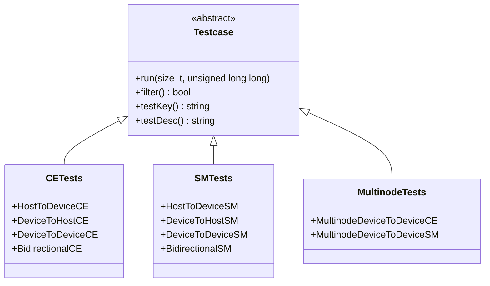

Each test case implements:
- `run()`: Executes the test with specified buffer size and iteration count
- `filter()`: Determines if the test is applicable for the current hardware
- `testKey()`: Returns a unique identifier for the test
- `testDesc()`: Returns a human-readable description

Sources: [nvbandwidth.cpp:64-117]()

### Memory Copy Framework

The Memory Copy Framework is the core engine that performs memory operations. It abstracts the complexities of buffer management and memory transfers across different hardware components.

Key components:
- **MemcpyBuffer**: Abstract base class for different memory buffer types
- **MemcpyInitiator**: Interface for different memory copy strategies
- **MemcpyOperation**: Coordinates memory transfers between buffers

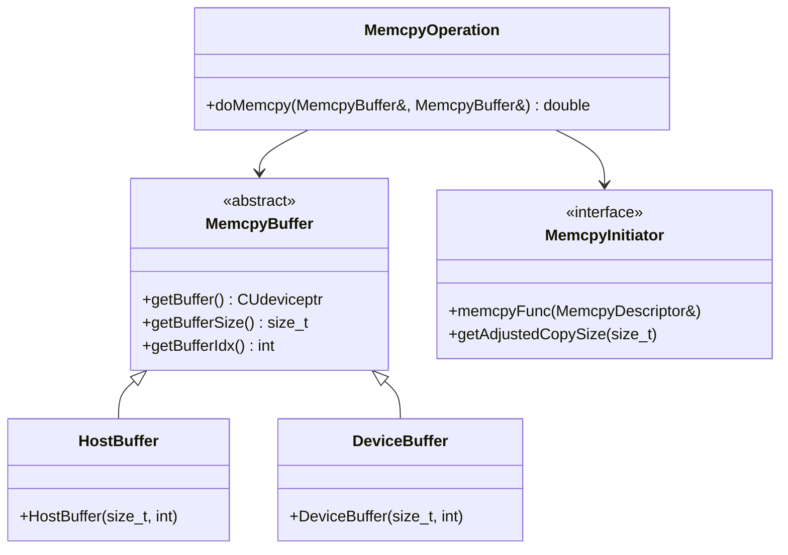

For more details on the Memory Copy Framework, see [Memory Copy Framework](#3).

Sources: [common.h:240-249]()

### CUDA Kernels

The CUDA Kernels component includes specialized CUDA kernels for performing memory operations using different strategies:

- **CE (Copy Engine)**: Uses CUDA's built-in asynchronous memory copy functions
- **SM (Streaming Multiprocessor)**: Uses custom CUDA kernels to perform copies through the SM

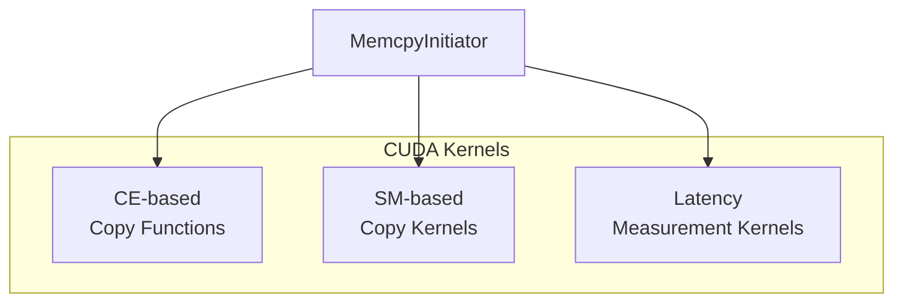

Sources: [CMakeLists.txt:40-52]()

### Output System

The Output System is responsible for formatting and presenting test results. It supports multiple output formats, including plain text and JSON.

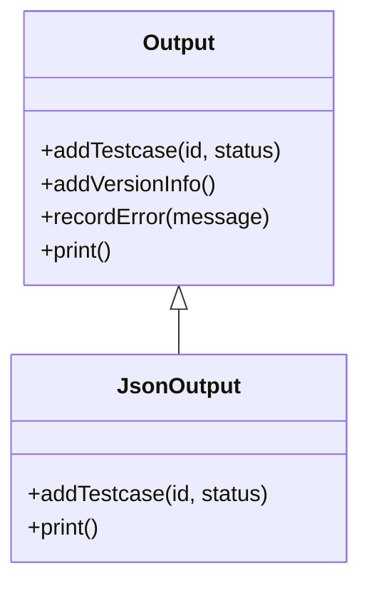

Sources: [nvbandwidth.cpp:181-250]()

## Data Flow

The overall data flow within nvbandwidth follows this pattern:

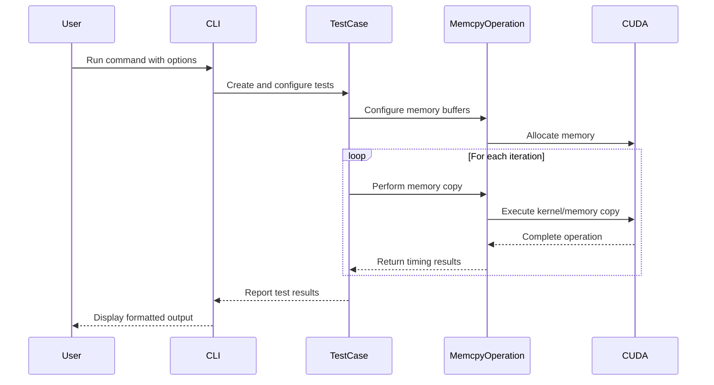

Sources: [nvbandwidth.cpp:149-176]()

## Test Types and Memory Paths

nvbandwidth includes multiple test types to measure bandwidth across different memory paths:

| Test Category | Description | Implementation Methods |
|---------------|-------------|------------------------|
| Host to Device | Measures bandwidth from CPU memory to GPU memory | CE, SM |
| Device to Host | Measures bandwidth from GPU memory to CPU memory | CE, SM |
| Device to Device | Measures bandwidth between memories on same GPU | CE, SM |
| Bidirectional | Measures concurrent copy bandwidth in both directions | CE, SM |
| All to One | Measures bandwidth when all GPUs copy to one GPU | CE, SM |
| One to All | Measures bandwidth when one GPU copies to all GPUs | CE, SM |
| All to Host | Measures bandwidth when all GPUs copy to host | CE, SM |
| Host to All | Measures bandwidth when host copies to all GPUs | CE, SM |
| Latency | Measures memory access latency rather than bandwidth | SM |
| Multinode | Measures bandwidth across node boundaries (when built with MPI) | CE, SM |

Sources: [nvbandwidth.cpp:64-117]()

## Execution Model

nvbandwidth follows a straightforward execution model:

1. **Initialization**: Parse command-line arguments, initialize CUDA, and discover available GPUs
2. **Test Selection**: Select test cases to run based on user input
3. **Kernel Preloading**: Preload CUDA kernels on all devices to avoid synchronization issues
4. **Test Execution**: Run each selected test case
5. **Result Collection**: Gather performance results from all tests
6. **Result Presentation**: Format and display results according to the selected output format

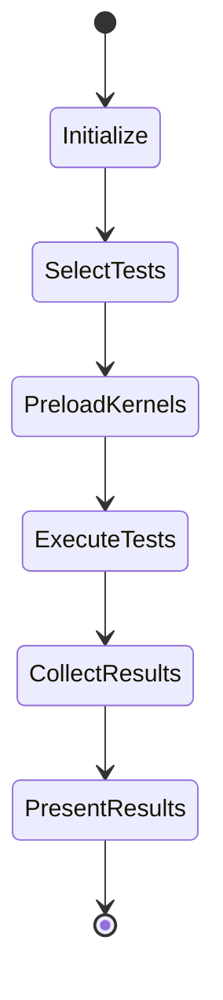

Sources: [nvbandwidth.cpp:178-325]()

## Design Patterns

The nvbandwidth architecture implements several design patterns:

1. **Strategy Pattern**: Through the `MemcpyInitiator` interface, which allows different memory copy strategies to be implemented and used interchangeably.

2. **Template Method Pattern**: Through the `Testcase` base class, which defines the structure of a test while allowing derived classes to implement specific behaviors.

3. **Factory Method Pattern**: Through the `createTestcases()` function, which creates and returns a collection of test case objects.

4. **Command Pattern**: Each test case encapsulates a specific bandwidth measurement operation that can be executed on demand.

5. **Adapter Pattern**: The output system adapts internal data structures into different output formats (plain text and JSON).

Sources: [nvbandwidth.cpp:64-117](), [nvbandwidth.cpp:178-325]()

## Multi-node Support

When built with MPI support, nvbandwidth includes additional test cases for measuring bandwidth across node boundaries. This functionality uses MPI for process coordination and adds specialized buffer and test case implementations for multi-node scenarios.

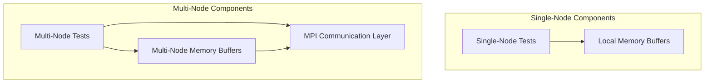

Sources: [nvbandwidth.cpp:100-115](), [CMakeLists.txt:72-77]()

## System Integration Points

nvbandwidth integrates with several external systems:

1. **CUDA Driver API**: For low-level GPU control and memory management
2. **CUDA Runtime API**: For higher-level CUDA operations
3. **NVML (NVIDIA Management Library)**: For GPU device information and statistics
4. **Boost Program Options**: For command-line argument parsing
5. **MPI (optional)**: For multi-node support

Sources: [nvbandwidth.cpp:18-32](), [CMakeLists.txt:18-77]()

---

# Page: Memory Copy Framework

# Memory Copy Framework

<details>
<summary>Relevant source files</summary>

The following files were used as context for generating this wiki page:

- [memcpy.cpp](memcpy.cpp)
- [memcpy.h](memcpy.h)

</details>


## Purpose and Scope

The Memory Copy Framework is a core component of nvbandwidth that provides the infrastructure necessary to measure memory bandwidth across different GPU data paths. It abstracts and manages memory allocation, data transfer operations, and performance timing. This framework serves as the foundation for all bandwidth tests within nvbandwidth, enabling accurate measurements of memory performance across host-to-device, device-to-host, and device-to-device transfers.

For information about the specific test cases built on top of this framework, see [Test Cases](#5).

Sources: [memcpy.h:18-20](), [memcpy.cpp:18-24]()

## Architecture Overview

The Memory Copy Framework is built around several key abstractions that work together to enable flexible memory bandwidth testing:

```mermaid
classDiagram
    class "MemcpyBuffer" {
        <<abstract>>
        +getBuffer()
        +getBufferSize()
        +getBufferIdx()
        +getPrimaryCtx()
        +getBufferString()
    }
    
    class "HostBuffer" {
        +HostBuffer(bufferSize, targetDeviceId)
    }
    
    class "DeviceBuffer" {
        +DeviceBuffer(bufferSize, deviceIdx)
        +enablePeerAccess()
    }
    
    class "MemcpyInitiator" {
        <<interface>>
        +memcpyFunc()
        +getAdjustedCopySize()
        +memsetPattern()
        +memcmpPattern()
        +getAdjustedBandwidth()
    }
    
    class "MemcpyInitiatorCE" {
        +memcpyFunc()
    }
    
    class "MemcpyInitiatorSM" {
        +memcpyFunc()
    }
    
    class "MemcpyOperation" {
        +doMemcpy()
        +doMemcpyCore()
        +doMemcpyVector()
    }
    
    class "NodeHelper" {
        <<interface>>
        +dispatchMemcpy()
        +calculateTotalBandwidth()
        +streamSynchronizeWrapper()
    }
    
    "MemcpyBuffer" <|-- "HostBuffer"
    "MemcpyBuffer" <|-- "DeviceBuffer"
    "MemcpyInitiator" <|.. "MemcpyInitiatorCE"
    "MemcpyInitiator" <|.. "MemcpyInitiatorSM"
    "MemcpyOperation" --> "MemcpyInitiator"
    "MemcpyOperation" --> "NodeHelper"
    "MemcpyOperation" ..> "MemcpyBuffer"
```

Sources: [memcpy.h:24-252](), [memcpy.cpp:33-41]()

The framework is designed around the following key components:

1. **Memory Buffers**: Abstractions representing memory in different locations (host or device)
2. **Copy Initiators**: Strategies for performing memory copies through different mechanisms
3. **Memory Copy Operation**: Coordinates buffers and initiators to perform and time memory transfers
4. **Node Helpers**: Manages node-specific operations in multi-node scenarios

Sources: [memcpy.h:24-252]()

## Memory Buffers

Memory buffers abstract the location and type of memory being used in bandwidth tests. The framework provides classes for different memory types:

```mermaid
classDiagram
    class "MemcpyBuffer" {
        <<abstract>>
        -void* buffer
        -size_t bufferSize
        +CUdeviceptr getBuffer()
        +size_t getBufferSize()
        +virtual int getBufferIdx()
        +virtual CUcontext getPrimaryCtx()
        +virtual std::string getBufferString()
        +virtual CUresult streamSynchronizeWrapper()
        +virtual int getMPIRank()
    }
    
    class "HostBuffer" {
        +HostBuffer(size_t bufferSize, int targetDeviceId)
        +~HostBuffer()
        +int getBufferIdx()
        +CUcontext getPrimaryCtx()
        +std::string getBufferString()
    }
    
    class "DeviceBuffer" {
        -int deviceIdx
        -CUcontext primaryCtx
        +DeviceBuffer(size_t bufferSize, int deviceIdx)
        +~DeviceBuffer()
        +int getBufferIdx()
        +CUcontext getPrimaryCtx()
        +std::string getBufferString()
        +bool enablePeerAcess(DeviceBuffer&)
    }
    
    "MemcpyBuffer" <|-- "HostBuffer"
    "MemcpyBuffer" <|-- "DeviceBuffer"
```

Sources: [memcpy.h:24-69](), [memcpy.cpp:33-41](), [memcpy.cpp:198-283]()

### MemcpyBuffer

The `MemcpyBuffer` class is the abstract base class for all memory buffers. It defines the common interface for accessing memory in different locations:

- `getBuffer()`: Returns a pointer to the underlying memory
- `getBufferSize()`: Returns the size of the buffer
- `getBufferIdx()`: Returns an index identifying the buffer (device ID or 0 for host)
- `getPrimaryCtx()`: Returns the CUDA context associated with the buffer
- `getBufferString()`: Returns a human-readable string describing the buffer

Sources: [memcpy.h:24-41](), [memcpy.cpp:33-41](), [memcpy.cpp:198-207]()

### HostBuffer

The `HostBuffer` class represents host (CPU) memory. Key features include:

- Memory allocation with NUMA affinity optimization for the target device
- Integration with CUDA via `cuMemHostAlloc` for efficient host-device transfers
- Proper cleanup in the destructor

Sources: [memcpy.h:44-53](), [memcpy.cpp:208-239]()

### DeviceBuffer

The `DeviceBuffer` class represents device (GPU) memory. Key features include:

- Allocation of memory on a specific GPU device
- Management of the device's primary CUDA context
- Support for peer access between multiple GPUs via `enablePeerAccess()`

Sources: [memcpy.h:56-69](), [memcpy.cpp:241-283]()

## Copy Initiators

Copy initiators implement different strategies for memory transfers. The framework provides implementations for various transfer mechanisms:

```mermaid
classDiagram
    class "MemcpyInitiator" {
        <<interface>>
        +size_t memcpyFunc(MemcpyDescriptor&)
        +size_t getAdjustedCopySize(size_t, CUstream)
        +void memsetPattern(MemcpyDispatchInfo&)
        +void memcmpPattern(MemcpyDispatchInfo&)
        +unsigned long long getAdjustedBandwidth(unsigned long long)
    }
    
    class "MemcpyInitiatorCE" {
        +size_t memcpyFunc(MemcpyDescriptor&)
        +size_t getAdjustedCopySize(size_t, CUstream)
        +void memsetPattern(MemcpyDispatchInfo&)
        +void memcmpPattern(MemcpyDispatchInfo&)
        +unsigned long long getAdjustedBandwidth(unsigned long long)
    }
    
    class "MemcpyInitiatorSM" {
        +size_t memcpyFunc(MemcpyDescriptor&)
        +size_t getAdjustedCopySize(size_t, CUstream)
        +void memsetPattern(MemcpyDispatchInfo&)
        +void memcmpPattern(MemcpyDispatchInfo&)
        +unsigned long long getAdjustedBandwidth(unsigned long long)
    }
    
    class "MemcpyInitiatorMulticastWrite" {
        +size_t memcpyFunc(MemcpyDescriptor&)
        +size_t getAdjustedCopySize(size_t, CUstream)
        +void memsetPattern(MemcpyDispatchInfo&)
        +void memcmpPattern(MemcpyDispatchInfo&)
        +unsigned long long getAdjustedBandwidth(unsigned long long)
    }
    
    class "MemcpyInitiatorSMSplitWarp" {
        +size_t memcpyFunc(MemcpyDescriptor&)
        +void memsetPattern(MemcpyDispatchInfo&)
        +void memcmpPattern(MemcpyDispatchInfo&)
        +unsigned long long getAdjustedBandwidth(unsigned long long)
    }
    
    "MemcpyInitiator" <|.. "MemcpyInitiatorCE"
    "MemcpyInitiator" <|.. "MemcpyInitiatorSM"
    "MemcpyInitiator" <|.. "MemcpyInitiatorMulticastWrite"
    "MemcpyInitiatorSM" <|-- "MemcpyInitiatorSMSplitWarp"
```

Sources: [memcpy.h:133-197](), [memcpy.cpp:84-196](), [memcpy.cpp:540-590]()

### MemcpyInitiator Interface

The `MemcpyInitiator` interface defines the contract for all copy strategies:

- `memcpyFunc()`: Performs the actual memory copy operation
- `getAdjustedCopySize()`: Calculates adjusted copy sizes (important for SM copies)
- `memsetPattern()`: Fills buffers with test patterns
- `memcmpPattern()`: Verifies buffers against expected patterns
- `getAdjustedBandwidth()`: Adjusts bandwidth measurements for specific copy methods

Sources: [memcpy.h:133-147]()

### Copy Engine (CE) Initiator

The `MemcpyInitiatorCE` class implements memory copies using CUDA's hardware Copy Engine:

- Uses `cuMemcpyAsync()` for hardware-accelerated transfers
- Offers optimal performance for bulk transfers
- Preserves exact copy sizes without truncation

Sources: [memcpy.h:162-173](), [memcpy.cpp:84-90](), [memcpy.cpp:118-120](), [memcpy.cpp:168-173](), [memcpy.cpp:567-578]()

### Streaming Multiprocessor (SM) Initiator

The `MemcpyInitiatorSM` class implements memory copies using custom CUDA kernels on the GPU's Streaming Multiprocessors:

- Uses custom CUDA kernels to perform copies
- May truncate buffer sizes to optimize for SM throughput
- Provides alternative paths for memory transfers that may bypass certain hardware limitations

Sources: [memcpy.h:149-160](), [memcpy.cpp:92-98](), [memcpy.cpp:122-124](), [memcpy.cpp:175-180](), [memcpy.cpp:540-565]()

### Specialized Initiators

Additional initiator implementations include:

- `MemcpyInitiatorMulticastWrite`: Supports one-to-many transfers using the GPU's multicast features
- `MemcpyInitiatorSMSplitWarp`: Implements bidirectional transfers by splitting GPU warps

Sources: [memcpy.h:175-197](), [memcpy.cpp:100-116](), [memcpy.cpp:126-133](), [memcpy.cpp:182-196](), [memcpy.cpp:580-591]()

## Memory Copy Operation

The `MemcpyOperation` class coordinates memory operations, timing, and bandwidth calculation:

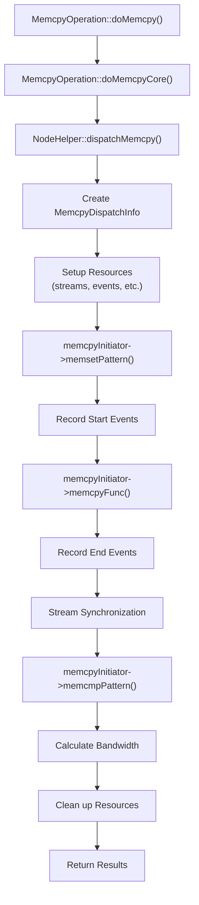

Sources: [memcpy.h:207-240](), [memcpy.cpp:288-538]()

### Core Operations

The `MemcpyOperation` class provides several methods for performing memory copies:

- `doMemcpy()`: Performs a single memory copy between two buffers
- `doMemcpyVector()`: Performs multiple memory copies and returns individual bandwidths
- `doMemcpyCore()`: Core implementation that sets up, times, and executes copies

The operation process includes:

1. Setting up resources (streams, events)
2. Initializing memory with patterns for verification
3. Warmup iterations to prime the system
4. Timed execution of memory copies
5. Verification of copy correctness
6. Calculation of bandwidth metrics
7. Resource cleanup

Sources: [memcpy.h:228-240](), [memcpy.cpp:288-538]()

### Bandwidth Calculation Options

The framework supports different methods for calculating bandwidth:

| Mode | Description |
|------|-------------|
| `USE_FIRST_BW` | Use only the bandwidth of the first copy in a multi-copy operation |
| `SUM_BW` | Sum the individual bandwidths of all copies |
| `TOTAL_BW` | Calculate total bandwidth based on total time and total bytes |
| `VECTOR_BW` | Return individual bandwidths as a vector |

Sources: [memcpy.h:210-215](), [memcpy.cpp:525-537]()

## Node Helper

The `NodeHelper` abstraction manages node-specific operations, particularly important for multi-node scenarios:

```mermaid
classDiagram
    class "NodeHelper" {
        <<interface>>
        +MemcpyDispatchInfo dispatchMemcpy()
        +double calculateTotalBandwidth()
        +double calculateSumBandwidth()
        +double calculateFirstBandwidth()
        +std::vector<double> calculateVectorBandwidth()
        +void synchronizeProcess()
        +CUresult streamSynchronizeWrapper()
        +void streamBlockerReset()
        +void streamBlockerRelease()
        +void streamBlockerBlock()
    }
    
    class "NodeHelperSingle" {
        -volatile int* blockingVarHost
        +NodeHelperSingle()
        +~NodeHelperSingle()
        +MemcpyDispatchInfo dispatchMemcpy()
        +double calculateTotalBandwidth()
        +double calculateSumBandwidth()
        +double calculateFirstBandwidth()
        +std::vector<double> calculateVectorBandwidth()
        +void synchronizeProcess()
        +CUresult streamSynchronizeWrapper()
        +void streamBlockerReset()
        +void streamBlockerRelease()
        +void streamBlockerBlock()
    }
    
    "NodeHelper" <|.. "NodeHelperSingle"
```

Sources: [memcpy.h:95-131](), [memcpy.cpp:311-373]()

### NodeHelper Interface

The `NodeHelper` interface defines operations for node coordination:

- `dispatchMemcpy()`: Creates a dispatch info structure with proper contexts
- Bandwidth calculation functions for different strategies
- Stream synchronization and blocking functions for coordinated execution
- Process synchronization for multi-node scenarios

Sources: [memcpy.h:95-111]()

### NodeHelperSingle Implementation

The `NodeHelperSingle` class implements the `NodeHelper` interface for single-node scenarios:

- Creates a dispatch plan for memory copies
- Provides bandwidth calculation methods
- Implements stream blocking mechanisms using a host-side variable
- Provides stream synchronization

Sources: [memcpy.h:113-131](), [memcpy.cpp:311-373]()

## Memory Copy Execution Flow

The complete execution flow of a memory copy operation:

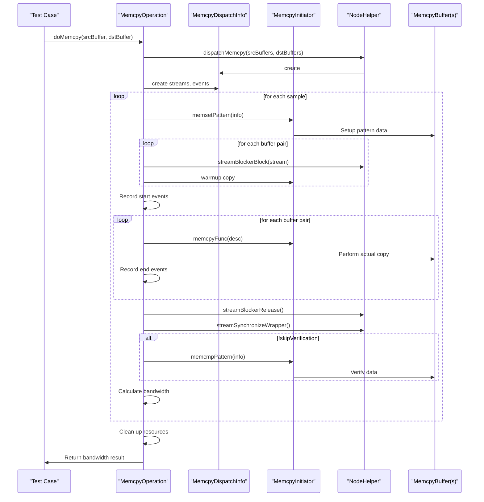

Sources: [memcpy.cpp:375-538]()

## Using the Memory Copy Framework

To use the Memory Copy Framework, clients typically:

1. Create memory buffers (`HostBuffer`, `DeviceBuffer`)
2. Select a copy initiator strategy (`MemcpyInitiatorCE`, `MemcpyInitiatorSM`)
3. Create a `MemcpyOperation` with the chosen initiator
4. Call `doMemcpy()` or `doMemcpyVector()` to perform the copy and get the bandwidth

For complete usage examples, see the test case implementations in the [CE Test Cases](#5.1) and [SM Test Cases](#5.2) sections.

Sources: [memcpy.h:217-240](), [memcpy.cpp:288-305]()

---

# Page: Memory Buffers

# Memory Buffers

<details>
<summary>Relevant source files</summary>

The following files were used as context for generating this wiki page:

- [memcpy.cpp](memcpy.cpp)
- [memcpy.h](memcpy.h)

</details>


## Purpose and Overview

Memory Buffers are a core abstraction in the nvbandwidth framework, providing a uniform interface for managing different types of memory locations (host and device) used in memory bandwidth testing. They abstract away the details of memory allocation, deallocation, and context management, enabling the testing framework to work with different memory configurations consistently.

For information about how these buffers are used by copy operations, see [Copy Initiators](#3.2).

Sources: [memcpy.h:24-41](). [memcpy.h:44-53](). [memcpy.h:56-69]().

## Buffer Class Hierarchy

Memory buffers in nvbandwidth follow an inheritance hierarchy that enables polymorphic handling of different memory types:

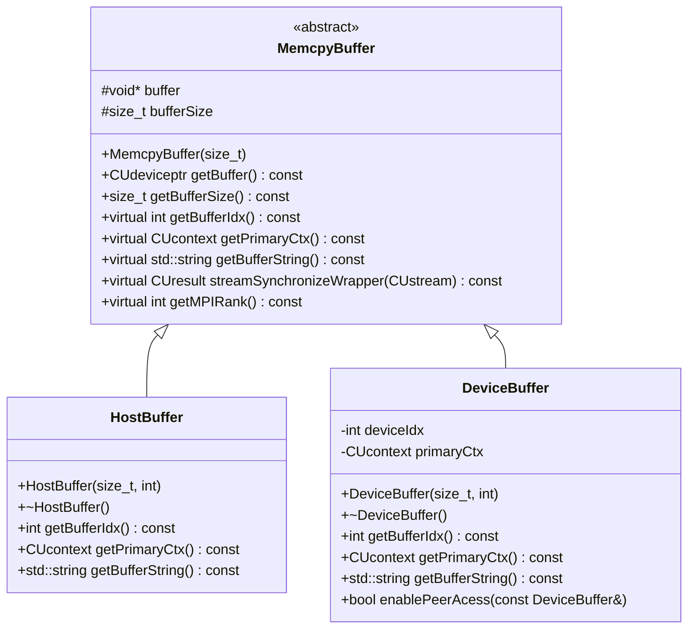

Sources: [memcpy.h:24-41](). [memcpy.h:44-53](). [memcpy.h:56-69](). [memcpy.cpp:33-41]().

## Base Class: MemcpyBuffer

The `MemcpyBuffer` abstract class serves as the foundation for all memory buffer types in nvbandwidth. It defines the common interface and functionality for different memory locations.

### Key Properties

- `buffer`: Raw pointer to the allocated memory
- `bufferSize`: Size of the allocated memory in bytes

### Key Methods

| Method | Description |
|--------|-------------|
| `getBuffer()` | Returns the buffer as a `CUdeviceptr` for use with CUDA operations |
| `getBufferSize()` | Returns the size of the buffer |
| `getBufferIdx()` | Virtual method to get an index identifying the buffer location |
| `getPrimaryCtx()` | Virtual method to get the CUDA context associated with this buffer |
| `getBufferString()` | Virtual method to get a string representation of the buffer for reporting |
| `streamSynchronizeWrapper()` | Wrapper for stream synchronization (important for MPI compatibility) |
| `getMPIRank()` | Returns the MPI rank for multi-node configurations |

Sources: [memcpy.h:24-41](). [memcpy.cpp:33-41](). [memcpy.cpp:201-206]().

## Host Buffers

The `HostBuffer` class represents memory allocated on the host (CPU). It optimizes memory allocation by setting NUMA affinity based on the target device ID.

### Initialization

Host buffers are created by specifying:
1. Buffer size in bytes
2. Target device ID (used for NUMA optimization)

```mermaid
sequenceDiagram
    participant "Application" as app
    participant "HostBuffer" as hb
    participant "CUDA Runtime" as cuda
    
    app->>hb: "Create(size, targetDeviceId)"
    hb->>hb: "setOptimalCpuAffinity(targetDeviceId)"
    hb->>cuda: "cuDevicePrimaryCtxRetain()"
    hb->>cuda: "cuCtxSetCurrent()"
    hb->>cuda: "cuMemHostAlloc(bufferSize, CU_MEMHOSTALLOC_PORTABLE)"
    hb-->>app: "Buffer ready"
```

### Key Features

- **NUMA-aware allocation**: Host buffers are allocated with memory affinity matching the target GPU to optimize data transfer bandwidth
- **Portable allocation**: Uses `CU_MEMHOSTALLOC_PORTABLE` flag to ensure memory can be accessed by any CUDA context
- **Null context**: Host buffers return `nullptr` for `getPrimaryCtx()` as they don't have a CUDA context

### Cleanup

Host buffers automatically free allocated memory in their destructor using either `cuMemFreeHost()` for CUDA-managed memory or standard `free()` for non-CUDA memory.

Sources: [memcpy.h:44-53](). [memcpy.cpp:208-225](). [memcpy.cpp:227-239]().

## Device Buffers

The `DeviceBuffer` class represents memory allocated on a GPU device. It handles both memory allocation and CUDA context management.

### Initialization

Device buffers are created by specifying:
1. Buffer size in bytes
2. Device index (GPU ID) where memory should be allocated

```mermaid
sequenceDiagram
    participant "Application" as app
    participant "DeviceBuffer" as db
    participant "CUDA Runtime" as cuda
    
    app->>db: "Create(size, deviceIdx)"
    db->>cuda: "cuDevicePrimaryCtxRetain(&primaryCtx, deviceIdx)"
    db->>cuda: "cuCtxSetCurrent(primaryCtx)"
    db->>cuda: "cuMemAlloc(&buffer, bufferSize)"
    db-->>app: "Buffer ready"
```

### Key Features

- **Context management**: Each device buffer retains and manages a primary CUDA context for its device
- **Device identification**: Maintains the device index for identification and peer access
- **Peer access support**: Provides methods to enable peer access between device buffers on different GPUs

### Peer Access

The `enablePeerAcess()` method checks if the current device can directly access memory on another device and enables this access if possible. This is critical for device-to-device bandwidth tests.

```mermaid
flowchart TD
    A["enablePeerAccess(peerBuffer)"] --> B{"Can access peer?"}
    B -- "Yes" --> C["Enable peer access in both directions"]
    B -- "No" --> D["Return false"]
    C --> E["Return true"]
```

### Cleanup

Device buffers automatically free allocated memory and release the primary context in their destructor.

Sources: [memcpy.h:56-69](). [memcpy.cpp:241-283]().

## Memory Buffer Usage in Operations

Memory buffers are used in combination to form the source and destination for bandwidth tests. The `MemcpyOperation` class uses pairs of buffers to perform memory copy operations and measure bandwidth.

### Buffer Pairing Patterns

```mermaid
flowchart LR
    subgraph "Host-Device Transfer"
        H1["HostBuffer"] --> D1["DeviceBuffer"]
        D2["DeviceBuffer"] --> H2["HostBuffer"]
    end
    
    subgraph "Device-Device Transfer"
        D3["DeviceBuffer 1"] --> D4["DeviceBuffer 2"]
    end
```

### Memory Operation Flow

```mermaid
sequenceDiagram
    participant "MemcpyOperation" as op
    participant "SourceBuffer" as src
    participant "DestBuffer" as dst
    participant "NodeHelper" as nh
    participant "MemcpyInitiator" as init
    
    op->>nh: "dispatchMemcpy(srcBuffers, dstBuffers, ctxPreference)"
    nh->>src: "getPrimaryCtx()"
    nh->>dst: "getPrimaryCtx()"
    nh-->>op: "MemcpyDispatchInfo object"
    op->>init: "memsetPattern(info)"
    init->>src: "getBuffer()"
    init->>dst: "getBuffer()"
    op->>init: "memcpyFunc(descriptor)"
    init->>src: "getBuffer()"
    init->>dst: "getBuffer()"
    op->>init: "memcmpPattern(info)"
```

When conducting bandwidth tests, the framework:

1. Creates appropriately sized host and/or device buffers
2. Initializes source buffers with test patterns
3. Performs the copy operation (measuring time)
4. Verifies the copy succeeded by checking patterns in destination buffers

Sources: [memcpy.h:207-240](). [memcpy.cpp:301-538]().

## Pattern Generation and Verification

Memory buffers are filled with deterministic patterns using the `xorshift2MBPattern` function and verified after copy operations to ensure data integrity:

1. **Pattern Generation**: A 2MB pattern is generated using a xorshift algorithm
2. **Memory Set**: Pattern is copied to the entire buffer using a CUDA kernel
3. **Memory Verification**: After copy, destination buffers are verified to contain the expected pattern

This verification ensures that the bandwidth measurements are based on correctly transferred data.

Sources: [memcpy.cpp:43-166]().

---

# Page: Copy Initiators

# Copy Initiators

<details>
<summary>Relevant source files</summary>

The following files were used as context for generating this wiki page:

- [memcpy.cpp](memcpy.cpp)
- [memcpy.h](memcpy.h)

</details>


## Purpose and Overview

This document explains the Copy Initiators subsystem within the nvbandwidth tool's memory copy framework. Copy Initiators are responsible for executing memory transfer operations using different hardware mechanisms and strategies. They implement specific memory copy methods that utilize different GPU resources for data movement, enabling nvbandwidth to measure and compare bandwidth across various copy strategies.

This page focuses on the interface and implementations of Copy Initiators. For information about the memory buffers used in copy operations, see [Memory Buffers](#3.1). For details about the overall Memory Copy Framework, see [Memory Copy Framework](#3).

Sources: [memcpy.h:133-147](), [memcpy.cpp:84-132]()

## The MemcpyInitiator Interface

The `MemcpyInitiator` class defines the interface that all copy initiator implementations must follow. This interface enables the memory copy framework to seamlessly work with different copy methods.

```mermaid
classDiagram
    class MemcpyInitiator {
        <<interface>>
        +memcpyFunc(MemcpyDescriptor&) size_t
        +getAdjustedCopySize(size_t, CUstream) size_t
        +memsetPattern(MemcpyDispatchInfo&) void
        +memcmpPattern(MemcpyDispatchInfo&) void
        +getAdjustedBandwidth(unsigned long long) unsigned long long
    }
    
    MemcpyInitiator <|-- MemcpyInitiatorCE
    MemcpyInitiator <|-- MemcpyInitiatorSM
    MemcpyInitiatorSM <|-- MemcpyInitiatorSMSplitWarp
    MemcpyInitiator <|-- MemcpyInitiatorMulticastWrite
    
    class MemcpyInitiatorCE {
        +memcpyFunc(MemcpyDescriptor&) size_t
        +getAdjustedCopySize(size_t, CUstream) size_t
        +memsetPattern(MemcpyDispatchInfo&) void
        +memcmpPattern(MemcpyDispatchInfo&) void
        +getAdjustedBandwidth(unsigned long long) unsigned long long
    }
    
    class MemcpyInitiatorSM {
        +memcpyFunc(MemcpyDescriptor&) size_t
        +getAdjustedCopySize(size_t, CUstream) size_t
        +memsetPattern(MemcpyDispatchInfo&) void
        +memcmpPattern(MemcpyDispatchInfo&) void
        +getAdjustedBandwidth(unsigned long long) unsigned long long
    }
    
    class MemcpyInitiatorSMSplitWarp {
        +memcpyFunc(MemcpyDescriptor&) size_t
        +memsetPattern(MemcpyDispatchInfo&) void
        +memcmpPattern(MemcpyDispatchInfo&) void
        +getAdjustedBandwidth(unsigned long long) unsigned long long
    }
    
    class MemcpyInitiatorMulticastWrite {
        +memcpyFunc(MemcpyDescriptor&) size_t
        +getAdjustedCopySize(size_t, CUstream) size_t
        +memsetPattern(MemcpyDispatchInfo&) void
        +memcmpPattern(MemcpyDispatchInfo&) void
        +getAdjustedBandwidth(unsigned long long) unsigned long long
    }
```

The interface defines five core methods:

1. `memcpyFunc`: Executes the actual memory copy operation and returns the actual number of bytes copied
2. `getAdjustedCopySize`: Calculates the effective copy size, accounting for hardware constraints and alignment requirements
3. `memsetPattern`: Fills source and destination buffers with specific patterns for verification
4. `memcmpPattern`: Verifies the results of a copy operation by comparing against expected patterns
5. `getAdjustedBandwidth`: Adjusts the raw bandwidth measurement before reporting (e.g., for bidirectional copies)

Sources: [memcpy.h:133-147]()

## Copy Initiator Implementations

nvbandwidth implements several copy initiators, each utilizing different hardware mechanisms for memory transfers:

### CE-based Copy Initiator (MemcpyInitiatorCE)

The CE-based initiator uses CUDA's Copy Engine hardware via `cuMemcpyAsync()`. This approach offloads memory transfer operations to dedicated copy hardware on the GPU.

Key characteristics:
- Uses dedicated Copy Engines (CEs)
- Preserves the original copy size without adjustments
- Direct hardware-accelerated memory transfers
- Leaves computational resources (SMs) available for other work

```cpp
// CE copy implementation simplified:
size_t MemcpyInitiatorCE::memcpyFunc(MemcpyDescriptor &desc) {
    for (unsigned int l = 0; l < desc.loopCount; l++) {
        cuMemcpyAsync(desc.dst, desc.src, desc.copySize, desc.stream);
    }
    return desc.copySize;
}
```

Sources: [memcpy.h:162-173](), [memcpy.cpp:567-573]()

### SM-based Copy Initiator (MemcpyInitiatorSM)

The SM-based initiator uses the GPU's computational cores (Streaming Multiprocessors) to perform memory transfers via custom CUDA kernels. This approach can sometimes achieve higher bandwidth than CE copies for specific workloads.

Key characteristics:
- Uses Streaming Multiprocessors (SMs) for memory transfers
- May truncate copy sizes to optimize for SM workload distribution
- Copy size depends on number of SMs and threads per block
- Different performance characteristics from CE-based transfers

```cpp
// SM copy size adjustment logic:
size_t MemcpyInitiatorSM::getAdjustedCopySize(size_t size, CUstream stream) {
    // Get device properties
    CUdevice dev;
    CUcontext ctx;
    cuStreamGetCtx(stream, &ctx);
    cuCtxGetDevice(&dev);
    
    // Get SM count
    int numSm;
    cuDeviceGetAttribute(&numSm, CU_DEVICE_ATTRIBUTE_MULTIPROCESSOR_COUNT, dev);
    
    // Calculate total thread count
    unsigned int totalThreadCount = numSm * numThreadPerBlock;
    
    // Adjust size based on small or large buffer
    if (size < (smallBufferThreshold * _MiB)) {
        // Small buffer: round down to 16 bytes
        int numUint4 = size / sizeof(uint4);
        return numUint4 * sizeof(uint4);
    } else {
        // Large buffer: truncate to thread count alignment
        size_t sizeInElement = size / sizeof(uint4);
        sizeInElement = totalThreadCount * (sizeInElement / totalThreadCount);
        return sizeInElement * sizeof(uint4);
    }
}
```

Sources: [memcpy.h:149-160](), [memcpy.cpp:540-565]()

### Split Warp Initiator (MemcpyInitiatorSMSplitWarp)

A specialized SM-based initiator that performs bidirectional copies. It splits CUDA warps, allowing half of the threads to copy in one direction and half in the opposite direction.

Key characteristics:
- Extends SM-based initiator
- Performs bidirectional copies simultaneously
- Halves the reported bandwidth to reflect per-direction performance
- Requires special buffer preparation and validation

Sources: [memcpy.h:188-197](), [memcpy.cpp:108-116](), [memcpy.cpp:189-196](), [memcpy.cpp:589-591]()

### Multicast Write Initiator (MemcpyInitiatorMulticastWrite)

This initiator uses CUDA's multicast capabilities to write to multiple destinations simultaneously from a single source.

Key characteristics:
- Optimized for one-to-many transfer patterns
- May have size constraints based on hardware support
- Uses special comparison kernels for validation

Sources: [memcpy.h:175-186](), [memcpy.cpp:100-106](), [memcpy.cpp:182-187](), [memcpy.cpp:580-587]()

## Memory Copy Flow

The following diagram illustrates how a copy operation flows through the initiator system:

```mermaid
sequenceDiagram
    participant TestCase as "Test Case"
    participant MemcpyOp as "MemcpyOperation"
    participant Initiator as "MemcpyInitiator"
    participant Buffers as "MemcpyBuffers"
    participant Kernel as "CUDA Kernels"
    
    TestCase->>MemcpyOp: doMemcpy(srcBuffer, dstBuffer)
    MemcpyOp->>MemcpyOp: Create MemcpyDispatchInfo
    
    MemcpyOp->>Initiator: memsetPattern(dispatchInfo)
    Initiator-->>Kernel: Initialize Buffer Contents
    
    MemcpyOp->>Initiator: getAdjustedCopySize()
    Initiator-->>MemcpyOp: Adjusted Size
    
    MemcpyOp->>Initiator: memcpyFunc(descriptor)
    Initiator-->>Kernel: Execute Memory Copy
    Kernel-->>Buffers: Transfer Data
    
    MemcpyOp->>Initiator: memcmpPattern(dispatchInfo)
    Initiator-->>Kernel: Verify Copy Results
    
    MemcpyOp->>Initiator: getAdjustedBandwidth(rawBandwidth)
    Initiator-->>MemcpyOp: Final Bandwidth Value
    
    MemcpyOp-->>TestCase: Bandwidth Result
```

Sources: [memcpy.cpp:375-386](), [memcpy.cpp:388-538]()

## Integration with the Memory Copy Framework

Copy Initiators are a key component in the Memory Copy Framework. They are created and used by the `MemcpyOperation` class, which manages the overall copy process, timing, and bandwidth calculation.

```mermaid
graph TD
    subgraph "Memory Copy Framework"
        TestCase["Test Case"]
        MemcpyOp["MemcpyOperation"]
        NodeHelper["NodeHelper"]
        Buffers["MemcpyBuffers"]
        
        subgraph "Copy Initiators"
            Initiator["MemcpyInitiator Interface"]
            CE["MemcpyInitiatorCE"]
            SM["MemcpyInitiatorSM"]
            SplitWarp["MemcpyInitiatorSMSplitWarp"]
            Multicast["MemcpyInitiatorMulticastWrite"]
        end
        
        TestCase --> MemcpyOp
        MemcpyOp --> Initiator
        MemcpyOp --> NodeHelper
        MemcpyOp --> Buffers
        
        Initiator --> CE
        Initiator --> SM
        SM --> SplitWarp
        Initiator --> Multicast
    end
    
    TestCase --> BandwidthResult["Bandwidth Measurements"]
```

Key integration points:

1. **Construction**: Test cases create an appropriate `MemcpyOperation` with the desired initiator type
2. **Execution**: The `MemcpyOperation` uses the initiator to perform memory copies
3. **Verification**: The initiator handles pattern setting and verification
4. **Measurement**: The initiator may adjust bandwidth measurements based on its specific characteristics

Sources: [memcpy.h:207-240](), [memcpy.cpp:288-296]()

## Key Differences Between Initiators

| Initiator Type | Copy Mechanism | Size Adjustment | Bandwidth Calculation | Main Use Cases |
|----------------|----------------|-----------------|------------------------|----------------|
| CE | Hardware Copy Engine | None (preserves original size) | Direct (no adjustment) | Standard memory copies, baseline measurements |
| SM | CUDA kernel using SMs | Rounds to thread count alignment | Direct (no adjustment) | Testing SM-based memory bandwidth |
| Split Warp | Bidirectional SM kernel | Same as SM | Halves the measured bandwidth | Measuring bidirectional bandwidth |
| Multicast Write | Multicast write operations | Rounds to unsigned int alignment | Direct (no adjustment) | One-to-many copy patterns |

Sources: [memcpy.cpp:118-133](), [memcpy.cpp:544-565](), [memcpy.cpp:567-573](), [memcpy.cpp:580-587]()

## Usage Examples

In practice, Copy Initiators are selected based on the test case requirements:

- CE-based initiators for standard hardware copy engine measurements
- SM-based initiators for measuring SM memory bandwidth capabilities
- Split Warp initiators for bidirectional transfer measurements
- Multicast Write initiators for one-to-many transfer patterns

Test cases instantiate the appropriate `MemcpyOperation` with the desired initiator type:

```cpp
// Example with CE initiator (simplified):
auto memcpyOp = new MemcpyOperation(loopCount, new MemcpyInitiatorCE());
double bandwidth = memcpyOp->doMemcpy(srcBuffer, dstBuffer);

// Example with SM initiator (simplified):
auto memcpyOp = new MemcpyOperation(loopCount, new MemcpyInitiatorSM());
double bandwidth = memcpyOp->doMemcpy(srcBuffer, dstBuffer);
```

Sources: [memcpy.h:230-231](), [memcpy.cpp:300-305]()

---

# Page: CUDA Kernels

# CUDA Kernels

<details>
<summary>Relevant source files</summary>

The following files were used as context for generating this wiki page:

- [kernels.cu](kernels.cu)
- [kernels.cuh](kernels.cuh)

</details>


## Purpose and Scope

This document describes the CUDA kernels implemented in the NVIDIA nvbandwidth tool. These kernels are the core computational components that execute on the GPU to measure memory bandwidth between different hardware components. They implement various memory transfer patterns and optimizations to achieve accurate bandwidth measurements for different scenarios.

For information about how these kernels are utilized in specific test cases, see [Test Cases](#5) and its child pages. For details on the memory copy framework that orchestrates these kernels, see [Memory Copy Framework](#3).

Sources: [kernels.cuh:17-39]()

## Kernel Architecture Overview

The nvbandwidth tool implements several specialized CUDA kernels that perform different types of memory operations:

```mermaid
flowchart TD
    subgraph "CUDA Kernels"
        direction TB
        MemCopy["Memory Copy Kernels"]
        Sync["Synchronization Kernels"]
        Latency["Latency Measurement Kernels"]
        MemOps["Memory Ops Kernels"]
    end

    MemCopy --> Simple["simpleCopyKernel"]
    MemCopy --> Striding["stridingMemcpyKernel"]
    MemCopy --> SplitWarp["splitWarpCopyKernel"]
    MemCopy --> Multicast["multicastCopyKernel"]
    
    Sync --> Spin["spinKernelDevice"]
    Sync --> MultiSpin["spinKernelDeviceMultistage"]
    
    Latency --> PtrChase["ptrChasingKernel"]
    
    MemOps --> Memset["memsetKernelDevice"]
    MemOps --> MemClear["memclearKernelByWarpParityDevice"]
    MemOps --> Memcmp["memcmpKernelDevice"]
    MemOps --> MCMemcmp["multicastMemcmpKernelDevice"]
```

Sources: [kernels.cu:20-399](), [kernels.cuh:27-39]()

## Memory Copy Kernels

Memory copy kernels are the primary components for bandwidth measurement. They implement different memory access patterns to measure bandwidth under various scenarios.

### Simple Copy Kernel

The `simpleCopyKernel` is a basic memory copy kernel used for smaller buffer sizes (less than the small buffer threshold). It uses cache global (CG) memory operations for data transfer.

```mermaid
sequenceDiagram
    participant Thread as "CUDA Thread"
    participant Source as "Source Memory"
    participant Dest as "Destination Memory"
    
    Note over Thread: "Thread assigned idx based on blockIdx and threadIdx"
    Thread->>Source: "__ldcg(src_uint4)" 
    Note over Source: "Cache-global load operation"
    Source-->>Thread: "Return data"
    Thread->>Dest: "__stcg(dst_uint4, data)"
    Note over Dest: "Cache-global store operation"
```

Sources: [kernels.cu:20-28](), [kernels.cu:183-222]()

### Striding Memcpy Kernel

The `stridingMemcpyKernel` is an optimized kernel for larger buffer sizes that uses a striding memory access pattern to maximize memory bandwidth. It employs techniques like memory pipelining and thread striding to achieve high throughput.

```mermaid
flowchart TD
    Thread["Thread with index 'from'"]
    Thread --> AdjustPointers["Adjust pointers\ndst += from\nsrc += from"]
    AdjustPointers --> LoopCount["Loop for loopCount iterations"]
    LoopCount --> BigChunk["Process big chunks in groups of 12"]
    BigChunk --> PipeLoad["Load 12 values in pipeline"]
    PipeLoad --> PipeStore["Store 12 values to destination"]
    PipeStore --> BigChunk
    BigChunk --> SmallChunk["Process remaining elements"]
    SmallChunk --> LoopCount
```

Sources: [kernels.cu:30-74](), [kernels.cu:183-222]()

### Split Warp Copy Kernel

The `splitWarpCopyKernel` performs a split warp copy by alternating copy directions across warps. This pattern is useful for maximizing bidirectional bandwidth between GPU components.

```mermaid
flowchart TD
    Thread["Thread with index 'idx'"]
    Thread --> CalcWarpID["Calculate globalWarpId = idx / warpSize"]
    CalcWarpID --> CheckParity{"Is globalWarpId odd?"}
    CheckParity -->|"Yes (odd warp)"| OddWarp["Copy from src to dst"]
    CheckParity -->|"No (even warp)"| EvenWarp["Copy from dst to src (reverse direction)"]
    OddWarp --> PerformCopy["Perform cache-global load and store"]
    EvenWarp --> PerformCopy
```

Sources: [kernels.cu:77-98](), [kernels.cu:224-242]()

### Multicast Copy Kernel

The `multicastCopyKernel` is specialized for architectures that support multicast memory operations (Hopper and later). It writes from regular memory to multicast memory regions.

```mermaid
flowchart TD
    Thread["Thread with offset based on block and thread ID"]
    Thread --> InitPointers["Initialize pointers to chunks"]
    InitPointers --> Loop["Loop for loopCount iterations"]
    Loop --> ResetPointers["Reset pointers to src and dst chunks"]
    ResetPointers --> InnerLoop["Process elements in chunks"]
    InnerLoop --> MulticastStore["mc_st_u32: Write using multimem.st.u32"]
    MulticastStore --> InnerLoop
    InnerLoop --> Loop
```

Sources: [kernels.cu:128-146](), [kernels.cu:244-259]()

## Latency Measurement Kernels

### Pointer Chasing Kernel

The `ptrChasingKernel` and its host-side wrapper `latencyPtrChaseKernel` implement a pointer chasing technique to measure memory latency. This approach forces serial memory accesses that cannot be parallelized, allowing accurate latency measurement.

```mermaid
sequenceDiagram
    participant Host as "Host Code"
    participant SM as "Streaming Multiprocessor"
    participant Memory as "GPU Memory"
    
    Host->>SM: "Launch ptrChasingKernel"
    Note over Host: "Record start time"
    SM->>Memory: "p = data"
    loop For i = 0 to accesses
        SM->>Memory: "Load p->next"
        Memory-->>SM: "Return next pointer"
        Note over SM: "p = p->next (serialize memory accesses)"
    end
    Host->>SM: "Synchronize"
    Note over Host: "Record end time\nCalculate latency"
```

Sources: [kernels.cu:100-111](), [kernels.cu:148-181]()

## Synchronization Kernels

### Spin Kernels

The nvbandwidth tool includes spin kernels for synchronization purposes:

1. `spinKernelDevice`: Simple spin kernel that waits until a latch variable is set or timeout occurs
2. `spinKernelDeviceMultistage`: Two-stage spin kernel for complex multi-node synchronization

```mermaid
flowchart TD
    subgraph "Single-stage Spin"
        S1["Start spinKernelDevice"]
        S2["Calculate endTime = clock64() + timeoutClocks"]
        S3{"*latch == 0?"}
        S4{"Timeout?"}
        S5["Exit kernel"]
        
        S1 --> S2 --> S3
        S3 -->|"Yes"| S4
        S4 -->|"No"| S3
        S4 -->|"Yes"| S5
        S3 -->|"No"| S5
    end
    
    subgraph "Two-stage Spin"
        M1["Start spinKernelDeviceMultistage"]
        M2{"latch1 provided?"}
        M3["Wait for latch1"]
        M4["Set latch2 = 1"]
        M5["Wait for latch2"]
        M6["Exit kernel"]
        
        M1 --> M2
        M2 -->|"Yes"| M3 --> M4 --> M5 --> M6
        M2 -->|"No"| M5
    end
```

Sources: [kernels.cu:261-331]()

## Memory Initialization and Verification Kernels

The nvbandwidth tool includes several kernels for memory pattern initialization and verification:

### Memory Pattern Operations

1. `memsetKernelDevice`: Sets memory to a specified pattern
2. `memcmpKernelDevice`: Compares memory with a specified pattern
3. `multicastMemcmpKernelDevice`: Compares multicast memory with a pattern
4. `memclearKernelByWarpParityDevice`: Clears memory locations based on warp parity

```mermaid
flowchart TD
    subgraph "Memory Pattern Operations"
        Memset["memsetKernelDevice:\nSet memory to pattern"]
        Memcmp["memcmpKernelDevice:\nVerify memory pattern"]
        McMemcmp["multicastMemcmpKernelDevice:\nVerify multicast memory pattern"]
        WarpClear["memclearKernelByWarpParityDevice:\nClear memory based on warp parity"]
    end
    
    OddWarp["Clear odd warp indexed locations"]
    EvenWarp["Clear even warp indexed locations"]
    
    WarpClear --> OddWarp
    WarpClear --> EvenWarp
```

Sources: [kernels.cu:333-447]()

## Kernel Preloading Mechanism

The nvbandwidth tool preloads all kernels on all devices at initialization to reduce kernel launch latency during measurements. This is implemented in the `preloadKernels` function.

```mermaid
sequenceDiagram
    participant Main as "Main Program"
    participant DevLoop as "Device Loop"
    participant CUDA as "CUDA Runtime"
    
    Main->>DevLoop: "preloadKernels(deviceCount)"
    loop For each device
        DevLoop->>CUDA: "cudaSetDevice(iDev)"
        Note over DevLoop: "Call cudaFuncGetAttributes for each kernel"
        DevLoop->>CUDA: "cudaFuncGetAttributes(&unused, &stridingMemcpyKernel)"
        DevLoop->>CUDA: "cudaFuncGetAttributes(&unused, &spinKernelDevice)"
        DevLoop->>CUDA: "cudaFuncGetAttributes(&unused, &...other kernels...)"
    end
```

Sources: [kernels.cu:449-465]()

## Kernel Selection Logic

The nvbandwidth tool selects the appropriate kernel based on buffer size and test requirements. The selection logic is primarily implemented in the `copyKernel` function.

```mermaid
flowchart TD
    Start["copyKernel() called"] --> SizeCheck{"copySize < smallBufferThreshold?"}
    SizeCheck -->|"Yes (small buffer)"| UseSimple["Use simpleCopyKernel"]
    SizeCheck -->|"No (large buffer)"| UseStriding["Use stridingMemcpyKernel"]
    
    UseSimple --> LaunchSimple["Launch with calculated\ngrid and block dimensions"]
    UseStriding --> CalcElements["Calculate elements and dimensions"]
    CalcElements --> LaunchStriding["Launch with adjusted parameters"]
    
    LaunchSimple --> Return["Return copied size"]
    LaunchStriding --> Return
```

The kernel selection table below summarizes when each kernel is used:

| Kernel Type | Function | Used When | Key Optimizations |
|-------------|----------|-----------|-------------------|
| Simple Copy | `simpleCopyKernel` | Buffer size < threshold | Basic cache-global ops |
| Striding Copy | `stridingMemcpyKernel` | Buffer size ≥ threshold | Memory pipelining, striding |
| Split Warp | `splitWarpCopyKernel` | Bidirectional tests | Alternating warp directions |
| Multicast | `multicastCopyKernel` | Multicast memory tests | Hopper+ multimem ops |

Sources: [kernels.cu:183-222](), [kernels.cu:224-242](), [kernels.cu:244-259]()

## Technical Implementation Details

### Key Parameters and Constants

| Constant | Value | Purpose |
|----------|-------|---------|
| `numThreadPerBlock` | Varies | Threads per block for memory copy |
| `smallBufferThreshold` | Defined in MiB | Threshold for kernel selection |
| `DEFAULT_SPIN_KERNEL_TIMEOUT_MS` | 10000 (10s) | Default timeout for spin kernels |

### Memory Access Instructions

The kernels use specific memory access instructions for optimal performance:

- `__ldcg()`: Cache-global load instruction that caches data globally
- `__stcg()`: Cache-global store instruction that caches data globally
- `multimem.st.u32`: Hopper architecture's multicast store instruction
- `multimem.ld_reduce.and.b32`: Hopper architecture's multicast load instruction

Sources: [kernels.cu:20-28](), [kernels.cu:113-125]()

## Integration with Memory Copy Framework

The CUDA kernels are integrated with the Memory Copy Framework through kernel wrapper functions like `copyKernel`, `copyKernelSplitWarp`, and `multicastCopy`. These functions take a `MemcpyDescriptor` structure or similar parameters and handle the details of launching the appropriate kernel with the right parameters.

```mermaid
classDiagram
    class MemcpyDescriptor {
        CUdeviceptr src
        CUdeviceptr dst
        size_t copySize
        unsigned long long loopCount
        CUstream stream
    }
    
    class MemcpyInitiator {
        <<interface>>
        +memcpyFunc(MemcpyDescriptor&)
    }
    
    class MemcpyInitiatorSM {
        +memcpyFunc(MemcpyDescriptor&)
    }
    
    class MemcpyInitiatorCE {
        +memcpyFunc(MemcpyDescriptor&)
    }
    
    MemcpyInitiator <|.. MemcpyInitiatorSM
    MemcpyInitiator <|.. MemcpyInitiatorCE
    MemcpyInitiator --> MemcpyDescriptor: uses
    MemcpyInitiatorSM ..> copyKernel: calls
    MemcpyInitiatorCE ..> copyKernel: calls
```

Sources: [kernels.cu:183-222](), [kernels.cuh:27-39]()

---

# Page: Test Cases

# Test Cases

<details>
<summary>Relevant source files</summary>

The following files were used as context for generating this wiki page:

- [testcase.cpp](testcase.cpp)
- [testcase.h](testcase.h)

</details>


## Purpose and Scope

This document describes the test case architecture of nvbandwidth, a CUDA-based tool for measuring memory bandwidth performance between various components in NVIDIA GPU systems. The test cases form the core functionality of nvbandwidth, providing specific implementations to measure bandwidth in different memory transfer scenarios. This page focuses on the test case framework, organization, and the types of tests available in the system.

For information about the Memory Copy Framework that powers these tests, see [Memory Copy Framework](#3).

Sources: [testcase.h:18-56]()

## Test Case Architecture

### Base Class Design

The nvbandwidth test cases follow an object-oriented design with a common base class that defines the interface and shared functionality. All specific test implementations inherit from this base class.

```mermaid
classDiagram
    class Testcase {
        #string key
        #string desc
        +Testcase(string key, string desc)
        +string testKey()
        +string testDesc()
        +bool filter()
        +void run(unsigned long long size, unsigned long long loopCount)*
        #bool filterHasAccessiblePeerPairs()
        #bool filterSupportsMulticast()
        #void latencyHelper()
        #void allToOneHelper()
        #void oneToAllHelper()
        #void allHostHelper()
        #void allHostBidirHelper()
    }
    
    class DeviceToHostCE {
        +DeviceToHostCE()
        +void run(unsigned long long size, unsigned long long loopCount)
    }
    
    class HostToDeviceCE {
        +HostToDeviceCE()
        +void run(unsigned long long size, unsigned long long loopCount)
    }
    
    class DeviceToDeviceReadCE {
        +DeviceToDeviceReadCE()
        +void run(unsigned long long size, unsigned long long loopCount)
        +bool filter()
    }
    
    class DeviceToHostSM {
        +DeviceToHostSM()
        +void run(unsigned long long size, unsigned long long loopCount)
    }
    
    Testcase <|-- DeviceToHostCE
    Testcase <|-- HostToDeviceCE
    Testcase <|-- DeviceToDeviceReadCE
    Testcase <|-- DeviceToHostSM
```

Each test case has:
1. A unique key identifier used for selecting tests
2. A description explaining what the test measures
3. A `filter()` method that determines if the test can run on the current system
4. A `run()` method that performs the actual test with specified buffer size and loop count

Sources: [testcase.h:26-56](), [testcase.cpp:23-29]()

### Test Filtering Mechanism

The base `Testcase` class provides several helper methods for filtering tests based on system capabilities:

- `filterHasAccessiblePeerPairs()`: Checks if there are any peer-accessible GPU pairs in the system
- `filterSupportsMulticast()`: Determines if all GPUs in the system support multicast operations
- `filterHasMultipleGPUsMultinode()`: For multinode builds, checks if there are multiple GPUs available across nodes

These filtering methods allow tests to determine if they should be skipped when the required hardware capabilities are not available.

Sources: [testcase.h:31-35](), [testcase.cpp:30-74]()

## Test Categories

nvbandwidth includes three main categories of test cases, each targeting different memory copy mechanisms:

```mermaid
graph TD
    subgraph "Test Categories"
        CE["CE Tests (Copy Engine)"]
        SM["SM Tests (Streaming Multiprocessor)"]
        MN["Multinode Tests"]
    end
    
    subgraph "Test Patterns"
        H2D["Host to Device"]
        D2H["Device to Host"]
        D2D["Device to Device"]
        Bidir["Bidirectional"]
        A2O["All to One"]
        O2A["One to All"]
        LAT["Latency"]
        BCAST["Broadcast"]
    end
    
    CE --- H2D
    CE --- D2H
    CE --- D2D
    CE --- Bidir
    CE --- A2O
    CE --- O2A
    
    SM --- H2D
    SM --- D2H
    SM --- D2D
    SM --- Bidir
    SM --- A2O
    SM --- O2A
    SM --- LAT
    
    MN --- D2D
    MN --- Bidir
    MN --- A2O
    MN --- O2A
    MN --- BCAST
```

Sources: [testcase.h:59-591]()

### CE Test Cases

CE (Copy Engine) test cases measure bandwidth using CUDA's built-in memory copy operations, primarily through the `cuMemcpyAsync` API. These tests leverage the GPU's dedicated copy engines for data transfer.

Key CE test cases include:
- Host to device transfers (`HostToDeviceCE`)
- Device to host transfers (`DeviceToHostCE`)
- Device to device transfers in both read and write directions (`DeviceToDeviceReadCE`, `DeviceToDeviceWriteCE`)
- Bidirectional transfers (`DeviceToDeviceBidirReadCE`, `DeviceToDeviceBidirWriteCE`)
- Aggregate bandwidth tests (`AllToOneReadCE`, `OneToAllWriteCE`)

Sources: [testcase.h:59-263]()

### SM Test Cases

SM (Streaming Multiprocessor) test cases measure bandwidth using custom CUDA kernels that run on the GPU's compute cores rather than using the dedicated copy engines. This provides an alternative measurement that can be useful for understanding real-world application performance.

Key SM test cases include:
- Host to device transfers (`HostToDeviceSM`)
- Device to host transfers (`DeviceToHostSM`)
- Device to device transfers (`DeviceToDeviceReadSM`, `DeviceToDeviceWriteSM`)
- Latency measurements (`HostDeviceLatencySM`, `DeviceToDeviceLatencySM`)
- Bidirectional transfers (`DeviceToDeviceBidirReadSM`, `DeviceToDeviceBidirWriteSM`)

Sources: [testcase.h:265-440]()

### Multinode Test Cases

When built with multinode support (via the `MULTINODE` flag), additional test cases are available for measuring bandwidth between GPUs across different compute nodes. These tests use MPI (Message Passing Interface) for coordination between nodes.

Key multinode test cases include:
- Cross-node device to device transfers (`MultinodeDeviceToDeviceReadCE`, `MultinodeDeviceToDeviceWriteCE`)
- Broadcast operations (`MultinodeBroadcastOneToAllSM`, `MultinodeBroadcastAllToAllSM`)
- Bisection bandwidth (`MultinodeBisectWriteCE`)

Sources: [testcase.h:442-591]()

## Test Directions and Patterns

The test cases implement various data transfer patterns to measure different aspects of system bandwidth:

### Transfer Directions

Each test case focuses on measuring bandwidth in a specific direction:

1. **Read Operations**: In read operations, the copy is initiated from the target device, reading data from another memory location (device memory or host memory). Read operations are generally denoted by "read" in the test name.

2. **Write Operations**: In write operations, the copy is initiated from the target device, writing data to another memory location. Write operations are generally denoted by "write" in the test name.

Sources: [testcase.h:120-139](), [testcase.h:295-326]()

### Data Transfer Patterns

The test cases implement several patterns of data transfer:

```mermaid
graph TD
    subgraph "Basic Transfers"
        H2D["Host to Device"]
        D2H["Device to Host"]
        D2D["Device to Device"]
        DL["Device Local"]
    end
    
    subgraph "Complex Patterns"
        Bidir["Bidirectional (simultaneous transfers in both directions)"]
        A2O["All to One (multiple sources to single destination)"]
        O2A["One to All (single source to multiple destinations)"]
        A2A["All to All (broadcast)"]
    end
    
    H2D --> Bandwidth["Bandwidth Measurement"]
    D2H --> Bandwidth
    D2D --> Bandwidth
    DL --> Bandwidth
    Bidir --> Bandwidth
    A2O --> Bandwidth
    O2A --> Bandwidth
    A2A --> Bandwidth
    
    LAT["Latency Tests"] --> Latency["Latency Measurement"]
```

Sources: [testcase.h:66-215](), [testcase.h:216-263](), [testcase.h:354-440](), [testcase.h:535-590]()

## Helper Methods for Complex Patterns

The base `Testcase` class provides several helper methods to support complex data transfer patterns:

### All-to-One Pattern

The `allToOneHelper()` method sets up a pattern where all GPUs send data to a single destination GPU. This tests the maximum inbound or outbound bandwidth a GPU can achieve when receiving from or being read by multiple peers.

```mermaid
graph LR
    GPU1["GPU 1"] --> GPU_Target["Target GPU"]
    GPU2["GPU 2"] --> GPU_Target
    GPU3["GPU 3"] --> GPU_Target
    GPU4["GPU 4"] --> GPU_Target
```

Sources: [testcase.cpp:99-144](), [testcase.h:217-239]()

### One-to-All Pattern

The `oneToAllHelper()` method implements a pattern where a single GPU sends data to all other GPUs. This tests the maximum outbound or inbound bandwidth a GPU can achieve when sending to or being written to by multiple peers.

```mermaid
graph LR
    GPU_Source["Source GPU"] --> GPU1["GPU 1"]
    GPU_Source --> GPU2["GPU 2"]
    GPU_Source --> GPU3["GPU 3"]
    GPU_Source --> GPU4["GPU 4"]
```

Sources: [testcase.cpp:146-191](), [testcase.h:242-263]()

### Bidirectional Transfers

Several test cases implement bidirectional transfers, where data is transferred simultaneously in both directions. For example, in host-device bidirectional tests, data is transferred from host to device and from device to host at the same time.

These tests are particularly valuable for measuring real-world performance under concurrent workloads and for testing the full duplex capabilities of interconnects like NVLink.

Sources: [testcase.h:79-117](), [testcase.h:142-163](), [testcase.h:185-214](), [testcase.h:329-350]()

## Latency Measurement

In addition to bandwidth tests, nvbandwidth includes test cases for measuring memory access latency:

- `HostDeviceLatencySM`: Measures host-device access latency using a pointer chase kernel
- `DeviceToDeviceLatencySM`: Measures device-to-device access latency between peer GPUs

The latency tests use a pointer chasing technique where each memory location contains the address of the next location to access. This creates a dependent chain of memory accesses that reveals the true latency of the memory subsystem.

```mermaid
graph LR
    subgraph "Latency Pattern"
        A["Memory Node 1"] --> B["Memory Node 2"]
        B --> C["Memory Node 3"]
        C --> D["Memory Node 4"]
        D --> E["... (continues)"]
        E --> A
    end
```

Sources: [testcase.cpp:77-97](), [testcase.h:267-274](), [testcase.h:306-315]()

## Test Case Execution Flow

When a test case's `run()` method is called, it typically follows this sequence:

1. **Setup**: Allocate necessary memory buffers (host, device, or both)
2. **Warmup**: Perform a few initial transfers to warm up the system
3. **Timed Execution**: Perform the actual memory transfers while measuring time
4. **Bandwidth Calculation**: Calculate bandwidth based on transfer size and elapsed time
5. **Cleanup**: Free allocated memory resources

For complex patterns (All-to-One, One-to-All, etc.), the test cases use the helper methods to set up the correct buffer configuration before performing the transfers.

Sources: [testcase.h:54-56](), [testcase.cpp:99-271]()

---

# Page: CE Test Cases

# CE Test Cases

<details>
<summary>Relevant source files</summary>

The following files were used as context for generating this wiki page:

- [testcase.h](testcase.h)
- [testcases_ce.cpp](testcases_ce.cpp)

</details>


## Purpose and Scope

This document covers the Compute Engine (CE) Test Cases in the nvbandwidth tool. These test cases measure memory bandwidth using CUDA's hardware-accelerated copy engine to perform various transfer patterns between host memory and GPU memory, or between multiple GPUs. For tests that use the Streaming Multiprocessor (SM) instead of the Copy Engine, see [SM Test Cases](#5.2).

## Overview of CE Test Cases

CE test cases utilize CUDA's built-in copy mechanisms (primarily cuMemcpyAsync) which use dedicated hardware copy engines on NVIDIA GPUs. These engines are optimized for high-bandwidth data transfers and operate independently of the GPU computation units (SMs).

```mermaid
graph TD
    subgraph "CE Test Case Types"
        Basic["Basic Transfers"]
        Bidir["Bidirectional Transfers"]
        Collective["Collective Transfers"]
        
        Basic --> H2D["Host to Device"]
        Basic --> D2H["Device to Host"]
        Basic --> D2D["Device to Device"]
        Basic --> DL["Device Local"]
        
        Bidir --> H2DB["Host-Device Bidirectional"]
        Bidir --> D2DB["Device-Device Bidirectional"]
        
        Collective --> A2H["All to Host"]
        Collective --> H2A["Host to All"]
        Collective --> A2O["All to One"]
        Collective --> O2A["One to All"]
    end
```

Sources: [testcase.h:59-263]()

## Implementation Architecture

CE test cases are implemented as concrete classes inheriting from the `Testcase` base class. Each test case implements the `run` method which performs the specific memory transfers and measures bandwidth.

```mermaid
classDiagram
    class Testcase {
        <<abstract>>
        #string key
        #string desc
        +run(size, loopCount) void
        +filter() bool
        +testKey() string
        +testDesc() string
    }
    
    class HostToDeviceCE {
        +run(size, loopCount) void
    }
    
    class DeviceToHostCE {
        +run(size, loopCount) void
    }
    
    class DeviceToDeviceReadCE {
        +run(size, loopCount) void
        +filter() bool
    }
    
    class DeviceToDeviceWriteCE {
        +run(size, loopCount) void
        +filter() bool
    }
    
    class DeviceToDeviceBidirReadCE {
        +run(size, loopCount) void
        +filter() bool
    }
    
    class DeviceToDeviceBidirWriteCE {
        +run(size, loopCount) void
        +filter() bool
    }
    
    Testcase <|-- HostToDeviceCE
    Testcase <|-- DeviceToHostCE
    Testcase <|-- DeviceToDeviceReadCE
    Testcase <|-- DeviceToDeviceWriteCE
    Testcase <|-- DeviceToDeviceBidirReadCE
    Testcase <|-- DeviceToDeviceBidirWriteCE
```

Sources: [testcase.h:26-262]()

## Core CE Test Case Categories

### Basic Transfers

These test cases measure the bandwidth of simple point-to-point transfers:

| Test Case | Description | Implementation |
|-----------|-------------|----------------|
| `HostToDeviceCE` | Measures host to device (CPU to GPU) transfer bandwidth | [testcases_ce.cpp:25-37]() |
| `DeviceToHostCE` | Measures device to host (GPU to CPU) transfer bandwidth | [testcases_ce.cpp:39-51]() |
| `DeviceToDeviceReadCE` | Measures peer-to-peer GPU read bandwidth | [testcases_ce.cpp:90-113]() |
| `DeviceToDeviceWriteCE` | Measures peer-to-peer GPU write bandwidth | [testcases_ce.cpp:116-138]() |
| `DeviceLocalCopy` | Measures bandwidth of copies within the same GPU | [testcases_ce.cpp:214-226]() |

Sources: [testcases_ce.cpp:25-226](), [testcase.h:62-172]()

### Bidirectional Transfers

These test cases measure bandwidth when data transfers occur simultaneously in both directions:

| Test Case | Description | Implementation |
|-----------|-------------|----------------|
| `HostToDeviceBidirCE` | Measures host to device bandwidth with simultaneous device to host transfer | [testcases_ce.cpp:53-69]() |
| `DeviceToHostBidirCE` | Measures device to host bandwidth with simultaneous host to device transfer | [testcases_ce.cpp:71-87]() |
| `DeviceToDeviceBidirReadCE` | Measures bidirectional peer-to-peer read bandwidth | [testcases_ce.cpp:141-175]() |
| `DeviceToDeviceBidirWriteCE` | Measures bidirectional peer-to-peer write bandwidth | [testcases_ce.cpp:178-212]() |

Sources: [testcases_ce.cpp:53-212](), [testcase.h:80-163]()

### Collective Transfers

These test cases measure bandwidth during multi-device data movement patterns:

| Test Case | Description | Implementation |
|-----------|-------------|----------------|
| `AllToHostCE` | Measures bandwidth from a device to host with simultaneous transfers from all other devices to host | [testcases_ce.cpp:228-235]() |
| `AllToHostBidirCE` | Measures bidirectional bandwidth between a device and host with interference from other devices | [testcases_ce.cpp:237-244]() |
| `HostToAllCE` | Measures bandwidth from host to a device with simultaneous transfers from host to all other devices | [testcases_ce.cpp:246-253]() |
| `HostToAllBidirCE` | Measures bidirectional bandwidth between host and a device with interference from other devices | [testcases_ce.cpp:255-262]() |
| `AllToOneWriteCE` | Measures total inbound bandwidth to a single device from all accessible peers | [testcases_ce.cpp:265-271]() |
| `AllToOneReadCE` | Measures total outbound bandwidth from a single device to all accessible peers using read operations | [testcases_ce.cpp:274-280]() |
| `OneToAllWriteCE` | Measures total outbound bandwidth from a single device to all accessible peers using write operations | [testcases_ce.cpp:283-289]() |
| `OneToAllReadCE` | Measures total inbound bandwidth to a single device from all accessible peers using read operations | [testcases_ce.cpp:292-298]() |

Sources: [testcases_ce.cpp:228-298](), [testcase.h:175-263]()

## CE Test Case Execution Flow

The following diagram illustrates the execution flow of a typical CE test case:

```mermaid
flowchart TD
    Start([Test Case Execution]) --> CreateMatrix["Create Bandwidth Matrix"]
    CreateMatrix --> CreateOP["Create MemcpyOperation with\nMemcpyInitiatorCE"]
    CreateOP --> CreateBuffer["Create Memory Buffers"]
    CreateBuffer --> PerformCopy["Perform Memory Copy Operation"]
    PerformCopy --> RecordBW["Record Bandwidth Measurement"]
    RecordBW --> NextDevice{More Devices?}
    NextDevice -- Yes --> CreateBuffer
    NextDevice -- No --> AddResults["Add Results to Output"]
    AddResults --> End([End])
```

Sources: [testcases_ce.cpp:25-37]()

## Implementation Details

### Memory Copy Operation Setup

CE test cases use `MemcpyInitiatorCE` to perform the actual data transfers. This initiator uses CUDA's hardware copy engines rather than executing copy kernels on the SM.

```mermaid
sequenceDiagram
    participant TC as TestCase
    participant MO as MemcpyOperation
    participant MICE as MemcpyInitiatorCE
    participant SB as Source Buffer
    participant DB as Destination Buffer
    
    TC->>MO: create(loopCount, new MemcpyInitiatorCE())
    TC->>SB: create(size, deviceId)
    TC->>DB: create(size, deviceId)
    TC->>MO: doMemcpy(SB, DB)
    MO->>MICE: memcpyFunc(descriptor)
    MICE->>SB: getBuffer()
    MICE->>DB: getBuffer()
    MICE-->>MO: bandwidth result
    MO-->>TC: bandwidth result
    TC->>Output: addTestcaseResults(...)
```

Sources: [testcases_ce.cpp:26-36]()

### Read vs. Write Operations

NVIDIA GPUs distinguish between read and write operations for peer-to-peer transfers:

1. **Read operations**: The destination device reads from the source device (pulls data)
2. **Write operations**: The source device writes to the destination device (pushes data)

The CE test cases test both patterns by controlling which device's context is used to execute the copy:

```mermaid
graph TD
    subgraph "Copy Context Control"
        RC["Read Copy\n(PREFER_DST_CONTEXT)"] --> DCM["Destination Device Context\nRead from Source"]
        WC["Write Copy\n(PREFER_SRC_CONTEXT)"] --> SCM["Source Device Context\nWrite to Destination"]
    end
```

Sources: [testcases_ce.cpp:92](), [testcases_ce.cpp:118]()

### Special Handling for Bidirectional Tests

For bidirectional tests, the test case creates two copies running in opposite directions:

```mermaid
flowchart LR
    subgraph "Bidirectional Test Setup"
        direction LR
        SrcBuf1["Source Buffer 1"] --> DstBuf1["Destination Buffer 1"]
        DstBuf2["Destination Buffer 2"] --> SrcBuf2["Source Buffer 2"]
    end
```

Sources: [testcases_ce.cpp:62-65](), [testcases_ce.cpp:80-83]()

## CE Test Performance Considerations

1. **CE vs. SM Performance**:
   - CE operations generally provide higher bandwidth for large transfers
   - CE operations run asynchronously from SM computation
   - CE operations have lower CPU overhead compared to launching SM copy kernels

2. **Peer-to-Peer Transfer Requirements**:
   - The devices must support peer access (verified with `enablePeerAccess`)
   - Bandwidth depends on the system topology and interconnect (e.g., NVLink, PCIe)

3. **Read vs Write Performance**:
   - Read and write performance may differ based on hardware architecture
   - Both patterns are tested to identify optimal data movement strategies

Sources: [testcases_ce.cpp:103-105](), [testcases_ce.cpp:129-131]()

## Usage Example

These test cases can be run from the nvbandwidth CLI with specific test keys. For example:

```
./nvbandwidth --testcase=device_to_device_memcpy_read_ce --bufferSize=1GB
```

This would run the `DeviceToDeviceReadCE` test case with a 1GB buffer size.

---

# Page: SM Test Cases

# SM Test Cases

<details>
<summary>Relevant source files</summary>

The following files were used as context for generating this wiki page:

- [testcase.h](testcase.h)
- [testcases_sm.cpp](testcases_sm.cpp)

</details>


## Purpose and Scope

This page documents the Streaming Multiprocessor (SM) test cases in the nvbandwidth tool. These test cases measure memory bandwidth and latency by using custom CUDA kernels that execute on the GPU's Streaming Multiprocessors rather than using the Copy Engine (CE) like the CE tests do (for information about CE-based tests, see [CE Test Cases](#5.1)).

SM tests offer different performance characteristics than CE tests and can help provide a more complete picture of system memory transfer capabilities, especially for understanding how memory transfers perform when initiated directly from compute workloads.

Sources: [testcases_sm.cpp:18-365]()/[testcase.h:265-440]()

## Overview of SM Test Cases

SM test cases in nvbandwidth use specialized CUDA kernels to perform memory operations and measure bandwidth or latency. Unlike CE tests which use the CUDA Driver API's `cuMemcpyAsync()` function, SM tests launch custom kernels to perform the copies, simulating how real applications might move data during computation.

```mermaid
flowchart TB
    subgraph "SM Test Cases"
        direction TB
        SMTests["SM Test Classes"]
        SMLatency["Latency Tests"]
        SMBandwidth["Bandwidth Tests"]
        
        SMTests --> SMLatency
        SMTests --> SMBandwidth
        
        subgraph "SMLatency"
            HostDeviceLatencySM["HostDeviceLatencySM"]
            DeviceToDeviceLatencySM["DeviceToDeviceLatencySM"]
        end
        
        subgraph "SMBandwidth"
            UnidirectionalSM["Unidirectional Tests"]
            BidirectionalSM["Bidirectional Tests"]
            CollectiveSM["Collective Tests"]
        end
        
        SMBandwidth --> UnidirectionalSM
        SMBandwidth --> BidirectionalSM
        SMBandwidth --> CollectiveSM
        
        subgraph "UnidirectionalSM"
            HostToDeviceSM["HostToDeviceSM"]
            DeviceToHostSM["DeviceToHostSM"]
            DeviceToDeviceReadSM["DeviceToDeviceReadSM"]
            DeviceToDeviceWriteSM["DeviceToDeviceWriteSM"]
        end
        
        subgraph "BidirectionalSM"
            HostToDeviceBidirSM["HostToDeviceBidirSM"]
            DeviceToHostBidirSM["DeviceToHostBidirSM"]
            DeviceToDeviceBidirReadSM["DeviceToDeviceBidirReadSM"]
            DeviceToDeviceBidirWriteSM["DeviceToDeviceBidirWriteSM"]
        end
        
        subgraph "CollectiveSM"
            AllToHostSM["AllToHostSM"]
            AllToHostBidirSM["AllToHostBidirSM"]
            HostToAllSM["HostToAllSM"]
            HostToAllBidirSM["HostToAllBidirSM"]
            AllToOneReadSM["AllToOneReadSM"]
            AllToOneWriteSM["AllToOneWriteSM"]
            OneToAllReadSM["OneToAllReadSM"]
            OneToAllWriteSM["OneToAllWriteSM"]
        end
    end
```

Sources: [testcases_sm.cpp:24-364]()/[testcase.h:265-440]()

## SM Test Case Implementation

SM test cases follow a consistent implementation pattern that involves:

1. Creating data buffers
2. Setting up the memory copy operation with an SM-specific initiator
3. Executing the operation
4. Collecting and reporting bandwidth or latency results

```mermaid
sequenceDiagram
    participant TestCase as "SM Test Case"
    participant Buffer as "Memory Buffers"
    participant Op as "MemcpyOperation"
    participant Initiator as "MemcpyInitiatorSM"
    participant Kernel as "CUDA Kernel"
    participant Output as "Output System"
    
    TestCase->>Buffer: Create source and destination buffers
    TestCase->>Initiator: Create SM initiator
    TestCase->>Op: Create MemcpyOperation with initiator
    TestCase->>Buffer: Enable peer access (if device-to-device)
    TestCase->>Op: doMemcpy(srcBuffer, dstBuffer)
    Op->>Initiator: memcpyFunc(descriptor)
    Initiator->>Kernel: Launch copy kernel
    Kernel-->>Initiator: Complete copy
    Initiator-->>Op: Return timing info
    Op-->>TestCase: Return bandwidth
    TestCase->>Output: Report results
```

Sources: [testcases_sm.cpp:37-49]()/[testcases_sm.cpp:144-167]()

## Key Components of SM Test Cases

### MemcpyInitiators for SM Tests

SM test cases use specialized memory copy initiators that launch CUDA kernels rather than using the CUDA Driver API's memory copy functions:

| Initiator | Description | Used In |
|-----------|-------------|---------|
| `MemcpyInitiatorSM` | Standard SM copy initiator that launches kernels for unidirectional memory copies | Most SM test cases |
| `MemcpyInitiatorSMSplitWarp` | Special initiator that uses split warps to handle bidirectional copies simultaneously | Bidirectional test cases |

Sources: [testcases_sm.cpp:39]()/[testcases_sm.cpp:67]()/[testcases_sm.cpp:81]()

### Execution Context Selection

SM test cases can specify which GPU context to use when executing transfers:

| Context Preference | Description | Used In |
|-------------------|-------------|---------|
| `PREFER_SRC_CONTEXT` | Use the source buffer's GPU context for the operation | Most write operations |
| `PREFER_DST_CONTEXT` | Use the destination buffer's GPU context for the operation | Most read operations |

This selection impacts how memory operations are executed and can affect observed bandwidth.

Sources: [testcases_sm.cpp:96]()/[testcases_sm.cpp:211]()/[testcases_sm.cpp:147]()

## Types of SM Test Cases

### Latency Test Cases

SM latency tests measure memory access times using pointer-chasing kernels rather than bulk memory transfers:

```mermaid
classDiagram
    class HostDeviceLatencySM {
        +run(size, loopCount)
        -latencyHelper()
        -ptrChaseOp()
    }
    
    class DeviceToDeviceLatencySM {
        +run(size, loopCount)
        -latencyHelper()
        -ptrChaseOp()
    }
    
    Testcase <|-- HostDeviceLatencySM
    Testcase <|-- DeviceToDeviceLatencySM
```

Sources: [testcases_sm.cpp:24-35]()/[testcases_sm.cpp:119-142]()/[testcase.h:267-274]()/[testcase.h:306-315]()

### Basic Memory Transfer Test Cases

The simplest SM test cases perform transfers between host and device or between devices:

```mermaid
classDiagram
    class HostToDeviceSM {
        +run(size, loopCount)
    }
    
    class DeviceToHostSM {
        +run(size, loopCount)
    }
    
    class DeviceToDeviceReadSM {
        +run(size, loopCount)
        +filter()
    }
    
    class DeviceToDeviceWriteSM {
        +run(size, loopCount)
        +filter()
    }
    
    Testcase <|-- HostToDeviceSM
    Testcase <|-- DeviceToHostSM
    Testcase <|-- DeviceToDeviceReadSM
    Testcase <|-- DeviceToDeviceWriteSM
```

These test cases measure basic bandwidth in a single direction between memory locations. Device-to-device tests require peer access and further distinguish between read and write operations.

Sources: [testcases_sm.cpp:37-63]()/[testcases_sm.cpp:94-117]()/[testcases_sm.cpp:145-167]()/[testcase.h:277-326]()

### Bidirectional Test Cases

Bidirectional tests measure bandwidth when transfers occur simultaneously in both directions:

```mermaid
classDiagram
    class HostToDeviceBidirSM {
        +run(size, loopCount)
    }
    
    class DeviceToHostBidirSM {
        +run(size, loopCount)
    }
    
    class DeviceToDeviceBidirReadSM {
        +run(size, loopCount)
        +filter()
    }
    
    class DeviceToDeviceBidirWriteSM {
        +run(size, loopCount)
        +filter()
    }
    
    Testcase <|-- HostToDeviceBidirSM
    Testcase <|-- DeviceToHostBidirSM
    Testcase <|-- DeviceToDeviceBidirReadSM
    Testcase <|-- DeviceToDeviceBidirWriteSM
```

These tests use `MemcpyInitiatorSMSplitWarp` for host-device transfers and measure multiple transfers simultaneously for device-to-device transfers to assess bidirectional capabilities.

Sources: [testcases_sm.cpp:65-91]()/[testcases_sm.cpp:170-241]()/[testcase.h:100-117]()/[testcase.h:329-350]()

### Collective Test Cases

Collective test cases measure bandwidth in scenarios involving multiple devices:

```mermaid
flowchart LR
    subgraph "Collective Patterns"
        direction TB
        AllToHost["All To Host"]
        HostToAll["Host To All"]
        AllToOne["All To One"]
        OneToAll["One To All"]
    end
    
    subgraph "Test Cases"
        AllToHostSM["AllToHostSM"]
        AllToHostBidirSM["AllToHostBidirSM"]
        HostToAllSM["HostToAllSM"]
        HostToAllBidirSM["HostToAllBidirSM"]
        AllToOneReadSM["AllToOneReadSM"]
        AllToOneWriteSM["AllToOneWriteSM"]
        OneToAllReadSM["OneToAllReadSM"]
        OneToAllWriteSM["OneToAllWriteSM"]
    end
    
    AllToHost --> AllToHostSM & AllToHostBidirSM
    HostToAll --> HostToAllSM & HostToAllBidirSM
    AllToOne --> AllToOneReadSM & AllToOneWriteSM
    OneToAll --> OneToAllReadSM & OneToAllWriteSM
```

These tests evaluate bandwidth in more complex scenarios:

- **All-to-Host**: Measure bandwidth from one device to the host while all other devices also copy to the host
- **Host-to-All**: Measure bandwidth from the host to one device while the host also copies to all other devices
- **All-to-One**: Measure combined bandwidth when all devices copy to a single device
- **One-to-All**: Measure combined bandwidth when one device copies to all other devices

Each pattern has read and write variants, with some also having bidirectional versions.

Sources: [testcases_sm.cpp:243-364]()/[testcase.h:353-440]()

## Implementation Details

### Common Test Case Structure

Most SM test cases follow this general structure:

1. Create a matrix to store bandwidth/latency results
2. Create a `MemcpyOperation` instance with appropriate initiator and settings
3. Create source and destination buffers
4. Enable peer access if needed (for device-to-device transfers)
5. Execute the memory operation and measure bandwidth
6. Report results

Example from `HostToDeviceSM`:

```
1. Create PeerValueMatrix
2. Create MemcpyOperation with MemcpyInitiatorSM
3. For each device:
   a. Create host and device buffers
   b. Perform memory copy and measure bandwidth
   c. Store result in matrix
4. Report results
```

Sources: [testcases_sm.cpp:37-49]()

### Read vs. Write Operations

For device-to-device tests, there's an important distinction between read and write operations:

- **Read operations**: The destination device initiates the transfer, reading from the source device
- **Write operations**: The source device initiates the transfer, writing to the destination device

This is controlled by the context preference (`PREFER_SRC_CONTEXT` or `PREFER_DST_CONTEXT`) and affects which GPU executes the transfer.

Sources: [testcases_sm.cpp:96]()/[testcases_sm.cpp:147]()

### Vector Copy Operations

Bidirectional and collective tests often use vector operations to perform multiple transfers simultaneously:

```cpp
// Instead of doMemcpy(srcBuffer, dstBuffer)
std::vector<const MemcpyBuffer*> srcBuffers = {&src1, &src2};
std::vector<const MemcpyBuffer*> dstBuffers = {&dst1, &dst2};
auto results = memcpyInstance.doMemcpyVector(srcBuffers, dstBuffers);
```

Results can be reported individually or combined depending on the test case.

Sources: [testcases_sm.cpp:191-197]()/[testcases_sm.cpp:228-234]()

## Key Test Cases Explained

### Memory Latency Tests

Latency tests (`HostDeviceLatencySM` and `DeviceToDeviceLatencySM`) use a pointer-chasing approach to measure memory access latency rather than bandwidth:

```mermaid
flowchart TB
    Start["Start Pointer Chase"] --> PtrAlloc["Create Linked Pointer Structure"]
    PtrAlloc --> Launch["Launch Chase Kernel"]
    Launch --> Chase["GPU Kernel: Follow Pointers"]
    Chase --> Timing["Measure Average Access Time"]
    Timing --> Results["Report Latency (ns)"]
```

These tests are crucial for understanding memory system performance beyond raw bandwidth.

Sources: [testcases_sm.cpp:24-35]()/[testcases_sm.cpp:119-142]()

### Device-to-Device Transfers

Device-to-device transfers are particularly important for multi-GPU systems. They require peer access to be enabled and come in several variants:

1. **Basic transfers**: `DeviceToDeviceReadSM` and `DeviceToDeviceWriteSM`
2. **Bidirectional transfers**: `DeviceToDeviceBidirReadSM` and `DeviceToDeviceBidirWriteSM`

The bidirectional tests perform copies in both directions simultaneously and report both individual and combined bandwidth.

Sources: [testcases_sm.cpp:94-117]()/[testcases_sm.cpp:145-167]()/[testcases_sm.cpp:170-241]()

### Collective Tests

Collective tests assess performance in multi-GPU scenarios where multiple transfers occur simultaneously:

```mermaid
flowchart LR
    subgraph "AllToOneWriteSM"
        direction TB
        GPU1["GPU 1"]
        GPU2["GPU 2"]
        GPU3["GPU 3"]
        Target["Target GPU"]
        
        GPU1 --> Target
        GPU2 --> Target
        GPU3 --> Target
    end
    
    subgraph "OneToAllWriteSM"
        direction TB
        Source["Source GPU"]
        Dest1["GPU 1"]
        Dest2["GPU 2"]
        Dest3["GPU 3"]
        
        Source --> Dest1
        Source --> Dest2
        Source --> Dest3
    end
```

These tests help understand system behavior under more complex transfer patterns that are common in multi-GPU applications.

Sources: [testcases_sm.cpp:330-364]()

## Comparison with CE Test Cases

SM test cases differ from CE test cases in several important ways:

| Aspect | SM Tests | CE Tests |
|--------|----------|----------|
| Implementation | Custom CUDA kernels | CUDA Runtime/Driver API functions |
| Execution | On Streaming Multiprocessors | On Copy Engines |
| Control | More programmatic control | Relies on driver implementation |
| Use case | Simulates application memory access patterns | Measures raw hardware capabilities |
| Performance characteristics | May have higher latency but can utilize SM parallelism | Optimized for bulk transfers |

Understanding the differences between SM and CE test results can provide valuable insights into system memory architecture and help optimize application memory operations.

Sources: [testcase.h:265-440]()/[testcase.h:59-263]()

## Summary

SM test cases in nvbandwidth provide a comprehensive suite for measuring memory bandwidth and latency using GPU compute resources rather than dedicated copy engines. They cover a wide range of scenarios including:

1. Basic host-device transfers
2. Device-to-device transfers
3. Bidirectional transfers
4. Collective transfers involving multiple devices

These tests help users understand the performance characteristics of memory operations when executed from GPU kernels, which complements the information provided by CE tests and gives a more complete picture of system memory performance.

Sources: [testcases_sm.cpp:18-365]()/[testcase.h:265-440]()

---

# Page: Multinode Test Cases

# Multinode Test Cases

<details>
<summary>Relevant source files</summary>

The following files were used as context for generating this wiki page:

- [multinode_memcpy.cpp](multinode_memcpy.cpp)
- [multinode_memcpy.h](multinode_memcpy.h)
- [multinode_testcases.cpp](multinode_testcases.cpp)

</details>


## Purpose and Scope

This document describes the multinode test cases in nvbandwidth, which measure memory bandwidth performance across multiple nodes in NVIDIA GPU systems connected via technologies like NVLink. These test cases use MPI (Message Passing Interface) to coordinate operations across multiple nodes and leverage CUDA's memory management features, particularly fabric memory and multicast objects. For information about single-node test cases, see [CE Test Cases](#5.1) and [SM Test Cases](#5.2).

## Architecture Overview

The multinode test system consists of several interconnected components that work together to measure bandwidth performance across networked GPU systems:

```mermaid
classDiagram
    class MultinodeMemoryAllocation {
        <<abstract>>
        #void* buffer
        #size_t bufferSize
        #int MPI_rank
        +getBuffer()
        +streamSynchronizeWrapper()
    }
    
    class MultinodeMemoryAllocationUnicast {
        -CUmemGenericAllocationHandle handle
        -CUmemFabricHandle fh
        +MultinodeMemoryAllocationUnicast(size_t, int)
    }
    
    class MultinodeMemoryAllocationMulticast {
        -CUmemGenericAllocationHandle handle
        -CUmemGenericAllocationHandle multicastHandle
        +MultinodeMemoryAllocationMulticast(size_t, int)
    }
    
    class MultinodeDeviceBuffer {
        <<abstract>>
        -int MPI_rank
        +getPrimaryCtx()
        +getBufferIdx()
        +getBufferString()
        +getMPIRank()
    }
    
    class MultinodeDeviceBufferUnicast {
        -MultinodeMemoryAllocationUnicast MemoryAllocation
    }
    
    class MultinodeDeviceBufferMulticast {
        -MultinodeMemoryAllocationMulticast MemoryAllocation
    }
    
    class MultinodeDeviceBufferLocal {
        -CUcontext primaryCtx
    }
    
    class NodeHelperMulti {
        -int rankOfFirstMemcpy
        -volatile int* blockingVarHost
        -volatile int* blockingVarDevice
        +dispatchMemcpy()
        +calculateTotalBandwidth()
        +calculateSumBandwidth()
        +calculateFirstBandwidth()
        +calculateVectorBandwidth()
    }
    
    class MemcpyBuffer {
        <<abstract>>
    }
    
    MultinodeMemoryAllocation <|-- MultinodeMemoryAllocationUnicast
    MultinodeMemoryAllocation <|-- MultinodeMemoryAllocationMulticast
    MemcpyBuffer <|-- MultinodeDeviceBuffer
    MultinodeDeviceBuffer <|-- MultinodeDeviceBufferUnicast
    MultinodeDeviceBuffer <|-- MultinodeDeviceBufferMulticast
    MultinodeDeviceBuffer <|-- MultinodeDeviceBufferLocal
    MultinodeDeviceBufferUnicast --> MultinodeMemoryAllocationUnicast
    MultinodeDeviceBufferMulticast --> MultinodeMemoryAllocationMulticast
    NodeHelper <|-- NodeHelperMulti
```

Sources: [multinode_memcpy.h:28-146](), [multinode_memcpy.cpp:25-326]()

## Memory Allocation Classes

The multinode system uses specialized memory allocation classes to manage memory across multiple nodes:

1. **MultinodeMemoryAllocation** (abstract base class):
   - Base class for multinode memory allocations
   - Manages a buffer pointer, buffer size, and MPI rank
   - Provides synchronization wrappers for coordinating operations

2. **MultinodeMemoryAllocationUnicast**:
   - Allocates memory on one node that can be accessed by other nodes
   - Uses CUDA's fabric memory handles to share memory across nodes
   - Memory physically resides on one node but is mapped to address spaces of other nodes

3. **MultinodeMemoryAllocationMulticast**:
   - Uses CUDA's multicast objects to efficiently distribute memory updates
   - Allows simultaneous writes to be propagated to multiple nodes
   - Optimizes broadcast-type operations

The allocation process involves:
1. Creating the allocation on one node
2. Exporting a shareable handle
3. Broadcasting the handle to other nodes via MPI
4. Importing the handle on other nodes
5. Mapping memory to each node's address space
6. Setting appropriate access permissions

Sources: [multinode_memcpy.h:28-76](), [multinode_memcpy.cpp:25-155]()

## Buffer Classes

Building on the memory allocation classes, the multinode system provides several buffer types:

```mermaid
classDiagram
    class MemcpyBuffer {
        <<abstract>>
        +getBuffer()
        +getBufferSize()
        +getBufferIdx()
        +getPrimaryCtx()
        +getBufferString()
    }
    
    class MultinodeDeviceBuffer {
        -int MPI_rank
        +MultinodeDeviceBuffer(size_t, int)
        +getMPIRank()
    }
    
    class MultinodeDeviceBufferUnicast {
        -MultinodeMemoryAllocationUnicast MemoryAllocation
        +MultinodeDeviceBufferUnicast(size_t, int)
    }
    
    class MultinodeDeviceBufferMulticast {
        -MultinodeMemoryAllocationMulticast MemoryAllocation
        +MultinodeDeviceBufferMulticast(size_t, int)
    }
    
    class MultinodeDeviceBufferLocal {
        -CUcontext primaryCtx
        +MultinodeDeviceBufferLocal(size_t, int)
    }
    
    MemcpyBuffer <|-- MultinodeDeviceBuffer
    MultinodeDeviceBuffer <|-- MultinodeDeviceBufferUnicast
    MultinodeDeviceBuffer <|-- MultinodeDeviceBufferMulticast
    MultinodeDeviceBuffer <|-- MultinodeDeviceBufferLocal
```

1. **MultinodeDeviceBuffer** (abstract):
   - Base class for all multinode device buffers
   - Extends the MemcpyBuffer class with multinode capabilities
   - Tracks which MPI rank owns or is associated with the buffer

2. **MultinodeDeviceBufferUnicast**:
   - Buffer using unicast memory allocation
   - Memory physically resides on one node but is accessible remotely from others
   - Used for point-to-point transfers where data is read/written by specific nodes

3. **MultinodeDeviceBufferMulticast**:
   - Buffer using multicast memory allocation
   - Data written by one node is automatically propagated to all nodes
   - Used for broadcast operations where one node needs to share data with many

4. **MultinodeDeviceBufferLocal**:
   - Simple device memory buffer only accessible from the local node
   - Used when a node needs a local source/destination that isn't shared

Sources: [multinode_memcpy.h:80-120](), [multinode_memcpy.cpp:157-211]()

## Node Helper

The `NodeHelperMulti` class facilitates coordination between nodes during bandwidth tests:

1. **Dispatch Management**:
   - Determines which MPI ranks should execute which memory copy operations
   - Routes operations to appropriate contexts (source or destination)
   - Filters operations to be executed only on relevant nodes

2. **Bandwidth Calculation**:
   - `calculateTotalBandwidth`: Computes aggregate bandwidth across all nodes
   - `calculateSumBandwidth`: Sums bandwidth across multiple operations
   - `calculateFirstBandwidth`: Reports bandwidth of designated "first" copy
   - `calculateVectorBandwidth`: Processes vector of bandwidth measurements

3. **Synchronization**:
   - Process-level synchronization using MPI barriers
   - Stream synchronization with MPI integration for event handling
   - Special stream blocking mechanism for coordinated operations

Sources: [multinode_memcpy.h:122-146](), [multinode_memcpy.cpp:213-326]()

## Test Case Types

The multinode test system implements various test cases to measure different aspects of memory bandwidth:

```mermaid
graph TD
    subgraph "Multinode Test Cases"
        A1["DeviceToDeviceReadCE/SM"] --> D2D["Device to Device"]
        A2["DeviceToDeviceWriteCE/SM"] --> D2D
        A3["DeviceToDeviceBidirReadCE/SM"] --> D2D
        A4["DeviceToDeviceBidirWriteCE/SM"] --> D2D
        
        B1["AllToOneWriteSM"] --> COL["Collective Operations"]
        B2["AllFromOneReadSM"] --> COL
        B3["BroadcastOneToAllSM"] --> COL
        B4["BroadcastAllToAllSM"] --> COL
        
        C1["BisectWriteCE"] --> SPEC["Specialized Patterns"]
    end
    
    subgraph "Memory Patterns"
        D2D --> P1["Point-to-Point"]
        COL --> P2["All-to-One/One-to-All"]
        COL --> P3["Broadcast"]
        SPEC --> P4["Bisection"]
    end
    
    subgraph "Implementation"
        P1 --> I1["CE and SM Variants"]
        P2 --> I2["Unicast Memory"]
        P3 --> I3["Multicast Memory"]
        P4 --> I4["Multiple Simultaneous Transfers"]
    end
```

Sources: [multinode_testcases.cpp:29-383]()

### Device-to-Device Operations

These test cases measure bandwidth between pairs of devices across different nodes:

1. **Read Operations**:
   - `MultinodeDeviceToDeviceReadCE/SM`: Measures bandwidth when reading from a remote node
   - Uses destination node's context to initiate the transfer
   - Available in both CE (Copy Engine) and SM (Streaming Multiprocessor) variants

2. **Write Operations**:
   - `MultinodeDeviceToDeviceWriteCE/SM`: Measures bandwidth when writing to a remote node
   - Uses source node's context to initiate the transfer
   - Available in both CE and SM variants

3. **Bidirectional Operations**:
   - `MultinodeDeviceToDeviceBidirReadCE/SM`: Measures bidirectional read bandwidth
   - `MultinodeDeviceToDeviceBidirWriteCE/SM`: Measures bidirectional write bandwidth
   - Tests how well the interconnect handles simultaneous transfers in both directions

The test implementation creates an N×N matrix of bandwidth measurements (where N is the number of nodes), excluding the diagonal (self-to-self transfers).

Sources: [multinode_testcases.cpp:29-241]()

### Collective Operations

These test cases measure bandwidth in many-to-one, one-to-many, and many-to-many patterns:

1. **All-to-One Operations**:
   - `MultinodeAllToOneWriteSM`: Measures aggregate bandwidth when all nodes write to a single node
   - Tests fan-in performance of the interconnect

2. **One-to-All Operations**:
   - `MultinodeAllFromOneReadSM`: Measures aggregate bandwidth when all nodes read from a single node
   - Tests fan-out performance of the interconnect

3. **Broadcast Operations**:
   - `MultinodeBroadcastOneToAllSM`: Measures bandwidth when one node broadcasts to all others using multicast
   - `MultinodeBroadcastAllToAllSM`: Measures bandwidth when all nodes broadcast to all others
   - Uses multicast memory allocation for efficient broadcasts

These tests are particularly important for evaluating the performance of collective operations in parallel applications.

Sources: [multinode_testcases.cpp:243-348]()

### Specialized Patterns

1. **Bisection Bandwidth**:
   - `MultinodeBisectWriteCE`: Measures the bisection bandwidth of the system
   - Creates pairs of nodes that communicate simultaneously
   - Evaluates how well the interconnect handles multiple cross-traffic patterns

This test is helpful for understanding the total cross-sectional bandwidth available in the system.

Sources: [multinode_testcases.cpp:350-381]()

## Implementation Details

### Memory Handling

The multinode test cases leverage CUDA's memory fabric handling capabilities:

1. **Unicast Memory**:
   - Uses `cuMemCreate` and `cuMemExportToShareableHandle` to create and share memory
   - Memory physically resides on one node but is accessible through NVLink from others
   - Implementation in `MultinodeMemoryAllocationUnicast` handles the creation, sharing, and mapping

2. **Multicast Memory**:
   - Uses `cuMulticastCreate` and related functions to create a multicast object
   - Binds local memory from each node to the multicast object
   - Enables efficient broadcast operations where updates from one node are automatically propagated

3. **Synchronization**:
   - Uses MPI barriers to synchronize nodes at key points
   - Custom stream synchronization through `MPIstreamSyncHelper` integrates CUDA stream synchronization with MPI message handling
   - Special stream blocking mechanism for precise timing and coordination

Sources: [multinode_memcpy.cpp:29-41](), [multinode_memcpy.cpp:43-155]()

### Data Collection and Reporting

The test cases collect performance data in several formats:

1. **Matrix Reporting**:
   - Most tests report results as a `PeerValueMatrix` showing bandwidth between each pair of nodes
   - Format clearly shows the bandwidth achievable between any two nodes

2. **Aggregate Bandwidth**:
   - For collective operations, tests often report either:
     - Sum of bandwidths across all transfers
     - Maximum time taken across all nodes (for true aggregate measurement)

3. **Vector Bandwidth**:
   - For bidirectional tests, results are reported for individual transfers and as totals
   - Helps identify asymmetries in read vs. write performance

Sources: [multinode_testcases.cpp:47-68](), [multinode_testcases.cpp:99-101](), [multinode_memcpy.cpp:257-303]()

## Usage Examples

The multinode test cases must be compiled with MPI support by defining the `MULTINODE` preprocessor macro. When executed, these tests typically run across multiple nodes using `mpirun` or a similar launcher.

A typical test execution sequence:

1. Each node initializes its local environment
2. Nodes coordinate through MPI to set up memory allocations
3. Test cases run on the appropriate nodes as determined by the dispatcher
4. Results are collected and combined across all nodes
5. Final results are reported in a matrix or aggregated format

### Example Test Case Implementation Pattern

Most multinode test cases follow this pattern:

1. Create a performance matrix to store results
2. Instantiate a `MemcpyOperation` with appropriate initiator and helper
3. For each relevant node pair or group:
   - Create buffer objects representing source and destination
   - Execute the memory copy operation
   - Store bandwidth results
4. Report results through the output system

This pattern can be seen in all the test case implementations, with variations depending on the specific operation being tested.

Sources: [multinode_testcases.cpp:29-68](), [multinode_testcases.cpp:243-271]()

---

# Page: Output System

# Output System

<details>
<summary>Relevant source files</summary>

The following files were used as context for generating this wiki page:

- [json/json-forwards.h](json/json-forwards.h)
- [json/json.h](json/json.h)
- [json/jsoncpp.cpp](json/jsoncpp.cpp)
- [json_output.cpp](json_output.cpp)
- [json_output.h](json_output.h)
- [output.cpp](output.cpp)
- [output.h](output.h)

</details>


The Output System in nvbandwidth is responsible for formatting and displaying the results of the bandwidth tests. It provides a consistent interface for reporting test results, errors, warnings, and device information while supporting multiple output formats including plain text and JSON.

## Architecture Overview

The Output System follows a simple inheritance-based design with a base class providing the interface and default implementations, and specialized classes for different output formats.

```mermaid
classDiagram
    class Output {
        <<abstract>>
        +addTestcase(name, status, msg)
        +setTestcaseStatusAndAddIfNeeded(name, status, msg)
        +print()
        +recordError(errorParts)
        +recordError(error)
        +recordErrorCurrentTest(errorPart1, errorPart2)
        +recordWarning(warning)
        +addCudaAndDriverInfo(cudaVersion, driverVersion)
        +addTestcaseResults(matrix, description)
        +addVersionInfo()
        +printInfo()
        +recordDevices(deviceCount)
        +listTestcases(testcases)
    }
    
    class JsonOutput {
        -shouldOutput: bool
        -m_root: Json::Value
        +JsonOutput(shouldOutput)
        +addTestcase(name, status, msg)
        +setTestcaseStatusAndAddIfNeeded(name, status, msg)
        +print()
        +recordError(error)
        +recordError(errorParts)
        +recordErrorCurrentTest(errorPart1, errorPart2)
        +recordWarning(warning)
        +addVersionInfo()
        +addCudaAndDriverInfo(cudaVersion, driverVersion)
        +addTestcaseResults(matrix, description)
        +printInfo()
        +recordDevices(deviceCount)
    }
    
    Output <|-- JsonOutput
```

Sources: [output.h:47-97](), [json_output.h:27-58]()

## Global Output Instance

The output system utilizes a global pointer to the Output class that is shared across the application:

```mermaid
flowchart LR
    nvBandwidth["nvBandwidth Application"] --> output["External Output pointer"]
    output --> CurrentOutput["Current Output Implementation"]
    CurrentOutput --> TextOutput["Text Output (Default)"]
    CurrentOutput --> JsonOutput["JSON Output"]
```

Sources: [output.h:99]()

## Output Constants

The system defines several constants used to standardize status messages and JSON field names:

| Constant | Purpose |
|----------|---------|
| NVB_PASSED | Indicates a test has passed |
| NVB_RUNNING | Indicates a test is currently running |
| NVB_WAIVED | Indicates a test was skipped or waived |
| NVB_NOT_FOUND | Indicates a test could not be found |
| NVB_ERROR_STATUS | Indicates a test has failed with an error |
| NVB_TITLE | JSON field for the title |
| NVB_BW_MATRIX | JSON field for bandwidth matrix data |
| NVB_BW_DESCRIPTION | JSON field for bandwidth description |

Sources: [output.h:26-45](), [json_output.cpp:25-52]()

## Base Output Class

The `Output` class defines the interface for all output implementations and provides a default implementation that outputs plain text to the console.

### Key Methods

#### Error and Warning Handling

```cpp
// Record a global error
virtual void recordError(const std::string &error);

// Record a global error with multiple parts
virtual void recordError(const std::vector<std::string> &errorParts);

// Record an error for the current test
virtual void recordErrorCurrentTest(const std::string &errorPart1, const std::string &errorPart2);

// Record a warning
virtual void recordWarning(const std::string &warning);
```

Sources: [output.h:67-84](), [output.cpp:54-68](), [output.cpp:197-203]()

#### Test Results

```cpp
// Add a test case
virtual void addTestcase(const std::string &name, const std::string &status, const std::string &msg = "");

// Set status for existing test case or add a new one
virtual void setTestcaseStatusAndAddIfNeeded(const std::string &name, const std::string &status, const std::string &msg = "");

// Add test results in matrix form
virtual void addTestcaseResults(const PeerValueMatrix<double> &matrix, const std::string &description);
```

Sources: [output.h:49-59](), [output.h:88](), [output.cpp:175-191]()

#### Informational Output

```cpp
// Add version information
virtual void addVersionInfo();

// Add CUDA and driver information
virtual void addCudaAndDriverInfo(int cudaVersion, const std::string &driverVersion);

// Show available GPU devices
virtual void recordDevices(int deviceCount);

// List all available test cases
void listTestcases(const std::vector<Testcase*> &testcases);
```

Sources: [output.h:90-96](), [output.cpp:30-41](), [output.cpp:48-52](), [output.cpp:70-77](), [output.cpp:167-173]()

## JSON Output Implementation

The `JsonOutput` class extends the `Output` base class to provide output in JSON format. It uses the JsonCpp library to build a structured JSON object containing all test data.

### JSON Structure

The JSON output follows this general structure:

```
{
  "nvbandwidth": {
    "version": "X.Y.Z",
    "git_version": "commit-hash",
    "CUDA Runtime Version": 11800,
    "Driver Version": "X.Y.Z",
    "GPU Device list": ["0: DeviceName (PCI ID): (hostname)"],
    "testcases": [
      {
        "name": "TestName",
        "status": "Passed",
        "bandwidth_description": "Description",
        "bandwidth_matrix": [["value1", "value2"], ["value3", "value4"]],
        "sum": 123.45,
        "min": 10.1,
        "max": 50.2,
        "average": 30.5
      }
    ],
    "error": "Any error message",
    "warning": "Any warning message"
  }
}
```

Sources: [json_output.cpp:25-52](), [json_output.cpp:186-194]()

### Implementation Details

The `JsonOutput` class builds a JSON tree structure stored in the `m_root` member variable. The class overrides all of the `Output` virtual methods to populate this tree instead of printing to the console.

Key implementation details:
- `print()` is called to output the JSON data, which is only done if `shouldOutput` is true
- Test cases are added to a JSON array under the `"testcases"` key
- The matrix of test results is stored as a nested array under each test case
- Statistics like sum, min, max, and average are calculated and stored with the results

Sources: [json_output.h:56-57](), [json_output.cpp:58-97](), [json_output.cpp:99-139](), [json_output.cpp:186-194]()

## Data Visualization

The Output System handles formatting of bandwidth matrices for both text and JSON output:

```mermaid
flowchart TD
    BandwidthTest["Bandwidth Test"] --> Results["Test Results"]
    Results --> PeerValueMatrix["PeerValueMatrix"]
    PeerValueMatrix --> TextOutput["Text Output\n(Formatted Table)"]
    PeerValueMatrix --> JsonOutput["JSON Output\n(Nested Arrays)"]
    JsonOutput --> Stats["Statistical Values\n(sum, min, max, avg)"]
```

For text output, the system formats matrices using fixed precision and tabular formatting. For JSON output, it constructs a nested array representation with additional statistics.

Sources: [output.cpp:188-191](), [json_output.cpp:58-97]()

## Device Information Display

The system provides specialized handling for device information display, including multi-node support:

```mermaid
flowchart TD
    recordDevices["recordDevices(deviceCount)"] --> isMultinode{"Is Multinode?"}
    isMultinode -- Yes --> printGPUsMultinode["printGPUsMultinode(deviceCount)"]
    isMultinode -- No --> printGPUs["printGPUs()"]
    
    printGPUsMultinode --> ExchangeHostnames["Exchange Hostnames via MPI"]
    ExchangeHostnames --> FindLocalRank["Find Local Rank"]
    FindLocalRank --> ExchangeDeviceInfo["Exchange Device Info"]
    ExchangeDeviceInfo --> OutputDevicesTable["Output Devices Table"]
    
    printGPUs --> OutputHostname["Output Hostname"]
    OutputHostname --> OutputDeviceList["Output Device List"]
```

Sources: [output.cpp:99-173]()

## Integration with Test System

The Output System is tightly integrated with the test execution system. As tests run, the Output System records their status and results:

```mermaid
sequenceDiagram
    participant Testcase as "Test Case"
    participant Output as "Output System"
    
    Testcase->>Output: addTestcase(name, "Running")
    Note over Testcase: Run test
    alt Test successful
        Testcase->>Output: setTestcaseStatusAndAddIfNeeded(name, "Passed")
        Testcase->>Output: addTestcaseResults(results, description)
    else Test failed
        Testcase->>Output: recordErrorCurrentTest(error1, error2)
        Testcase->>Output: setTestcaseStatusAndAddIfNeeded(name, "Error")
    end
    
    Note over Output: At program end
    Output->>Output: print()
```

Sources: [output.cpp:175-186](), [output.cpp:188-191](), [output.cpp:197-199](), [json_output.cpp:186-194]()

## Additional Utility Functions

The Output System also provides several utility functions:

| Function | Purpose |
|----------|---------|
| `getDeviceDisplayInfo(deviceOrdinal)` | Formats device name and PCI information |
| `RecordError(errmsg)` | Helper to record errors via the global output pointer |
| `normalizeEOL(begin, end)` | Normalizes line endings in comment text |

Sources: [output.cpp:79-97](), [output.cpp:205-207](), [json_output.cpp:1573-1590]()

---

# Page: Building and Running

# Building and Running

<details>
<summary>Relevant source files</summary>

The following files were used as context for generating this wiki page:

- [CMakeLists.txt](CMakeLists.txt)
- [Licenses.txt](Licenses.txt)
- [README.md](README.md)
- [debian_install.sh](debian_install.sh)
- [detect_cuda_arch.cmake](detect_cuda_arch.cmake)

</details>


This page provides detailed instructions for building and running the nvbandwidth tool. It covers the necessary requirements, build process, and execution options for both single-node and multi-node configurations. For information about the architecture of nvbandwidth, see [Architecture](#2), and for details about test cases, see [Test Cases](#5).

## System Requirements

### Hardware Requirements

```mermaid
flowchart LR
    subgraph "Hardware Requirements"
        GPU["NVIDIA GPU"]
        Driver["NVIDIA Display Driver"]
        Multinode["For Multi-node:
        Ampere+ GPUs with
        NVLink support"]
    end
```

Sources: [README.md:8-20]()

- CUDA-enabled NVIDIA GPU
- NVIDIA display driver compatible with the CUDA toolkit version
- For multi-node tests: Ampere architecture or newer GPUs with NVLink multi-node capability

### Software Requirements

```mermaid
flowchart TD
    subgraph "Software Dependencies"
        CUDA["CUDA Toolkit
        v11.x+ (Single-node)
        v12.3+ (Multi-node)"]
        CPP["C++17 Compatible
        Compiler
        (GCC 7.x+)"]
        CMAKE["CMake 3.20+
        3.24+ recommended"]
        BOOST["Boost Program
        Options Library"]
        MPI["MPI Library
        (Multi-node only)"]
        IMEX["NVIDIA IMEX Service
        (Multi-node only)"]
    end
    
    CUDA -->|"Required for"| Build
    CPP -->|"Required for"| Build
    CMAKE -->|"Required for"| Build
    BOOST -->|"Required for"| Build
    MPI -->|"Optional for"| MultiNodeBuild["Multi-node Build"]
    IMEX -->|"Required for"| MultiNodeRun["Multi-node Runtime"]
```

Sources: [README.md:8-20](), [CMakeLists.txt:72-77]()

- CUDA toolkit:
  - Version 11.x or above for single-node
  - Version 12.3 or above for multi-node, with 550+ driver
- C++17 compatible compiler (GCC 7.x or above for Linux)
- CMake version 3.20 or above (3.24+ recommended)
- Boost program_options library
- For multi-node: MPI library

## Installing Dependencies

The nvbandwidth tool requires several dependencies to be installed before it can be built and run.

### Linux

#### Ubuntu/Debian

Ubuntu and Debian users can use the provided helper script to install all required dependencies:

```bash
sudo ./debian_install.sh
```

This script:
- Installs build-essential package
- Installs Boost program_options library
- Installs CMake
- Checks if CMake version is sufficient
- Builds nvbandwidth

Alternatively, install dependencies manually:

```bash
sudo apt install build-essential
sudo apt install libboost-program-options-dev
sudo apt install cmake
```

Sources: [debian_install.sh:1-16](), [README.md:25-30]()

#### Fedora

Fedora users can install the required dependencies with:

```bash
sudo dnf -y install boost-devel
```

Sources: [README.md:35-37](), [CMakeLists.txt:30-37]()

### Windows

On Windows:
- Install a compatible CUDA toolkit
- Install a C++17 compatible compiler
- Install CMake 3.20+
- Install Boost libraries
- Set the `BOOST_ROOT` environment variable to tell CMake where to find your Boost installation

Sources: [README.md:46](), [CMakeLists.txt:62-66]()

## Building nvbandwidth

The nvbandwidth tool uses CMake as its build system. The build process automatically detects the available CUDA architectures on your system unless explicitly specified.

### Single-node Build

To build the basic version of nvbandwidth for single-node operation:

```bash
cmake .
make
```

This will create the `nvbandwidth` executable in the current directory.

```mermaid
flowchart TD
    Start["Begin Build Process"] --> CMake["Run CMake"]
    CMake --> DetectArch["Detect CUDA Architecture"]
    DetectArch --> FindDependencies["Find Boost & CUDA"]
    FindDependencies --> Compile["Compile Source Files"]
    Compile --> Executable["Generate nvbandwidth Executable"]
    
    subgraph "Architecture Detection Process"
        CreateDetection["Create Detection Program"]
        RunDetection["Run Detection Program"]
        ParseOutput["Parse Architecture Output"]
        CreateDetection --> RunDetection --> ParseOutput
    end
    
    DetectArch --> CreateDetection
```

Sources: [CMakeLists.txt:1-70](), [README.md:40-45](), [detect_cuda_arch.cmake:1-67]()

### Multi-node Build

To build nvbandwidth with multi-node support (requires MPI):

```bash
cmake -DMULTINODE=1 .
make
```

When the `MULTINODE` flag is enabled, the build process:
1. Searches for an MPI installation
2. Includes MPI headers
3. Links against MPI libraries
4. Defines the `MULTINODE` preprocessor directive

Sources: [CMakeLists.txt:72-77](), [README.md:94-99]()

### Advanced Build Configuration

The build system supports several advanced configuration options:

#### CUDA Architecture Selection

By default, the build detects your GPU architecture and builds for it. You can explicitly specify architecture(s) with:

```bash
cmake -DCMAKE_CUDA_ARCHITECTURES="80;86" .
```

The supported architectures are:
- CUDA < 13.0: "52", "70", "75", "80", "86", "89", "90", "100"
- CUDA ≥ 13.0: "70", "75", "80", "86", "89", "90", "100"

Sources: [CMakeLists.txt:11-23](), [detect_cuda_arch.cmake:1-67]()

#### Build Type

By default, the build type is set to "Release". You can change it with:

```bash
cmake -DCMAKE_BUILD_TYPE=Debug .
```

Sources: [CMakeLists.txt:25-27]()

## Running nvbandwidth

Once built, the nvbandwidth tool can be run to measure bandwidth between various memory locations.

### Command-Line Options

The tool provides several command-line options to customize its behavior:

```
nvbandwidth CLI:
  -h [ --help ]                  Produce help message
  -b [ --bufferSize ] arg (=512) Memcpy buffer size in MiB
  -l [ --list ]                  List available testcases
  -t [ --testcase ] arg          Testcase(s) to run (by name or index)
  -p [ --testcasePrefixes ] arg  Testcase(s) to run (by prefix))
  -v [ --verbose ]               Verbose output
  -s [ --skipVerification ]      Skips data verification after copy
  -d [ --disableAffinity ]       Disable automatic CPU affinity control
  -i [ --testSamples ] arg (=3)  Iterations of the benchmark
  -m [ --useMean ]               Use mean instead of median for results
  -j [ --json ]                  Print output in json format instead of plain text
```

Sources: [README.md:48-65]()

### Basic Usage

To run all available testcases:

```bash
./nvbandwidth
```

To list all available testcases:

```bash
./nvbandwidth -l
```

To run a specific testcase by name:

```bash
./nvbandwidth -t device_to_device_memcpy_read_ce
```

To run all testcases matching a prefix:

```bash
./nvbandwidth -p device_to_device
```

Sources: [README.md:66-88]()

### Customizing Test Parameters

You can customize several test parameters:

```bash
# Run with 1GiB buffer size
./nvbandwidth -b 1024

# Run with 10 iterations per test (instead of default 3)
./nvbandwidth -i 10

# Use mean instead of median for result calculation
./nvbandwidth -m

# Output results in JSON format
./nvbandwidth -j
```

Sources: [README.md:90-91]()

## Multi-node Operation

Running nvbandwidth in multi-node mode requires additional setup and configuration.

### Setting up IMEX Service

For multi-node operation, the NVIDIA Internode Memory Exchange Service (IMEX) must be running:

1. Start the IMEX service:
   ```bash
   sudo systemctl start nvidia-imex.service
   ```

2. Configure node addresses in `/etc/nvidia-imex/nodes_config.cfg`:
   ```
   node1-ip
   node2-ip
   ...
   ```

Sources: [README.md:100-107]()

```mermaid
flowchart LR
    subgraph "Multi-node Setup"
        IMEX["Start IMEX Service"]
        Config["Configure nodes_config.cfg"]
        BuildMN["Build with -DMULTINODE=1"]
        Run["Run with MPI"]
    end
    
    IMEX --> Config --> BuildMN --> Run
```

### Running Multi-node Tests

There are two ways to run multi-node tests:

#### Local Testing (Single Machine)

To test multi-node functionality on a single machine with multiple GPUs (Ampere+ required):

```bash
mpirun -n 4 ./nvbandwidth -p multinode
```

This spawns 4 processes (one per GPU) and runs all tests with "multinode" prefix.

Sources: [README.md:113-115]()

#### Cluster Deployment

To run on a multi-node cluster:

```bash
mpirun --allow-run-as-root --map-by ppr:4:node --bind-to core -np 8 --report-bindings \
  -q -mca btl_tcp_if_include enP5p9s0 --hostfile /etc/nvidia-imex/nodes_config.cfg \
  ./nvbandwidth -p multinode
```

This example runs on 2 nodes with 4 GPUs per node.

Important notes for multi-node operation:
1. Run one process per GPU
2. Running less processes than GPUs is valid (consecutive GPUs will be used)
3. Running more processes than GPUs is not valid
4. All ranks must be part of the same multinode clique
5. Only MPI rank 0 will output to stdout
6. It's recommended to only run "multinode*" testcases under MPI

Sources: [README.md:119-131]()

## Execution Flow

```mermaid
flowchart TD
    Start["Start nvbandwidth"] --> ParseArgs["Parse CLI Arguments"]
    ParseArgs --> DetectMode{"Execution Mode"}
    
    DetectMode -->|"Help"| ShowHelp["Display Help"]
    DetectMode -->|"List"| ListTests["List Test Cases"]
    DetectMode -->|"Run Tests"| FilterTests["Filter Selected Tests"]
    
    FilterTests --> PreloadKernels["Preload CUDA Kernels"]
    PreloadKernels --> RunTests["Run Selected Tests"]
    RunTests --> OutputResults["Output Results"]
    
    subgraph "Test Execution"
        Initialize["Initialize Buffers"]
        EnqueueOps["Enqueue Copy Operations"]
        MeasureTime["Measure Transfer Time"]
        VerifyData["Verify Data (optional)"]
        CalculateBW["Calculate Bandwidth"]
        Initialize --> EnqueueOps --> MeasureTime --> VerifyData --> CalculateBW
    end
    
    RunTests --> Initialize
```

Sources: [README.md:134-154]()