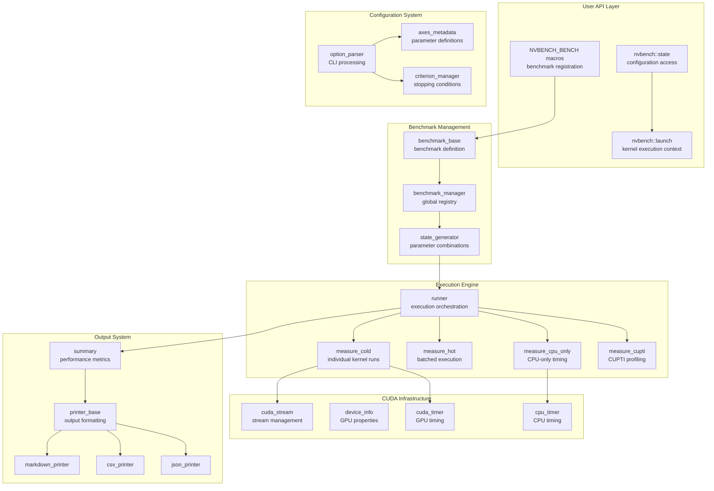
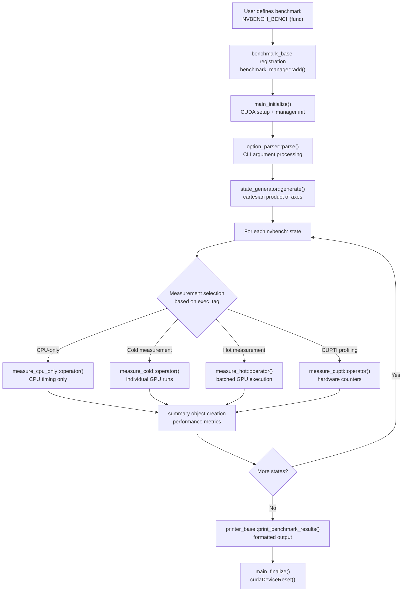
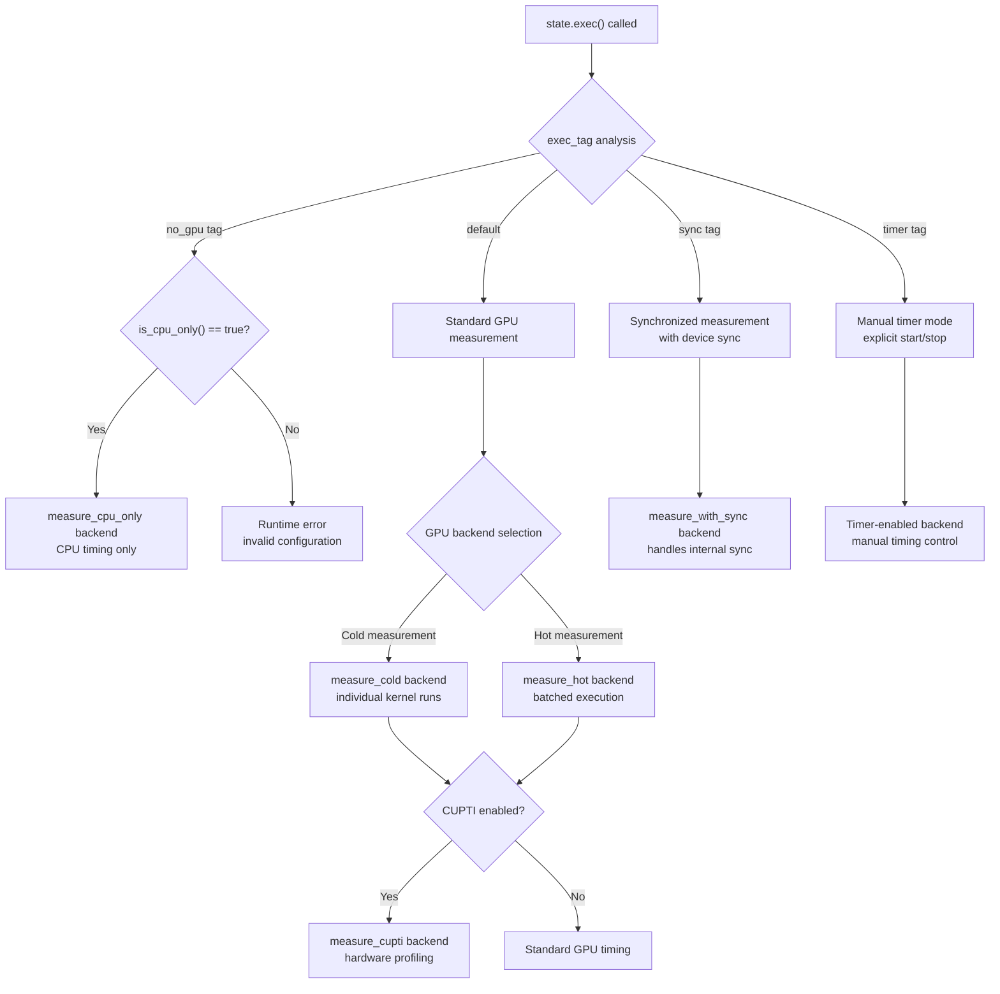

<!-- source: DeepWiki mcp.deepwiki.com · repo NVIDIA/nvbench · page 1 Overview · fetched 2026-10-26 -->

# Overview

<details>
<summary>Relevant source files</summary>

The following files were used as context for generating this wiki page:

- [README.md](README.md)
- [docs/benchmarks.md](docs/benchmarks.md)
- [examples/CMakeLists.txt](examples/CMakeLists.txt)
- [examples/cpu_only.cu](examples/cpu_only.cu)
- [examples/summaries.cu](examples/summaries.cu)
- [nvbench/detail/measure_cpu_only.cuh](nvbench/detail/measure_cpu_only.cuh)
- [nvbench/detail/measure_cpu_only.cxx](nvbench/detail/measure_cpu_only.cxx)
- [nvbench/main.cuh](nvbench/main.cuh)
- [nvbench/nvbench.cuh](nvbench/nvbench.cuh)

</details>


This document provides a high-level overview of NVBench, a C++17 CUDA benchmarking framework designed to simplify GPU kernel performance measurement and analysis. It covers the system's architecture, core components, and primary workflows. For detailed information about creating benchmarks, see [Getting Started](#2). For specific measurement strategies and execution details, see [Measurement Systems](#3.2).

NVBench enables developers to create comprehensive benchmarks with parameter sweeps, multiple measurement strategies, and rich output formatting. The framework handles the complexities of GPU timing, statistical analysis, and result presentation while providing a simple API for benchmark definition.

## System Architecture

The NVBench framework consists of several interconnected subsystems that work together to provide comprehensive CUDA benchmarking capabilities:

**NVBench Core Architecture**


Sources: [nvbench/nvbench.cuh:1-40](), [nvbench/main.cuh:1-254](), [README.md:1-186]()

## Core Benchmarking Workflow

The benchmarking process follows a well-defined sequence from benchmark definition through result output:

**Benchmark Execution Flow**


Sources: [nvbench/main.cuh:112-156](), [nvbench/detail/measure_cpu_only.cuh:88-142](), [docs/benchmarks.md:1-516]()

## Key Components

### Benchmark Definition and Registration

The `benchmark_base` class serves as the foundation for all benchmarks, storing configuration data and parameter axes. The `benchmark_manager` maintains a global registry of all benchmarks defined using the `NVBENCH_BENCH` macro system.

| Component | Role | Key Methods |
|-----------|------|-------------|
| `benchmark_base` | Benchmark definition storage | `run()`, `get_config_count()`, `set_name()` |
| `benchmark_manager` | Global benchmark registry | `initialize()`, `get()` (singleton) |
| `NVBENCH_BENCH` | Benchmark registration macro | Creates and registers benchmark instances |

### State Management and Configuration

The `nvbench::state` object provides runtime access to benchmark parameters and execution context. The `state_generator` creates all possible parameter combinations from defined axes.

| Component | Role | Key Methods |
|-----------|------|-------------|
| `nvbench::state` | Runtime parameter access | `get_int64()`, `get_float64()`, `get_string()`, `exec()` |
| `state_generator` | Parameter combination generation | Generates cartesian product of all axes |
| `axes_metadata` | Parameter axis definitions | Stores axis names, values, and types |

### Measurement Backends

NVBench provides multiple measurement strategies optimized for different use cases:

| Backend | Purpose | Implementation |
|---------|---------|----------------|
| `measure_cold` | Individual GPU kernel runs | Clean L2 cache between runs |
| `measure_hot` | Batched GPU execution | Multiple back-to-back runs |
| `measure_cpu_only` | CPU-only workloads | Host-side timing only |
| `measure_cupti` | Hardware profiling | CUPTI-based metrics collection |

Sources: [nvbench/detail/measure_cpu_only.cuh:40-142](), [README.md:21-31](), [docs/benchmarks.md:417-451]()

## Measurement Strategy Selection

NVBench automatically selects the appropriate measurement backend based on execution tags and benchmark configuration:

**Measurement Backend Selection**


Sources: [docs/benchmarks.md:308-341](), [docs/benchmarks.md:361-401](), [examples/cpu_only.cu:1-84]()

## Usage Patterns

### Basic Benchmark Definition

```cpp
void my_benchmark(nvbench::state& state) {
  state.exec([](nvbench::launch& launch) {
    my_kernel<<<blocks, threads, 0, launch.get_stream()>>>();
  });
}
NVBENCH_BENCH(my_benchmark);
```

### Parameter Sweeps

```cpp
NVBENCH_BENCH(benchmark)
  .add_int64_axis("NumInputs", {16, 64, 256, 1024})
  .add_float64_axis("Quality", {0.5, 0.75, 1.0});
```

### Advanced Execution Control

```cpp
state.exec(nvbench::exec_tag::sync | nvbench::exec_tag::timer,
           [](nvbench::launch& launch, auto& timer) {
             timer.start();
             /* timed region */
             timer.stop();
           });
```

Sources: [docs/benchmarks.md:1-56](), [docs/benchmarks.md:88-125](), [docs/benchmarks.md:332-338](), [examples/summaries.cu:26-74]()

This architecture enables NVBench to provide comprehensive CUDA benchmarking capabilities while maintaining a simple user interface and handling the complexities of GPU performance measurement automatically.

---

