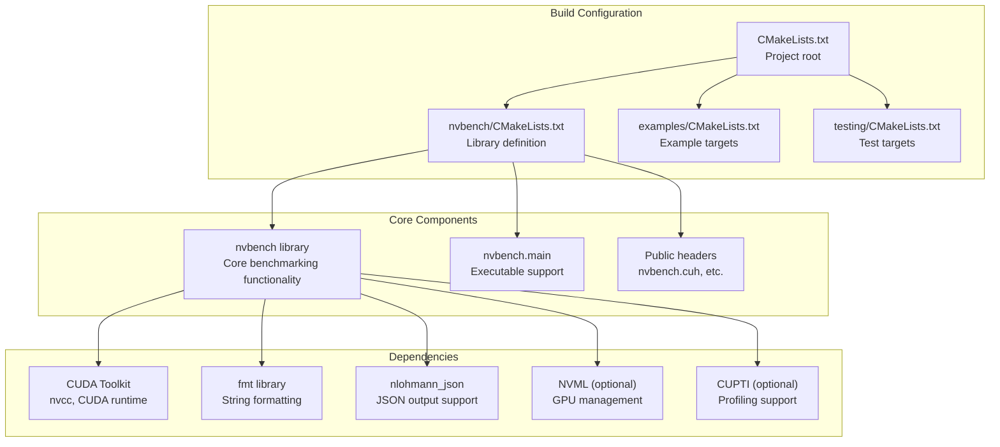
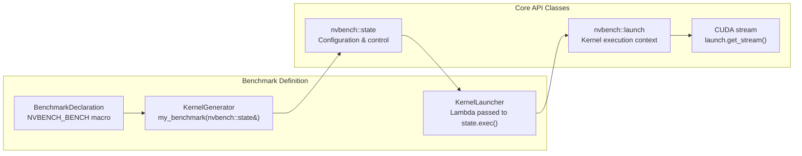
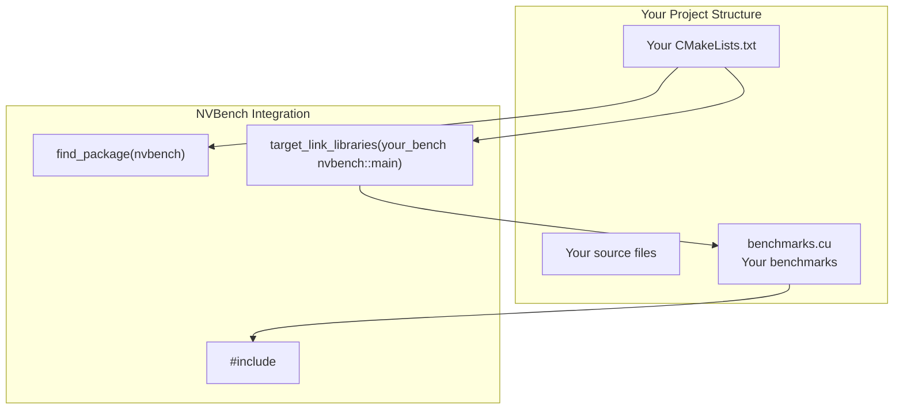
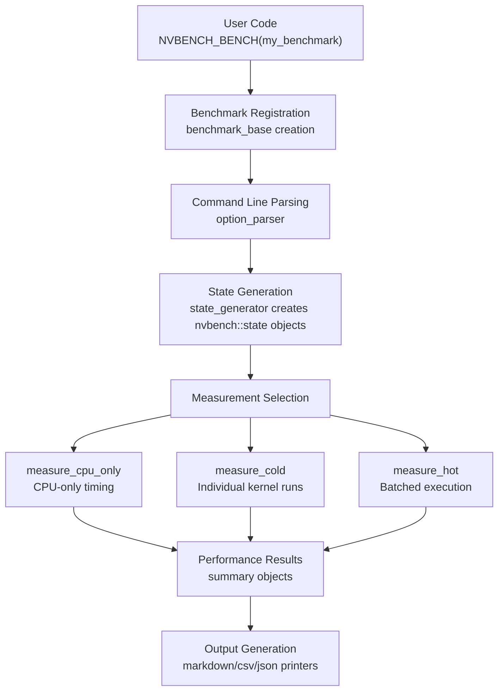

<!-- source: DeepWiki mcp.deepwiki.com · repo NVIDIA/nvbench · page 2 Getting Started · fetched 2026-10-26 -->

# Getting Started

<details>
<summary>Relevant source files</summary>

The following files were used as context for generating this wiki page:

- [CMakeLists.txt](CMakeLists.txt)
- [README.md](README.md)
- [docs/benchmarks.md](docs/benchmarks.md)
- [examples/CMakeLists.txt](examples/CMakeLists.txt)
- [examples/cpu_only.cu](examples/cpu_only.cu)
- [examples/summaries.cu](examples/summaries.cu)
- [nvbench/CMakeLists.txt](nvbench/CMakeLists.txt)
- [nvbench/detail/measure_cpu_only.cuh](nvbench/detail/measure_cpu_only.cuh)
- [nvbench/detail/measure_cpu_only.cxx](nvbench/detail/measure_cpu_only.cxx)
- [testing/CMakeLists.txt](testing/CMakeLists.txt)

</details>


This document provides essential information for installing NVBench, creating your first benchmarks, and understanding the basic workflow. It covers installation, dependencies, minimal benchmark examples, and command-line usage.

For detailed information about benchmark configuration and parameter sweeps, see [Basic Usage and Examples](#2.2). For comprehensive CLI options, see [Command Line Interface](#2.3). For advanced architectural details, see [Core Architecture](#3).

## Installation and Build System

NVBench uses CMake as its build system and requires CUDA for GPU benchmarking functionality. The framework is designed to integrate easily with existing CUDA projects.

### Build System Overview



**Sources:** [CMakeLists.txt:1-85](), [nvbench/CMakeLists.txt:1-151](), [examples/CMakeLists.txt:1-55](), [testing/CMakeLists.txt:1-60]()

### Required Dependencies

| Component | Version Requirement | Purpose |
|-----------|-------------------|---------|
| CMake | > 3.30.4 | Build system |
| CUDA Toolkit + nvcc | 12.0+ | GPU compilation and runtime |
| C++ Compiler | g++ 7-14, clang++ 14-19 | Host code compilation |
| C++ Standard | C++17 | Language features |

**Sources:** [README.md:35-41](), [CMakeLists.txt:2-6]()

### Basic Installation

```bash
mkdir -p build
cd build
cmake -DNVBench_ENABLE_EXAMPLES=ON -DCMAKE_CUDA_ARCHITECTURES=70 .. && make
```

Key CMake options:
- `NVBench_ENABLE_EXAMPLES`: Build example benchmarks
- `NVBench_ENABLE_TESTING`: Build test suite  
- `CMAKE_CUDA_ARCHITECTURES`: Target GPU architecture
- `BUILD_SHARED_LIBS`: Build as shared library (default: ON)

**Sources:** [README.md:85-94](), [CMakeLists.txt:36-48]()

## Minimal Benchmark Creation

### Basic Benchmark Structure



**Sources:** [docs/benchmarks.md:14-29](), [README.md:49-56]()

### Minimal Example

The simplest benchmark requires three components: a generator function, a launcher lambda, and a registration macro.

```cpp
void my_benchmark(nvbench::state& state) {
  state.exec([](nvbench::launch& launch) {
    my_kernel<<<num_blocks, 256, 0, launch.get_stream()>>>();
  });
}
NVBENCH_BENCH(my_benchmark);
```

Key components:
- **KernelGenerator**: `my_benchmark` function receives `nvbench::state&`
- **KernelLauncher**: Lambda passed to `state.exec()` 
- **BenchmarkDeclaration**: `NVBENCH_BENCH` macro registers the benchmark

**Sources:** [README.md:49-56](), [docs/benchmarks.md:5-12]()

### Integration with Existing Projects



**Sources:** [examples/CMakeLists.txt:26-30]()

## Command Line Interface

### Basic Execution

Built benchmarks provide extensive runtime configuration through command-line options.

```bash
# Run all benchmarks
./nvbench.example.throughput

# Run with specific device
./nvbench.example.throughput -d 0

# Limit execution time
./nvbench.example.throughput --timeout 10.0

# Change output format
./nvbench.example.throughput --csv output.csv
```

### Core CLI Options

| Option | Purpose | Example |
|--------|---------|---------|
| `-d, --device` | Select CUDA device | `-d 0` |
| `--timeout` | Maximum benchmark time | `--timeout 60.0` |
| `--csv` | CSV output | `--csv results.csv` |
| `--json` | JSON output | `--json results.json` |
| `--run-once` | Single execution | `--run-once` |

**Sources:** [README.md:61-67]()

## Basic Benchmark Workflow  

### Execution Flow



**Sources:** [nvbench/CMakeLists.txt:1-36](), [nvbench/detail/measure_cpu_only.cxx:35-50]()

### Key API Classes and Their Roles

| Class | Purpose | Key Methods |
|-------|---------|-------------|
| `nvbench::state` | Benchmark configuration and execution control | `exec()`, `get_int64()`, `add_summary()` |
| `nvbench::launch` | Kernel launch context | `get_stream()` |
| `benchmark_base` | Benchmark definition and metadata | Created by `NVBENCH_BENCH` |
| `option_parser` | Command-line argument processing | Handles CLI flags |
| `state_generator` | Creates benchmark configurations | Generates parameter combinations |

**Sources:** [nvbench/state.cxx:20-25](), [nvbench/option_parser.cu:16-20](), [nvbench/benchmark_base.cxx:4-10]()

## Quick Start Examples

### Simple Parameter Sweep

```cpp
void size_sweep(nvbench::state& state) {
  const auto size = state.get_int64("Size");
  
  state.exec([size](nvbench::launch& launch) {
    my_kernel<<<(size + 255) / 256, 256, 0, launch.get_stream()>>>(size);
  });
}
NVBENCH_BENCH(size_sweep)
  .add_int64_axis("Size", {1024, 4096, 16384, 65536});
```

### CPU-Only Benchmark

```cpp
void cpu_work(nvbench::state& state) {
  state.exec([](nvbench::launch&) {
    // CPU-only work here
    std::this_thread::sleep_for(std::chrono::milliseconds(10));
  });
}
NVBENCH_BENCH(cpu_work)
  .set_is_cpu_only(true);
```

**Sources:** [examples/cpu_only.cu:33-43](), [docs/benchmarks.md:95-104]()

### Building and Running Examples

The repository provides comprehensive examples demonstrating various NVBench features:

- **axes.cu**: Parameter sweeps and axis configuration
- **throughput.cu**: Performance metrics calculation  
- **cpu_only.cu**: Host-only benchmarking
- **exec_tag_*.cu**: Special execution modes

Build examples with:
```bash
cmake -DNVBench_ENABLE_EXAMPLES=ON .. && make
```

Examples are built to `build/bin` with prefix `nvbench.example.*`.

**Sources:** [examples/CMakeLists.txt:1-13](), [README.md:69-94]()

---

