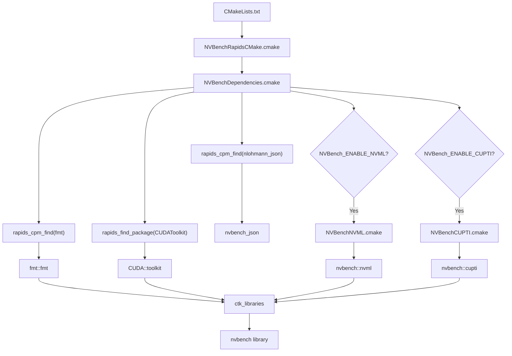
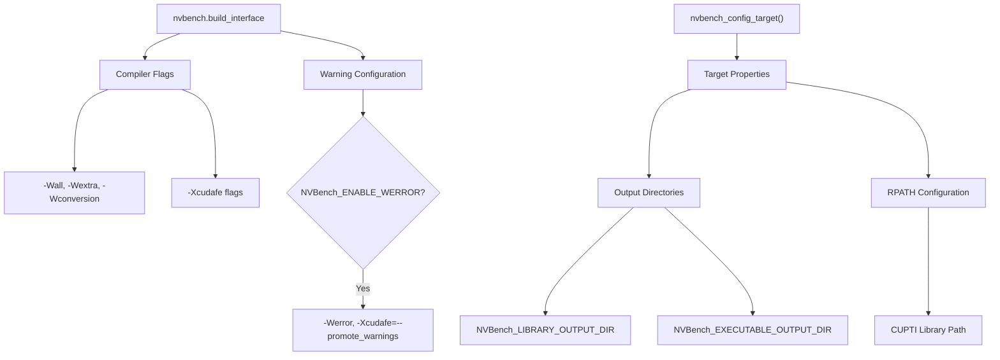
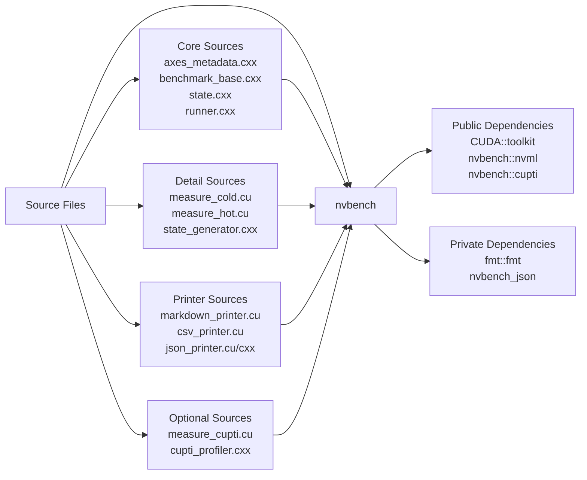
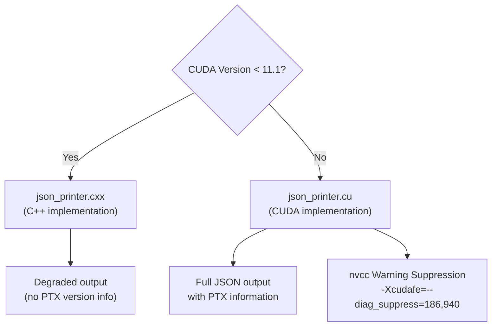
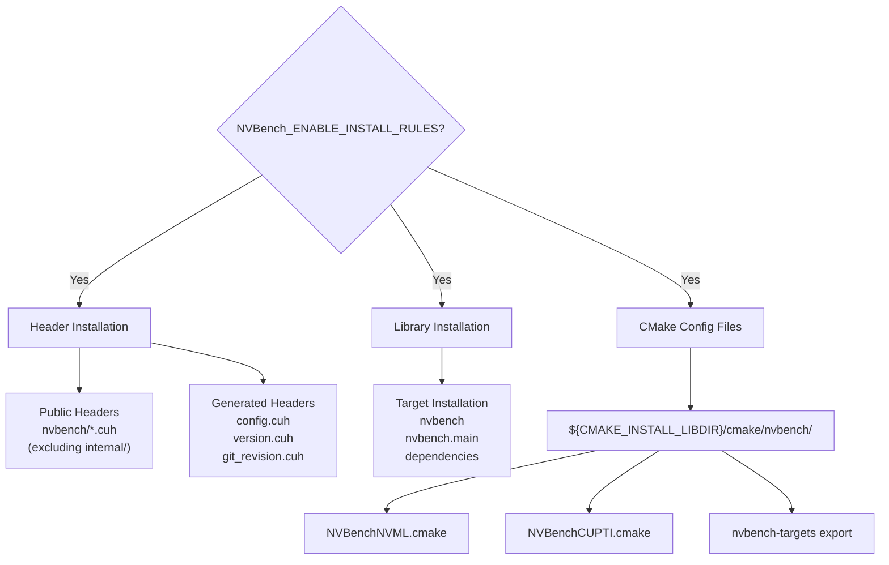

<!-- source: DeepWiki mcp.deepwiki.com · repo NVIDIA/nvbench · page 2.1 Installation and Build System · fetched 2026-10-26 -->

# Installation and Build System

Relevant source files

The following files were used as context for generating this wiki page:

- [CMakeLists.txt](CMakeLists.txt)
- [cmake/NVBenchConfigTarget.cmake](cmake/NVBenchConfigTarget.cmake)
- [cmake/NVBenchDependencies.cmake](cmake/NVBenchDependencies.cmake)
- [cmake/NVBenchExports.cmake](cmake/NVBenchExports.cmake)
- [cmake/NVBenchInstallRules.cmake](cmake/NVBenchInstallRules.cmake)
- [cmake/NVBenchRapidsCMake.cmake](cmake/NVBenchRapidsCMake.cmake)
- [cmake/RAPIDS.cmake](cmake/RAPIDS.cmake)
- [examples/auto_throughput.cu](examples/auto_throughput.cu)
- [nvbench/CMakeLists.txt](nvbench/CMakeLists.txt)
- [nvbench/git_revision.cuh](nvbench/git_revision.cuh)
- [nvbench/version.cuh](nvbench/version.cuh)
- [testing/CMakeLists.txt](testing/CMakeLists.txt)

This document covers NVBench's CMake-based build system, including dependencies, configuration options, and installation procedures. It explains how to build NVBench from source and integrate it into other projects.

For information about using NVBench after installation, see [Basic Usage and Examples](#2.2). For advanced build system customization and development workflows, see [Build System Deep Dive](#7.1).

## Build Requirements and Dependencies

NVBench requires CMake 3.30.4 or later and follows C++17/CUDA 17 standards. The build system leverages rapids-cmake for standardized dependency management and configuration.

### Core Dependencies

| Dependency | Version | Purpose | Required |
|------------|---------|---------|----------|
| CUDAToolkit | Any supported | GPU benchmarking and device management | Yes |
| fmt | 11.2.0+ | String formatting and output | Yes |
| nlohmann_json | 3.12.0+ | JSON output format support | Yes |

### Optional Dependencies

| Dependency | Default | Purpose | CMake Option |
|------------|---------|---------|--------------|
| NVML | ON | GPU management and frequency control | `NVBench_ENABLE_NVML` |
| CUPTI | ON (CUDA 11.3+) | Hardware performance counters | `NVBench_ENABLE_CUPTI` |

Sources: [CMakeLists.txt:30-35](), [cmake/NVBenchDependencies.cmake:11-24,36-46,62-82]()

## CMake Configuration Options

The build system provides extensive configuration through CMake options:

### Library Configuration
- `BUILD_SHARED_LIBS=ON` - Build NVBench as shared library
- `NVBench_ENABLE_NVML=ON` - Include NVML support for GPU management
- `NVBench_ENABLE_CUPTI=ON/OFF` - Include CUPTI profiling (auto-detected based on CUDA version)

### Development and Testing
- `NVBench_ENABLE_TESTING=OFF` - Build test suite
- `NVBench_ENABLE_HEADER_TESTING=OFF` - Test header compilation
- `NVBench_ENABLE_DEVICE_TESTING=OFF` - Include GPU-dependent tests
- `NVBench_ENABLE_EXAMPLES=OFF` - Build example benchmarks
- `NVBench_ENABLE_WERROR=ON` - Treat warnings as errors (top-level projects only)

### Installation
- `NVBench_ENABLE_INSTALL_RULES=ON/OFF` - Generate installation rules (auto-detected)

Sources: [CMakeLists.txt:36-48](), [cmake/NVBenchConfigTarget.cmake:3-6]()

## Build System Architecture

### Dependency Management Flow

Sources: [cmake/NVBenchDependencies.cmake:1-83](), [CMakeLists.txt:14-22]()

### Target Configuration System

Sources: [cmake/NVBenchConfigTarget.cmake:15-91]()

## Build Targets and Libraries

### Primary Libraries

The build system creates several key targets:

#### nvbench Library
The main library target containing core benchmarking functionality:

#### nvbench.main Object Library
Provides main function implementation for executable benchmarks:

- Target: `nvbench.main`
- Source: [nvbench/main.cu]()
- Links to: `nvbench` library
- Export name: `main`

Sources: [nvbench/CMakeLists.txt:1-53,72-86,112-117]()

### Special Compilation Handling

The build system includes several workarounds for compiler compatibility:

#### JSON Printer Compilation
CUDA 11.0 cannot compile the JSON printer as CUDA code, requiring fallback to C++:

Sources: [nvbench/CMakeLists.txt:42-53,125-134]()

## Installation Process

### Installation Components

### Generated Files

The build system generates several configuration files:

| File | Purpose | Location |
|------|---------|----------|
| `config.cuh` | Build configuration | `${NVBench_BINARY_DIR}/nvbench/` |
| `version.cuh` | Version information | `${NVBench_BINARY_DIR}/nvbench/detail/` |
| `git_revision.cuh` | Git revision info | `${NVBench_BINARY_DIR}/nvbench/detail/` |
| CLI help headers | Command-line documentation | `${NVBench_BINARY_DIR}/nvbench/internal/` |

Sources: [cmake/NVBenchInstallRules.cmake:1-70](), [nvbench/CMakeLists.txt:56-70,139-144]()

## Export Configuration

The build system supports both build-tree and install-tree usage through rapids-cmake export mechanisms:

### Export Targets
- Main targets: `nvbench`, `main`, `ctl`, `internal_build_interface`
- Namespace: `nvbench::`
- Languages: CUDA, CXX
- Export set: `nvbench-targets`

### Conditional Exports
Optional dependencies are included in exports when enabled:
- NVML support: includes `NVBenchNVML.cmake`
- CUPTI support: includes `NVBenchCUPTI.cmake`
- JSON support: configures `nvbench_json` target

Sources: [cmake/NVBenchExports.cmake:1-51]()

---

