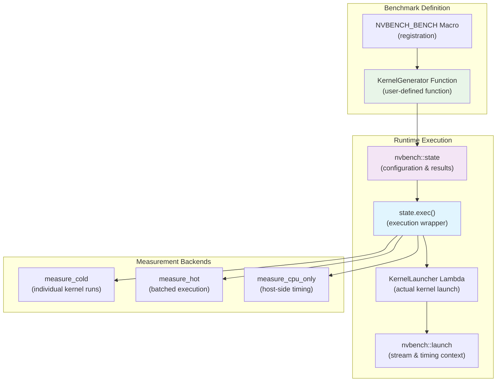
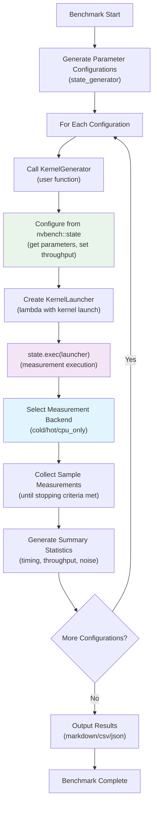
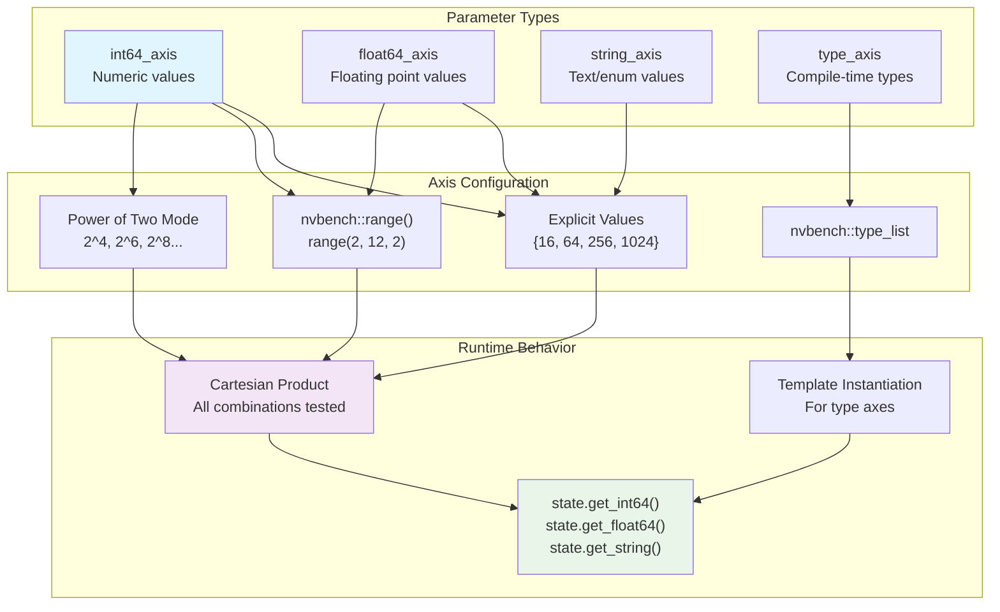
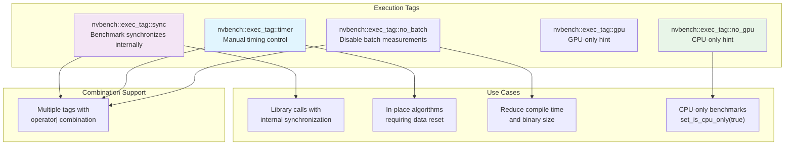
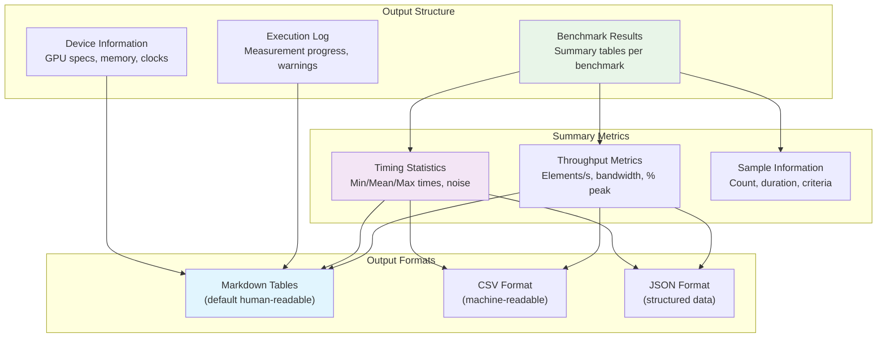

<!-- source: DeepWiki mcp.deepwiki.com · repo NVIDIA/nvbench · page 2.2 Basic Usage and Examples · fetched 2026-10-26 -->

# Basic Usage and Examples

<details>
<summary>Relevant source files</summary>

The following files were used as context for generating this wiki page:

- [README.md](README.md)
- [docs/benchmarks.md](docs/benchmarks.md)
- [examples/CMakeLists.txt](examples/CMakeLists.txt)
- [examples/cpu_only.cu](examples/cpu_only.cu)
- [examples/custom_criterion.cu](examples/custom_criterion.cu)
- [examples/summaries.cu](examples/summaries.cu)
- [nvbench/criterion_manager.cuh](nvbench/criterion_manager.cuh)
- [nvbench/criterion_manager.cxx](nvbench/criterion_manager.cxx)
- [nvbench/detail/measure_cpu_only.cuh](nvbench/detail/measure_cpu_only.cuh)
- [nvbench/detail/measure_cpu_only.cxx](nvbench/detail/measure_cpu_only.cxx)
- [testing/criterion_manager.cu](testing/criterion_manager.cu)

</details>


This page provides a comprehensive guide to creating and running basic benchmarks with NVBench. It covers the fundamental concepts, core workflow, and practical examples needed to get started with CUDA kernel benchmarking. For advanced configuration options and stopping criteria, see [Advanced Features](#6). For detailed CLI reference, see [Command Line Interface](#2.3).

## Core Concepts and Workflow

NVBench operates around three main components that work together to execute benchmarks:



**Benchmark Execution Flow**

Sources: [docs/benchmarks.md:1-30](), [README.md:45-56]()

The execution flow follows a consistent pattern where the `KernelGenerator` configures benchmark parameters from the `nvbench::state`, creates a `KernelLauncher` lambda that launches the actual kernel, and passes it to `state.exec()` for measurement.



Sources: [nvbench/state.cuh](), [nvbench/benchmark_base.cuh](), [docs/benchmarks.md:14-30]()

## Minimal Benchmark

The simplest benchmark requires just a few lines of code:

```cpp
void my_benchmark(nvbench::state& state) {
  state.exec([](nvbench::launch& launch) {
    my_kernel<<<num_blocks, 256, 0, launch.get_stream()>>>();
  });
}
NVBENCH_BENCH(my_benchmark);
```

This minimal example demonstrates the three core components:

- **KernelGenerator**: `my_benchmark()` function that receives an `nvbench::state` object
- **KernelLauncher**: Lambda passed to `state.exec()` that launches the kernel  
- **BenchmarkDeclaration**: `NVBENCH_BENCH` macro that registers the benchmark

The `nvbench::launch` object provides the CUDA stream via `launch.get_stream()` that should be used for all kernel launches to ensure proper timing measurement.

Sources: [README.md:49-56](), [docs/benchmarks.md:5-12]()

## Parameter Axes and Sweeps

NVBench supports four types of parameter axes to explore different kernel configurations:



Sources: [docs/benchmarks.md:74-125](), [docs/benchmarks.md:166-200]()

### Int64 Axes Example

```cpp
void benchmark(nvbench::state& state)
{
  const auto num_inputs = state.get_int64("NumInputs");
  thrust::device_vector<int> data = generate_input(num_inputs);

  state.exec([&data](nvbench::launch& launch) {
    my_kernel<<<blocks, threads, 0, launch.get_stream()>>>(data.begin(), data.end());
  });
}
NVBENCH_BENCH(benchmark).add_int64_axis("NumInputs", {16, 64, 256, 1024, 4096});
```

The `nvbench::range(start, end, stride)` helper simplifies creating numeric sequences:

```cpp
// These are equivalent:
.add_int64_axis("Size", {2, 4, 6, 8, 10, 12})
.add_int64_axis("Size", nvbench::range(2, 12, 2))

// Power-of-two mode for common patterns:
.add_int64_power_of_two_axis("NumInputs", {4, 6, 8, 10, 12})  // 2^4, 2^6, 2^8, 2^10, 2^12
```

Sources: [docs/benchmarks.md:88-125](), [examples/axes.cu]()

### Type Axes Example

Type axes enable compile-time parameter sweeps for templated kernels:

```cpp
template <typename T>
void my_benchmark(nvbench::state& state, nvbench::type_list<T>)
{
  thrust::device_vector<T> data = generate_input<T>();

  state.exec([&data](nvbench::launch& launch) {
    my_kernel<<<blocks, threads, 0, launch.get_stream()>>>(data.begin(), data.end());
  });
}
using my_types = nvbench::type_list<int, float, double>;
NVBENCH_BENCH_TYPES(my_benchmark, NVBENCH_TYPE_AXES(my_types))
  .set_type_axes_names({"ValueType"});
```

Sources: [docs/benchmarks.md:166-200](), [examples/enums.cu]()

## Throughput Measurements

NVBench can calculate and report throughput metrics automatically when provided with element counts and memory access patterns:

```cpp
void throughput_benchmark(nvbench::state& state)
{
  const auto num_elements = state.get_int64("NumElements");
  
  // Configure throughput calculations:
  state.add_element_count(num_elements);
  state.add_global_memory_reads<InputType>(num_elements);
  state.add_global_memory_writes<OutputType>(num_elements);

  state.exec([=](nvbench::launch& launch) {
    copy_kernel<<<blocks, threads, 0, launch.get_stream()>>>(input_ptr, output_ptr, num_elements);
  });
}
```

This configuration enables NVBench to report:
- Elements processed per second  
- Global memory bandwidth usage (bytes/second)
- Percentage of device peak bandwidth utilized

Sources: [docs/benchmarks.md:244-267](), [examples/throughput.cu]()

## Execution Tags and Special Cases

NVBench provides execution tags to handle special benchmark requirements:



Sources: [docs/benchmarks.md:308-341](), [docs/benchmarks.md:417-474]()

### Manual Timer Mode

For kernels that modify input data and require reset between runs:

```cpp
void timer_example(nvbench::state& state)
{
  state.exec(nvbench::exec_tag::timer,
    [](nvbench::launch& launch, auto& timer) {
      // Reset/setup code here (not timed)
      
      timer.start();
      my_kernel<<<blocks, threads, 0, launch.get_stream()>>>();
      timer.stop();
      
      // Cleanup code here (not timed)  
    });
}
```

Sources: [docs/benchmarks.md:361-401](), [examples/exec_tag_timer.cu]()

### CPU-Only Benchmarks

For benchmarking host-side code without GPU involvement:

```cpp
void cpu_benchmark(nvbench::state& state)
{
  const auto duration = state.get_float64("Duration");
  
  state.exec(nvbench::exec_tag::no_gpu, [duration](nvbench::launch&) {
    // CPU workload here
    perform_cpu_work(duration);
  });
}
NVBENCH_BENCH(cpu_benchmark)
  .add_float64_axis("Duration", nvbench::range(0.1, 0.5, 0.1))
  .set_is_cpu_only(true);
```

Sources: [docs/benchmarks.md:417-474](), [examples/cpu_only.cu]()

## Running Benchmarks

Once compiled, benchmark executables provide extensive command-line configuration options. Basic execution requires no arguments:

```bash
./my_benchmark
```

Common CLI options include:

```bash
# Run specific benchmark configurations
./my_benchmark --benchmark "my_benchmark" --axis NumInputs=1024

# Change output format  
./my_benchmark --csv output.csv
./my_benchmark --json results.json

# Control measurement duration
./my_benchmark --timeout 30 --min-time 0.01

# Select specific GPU devices
./my_benchmark --devices 0,1
```

The framework automatically selects appropriate measurement backends (cold vs hot vs cpu_only) based on benchmark characteristics and execution tags.

Sources: [README.md:61-67](), [docs/cli_help.md]()

## Understanding Output

NVBench generates comprehensive output including device information, measurement logs, and summary tables:



Sources: [README.md:95-132](), [nvbench/detail/measure_cpu_only.cxx:117-270]()

Example output shows device specs, measurement progress, and tabulated results with timing statistics, throughput calculations, and noise analysis for each parameter configuration tested.

Sources: [README.md:98-131](), [examples/custom_criterion.cu:77]()

---

