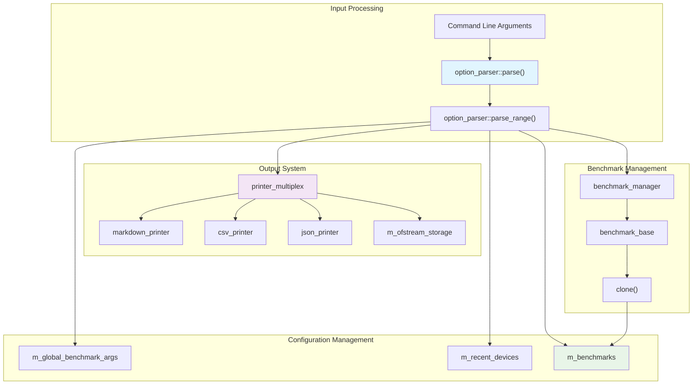
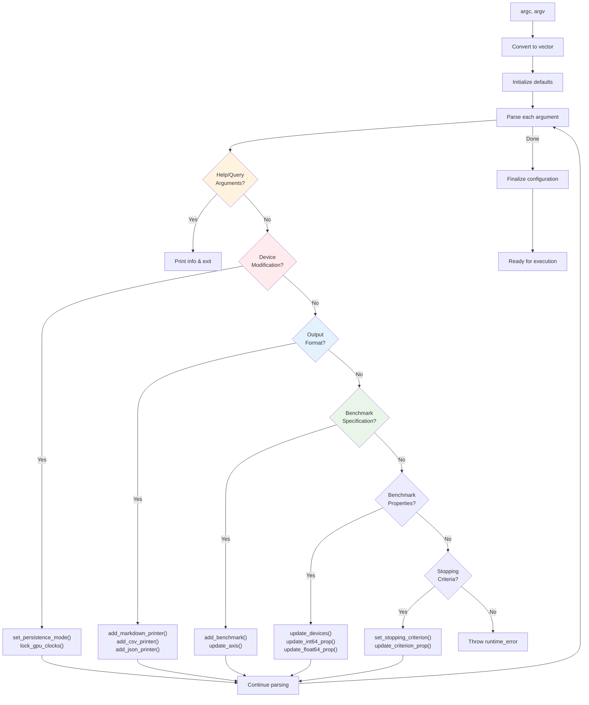
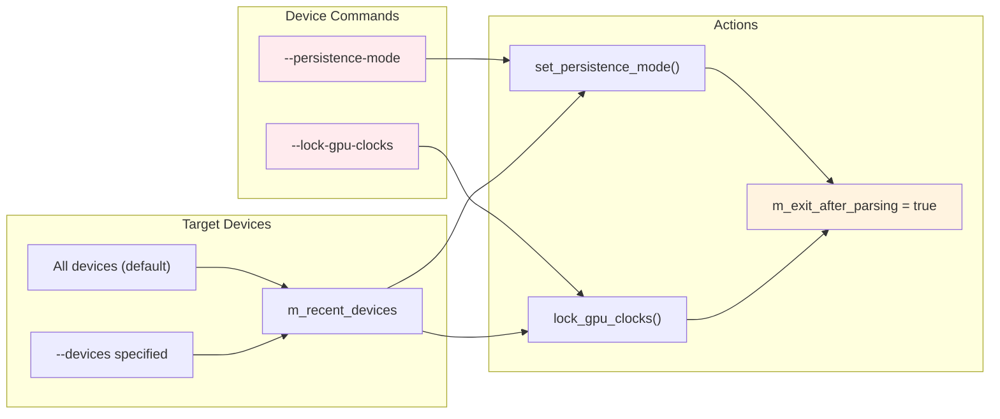
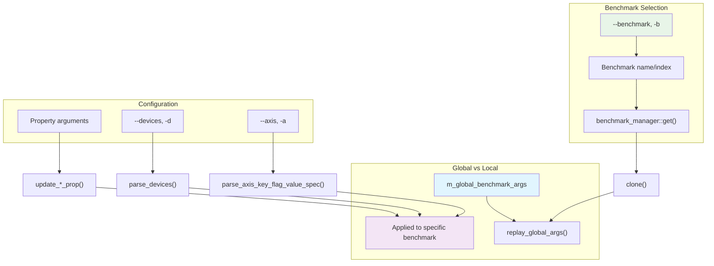
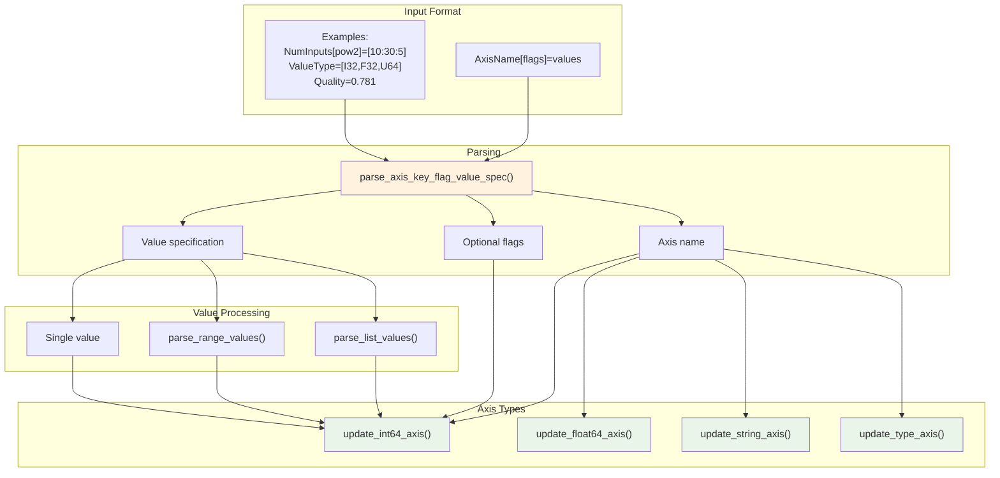
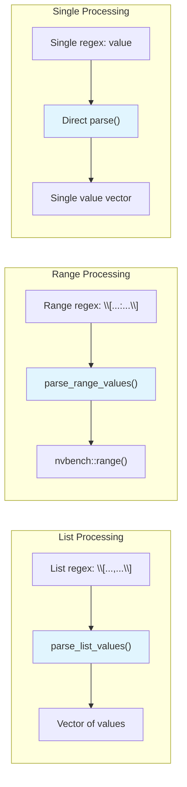
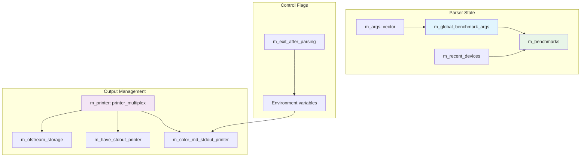
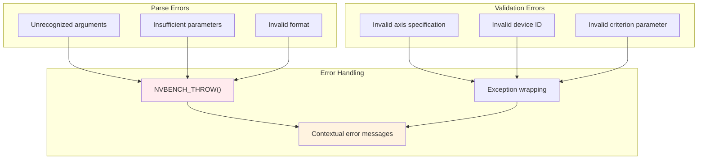

<!-- source: DeepWiki mcp.deepwiki.com · repo NVIDIA/nvbench · page 2.3 Command Line Interface · fetched 2026-10-26 -->

# Command Line Interface

Relevant source files

The following files were used as context for generating this wiki page:

- [docs/cli_help.md](docs/cli_help.md)
- [nvbench/benchmark_base.cxx](nvbench/benchmark_base.cxx)
- [nvbench/option_parser.cu](nvbench/option_parser.cu)
- [nvbench/option_parser.cuh](nvbench/option_parser.cuh)
- [nvbench/state.cxx](nvbench/state.cxx)

The Command Line Interface (CLI) system provides comprehensive control over NVBench benchmark execution, configuration, and output formatting. This system parses command-line arguments and converts them into benchmark configurations, device settings, and output specifications.

For information about benchmark definition and internal state management, see [Benchmark Definition and State Management](#3.1). For details about output formats and analysis tools, see [Output Formats and Printers](#5.1).

## Architecture Overview

The CLI system is built around the `option_parser` class, which serves as the central coordinator for processing command-line arguments and configuring the benchmarking system.

### CLI System Architecture

Sources: [nvbench/option_parser.cu:43-149](), [nvbench/option_parser.cuh:40-149]()

### Argument Processing Flow

Sources: [nvbench/option_parser.cu:383-571](), [nvbench/option_parser.cu:341-380]()

## Command Categories

The CLI system organizes commands into several functional categories, each handled by specific parsing logic.

### Query Commands

| Command | Function | Implementation |
|---------|----------|----------------|
| `--help`, `-h` | Print usage information | [nvbench/option_parser.cu:411-416]() |
| `--help-axes` | Print axis documentation | [nvbench/option_parser.cu:418-421]() |
| `--version` | Print version information | [nvbench/option_parser.cu:423-426]() |
| `--list`, `-l` | List devices and benchmarks | [nvbench/option_parser.cu:428-432]() |
| `--jsonlist-benches` | JSON benchmark list | [nvbench/option_parser.cu:434-439]() |
| `--jsonlist-devices` | JSON device list | [nvbench/option_parser.cu:441-445]() |

### Device Management Commands

Sources: [nvbench/option_parser.cu:447-457](), [nvbench/option_parser.cu:664-738]()

### Output Format Commands

The system supports multiple output formats through a multiplexed printer system:

| Format | Command | Printer Type | Binary Support |
|--------|---------|--------------|----------------|
| Markdown | `--markdown`, `--md` | `markdown_printer` | No |
| CSV | `--csv` | `csv_printer` | No |
| JSON | `--json` | `json_printer` | No |
| Binary JSON | `--jsonbin` | `json_printer` | Yes |

### Benchmark Configuration Commands

Sources: [nvbench/option_parser.cu:517-521](), [nvbench/option_parser.cu:789-813](), [nvbench/option_parser.cu:815-817]()

## Axis Specification System

The axis specification system allows runtime configuration of benchmark parameters using a structured syntax.

### Axis Specification Parser

Sources: [nvbench/option_parser.cu:277-312](), [nvbench/option_parser.cu:847-909](), [nvbench/option_parser.cu:119-194]()

### Value Specification Formats

The system supports three value specification formats:

1. **List Format**: `[value1, value2, value3]`
2. **Range Format**: `[start:stop:stride]` 
3. **Single Value**: `value` or `[value]`

Sources: [nvbench/option_parser.cu:196-255](), [nvbench/option_parser.cu:147-184]()

## Configuration State Management

The `option_parser` maintains several key state components to manage benchmark configuration and global settings.

### State Components

Sources: [nvbench/option_parser.cuh:122-149](), [nvbench/option_parser.cu:348-351]()

### Global vs Local Arguments

The system distinguishes between global arguments (applied to all benchmarks) and local arguments (applied to specific benchmarks):

| Argument Type | Storage | Application |
|---------------|---------|-------------|
| Global | `m_global_benchmark_args` | Applied via `replay_global_args()` |
| Local | Direct benchmark modification | Immediate application |

Global arguments are stored when no benchmark is currently selected and replayed for each new benchmark through the `replay_global_args()` mechanism.

Sources: [nvbench/option_parser.cu:744-748](), [nvbench/option_parser.cu:815-817](), [nvbench/option_parser.cu:825-830]()

## Error Handling and Validation

The CLI system implements comprehensive error handling with detailed error messages for invalid arguments and malformed specifications.

### Error Categories

Sources: [nvbench/option_parser.cu:392-401](), [nvbench/option_parser.cu:552-568](), [nvbench/option_parser.cu:584-590]()

The error handling system provides detailed context about which argument caused the error and what values were expected, making debugging command-line issues straightforward for users.

---

