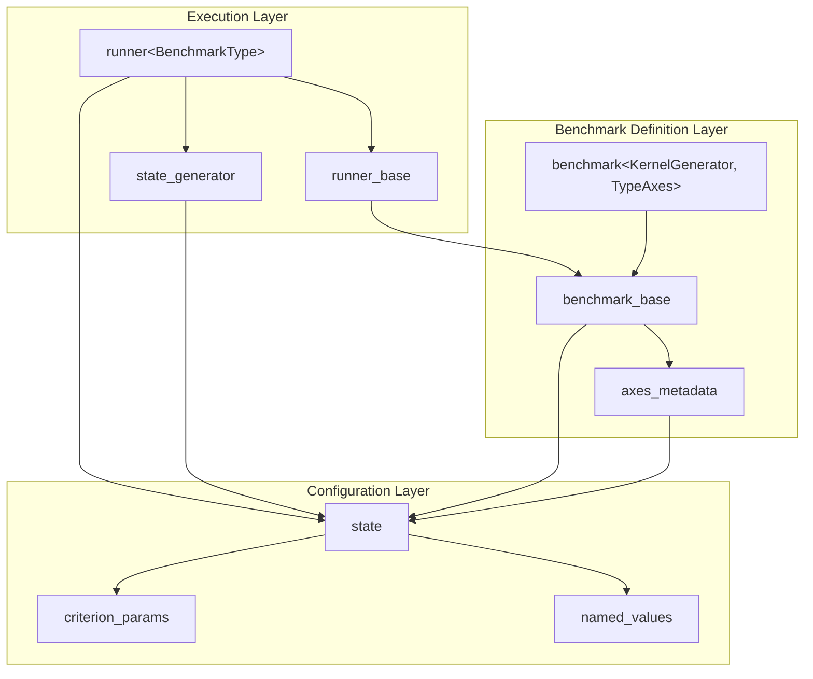
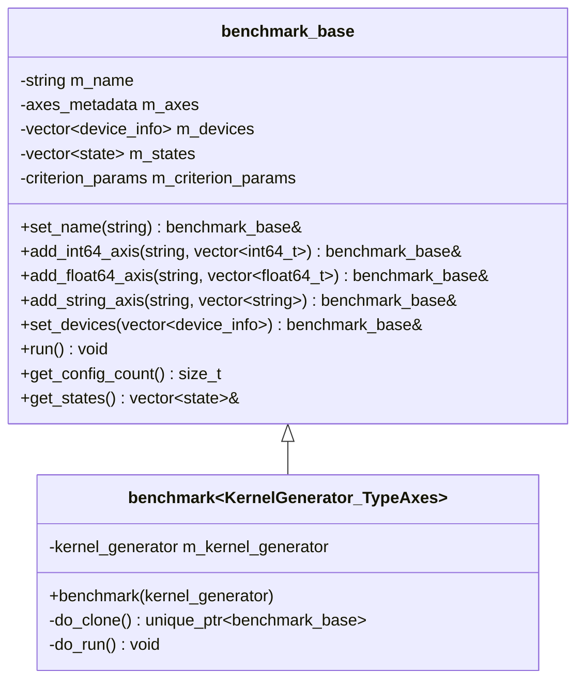
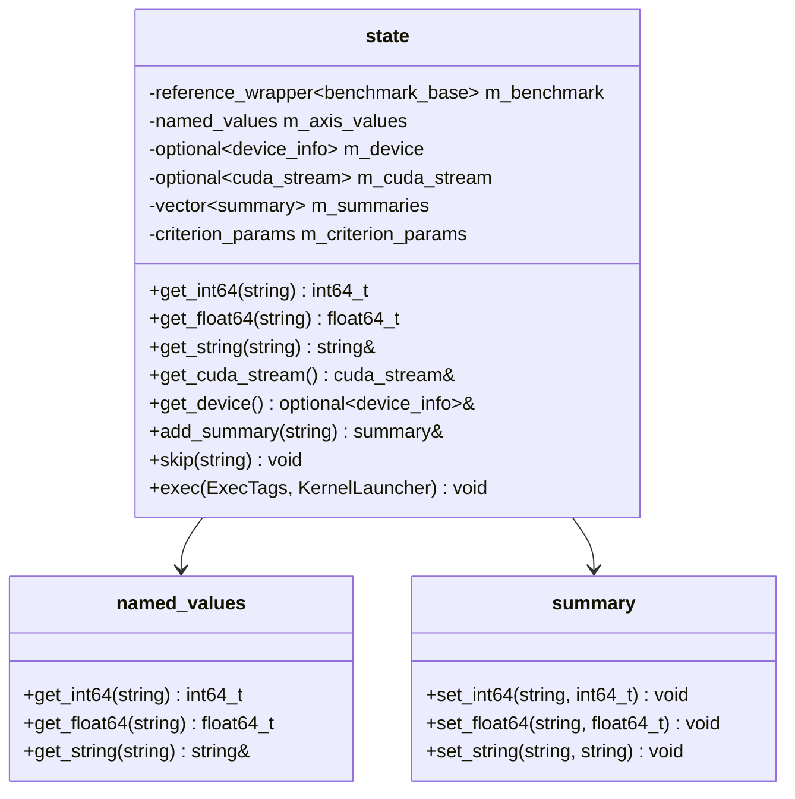
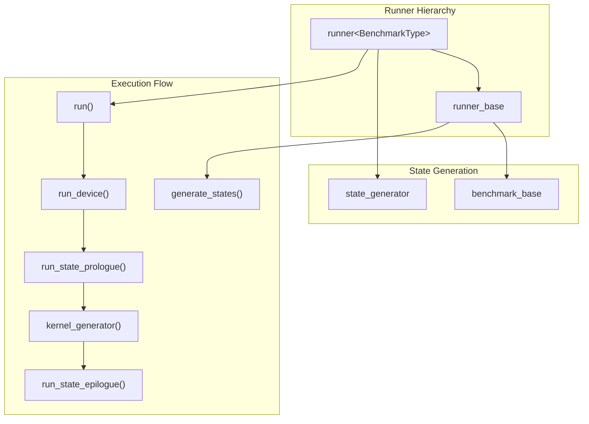
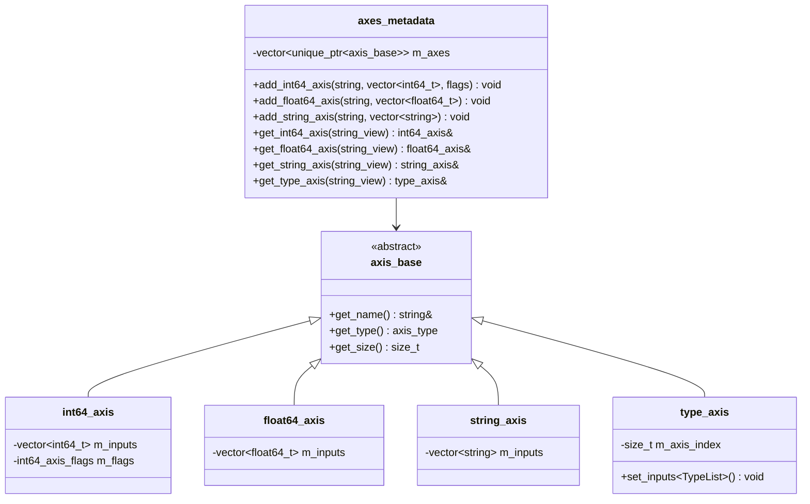

<!-- source: DeepWiki mcp.deepwiki.com · repo NVIDIA/nvbench · page 3 Core Architecture · fetched 2026-10-26 -->

# Core Architecture

<details>
<summary>Relevant source files</summary>

The following files were used as context for generating this wiki page:

- [nvbench/axes_metadata.cuh](nvbench/axes_metadata.cuh)
- [nvbench/benchmark.cuh](nvbench/benchmark.cuh)
- [nvbench/benchmark_base.cuh](nvbench/benchmark_base.cuh)
- [nvbench/runner.cuh](nvbench/runner.cuh)
- [nvbench/state.cuh](nvbench/state.cuh)

</details>


This document provides a detailed examination of NVBench's internal architecture and primary systems. It covers the fundamental components that enable benchmark definition, configuration, execution, and state management within the framework.

For information about measurement backends and timing systems, see [Measurement Systems](#3.2). For details about command-line interfaces and user-facing APIs, see [Getting Started](#2).

## Architecture Overview

NVBench's core architecture is built around four fundamental systems that work together to provide a comprehensive benchmarking framework:

1. **Benchmark Definition System** - Defines and configures benchmarks through `benchmark_base` and `benchmark` classes
2. **State Management System** - Manages individual benchmark configurations via the `state` class  
3. **Execution Orchestration** - Coordinates benchmark execution through the `runner` system
4. **Parameter Management** - Handles parameter axes and configuration through `axes_metadata`

### Core Component Relationships



*Sources: [nvbench/benchmark_base.cuh:40-47](), [nvbench/benchmark.cuh:52-57](), [nvbench/runner.cuh:31-47](), [nvbench/state.cuh:59-78]()*

## Benchmark Definition System

The benchmark definition system centers on a two-tier class hierarchy that separates template-independent functionality from type-specific operations.

### benchmark_base Class

The `benchmark_base` class serves as the foundation for all benchmarks, providing runtime configuration and non-templated functionality:



Key responsibilities of `benchmark_base` include:
- Managing benchmark metadata (name, axes, devices)
- Storing configuration parameters and stopping criteria
- Providing public API for benchmark configuration
- Managing the collection of `state` objects representing all parameter combinations

### benchmark Template Class

The `benchmark` template class extends `benchmark_base` with type-specific functionality:

**Template Parameters:**
- `KernelGenerator`: Callable object that executes the benchmark kernel
- `TypeAxes`: Type list defining compile-time parameter variations

**Key Features:**
- Implements virtual interface for type-specific operations
- Stores the kernel generator function
- Manages compile-time type configurations through `type_configs`

*Sources: [nvbench/benchmark_base.cuh:47-48](), [nvbench/benchmark.cuh:52-65](), [nvbench/benchmark_base.cuh:296-323]()*

## State Management System

The `state` class represents a single configuration instance of a benchmark, containing all parameter values and execution context for one specific test case.

### State Class Architecture



### State Responsibilities

The `state` class manages:

1. **Parameter Access**: Provides type-safe access to benchmark parameters via `get_int64()`, `get_float64()`, and `get_string()` methods
2. **Device Management**: Manages CUDA device selection and stream creation
3. **Execution Control**: Provides the `exec()` method for kernel execution with configurable execution tags
4. **Result Collection**: Manages `summary` objects containing measurement results
5. **Skip Logic**: Handles benchmark skipping with reason tracking

### Key State Features

**CUDA Integration**: The state automatically manages CUDA streams through lazy initialization:
```cpp
nvbench::cuda_stream &get_cuda_stream() {
    if (!m_cuda_stream.has_value()) {
        m_cuda_stream = nvbench::cuda_stream{m_device};
    }
    return m_cuda_stream.value();
}
```

**Performance Measurement Control**: States can be configured for specialized measurement scenarios:
- `m_is_cpu_only`: CPU-only timing mode
- `m_run_once`: Single execution for profiling tools
- `m_disable_blocking_kernel`: Disable synchronization kernel

*Sources: [nvbench/state.cuh:59-92](), [nvbench/state.cuh:284-292](), [nvbench/state.cuh:227-234]()*

## Execution Orchestration

The execution system coordinates benchmark running through a two-level runner architecture that separates template-independent coordination from type-specific execution.

### Runner System Architecture



### runner_base Responsibilities

The `runner_base` class handles template-independent execution coordination:

- **State Generation**: Calls `generate_states()` to create all parameter combinations
- **Exception Handling**: Manages benchmark execution exceptions through `handle_sampling_exception()`
- **Execution Lifecycle**: Provides `run_state_prologue()` and `run_state_epilogue()` hooks
- **Skip Notifications**: Handles skip reporting via `print_skip_notification()`

### runner Template Specialization

The `runner<BenchmarkType>` template manages type-specific execution:

**Multi-Device Execution**: Iterates through configured devices, setting each active before execution:
```cpp
for (const auto &device : m_benchmark.m_devices) {
    this->run_device(device);
}
```

**Type Configuration Iteration**: Uses template metaprogramming to iterate through all type configurations:
```cpp
nvbench::tl::foreach<type_configs>(
    [&self = *this, &states = m_benchmark.m_states, &type_config_index, &device](
        auto type_config_wrapper) {
        using type_config = typename decltype(type_config_wrapper)::type;
        // Execute kernel with current type configuration
        kernel_generator_copy(cur_state, type_config{});
    });
```

*Sources: [nvbench/runner.cuh:31-47](), [nvbench/runner.cuh:62-75](), [nvbench/runner.cuh:78-119]()*

## Parameter and Axis Management

The `axes_metadata` class manages the parameter space definition for benchmarks, handling both runtime parameter axes and compile-time type axes.

### Axis System Architecture



### Axis Types and Capabilities

**Runtime Parameter Axes:**
- `int64_axis`: Integer parameters with optional power-of-two formatting
- `float64_axis`: Floating-point parameters
- `string_axis`: String-based parameters

**Compile-Time Type Axes:**
- `type_axis`: Template type parameters managed through `nvbench::type_list`

### Template Metaprogramming Integration

The axis system integrates with NVBench's template metaprogramming through the constructor:

```cpp
template <typename... TypeAxes>
axes_metadata::axes_metadata(nvbench::type_list<TypeAxes...>)
{
    nvbench::tl::foreach<type_axes_list>(
        [&axes = m_axes, &names_iter]([[maybe_unused]] auto wrapped_type) {
            typedef typename decltype(wrapped_type)::type type_list;
            auto axis = std::make_unique<nvbench::type_axis>(std::move(*names_iter++), type_axis_index);
            axis->template set_inputs<type_list>();
            axes.push_back(std::move(axis));
        });
}
```

This creates type axes automatically from the template parameters, enabling compile-time type iteration during benchmark execution.

*Sources: [nvbench/axes_metadata.cuh:37-42](), [nvbench/axes_metadata.cuh:53-77](), [nvbench/axes_metadata.cuh:93-116]()*

## Integration and Data Flow

The core architecture components integrate to provide a complete benchmarking pipeline:

### Complete Execution Flow

```mermaid
sequenceDiagram
    participant User
    participant benchmark as "benchmark&lt;T&gt;"
    participant runner as "runner&lt;T&gt;"
    participant state_gen as "state_generator"
    participant state as "state"
    participant kernel as "KernelGenerator"
    
    User->>benchmark: run()
    benchmark->>runner: create runner
    runner->>state_gen: generate_states()
    state_gen->>state: create state objects
    state-->>runner: state collection
    
    loop For each device
        loop For each type config
            loop For each parameter combination
                runner->>state: run_state_prologue()
                runner->>kernel: operator()(state, type_config)
                kernel->>state: exec(kernel_launcher)
                runner->>state: run_state_epilogue()
            end
        end
    end
```

### Configuration Propagation

Configuration flows from `benchmark_base` to individual `state` objects:

1. **Axis Definition**: `axes_metadata` defines the parameter space
2. **State Generation**: `state_generator` creates cartesian product of all axes
3. **Configuration Transfer**: Benchmark-level settings propagate to each state
4. **Execution Context**: Each state provides isolated execution environment

The architecture ensures type safety through template specialization while maintaining runtime flexibility through the base class hierarchy.

*Sources: [nvbench/benchmark.cuh:77-82](), [nvbench/runner.cuh:37-38](), [nvbench/state.cuh:294-302]()*

---

