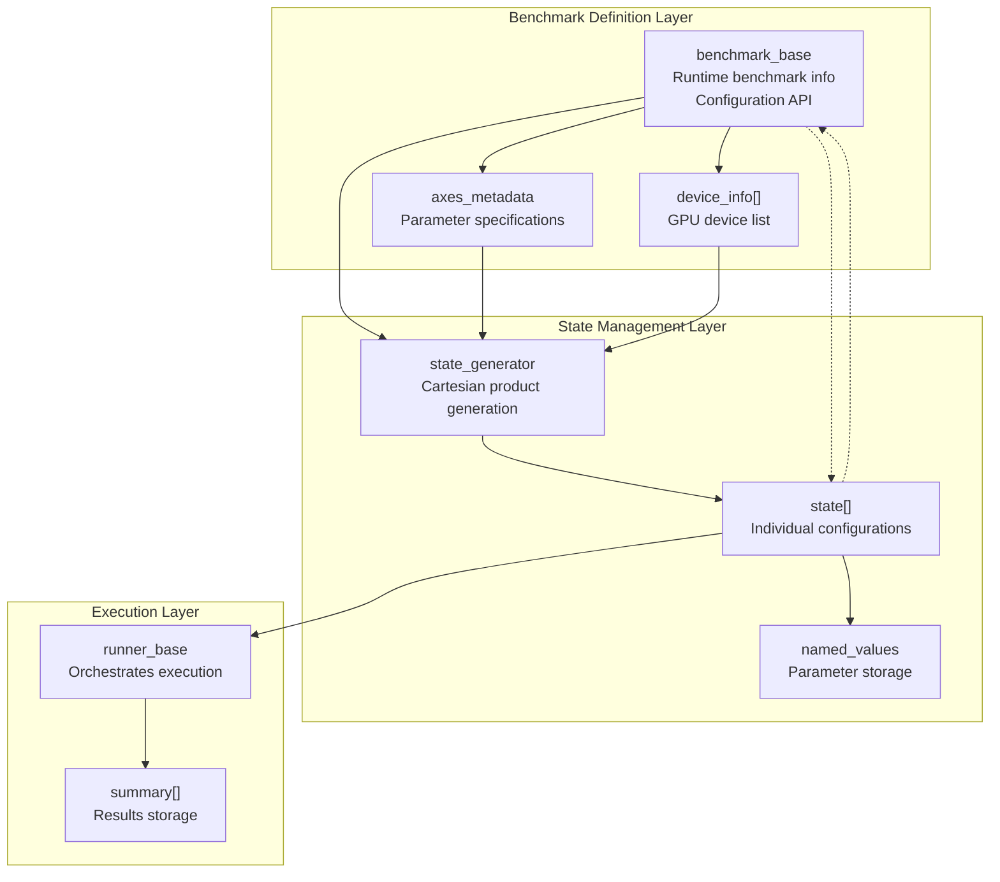
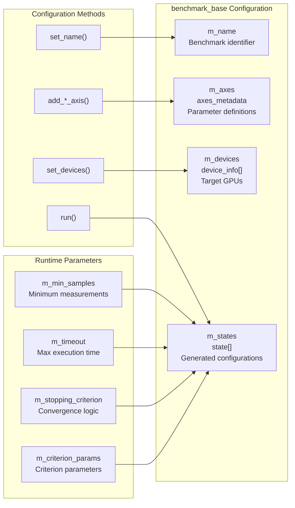
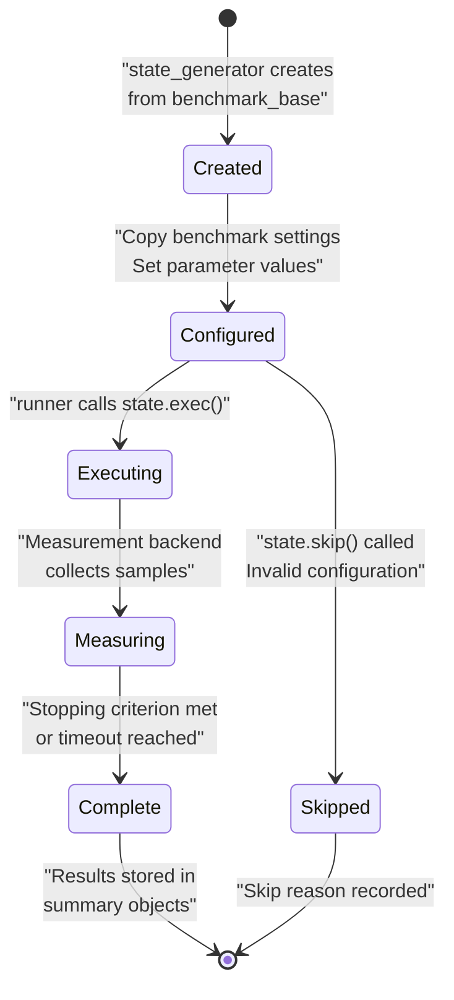
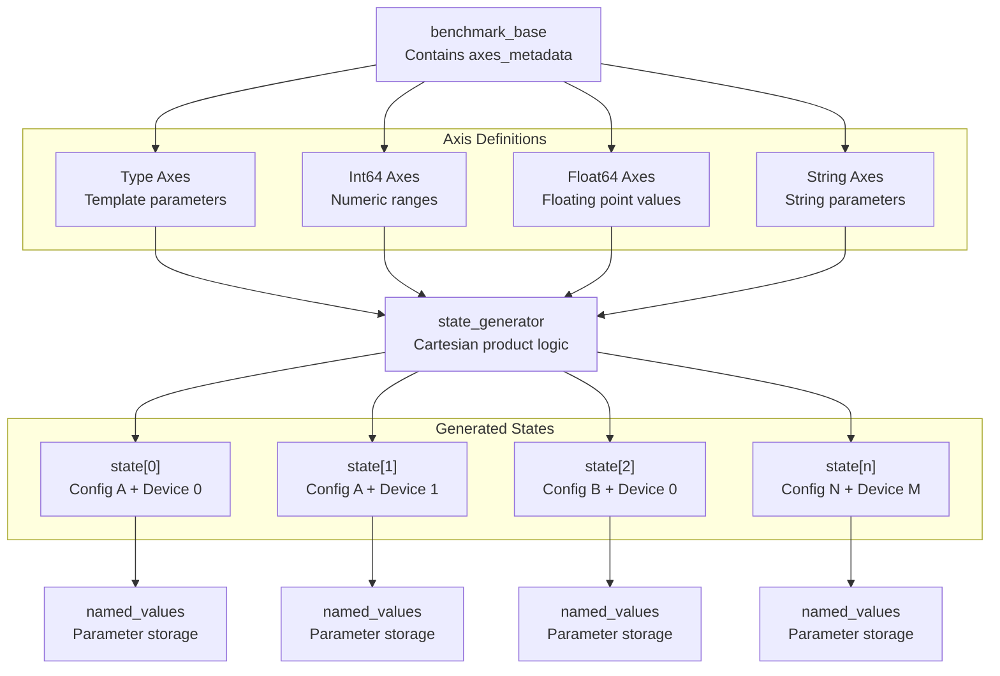
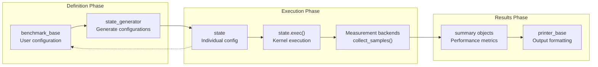

<!-- source: DeepWiki mcp.deepwiki.com · repo NVIDIA/nvbench · page 3.1 Benchmark Definition and State Management · fetched 2026-10-26 -->

# Benchmark Definition and State Management

<details>
<summary>Relevant source files</summary>

The following files were used as context for generating this wiki page:

- [nvbench/benchmark_base.cuh](nvbench/benchmark_base.cuh)
- [nvbench/state.cuh](nvbench/state.cuh)
- [testing/axes_metadata.cu](testing/axes_metadata.cu)
- [testing/benchmark.cu](testing/benchmark.cu)
- [testing/runner.cu](testing/runner.cu)

</details>


This document covers how benchmarks are defined and configured in NVBench, focusing on the `benchmark_base` class for benchmark definition and the `state` struct for managing individual benchmark configurations. It explains how parameter axes generate multiple benchmark states and how these states are managed throughout the benchmarking process.

For information about the actual measurement and execution of benchmarks, see [Measurement Systems](#3.2). For details about parameter axis configuration, see [Parameter Axes and Configuration](#3.4).

## Core Components Overview

NVBench's benchmark definition and state management system is built around two primary classes that work together to define, configure, and execute benchmarks.



Sources: [nvbench/benchmark_base.cuh:40-323](), [nvbench/state.cuh:45-339]()

## Benchmark Definition with benchmark_base

The `benchmark_base` class serves as the primary interface for defining and configuring benchmarks. It holds all runtime benchmark information and provides the public customization API used by the `NVBENCH_BENCH` macros.

### Key Responsibilities

| Function | Description | Key Methods |
|----------|-------------|-------------|
| **Axis Management** | Define parameter ranges for benchmarking | `add_int64_axis()`, `add_float64_axis()`, `add_string_axis()` |
| **Device Configuration** | Specify which CUDA devices to use | `set_devices()`, `add_device()`, `get_devices()` |
| **Execution Control** | Configure measurement behavior | `set_min_samples()`, `set_timeout()`, `set_stopping_criterion()` |
| **State Generation** | Create individual benchmark configurations | `run()`, `get_states()`, `get_config_count()` |



Sources: [nvbench/benchmark_base.cuh:47-323](), [testing/benchmark.cu:88-127]()

### Benchmark Configuration API

The `benchmark_base` class provides a fluent API for configuring benchmarks:

```cpp
// From benchmark_base.cuh method signatures:
benchmark_base& set_name(std::string name);
benchmark_base& add_int64_axis(std::string name, std::vector<nvbench::int64_t> data);
benchmark_base& add_float64_axis(std::string name, std::vector<nvbench::float64_t> data);
benchmark_base& add_string_axis(std::string name, std::vector<std::string> data);
benchmark_base& set_devices(std::vector<nvbench::device_info> devices);
benchmark_base& set_min_samples(nvbench::int64_t min_samples);
benchmark_base& set_timeout(nvbench::float64_t timeout);
```

Sources: [nvbench/benchmark_base.cuh:70-82](), [nvbench/benchmark_base.cuh:84-109](), [nvbench/benchmark_base.cuh:156-222]()

## State Management with state Struct

The `state` struct stores all information about a particular benchmark configuration. One `state` object exists for every combination of a benchmark's parameter axes, representing a unique configuration to be measured.

### State Lifecycle and Components



Sources: [nvbench/state.cuh:59-339](), [testing/runner.cu:42-93]()

### State Data Structure

The `state` struct contains several categories of information:

| Category | Members | Purpose |
|----------|---------|---------|
| **Benchmark Reference** | `m_benchmark`, `m_axis_values` | Link to parent benchmark and parameter values |
| **Device Context** | `m_device`, `m_cuda_stream` | CUDA device and stream management |
| **Execution Control** | `m_min_samples`, `m_timeout`, `m_stopping_criterion` | Measurement configuration |
| **Results Storage** | `m_summaries`, `m_skip_reason` | Performance data and skip information |
| **Memory Tracking** | `m_element_count`, `m_global_memory_rw_bytes` | Data size metrics |
| **CUPTI Integration** | `m_collect_l1_hit_rates`, etc. | Hardware counter collection flags |

Sources: [nvbench/state.cuh:304-339]()

## Parameter Access and Management

The `state` class provides type-safe parameter access through the `named_values` system:

```cpp
// Parameter retrieval methods from state.cuh:
nvbench::int64_t get_int64(const std::string& axis_name) const;
nvbench::float64_t get_float64(const std::string& axis_name) const;
const std::string& get_string(const std::string& axis_name) const;

// With default value fallbacks:
nvbench::int64_t get_int64_or_default(const std::string& axis_name, 
                                      nvbench::int64_t default_value) const;
```

Sources: [nvbench/state.cuh:98-108]()

## State Generation Process

The state generation process creates the Cartesian product of all parameter axes to generate individual benchmark configurations.



Sources: [nvbench/state.cuh:294-302](), [testing/runner.cu:106-109](), [testing/benchmark.cu:281-301]()

## Configuration Count Calculation

The total number of benchmark configurations is computed as the product of all axis sizes multiplied by the number of devices:

```
config_count = (type_axis_0_size × type_axis_1_size × ... × type_axis_n_size) 
             × (int64_axis_0_size × int64_axis_1_size × ... × int64_axis_m_size)
             × (float64_axis_0_size × float64_axis_1_size × ... × float64_axis_k_size)  
             × (string_axis_0_size × string_axis_1_size × ... × string_axis_j_size)
             × max(device_count, 1)
```

This calculation is available through the `get_config_count()` method, which can be called before `run()` to determine the total number of configurations that will be generated.

Sources: [nvbench/benchmark_base.cuh:139-141](), [testing/benchmark.cu:281-301]()

## Memory and Performance Tracking

The `state` class provides methods for tracking memory usage and computational work:

```cpp
// Memory tracking methods:
void add_element_count(std::size_t elements, std::string column_name = {});
void add_global_memory_reads(std::size_t bytes, std::string column_name = {});
void add_global_memory_writes(std::size_t bytes, std::string column_name = {});
void add_buffer_size(std::size_t num_bytes, std::string summary_tag, 
                     std::string column_name = {}, std::string description = {});
```

These methods allow benchmarks to report their memory access patterns, which is essential for calculating metrics like effective bandwidth and memory efficiency.

Sources: [nvbench/state.cuh:110-133]()

## Integration with Execution System

The `state` objects serve as the primary interface between benchmark definition and execution:



Each `state` maintains a reference back to its parent `benchmark_base` and can access shared configuration like stopping criteria and timeout values while maintaining its own parameter values and execution context.

Sources: [nvbench/state.cuh:284-291](), [nvbench/state.cuh:304](), [nvbench/benchmark_base.cuh:144-147]()

---

