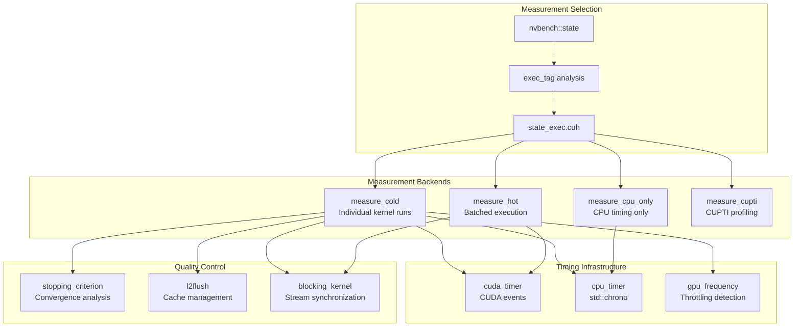
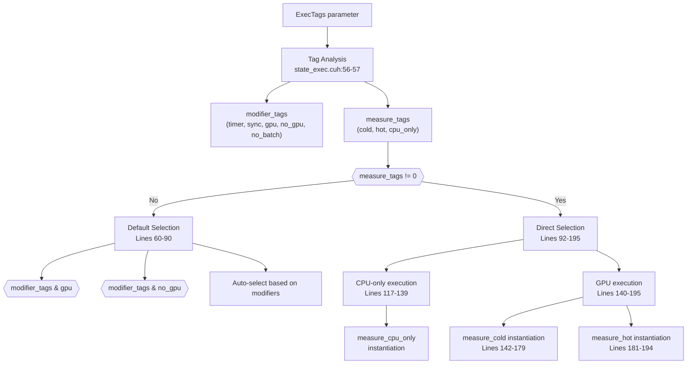
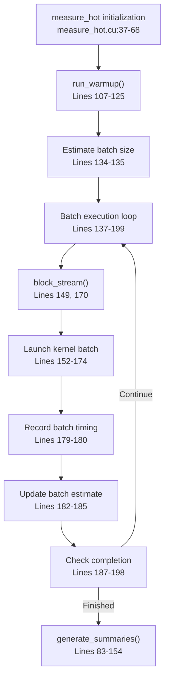
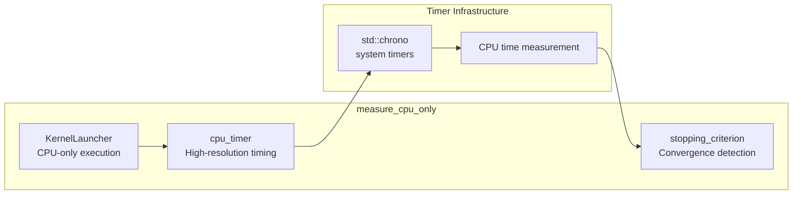
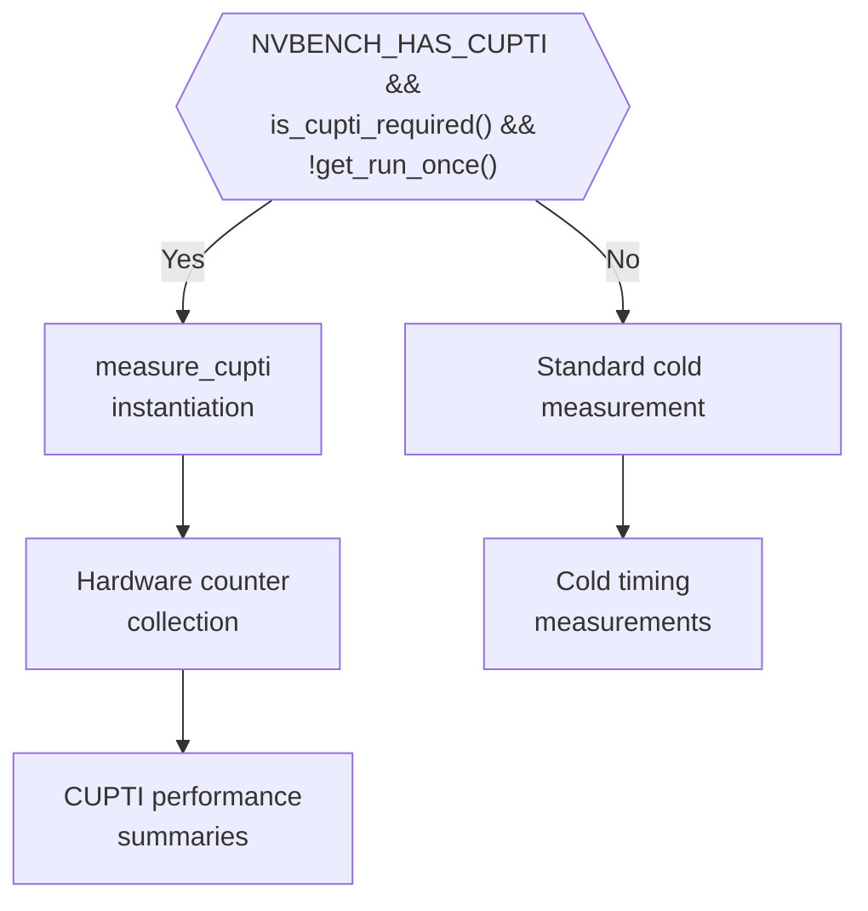
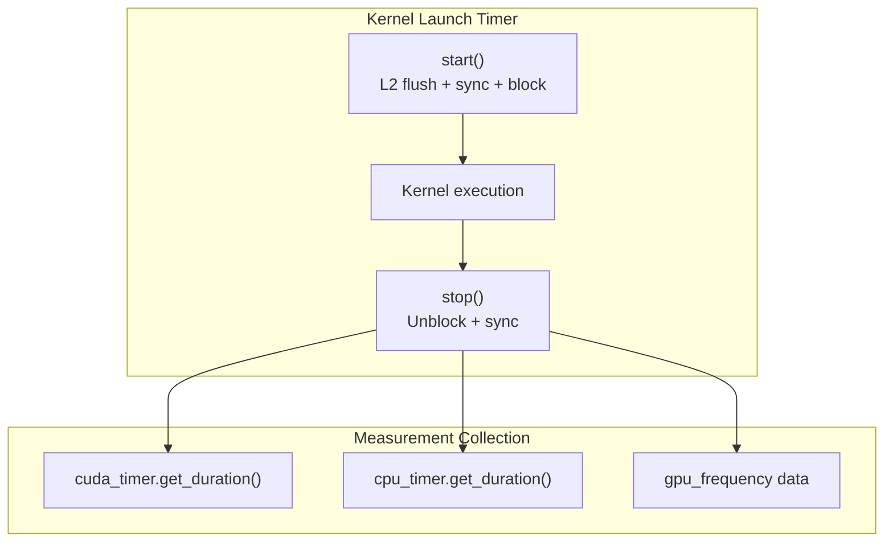

<!-- source: DeepWiki mcp.deepwiki.com · repo NVIDIA/nvbench · page 3.2 Measurement Systems · fetched 2026-10-26 -->

# Measurement Systems

<details>
<summary>Relevant source files</summary>

The following files were used as context for generating this wiki page:

- [nvbench/detail/measure_cold.cu](nvbench/detail/measure_cold.cu)
- [nvbench/detail/measure_cold.cuh](nvbench/detail/measure_cold.cuh)
- [nvbench/detail/measure_hot.cu](nvbench/detail/measure_hot.cu)
- [nvbench/detail/measure_hot.cuh](nvbench/detail/measure_hot.cuh)
- [nvbench/detail/state_exec.cuh](nvbench/detail/state_exec.cuh)
- [nvbench/exec_tag.cuh](nvbench/exec_tag.cuh)

</details>


This document covers NVBench's measurement backends and the infrastructure that controls when and how different measurement strategies are applied. The measurement systems are responsible for executing benchmarks, collecting timing data, and generating performance summaries.

For information about how benchmarks are defined and configured, see [Benchmark Definition and State Management](#3.1). For details about the execution engine that orchestrates measurements, see [Execution Engine and State Generation](#3.3).

## Overview of Measurement Backends

NVBench provides multiple measurement strategies optimized for different benchmark characteristics and requirements. The framework automatically selects appropriate measurement backends based on execution tags and benchmark configuration.

### Measurement Backend Architecture



**Sources:** [nvbench/detail/state_exec.cuh:43-196](), [nvbench/detail/measure_cold.cuh:48-232](), [nvbench/detail/measure_hot.cuh:40-212]()

## Measurement Selection System

The measurement system uses execution tags (`exec_tag`) to determine which measurement backends to instantiate and execute. This compile-time selection mechanism prevents unnecessary code generation.

### Execution Tag Processing



**Sources:** [nvbench/detail/state_exec.cuh:43-196](), [nvbench/exec_tag.cuh:31-151]()

### Execution Tag Definitions

| Tag | Purpose | Constraints |
|-----|---------|-------------|
| `timer` | Manual timing in kernel launcher | Implies `no_batch` |
| `sync` | Kernel launcher performs synchronization | Implies `no_batch`, disables throttling |
| `gpu` | GPU-only measurements | Excludes `measure_cpu_only` |
| `no_gpu` | CPU-only measurements | Requires `set_is_cpu_only(true)` |
| `no_batch` | Disable batched measurements | Excludes `measure_hot` |

**Sources:** [nvbench/exec_tag.cuh:128-149](), [nvbench/detail/state_exec.cuh:104-110]()

## Cold Measurement System

The cold measurement system (`measure_cold`) executes kernels individually to measure isolated performance characteristics. This approach provides detailed statistics and can detect GPU throttling.

### Cold Measurement Architecture

```mermaid
graph TB
    subgraph "measure_cold_base"
        constructor["Constructor<br/>measure_cold.cu:39-59"]
        initialize["initialize()<br/>Lines 74-93"]
        run_trials["run_trials()<br/>Lines 215-223"]
        record_measurements["record_measurements()<br/>Lines 97-163"]
        is_finished["is_finished()<br/>Lines 165-190"]
        generate_summaries["generate_summaries()<br/>Lines 194-449"]
    end
    
    subgraph "Timing Components"
        kernel_launch_timer["kernel_launch_timer<br/>Lines 131-176"]
        cuda_timer_cold["cuda_timer"]
        cpu_timer_cold["cpu_timer"]
        walltime_timer["walltime_timer"]
    end
    
    subgraph "Quality Control"
        throttle_detection["GPU Throttling Detection<br/>Lines 99-144"]
        l2flush_cold["L2 Cache Flush<br/>Line 73"]
        blocking_kernel_cold["Blocking Kernel<br/>Lines 465-468"]
        stopping_criterion_cold["Stopping Criterion<br/>Line 162"]
    end
    
    constructor --> initialize
    initialize --> run_trials
    run_trials --> record_measurements
    record_measurements --> throttle_detection
    record_measurements --> is_finished
    is_finished --> generate_summaries
    
    kernel_launch_timer --> cuda_timer_cold
    kernel_launch_timer --> cpu_timer_cold
    kernel_launch_timer --> l2flush_cold
    kernel_launch_timer --> blocking_kernel_cold
```

**Sources:** [nvbench/detail/measure_cold.cu:36-471](), [nvbench/detail/measure_cold.cuh:48-232]()

### Cold Measurement Features

The cold measurement system provides comprehensive performance analysis:

#### Throttling Detection
Cold measurements monitor GPU clock frequencies to detect thermal throttling. When throttling is detected, the measurement discards the sample and pauses execution:

```cpp
// GPU frequency monitoring logic
if (m_gpu_frequency.has_throttled(default_clock_rate, m_throttle_threshold))
{
  // Discard measurement and increase recovery delay
  m_dynamic_throttle_recovery_delay += std::min(m_dynamic_throttle_recovery_delay * 1.5f, 0.5f);
  std::this_thread::sleep_for(std::chrono::duration<float>(m_dynamic_throttle_recovery_delay));
  return; // Skip this measurement
}
```

**Sources:** [nvbench/detail/measure_cold.cu:99-144]()

#### Performance Summaries Generated

| Summary Key | Description | Purpose |
|-------------|-------------|---------|
| `nv/cold/sample_size` | Number of isolated executions | Sample size reporting |
| `nv/cold/time/gpu/mean` | Mean GPU execution time | Primary performance metric |
| `nv/cold/time/cpu/mean` | Mean CPU-measured time | Host overhead analysis |
| `nv/cold/bw/global/bytes_per_second` | Global memory bandwidth | Bandwidth utilization |
| `nv/cold/sm_clock_rate/mean` | Mean SM clock rate | Throttling analysis |

**Sources:** [nvbench/detail/measure_cold.cu:194-449]()

## Hot Measurement System

The hot measurement system (`measure_hot`) executes kernels in batches to achieve stable performance measurements by amortizing launch overhead and maintaining GPU occupancy.

### Hot Measurement Flow



**Sources:** [nvbench/detail/measure_hot.cu:34-176](), [nvbench/detail/measure_hot.cuh:87-212]()

### Hot Measurement Batch Sizing

Hot measurement dynamically adjusts batch sizes based on performance estimates:

```cpp
// Initial batch size estimation from warmup
const auto time_estimate = m_cuda_timer.get_duration() * 0.95;
auto batch_size = static_cast<nvbench::int64_t>(m_min_time / time_estimate);

// Dynamic batch size updates during execution
batch_size = static_cast<nvbench::int64_t>(
  (m_min_time - m_total_cuda_time) /
  (m_total_cuda_time / static_cast<nvbench::float64_t>(m_total_samples)));
```

**Sources:** [nvbench/detail/measure_hot.cuh:134-185]()

## CPU-Only Measurement System

The CPU-only measurement system (`measure_cpu_only`) provides timing for benchmarks that don't use GPU resources, using high-resolution CPU timers.

### CPU-Only Measurement Components



**Sources:** [nvbench/detail/measure_cpu_only.cuh](), [nvbench/detail/state_exec.cuh:117-139]()

## CUPTI Profiling Integration

When CUPTI support is available, NVBench can collect detailed hardware performance counters alongside timing measurements.

### CUPTI Measurement Selection



**Sources:** [nvbench/detail/state_exec.cuh:148-173]()

## Timing Infrastructure

All measurement systems rely on specialized timer implementations optimized for different execution contexts.

### Timer Architecture

| Timer Type | Implementation | Use Case |
|------------|----------------|----------|
| `cuda_timer` | CUDA events | GPU kernel timing |
| `cpu_timer` | `std::chrono` | Host code timing |
| `gpu_frequency` | NVML queries | Throttling detection |

### Timer Integration Points



**Sources:** [nvbench/detail/measure_cold.cuh:131-176](), [nvbench/cuda_timer.cuh](), [nvbench/cpu_timer.cuh]()

## Quality Control Mechanisms

The measurement systems implement several quality control mechanisms to ensure reliable results:

### L2 Cache Management
Cache flushing ensures consistent memory subsystem state between measurements:

```cpp
__forceinline__ void flush_device_l2() { 
  m_l2flush.flush(m_launch.get_stream()); 
}
```

### Blocking Kernel Pattern
Stream blocking ensures accurate timing by preventing CPU-GPU execution overlap:

```cpp
void block_stream() {
  m_blocker.block(m_launch.get_stream(), m_state.get_blocking_kernel_timeout());
}
```

### Skip Time Validation
Measurements below minimum execution time thresholds are rejected:

```cpp
void check_skip_time(nvbench::float64_t warmup_time) {
  if (m_skip_time > 0. && warmup_time < m_skip_time) {
    m_state.skip("Warmup time did not meet skip_time limit");
  }
}
```

**Sources:** [nvbench/detail/measure_cold.cuh:73-81](), [nvbench/detail/measure_cold.cu:451-463](), [nvbench/detail/measure_cold.cu:465-468]()

---

