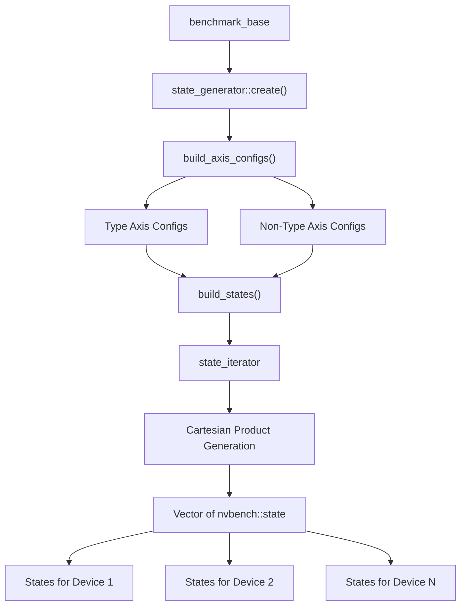
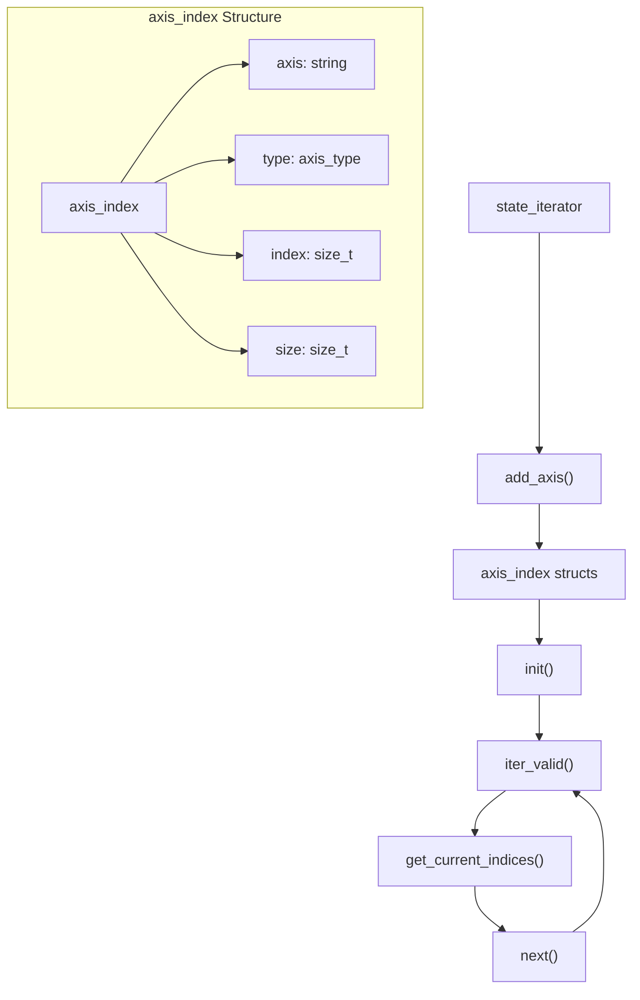
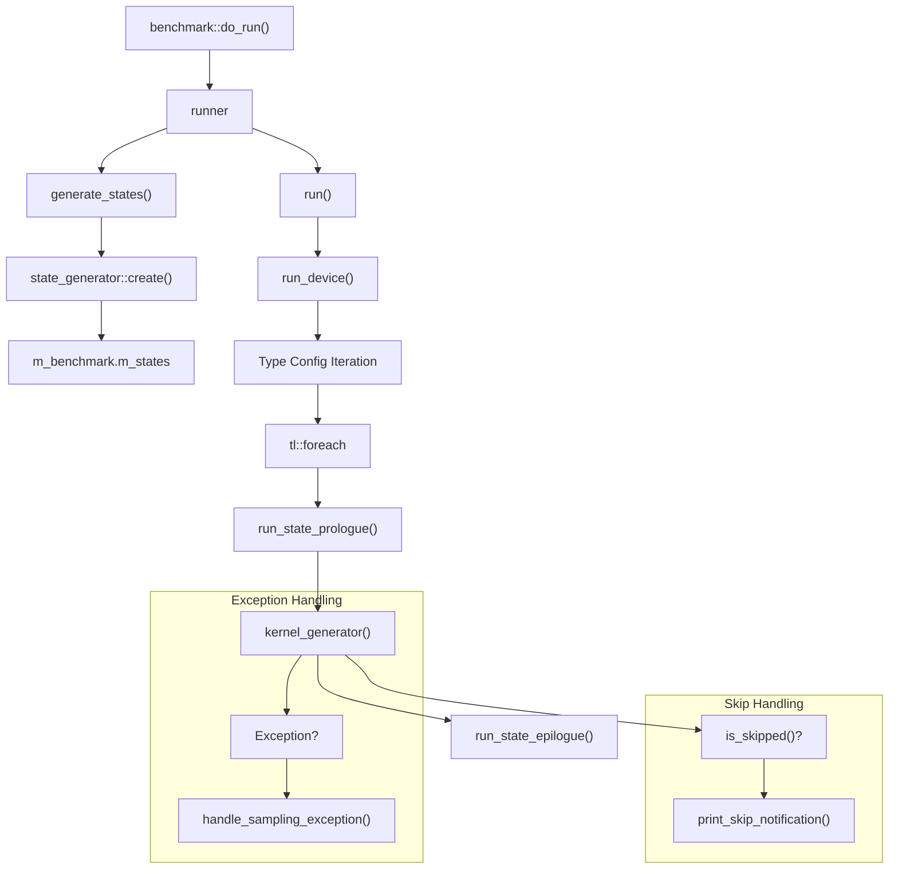
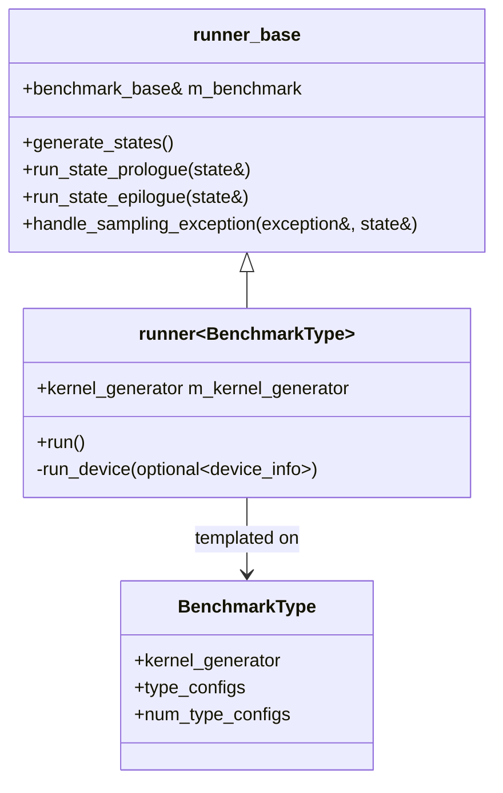
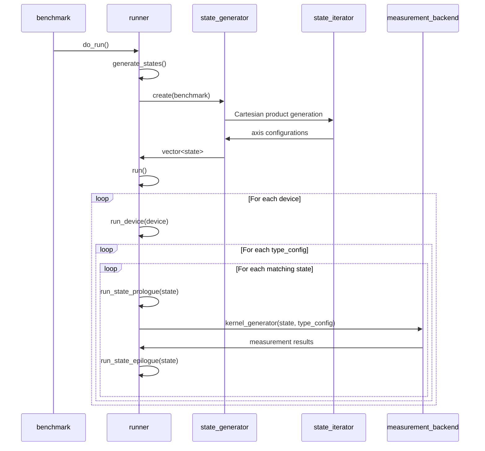
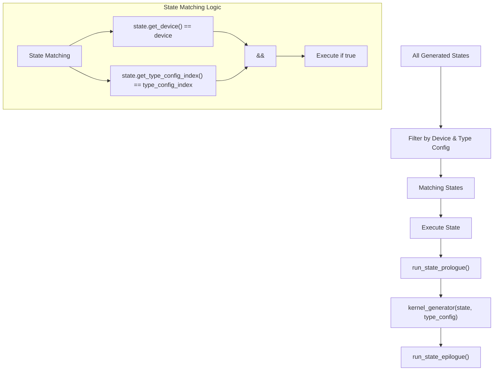

<!-- source: DeepWiki mcp.deepwiki.com · repo NVIDIA/nvbench · page 3.3 Execution Engine and State Generation · fetched 2026-10-26 -->

# Execution Engine and State Generation

Relevant source files

The following files were used as context for generating this wiki page:

- [nvbench/axes_metadata.cuh](nvbench/axes_metadata.cuh)
- [nvbench/benchmark.cuh](nvbench/benchmark.cuh)
- [nvbench/detail/state_generator.cuh](nvbench/detail/state_generator.cuh)
- [nvbench/runner.cuh](nvbench/runner.cuh)
- [testing/option_parser.cu](testing/option_parser.cu)
- [testing/state_generator.cu](testing/state_generator.cu)

This document covers NVBench's core execution systems: how benchmark configurations are converted into executable states and how those states are systematically executed. The state generation system creates the Cartesian product of all parameter combinations, while the execution engine orchestrates the actual benchmark runs across devices and configurations.

For information about benchmark definition and parameter configuration, see [Benchmark Definition and State Management](#3.1). For details about the measurement backends used during execution, see [Measurement Systems](#3.2).

## Overview

The execution engine and state generation work together to transform high-level benchmark definitions into concrete measurement results. The process involves two main phases:

1. **State Generation**: Converting benchmark parameter axes into individual `nvbench::state` objects representing each unique configuration
2. **Execution**: Systematically running each state through the appropriate measurement backend

## State Generation System

The state generation system creates individual benchmark states from the Cartesian product of all configured parameter axes. This is handled primarily by the `nvbench::detail::state_generator` class.

### State Generation Architecture

**State Generation Flow**

Sources: [nvbench/detail/state_generator.cuh:38-54](), [testing/state_generator.cu:147-230]()

### State Iterator Implementation

The `state_iterator` class generates all possible combinations of parameter values using a Cartesian product approach:

**State Iterator Components**

Each `axis_index` contains:
- `axis`: The parameter name (e.g., "VecSize", "Strategy")
- `type`: The axis type (int64, float64, string, type)
- `index`: Current value index within the axis
- `size`: Total number of values in the axis

Sources: [nvbench/detail/state_generator.cuh:74-96](), [testing/state_generator.cu:72-145]()

### Parameter Axis Types

The state generator handles four types of parameter axes:

| Axis Type | Class | Purpose | Example |
|-----------|-------|---------|---------|
| Type | `type_axis` | Template type parameters | `<float, int, bool>` |
| Integer | `int64_axis` | Numeric parameters | `{1024, 2048, 4096}` |
| Float | `float64_axis` | Floating-point parameters | `{3.14, 6.28}` |
| String | `string_axis` | Categorical parameters | `{"recursive", "iterative"}` |

Sources: [nvbench/axes_metadata.cuh:53-71](), [testing/state_generator.cu:147-230]()

## Execution Engine

The execution engine is implemented through the `runner` template class and its base `runner_base`. It orchestrates the systematic execution of all generated states.

### Execution Architecture

**Execution Flow Components**

Sources: [nvbench/runner.cuh:49-122](), [nvbench/benchmark.cuh:77-82]()

### Runner Template Structure

The `runner` template provides type-safe execution for specific benchmark types:

**Runner Class Hierarchy**

The separation between `runner_base` and `runner<T>` minimizes template instantiation costs by keeping non-templated functionality in the base class.

Sources: [nvbench/runner.cuh:31-47](), [nvbench/runner.cuh:49-122]()

## State-to-Execution Integration

The integration between state generation and execution follows a systematic pattern that ensures all parameter combinations are measured consistently.

### Complete Execution Flow

**Execution Sequence**

Sources: [nvbench/benchmark.cuh:77-82](), [nvbench/runner.cuh:62-119]()

### State Filtering and Execution

During execution, states are filtered by device and type configuration to ensure proper execution order:

**State Execution Filtering**

The execution engine ensures that each state runs with the correct device context and type configuration, maintaining consistency across all measurements.

Sources: [nvbench/runner.cuh:86-118]()

### Error Handling and State Management

The execution engine provides comprehensive error handling and state lifecycle management:

| Phase | Handler | Purpose |
|-------|---------|---------|
| Prologue | `run_state_prologue()` | Initialize measurement context |
| Execution | `handle_sampling_exception()` | Handle measurement failures |
| Skip Detection | `print_skip_notification()` | Report skipped configurations |
| Epilogue | `run_state_epilogue()` | Finalize measurements |

Sources: [nvbench/runner.cuh:39-44](), [nvbench/runner.cuh:104-113]()

---

