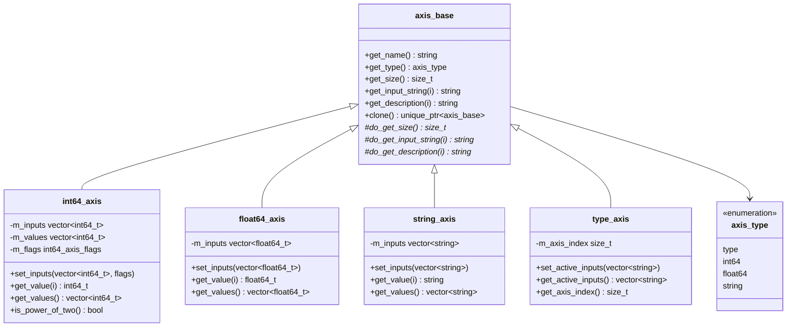
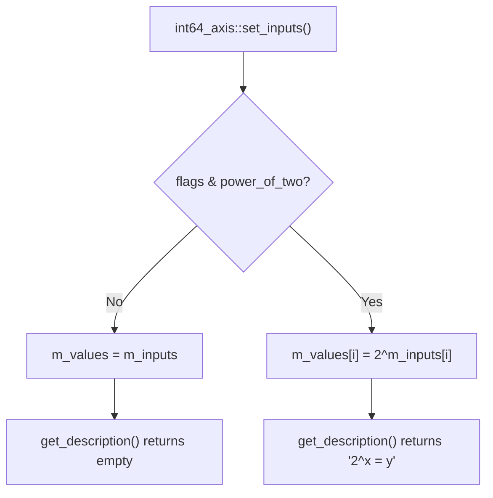
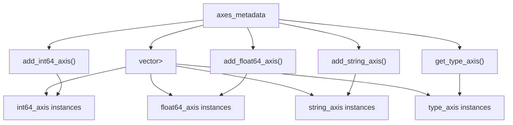
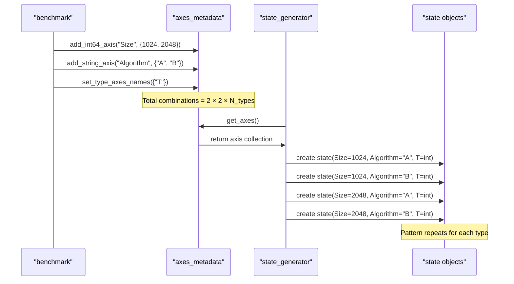
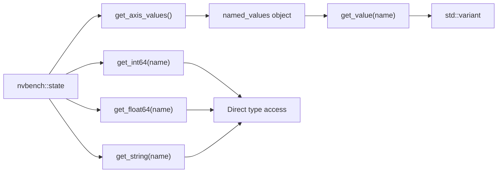
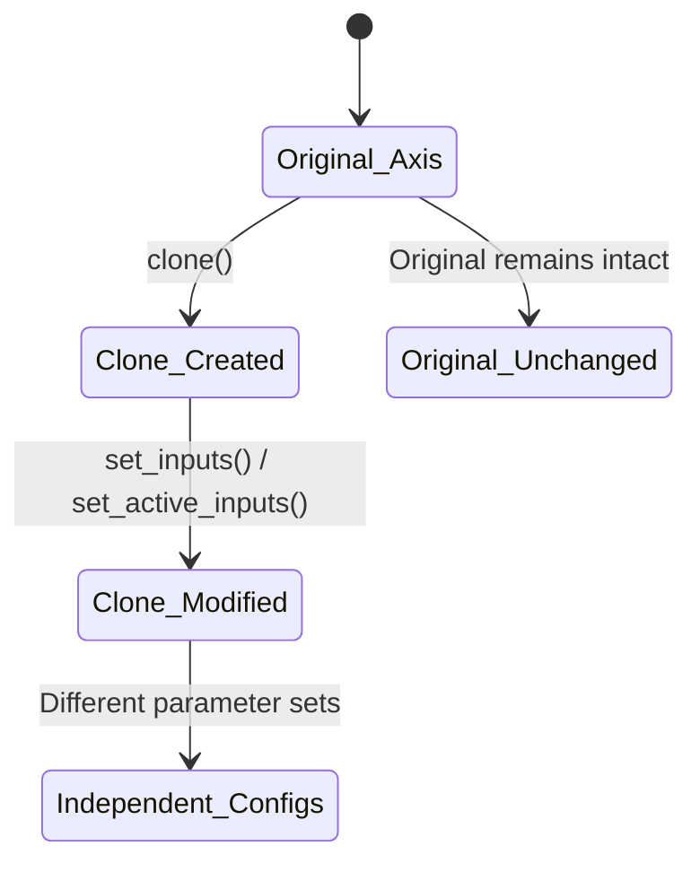

<!-- source: DeepWiki mcp.deepwiki.com · repo NVIDIA/nvbench · page 3.4 Parameter Axes and Configuration · fetched 2026-10-26 -->

# Parameter Axes and Configuration

Relevant source files

The following files were used as context for generating this wiki page:

- [nvbench/axis_base.cuh](nvbench/axis_base.cuh)
- [nvbench/flags.cuh](nvbench/flags.cuh)
- [nvbench/int64_axis.cuh](nvbench/int64_axis.cuh)
- [testing/axes_metadata.cu](testing/axes_metadata.cu)
- [testing/benchmark.cu](testing/benchmark.cu)
- [testing/int64_axis.cu](testing/int64_axis.cu)
- [testing/runner.cu](testing/runner.cu)

This document describes NVBench's parameter axis system, which defines how benchmark parameters are specified, managed, and used to generate different benchmark configurations. The axis system enables benchmarks to test multiple parameter combinations by defining parameter spaces along different dimensions.

For information about how these parameter configurations are executed, see [Execution Engine and State Generation](#3.3). For details on how parameter values are accessed during benchmark execution, see [Benchmark Definition and State Management](#3.1).

## Axis System Architecture

NVBench implements a polymorphic axis hierarchy that supports different parameter types through a common interface. Each axis represents a dimension of parameter space and contains multiple values that can be tested.

**Sources:** [nvbench/axis_base.cuh:40-86](), [nvbench/int64_axis.cuh:44-102]()

## Axis Types and Configuration

### Integer Axes

The `int64_axis` class supports two modes of operation controlled by `int64_axis_flags`:

| Mode | Description | Input Values | Output Values |
|------|-------------|--------------|---------------|
| Normal | Direct integer values | `{10, 20, 30}` | `{10, 20, 30}` |
| Power-of-Two | Exponents for powers of 2 | `{1, 2, 3}` | `{2, 4, 8}` |

**Sources:** [nvbench/int64_axis.cuh:55-68](), [testing/int64_axis.cu:85-122]()

### String and Float64 Axes

String and float64 axes operate with direct value mapping:
- `string_axis`: Stores string values directly
- `float64_axis`: Stores floating-point values directly

Both use their input values as output values without transformation.

**Sources:** [testing/axes_metadata.cu:169-181](), [testing/axes_metadata.cu:211-221]()

### Type Axes

Type axes are generated automatically from template parameter lists and represent C++ types used in templated benchmarks. They support filtering through `set_active_inputs()` to limit which types are tested.

**Sources:** [testing/axes_metadata.cu:42-110](), [testing/benchmark.cu:88-126]()

## Axes Metadata Management

The `axes_metadata` class manages collections of axes and provides unified access to them:

**Sources:** [testing/axes_metadata.cu:19-231](), [testing/benchmark.cu:173-228]()

## Parameter Generation Process

The axis system generates parameter combinations through a Cartesian product of all axis values:

**Sources:** [testing/benchmark.cu:281-301](), [testing/runner.cu:95-155]()

## Configuration Methods

### Benchmark Configuration API

Benchmarks provide methods to add different axis types:

| Method | Purpose | Example |
|--------|---------|---------|
| `add_int64_axis()` | Add integer parameter axis | `bench.add_int64_axis("Size", {1024, 2048, 4096})` |
| `add_int64_power_of_two_axis()` | Add power-of-two integer axis | `bench.add_int64_power_of_two_axis("Size", {10, 11, 12})` |
| `add_float64_axis()` | Add floating-point parameter axis | `bench.add_float64_axis("Alpha", {0.1, 0.5, 1.0})` |
| `add_string_axis()` | Add string parameter axis | `bench.add_string_axis("Method", {"fast", "accurate"})` |
| `set_type_axes_names()` | Name template parameter axes | `bench.set_type_axes_names({"T", "U"})` |

**Sources:** [testing/benchmark.cu:175-228](), [testing/benchmark.cu:202-215]()

### Axis Value Access

During benchmark execution, parameter values are accessed through the `state` object:

**Sources:** [testing/benchmark.cu:45-61](), [testing/runner.cu:42-58]()

## Axis Cloning and Modification

Axes support cloning for independent modification, enabling features like configuration filtering:

This cloning mechanism allows the same benchmark definition to be used with different parameter sets without modifying the original configuration.

**Sources:** [testing/benchmark.cu:241-279](), [testing/int64_axis.cu:124-181]()

---

