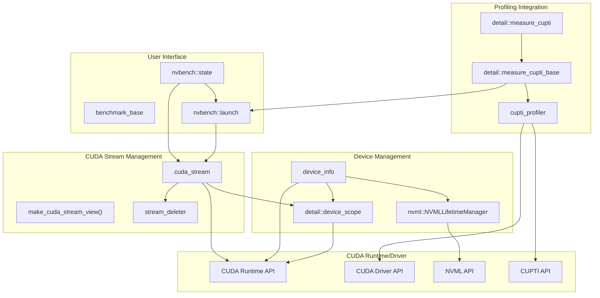
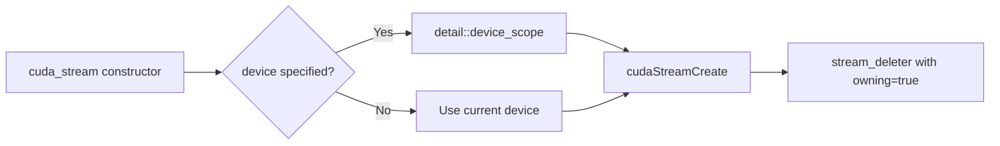
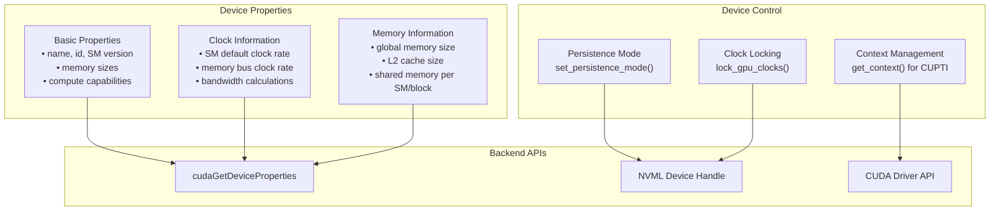
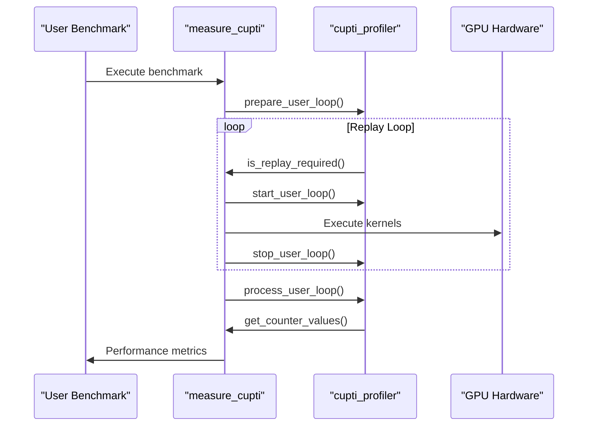
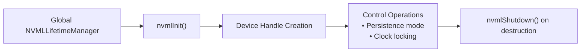
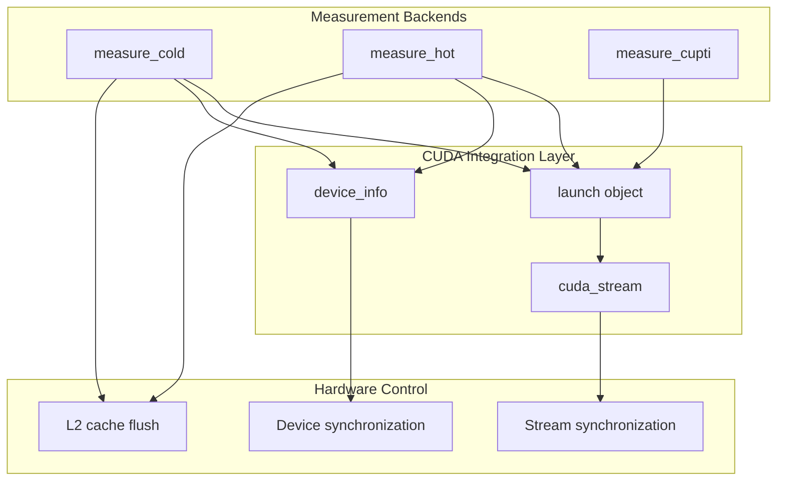

<!-- source: DeepWiki mcp.deepwiki.com · repo NVIDIA/nvbench · page 4 CUDA Integration · fetched 2026-10-26 -->

# CUDA Integration

Relevant source files

The following files were used as context for generating this wiki page:

- [nvbench/cuda_stream.cuh](nvbench/cuda_stream.cuh)
- [nvbench/cupti_profiler.cuh](nvbench/cupti_profiler.cuh)
- [nvbench/detail/measure_cupti.cu](nvbench/detail/measure_cupti.cu)
- [nvbench/detail/measure_cupti.cuh](nvbench/detail/measure_cupti.cuh)
- [nvbench/device_info.cu](nvbench/device_info.cu)
- [nvbench/device_info.cuh](nvbench/device_info.cuh)
- [nvbench/internal/nvml.cuh](nvbench/internal/nvml.cuh)
- [nvbench/internal/nvml.cxx](nvbench/internal/nvml.cxx)
- [nvbench/launch.cuh](nvbench/launch.cuh)
- [testing/cuda_stream.cu](testing/cuda_stream.cu)
- [testing/state.cu](testing/state.cu)

This document covers NVBench's integration with CUDA runtime, driver APIs, and related NVIDIA tools for GPU benchmarking. It explains how NVBench manages CUDA devices, streams, and profiling capabilities to provide accurate and comprehensive GPU performance measurements.

For information about the measurement backends that utilize these CUDA integrations, see [Measurement Systems](#3.2). For details about device-specific configuration options, see [Device Management and GPU Control](#4.1).

## Overview

NVBench's CUDA integration provides a comprehensive foundation for GPU benchmarking through several key components:

- **Device Management**: Discovery, selection, and control of CUDA devices
- **Stream Management**: CUDA stream lifecycle and synchronization
- **CUPTI Integration**: Advanced profiling using CUDA Performance Tools Interface
- **NVML Integration**: GPU clock control and persistence mode management
- **Kernel Launch Context**: Streamlined kernel execution interface

## CUDA Integration Architecture

Sources: [nvbench/cuda_stream.cuh:1-131](), [nvbench/device_info.cuh:1-235](), [nvbench/launch.cuh:1-63](), [nvbench/cupti_profiler.cuh:1-127]()

## Core CUDA Components

### CUDA Stream Management

The `cuda_stream` class provides RAII management of CUDA streams with support for both owning and non-owning semantics:

| Component | Purpose | Key Methods |
|-----------|---------|-------------|
| `cuda_stream` | Stream lifecycle management | `get_stream()`, operator `cudaStream_t()` |
| `make_cuda_stream_view()` | Non-owning stream wrapper | Creates view without ownership |
| `stream_deleter` | Custom deleter for RAII | Conditionally calls `cudaStreamDestroy` |

The stream can be associated with a specific device during construction or use the currently active device:

Sources: [nvbench/cuda_stream.cuh:42-120]()

### Device Information and Management

The `device_info` class encapsulates comprehensive CUDA device properties and provides control capabilities:

Sources: [nvbench/device_info.cuh:43-203](), [nvbench/device_info.cu:32-174]()

### Kernel Launch Context

The `launch` class provides a streamlined interface for kernel execution within benchmarks:

| Feature | Implementation |
|---------|----------------|
| Stream Access | `get_stream()` returns const reference to `cuda_stream` |
| Move-Only Semantics | Prevents accidental copying |
| Integration | Used by measurement backends and user kernel launchers |

Sources: [nvbench/launch.cuh:38-61]()

## CUPTI Profiling Integration

NVBench integrates CUPTI (CUDA Performance Tools Interface) for advanced GPU profiling through a layered architecture:

### CUPTI Profiling Workflow

Sources: [nvbench/detail/measure_cupti.cuh:112-151](), [nvbench/cupti_profiler.cuh:84-114]()

### Available CUPTI Metrics

The CUPTI integration supports multiple hardware performance metrics:

| Metric ID | CUPTI Metric Name | Description |
|-----------|------------------|-------------|
| `dram_peak_sustained_throughput` | `dram__throughput.avg.pct_of_peak_sustained_elapsed` | Memory bandwidth utilization |
| `global_load_efficiency` | `smsp__sass_average_data_bytes_per_sector_mem_global_op_ld.pct` | Global load efficiency |
| `global_store_efficiency` | `smsp__sass_average_data_bytes_per_sector_mem_global_op_st.pct` | Global store efficiency |
| `l1_hit_rate` | `l1tex__t_sector_hit_rate.pct` | L1 cache hit rate |
| `l2_hit_rate` | `lts__t_sector_hit_rate.pct` | L2 cache hit rate |

Sources: [nvbench/detail/measure_cupti.cu:36-134]()

## NVML Integration

NVML (NVIDIA Management Library) integration enables advanced device control:

### NVML Lifecycle Management

### Device Control Capabilities

| Operation | Method | Requirements | Supported Platforms |
|-----------|--------|--------------|-------------------|
| Persistence Mode | `set_persistence_mode(bool)` | Root/Admin privileges | Linux only |
| Clock Locking | `lock_gpu_clocks(clock_rate)` | Root/Admin, Volta+ (SM 70+) | Linux/Windows |
| Clock Rates | `none`, `base`, `maximum` | Different locking strategies | - |

Sources: [nvbench/device_info.cu:101-158](), [nvbench/internal/nvml.cuh:35-96](), [nvbench/internal/nvml.cxx:23-55]()

## Integration with Measurement Systems

The CUDA integration components work together to support NVBench's measurement backends:

Sources: [nvbench/detail/measure_cupti.cuh:60-79](), [testing/state.cu:52-72]()

## Error Handling and Diagnostics

NVBench's CUDA integration includes comprehensive error handling:

- **CUDA Runtime Errors**: Handled via `NVBENCH_CUDA_CALL` macro
- **CUDA Driver Errors**: Handled via `NVBENCH_DRIVER_API_CALL` macro  
- **NVML Errors**: Custom exception hierarchy with detailed error codes
- **CUPTI Errors**: Graceful degradation with warning messages

The integration provides detailed diagnostic information when CUDA operations fail, including device context, operation details, and suggested remediation steps.

Sources: [nvbench/internal/nvml.cuh:65-94](), [nvbench/detail/measure_cupti.cu:172-180]()

---

