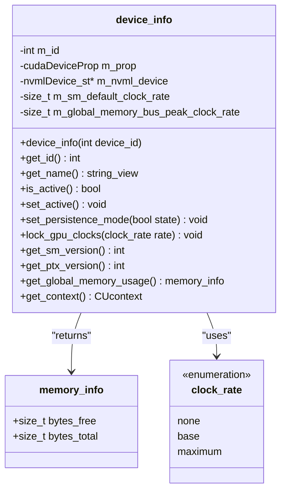
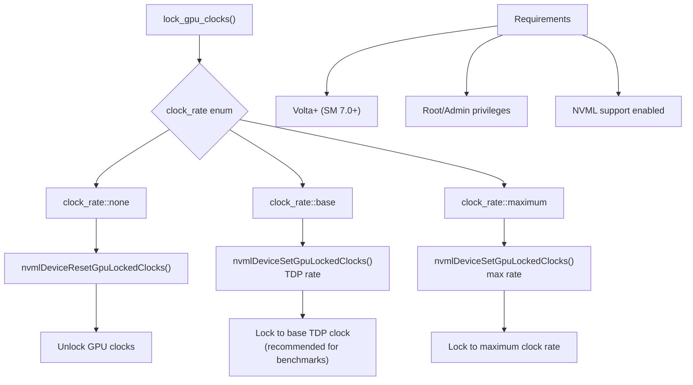
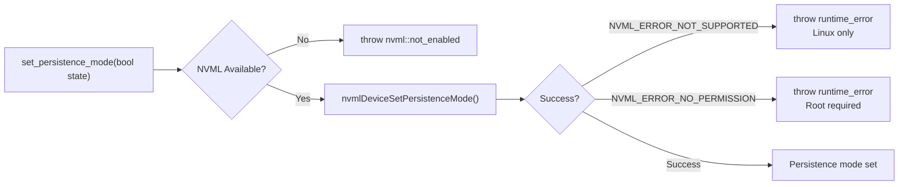
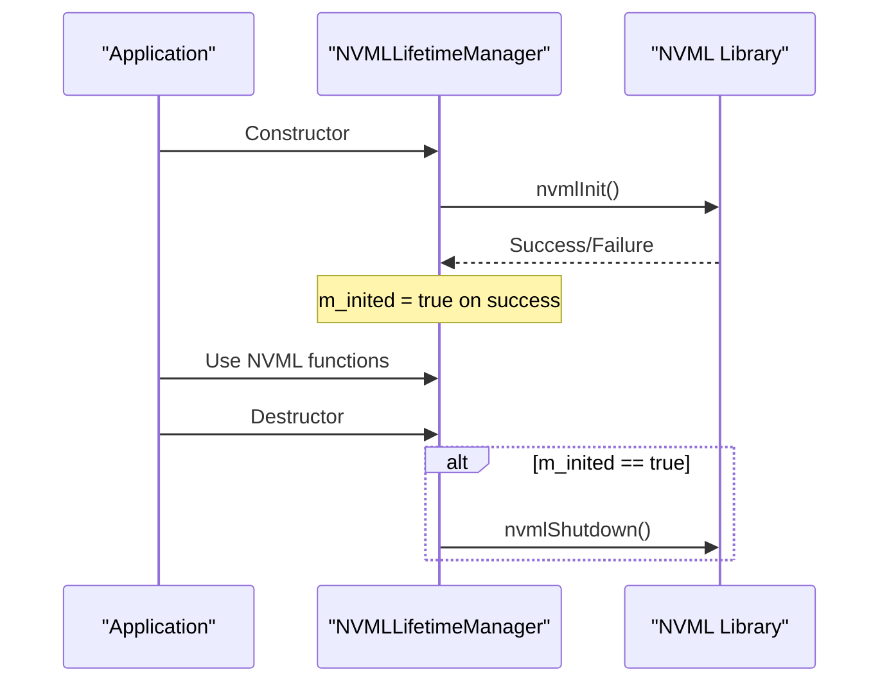
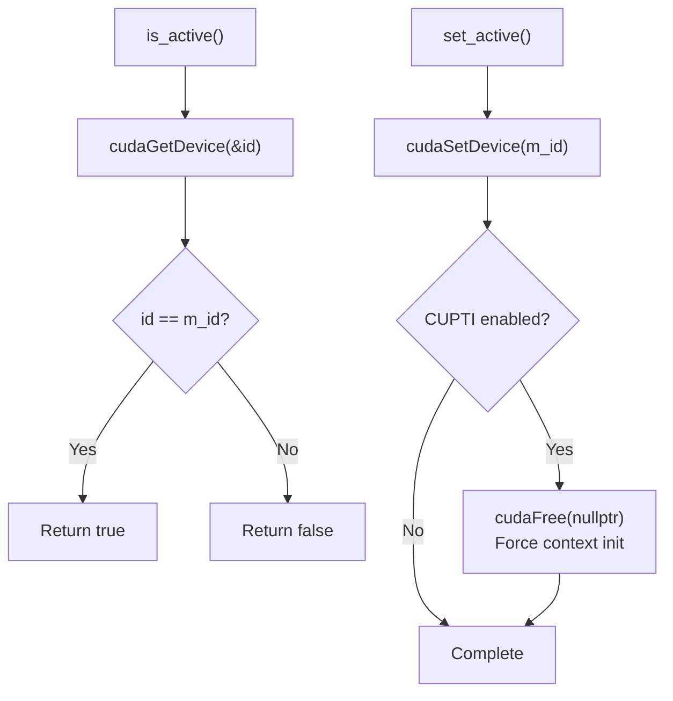
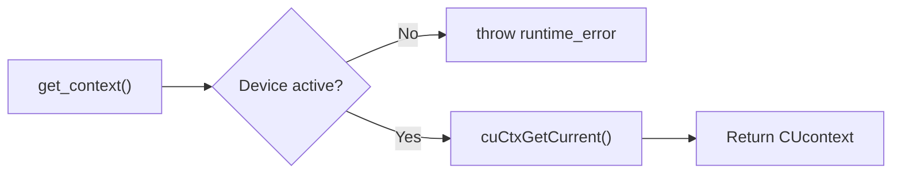
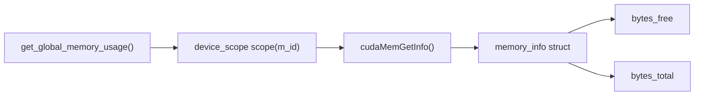
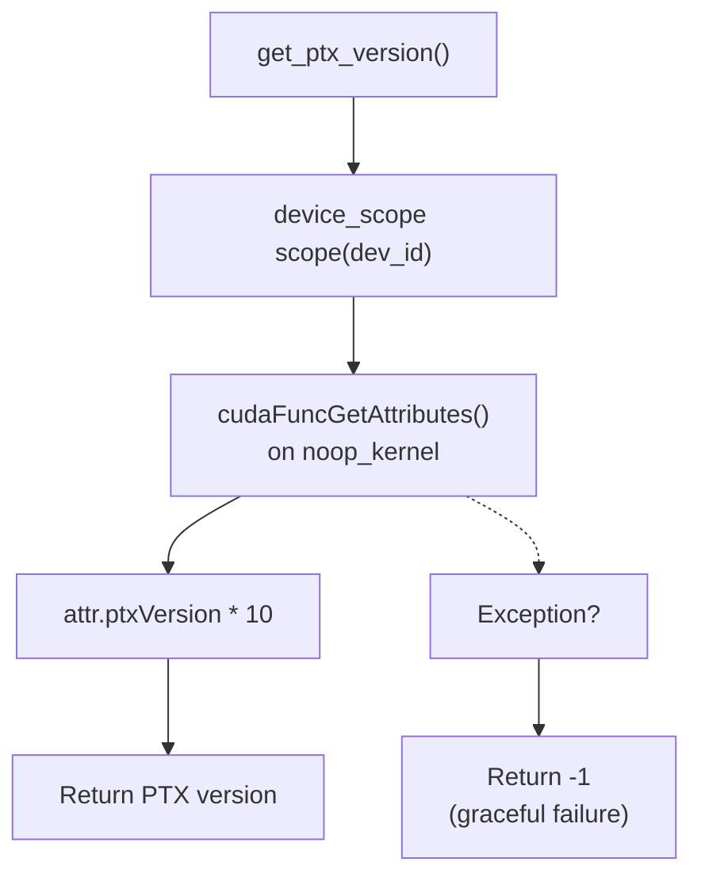

<!-- source: DeepWiki mcp.deepwiki.com · repo NVIDIA/nvbench · page 4.1 Device Management and GPU Control · fetched 2026-10-26 -->

# Device Management and GPU Control

<details>
<summary>Relevant source files</summary>

The following files were used as context for generating this wiki page:

- [nvbench/device_info.cu](nvbench/device_info.cu)
- [nvbench/device_info.cuh](nvbench/device_info.cuh)
- [nvbench/internal/nvml.cuh](nvbench/internal/nvml.cuh)
- [nvbench/internal/nvml.cxx](nvbench/internal/nvml.cxx)

</details>


This document covers NVBench's device management and GPU control capabilities, including device discovery, property querying, GPU clock control, and persistence mode management. The system provides a comprehensive interface for managing CUDA devices and controlling their operational parameters to ensure consistent benchmarking conditions.

For information about CUDA stream management and kernel execution, see [CUDA Stream Management](#4.2). For CUPTI profiling integration, see [CUPTI Profiling Integration](#4.3).

## Overview

NVBench's device management system is built around the `device_info` class, which provides a unified interface for querying device properties and controlling GPU behavior. The system integrates with NVIDIA's NVML (NVIDIA Management Library) to provide advanced GPU control features like clock locking and persistence mode management.

## Device Information Management

### Core Device Interface

The `device_info` class serves as the primary interface for device management and property querying.



**Sources:** [nvbench/device_info.cuh:43-203]()

### Device Property Access

The system provides comprehensive access to device properties through various getter methods:

| Property Category | Key Methods | Description |
|------------------|-------------|-------------|
| **Compute Capability** | `get_sm_version()`, `get_ptx_version()` | SM and PTX version information |
| **Processing Units** | `get_number_of_sms()`, `get_max_threads_per_sm()` | Multiprocessor configuration |
| **Memory Hierarchy** | `get_global_memory_size()`, `get_l2_cache_size()` | Memory subsystem details |
| **Clock Rates** | `get_sm_default_clock_rate()`, `get_global_memory_bus_peak_clock_rate()` | Performance characteristics |
| **Execution Limits** | `get_max_threads_per_block()`, `get_max_blocks_per_sm()` | Kernel launch constraints |

**Sources:** [nvbench/device_info.cuh:99-191]()

## GPU Control Features

### Clock Rate Management

NVBench provides fine-grained control over GPU clock rates through the `lock_gpu_clocks()` method, which supports three operational modes:



**Sources:** [nvbench/device_info.cu:101-158]()

### Persistence Mode Control

The `set_persistence_mode()` method manages GPU persistence mode to reduce driver overhead:



**Sources:** [nvbench/device_info.cu:71-99]()

## NVML Integration

### Lifetime Management

The NVML integration is managed through the `NVMLLifetimeManager` class, which handles initialization and cleanup:



**Sources:** [nvbench/internal/nvml.cxx:23-53](), [nvbench/internal/nvml.cuh:37-44]()

### Error Handling

NVML operations use structured error handling through custom exception types:

| Exception Type | Purpose | When Thrown |
|---------------|---------|-------------|
| `nvml::not_enabled` | NVML support disabled | When NVML not compiled in |
| `nvml::call_failed` | NVML API call failure | When NVML calls return errors |
| `nvml::error` | Base NVML exception | Base class for NVML errors |

**Sources:** [nvbench/internal/nvml.cuh:46-95]()

## Device Selection and Context Management

### Active Device Management

The system tracks and manages the active CUDA device:



**Sources:** [nvbench/device_info.cuh:59-76]()

### CUDA Context Access

For CUPTI integration, the system provides access to the current CUDA context:



**Sources:** [nvbench/device_info.cu:161-172]()

## Memory Management and Monitoring

### Global Memory Usage

The system provides real-time memory usage information through the `get_global_memory_usage()` method:



**Sources:** [nvbench/device_info.cu:32-39](), [nvbench/device_info.cuh:132-139]()

### Memory Bandwidth Calculation

The system calculates theoretical memory bandwidth using device properties:

```cpp
// From get_global_memory_bus_bandwidth()
return 2 * get_global_memory_bus_peak_clock_rate() * 
       (get_global_memory_bus_width() / CHAR_BIT);
```

**Sources:** [nvbench/device_info.cuh:150-155]()

## PTX Version Detection

### Runtime PTX Version Query

The system determines the PTX version at runtime using a novel approach:



**Sources:** [nvbench/device_info.cuh:219-230]()

## Configuration and Build Integration

### Conditional Feature Support

The device management system gracefully handles optional dependencies:

| Feature | CMake Option | Conditional Compilation |
|---------|-------------|------------------------|
| **NVML Support** | `NVBench_ENABLE_NVML` | `#ifdef NVBENCH_HAS_NVML` |
| **CUPTI Support** | `NVBench_ENABLE_CUPTI` | `#ifdef NVBENCH_HAS_CUPTI` |

When features are disabled, appropriate exceptions are thrown to inform users about missing capabilities.

**Sources:** [nvbench/device_info.cu:72-76](), [nvbench/device_info.cu:102-106](), [nvbench/device_info.cuh:175-183]()

---

