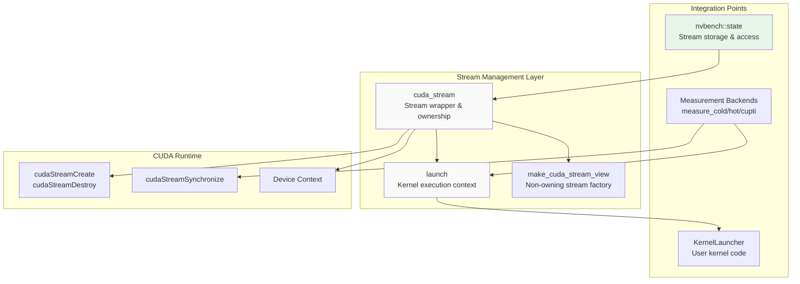
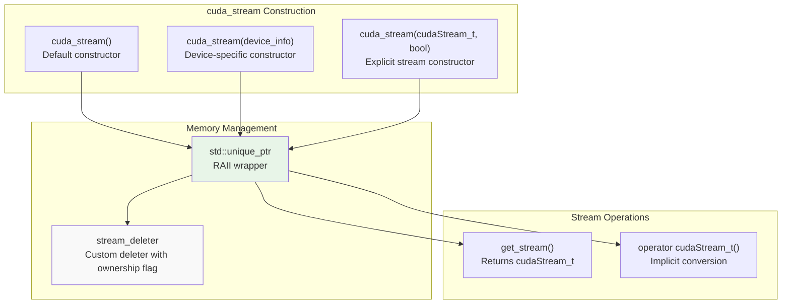
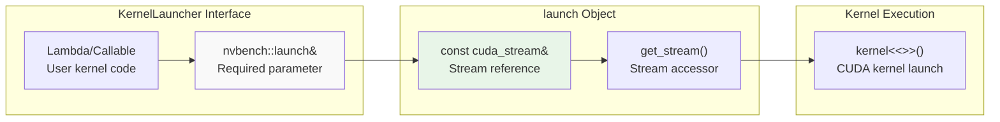
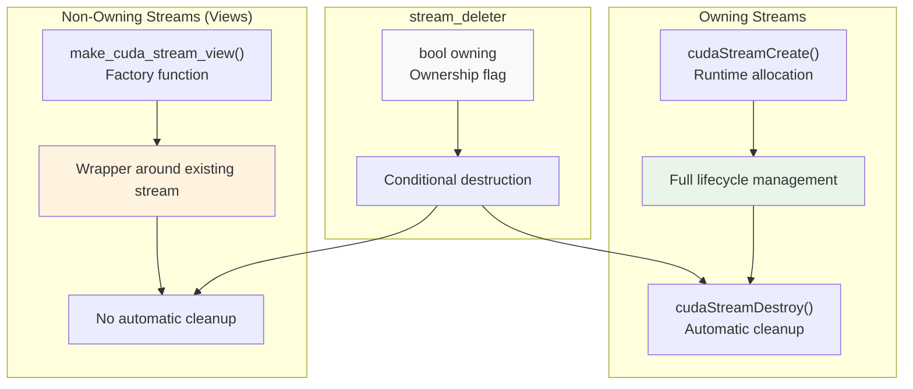
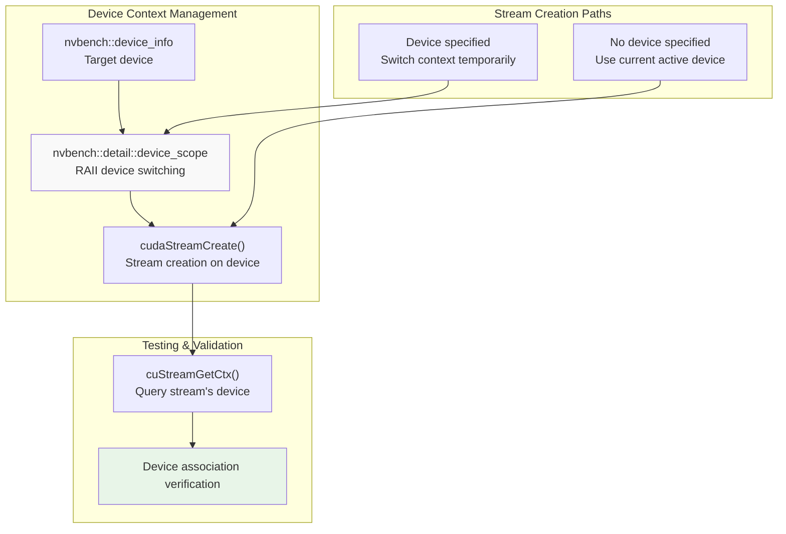
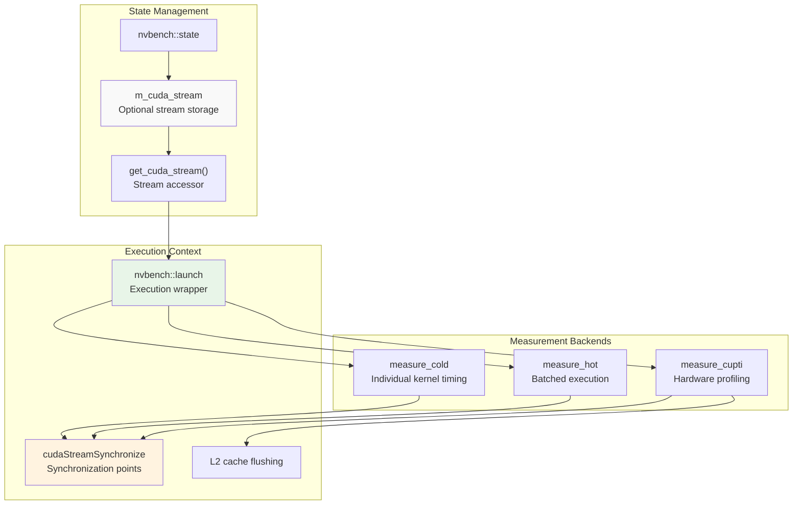
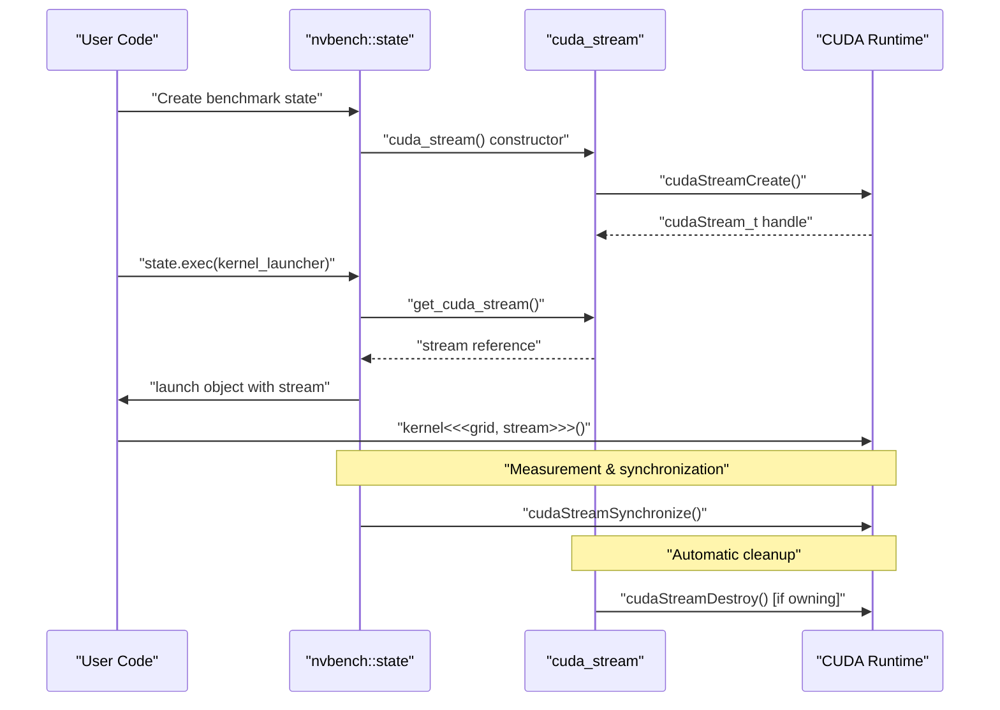
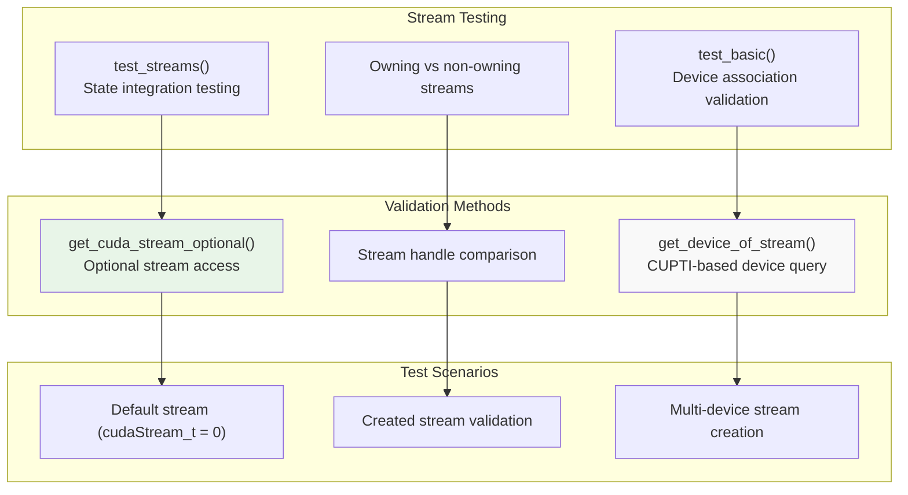

<!-- source: DeepWiki mcp.deepwiki.com · repo NVIDIA/nvbench · page 4.2 CUDA Stream Management · fetched 2026-10-26 -->

# CUDA Stream Management

Relevant source files

The following files were used as context for generating this wiki page:

- [nvbench/cuda_stream.cuh](nvbench/cuda_stream.cuh)
- [nvbench/cupti_profiler.cuh](nvbench/cupti_profiler.cuh)
- [nvbench/detail/measure_cupti.cu](nvbench/detail/measure_cupti.cu)
- [nvbench/detail/measure_cupti.cuh](nvbench/detail/measure_cupti.cuh)
- [nvbench/launch.cuh](nvbench/launch.cuh)
- [testing/cuda_stream.cu](testing/cuda_stream.cu)
- [testing/state.cu](testing/state.cu)

## Purpose and Scope

CUDA Stream Management in NVBench provides a unified interface for managing CUDA streams throughout the benchmarking framework. This system handles stream creation, ownership semantics, device association, and integration with measurement backends. The stream management system ensures proper synchronization and execution context for GPU kernels during benchmarking operations.

For information about device management and GPU control, see [Device Management and GPU Control](#4.1). For details about CUPTI profiling integration, see [CUPTI Profiling Integration](#4.3).

## Stream Architecture Overview

The CUDA stream management system in NVBench consists of two primary components that work together to provide controlled kernel execution:

**Stream Management Architecture**

Sources: [nvbench/cuda_stream.cuh:1-131](), [nvbench/launch.cuh:1-63]()

## Core Components

### cuda_stream Class

The `cuda_stream` struct is the primary abstraction for CUDA stream management, providing both owning and non-owning stream semantics:

**cuda_stream Class Structure**

The class supports three construction patterns:

| Constructor | Purpose | Ownership | Device Context |
|-------------|---------|-----------|----------------|
| `cuda_stream()` | Default stream creation | Owning | Current active device |
| `cuda_stream(device_info)` | Device-specific creation | Owning | Specified device |
| `cuda_stream(cudaStream_t, bool)` | Explicit stream wrapping | Configurable | Stream's device |

Sources: [nvbench/cuda_stream.cuh:42-85]()

### launch Class

The `launch` struct provides the execution context for kernel launchers, containing a reference to the managed CUDA stream:

**launch Object Flow**

Sources: [nvbench/launch.cuh:26-61]()

## Stream Ownership Model

NVBench implements a flexible ownership model for CUDA streams using RAII principles:

**Stream Ownership Model**

The ownership model is implemented through the `stream_deleter` custom deleter:

| Ownership | Creation | Cleanup | Use Case |
|-----------|----------|---------|----------|
| Owning | `cudaStreamCreate()` | `cudaStreamDestroy()` | Primary stream management |
| Non-owning | External source | No cleanup | Views, temporary access |

Sources: [nvbench/cuda_stream.cuh:105-120](), [nvbench/cuda_stream.cuh:122-129]()

## Device Association

CUDA streams in NVBench can be explicitly associated with specific devices using the device-aware constructor:

**Device Association Flow**

Sources: [nvbench/cuda_stream.cuh:50-65](), [testing/cuda_stream.cu:37-46]()

## Integration with Measurement Systems

CUDA streams are central to NVBench's measurement backends, providing controlled execution contexts for timing and profiling:

**Stream Integration with Measurement Systems**

The measurement systems use streams for:
- **Synchronization**: Ensuring accurate timing boundaries
- **L2 Cache Management**: Flushing cache between measurements  
- **CUPTI Integration**: Providing execution context for hardware profiling
- **Batch Control**: Managing multiple kernel executions

Sources: [nvbench/detail/measure_cupti.cuh:63-68](), [nvbench/detail/measure_cupti.cu:163-170]()

## Stream Lifecycle Management

The complete lifecycle of CUDA streams in NVBench follows a well-defined pattern:

**Stream Lifecycle Sequence**

The lifecycle includes these key phases:

| Phase | Operations | Responsibilities |
|-------|------------|------------------|
| **Creation** | `cudaStreamCreate()`, device context setup | Stream allocation, device binding |
| **Usage** | Kernel launches, synchronization | Execution management, timing |
| **Cleanup** | `cudaStreamDestroy()` (if owning) | Resource deallocation |

Sources: [nvbench/cuda_stream.cuh:50-65](), [nvbench/cuda_stream.cuh:110-116]()

## Testing and Validation

NVBench includes comprehensive testing for stream management functionality:

**Testing Framework for Stream Management**

Key testing patterns include:

- **Device Association**: Verifying streams are created on correct devices
- **Ownership Semantics**: Testing both owning and non-owning streams
- **State Integration**: Ensuring proper stream storage and retrieval
- **Multi-device Support**: Validating stream creation across multiple GPUs

Sources: [testing/cuda_stream.cu:50-78](), [testing/state.cu:52-72]()

---

