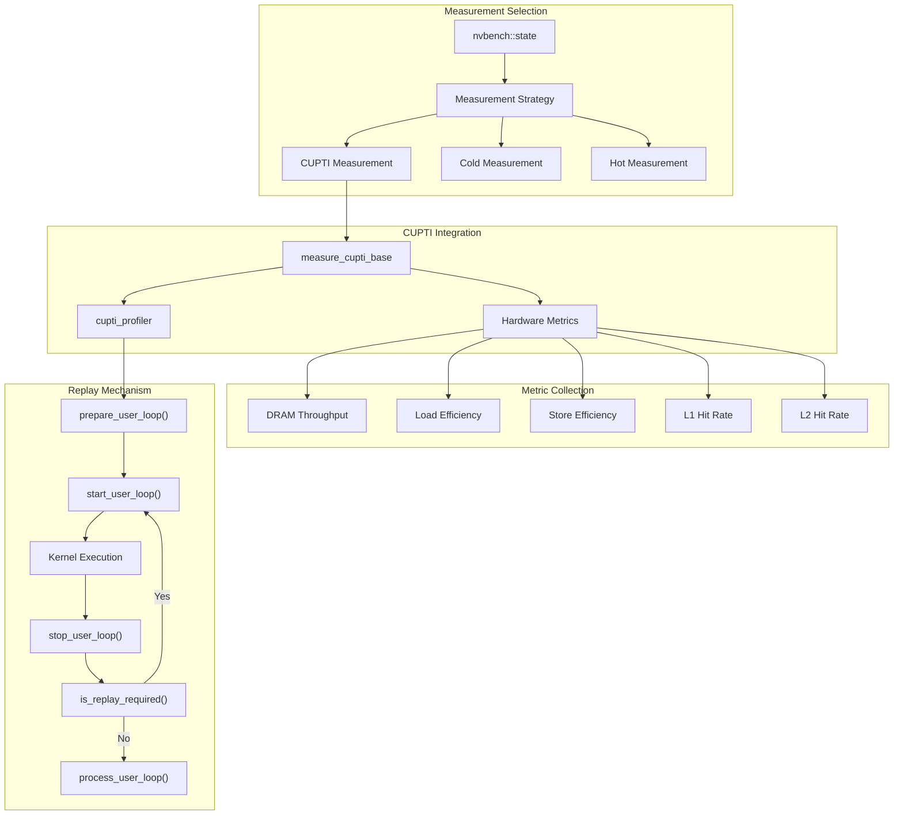
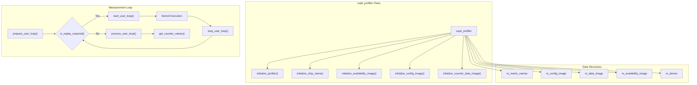
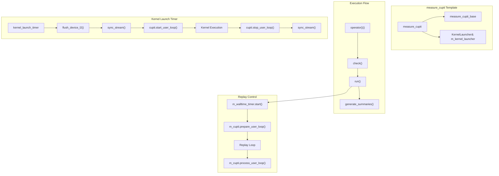
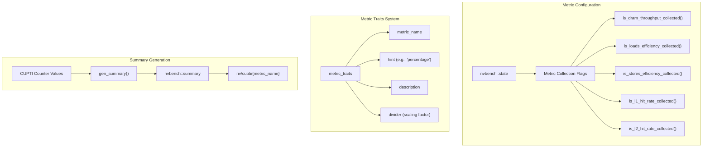
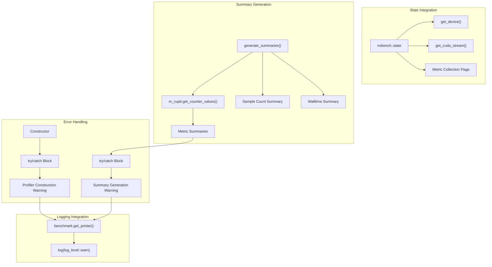
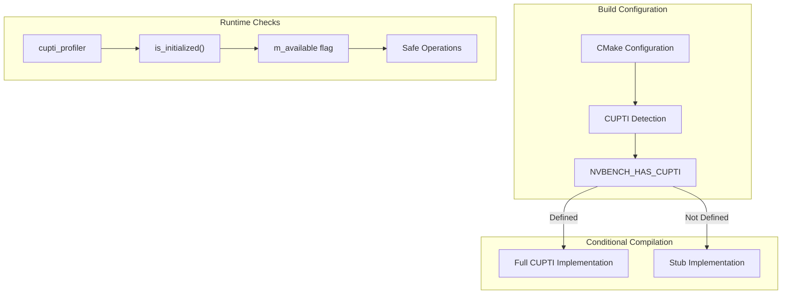

<!-- source: DeepWiki mcp.deepwiki.com · repo NVIDIA/nvbench · page 4.3 CUPTI Profiling Integration · fetched 2026-10-26 -->

# CUPTI Profiling Integration

Relevant source files

The following files were used as context for generating this wiki page:

- [nvbench/cuda_stream.cuh](nvbench/cuda_stream.cuh)
- [nvbench/cupti_profiler.cuh](nvbench/cupti_profiler.cuh)
- [nvbench/detail/measure_cold.cu](nvbench/detail/measure_cold.cu)
- [nvbench/detail/measure_cold.cuh](nvbench/detail/measure_cold.cuh)
- [nvbench/detail/measure_cupti.cu](nvbench/detail/measure_cupti.cu)
- [nvbench/detail/measure_cupti.cuh](nvbench/detail/measure_cupti.cuh)
- [nvbench/detail/measure_hot.cu](nvbench/detail/measure_hot.cu)
- [nvbench/detail/measure_hot.cuh](nvbench/detail/measure_hot.cuh)
- [nvbench/launch.cuh](nvbench/launch.cuh)
- [testing/cuda_stream.cu](testing/cuda_stream.cu)
- [testing/state.cu](testing/state.cu)

This page covers NVBench's integration with NVIDIA's CUPTI (CUDA Profiling Tools Interface) for collecting detailed GPU hardware performance metrics during benchmark execution. CUPTI profiling provides access to low-level hardware counters that are not available through standard CUDA timing mechanisms.

For basic GPU timing measurements, see [Measurement Systems](#3.2). For overall CUDA integration, see [CUDA Integration](#4).

## Purpose and Architecture

The CUPTI profiling system in NVBench enables collection of hardware performance counters such as cache hit rates, memory throughput utilization, and load/store efficiency. This measurement backend operates alongside the standard cold and hot measurement systems but requires multiple kernel replays to collect all requested metrics.

**CUPTI Measurement Architecture**

Sources: [nvbench/detail/measure_cupti.cuh:40-80](), [nvbench/cupti_profiler.cuh:60-123]()

## CUPTI Profiler Implementation

The `cupti_profiler` class encapsulates CUPTI functionality and manages the complex replay-based measurement process required for hardware counter collection.

**CUPTI Profiler Internal Structure**

The profiler uses a single user-defined range (`m_num_ranges = 1`) to encompass all kernel executions within each replay pass. This approach provides aggregate metrics across all kernels in the measurement period.

Sources: [nvbench/cupti_profiler.cuh:62-123](), [nvbench/detail/measure_cupti.cu:163-180]()

## Measurement Process Integration

The CUPTI measurement backend integrates with NVBench's measurement system through the `measure_cupti` template class, which follows the same interface pattern as other measurement backends.

**CUPTI Measurement Execution Flow**

Sources: [nvbench/detail/measure_cupti.cuh:112-150](), [nvbench/detail/measure_cupti.cuh:81-110]()

## Supported Hardware Metrics

NVBench defines a set of commonly used hardware metrics through a template-based system that maps CUPTI metric names to user-friendly identifiers and descriptions.

| Metric ID | CUPTI Metric Name | Display Name | Description |
|-----------|-------------------|--------------|-------------|
| `dram_peak_sustained_throughput` | `dram__throughput.avg.pct_of_peak_sustained_elapsed` | HBWPeak | Device memory utilization relative to peak |
| `global_load_efficiency` | `smsp__sass_average_data_bytes_per_sector_mem_global_op_ld.pct` | LoadEff | Global memory load throughput efficiency |
| `global_store_efficiency` | `smsp__sass_average_data_bytes_per_sector_mem_global_op_st.pct` | StoreEff | Global memory store throughput efficiency |
| `l1_hit_rate` | `l1tex__t_sector_hit_rate.pct` | L1HitRate | L1 cache hit rate percentage |
| `l2_hit_rate` | `lts__t_sector_hit_rate.pct` | L2HitRate | L2 cache hit rate percentage |

**Hardware Metrics Configuration and Collection**

The metric selection is controlled by state configuration flags, and each metric has associated traits that define its CUPTI name, display properties, and scaling factors.

Sources: [nvbench/detail/measure_cupti.cu:36-160](), [nvbench/detail/measure_cupti.cu:196-224]()

## Integration with State and Summary System

CUPTI measurements integrate seamlessly with NVBench's state management and summary generation systems, providing consistent output formatting and error handling.

**CUPTI Integration with NVBench Infrastructure**

The CUPTI measurement system includes comprehensive error handling since CUPTI operations can fail due to driver limitations, insufficient privileges, or hardware constraints.

Sources: [nvbench/detail/measure_cupti.cu:163-180](), [nvbench/detail/measure_cupti.cu:227-268]()

## Conditional Compilation and Availability

CUPTI functionality is conditionally compiled based on the `NVBENCH_HAS_CUPTI` preprocessor definition. When CUPTI is not available, the profiler class provides stub implementations to maintain interface compatibility.

**CUPTI Availability and Conditional Compilation**

Sources: [nvbench/cupti_profiler.cuh:31-124](), [nvbench/detail/measure_cupti.cuh:22]()

---

