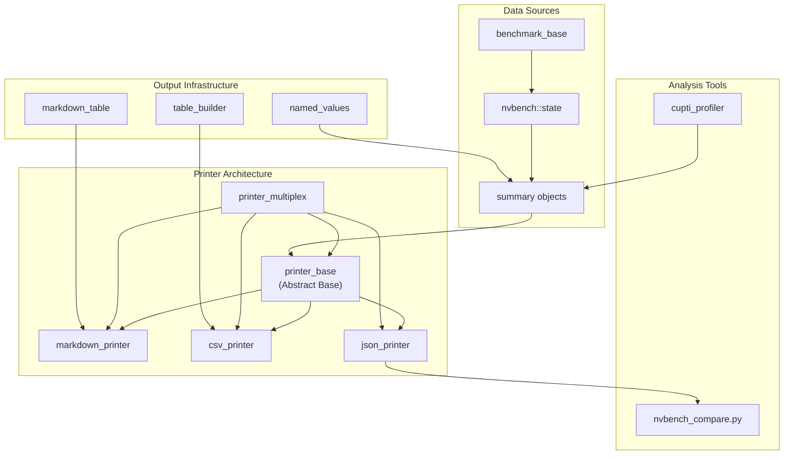
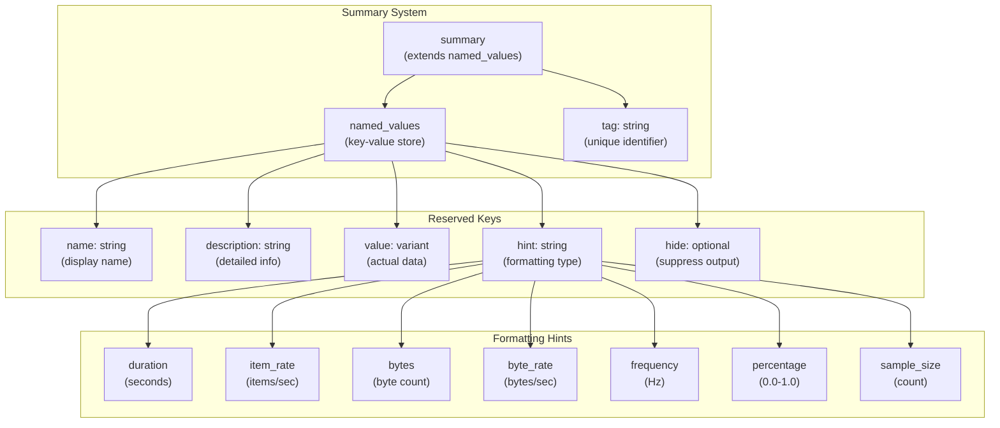
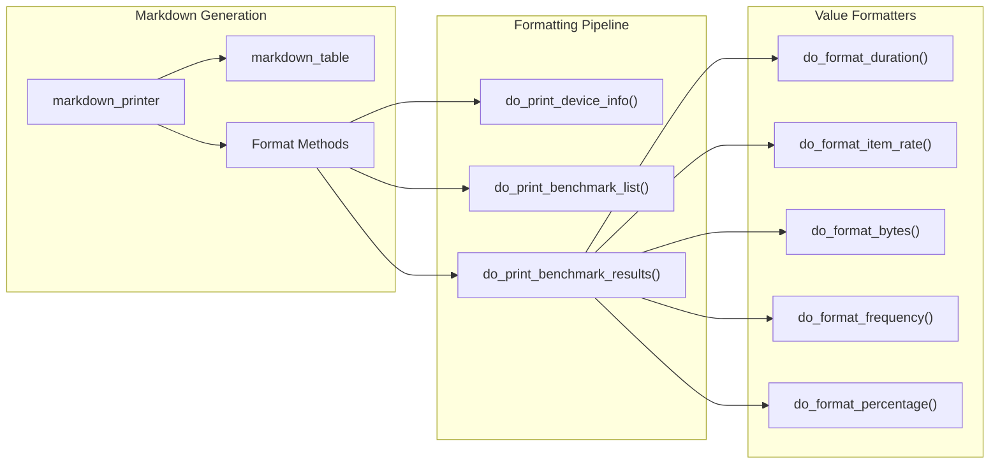
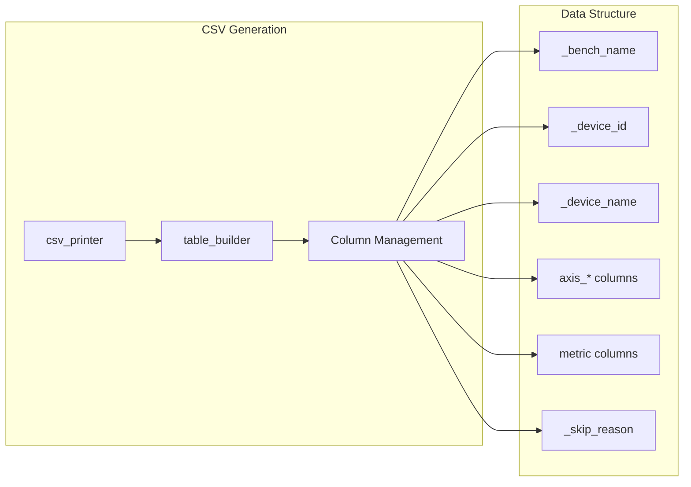
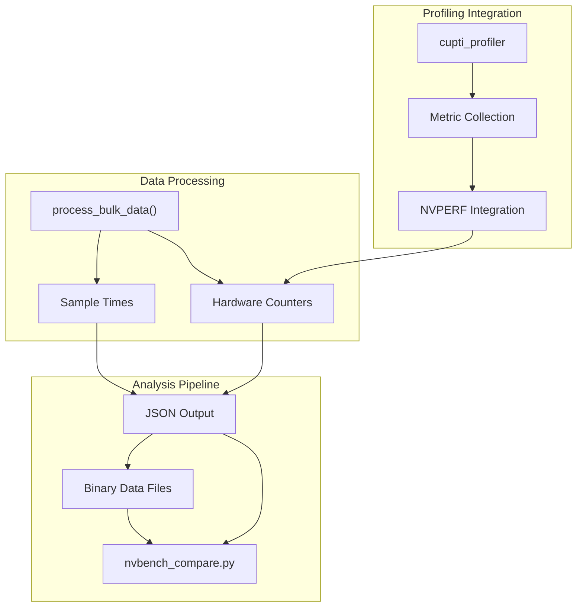
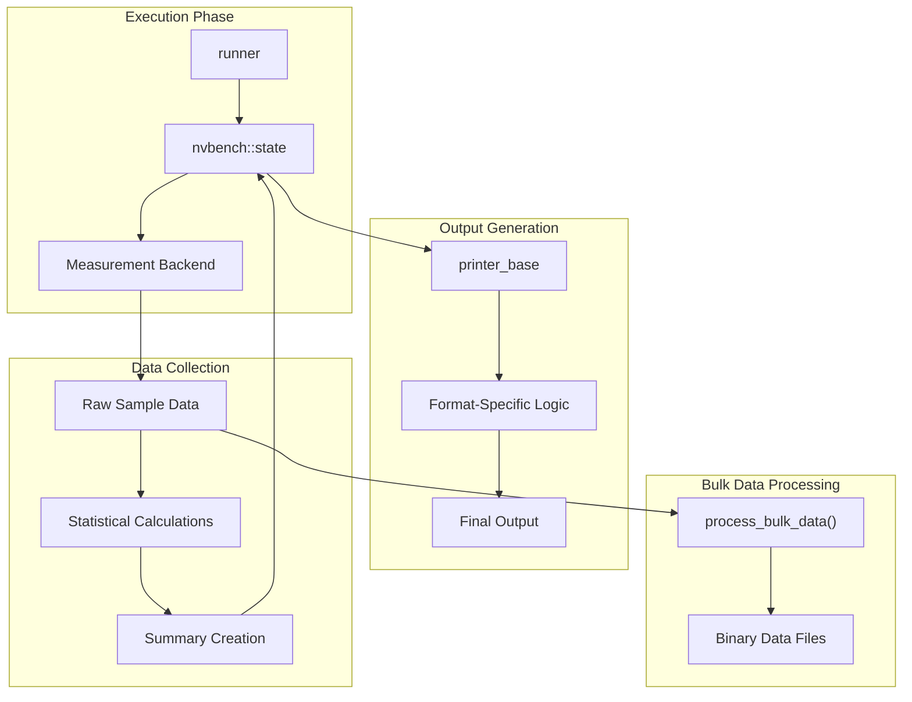

<!-- source: DeepWiki mcp.deepwiki.com · repo NVIDIA/nvbench · page 5 Output and Analysis · fetched 2026-10-26 -->

# Output and Analysis

Relevant source files

The following files were used as context for generating this wiki page:

- [nvbench/csv_printer.cu](nvbench/csv_printer.cu)
- [nvbench/csv_printer.cuh](nvbench/csv_printer.cuh)
- [nvbench/cupti_profiler.cxx](nvbench/cupti_profiler.cxx)
- [nvbench/internal/markdown_table.cuh](nvbench/internal/markdown_table.cuh)
- [nvbench/internal/table_builder.cuh](nvbench/internal/table_builder.cuh)
- [nvbench/json_printer.cuh](nvbench/json_printer.cuh)
- [nvbench/markdown_printer.cu](nvbench/markdown_printer.cu)
- [nvbench/markdown_printer.cuh](nvbench/markdown_printer.cuh)
- [nvbench/printer_base.cuh](nvbench/printer_base.cuh)
- [nvbench/printer_base.cxx](nvbench/printer_base.cxx)
- [nvbench/printer_multiplex.cuh](nvbench/printer_multiplex.cuh)
- [nvbench/printer_multiplex.cxx](nvbench/printer_multiplex.cxx)
- [nvbench/summary.cuh](nvbench/summary.cuh)

This section covers NVBench's output generation and analysis capabilities, including the printer system that formats benchmark results, the summary data model that stores performance metrics, and the tools available for analyzing and comparing benchmark results.

For information about configuring output formats via command line, see [Command Line Interface](#2.3). For details about the comparison tools and analysis workflows, see [Benchmark Comparison Tools](#5.2).

## Output System Architecture

NVBench's output system is built around a polymorphic printer architecture that supports multiple output formats and can multiplex results to different destinations simultaneously.

Sources: [nvbench/printer_base.cuh:54-218](), [nvbench/printer_multiplex.cuh:32-63](), [nvbench/markdown_printer.cuh:36-74]()

The `printer_base` class defines the interface for all output formats, providing virtual methods for device information, logging, and benchmark results. The `printer_multiplex` class allows simultaneous output to multiple formats, which is commonly used to display results on screen while also saving to files.

## Summary Data Model

The core data structure for benchmark results is the `summary` class, which stores individual performance metrics with associated metadata and formatting hints.

Sources: [nvbench/summary.cuh:87-105](), [nvbench/named_values.cuh]()

Each `summary` object contains a hierarchical tag (e.g., `"nv/cold/time/gpu/mean"`) and stores performance data with formatting hints that determine how the data should be displayed in different output formats.

## Output Format Implementations

NVBench supports three primary output formats, each optimized for different use cases:

### Markdown Format

The `markdown_printer` generates human-readable tables with optional color support and automatic unit formatting.

Sources: [nvbench/markdown_printer.cu:39-496](), [nvbench/internal/markdown_table.cuh:47-149]()

The markdown format includes device information sections, benchmark configuration lists, and formatted results tables. Values are automatically formatted with appropriate units (e.g., "1.23 ms", "456.7 MB/s", "2^10 = 1024").

### CSV Format  

The `csv_printer` produces machine-readable comma-separated values suitable for data analysis and plotting tools.

Sources: [nvbench/csv_printer.cu:37-181](), [nvbench/internal/table_builder.cuh:32-79]()

The CSV format flattens all benchmark data into a single table with columns for benchmark name, device information, parameter axes, and all measured metrics.

### JSON Format

The `json_printer` creates structured JSON output with full metadata preservation and optional binary data files.

Sources: [nvbench/json_printer.cuh:36-78]()

## Analysis and Profiling Integration

NVBench integrates with CUPTI for detailed GPU profiling and provides analysis tools for comparing benchmark results across different configurations.

Sources: [nvbench/cupti_profiler.cxx:64-756](), [nvbench/printer_base.cuh:134-140]()

The `cupti_profiler` class manages GPU profiling sessions and collects hardware performance counters. Raw sample data can be written to binary files for detailed analysis, while aggregate metrics are stored in summary objects for display.

## Data Flow from Execution to Output

The complete pipeline from benchmark execution to formatted output follows this flow:

Sources: [nvbench/state.cuh](), [nvbench/printer_base.cuh:134-140](), [nvbench/summary.cuh:87-105]()

During benchmark execution, measurement backends collect raw timing data and performance metrics. This data is processed to compute statistics (mean, standard deviation, etc.) and stored in `summary` objects attached to the benchmark `state`. The printer system then formats these summaries according to the selected output format, while bulk data processing can optionally save raw samples to binary files for detailed analysis.

---

