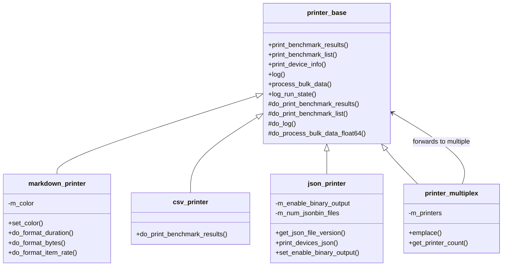
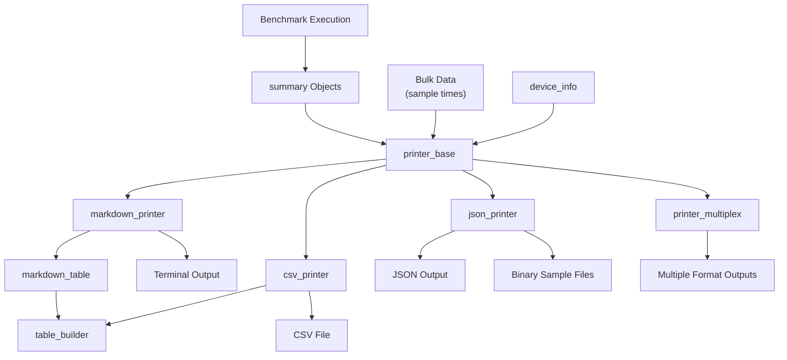
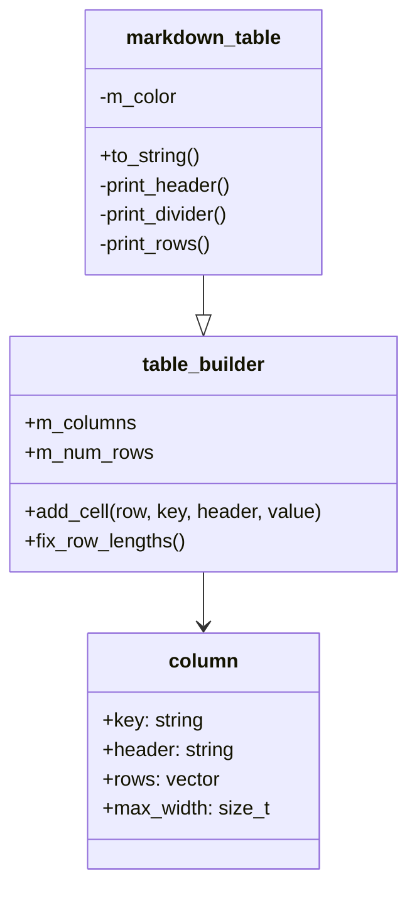

<!-- source: DeepWiki mcp.deepwiki.com · repo NVIDIA/nvbench · page 5.1 Output Formats and Printers · fetched 2026-10-26 -->

# Output Formats and Printers

<details>
<summary>Relevant source files</summary>

The following files were used as context for generating this wiki page:

- [nvbench/csv_printer.cu](nvbench/csv_printer.cu)
- [nvbench/csv_printer.cuh](nvbench/csv_printer.cuh)
- [nvbench/cupti_profiler.cxx](nvbench/cupti_profiler.cxx)
- [nvbench/internal/markdown_table.cuh](nvbench/internal/markdown_table.cuh)
- [nvbench/internal/table_builder.cuh](nvbench/internal/table_builder.cuh)
- [nvbench/json_printer.cu](nvbench/json_printer.cu)
- [nvbench/json_printer.cuh](nvbench/json_printer.cuh)
- [nvbench/markdown_printer.cu](nvbench/markdown_printer.cu)
- [nvbench/markdown_printer.cuh](nvbench/markdown_printer.cuh)
- [nvbench/printer_base.cuh](nvbench/printer_base.cuh)
- [nvbench/printer_base.cxx](nvbench/printer_base.cxx)
- [nvbench/printer_multiplex.cuh](nvbench/printer_multiplex.cuh)
- [nvbench/printer_multiplex.cxx](nvbench/printer_multiplex.cxx)
- [nvbench/stopping_criterion.cxx](nvbench/stopping_criterion.cxx)
- [nvbench/summary.cuh](nvbench/summary.cuh)
- [testing/criterion_params.cu](testing/criterion_params.cu)
- [testing/device/noisy_bench.cu](testing/device/noisy_bench.cu)

</details>


This document covers NVBench's output system, which formats and presents benchmark results in multiple formats including Markdown, CSV, and JSON. The printer system provides a flexible architecture for generating different output formats from the same benchmark data.

For information about benchmark comparison and analysis tools that work with these output formats, see [Benchmark Comparison Tools](#5.2).

## Architecture Overview

NVBench's output system is built around a polymorphic printer hierarchy that processes benchmark results and formats them for different consumers.

### Printer Class Hierarchy



Sources: [nvbench/printer_base.cuh:54-218](), [nvbench/markdown_printer.cuh:36-76](), [nvbench/csv_printer.cuh:29-38](), [nvbench/json_printer.cuh:36-80](), [nvbench/printer_multiplex.cuh:32-65]()

### Data Flow Architecture



Sources: [nvbench/printer_base.cuh:132-140](), [nvbench/summary.cuh:87-105](), [nvbench/json_printer.cu:131-219](), [nvbench/markdown_printer.cu:210-341]()

## Core Components

### printer_base

The `printer_base` class defines the interface that all output formats must implement. It provides both public methods for consumers and protected virtual methods for subclasses to override.

Key interface methods:
- `print_benchmark_results()` - Main method for outputting final results
- `print_benchmark_list()` - Used for `--list` command to show available benchmarks  
- `process_bulk_data()` - Handles large datasets like raw sample times
- `log()` - Outputs progress and status messages during execution

The base class tracks execution progress through `m_completed_state_count` and `m_total_state_count` for interactive progress display.

Sources: [nvbench/printer_base.cuh:45-218](), [nvbench/printer_base.cxx:26-47]()

### summary Objects

The `summary` class represents individual benchmark results with metadata. Each summary contains:
- **Tag**: Unique identifier like `"nv/cold/time/gpu/mean"`
- **Named values**: Key-value pairs including `"name"`, `"value"`, `"hint"`, `"description"`
- **Formatting hints**: Guide output formatting (e.g., `"duration"`, `"bytes"`, `"item_rate"`)

Reserved keys with special meaning:
- `"name"`: Display name for table headers
- `"value"`: The actual measured value
- `"hint"`: Formatting hint for proper display
- `"hide"`: If present, excludes from markdown tables

Sources: [nvbench/summary.cuh:29-105]()

## Output Formats

### Markdown Printer

The `markdown_printer` generates human-readable tables with optional terminal colors. It includes specialized formatting for different data types:

| Hint | Formatting | Example |
|------|------------|---------|
| `duration` | Automatic time units | `1.234 ms`, `56.7 us` |
| `bytes` | Binary size units | `1.23 GiB`, `456 KiB` |
| `item_rate` | Rate with SI prefixes | `12.3M` items/sec |
| `byte_rate` | Bandwidth units | `4.56 GB/s` |
| `percentage` | Percentage display | `12.34%` |

The printer uses `markdown_table` internally for consistent table formatting and supports colored output for terminal display.

Sources: [nvbench/markdown_printer.cu:210-495](), [nvbench/internal/markdown_table.cuh:47-149]()

### CSV Printer

The `csv_printer` generates comma-separated values suitable for spreadsheet analysis. It flattens all benchmark data into a tabular format with columns for:
- Benchmark metadata (`_bench_name`, `_device_id`, `_device_name`)
- Axis values (parameter combinations)
- Summary values with units in headers
- Skip status and reasons

Power-of-two integer axes get special treatment with both exponential (`2^10`) and plain (`1024`) representations.

Sources: [nvbench/csv_printer.cu:37-180]()

### JSON Printer

The `json_printer` produces structured JSON output with comprehensive metadata. The output includes:

```json
{
  "meta": {
    "version": {
      "json": {"major": 1, "minor": 0, "patch": 0},
      "nvbench": {"major": 1, "minor": 0, "patch": 0, "git_sha": "..."}
    },
    "argv": ["./benchmark", "--devices", "0"]
  },
  "devices": [...],
  "benchmarks": [...]
}
```

Key features:
- **Schema versioning**: Uses semantic versioning for compatibility
- **Binary output**: Optional binary files for raw sample data  
- **Device information**: Complete GPU device specifications
- **Axis metadata**: Full parameter space definition

The JSON format is designed for programmatic analysis and post-processing tools.

Sources: [nvbench/json_printer.cu:114-502](), [nvbench/json_printer.cuh:46-58]()

### Printer Multiplex

The `printer_multiplex` enables multiple output formats simultaneously by forwarding all method calls to registered printers:

```cpp
printer_multiplex multiplex;
auto& md_printer = multiplex.emplace<markdown_printer>(std::cout, "stdout");
auto& json_printer = multiplex.emplace<json_printer>(json_file, "results.json");
```

This allows generating both terminal output and file output in a single benchmark run.

Sources: [nvbench/printer_multiplex.cuh:32-65](), [nvbench/printer_multiplex.cxx:26-131]()

## Bulk Data Processing

The printer system includes special handling for large datasets through the `process_bulk_data()` method. This is primarily used for raw sample times data:

### JSON Binary Output

When enabled, the JSON printer saves raw sample times as binary files:
- **Format**: Little-endian float32 values
- **Directory**: `{output_name}-bin/`  
- **Indexing**: Sequential numeric filenames (`0.bin`, `1.bin`, etc.)
- **Metadata**: File references stored in JSON summaries with `"file/sample_times"` hint

This enables efficient storage and analysis of large sample datasets while maintaining JSON compatibility.

Sources: [nvbench/json_printer.cu:131-219]()

## Integration with Benchmark System

### Printer Assignment

Printers are typically assigned to benchmarks during execution setup. The benchmark system calls printer methods at specific points:

1. **Initialization**: `print_device_info()`, `print_log_preamble()`
2. **Execution**: `log_run_state()`, `log()` for each measurement
3. **Data processing**: `process_bulk_data()` for large datasets  
4. **Finalization**: `print_benchmark_results()`, `print_log_epilogue()`

### Progress Tracking

Printers track execution progress through the base class interface:
- `set_total_state_count()` - Called once with total number of states
- `add_completed_state()` - Called after each state completes
- Progress information enables interactive display updates

Sources: [nvbench/printer_base.cuh:160-181](), [nvbench/markdown_printer.cu:139-153]()

## Table Building Infrastructure

Both CSV and Markdown printers use the `table_builder` infrastructure for consistent table formatting:



The `table_builder` manages columns dynamically, tracking maximum widths for consistent formatting. The `markdown_table` extends this with color support and markdown-specific formatting.

Sources: [nvbench/internal/table_builder.cuh:32-79](), [nvbench/internal/markdown_table.cuh:47-149]()

---

