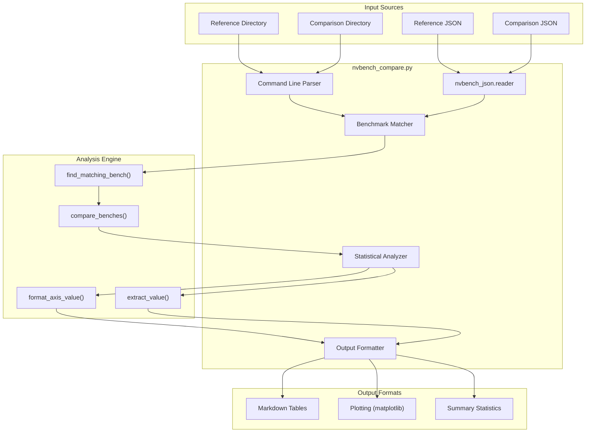
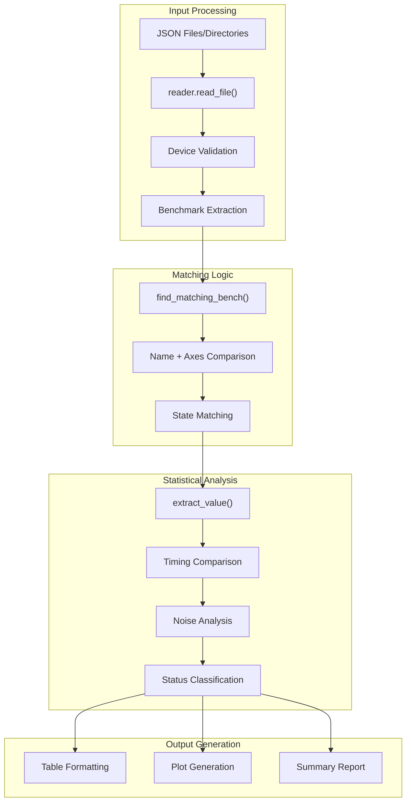
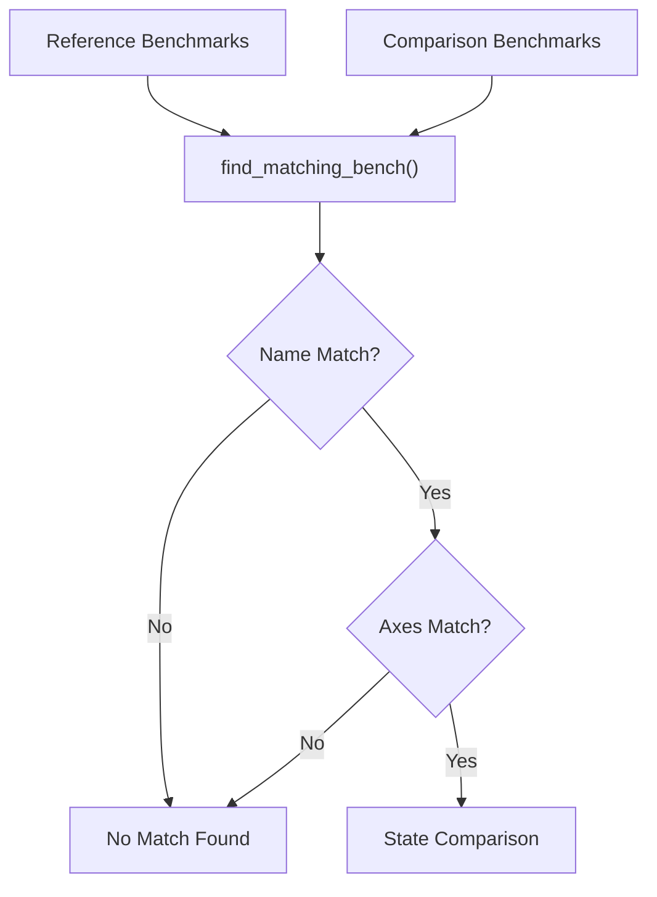
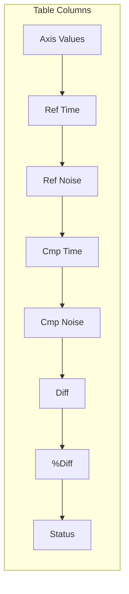
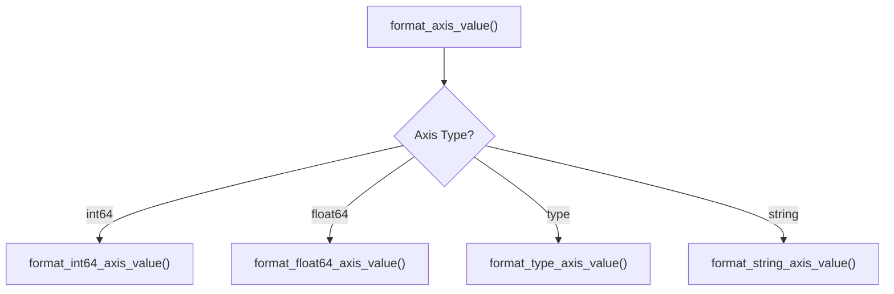
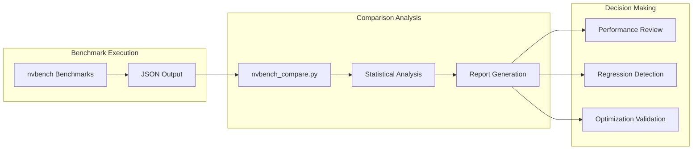

<!-- source: DeepWiki mcp.deepwiki.com · repo NVIDIA/nvbench · page 5.2 Benchmark Comparison Tools · fetched 2026-10-26 -->

# Benchmark Comparison Tools

<details>
<summary>Relevant source files</summary>

The following files were used as context for generating this wiki page:

- [scripts/nvbench_compare.py](scripts/nvbench_compare.py)
- [scripts/test_cmp.json](scripts/test_cmp.json)
- [scripts/test_ref.json](scripts/test_ref.json)

</details>


This page covers NVBench's benchmark comparison tools, primarily the `nvbench_compare.py` script and related utilities for analyzing and comparing benchmark results. These tools enable developers to compare performance measurements between different runs, versions, or configurations of CUDA benchmarks.

For information about generating the JSON output files that these tools consume, see [Output Formats and Printers](#5.1). For details about the underlying benchmark execution and measurement systems, see [Measurement Systems](#3.2).

## Overview

The benchmark comparison system provides automated analysis of NVBench JSON output files to identify performance regressions, improvements, and statistical significance of timing differences. The primary tool is a Python script that processes JSON benchmark results and generates comparison reports with statistical analysis.

## Core Components

### nvbench_compare.py Script

The main comparison tool is implemented in `nvbench_compare.py`, which provides command-line functionality for comparing benchmark results.



Sources: [scripts/nvbench_compare.py:1-393]()

### Data Flow Architecture



Sources: [scripts/nvbench_compare.py:327-392](), [scripts/nvbench_compare.py:101-326]()

## Input Data Format

The comparison tools expect JSON files in the NVBench output format, which contains structured benchmark data.

### JSON Schema Structure

| Component | Description | Location in JSON |
|-----------|-------------|------------------|
| **Meta Information** | Command line args, version info | `meta.argv`, `meta.version` |
| **Device Data** | GPU specifications and properties | `devices[].name`, `devices[].id` |
| **Benchmark Definitions** | Test configurations and parameters | `benchmarks[].name`, `benchmarks[].axes` |
| **State Results** | Individual measurement results | `benchmarks[].states[].summaries` |
| **Summary Tags** | Timing and performance metrics | `summaries[].tag`, `summaries[].data` |

Sources: [scripts/test_ref.json:1-50](), [scripts/test_cmp.json:1-50]()

### Critical Summary Tags

The comparison tool specifically looks for these measurement tags:

- `nv/cold/time/gpu/mean` - Primary GPU timing measurement
- `nv/cold/time/gpu/stdev/relative` - Relative standard deviation (noise)
- `nv/cold/time/cpu/mean` - CPU timing measurement  
- `nv/cold/time/cpu/stdev/relative` - CPU noise measurement

Sources: [scripts/nvbench_compare.py:170-181]()

## Comparison Logic

### Benchmark Matching Algorithm



The matching logic in `find_matching_bench()` ensures benchmarks are compared only when they have identical names and axis configurations.

Sources: [scripts/nvbench_compare.py:27-31]()

### Statistical Classification

The tool classifies performance differences using noise-based thresholds:

| Status | Condition | Color Coding | Interpretation |
|--------|-----------|--------------|----------------|
| **SAME** | `abs(frac_diff) <= min_noise` | Blue | No significant change |
| **FAST** | `diff < 0 && abs(frac_diff) > min_noise` | Green | Performance improvement |
| **SLOW** | `diff > 0 && abs(frac_diff) > min_noise` | Red | Performance regression |
| **????** | `min_noise == null` | Yellow | Insufficient data for analysis |

Sources: [scripts/nvbench_compare.py:258-270]()

### Noise Calculation

```python
min_noise = min(ref_noise, cmp_noise)  # Use the lower noise value
status = "SAME" if abs(frac_diff) <= min_noise else ("FAST" if diff < 0 else "SLOW")
```

This approach ensures that differences must exceed the measurement noise to be considered significant.

Sources: [scripts/nvbench_compare.py:215-227](), [scripts/nvbench_compare.py:262-270]()

## Command Line Interface

### Basic Usage Patterns

```bash
# Compare two JSON files
nvbench_compare.py reference.json comparison.json

# Compare directories (matches files by name)
nvbench_compare.py reference_dir/ comparison_dir/

# Filter results by threshold
nvbench_compare.py --threshold-diff 0.05 ref.json cmp.json

# Generate plots along a specific axis
nvbench_compare.py --plot-along Duration ref.json cmp.json
```

### Command Line Arguments

| Argument | Type | Default | Purpose |
|----------|------|---------|---------|
| `--threshold-diff` | `float` | `0.0` | Minimum percentage difference to display |
| `--plot-along` | `string` | `None` | Axis name for plotting results |
| `files_or_dirs` | `positional` | Required | Reference and comparison targets |

Sources: [scripts/nvbench_compare.py:329-341]()

## Output Formats

### Markdown Table Output

The tool generates formatted tables with benchmark comparison results:



The table format adapts based on the `tabulate` library version, using GitHub-flavored markdown when possible.

Sources: [scripts/nvbench_compare.py:122-138](), [scripts/nvbench_compare.py:289-296]()

### Plotting Functionality

When `--plot-along` is specified, the tool generates matplotlib visualizations:

- **X-axis**: Selected parameter values (log scale)
- **Y-axis**: Timing measurements (log scale)  
- **Error bars**: Noise-based confidence intervals
- **Line styles**: Solid for comparison, dashed for reference

Sources: [scripts/nvbench_compare.py:300-324]()

### Summary Statistics

The tool provides aggregate analysis at the end of each run:

| Metric | Description |
|--------|-------------|
| **Total Matches** | Number of comparable benchmark states |
| **Pass** | States with differences within noise |
| **Unknown** | States with infinite noise measurements |
| **Failure** | States with significant differences |

Sources: [scripts/nvbench_compare.py:383-388]()

## Utility Functions

### Value Formatting

The tool includes specialized formatters for different data types:



Special handling includes power-of-2 formatting for integer axes and scientific notation for floating-point values.

Sources: [scripts/nvbench_compare.py:41-74]()

### Duration and Percentage Formatting

- **Duration formatting**: Automatic unit selection (s/ms/μs) based on magnitude
- **Percentage formatting**: Handles null values (infinite noise) gracefully
- **Device lookup**: Efficient device information retrieval by ID

Sources: [scripts/nvbench_compare.py:76-99](), [scripts/nvbench_compare.py:34-38]()

## Integration with NVBench Ecosystem

The comparison tools integrate seamlessly with the broader NVBench workflow:



This workflow enables automated performance monitoring and regression testing in continuous integration environments.

Sources: [scripts/nvbench_compare.py:367-381]()

---

