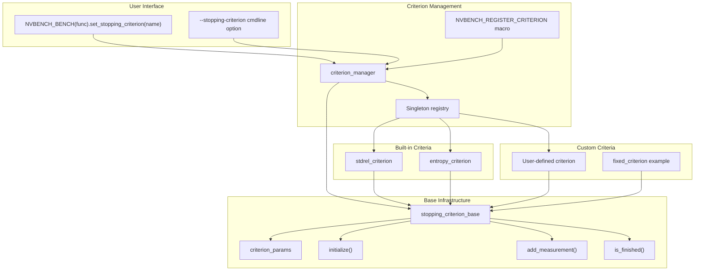
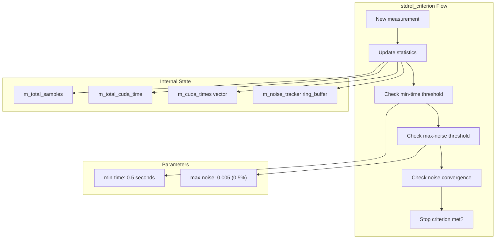
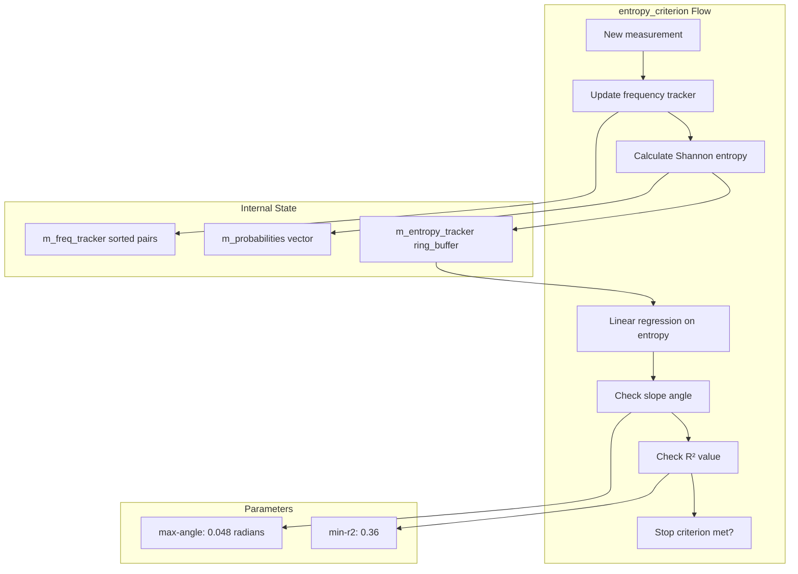
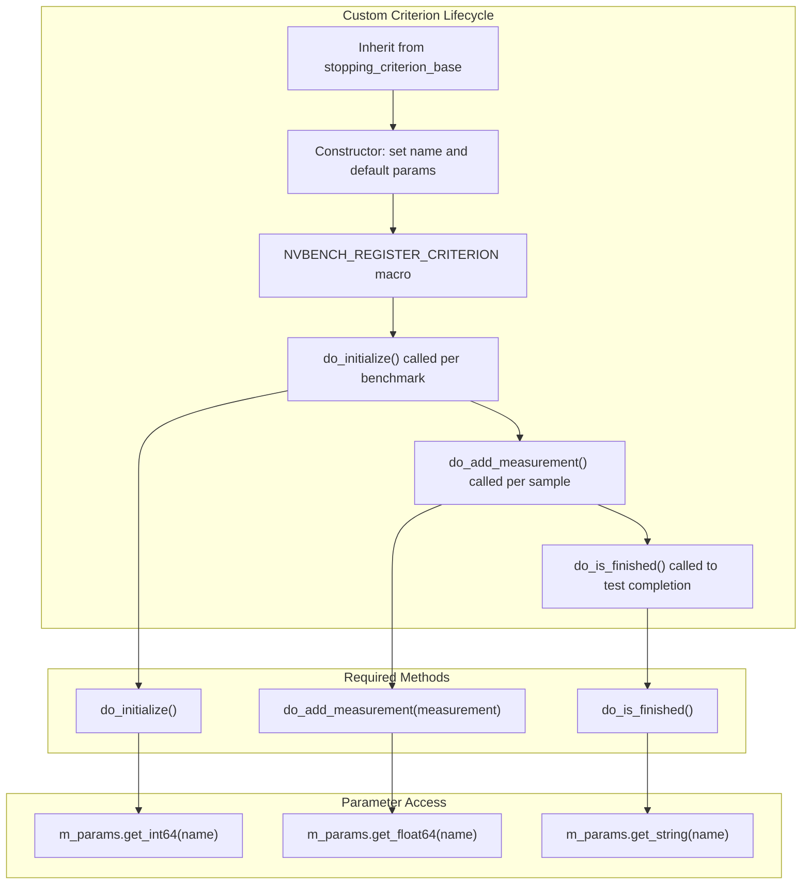
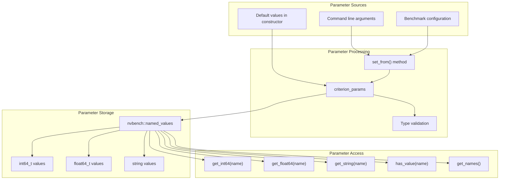

<!-- source: DeepWiki mcp.deepwiki.com · repo NVIDIA/nvbench · page 6 Advanced Features · fetched 2026-10-26 -->

# Advanced Features

<details>
<summary>Relevant source files</summary>

The following files were used as context for generating this wiki page:

- [examples/custom_criterion.cu](examples/custom_criterion.cu)
- [nvbench/criterion_manager.cuh](nvbench/criterion_manager.cuh)
- [nvbench/criterion_manager.cxx](nvbench/criterion_manager.cxx)
- [nvbench/detail/entropy_criterion.cuh](nvbench/detail/entropy_criterion.cuh)
- [nvbench/detail/entropy_criterion.cxx](nvbench/detail/entropy_criterion.cxx)
- [nvbench/detail/stdrel_criterion.cuh](nvbench/detail/stdrel_criterion.cuh)
- [nvbench/detail/stdrel_criterion.cxx](nvbench/detail/stdrel_criterion.cxx)
- [nvbench/stopping_criterion.cuh](nvbench/stopping_criterion.cuh)
- [testing/criterion_manager.cu](testing/criterion_manager.cu)

</details>


This page covers advanced configuration options and customization capabilities in NVBench, focusing on the stopping criteria system and extensibility features. These features allow users to fine-tune benchmark behavior and create custom measurement termination logic.

For basic benchmark configuration and parameter axes, see [Parameter Axes and Configuration](#3.4). For measurement system details, see [Measurement Systems](#3.2).

## Stopping Criteria System

The stopping criteria system determines when a benchmark has collected sufficient measurements to produce reliable results. NVBench provides a pluggable architecture that allows both built-in and custom criteria.

### Stopping Criteria Architecture



Sources: [nvbench/stopping_criterion.cuh:70-127](), [nvbench/criterion_manager.cuh:32-56](), [examples/custom_criterion.cu:27-55]()

### Core Components

The stopping criteria system consists of several key components:

| Component | Purpose | Location |
|---|---|---|
| `stopping_criterion_base` | Abstract base class for all criteria | [nvbench/stopping_criterion.cuh:70-127]() |
| `criterion_manager` | Singleton registry managing all criteria | [nvbench/criterion_manager.cuh:32-56]() |
| `criterion_params` | Parameter storage and management | [nvbench/stopping_criterion.cuh:39-65]() |
| `NVBENCH_REGISTER_CRITERION` | Macro for registering custom criteria | [nvbench/criterion_manager.cuh:63-65]() |

Sources: [nvbench/stopping_criterion.cuh:1-130](), [nvbench/criterion_manager.cuh:1-68]()

## Built-in Stopping Criteria

NVBench includes two sophisticated built-in stopping criteria designed for different measurement scenarios.

### Standard Relative Deviation Criterion

The `stdrel_criterion` stops when measurements achieve statistical stability based on relative standard deviation.



**Parameters:**
- `max-noise`: Maximum acceptable relative standard deviation (default: 0.005 = 0.5%)
- `min-time`: Minimum total measurement time before stopping (default: 0.5 seconds)

**Algorithm:**
1. Accumulates measurements and computes running statistics
2. Calculates relative standard deviation of CUDA timing measurements
3. Stops when noise drops below threshold OR noise has converged to a stable level
4. Uses a ring buffer to track noise convergence over time

Sources: [nvbench/detail/stdrel_criterion.cxx:24-96](), [nvbench/detail/stdrel_criterion.cuh:30-45]()

### Entropy-Based Criterion

The `entropy_criterion` uses information theory to detect when measurement distribution has stabilized.



**Parameters:**
- `max-angle`: Maximum acceptable slope angle in radians (default: 0.048)
- `min-r2`: Minimum R² value for linear regression (default: 0.36)

**Algorithm:**
1. Tracks frequency distribution of measurement values
2. Computes Shannon entropy: H = -Σ(p_i * log₂(p_i))
3. Performs linear regression on entropy values over time
4. Stops when entropy slope is sufficiently flat with good R² fit

Sources: [nvbench/detail/entropy_criterion.cxx:27-134](), [nvbench/detail/entropy_criterion.cuh:30-52]()

## Custom Stopping Criteria

Users can create custom stopping criteria by inheriting from `stopping_criterion_base` and implementing the required virtual methods.

### Custom Criterion Implementation Pattern



### Example: Fixed Sample Count Criterion

The `fixed_criterion` example demonstrates a simple custom criterion that stops after a fixed number of measurements:

**Key Implementation Details:**
- **Constructor**: Sets criterion name and default parameters
- **State Management**: Tracks sample count in `m_num_samples`
- **Parameter Access**: Retrieves `max-samples` parameter value
- **Registration**: Uses `NVBENCH_REGISTER_CRITERION` macro

**Usage Pattern:**
```cpp
// In benchmark definition
NVBENCH_BENCH(my_function).set_stopping_criterion("fixed");

// Command line usage
./my_benchmark --stopping-criterion fixed --max-samples 100
```

Sources: [examples/custom_criterion.cu:28-55](), [examples/custom_criterion.cu:77-77]()

## Parameter Management System

The `criterion_params` class provides type-safe parameter storage and retrieval for stopping criteria.

### Parameter System Architecture



### Parameter Types and Methods

| Method | Purpose | Return Type |
|---|---|---|
| `set_int64(name, value)` | Set integer parameter | `void` |
| `set_float64(name, value)` | Set floating-point parameter | `void` |
| `set_string(name, value)` | Set string parameter | `void` |
| `get_int64(name)` | Retrieve integer parameter | `nvbench::int64_t` |
| `get_float64(name)` | Retrieve floating-point parameter | `nvbench::float64_t` |
| `get_string(name)` | Retrieve string parameter | `std::string` |
| `has_value(name)` | Check if parameter exists | `bool` |
| `get_names()` | Get all parameter names | `std::vector<std::string>` |

Sources: [nvbench/stopping_criterion.cuh:39-65]()

## Advanced Configuration

### Criterion Manager Integration

The `criterion_manager` serves as a singleton registry for all stopping criteria, providing centralized management and parameter validation.

**Key Features:**
- **Singleton Pattern**: Single global registry accessible via `criterion_manager::get()`
- **Automatic Registration**: Built-in criteria registered during construction
- **Dynamic Registration**: Custom criteria registered via `NVBENCH_REGISTER_CRITERION`
- **Parameter Validation**: Ensures parameter names don't conflict between criteria
- **Type Safety**: Validates parameter types across all criteria

**Manager Interface:**
```cpp
// Get criterion by name
auto& criterion = criterion_manager::get().get_criterion("stdrel");

// Register custom criterion
NVBENCH_REGISTER_CRITERION(my_custom_criterion);

// Get parameter descriptions
auto descriptions = criterion_manager::get().get_params_description();
```

Sources: [nvbench/criterion_manager.cxx:32-124](), [nvbench/criterion_manager.cuh:32-66]()

### Integration with Benchmark Execution

The stopping criteria system integrates seamlessly with NVBench's measurement backends:

1. **Initialization**: Criteria are initialized once per benchmark configuration
2. **Measurement Processing**: Each measurement is passed to the active criterion
3. **Termination Check**: Criteria determine when sufficient data has been collected
4. **Parameter Override**: Command-line arguments can override default parameters

**Usage Examples:**
```cpp
// Set criterion in benchmark definition
NVBENCH_BENCH(my_kernel).set_stopping_criterion("entropy");

// Override parameters via command line
./benchmark --stopping-criterion stdrel --max-noise 0.01 --min-time 1.0
```

Sources: [examples/custom_criterion.cu:77-77](), [nvbench/criterion_manager.cuh:63-65]()

---

