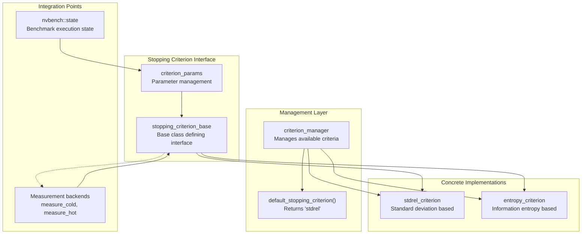
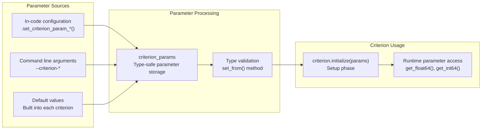
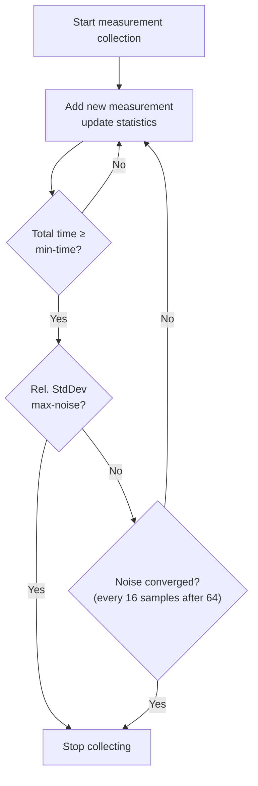
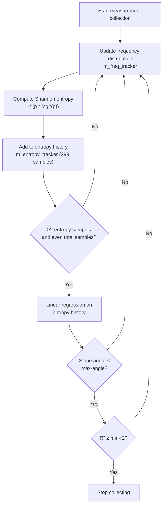
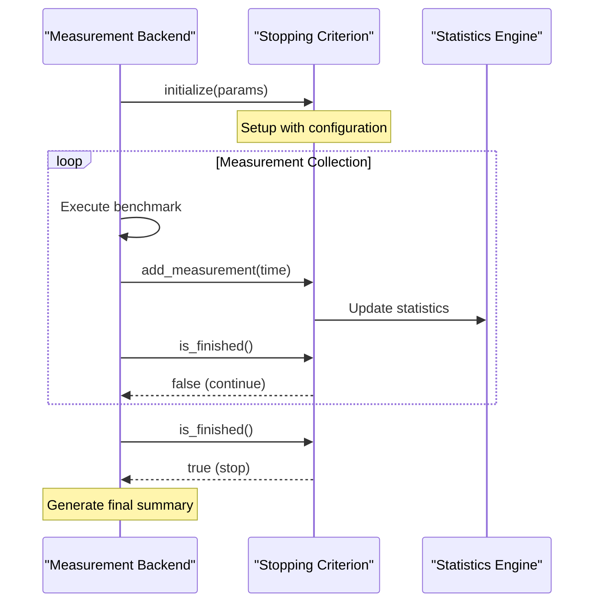

<!-- source: DeepWiki mcp.deepwiki.com · repo NVIDIA/nvbench · page 6.1 Stopping Criteria · fetched 2026-10-26 -->

# Stopping Criteria

<details>
<summary>Relevant source files</summary>

The following files were used as context for generating this wiki page:

- [nvbench/detail/entropy_criterion.cuh](nvbench/detail/entropy_criterion.cuh)
- [nvbench/detail/entropy_criterion.cxx](nvbench/detail/entropy_criterion.cxx)
- [nvbench/detail/stdrel_criterion.cuh](nvbench/detail/stdrel_criterion.cuh)
- [nvbench/detail/stdrel_criterion.cxx](nvbench/detail/stdrel_criterion.cxx)
- [nvbench/json_printer.cu](nvbench/json_printer.cu)
- [nvbench/stopping_criterion.cuh](nvbench/stopping_criterion.cuh)
- [nvbench/stopping_criterion.cxx](nvbench/stopping_criterion.cxx)
- [testing/criterion_params.cu](testing/criterion_params.cu)
- [testing/device/noisy_bench.cu](testing/device/noisy_bench.cu)

</details>


Stopping criteria in NVBench determine when a benchmark has collected sufficient measurements to produce reliable results. The system provides multiple algorithms to automatically decide when to stop measuring, balancing measurement accuracy with execution time.

This document covers the stopping criteria system architecture, available implementations, and configuration options. For information about the broader measurement system that uses these criteria, see [Measurement Systems](#3.2). For details on benchmark configuration including timeout settings, see [Benchmark Definition and State Management](#3.1).

## Architecture Overview

The stopping criteria system is built around a pluggable architecture where different algorithms can be selected and configured based on benchmark requirements.

### Core Components



**Core Stopping Criterion Interface**
The `stopping_criterion_base` class defines the interface for all stopping criteria through three key methods:

| Method | Purpose |
|--------|---------|
| `initialize(params)` | Setup criterion with configuration parameters |
| `add_measurement(value)` | Process a new timing measurement |
| `is_finished()` | Check if sufficient measurements have been collected |

Sources: [nvbench/stopping_criterion.cuh:70-127]()

### Parameter Management

The `criterion_params` class manages configuration parameters for stopping criteria, supporting typed parameters (int64, float64, string) with validation and type safety.



Sources: [nvbench/stopping_criterion.cuh:39-65](), [nvbench/stopping_criterion.cxx:25-112]()

## Available Stopping Criteria

### Standard Deviation Relative (stdrel) - Default

The `stdrel_criterion` is the default stopping criterion that uses relative standard deviation to determine convergence.

**Algorithm:**
1. Collects timing measurements and computes running statistics
2. Stops when relative standard deviation drops below `max-noise` threshold
3. Requires minimum total execution time of `min-time` seconds
4. Includes convergence detection for inherently noisy benchmarks

**Default Parameters:**
- `max-noise`: 0.005 (0.5% relative standard deviation)
- `min-time`: 0.5 (seconds)



**Convergence Detection:**
The criterion includes sophisticated logic to handle inherently noisy benchmarks that may never reach the target noise threshold. After collecting 64+ samples, it periodically checks if the noise measurements themselves have stabilized (relative standard deviation of noise < 5%).

Sources: [nvbench/detail/stdrel_criterion.cuh:30-45](), [nvbench/detail/stdrel_criterion.cxx:24-96]()

### Information Entropy Based (entropy)

The `entropy_criterion` uses information theory to determine when measurement distribution has stabilized by analyzing the entropy of the measurement frequency distribution.

**Algorithm:**
1. Tracks frequency distribution of measurements
2. Computes entropy of the distribution using Shannon entropy formula
3. Uses linear regression to detect when entropy has stabilized
4. Validates convergence using slope angle and R² correlation metrics

**Default Parameters:**
- `max-angle`: 0.048 (maximum slope angle in radians)
- `min-r2`: 0.36 (minimum R² correlation coefficient)



**Entropy Computation:**
The criterion maintains a sorted frequency tracker for efficient entropy calculation:
- Each unique measurement value gets a frequency count
- Probabilities are computed as frequency/total_samples
- Shannon entropy: H = -Σ(p_i * log₂(p_i))

Sources: [nvbench/detail/entropy_criterion.cuh:30-52](), [nvbench/detail/entropy_criterion.cxx:27-135]()

## Configuration and Usage

### In-Code Configuration

Benchmarks can configure stopping criteria through the benchmark definition API:

```cpp
// Example from testing/device/noisy_bench.cu
NVBENCH_BENCH(noisy_bench)
  .set_criterion_param_float64("max-noise", 0.0000001);
```

### Parameter Types and Methods

| Parameter Type | Set Method | Get Method | Description |
|----------------|------------|------------|-------------|
| `int64_t` | `set_criterion_param_int64()` | `get_int64()` | Integer parameters |
| `float64_t` | `set_criterion_param_float64()` | `get_float64()` | Floating-point parameters |
| `string` | `set_criterion_param_string()` | `get_string()` | String parameters |

### Integration with Measurement System

The stopping criteria integrate seamlessly with NVBench's measurement backends:



Each measurement backend (`measure_cold`, `measure_hot`, etc.) uses stopping criteria to determine when sufficient data has been collected, ensuring both accuracy and efficiency in benchmark execution.

Sources: [nvbench/json_printer.cu:313-316](), [testing/device/noisy_bench.cu:138-144]()

## Advanced Features

### Noise Convergence Detection

The `stdrel_criterion` includes sophisticated convergence detection for benchmarks with inherent noise that may never reach the target threshold:

- Monitors the stability of noise measurements themselves
- Checks convergence every 16 samples after collecting 64+ samples
- Uses 5% relative standard deviation of noise as convergence threshold
- Prevents infinite execution on inherently noisy benchmarks

### Entropy Window Management

The `entropy_criterion` uses a ring buffer to maintain a sliding window of entropy measurements:

- Fixed window size of 299 entropy samples
- Efficient memory usage through circular buffer
- Linear regression analysis over the entire window
- Statistical validation using slope angle and R² metrics

Sources: [nvbench/detail/stdrel_criterion.cxx:69-93](), [nvbench/detail/entropy_criterion.cuh:38]()

---

