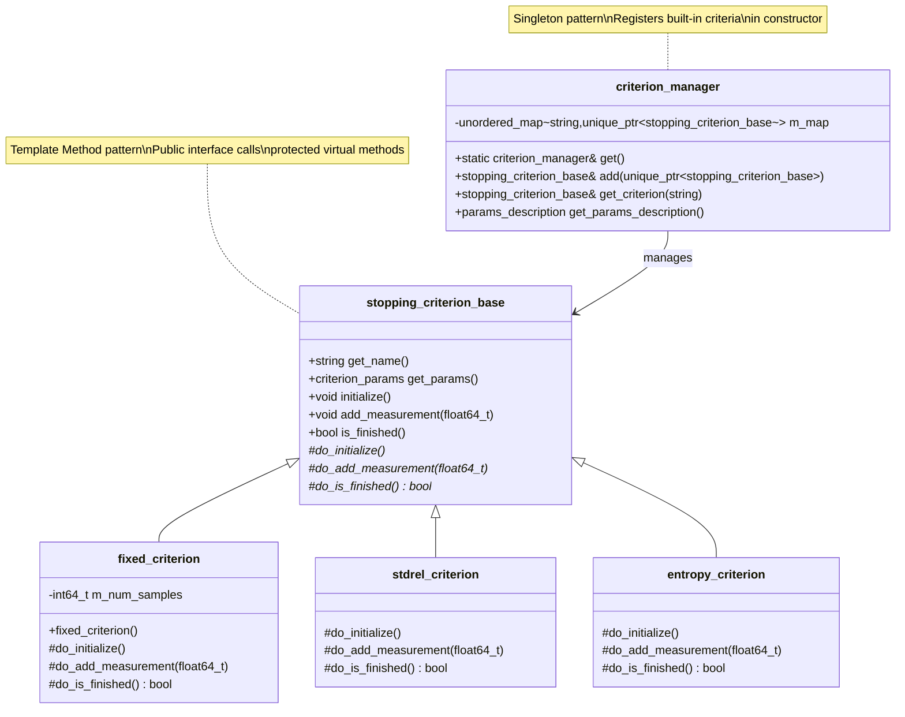
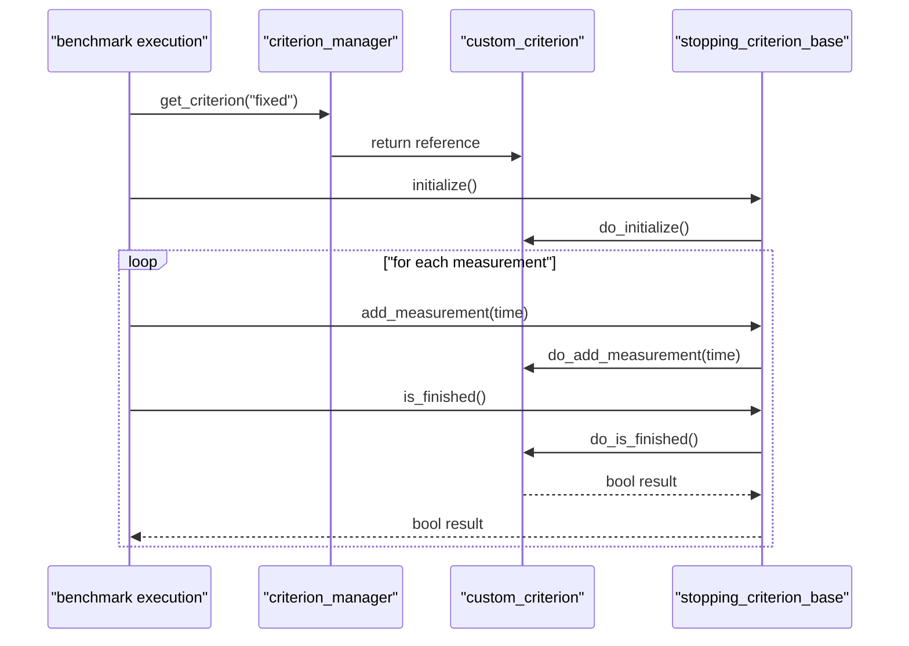
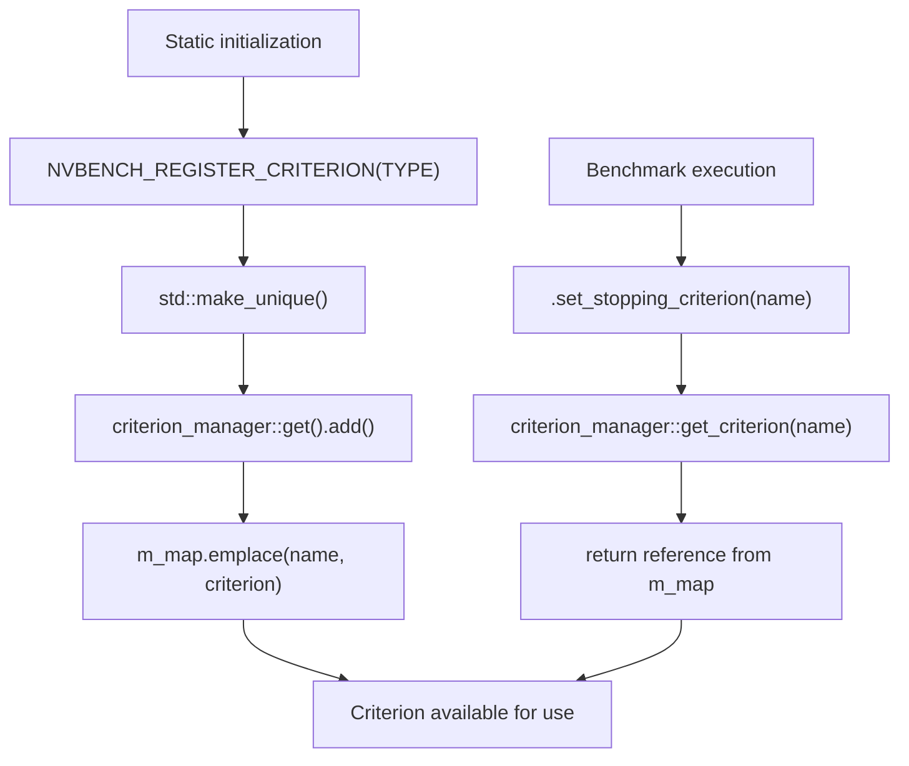
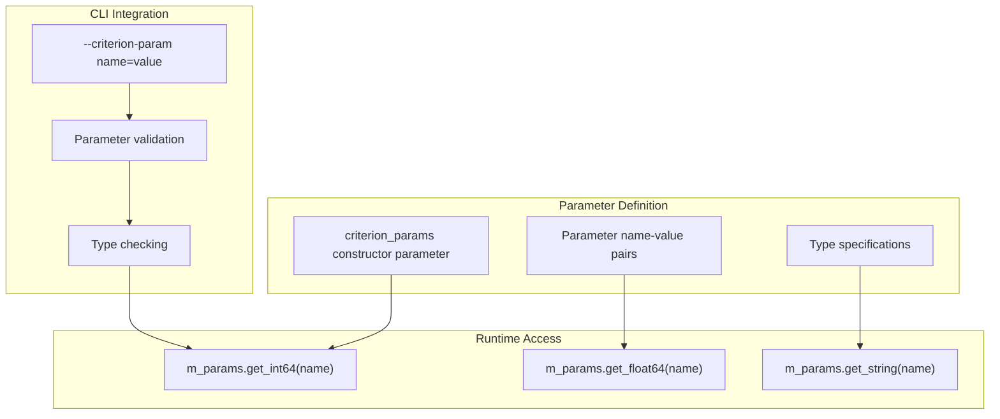
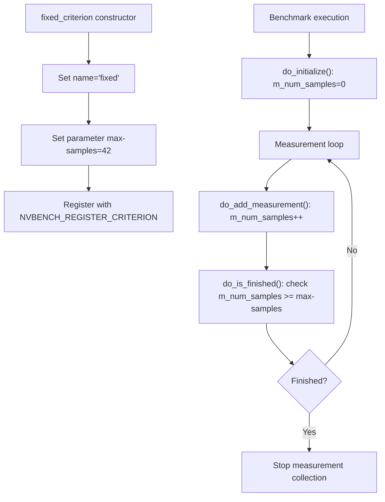

<!-- source: DeepWiki mcp.deepwiki.com · repo NVIDIA/nvbench · page 6.2 Custom Criteria and Extensions · fetched 2026-10-26 -->

# Custom Criteria and Extensions

<details>
<summary>Relevant source files</summary>

The following files were used as context for generating this wiki page:

- [examples/custom_criterion.cu](examples/custom_criterion.cu)
- [nvbench/criterion_manager.cuh](nvbench/criterion_manager.cuh)
- [nvbench/criterion_manager.cxx](nvbench/criterion_manager.cxx)
- [testing/criterion_manager.cu](testing/criterion_manager.cu)

</details>


This document covers how to create custom stopping criteria and extend NVBench's functionality beyond the built-in capabilities. It focuses on the extensibility mechanisms provided by the criterion system and how to implement custom behavior for specialized benchmarking scenarios.

For information about the built-in stopping criteria (`entropy` and `stdrel`), see [Stopping Criteria](#6.1). For basic benchmark configuration, see [Parameter Axes and Configuration](#3.4).

## Architecture of the Extension System

NVBench's extension system is built around the `criterion_manager` singleton and the `stopping_criterion_base` abstract interface. The system allows registration of custom criteria at runtime through a factory pattern.



Sources: [nvbench/criterion_manager.cuh:32-56](), [examples/custom_criterion.cu:28-52](), [nvbench/criterion_manager.cxx:32-36]()

## Custom Stopping Criteria Implementation

Creating a custom stopping criterion requires inheriting from `stopping_criterion_base` and implementing three key virtual methods. The base class uses the Template Method pattern to provide a consistent public interface.



### Required Virtual Methods

| Method | Purpose | Implementation Requirements |
|--------|---------|----------------------------|
| `do_initialize()` | Reset criterion state | Called once before measurement collection |
| `do_add_measurement(float64_t)` | Process new measurement | Called for each timing sample |
| `do_is_finished()` | Check completion status | Return `true` when criterion is satisfied |

### Constructor Pattern

Custom criteria must call the base constructor with a name and parameter specification:

```cpp
// Pattern from examples/custom_criterion.cu:33-35
custom_criterion() 
    : nvbench::stopping_criterion_base{"criterion_name", parameters}
```

Sources: [examples/custom_criterion.cu:28-52](), [nvbench/stopping_criterion.cuh]()

## Registration and Usage System

The registration system uses a macro-based approach to automatically register criteria with the `criterion_manager` singleton during static initialization.



### Registration Process

The `NVBENCH_REGISTER_CRITERION` macro creates a static instance that registers the criterion during program initialization:

```cpp
// From nvbench/criterion_manager.cuh:63-65
#define NVBENCH_REGISTER_CRITERION(TYPE) \
  static nvbench::stopping_criterion_base &NVBENCH_UNIQUE_IDENTIFIER(TYPE) = \
    nvbench::criterion_manager::get().add(std::make_unique<TYPE>())
```

### Usage in Benchmarks

Once registered, custom criteria can be used with the `.set_stopping_criterion()` method:

```cpp
// From examples/custom_criterion.cu:77
NVBENCH_BENCH(throughput_bench).set_stopping_criterion("fixed");
```

Sources: [nvbench/criterion_manager.cuh:63-65](), [examples/custom_criterion.cu:55](), [examples/custom_criterion.cu:77]()

## Parameter System Integration

Custom criteria can define configurable parameters that integrate with NVBench's command-line interface and parameter validation system.



### Parameter Definition Example

```cpp
// From examples/custom_criterion.cu:34
fixed_criterion()
    : nvbench::stopping_criterion_base{"fixed", {{"max-samples", nvbench::int64_t{42}}}}
```

### Parameter Access Pattern

```cpp
// From examples/custom_criterion.cu:50
return m_num_samples >= m_params.get_int64("max-samples");
```

The `criterion_manager` validates that parameter names are unique across criteria and that types are consistent when parameters are shared between criteria.

Sources: [examples/custom_criterion.cu:34](), [examples/custom_criterion.cu:50](), [nvbench/criterion_manager.cxx:79-104]()

## Advanced Extension Patterns

### State Management in Custom Criteria

Custom criteria can maintain complex internal state across measurement cycles:

```cpp
class sophisticated_criterion : public nvbench::stopping_criterion_base
{
  std::vector<nvbench::float64_t> m_measurements;
  nvbench::float64_t m_running_average{};
  nvbench::int64_t m_stable_count{};
  
protected:
  virtual void do_initialize() override {
    m_measurements.clear();
    m_running_average = 0.0;
    m_stable_count = 0;
  }
  // ... implementation
};
```

### Integration with Measurement Backends

Custom criteria work with all measurement backends (`measure_cold`, `measure_hot`, `measure_cpu_only`, `measure_cupti`) through the standardized interface. The measurement values passed to `do_add_measurement()` are already processed by the appropriate backend.

### Error Handling and Validation

The `criterion_manager` provides automatic validation:
- Duplicate criterion names are rejected at registration time
- Parameter type conflicts are detected during initialization
- Runtime errors are thrown for invalid criterion names

Sources: [nvbench/criterion_manager.cxx:65-77](), [nvbench/criterion_manager.cxx:79-104](), [testing/criterion_manager.cu:43-76]()

## Complete Implementation Example

The `fixed_criterion` from the examples demonstrates a complete implementation:



This example shows:
- Constructor with name and default parameters
- Simple state management with a counter
- Parameter access through `m_params.get_int64()`
- Registration using the provided macro
- Usage in a benchmark with `.set_stopping_criterion()`

Sources: [examples/custom_criterion.cu:28-78]()

---

