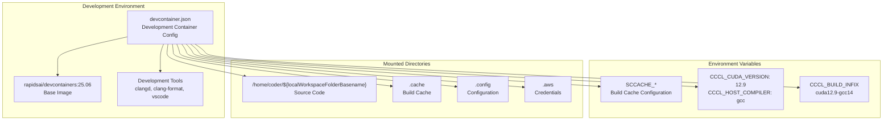
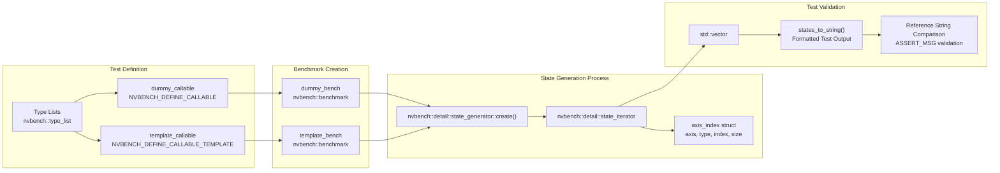
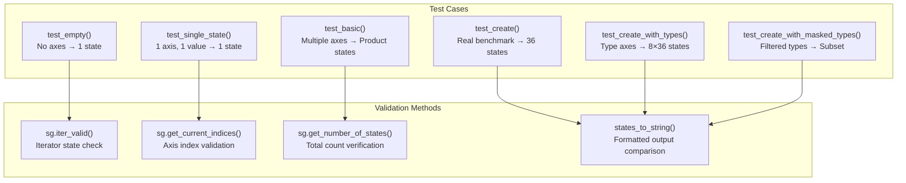

<!-- source: DeepWiki mcp.deepwiki.com · repo NVIDIA/nvbench · page 7 Development and Contributing · fetched 2026-10-26 -->

# Development and Contributing

Relevant source files

The following files were used as context for generating this wiki page:

- [.devcontainer/devcontainer.json](.devcontainer/devcontainer.json)
- [ci/matrix.yaml](ci/matrix.yaml)
- [nvbench/detail/state_generator.cuh](nvbench/detail/state_generator.cuh)
- [testing/option_parser.cu](testing/option_parser.cu)
- [testing/state_generator.cu](testing/state_generator.cu)

This document provides essential information for developers who want to contribute to or modify NVBench. It covers the development environment setup, code organization, testing infrastructure, and contribution workflows.

For detailed information about the build system configuration and dependencies, see [Build System Deep Dive](#7.1). For comprehensive testing framework documentation, see [Testing Framework](#7.2). For CI/CD pipeline details and development container usage, see [CI/CD and Development Environment](#7.3).

## Development Environment

NVBench provides a standardized development environment through Docker containers and comprehensive CI matrices that test across multiple CUDA versions and compilers.

### Development Container Setup

The development container is configured with CUDA 12.9 and GCC 14, providing a consistent environment for all contributors.

Sources: [.devcontainer/devcontainer.json:1-46]()

### Compiler and CUDA Matrix

```mermaid
graph TB
    subgraph "CI Matrix Configuration"
        MATRIX["ci/matrix.yaml<br/>Build Matrix Definition"]
        CURR_MIN["cuda_curr_min: 12.0"]
        CURR_MAX["cuda_curr_max: 12.9"]
        DEVCON_VER["devcontainer_version: 25.06"]
    end
    
    subgraph "GCC Compilers"
        GCC7["gcc7: version 7, exe: g++"]
        GCC8["gcc8: version 8, exe: g++"]
        GCC9["gcc9: version 9, exe: g++"]
        GCC10["gcc10: version 10, exe: g++"]
        GCC11["gcc11: version 11, exe: g++"]
        GCC12["gcc12: version 12, exe: g++"]
        GCC13["gcc13: version 13, exe: g++"]
        GCC14["gcc14: version 14, exe: g++"]
    end
    
    subgraph "LLVM Compilers"
        LLVM14["llvm14: version 14, exe: clang++"]
        LLVM15["llvm15: version 15, exe: clang++"]
        LLVM16["llvm16: version 16, exe: clang++"]
        LLVM17["llvm17: version 17, exe: clang++"]
        LLVM18["llvm18: version 18, exe: clang++"]
        LLVM19["llvm19: version 19, exe: clang++"]
    end
    
    subgraph "PR Test Matrix"
        PR_NVCC["pull_request.nvcc<br/>18 different configurations"]
        UBUNTU2004["ubuntu20.04 + amd64"]
        UBUNTU2204["ubuntu22.04 + amd64"]
        UBUNTU2404["ubuntu24.04 + amd64"]
    end
    
    MATRIX --> CURR_MIN
    MATRIX --> CURR_MAX
    MATRIX --> DEVCON_VER
    
    MATRIX --> GCC7
    MATRIX --> GCC8
    MATRIX --> GCC9
    MATRIX --> GCC10
    MATRIX --> GCC11
    MATRIX --> GCC12
    MATRIX --> GCC13
    MATRIX --> GCC14
    
    MATRIX --> LLVM14
    MATRIX --> LLVM15
    MATRIX --> LLVM16
    MATRIX --> LLVM17
    MATRIX --> LLVM18
    MATRIX --> LLVM19
    
    MATRIX --> PR_NVCC
    PR_NVCC --> UBUNTU2004
    PR_NVCC --> UBUNTU2204
    PR_NVCC --> UBUNTU2404
```

The CI system tests 18 different compiler and CUDA combinations for every pull request, ensuring broad compatibility.

Sources: [ci/matrix.yaml:1-59]()

## Code Organization for Contributors

### Core Testing Infrastructure

```mermaid
graph TB
    subgraph "Testing Framework Structure"
        TEST_ASSERTS["test_asserts.cuh<br/>Custom Test Assertions"]
        
        subgraph "Component Tests"
            OPT_PARSER_TEST["testing/option_parser.cu<br/>CLI Parsing Tests"]
            STATE_GEN_TEST["testing/state_generator.cu<br/>State Generation Tests"]
        end
        
        subgraph "Test Utilities"
            DUMMY_BENCH["DummyBench<br/>void DummyBench(nvbench::state&)"]
            TEST_BENCH["TestBench<br/>Template Benchmark"]
            STATES_TO_STRING["states_to_string()<br/>Test Output Formatter"]
            PARSER_TO_STATES["parser_to_states()<br/>Test Helper"]
        end
        
        subgraph "Test Macros"
            NVBENCH_BENCH["NVBENCH_BENCH(DummyBench)"]
            NVBENCH_BENCH_TYPES["NVBENCH_BENCH_TYPES(TestBench)"]
            NVBENCH_TYPE_AXES["NVBENCH_TYPE_AXES(Ts, Us)"]
        end
    end
    
    subgraph "Core Implementation"
        OPTION_PARSER["nvbench::option_parser<br/>CLI Argument Processing"]
        STATE_GENERATOR["nvbench::detail::state_generator<br/>Benchmark State Creation"]
        STATE_ITERATOR["nvbench::detail::state_iterator<br/>Cartesian Product Iterator"]
    end
    
    OPT_PARSER_TEST --> TEST_ASSERTS
    OPT_PARSER_TEST --> DUMMY_BENCH
    OPT_PARSER_TEST --> TEST_BENCH
    OPT_PARSER_TEST --> STATES_TO_STRING
    OPT_PARSER_TEST --> PARSER_TO_STATES
    OPT_PARSER_TEST --> NVBENCH_BENCH
    OPT_PARSER_TEST --> NVBENCH_BENCH_TYPES
    OPT_PARSER_TEST --> OPTION_PARSER
    
    STATE_GEN_TEST --> TEST_ASSERTS
    STATE_GEN_TEST --> STATE_GENERATOR
    STATE_GEN_TEST --> STATE_ITERATOR
    
    STATE_GENERATOR --> STATE_ITERATOR
```

The testing infrastructure uses custom test functions and benchmark definitions to validate core functionality.

Sources: [testing/option_parser.cu:1-50](), [testing/state_generator.cu:1-50](), [nvbench/detail/state_generator.cuh:1-99]()

### State Generation and Testing Workflow

The state generation system creates cartesian products of benchmark parameters and validates them through comprehensive string-based regression tests.

Sources: [testing/state_generator.cu:29-42](), [testing/state_generator.cu:147-230](), [nvbench/detail/state_generator.cuh:38-54]()

## Key Development Workflows

### Option Parser Testing Pattern

The option parser tests follow a consistent pattern for validating CLI argument processing:

| Test Function | Purpose | Key Validation |
|---------------|---------|----------------|
| `test_empty()` | No arguments handling | 2 benchmarks found |
| `test_exec_name_tolerance()` | Executable name handling | Args vector consistency |
| `test_benchmark_long()` | `--benchmark` flag | State generation accuracy |
| `test_benchmark_short()` | `-b` flag | Short form equivalence |
| `test_*_axis_*()` | Axis value parsing | Parameter configuration |

Each test creates an `nvbench::option_parser`, parses arguments, runs benchmarks, and validates the resulting states through formatted string comparison.

Sources: [testing/option_parser.cu:111-189](), [testing/option_parser.cu:222-332]()

### State Generation Testing Strategy

The state generation tests validate the cartesian product creation for benchmark parameters:

Tests verify both the iteration logic and the final state configuration through comprehensive string-based regression testing.

Sources: [testing/state_generator.cu:43-52](), [testing/state_generator.cu:147-230](), [testing/state_generator.cu:579-626]()

## Development Best Practices

### Test Structure Guidelines

1. **Use descriptive test function names** that clearly indicate what is being tested
2. **Create reference strings** for regression testing of complex output formats
3. **Validate both positive and negative cases** (e.g., `test_invalid_option()`)
4. **Use helper functions** like `parser_to_state_string()` for consistent test formatting
5. **Test edge cases** including empty inputs, single values, and boundary conditions

### Code Organization Patterns

The codebase follows clear separation between public APIs and internal implementation details:

- **Public headers** in `nvbench/` directory (e.g., `nvbench/option_parser.cuh`)
- **Internal implementation** in `nvbench/detail/` directory (e.g., `nvbench/detail/state_generator.cuh`)
- **Test files** in `testing/` directory with `.cu` extension
- **Build configuration** in root-level CMake files and `ci/` directory

### Testing Infrastructure Requirements

Contributors should ensure all new functionality includes:

1. **Unit tests** for individual components
2. **Integration tests** for end-to-end workflows
3. **Regression tests** with reference output validation
4. **Edge case coverage** for boundary conditions
5. **Documentation** of test purpose and expected behavior

Sources: [testing/option_parser.cu:1-1200](), [testing/state_generator.cu:1-700](), [nvbench/detail/state_generator.cuh:1-99]()

---

