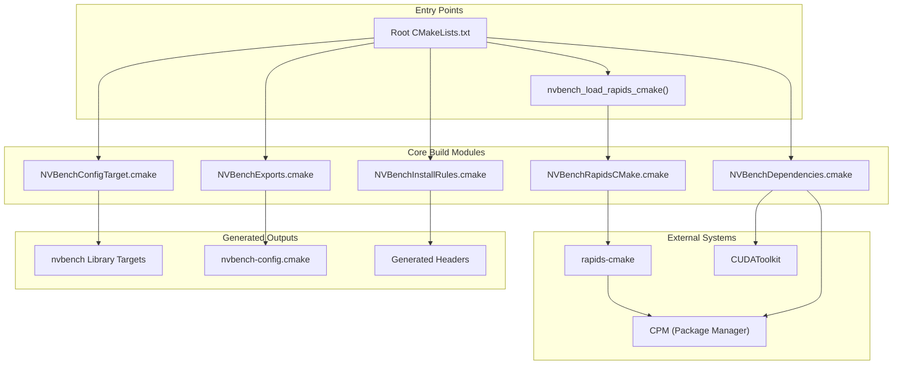
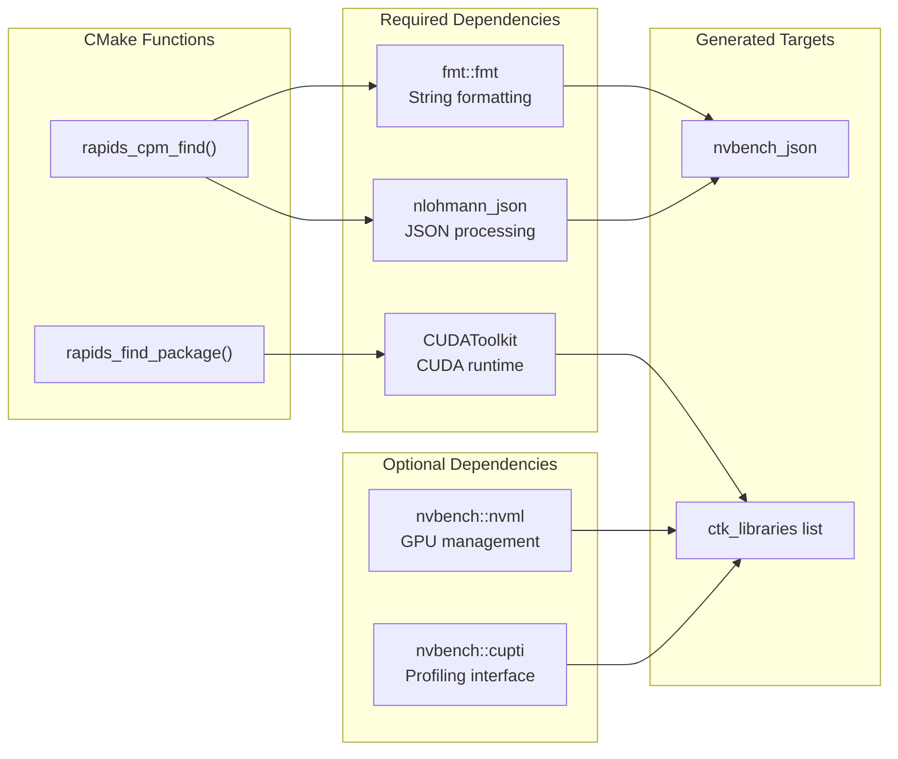
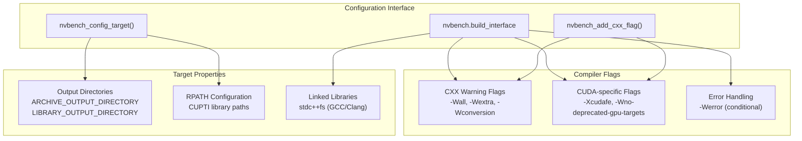
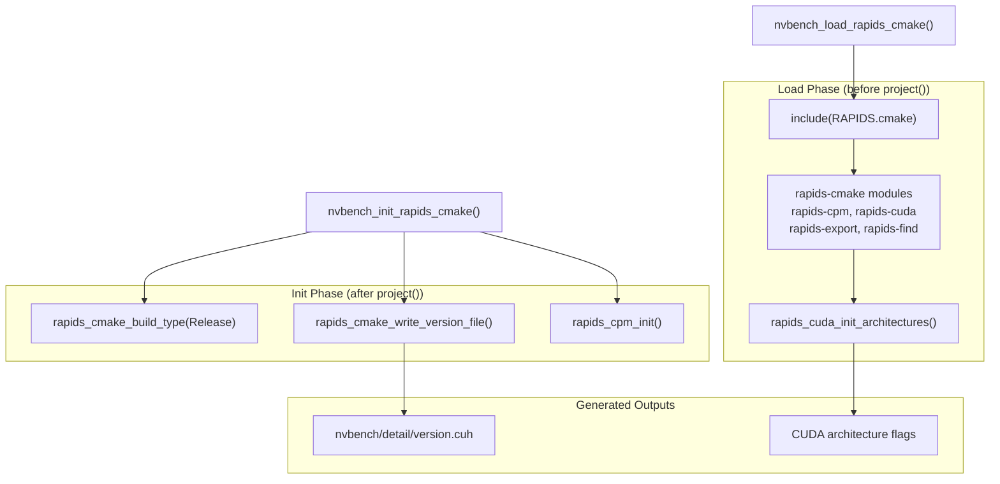
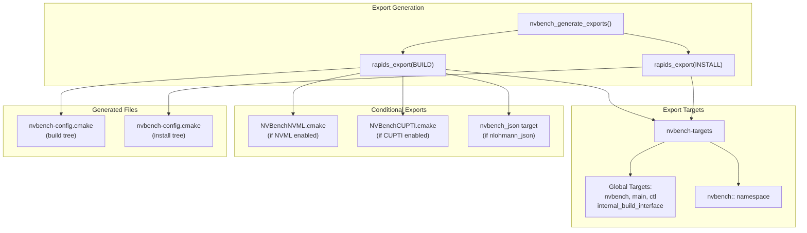
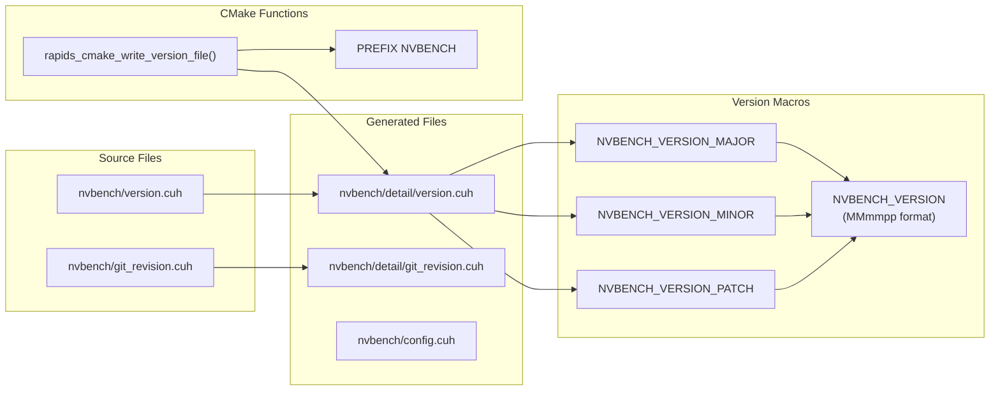
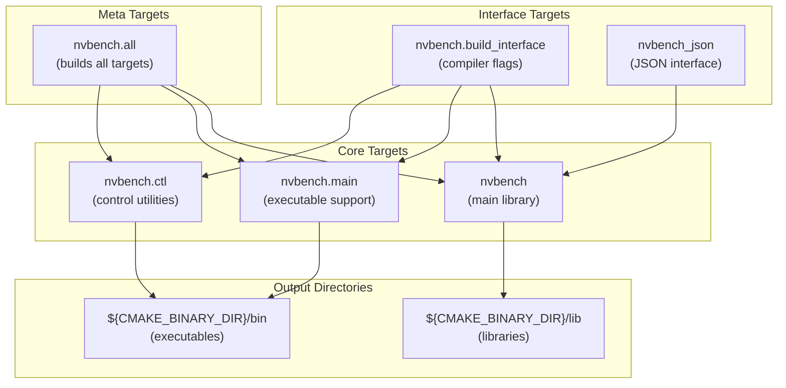

<!-- source: DeepWiki mcp.deepwiki.com · repo NVIDIA/nvbench · page 7.1 Build System Deep Dive · fetched 2026-10-26 -->

# Build System Deep Dive

Relevant source files

The following files were used as context for generating this wiki page:

- [cmake/NVBenchConfigTarget.cmake](cmake/NVBenchConfigTarget.cmake)
- [cmake/NVBenchDependencies.cmake](cmake/NVBenchDependencies.cmake)
- [cmake/NVBenchExports.cmake](cmake/NVBenchExports.cmake)
- [cmake/NVBenchInstallRules.cmake](cmake/NVBenchInstallRules.cmake)
- [cmake/NVBenchRapidsCMake.cmake](cmake/NVBenchRapidsCMake.cmake)
- [cmake/RAPIDS.cmake](cmake/RAPIDS.cmake)
- [examples/auto_throughput.cu](examples/auto_throughput.cu)
- [nvbench/git_revision.cuh](nvbench/git_revision.cuh)
- [nvbench/version.cuh](nvbench/version.cuh)

This document provides a comprehensive overview of NVBench's CMake-based build system, covering dependency management, target configuration, Rapids integration, and installation rules. The build system is designed to handle complex CUDA compilation requirements while maintaining compatibility across different platforms and CUDA versions.

For basic installation instructions, see [Installation and Build System](#2.1). For information about the development environment and CI/CD setup, see [CI/CD and Development Environment](#7.3).

## Build System Architecture Overview

NVBench uses a modular CMake architecture built on top of Rapids CMake infrastructure. The system handles external dependencies, compiler configuration, target management, and installation rules through specialized CMake modules.

Sources: [cmake/NVBenchRapidsCMake.cmake:1-30](), [cmake/NVBenchDependencies.cmake:1-83](), [cmake/NVBenchConfigTarget.cmake:1-92]()

## Dependency Management System

The dependency management is centralized in `NVBenchDependencies.cmake`, which uses Rapids CPM (CMake Package Manager) to fetch and configure external libraries.

### Core Dependencies Architecture

### Dependency Configuration Details

| Dependency | Version | Purpose | Configuration |
|------------|---------|---------|---------------|
| `fmt` | 11.2.0 | String formatting | Static linking, system headers |
| `nlohmann_json` | 3.12.0 | JSON I/O | Header-only via URL download |
| `CUDAToolkit` | Required | CUDA runtime | Rapids-managed |
| `NVML` | Optional | GPU management | Conditional inclusion |
| `CUPTI` | Optional | Profiling | Conditional inclusion |

Sources: [cmake/NVBenchDependencies.cmake:11-24](), [cmake/NVBenchDependencies.cmake:36-46](), [cmake/NVBenchDependencies.cmake:62-82]()

## Target Configuration System

The `NVBenchConfigTarget.cmake` module establishes compiler settings, warning flags, and target properties for all NVBench components.

### Compiler Configuration Architecture

### Key Configuration Options

| Option | Default | Purpose |
|--------|---------|---------|
| `NVBench_ENABLE_WERROR` | `${NVBench_TOPLEVEL_PROJECT}` | Treat warnings as errors |
| `NVBench_LIBRARY_OUTPUT_DIR` | `${CMAKE_BINARY_DIR}/lib` | Library output location |
| `NVBench_EXECUTABLE_OUTPUT_DIR` | `${CMAKE_BINARY_DIR}/bin` | Executable output location |

Sources: [cmake/NVBenchConfigTarget.cmake:3-6](), [cmake/NVBenchConfigTarget.cmake:36-46](), [cmake/NVBenchConfigTarget.cmake:73-91]()

## Rapids CMake Integration

NVBench leverages Rapids CMake for standardized build practices and dependency management across the RAPIDS ecosystem.

### Rapids Integration Flow

Sources: [cmake/NVBenchRapidsCMake.cmake:2-19](), [cmake/NVBenchRapidsCMake.cmake:22-29](), [cmake/RAPIDS.cmake:20-94]()

## Export and Installation System

The build system provides comprehensive export and installation capabilities through `NVBenchExports.cmake` and `NVBenchInstallRules.cmake`.

### Export System Architecture

### Installation Rules

| Component | Install Location | Purpose |
|-----------|------------------|---------|
| Public Headers | `${CMAKE_INSTALL_INCLUDEDIR}/nvbench` | User-facing API |
| Generated Headers | `${CMAKE_INSTALL_INCLUDEDIR}/nvbench/detail` | Version info |
| Libraries | `${NVBench_INSTALL_LIB_DIR}` | Compiled libraries |
| CMake Files | `${config_install_location}/cmake/nvbench` | Consumer configuration |

Sources: [cmake/NVBenchExports.cmake:1-51](), [cmake/NVBenchInstallRules.cmake:7-26](), [cmake/NVBenchInstallRules.cmake:37-51]()

## Version Management

NVBench generates version information through both Rapids CMake and custom header generation.

### Version System Components

Sources: [cmake/NVBenchRapidsCMake.cmake:24-27](), [nvbench/version.cuh:21-32](), [nvbench/git_revision.cuh:19-22]()

## Build Targets and Output Structure

The build system produces several types of targets with specific purposes and configurations.

### Target Hierarchy

### Configuration Functions

| Function | Purpose | Usage |
|----------|---------|-------|
| `nvbench_config_target()` | Apply standard configuration | Called on all NVBench targets |
| `nvbench_install_libraries()` | Install library targets | Handles export set registration |
| `nvbench_install_executables()` | Install executable targets | Handles export set registration |

Sources: [cmake/NVBenchConfigTarget.cmake:9-10](), [cmake/NVBenchConfigTarget.cmake:73-91](), [cmake/NVBenchInstallRules.cmake:55-69]()

---

