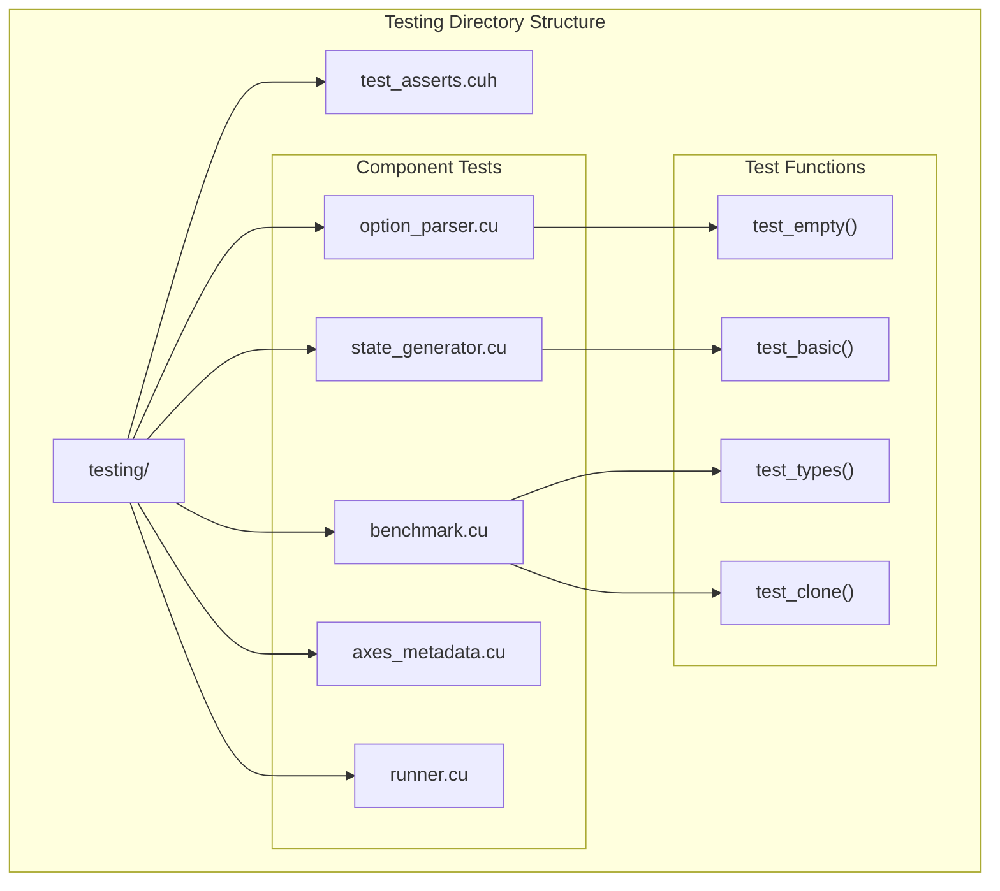
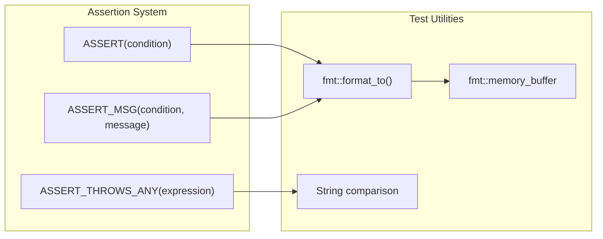
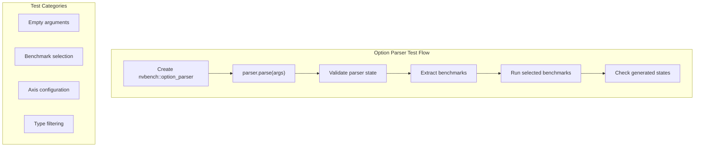
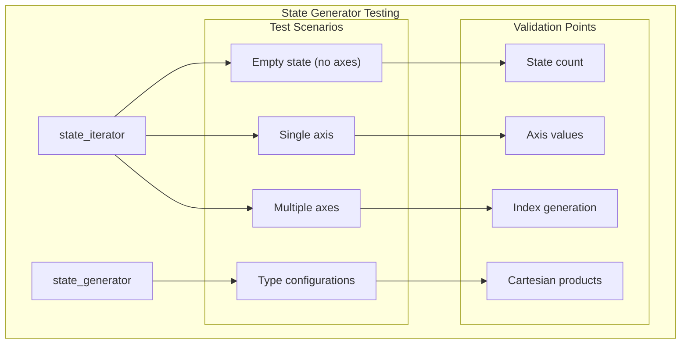
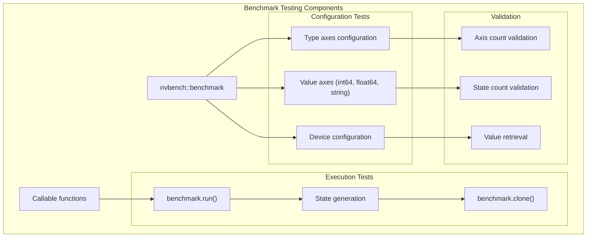
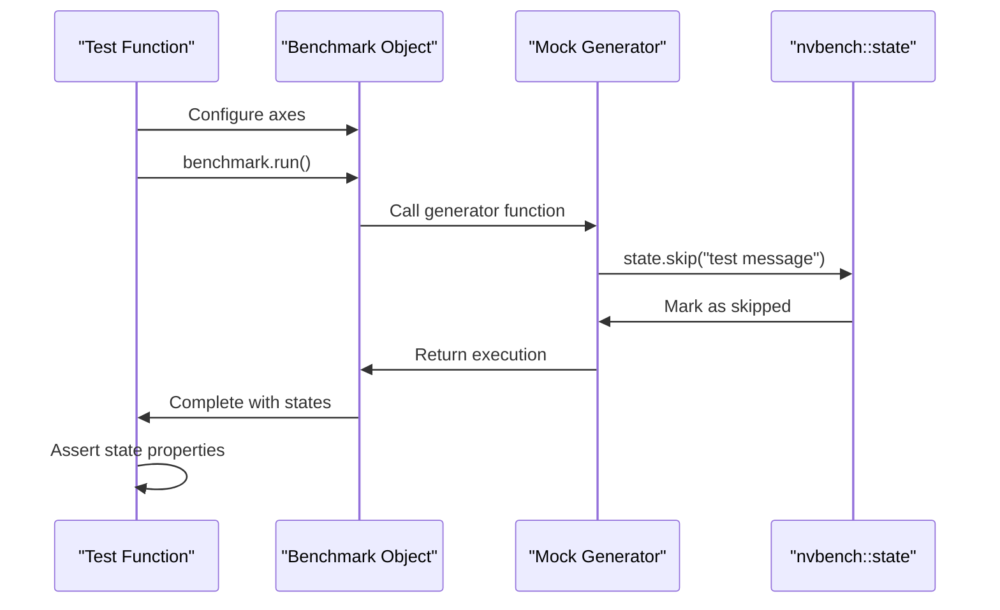
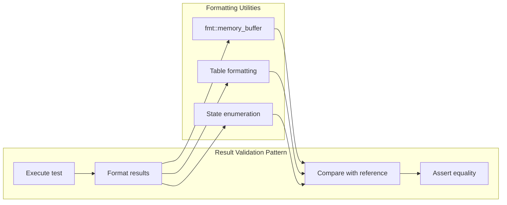
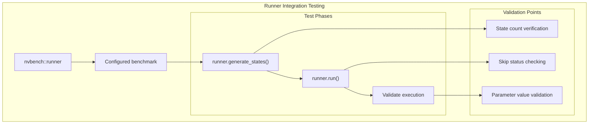

<!-- source: DeepWiki mcp.deepwiki.com · repo NVIDIA/nvbench · page 7.2 Testing Framework · fetched 2026-10-26 -->

# Testing Framework

<details>
<summary>Relevant source files</summary>

The following files were used as context for generating this wiki page:

- [nvbench/detail/state_generator.cuh](nvbench/detail/state_generator.cuh)
- [testing/axes_metadata.cu](testing/axes_metadata.cu)
- [testing/benchmark.cu](testing/benchmark.cu)
- [testing/option_parser.cu](testing/option_parser.cu)
- [testing/runner.cu](testing/runner.cu)
- [testing/state_generator.cu](testing/state_generator.cu)

</details>


This document describes NVBench's testing infrastructure, including test organization, testing utilities, assertion mechanisms, and patterns for validating core framework functionality. The testing framework ensures reliability of benchmark execution, state generation, option parsing, and other critical components.

For information about the broader development workflow and CI/CD processes, see [CI/CD and Development Environment](#7.3).

## Test Organization and Structure

NVBench's testing framework is organized around component-specific test files located in the `testing/` directory. Each test file focuses on validating a specific subsystem of the framework.

### Test File Structure



**Test File Organization**

| Test File | Primary Component | Key Areas Tested |
|-----------|------------------|------------------|
| `option_parser.cu` | `nvbench::option_parser` | CLI argument parsing, axis configuration |
| `state_generator.cu` | `nvbench::detail::state_generator` | State creation, cartesian products |
| `benchmark.cu` | `nvbench::benchmark` | Benchmark configuration, execution |
| `axes_metadata.cu` | `nvbench::axes_metadata` | Axis management, type handling |
| `runner.cu` | `nvbench::runner` | Benchmark execution orchestration |

Sources: [testing/option_parser.cu:1-50](), [testing/state_generator.cu:1-50](), [testing/benchmark.cu:1-50](), [testing/axes_metadata.cu:1-50](), [testing/runner.cu:1-50]()

## Testing Utilities and Assertions

The testing framework provides custom assertion macros and utilities for validating behavior and generating test data.

### Assertion Framework



**Core Assertion Patterns**

The testing framework uses several assertion patterns for validation:

```cpp
// Basic condition checking
ASSERT(parser.get_benchmarks().size() == 2);

// Assertions with detailed error messages  
ASSERT_MSG(test == ref, "Expected:\n\"{}\"\n\nActual:\n\"{}\"", ref, test);

// Exception testing
ASSERT_THROWS_ANY(parser.parse({"--not-a-real-option"}));
```

Sources: [testing/option_parser.cu:92-93](), [testing/option_parser.cu:157-158](), [testing/option_parser.cu:180-181]()

## Component Testing Patterns

### Option Parser Testing

The option parser tests validate command-line argument processing and benchmark filtering functionality.



**Key Testing Functions:**

- `test_empty()`: Validates parser behavior with no arguments
- `test_benchmark_long()`: Tests `--benchmark` option functionality
- `test_int64_axis_single()`: Validates single-value axis configuration
- `test_type_axis_multi()`: Tests multi-value type axis filtering

Sources: [testing/option_parser.cu:111-126](), [testing/option_parser.cu:160-189](), [testing/option_parser.cu:222-279](), [testing/option_parser.cu:911-930]()

### State Generation Testing

State generation tests ensure proper creation of benchmark configurations from axis combinations.



**State Iterator Testing:**

The `state_iterator` is tested for proper index generation across multiple axes:

```cpp
nvbench::detail::state_iterator sg;
sg.add_axis("Axis1", nvbench::axis_type::string, 2);
sg.add_axis("Axis2", nvbench::axis_type::string, 3);
ASSERT(sg.get_number_of_states() == 6); // 2 * 3
```

Sources: [testing/state_generator.cu:72-83](), [testing/state_generator.cu:147-159](), [testing/state_generator.cu:232-248]()

### Benchmark Testing

Benchmark tests validate the core benchmark functionality including axis configuration, type handling, and execution.



**Type Configuration Testing:**

The framework extensively tests type axis configuration:

```cpp
lots_of_types_bench bench;
bench.set_type_axes_names({"Integer", "Float", "Other"});
static_assert(bench.num_type_configs == 16); // 4 * 2 * 2
```

Sources: [testing/benchmark.cu:88-126](), [testing/benchmark.cu:128-171](), [testing/benchmark.cu:241-279]()

## Test Execution Flow

### Mock Benchmark Functions

Tests use mock benchmark functions that validate parameter passing and state management:



**Mock Function Pattern:**

```cpp
void no_op_generator(nvbench::state &state) {
    fmt::memory_buffer params;
    fmt::format_to(std::back_inserter(params), "Params:");
    const auto &axis_values = state.get_axis_values();
    // ... format parameter values
    state.skip(fmt::to_string(std::move(params)));
}
```

Sources: [testing/benchmark.cu:45-61](), [testing/runner.cu:42-58]()

### Test Result Validation

The framework uses string-based regression testing for complex output validation:



**Reference String Testing:**

Tests generate formatted output and compare against reference strings:

```cpp
const std::string ref = R"expected(
| State | TypeConfig |  T   |  U   | Ints |
|   0   |     0      | void | bool |  42  |
|   1   |     1      | void | F32  |  42  |
)expected";

const auto test = parser_to_state_string(parser);
ASSERT_MSG(test == ref, "Expected:\n\"{}\"\n\nActual:\n\"{}\"", ref, test);
```

Sources: [testing/option_parser.cu:162-181](), [testing/state_generator.cu:187-229]()

## Integration Testing

### Runner Integration Tests

The runner tests validate end-to-end benchmark execution including state generation and callable invocation:



**Integration Test Pattern:**

```cpp
runner_type runner{bench};
runner.generate_states();
ASSERT(bench.get_states().size() == 27);

runner.run();
for (const auto &state : bench.get_states()) {
    ASSERT(state.is_skipped() == true);
}
```

Sources: [testing/runner.cu:78-93](), [testing/runner.cu:95-155](), [testing/runner.cu:198-249]()

The testing framework provides comprehensive validation of NVBench's core functionality through component-specific tests, integration tests, and extensive result validation using formatted string comparisons and assertion utilities.

---

