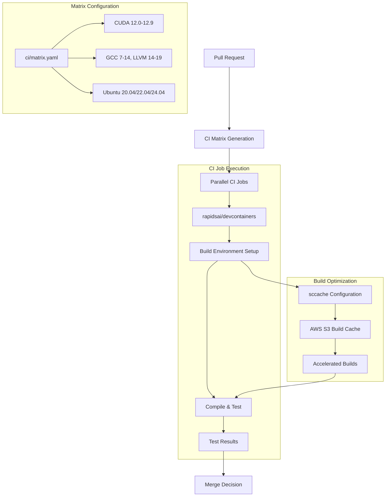
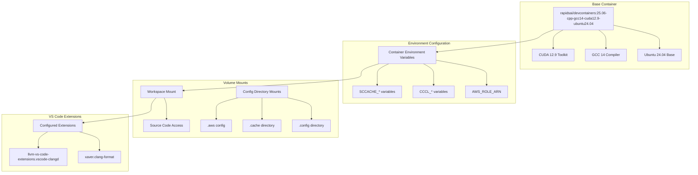
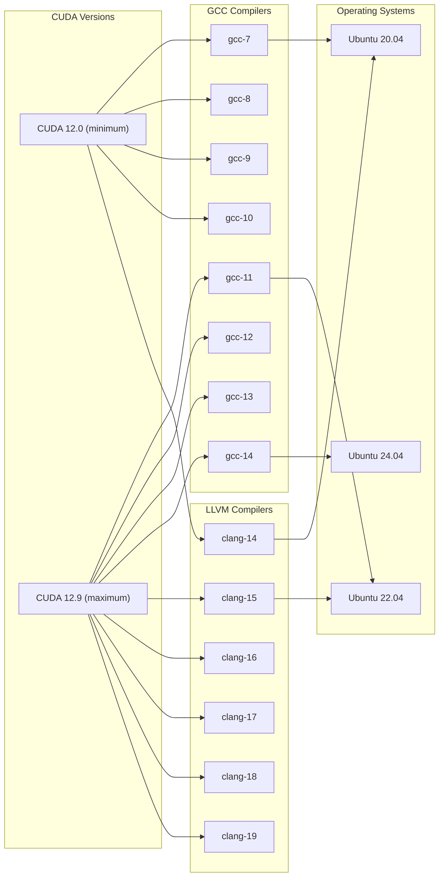
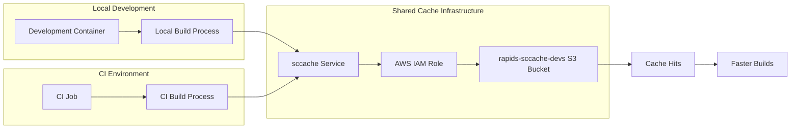
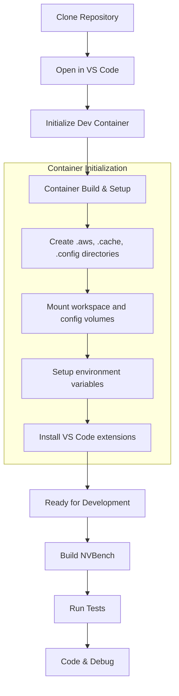

<!-- source: DeepWiki mcp.deepwiki.com · repo NVIDIA/nvbench · page 7.3 CI/CD and Development Environment · fetched 2026-10-26 -->

# CI/CD and Development Environment

Relevant source files

The following files were used as context for generating this wiki page:

- [.devcontainer/devcontainer.json](.devcontainer/devcontainer.json)
- [ci/matrix.yaml](ci/matrix.yaml)

This page documents NVBench's continuous integration and development environment infrastructure. It covers the CI/CD pipeline configuration, development container setup, testing matrix, and development workflow. For information about the build system itself, see [Build System Deep Dive](#7.1). For testing framework details, see [Testing Framework](#7.2).

## CI/CD Infrastructure Overview

NVBench uses a matrix-based CI/CD approach to test across multiple CUDA versions, compilers, and operating systems. The infrastructure is built around RAPIDS AI's standardized development containers and testing practices.

### CI/CD Pipeline Architecture

Sources: [ci/matrix.yaml:1-59](), [.devcontainer/devcontainer.json:1-46]()

## Development Container Configuration

The development environment is standardized using VS Code development containers based on RAPIDS AI's container images. This ensures consistent development environments across all contributors.

### Container Environment Setup

The container configuration includes several key environment variables for optimizing builds and enabling proper toolchain detection:

| Variable | Purpose | Value |
|----------|---------|-------|
| `CCCL_CUDA_VERSION` | CUDA version detection | `12.9` |
| `CCCL_HOST_COMPILER` | Host compiler type | `gcc` |
| `CCCL_HOST_COMPILER_VERSION` | Compiler version | `14` |
| `SCCACHE_REGION` | Build cache region | `us-east-2` |
| `SCCACHE_BUCKET` | S3 cache bucket | `rapids-sccache-devs` |

Sources: [.devcontainer/devcontainer.json:12-22](), [.devcontainer/devcontainer.json:25-28]()

## Testing Matrix Configuration

The CI system tests NVBench across a comprehensive matrix of configurations to ensure compatibility across different environments. The matrix is defined in [ci/matrix.yaml:1-59]() and includes both minimum and maximum supported CUDA versions.

### Compiler and Platform Matrix

### Pull Request Testing Configuration

For pull requests, the system runs a subset of the full matrix to balance thoroughness with CI resource usage:

| CUDA Version | Ubuntu Version | Compiler Coverage |
|--------------|----------------|-------------------|
| 12.0 (min) | 20.04 | GCC 7-10, Clang 14 |
| 12.0 (min) | 22.04 | GCC 11-12 |
| 12.9 (max) | 20.04 | GCC 7-10, Clang 14 |
| 12.9 (max) | 22.04 | GCC 11-13, Clang 15-19 |
| 12.9 (max) | 24.04 | GCC 14 |

Sources: [ci/matrix.yaml:36-58](), [ci/matrix.yaml:7-23]()

## Build Optimization and Caching

The development environment includes sophisticated build caching to accelerate development and CI builds using `sccache` with AWS S3 backend storage.

### Build Cache Architecture

The cache configuration uses AWS IAM roles for authentication and regional optimization:

- **Cache Region**: `us-east-2` for optimal performance
- **IAM Role**: `arn:aws:iam::279114543810:role/nv-gha-token-sccache-devs`
- **Bucket**: `rapids-sccache-devs` for shared cache storage

Sources: [.devcontainer/devcontainer.json:13-15]()

## Development Workflow

The standardized development environment supports a consistent workflow across different development scenarios.

### Local Development Setup

### VS Code Integration Features

The development container includes pre-configured VS Code settings for optimal C++ development:

- **Code Formatting**: Automated clang-format integration using `/usr/local/bin/clang-format`
- **Language Server**: ClangD integration with compile commands support
- **IntelliSense**: Full C++ IntelliSense with CUDA support
- **Debug Support**: Integrated debugging capabilities for both CPU and GPU code

Key VS Code configuration:
- Default formatter: `xaver.clang-format`
- ClangD arguments: `--compile-commands-dir=${workspaceFolder}`
- Automatic compilation database detection

Sources: [.devcontainer/devcontainer.json:32-43](), [.devcontainer/devcontainer.json:7-11]()

## Development Environment Variables

The container environment is configured with several important variables that affect build behavior and toolchain detection:

| Category | Variable | Purpose |
|----------|----------|---------|
| Build Identity | `CCCL_BUILD_INFIX` | Build configuration identifier (`cuda12.9-gcc14`) |
| Build Identity | `DEVCONTAINER_NAME` | Container configuration name |
| Compiler Detection | `CCCL_HOST_COMPILER` | Host compiler type for CCCL integration |
| Compiler Detection | `CCCL_HOST_COMPILER_VERSION` | Compiler version for compatibility |
| CUDA Detection | `CCCL_CUDA_VERSION` | CUDA version for build configuration |
| Shell | `HISTFILE` | Persistent bash history location |

These variables ensure that the build system can correctly detect and configure the toolchain, and that builds are properly cached and identified.

Sources: [.devcontainer/devcontainer.json:17-21]()