# Page: Overview

# Overview

<details>
<summary>Relevant source files</summary>

The following files were used as context for generating this wiki page:

- [README.md](README.md)
- [docs/benchmarks.md](docs/benchmarks.md)
- [examples/CMakeLists.txt](examples/CMakeLists.txt)
- [examples/cpu_only.cu](examples/cpu_only.cu)
- [examples/summaries.cu](examples/summaries.cu)
- [nvbench/detail/measure_cpu_only.cuh](nvbench/detail/measure_cpu_only.cuh)
- [nvbench/detail/measure_cpu_only.cxx](nvbench/detail/measure_cpu_only.cxx)
- [nvbench/main.cuh](nvbench/main.cuh)
- [nvbench/nvbench.cuh](nvbench/nvbench.cuh)

</details>


This document provides a high-level overview of NVBench, a C++17 CUDA benchmarking framework designed to simplify GPU kernel performance measurement and analysis. It covers the system's architecture, core components, and primary workflows. For detailed information about creating benchmarks, see [Getting Started](#2). For specific measurement strategies and execution details, see [Measurement Systems](#3.2).

NVBench enables developers to create comprehensive benchmarks with parameter sweeps, multiple measurement strategies, and rich output formatting. The framework handles the complexities of GPU timing, statistical analysis, and result presentation while providing a simple API for benchmark definition.

## System Architecture

The NVBench framework consists of several interconnected subsystems that work together to provide comprehensive CUDA benchmarking capabilities:

**NVBench Core Architecture**
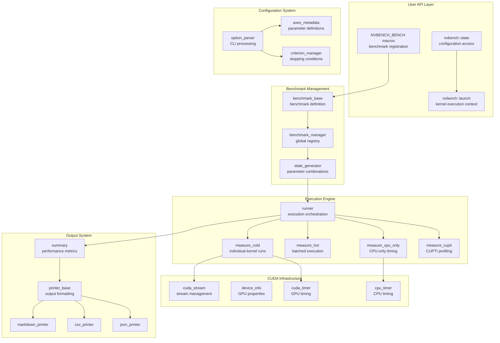

Sources: [nvbench/nvbench.cuh:1-40](), [nvbench/main.cuh:1-254](), [README.md:1-186]()

## Core Benchmarking Workflow

The benchmarking process follows a well-defined sequence from benchmark definition through result output:

**Benchmark Execution Flow**
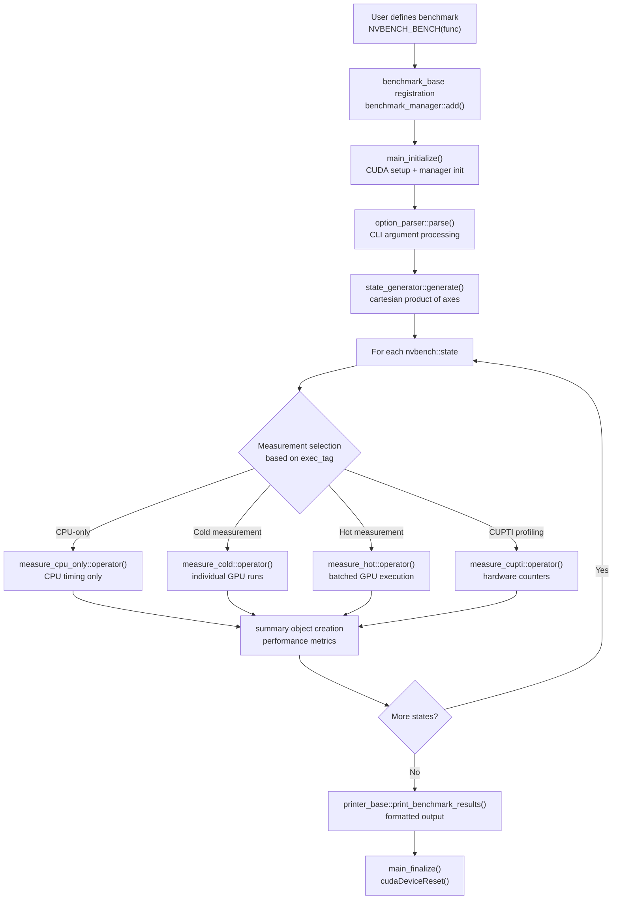

Sources: [nvbench/main.cuh:112-156](), [nvbench/detail/measure_cpu_only.cuh:88-142](), [docs/benchmarks.md:1-516]()

## Key Components

### Benchmark Definition and Registration

The `benchmark_base` class serves as the foundation for all benchmarks, storing configuration data and parameter axes. The `benchmark_manager` maintains a global registry of all benchmarks defined using the `NVBENCH_BENCH` macro system.

| Component | Role | Key Methods |
|-----------|------|-------------|
| `benchmark_base` | Benchmark definition storage | `run()`, `get_config_count()`, `set_name()` |
| `benchmark_manager` | Global benchmark registry | `initialize()`, `get()` (singleton) |
| `NVBENCH_BENCH` | Benchmark registration macro | Creates and registers benchmark instances |

### State Management and Configuration

The `nvbench::state` object provides runtime access to benchmark parameters and execution context. The `state_generator` creates all possible parameter combinations from defined axes.

| Component | Role | Key Methods |
|-----------|------|-------------|
| `nvbench::state` | Runtime parameter access | `get_int64()`, `get_float64()`, `get_string()`, `exec()` |
| `state_generator` | Parameter combination generation | Generates cartesian product of all axes |
| `axes_metadata` | Parameter axis definitions | Stores axis names, values, and types |

### Measurement Backends

NVBench provides multiple measurement strategies optimized for different use cases:

| Backend | Purpose | Implementation |
|---------|---------|----------------|
| `measure_cold` | Individual GPU kernel runs | Clean L2 cache between runs |
| `measure_hot` | Batched GPU execution | Multiple back-to-back runs |
| `measure_cpu_only` | CPU-only workloads | Host-side timing only |
| `measure_cupti` | Hardware profiling | CUPTI-based metrics collection |

Sources: [nvbench/detail/measure_cpu_only.cuh:40-142](), [README.md:21-31](), [docs/benchmarks.md:417-451]()

## Measurement Strategy Selection

NVBench automatically selects the appropriate measurement backend based on execution tags and benchmark configuration:

**Measurement Backend Selection**
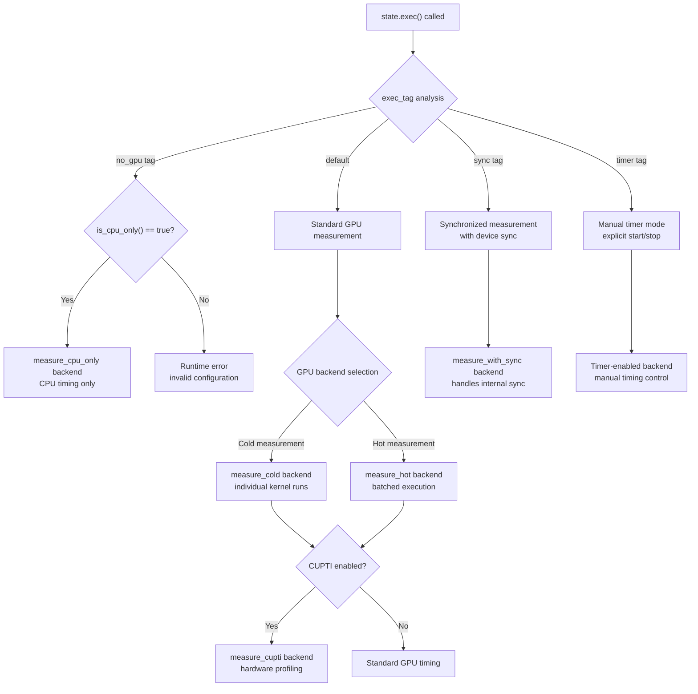

Sources: [docs/benchmarks.md:308-341](), [docs/benchmarks.md:361-401](), [examples/cpu_only.cu:1-84]()

## Usage Patterns

### Basic Benchmark Definition

```cpp
void my_benchmark(nvbench::state& state) {
  state.exec([](nvbench::launch& launch) {
    my_kernel<<<blocks, threads, 0, launch.get_stream()>>>();
  });
}
NVBENCH_BENCH(my_benchmark);
```

### Parameter Sweeps

```cpp
NVBENCH_BENCH(benchmark)
  .add_int64_axis("NumInputs", {16, 64, 256, 1024})
  .add_float64_axis("Quality", {0.5, 0.75, 1.0});
```

### Advanced Execution Control

```cpp
state.exec(nvbench::exec_tag::sync | nvbench::exec_tag::timer,
           [](nvbench::launch& launch, auto& timer) {
             timer.start();
             /* timed region */
             timer.stop();
           });
```

Sources: [docs/benchmarks.md:1-56](), [docs/benchmarks.md:88-125](), [docs/benchmarks.md:332-338](), [examples/summaries.cu:26-74]()

This architecture enables NVBench to provide comprehensive CUDA benchmarking capabilities while maintaining a simple user interface and handling the complexities of GPU performance measurement automatically.

---

# Page: Getting Started

# Getting Started

<details>
<summary>Relevant source files</summary>

The following files were used as context for generating this wiki page:

- [CMakeLists.txt](CMakeLists.txt)
- [README.md](README.md)
- [docs/benchmarks.md](docs/benchmarks.md)
- [examples/CMakeLists.txt](examples/CMakeLists.txt)
- [examples/cpu_only.cu](examples/cpu_only.cu)
- [examples/summaries.cu](examples/summaries.cu)
- [nvbench/CMakeLists.txt](nvbench/CMakeLists.txt)
- [nvbench/detail/measure_cpu_only.cuh](nvbench/detail/measure_cpu_only.cuh)
- [nvbench/detail/measure_cpu_only.cxx](nvbench/detail/measure_cpu_only.cxx)
- [testing/CMakeLists.txt](testing/CMakeLists.txt)

</details>


This document provides essential information for installing NVBench, creating your first benchmarks, and understanding the basic workflow. It covers installation, dependencies, minimal benchmark examples, and command-line usage.

For detailed information about benchmark configuration and parameter sweeps, see [Basic Usage and Examples](#2.2). For comprehensive CLI options, see [Command Line Interface](#2.3). For advanced architectural details, see [Core Architecture](#3).

## Installation and Build System

NVBench uses CMake as its build system and requires CUDA for GPU benchmarking functionality. The framework is designed to integrate easily with existing CUDA projects.

### Build System Overview

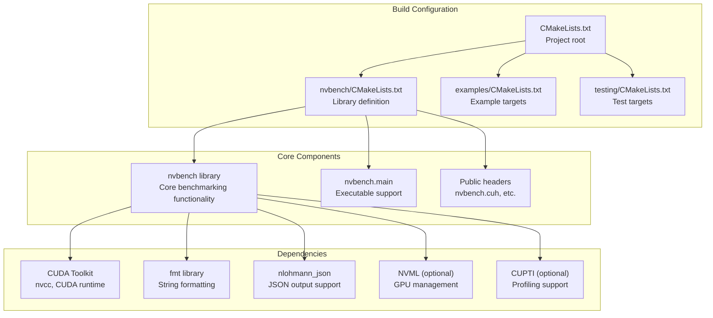

**Sources:** [CMakeLists.txt:1-85](), [nvbench/CMakeLists.txt:1-151](), [examples/CMakeLists.txt:1-55](), [testing/CMakeLists.txt:1-60]()

### Required Dependencies

| Component | Version Requirement | Purpose |
|-----------|-------------------|---------|
| CMake | > 3.30.4 | Build system |
| CUDA Toolkit + nvcc | 12.0+ | GPU compilation and runtime |
| C++ Compiler | g++ 7-14, clang++ 14-19 | Host code compilation |
| C++ Standard | C++17 | Language features |

**Sources:** [README.md:35-41](), [CMakeLists.txt:2-6]()

### Basic Installation

```bash
mkdir -p build
cd build
cmake -DNVBench_ENABLE_EXAMPLES=ON -DCMAKE_CUDA_ARCHITECTURES=70 .. && make
```

Key CMake options:
- `NVBench_ENABLE_EXAMPLES`: Build example benchmarks
- `NVBench_ENABLE_TESTING`: Build test suite  
- `CMAKE_CUDA_ARCHITECTURES`: Target GPU architecture
- `BUILD_SHARED_LIBS`: Build as shared library (default: ON)

**Sources:** [README.md:85-94](), [CMakeLists.txt:36-48]()

## Minimal Benchmark Creation

### Basic Benchmark Structure

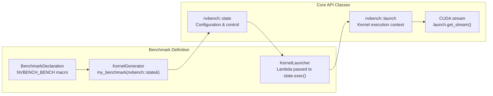

**Sources:** [docs/benchmarks.md:14-29](), [README.md:49-56]()

### Minimal Example

The simplest benchmark requires three components: a generator function, a launcher lambda, and a registration macro.

```cpp
void my_benchmark(nvbench::state& state) {
  state.exec([](nvbench::launch& launch) {
    my_kernel<<<num_blocks, 256, 0, launch.get_stream()>>>();
  });
}
NVBENCH_BENCH(my_benchmark);
```

Key components:
- **KernelGenerator**: `my_benchmark` function receives `nvbench::state&`
- **KernelLauncher**: Lambda passed to `state.exec()` 
- **BenchmarkDeclaration**: `NVBENCH_BENCH` macro registers the benchmark

**Sources:** [README.md:49-56](), [docs/benchmarks.md:5-12]()

### Integration with Existing Projects

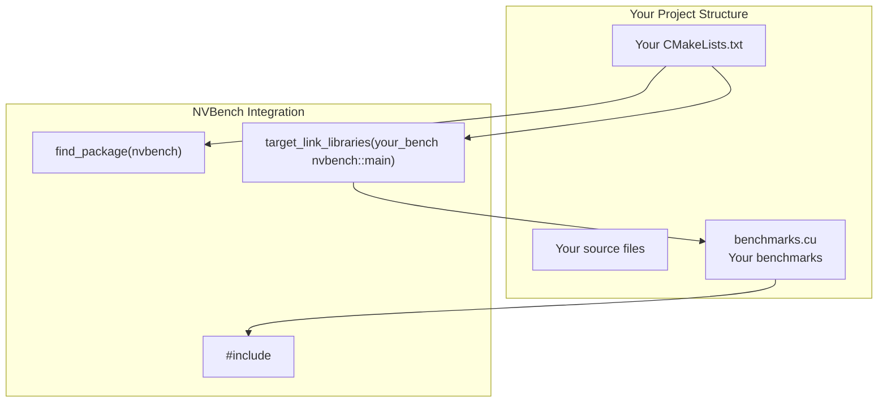

**Sources:** [examples/CMakeLists.txt:26-30]()

## Command Line Interface

### Basic Execution

Built benchmarks provide extensive runtime configuration through command-line options.

```bash
# Run all benchmarks
./nvbench.example.throughput

# Run with specific device
./nvbench.example.throughput -d 0

# Limit execution time
./nvbench.example.throughput --timeout 10.0

# Change output format
./nvbench.example.throughput --csv output.csv
```

### Core CLI Options

| Option | Purpose | Example |
|--------|---------|---------|
| `-d, --device` | Select CUDA device | `-d 0` |
| `--timeout` | Maximum benchmark time | `--timeout 60.0` |
| `--csv` | CSV output | `--csv results.csv` |
| `--json` | JSON output | `--json results.json` |
| `--run-once` | Single execution | `--run-once` |

**Sources:** [README.md:61-67]()

## Basic Benchmark Workflow  

### Execution Flow

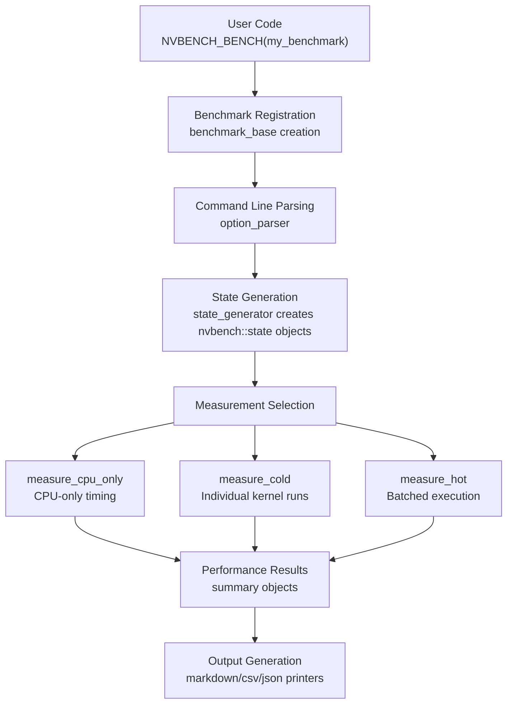

**Sources:** [nvbench/CMakeLists.txt:1-36](), [nvbench/detail/measure_cpu_only.cxx:35-50]()

### Key API Classes and Their Roles

| Class | Purpose | Key Methods |
|-------|---------|-------------|
| `nvbench::state` | Benchmark configuration and execution control | `exec()`, `get_int64()`, `add_summary()` |
| `nvbench::launch` | Kernel launch context | `get_stream()` |
| `benchmark_base` | Benchmark definition and metadata | Created by `NVBENCH_BENCH` |
| `option_parser` | Command-line argument processing | Handles CLI flags |
| `state_generator` | Creates benchmark configurations | Generates parameter combinations |

**Sources:** [nvbench/state.cxx:20-25](), [nvbench/option_parser.cu:16-20](), [nvbench/benchmark_base.cxx:4-10]()

## Quick Start Examples

### Simple Parameter Sweep

```cpp
void size_sweep(nvbench::state& state) {
  const auto size = state.get_int64("Size");
  
  state.exec([size](nvbench::launch& launch) {
    my_kernel<<<(size + 255) / 256, 256, 0, launch.get_stream()>>>(size);
  });
}
NVBENCH_BENCH(size_sweep)
  .add_int64_axis("Size", {1024, 4096, 16384, 65536});
```

### CPU-Only Benchmark

```cpp
void cpu_work(nvbench::state& state) {
  state.exec([](nvbench::launch&) {
    // CPU-only work here
    std::this_thread::sleep_for(std::chrono::milliseconds(10));
  });
}
NVBENCH_BENCH(cpu_work)
  .set_is_cpu_only(true);
```

**Sources:** [examples/cpu_only.cu:33-43](), [docs/benchmarks.md:95-104]()

### Building and Running Examples

The repository provides comprehensive examples demonstrating various NVBench features:

- **axes.cu**: Parameter sweeps and axis configuration
- **throughput.cu**: Performance metrics calculation  
- **cpu_only.cu**: Host-only benchmarking
- **exec_tag_*.cu**: Special execution modes

Build examples with:
```bash
cmake -DNVBench_ENABLE_EXAMPLES=ON .. && make
```

Examples are built to `build/bin` with prefix `nvbench.example.*`.

**Sources:** [examples/CMakeLists.txt:1-13](), [README.md:69-94]()

---

# Page: Installation and Build System

# Installation and Build System

<details>
<summary>Relevant source files</summary>

The following files were used as context for generating this wiki page:

- [CMakeLists.txt](CMakeLists.txt)
- [cmake/NVBenchConfigTarget.cmake](cmake/NVBenchConfigTarget.cmake)
- [cmake/NVBenchDependencies.cmake](cmake/NVBenchDependencies.cmake)
- [cmake/NVBenchExports.cmake](cmake/NVBenchExports.cmake)
- [cmake/NVBenchInstallRules.cmake](cmake/NVBenchInstallRules.cmake)
- [cmake/NVBenchRapidsCMake.cmake](cmake/NVBenchRapidsCMake.cmake)
- [cmake/RAPIDS.cmake](cmake/RAPIDS.cmake)
- [examples/auto_throughput.cu](examples/auto_throughput.cu)
- [nvbench/CMakeLists.txt](nvbench/CMakeLists.txt)
- [nvbench/git_revision.cuh](nvbench/git_revision.cuh)
- [nvbench/version.cuh](nvbench/version.cuh)
- [testing/CMakeLists.txt](testing/CMakeLists.txt)

</details>


This document covers NVBench's CMake-based build system, including dependencies, configuration options, and installation procedures. It explains how to build NVBench from source and integrate it into other projects.

For information about using NVBench after installation, see [Basic Usage and Examples](#2.2). For advanced build system customization and development workflows, see [Build System Deep Dive](#7.1).

## Build Requirements and Dependencies

NVBench requires CMake 3.30.4 or later and follows C++17/CUDA 17 standards. The build system leverages rapids-cmake for standardized dependency management and configuration.

### Core Dependencies

| Dependency | Version | Purpose | Required |
|------------|---------|---------|----------|
| CUDAToolkit | Any supported | GPU benchmarking and device management | Yes |
| fmt | 11.2.0+ | String formatting and output | Yes |
| nlohmann_json | 3.12.0+ | JSON output format support | Yes |

### Optional Dependencies

| Dependency | Default | Purpose | CMake Option |
|------------|---------|---------|--------------|
| NVML | ON | GPU management and frequency control | `NVBench_ENABLE_NVML` |
| CUPTI | ON (CUDA 11.3+) | Hardware performance counters | `NVBench_ENABLE_CUPTI` |

Sources: [CMakeLists.txt:30-35](), [cmake/NVBenchDependencies.cmake:11-24,36-46,62-82]()

## CMake Configuration Options

The build system provides extensive configuration through CMake options:

### Library Configuration
- `BUILD_SHARED_LIBS=ON` - Build NVBench as shared library
- `NVBench_ENABLE_NVML=ON` - Include NVML support for GPU management
- `NVBench_ENABLE_CUPTI=ON/OFF` - Include CUPTI profiling (auto-detected based on CUDA version)

### Development and Testing
- `NVBench_ENABLE_TESTING=OFF` - Build test suite
- `NVBench_ENABLE_HEADER_TESTING=OFF` - Test header compilation
- `NVBench_ENABLE_DEVICE_TESTING=OFF` - Include GPU-dependent tests
- `NVBench_ENABLE_EXAMPLES=OFF` - Build example benchmarks
- `NVBench_ENABLE_WERROR=ON` - Treat warnings as errors (top-level projects only)

### Installation
- `NVBench_ENABLE_INSTALL_RULES=ON/OFF` - Generate installation rules (auto-detected)

Sources: [CMakeLists.txt:36-48](), [cmake/NVBenchConfigTarget.cmake:3-6]()

## Build System Architecture

### Dependency Management Flow

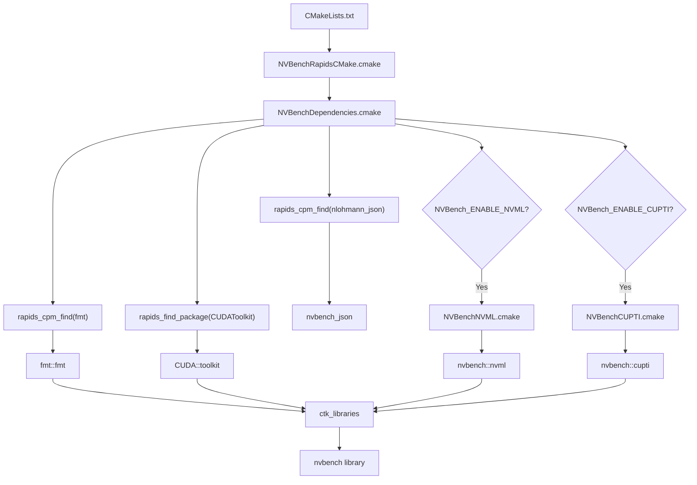

Sources: [cmake/NVBenchDependencies.cmake:1-83](), [CMakeLists.txt:14-22]()

### Target Configuration System

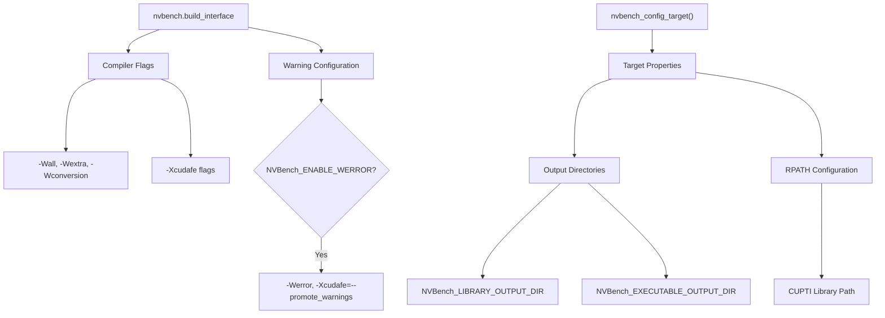

Sources: [cmake/NVBenchConfigTarget.cmake:15-91]()

## Build Targets and Libraries

### Primary Libraries

The build system creates several key targets:

#### nvbench Library
The main library target containing core benchmarking functionality:

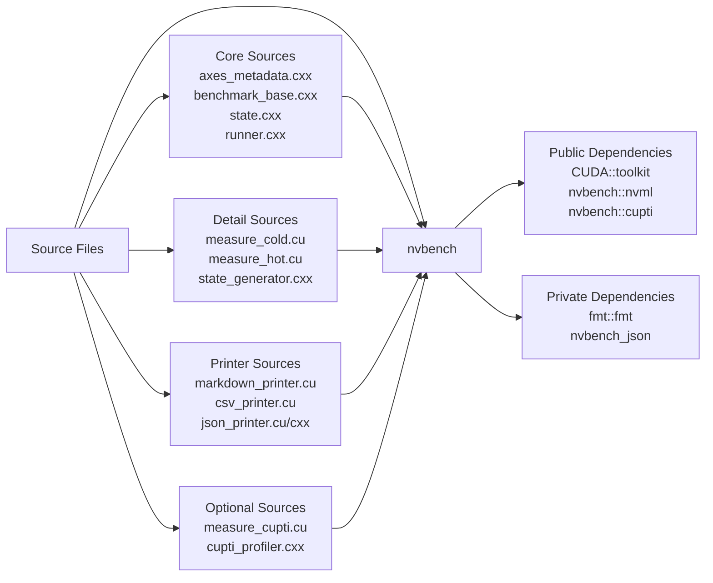

#### nvbench.main Object Library
Provides main function implementation for executable benchmarks:

- Target: `nvbench.main`
- Source: [nvbench/main.cu]()
- Links to: `nvbench` library
- Export name: `main`

Sources: [nvbench/CMakeLists.txt:1-53,72-86,112-117]()

### Special Compilation Handling

The build system includes several workarounds for compiler compatibility:

#### JSON Printer Compilation
CUDA 11.0 cannot compile the JSON printer as CUDA code, requiring fallback to C++:

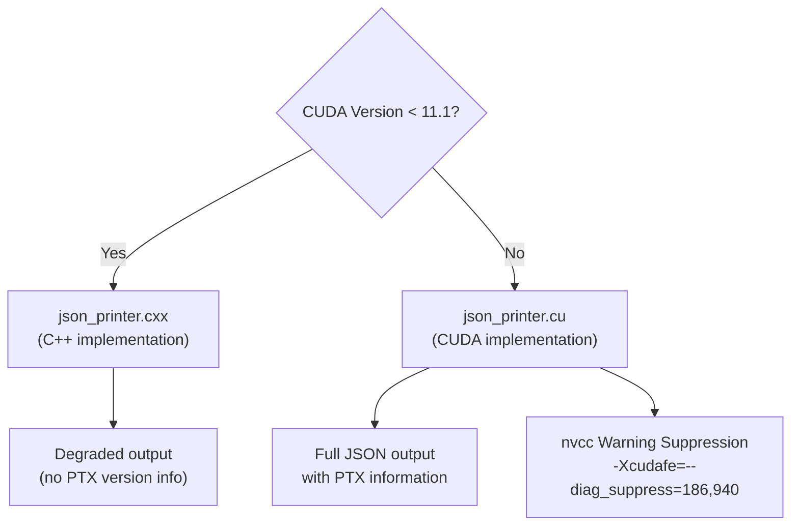

Sources: [nvbench/CMakeLists.txt:42-53,125-134]()

## Installation Process

### Installation Components

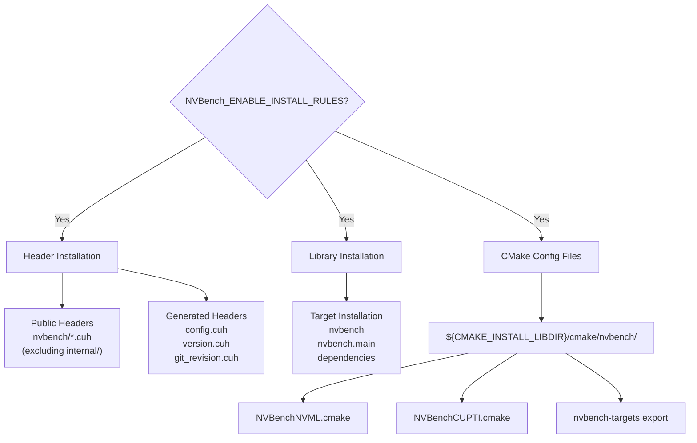

### Generated Files

The build system generates several configuration files:

| File | Purpose | Location |
|------|---------|----------|
| `config.cuh` | Build configuration | `${NVBench_BINARY_DIR}/nvbench/` |
| `version.cuh` | Version information | `${NVBench_BINARY_DIR}/nvbench/detail/` |
| `git_revision.cuh` | Git revision info | `${NVBench_BINARY_DIR}/nvbench/detail/` |
| CLI help headers | Command-line documentation | `${NVBench_BINARY_DIR}/nvbench/internal/` |

Sources: [cmake/NVBenchInstallRules.cmake:1-70](), [nvbench/CMakeLists.txt:56-70,139-144]()

## Export Configuration

The build system supports both build-tree and install-tree usage through rapids-cmake export mechanisms:

### Export Targets
- Main targets: `nvbench`, `main`, `ctl`, `internal_build_interface`
- Namespace: `nvbench::`
- Languages: CUDA, CXX
- Export set: `nvbench-targets`

### Conditional Exports
Optional dependencies are included in exports when enabled:
- NVML support: includes `NVBenchNVML.cmake`
- CUPTI support: includes `NVBenchCUPTI.cmake`
- JSON support: configures `nvbench_json` target

Sources: [cmake/NVBenchExports.cmake:1-51]()

---

# Page: Basic Usage and Examples

# Basic Usage and Examples

<details>
<summary>Relevant source files</summary>

The following files were used as context for generating this wiki page:

- [README.md](README.md)
- [docs/benchmarks.md](docs/benchmarks.md)
- [examples/CMakeLists.txt](examples/CMakeLists.txt)
- [examples/cpu_only.cu](examples/cpu_only.cu)
- [examples/custom_criterion.cu](examples/custom_criterion.cu)
- [examples/summaries.cu](examples/summaries.cu)
- [nvbench/criterion_manager.cuh](nvbench/criterion_manager.cuh)
- [nvbench/criterion_manager.cxx](nvbench/criterion_manager.cxx)
- [nvbench/detail/measure_cpu_only.cuh](nvbench/detail/measure_cpu_only.cuh)
- [nvbench/detail/measure_cpu_only.cxx](nvbench/detail/measure_cpu_only.cxx)
- [testing/criterion_manager.cu](testing/criterion_manager.cu)

</details>


This page provides a comprehensive guide to creating and running basic benchmarks with NVBench. It covers the fundamental concepts, core workflow, and practical examples needed to get started with CUDA kernel benchmarking. For advanced configuration options and stopping criteria, see [Advanced Features](#6). For detailed CLI reference, see [Command Line Interface](#2.3).

## Core Concepts and Workflow

NVBench operates around three main components that work together to execute benchmarks:

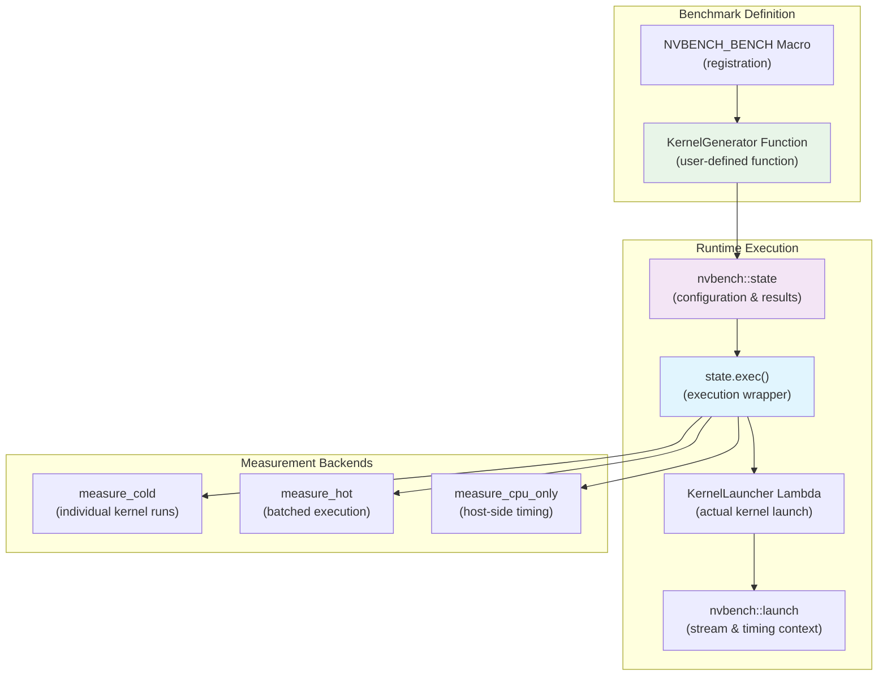

**Benchmark Execution Flow**

Sources: [docs/benchmarks.md:1-30](), [README.md:45-56]()

The execution flow follows a consistent pattern where the `KernelGenerator` configures benchmark parameters from the `nvbench::state`, creates a `KernelLauncher` lambda that launches the actual kernel, and passes it to `state.exec()` for measurement.

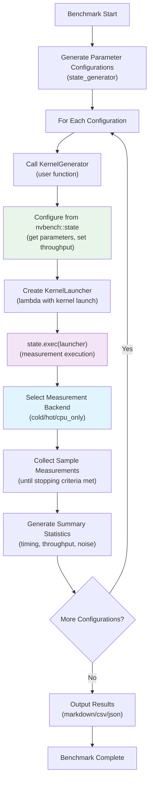

Sources: [nvbench/state.cuh](), [nvbench/benchmark_base.cuh](), [docs/benchmarks.md:14-30]()

## Minimal Benchmark

The simplest benchmark requires just a few lines of code:

```cpp
void my_benchmark(nvbench::state& state) {
  state.exec([](nvbench::launch& launch) {
    my_kernel<<<num_blocks, 256, 0, launch.get_stream()>>>();
  });
}
NVBENCH_BENCH(my_benchmark);
```

This minimal example demonstrates the three core components:

- **KernelGenerator**: `my_benchmark()` function that receives an `nvbench::state` object
- **KernelLauncher**: Lambda passed to `state.exec()` that launches the kernel  
- **BenchmarkDeclaration**: `NVBENCH_BENCH` macro that registers the benchmark

The `nvbench::launch` object provides the CUDA stream via `launch.get_stream()` that should be used for all kernel launches to ensure proper timing measurement.

Sources: [README.md:49-56](), [docs/benchmarks.md:5-12]()

## Parameter Axes and Sweeps

NVBench supports four types of parameter axes to explore different kernel configurations:

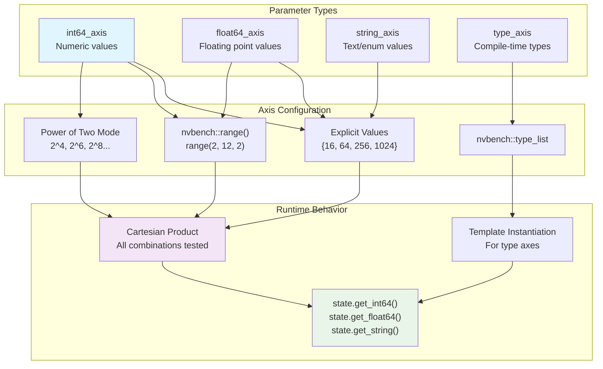

Sources: [docs/benchmarks.md:74-125](), [docs/benchmarks.md:166-200]()

### Int64 Axes Example

```cpp
void benchmark(nvbench::state& state)
{
  const auto num_inputs = state.get_int64("NumInputs");
  thrust::device_vector<int> data = generate_input(num_inputs);

  state.exec([&data](nvbench::launch& launch) {
    my_kernel<<<blocks, threads, 0, launch.get_stream()>>>(data.begin(), data.end());
  });
}
NVBENCH_BENCH(benchmark).add_int64_axis("NumInputs", {16, 64, 256, 1024, 4096});
```

The `nvbench::range(start, end, stride)` helper simplifies creating numeric sequences:

```cpp
// These are equivalent:
.add_int64_axis("Size", {2, 4, 6, 8, 10, 12})
.add_int64_axis("Size", nvbench::range(2, 12, 2))

// Power-of-two mode for common patterns:
.add_int64_power_of_two_axis("NumInputs", {4, 6, 8, 10, 12})  // 2^4, 2^6, 2^8, 2^10, 2^12
```

Sources: [docs/benchmarks.md:88-125](), [examples/axes.cu]()

### Type Axes Example

Type axes enable compile-time parameter sweeps for templated kernels:

```cpp
template <typename T>
void my_benchmark(nvbench::state& state, nvbench::type_list<T>)
{
  thrust::device_vector<T> data = generate_input<T>();

  state.exec([&data](nvbench::launch& launch) {
    my_kernel<<<blocks, threads, 0, launch.get_stream()>>>(data.begin(), data.end());
  });
}
using my_types = nvbench::type_list<int, float, double>;
NVBENCH_BENCH_TYPES(my_benchmark, NVBENCH_TYPE_AXES(my_types))
  .set_type_axes_names({"ValueType"});
```

Sources: [docs/benchmarks.md:166-200](), [examples/enums.cu]()

## Throughput Measurements

NVBench can calculate and report throughput metrics automatically when provided with element counts and memory access patterns:

```cpp
void throughput_benchmark(nvbench::state& state)
{
  const auto num_elements = state.get_int64("NumElements");
  
  // Configure throughput calculations:
  state.add_element_count(num_elements);
  state.add_global_memory_reads<InputType>(num_elements);
  state.add_global_memory_writes<OutputType>(num_elements);

  state.exec([=](nvbench::launch& launch) {
    copy_kernel<<<blocks, threads, 0, launch.get_stream()>>>(input_ptr, output_ptr, num_elements);
  });
}
```

This configuration enables NVBench to report:
- Elements processed per second  
- Global memory bandwidth usage (bytes/second)
- Percentage of device peak bandwidth utilized

Sources: [docs/benchmarks.md:244-267](), [examples/throughput.cu]()

## Execution Tags and Special Cases

NVBench provides execution tags to handle special benchmark requirements:

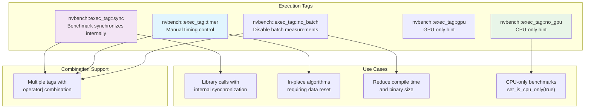

Sources: [docs/benchmarks.md:308-341](), [docs/benchmarks.md:417-474]()

### Manual Timer Mode

For kernels that modify input data and require reset between runs:

```cpp
void timer_example(nvbench::state& state)
{
  state.exec(nvbench::exec_tag::timer,
    [](nvbench::launch& launch, auto& timer) {
      // Reset/setup code here (not timed)
      
      timer.start();
      my_kernel<<<blocks, threads, 0, launch.get_stream()>>>();
      timer.stop();
      
      // Cleanup code here (not timed)  
    });
}
```

Sources: [docs/benchmarks.md:361-401](), [examples/exec_tag_timer.cu]()

### CPU-Only Benchmarks

For benchmarking host-side code without GPU involvement:

```cpp
void cpu_benchmark(nvbench::state& state)
{
  const auto duration = state.get_float64("Duration");
  
  state.exec(nvbench::exec_tag::no_gpu, [duration](nvbench::launch&) {
    // CPU workload here
    perform_cpu_work(duration);
  });
}
NVBENCH_BENCH(cpu_benchmark)
  .add_float64_axis("Duration", nvbench::range(0.1, 0.5, 0.1))
  .set_is_cpu_only(true);
```

Sources: [docs/benchmarks.md:417-474](), [examples/cpu_only.cu]()

## Running Benchmarks

Once compiled, benchmark executables provide extensive command-line configuration options. Basic execution requires no arguments:

```bash
./my_benchmark
```

Common CLI options include:

```bash
# Run specific benchmark configurations
./my_benchmark --benchmark "my_benchmark" --axis NumInputs=1024

# Change output format  
./my_benchmark --csv output.csv
./my_benchmark --json results.json

# Control measurement duration
./my_benchmark --timeout 30 --min-time 0.01

# Select specific GPU devices
./my_benchmark --devices 0,1
```

The framework automatically selects appropriate measurement backends (cold vs hot vs cpu_only) based on benchmark characteristics and execution tags.

Sources: [README.md:61-67](), [docs/cli_help.md]()

## Understanding Output

NVBench generates comprehensive output including device information, measurement logs, and summary tables:

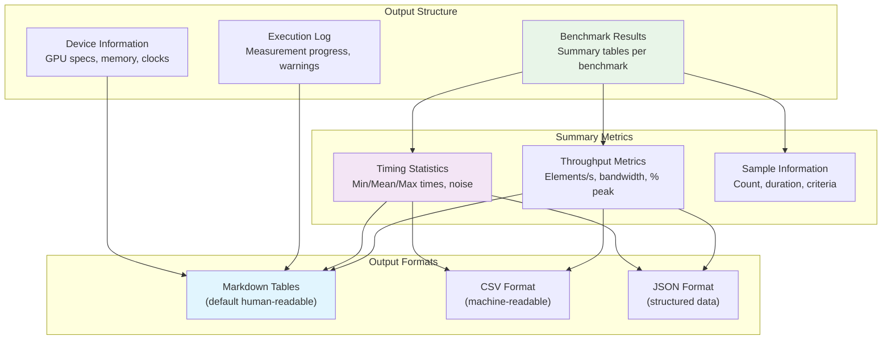

Sources: [README.md:95-132](), [nvbench/detail/measure_cpu_only.cxx:117-270]()

Example output shows device specs, measurement progress, and tabulated results with timing statistics, throughput calculations, and noise analysis for each parameter configuration tested.

Sources: [README.md:98-131](), [examples/custom_criterion.cu:77]()

---

# Page: Command Line Interface

# Command Line Interface

<details>
<summary>Relevant source files</summary>

The following files were used as context for generating this wiki page:

- [docs/cli_help.md](docs/cli_help.md)
- [nvbench/benchmark_base.cxx](nvbench/benchmark_base.cxx)
- [nvbench/option_parser.cu](nvbench/option_parser.cu)
- [nvbench/option_parser.cuh](nvbench/option_parser.cuh)
- [nvbench/state.cxx](nvbench/state.cxx)

</details>


The Command Line Interface (CLI) system provides comprehensive control over NVBench benchmark execution, configuration, and output formatting. This system parses command-line arguments and converts them into benchmark configurations, device settings, and output specifications.

For information about benchmark definition and internal state management, see [Benchmark Definition and State Management](#3.1). For details about output formats and analysis tools, see [Output Formats and Printers](#5.1).

## Architecture Overview

The CLI system is built around the `option_parser` class, which serves as the central coordinator for processing command-line arguments and configuring the benchmarking system.

### CLI System Architecture

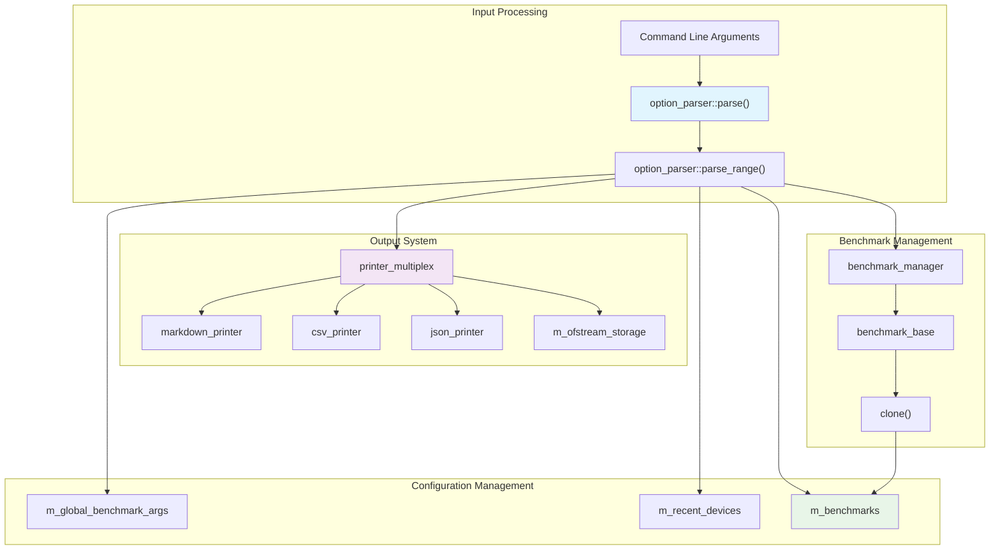

Sources: [nvbench/option_parser.cu:43-149](), [nvbench/option_parser.cuh:40-149]()

### Argument Processing Flow

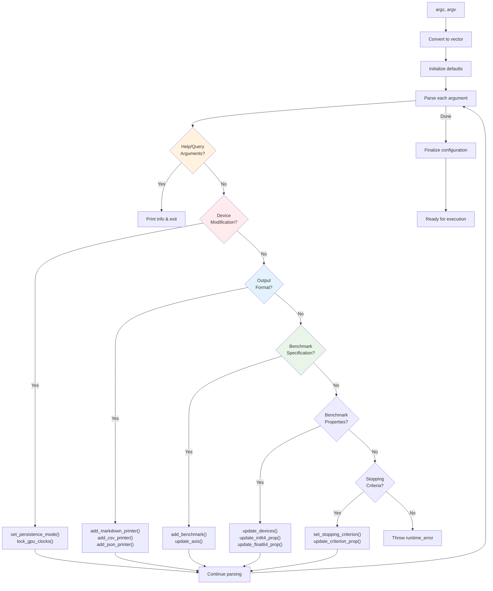

Sources: [nvbench/option_parser.cu:383-571](), [nvbench/option_parser.cu:341-380]()

## Command Categories

The CLI system organizes commands into several functional categories, each handled by specific parsing logic.

### Query Commands

| Command | Function | Implementation |
|---------|----------|----------------|
| `--help`, `-h` | Print usage information | [nvbench/option_parser.cu:411-416]() |
| `--help-axes` | Print axis documentation | [nvbench/option_parser.cu:418-421]() |
| `--version` | Print version information | [nvbench/option_parser.cu:423-426]() |
| `--list`, `-l` | List devices and benchmarks | [nvbench/option_parser.cu:428-432]() |
| `--jsonlist-benches` | JSON benchmark list | [nvbench/option_parser.cu:434-439]() |
| `--jsonlist-devices` | JSON device list | [nvbench/option_parser.cu:441-445]() |

### Device Management Commands

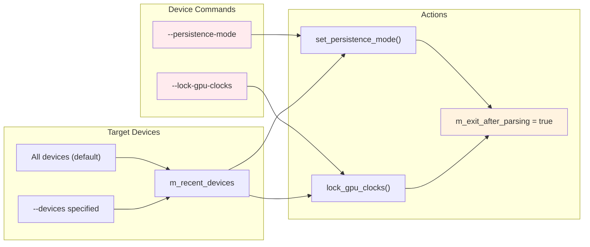

Sources: [nvbench/option_parser.cu:447-457](), [nvbench/option_parser.cu:664-738]()

### Output Format Commands

The system supports multiple output formats through a multiplexed printer system:

| Format | Command | Printer Type | Binary Support |
|--------|---------|--------------|----------------|
| Markdown | `--markdown`, `--md` | `markdown_printer` | No |
| CSV | `--csv` | `csv_printer` | No |
| JSON | `--json` | `json_printer` | No |
| Binary JSON | `--jsonbin` | `json_printer` | Yes |

### Benchmark Configuration Commands

```mermaid
graph TB
    subgraph "Benchmark Selection"
        BENCH["--benchmark, -b"]
        NAME["Benchmark name/index"]
        MGR["benchmark_manager::get()"]
    end
    
    subgraph "Configuration"
        AXIS["--axis, -a"]
        DEVICES["--devices, -d"]
        PROPS["Property arguments"]
    end
    
    subgraph "Global vs Local"
        GLOBAL["m_global_benchmark_args"]
        LOCAL["Applied to specific benchmark"]
        REPLAY["replay_global_args()"]
    end
    
    BENCH --> NAME
    NAME --> MGR
    MGR --> CLONE["clone()"]
    
    AXIS --> PARSE_AXIS["parse_axis_key_flag_value_spec()"]
    DEVICES --> PARSE_DEV["parse_devices()"]
    PROPS --> UPDATE["update_*_prop()"]
    
    CLONE --> REPLAY
    GLOBAL --> REPLAY
    
    PARSE_AXIS --> LOCAL
    PARSE_DEV --> LOCAL
    UPDATE --> LOCAL
    
    style BENCH fill:#e8f5e8
    style GLOBAL fill:#e1f5fe
    style LOCAL fill:#f3e5f5
```

Sources: [nvbench/option_parser.cu:517-521](), [nvbench/option_parser.cu:789-813](), [nvbench/option_parser.cu:815-817]()

## Axis Specification System

The axis specification system allows runtime configuration of benchmark parameters using a structured syntax.

### Axis Specification Parser

```mermaid
graph TB
    subgraph "Input Format"
        SPEC["AxisName[flags]=values"]
        EXAMPLES["Examples:\nNumInputs[pow2]=[10:30:5]\nValueType=[I32,F32,U64]\nQuality=0.781"]
    end
    
    subgraph "Parsing"
        REGEX["parse_axis_key_flag_value_spec()"]
        NAME["Axis name"]
        FLAGS["Optional flags"]
        VALUES["Value specification"]
    end
    
    subgraph "Value Processing"
        LIST["parse_list_values()"]
        RANGE["parse_range_values()"]
        SINGLE["Single value"]
    end
    
    subgraph "Axis Types"
        INT64["update_int64_axis()"]
        FLOAT64["update_float64_axis()"]
        STRING["update_string_axis()"]
        TYPE["update_type_axis()"]
    end
    
    SPEC --> REGEX
    EXAMPLES --> REGEX
    REGEX --> NAME
    REGEX --> FLAGS
    REGEX --> VALUES
    
    VALUES --> LIST
    VALUES --> RANGE
    VALUES --> SINGLE
    
    NAME --> INT64
    NAME --> FLOAT64
    NAME --> STRING
    NAME --> TYPE
    
    FLAGS --> INT64
    LIST --> INT64
    RANGE --> INT64
    SINGLE --> INT64
    
    style REGEX fill:#fff3e0
    style INT64 fill:#e8f5e8
    style FLOAT64 fill:#e8f5e8
    style STRING fill:#e8f5e8
    style TYPE fill:#e8f5e8
```

Sources: [nvbench/option_parser.cu:277-312](), [nvbench/option_parser.cu:847-909](), [nvbench/option_parser.cu:119-194]()

### Value Specification Formats

The system supports three value specification formats:

1. **List Format**: `[value1, value2, value3]`
2. **Range Format**: `[start:stop:stride]` 
3. **Single Value**: `value` or `[value]`

```mermaid
graph LR
    subgraph "List Processing"
        LISTREGEX["List regex: \\[...,...\\]"]
        LISTPARSE["parse_list_values()"]
        LISTVAL["Vector of values"]
    end
    
    subgraph "Range Processing"  
        RANGEREGEX["Range regex: \\[...:...\\]"]
        RANGEPARSE["parse_range_values()"]
        RANGEVAL["nvbench::range()"]
    end
    
    subgraph "Single Processing"
        SINGLEREGEX["Single regex: value"]
        SINGLEPARSE["Direct parse()"]
        SINGLEVAL["Single value vector"]
    end
    
    LISTREGEX --> LISTPARSE
    LISTPARSE --> LISTVAL
    
    RANGEREGEX --> RANGEPARSE
    RANGEPARSE --> RANGEVAL
    
    SINGLEREGEX --> SINGLEPARSE
    SINGLEPARSE --> SINGLEVAL
    
    style LISTPARSE fill:#e1f5fe
    style RANGEPARSE fill:#e1f5fe
    style SINGLEPARSE fill:#e1f5fe
```

Sources: [nvbench/option_parser.cu:196-255](), [nvbench/option_parser.cu:147-184]()

## Configuration State Management

The `option_parser` maintains several key state components to manage benchmark configuration and global settings.

### State Components

```mermaid
graph TB
    subgraph "Parser State"
        ARGS["m_args: vector<string>"]
        GLOBAL["m_global_benchmark_args"]
        RECENT["m_recent_devices"]
        BENCHES["m_benchmarks"]
    end
    
    subgraph "Output Management"
        PRINTER["m_printer: printer_multiplex"]
        STREAMS["m_ofstream_storage"]
        STDOUT["m_have_stdout_printer"]
        COLOR["m_color_md_stdout_printer"]
    end
    
    subgraph "Control Flags"
        EXIT["m_exit_after_parsing"]
        ENV["Environment variables"]
    end
    
    ARGS --> GLOBAL
    GLOBAL --> BENCHES
    RECENT --> BENCHES
    
    PRINTER --> STREAMS
    PRINTER --> STDOUT
    PRINTER --> COLOR
    
    ENV --> COLOR
    EXIT --> ENV
    
    style GLOBAL fill:#e1f5fe
    style BENCHES fill:#e8f5e8
    style PRINTER fill:#f3e5f5
```

Sources: [nvbench/option_parser.cuh:122-149](), [nvbench/option_parser.cu:348-351]()

### Global vs Local Arguments

The system distinguishes between global arguments (applied to all benchmarks) and local arguments (applied to specific benchmarks):

| Argument Type | Storage | Application |
|---------------|---------|-------------|
| Global | `m_global_benchmark_args` | Applied via `replay_global_args()` |
| Local | Direct benchmark modification | Immediate application |

Global arguments are stored when no benchmark is currently selected and replayed for each new benchmark through the `replay_global_args()` mechanism.

Sources: [nvbench/option_parser.cu:744-748](), [nvbench/option_parser.cu:815-817](), [nvbench/option_parser.cu:825-830]()

## Error Handling and Validation

The CLI system implements comprehensive error handling with detailed error messages for invalid arguments and malformed specifications.

### Error Categories

```mermaid
graph TB
    subgraph "Parse Errors"
        UNRECOG["Unrecognized arguments"]
        PARAMS["Insufficient parameters"]
        FORMAT["Invalid format"]
    end
    
    subgraph "Validation Errors"
        AXIS["Invalid axis specification"]
        DEVICE["Invalid device ID"]
        CRITERION["Invalid criterion parameter"]
    end
    
    subgraph "Error Handling"
        THROW["NVBENCH_THROW()"]
        CONTEXT["Contextual error messages"]
        WRAP["Exception wrapping"]
    end
    
    UNRECOG --> THROW
    PARAMS --> THROW
    FORMAT --> THROW
    
    AXIS --> WRAP
    DEVICE --> WRAP
    CRITERION --> WRAP
    
    THROW --> CONTEXT
    WRAP --> CONTEXT
    
    style THROW fill:#ffebee
    style CONTEXT fill:#fff3e0
```

Sources: [nvbench/option_parser.cu:392-401](), [nvbench/option_parser.cu:552-568](), [nvbench/option_parser.cu:584-590]()

The error handling system provides detailed context about which argument caused the error and what values were expected, making debugging command-line issues straightforward for users.

---

# Page: Core Architecture

# Core Architecture

<details>
<summary>Relevant source files</summary>

The following files were used as context for generating this wiki page:

- [nvbench/axes_metadata.cuh](nvbench/axes_metadata.cuh)
- [nvbench/benchmark.cuh](nvbench/benchmark.cuh)
- [nvbench/benchmark_base.cuh](nvbench/benchmark_base.cuh)
- [nvbench/runner.cuh](nvbench/runner.cuh)
- [nvbench/state.cuh](nvbench/state.cuh)

</details>


This document provides a detailed examination of NVBench's internal architecture and primary systems. It covers the fundamental components that enable benchmark definition, configuration, execution, and state management within the framework.

For information about measurement backends and timing systems, see [Measurement Systems](#3.2). For details about command-line interfaces and user-facing APIs, see [Getting Started](#2).

## Architecture Overview

NVBench's core architecture is built around four fundamental systems that work together to provide a comprehensive benchmarking framework:

1. **Benchmark Definition System** - Defines and configures benchmarks through `benchmark_base` and `benchmark` classes
2. **State Management System** - Manages individual benchmark configurations via the `state` class  
3. **Execution Orchestration** - Coordinates benchmark execution through the `runner` system
4. **Parameter Management** - Handles parameter axes and configuration through `axes_metadata`

### Core Component Relationships

```mermaid
graph TB
    subgraph "Benchmark Definition Layer"
        BB["benchmark_base"]
        BT["benchmark&lt;KernelGenerator, TypeAxes&gt;"]
        AM["axes_metadata"]
    end
    
    subgraph "Execution Layer"  
        RB["runner_base"]
        RT["runner&lt;BenchmarkType&gt;"]
        SG["state_generator"]
    end
    
    subgraph "Configuration Layer"
        ST["state"]
        NV["named_values"]
        CP["criterion_params"]
    end
    
    BT --> BB
    BB --> AM
    BB --> ST
    
    RT --> RB
    RB --> BB
    SG --> ST
    RT --> SG
    
    ST --> NV
    ST --> CP
    AM --> ST
    
    RT --> ST
```

*Sources: [nvbench/benchmark_base.cuh:40-47](), [nvbench/benchmark.cuh:52-57](), [nvbench/runner.cuh:31-47](), [nvbench/state.cuh:59-78]()*

## Benchmark Definition System

The benchmark definition system centers on a two-tier class hierarchy that separates template-independent functionality from type-specific operations.

### benchmark_base Class

The `benchmark_base` class serves as the foundation for all benchmarks, providing runtime configuration and non-templated functionality:

```mermaid
classDiagram
    class benchmark_base {
        -string m_name
        -axes_metadata m_axes
        -vector~device_info~ m_devices
        -vector~state~ m_states
        -criterion_params m_criterion_params
        +set_name(string) benchmark_base&
        +add_int64_axis(string, vector~int64_t~) benchmark_base&
        +add_float64_axis(string, vector~float64_t~) benchmark_base&
        +add_string_axis(string, vector~string~) benchmark_base&
        +set_devices(vector~device_info~) benchmark_base&
        +run() void
        +get_config_count() size_t
        +get_states() vector~state~&
    }
    
    class benchmark~KernelGenerator_TypeAxes~ {
        -kernel_generator m_kernel_generator
        +benchmark(kernel_generator)
        -do_clone() unique_ptr~benchmark_base~
        -do_run() void
    }
    
    benchmark_base <|-- benchmark~KernelGenerator_TypeAxes~
```

Key responsibilities of `benchmark_base` include:
- Managing benchmark metadata (name, axes, devices)
- Storing configuration parameters and stopping criteria
- Providing public API for benchmark configuration
- Managing the collection of `state` objects representing all parameter combinations

### benchmark Template Class

The `benchmark` template class extends `benchmark_base` with type-specific functionality:

**Template Parameters:**
- `KernelGenerator`: Callable object that executes the benchmark kernel
- `TypeAxes`: Type list defining compile-time parameter variations

**Key Features:**
- Implements virtual interface for type-specific operations
- Stores the kernel generator function
- Manages compile-time type configurations through `type_configs`

*Sources: [nvbench/benchmark_base.cuh:47-48](), [nvbench/benchmark.cuh:52-65](), [nvbench/benchmark_base.cuh:296-323]()*

## State Management System

The `state` class represents a single configuration instance of a benchmark, containing all parameter values and execution context for one specific test case.

### State Class Architecture

```mermaid
classDiagram
    class state {
        -reference_wrapper~benchmark_base~ m_benchmark
        -named_values m_axis_values
        -optional~device_info~ m_device
        -optional~cuda_stream~ m_cuda_stream
        -vector~summary~ m_summaries
        -criterion_params m_criterion_params
        +get_int64(string) int64_t
        +get_float64(string) float64_t
        +get_string(string) string&
        +get_cuda_stream() cuda_stream&
        +get_device() optional~device_info~&
        +add_summary(string) summary&
        +skip(string) void
        +exec(ExecTags, KernelLauncher) void
    }
    
    class named_values {
        +get_int64(string) int64_t
        +get_float64(string) float64_t
        +get_string(string) string&
    }
    
    class summary {
        +set_int64(string, int64_t) void
        +set_float64(string, float64_t) void
        +set_string(string, string) void
    }
    
    state --> named_values
    state --> summary
```

### State Responsibilities

The `state` class manages:

1. **Parameter Access**: Provides type-safe access to benchmark parameters via `get_int64()`, `get_float64()`, and `get_string()` methods
2. **Device Management**: Manages CUDA device selection and stream creation
3. **Execution Control**: Provides the `exec()` method for kernel execution with configurable execution tags
4. **Result Collection**: Manages `summary` objects containing measurement results
5. **Skip Logic**: Handles benchmark skipping with reason tracking

### Key State Features

**CUDA Integration**: The state automatically manages CUDA streams through lazy initialization:
```cpp
nvbench::cuda_stream &get_cuda_stream() {
    if (!m_cuda_stream.has_value()) {
        m_cuda_stream = nvbench::cuda_stream{m_device};
    }
    return m_cuda_stream.value();
}
```

**Performance Measurement Control**: States can be configured for specialized measurement scenarios:
- `m_is_cpu_only`: CPU-only timing mode
- `m_run_once`: Single execution for profiling tools
- `m_disable_blocking_kernel`: Disable synchronization kernel

*Sources: [nvbench/state.cuh:59-92](), [nvbench/state.cuh:284-292](), [nvbench/state.cuh:227-234]()*

## Execution Orchestration

The execution system coordinates benchmark running through a two-level runner architecture that separates template-independent coordination from type-specific execution.

### Runner System Architecture

```mermaid
graph TB
    subgraph "Runner Hierarchy"
        RB["runner_base"]
        RT["runner&lt;BenchmarkType&gt;"]
    end
    
    subgraph "State Generation"
        SG["state_generator"]
        BB["benchmark_base"]
    end
    
    subgraph "Execution Flow"
        GS["generate_states()"]
        RUN["run()"]
        RD["run_device()"]
        RP["run_state_prologue()"]
        KG["kernel_generator()"]
        RE["run_state_epilogue()"]
    end
    
    RT --> RB
    RB --> BB
    RT --> SG
    
    RB --> GS
    RT --> RUN
    RUN --> RD
    RD --> RP
    RP --> KG
    KG --> RE
```

### runner_base Responsibilities

The `runner_base` class handles template-independent execution coordination:

- **State Generation**: Calls `generate_states()` to create all parameter combinations
- **Exception Handling**: Manages benchmark execution exceptions through `handle_sampling_exception()`
- **Execution Lifecycle**: Provides `run_state_prologue()` and `run_state_epilogue()` hooks
- **Skip Notifications**: Handles skip reporting via `print_skip_notification()`

### runner Template Specialization

The `runner<BenchmarkType>` template manages type-specific execution:

**Multi-Device Execution**: Iterates through configured devices, setting each active before execution:
```cpp
for (const auto &device : m_benchmark.m_devices) {
    this->run_device(device);
}
```

**Type Configuration Iteration**: Uses template metaprogramming to iterate through all type configurations:
```cpp
nvbench::tl::foreach<type_configs>(
    [&self = *this, &states = m_benchmark.m_states, &type_config_index, &device](
        auto type_config_wrapper) {
        using type_config = typename decltype(type_config_wrapper)::type;
        // Execute kernel with current type configuration
        kernel_generator_copy(cur_state, type_config{});
    });
```

*Sources: [nvbench/runner.cuh:31-47](), [nvbench/runner.cuh:62-75](), [nvbench/runner.cuh:78-119]()*

## Parameter and Axis Management

The `axes_metadata` class manages the parameter space definition for benchmarks, handling both runtime parameter axes and compile-time type axes.

### Axis System Architecture

```mermaid
classDiagram
    class axes_metadata {
        -vector~unique_ptr~axis_base~~ m_axes
        +add_int64_axis(string, vector~int64_t~, flags) void
        +add_float64_axis(string, vector~float64_t~) void
        +add_string_axis(string, vector~string~) void
        +get_int64_axis(string_view) int64_axis&
        +get_float64_axis(string_view) float64_axis&
        +get_string_axis(string_view) string_axis&
        +get_type_axis(string_view) type_axis&
    }
    
    class axis_base {
        <<abstract>>
        +get_name() string&
        +get_type() axis_type
        +get_size() size_t
    }
    
    class int64_axis {
        -vector~int64_t~ m_inputs
        -int64_axis_flags m_flags
    }
    
    class float64_axis {
        -vector~float64_t~ m_inputs
    }
    
    class string_axis {
        -vector~string~ m_inputs
    }
    
    class type_axis {
        -size_t m_axis_index
        +set_inputs~TypeList~() void
    }
    
    axes_metadata --> axis_base
    axis_base <|-- int64_axis
    axis_base <|-- float64_axis  
    axis_base <|-- string_axis
    axis_base <|-- type_axis
```

### Axis Types and Capabilities

**Runtime Parameter Axes:**
- `int64_axis`: Integer parameters with optional power-of-two formatting
- `float64_axis`: Floating-point parameters
- `string_axis`: String-based parameters

**Compile-Time Type Axes:**
- `type_axis`: Template type parameters managed through `nvbench::type_list`

### Template Metaprogramming Integration

The axis system integrates with NVBench's template metaprogramming through the constructor:

```cpp
template <typename... TypeAxes>
axes_metadata::axes_metadata(nvbench::type_list<TypeAxes...>)
{
    nvbench::tl::foreach<type_axes_list>(
        [&axes = m_axes, &names_iter]([[maybe_unused]] auto wrapped_type) {
            typedef typename decltype(wrapped_type)::type type_list;
            auto axis = std::make_unique<nvbench::type_axis>(std::move(*names_iter++), type_axis_index);
            axis->template set_inputs<type_list>();
            axes.push_back(std::move(axis));
        });
}
```

This creates type axes automatically from the template parameters, enabling compile-time type iteration during benchmark execution.

*Sources: [nvbench/axes_metadata.cuh:37-42](), [nvbench/axes_metadata.cuh:53-77](), [nvbench/axes_metadata.cuh:93-116]()*

## Integration and Data Flow

The core architecture components integrate to provide a complete benchmarking pipeline:

### Complete Execution Flow

```mermaid
sequenceDiagram
    participant User
    participant benchmark as "benchmark&lt;T&gt;"
    participant runner as "runner&lt;T&gt;"
    participant state_gen as "state_generator"
    participant state as "state"
    participant kernel as "KernelGenerator"
    
    User->>benchmark: run()
    benchmark->>runner: create runner
    runner->>state_gen: generate_states()
    state_gen->>state: create state objects
    state-->>runner: state collection
    
    loop For each device
        loop For each type config
            loop For each parameter combination
                runner->>state: run_state_prologue()
                runner->>kernel: operator()(state, type_config)
                kernel->>state: exec(kernel_launcher)
                runner->>state: run_state_epilogue()
            end
        end
    end
```

### Configuration Propagation

Configuration flows from `benchmark_base` to individual `state` objects:

1. **Axis Definition**: `axes_metadata` defines the parameter space
2. **State Generation**: `state_generator` creates cartesian product of all axes
3. **Configuration Transfer**: Benchmark-level settings propagate to each state
4. **Execution Context**: Each state provides isolated execution environment

The architecture ensures type safety through template specialization while maintaining runtime flexibility through the base class hierarchy.

*Sources: [nvbench/benchmark.cuh:77-82](), [nvbench/runner.cuh:37-38](), [nvbench/state.cuh:294-302]()*

---

# Page: Benchmark Definition and State Management

# Benchmark Definition and State Management

<details>
<summary>Relevant source files</summary>

The following files were used as context for generating this wiki page:

- [nvbench/benchmark_base.cuh](nvbench/benchmark_base.cuh)
- [nvbench/state.cuh](nvbench/state.cuh)
- [testing/axes_metadata.cu](testing/axes_metadata.cu)
- [testing/benchmark.cu](testing/benchmark.cu)
- [testing/runner.cu](testing/runner.cu)

</details>


This document covers how benchmarks are defined and configured in NVBench, focusing on the `benchmark_base` class for benchmark definition and the `state` struct for managing individual benchmark configurations. It explains how parameter axes generate multiple benchmark states and how these states are managed throughout the benchmarking process.

For information about the actual measurement and execution of benchmarks, see [Measurement Systems](#3.2). For details about parameter axis configuration, see [Parameter Axes and Configuration](#3.4).

## Core Components Overview

NVBench's benchmark definition and state management system is built around two primary classes that work together to define, configure, and execute benchmarks.

```mermaid
graph TB
    subgraph "Benchmark Definition Layer"
        BB["benchmark_base<br/>Runtime benchmark info<br/>Configuration API"]
        AM["axes_metadata<br/>Parameter specifications"]
        DI["device_info[]<br/>GPU device list"]
    end
    
    subgraph "State Management Layer"  
        SG["state_generator<br/>Cartesian product generation"]
        ST["state[]<br/>Individual configurations"]
        NV["named_values<br/>Parameter storage"]
    end
    
    subgraph "Execution Layer"
        RB["runner_base<br/>Orchestrates execution"]
        SM["summary[]<br/>Results storage"]
    end
    
    BB --> AM
    BB --> DI
    BB --> SG
    AM --> SG
    DI --> SG
    SG --> ST
    ST --> NV
    ST --> RB
    RB --> SM
    
    BB -.-> ST
    ST -.-> BB
```

Sources: [nvbench/benchmark_base.cuh:40-323](), [nvbench/state.cuh:45-339]()

## Benchmark Definition with benchmark_base

The `benchmark_base` class serves as the primary interface for defining and configuring benchmarks. It holds all runtime benchmark information and provides the public customization API used by the `NVBENCH_BENCH` macros.

### Key Responsibilities

| Function | Description | Key Methods |
|----------|-------------|-------------|
| **Axis Management** | Define parameter ranges for benchmarking | `add_int64_axis()`, `add_float64_axis()`, `add_string_axis()` |
| **Device Configuration** | Specify which CUDA devices to use | `set_devices()`, `add_device()`, `get_devices()` |
| **Execution Control** | Configure measurement behavior | `set_min_samples()`, `set_timeout()`, `set_stopping_criterion()` |
| **State Generation** | Create individual benchmark configurations | `run()`, `get_states()`, `get_config_count()` |

```mermaid
graph LR
    subgraph "benchmark_base Configuration"
        NAME["m_name<br/>Benchmark identifier"]
        AXES["m_axes<br/>axes_metadata<br/>Parameter definitions"]
        DEVICES["m_devices<br/>device_info[]<br/>Target GPUs"]
        STATES["m_states<br/>state[]<br/>Generated configurations"]
    end
    
    subgraph "Configuration Methods"
        SET_NAME["set_name()"]
        ADD_AXIS["add_*_axis()"]
        SET_DEVICES["set_devices()"]
        RUN["run()"]
    end
    
    subgraph "Runtime Parameters"
        MIN_SAMPLES["m_min_samples<br/>Minimum measurements"]
        TIMEOUT["m_timeout<br/>Max execution time"]
        CRITERION["m_stopping_criterion<br/>Convergence logic"]
        PARAMS["m_criterion_params<br/>Criterion parameters"]
    end
    
    SET_NAME --> NAME
    ADD_AXIS --> AXES
    SET_DEVICES --> DEVICES
    RUN --> STATES
    
    MIN_SAMPLES --> STATES
    TIMEOUT --> STATES
    CRITERION --> STATES
    PARAMS --> STATES
```

Sources: [nvbench/benchmark_base.cuh:47-323](), [testing/benchmark.cu:88-127]()

### Benchmark Configuration API

The `benchmark_base` class provides a fluent API for configuring benchmarks:

```cpp
// From benchmark_base.cuh method signatures:
benchmark_base& set_name(std::string name);
benchmark_base& add_int64_axis(std::string name, std::vector<nvbench::int64_t> data);
benchmark_base& add_float64_axis(std::string name, std::vector<nvbench::float64_t> data);
benchmark_base& add_string_axis(std::string name, std::vector<std::string> data);
benchmark_base& set_devices(std::vector<nvbench::device_info> devices);
benchmark_base& set_min_samples(nvbench::int64_t min_samples);
benchmark_base& set_timeout(nvbench::float64_t timeout);
```

Sources: [nvbench/benchmark_base.cuh:70-82](), [nvbench/benchmark_base.cuh:84-109](), [nvbench/benchmark_base.cuh:156-222]()

## State Management with state Struct

The `state` struct stores all information about a particular benchmark configuration. One `state` object exists for every combination of a benchmark's parameter axes, representing a unique configuration to be measured.

### State Lifecycle and Components

```mermaid
stateDiagram-v2
    [*] --> Created: "state_generator creates<br/>from benchmark_base"
    Created --> Configured: "Copy benchmark settings<br/>Set parameter values"
    Configured --> Executing: "runner calls state.exec()"
    Executing --> Measuring: "Measurement backend<br/>collects samples"
    Measuring --> Complete: "Stopping criterion met<br/>or timeout reached"
    Complete --> [*]: "Results stored in<br/>summary objects"
    
    Configured --> Skipped: "state.skip() called<br/>Invalid configuration"
    Skipped --> [*]: "Skip reason recorded"
```

Sources: [nvbench/state.cuh:59-339](), [testing/runner.cu:42-93]()

### State Data Structure

The `state` struct contains several categories of information:

| Category | Members | Purpose |
|----------|---------|---------|
| **Benchmark Reference** | `m_benchmark`, `m_axis_values` | Link to parent benchmark and parameter values |
| **Device Context** | `m_device`, `m_cuda_stream` | CUDA device and stream management |
| **Execution Control** | `m_min_samples`, `m_timeout`, `m_stopping_criterion` | Measurement configuration |
| **Results Storage** | `m_summaries`, `m_skip_reason` | Performance data and skip information |
| **Memory Tracking** | `m_element_count`, `m_global_memory_rw_bytes` | Data size metrics |
| **CUPTI Integration** | `m_collect_l1_hit_rates`, etc. | Hardware counter collection flags |

Sources: [nvbench/state.cuh:304-339]()

## Parameter Access and Management

The `state` class provides type-safe parameter access through the `named_values` system:

```cpp
// Parameter retrieval methods from state.cuh:
nvbench::int64_t get_int64(const std::string& axis_name) const;
nvbench::float64_t get_float64(const std::string& axis_name) const;
const std::string& get_string(const std::string& axis_name) const;

// With default value fallbacks:
nvbench::int64_t get_int64_or_default(const std::string& axis_name, 
                                      nvbench::int64_t default_value) const;
```

Sources: [nvbench/state.cuh:98-108]()

## State Generation Process

The state generation process creates the Cartesian product of all parameter axes to generate individual benchmark configurations.

```mermaid
flowchart TD
    BB["benchmark_base<br/>Contains axes_metadata"]
    
    subgraph "Axis Definitions"
        TA["Type Axes<br/>Template parameters"]
        IA["Int64 Axes<br/>Numeric ranges"]
        FA["Float64 Axes<br/>Floating point values"]  
        SA["String Axes<br/>String parameters"]
    end
    
    SG["state_generator<br/>Cartesian product logic"]
    
    subgraph "Generated States"
        S1["state[0]<br/>Config A + Device 0"]
        S2["state[1]<br/>Config A + Device 1"]  
        S3["state[2]<br/>Config B + Device 0"]
        SN["state[n]<br/>Config N + Device M"]
    end
    
    BB --> TA
    BB --> IA
    BB --> FA
    BB --> SA
    
    TA --> SG
    IA --> SG
    FA --> SG
    SA --> SG
    
    SG --> S1
    SG --> S2
    SG --> S3
    SG --> SN
    
    S1 --> NV1["named_values<br/>Parameter storage"]
    S2 --> NV2["named_values<br/>Parameter storage"]
    S3 --> NV3["named_values<br/>Parameter storage"]
    SN --> NVN["named_values<br/>Parameter storage"]
```

Sources: [nvbench/state.cuh:294-302](), [testing/runner.cu:106-109](), [testing/benchmark.cu:281-301]()

## Configuration Count Calculation

The total number of benchmark configurations is computed as the product of all axis sizes multiplied by the number of devices:

```
config_count = (type_axis_0_size × type_axis_1_size × ... × type_axis_n_size) 
             × (int64_axis_0_size × int64_axis_1_size × ... × int64_axis_m_size)
             × (float64_axis_0_size × float64_axis_1_size × ... × float64_axis_k_size)  
             × (string_axis_0_size × string_axis_1_size × ... × string_axis_j_size)
             × max(device_count, 1)
```

This calculation is available through the `get_config_count()` method, which can be called before `run()` to determine the total number of configurations that will be generated.

Sources: [nvbench/benchmark_base.cuh:139-141](), [testing/benchmark.cu:281-301]()

## Memory and Performance Tracking

The `state` class provides methods for tracking memory usage and computational work:

```cpp
// Memory tracking methods:
void add_element_count(std::size_t elements, std::string column_name = {});
void add_global_memory_reads(std::size_t bytes, std::string column_name = {});
void add_global_memory_writes(std::size_t bytes, std::string column_name = {});
void add_buffer_size(std::size_t num_bytes, std::string summary_tag, 
                     std::string column_name = {}, std::string description = {});
```

These methods allow benchmarks to report their memory access patterns, which is essential for calculating metrics like effective bandwidth and memory efficiency.

Sources: [nvbench/state.cuh:110-133]()

## Integration with Execution System

The `state` objects serve as the primary interface between benchmark definition and execution:

```mermaid
graph LR
    subgraph "Definition Phase"
        BB["benchmark_base<br/>User configuration"]
        SG["state_generator<br/>Generate configurations"]
    end
    
    subgraph "Execution Phase"  
        ST["state<br/>Individual config"]
        EXEC["state.exec()<br/>Kernel execution"]
        MEASURE["Measurement backends<br/>collect_samples()"]
    end
    
    subgraph "Results Phase"
        SUMMARY["summary objects<br/>Performance metrics"]
        PRINTER["printer_base<br/>Output formatting"]
    end
    
    BB --> SG
    SG --> ST
    ST --> EXEC
    EXEC --> MEASURE
    MEASURE --> SUMMARY
    SUMMARY --> PRINTER
    
    ST -.-> BB
```

Each `state` maintains a reference back to its parent `benchmark_base` and can access shared configuration like stopping criteria and timeout values while maintaining its own parameter values and execution context.

Sources: [nvbench/state.cuh:284-291](), [nvbench/state.cuh:304](), [nvbench/benchmark_base.cuh:144-147]()

---

# Page: Measurement Systems

# Measurement Systems

<details>
<summary>Relevant source files</summary>

The following files were used as context for generating this wiki page:

- [nvbench/detail/measure_cold.cu](nvbench/detail/measure_cold.cu)
- [nvbench/detail/measure_cold.cuh](nvbench/detail/measure_cold.cuh)
- [nvbench/detail/measure_hot.cu](nvbench/detail/measure_hot.cu)
- [nvbench/detail/measure_hot.cuh](nvbench/detail/measure_hot.cuh)
- [nvbench/detail/state_exec.cuh](nvbench/detail/state_exec.cuh)
- [nvbench/exec_tag.cuh](nvbench/exec_tag.cuh)

</details>


This document covers NVBench's measurement backends and the infrastructure that controls when and how different measurement strategies are applied. The measurement systems are responsible for executing benchmarks, collecting timing data, and generating performance summaries.

For information about how benchmarks are defined and configured, see [Benchmark Definition and State Management](#3.1). For details about the execution engine that orchestrates measurements, see [Execution Engine and State Generation](#3.3).

## Overview of Measurement Backends

NVBench provides multiple measurement strategies optimized for different benchmark characteristics and requirements. The framework automatically selects appropriate measurement backends based on execution tags and benchmark configuration.

### Measurement Backend Architecture

```mermaid
graph TB
    subgraph "Measurement Selection"
        state["nvbench::state"]
        exec_tags["exec_tag analysis"]
        state_exec["state_exec.cuh"]
    end
    
    subgraph "Measurement Backends"
        measure_cold["measure_cold<br/>Individual kernel runs"]
        measure_hot["measure_hot<br/>Batched execution"]  
        measure_cpu_only["measure_cpu_only<br/>CPU timing only"]
        measure_cupti["measure_cupti<br/>CUPTI profiling"]
    end
    
    subgraph "Timing Infrastructure"
        cuda_timer["cuda_timer<br/>CUDA events"]
        cpu_timer["cpu_timer<br/>std::chrono"]
        gpu_frequency["gpu_frequency<br/>Throttling detection"]
    end
    
    subgraph "Quality Control"
        stopping_criterion["stopping_criterion<br/>Convergence analysis"]
        l2flush["l2flush<br/>Cache management"]
        blocking_kernel["blocking_kernel<br/>Stream synchronization"]
    end
    
    state --> exec_tags
    exec_tags --> state_exec
    state_exec --> measure_cold
    state_exec --> measure_hot
    state_exec --> measure_cpu_only
    state_exec --> measure_cupti
    
    measure_cold --> cuda_timer
    measure_cold --> cpu_timer
    measure_cold --> gpu_frequency
    measure_hot --> cuda_timer
    measure_cpu_only --> cpu_timer
    
    measure_cold --> stopping_criterion
    measure_cold --> l2flush
    measure_cold --> blocking_kernel
    measure_hot --> blocking_kernel
```

**Sources:** [nvbench/detail/state_exec.cuh:43-196](), [nvbench/detail/measure_cold.cuh:48-232](), [nvbench/detail/measure_hot.cuh:40-212]()

## Measurement Selection System

The measurement system uses execution tags (`exec_tag`) to determine which measurement backends to instantiate and execute. This compile-time selection mechanism prevents unnecessary code generation.

### Execution Tag Processing

```mermaid
flowchart TD
    ExecTags["ExecTags parameter"] --> tag_analysis["Tag Analysis<br/>state_exec.cuh:56-57"]
    tag_analysis --> modifier_tags["modifier_tags<br/>(timer, sync, gpu, no_gpu, no_batch)"]
    tag_analysis --> measure_tags["measure_tags<br/>(cold, hot, cpu_only)"]
    
    measure_tags --> has_measure{{"measure_tags != 0"}}
    has_measure -->|No| default_selection["Default Selection<br/>Lines 60-90"]
    has_measure -->|Yes| direct_selection["Direct Selection<br/>Lines 92-195"]
    
    default_selection --> gpu_check{{"modifier_tags & gpu"}}
    default_selection --> no_gpu_check{{"modifier_tags & no_gpu"}}
    default_selection --> auto_select["Auto-select based on modifiers"]
    
    direct_selection --> cpu_only_exec["CPU-only execution<br/>Lines 117-139"]
    direct_selection --> gpu_exec["GPU execution<br/>Lines 140-195"]
    
    gpu_exec --> cold_measure["measure_cold instantiation<br/>Lines 142-179"]
    gpu_exec --> hot_measure["measure_hot instantiation<br/>Lines 181-194"]
    
    cpu_only_exec --> measure_cpu_only_inst["measure_cpu_only<br/>instantiation"]
```

**Sources:** [nvbench/detail/state_exec.cuh:43-196](), [nvbench/exec_tag.cuh:31-151]()

### Execution Tag Definitions

| Tag | Purpose | Constraints |
|-----|---------|-------------|
| `timer` | Manual timing in kernel launcher | Implies `no_batch` |
| `sync` | Kernel launcher performs synchronization | Implies `no_batch`, disables throttling |
| `gpu` | GPU-only measurements | Excludes `measure_cpu_only` |
| `no_gpu` | CPU-only measurements | Requires `set_is_cpu_only(true)` |
| `no_batch` | Disable batched measurements | Excludes `measure_hot` |

**Sources:** [nvbench/exec_tag.cuh:128-149](), [nvbench/detail/state_exec.cuh:104-110]()

## Cold Measurement System

The cold measurement system (`measure_cold`) executes kernels individually to measure isolated performance characteristics. This approach provides detailed statistics and can detect GPU throttling.

### Cold Measurement Architecture

```mermaid
graph TB
    subgraph "measure_cold_base"
        constructor["Constructor<br/>measure_cold.cu:39-59"]
        initialize["initialize()<br/>Lines 74-93"]
        run_trials["run_trials()<br/>Lines 215-223"]
        record_measurements["record_measurements()<br/>Lines 97-163"]
        is_finished["is_finished()<br/>Lines 165-190"]
        generate_summaries["generate_summaries()<br/>Lines 194-449"]
    end
    
    subgraph "Timing Components"
        kernel_launch_timer["kernel_launch_timer<br/>Lines 131-176"]
        cuda_timer_cold["cuda_timer"]
        cpu_timer_cold["cpu_timer"]
        walltime_timer["walltime_timer"]
    end
    
    subgraph "Quality Control"
        throttle_detection["GPU Throttling Detection<br/>Lines 99-144"]
        l2flush_cold["L2 Cache Flush<br/>Line 73"]
        blocking_kernel_cold["Blocking Kernel<br/>Lines 465-468"]
        stopping_criterion_cold["Stopping Criterion<br/>Line 162"]
    end
    
    constructor --> initialize
    initialize --> run_trials
    run_trials --> record_measurements
    record_measurements --> throttle_detection
    record_measurements --> is_finished
    is_finished --> generate_summaries
    
    kernel_launch_timer --> cuda_timer_cold
    kernel_launch_timer --> cpu_timer_cold
    kernel_launch_timer --> l2flush_cold
    kernel_launch_timer --> blocking_kernel_cold
```

**Sources:** [nvbench/detail/measure_cold.cu:36-471](), [nvbench/detail/measure_cold.cuh:48-232]()

### Cold Measurement Features

The cold measurement system provides comprehensive performance analysis:

#### Throttling Detection
Cold measurements monitor GPU clock frequencies to detect thermal throttling. When throttling is detected, the measurement discards the sample and pauses execution:

```cpp
// GPU frequency monitoring logic
if (m_gpu_frequency.has_throttled(default_clock_rate, m_throttle_threshold))
{
  // Discard measurement and increase recovery delay
  m_dynamic_throttle_recovery_delay += std::min(m_dynamic_throttle_recovery_delay * 1.5f, 0.5f);
  std::this_thread::sleep_for(std::chrono::duration<float>(m_dynamic_throttle_recovery_delay));
  return; // Skip this measurement
}
```

**Sources:** [nvbench/detail/measure_cold.cu:99-144]()

#### Performance Summaries Generated

| Summary Key | Description | Purpose |
|-------------|-------------|---------|
| `nv/cold/sample_size` | Number of isolated executions | Sample size reporting |
| `nv/cold/time/gpu/mean` | Mean GPU execution time | Primary performance metric |
| `nv/cold/time/cpu/mean` | Mean CPU-measured time | Host overhead analysis |
| `nv/cold/bw/global/bytes_per_second` | Global memory bandwidth | Bandwidth utilization |
| `nv/cold/sm_clock_rate/mean` | Mean SM clock rate | Throttling analysis |

**Sources:** [nvbench/detail/measure_cold.cu:194-449]()

## Hot Measurement System

The hot measurement system (`measure_hot`) executes kernels in batches to achieve stable performance measurements by amortizing launch overhead and maintaining GPU occupancy.

### Hot Measurement Flow

```mermaid
flowchart TD
    measure_hot_init["measure_hot initialization<br/>measure_hot.cu:37-68"]
    warmup["run_warmup()<br/>Lines 107-125"]
    estimate_batch["Estimate batch size<br/>Lines 134-135"]
    
    batch_loop_start["Batch execution loop<br/>Lines 137-199"]
    block_stream_hot["block_stream()<br/>Lines 149, 170"]
    launch_kernels["Launch kernel batch<br/>Lines 152-174"]
    record_batch["Record batch timing<br/>Lines 179-180"]
    update_estimate["Update batch estimate<br/>Lines 182-185"]
    
    check_completion["Check completion<br/>Lines 187-198"]
    generate_hot_summaries["generate_summaries()<br/>Lines 83-154"]
    
    measure_hot_init --> warmup
    warmup --> estimate_batch
    estimate_batch --> batch_loop_start
    batch_loop_start --> block_stream_hot
    block_stream_hot --> launch_kernels
    launch_kernels --> record_batch
    record_batch --> update_estimate
    update_estimate --> check_completion
    check_completion -->|Continue| batch_loop_start
    check_completion -->|Finished| generate_hot_summaries
```

**Sources:** [nvbench/detail/measure_hot.cu:34-176](), [nvbench/detail/measure_hot.cuh:87-212]()

### Hot Measurement Batch Sizing

Hot measurement dynamically adjusts batch sizes based on performance estimates:

```cpp
// Initial batch size estimation from warmup
const auto time_estimate = m_cuda_timer.get_duration() * 0.95;
auto batch_size = static_cast<nvbench::int64_t>(m_min_time / time_estimate);

// Dynamic batch size updates during execution
batch_size = static_cast<nvbench::int64_t>(
  (m_min_time - m_total_cuda_time) /
  (m_total_cuda_time / static_cast<nvbench::float64_t>(m_total_samples)));
```

**Sources:** [nvbench/detail/measure_hot.cuh:134-185]()

## CPU-Only Measurement System

The CPU-only measurement system (`measure_cpu_only`) provides timing for benchmarks that don't use GPU resources, using high-resolution CPU timers.

### CPU-Only Measurement Components

```mermaid
graph LR
    subgraph "measure_cpu_only"
        cpu_timer_only["cpu_timer<br/>High-resolution timing"]
        kernel_launcher_cpu["KernelLauncher<br/>CPU-only execution"]
        stopping_criterion_cpu["stopping_criterion<br/>Convergence detection"]
    end
    
    subgraph "Timer Infrastructure"
        chrono_timer["std::chrono<br/>system timers"]
        cpu_measurement["CPU time measurement"]
    end
    
    kernel_launcher_cpu --> cpu_timer_only
    cpu_timer_only --> chrono_timer
    chrono_timer --> cpu_measurement
    cpu_measurement --> stopping_criterion_cpu
```

**Sources:** [nvbench/detail/measure_cpu_only.cuh](), [nvbench/detail/state_exec.cuh:117-139]()

## CUPTI Profiling Integration

When CUPTI support is available, NVBench can collect detailed hardware performance counters alongside timing measurements.

### CUPTI Measurement Selection

```mermaid
flowchart TD
    cupti_check{{"NVBENCH_HAS_CUPTI &&<br/>is_cupti_required() &&<br/>!get_run_once()"}}
    cupti_check -->|Yes| measure_cupti_inst["measure_cupti<br/>instantiation"]
    cupti_check -->|No| standard_cold["Standard cold measurement"]
    
    measure_cupti_inst --> hardware_counters["Hardware counter<br/>collection"]
    hardware_counters --> cupti_summaries["CUPTI performance<br/>summaries"]
    
    standard_cold --> cold_timing["Cold timing<br/>measurements"]
```

**Sources:** [nvbench/detail/state_exec.cuh:148-173]()

## Timing Infrastructure

All measurement systems rely on specialized timer implementations optimized for different execution contexts.

### Timer Architecture

| Timer Type | Implementation | Use Case |
|------------|----------------|----------|
| `cuda_timer` | CUDA events | GPU kernel timing |
| `cpu_timer` | `std::chrono` | Host code timing |
| `gpu_frequency` | NVML queries | Throttling detection |

### Timer Integration Points

```mermaid
graph TB
    subgraph "Kernel Launch Timer"
        timer_start["start()<br/>L2 flush + sync + block"]
        kernel_execution["Kernel execution"]
        timer_stop["stop()<br/>Unblock + sync"]
    end
    
    subgraph "Measurement Collection"
        cuda_duration["cuda_timer.get_duration()"]
        cpu_duration["cpu_timer.get_duration()"]
        frequency_data["gpu_frequency data"]
    end
    
    timer_start --> kernel_execution
    kernel_execution --> timer_stop
    timer_stop --> cuda_duration
    timer_stop --> cpu_duration
    timer_stop --> frequency_data
```

**Sources:** [nvbench/detail/measure_cold.cuh:131-176](), [nvbench/cuda_timer.cuh](), [nvbench/cpu_timer.cuh]()

## Quality Control Mechanisms

The measurement systems implement several quality control mechanisms to ensure reliable results:

### L2 Cache Management
Cache flushing ensures consistent memory subsystem state between measurements:

```cpp
__forceinline__ void flush_device_l2() { 
  m_l2flush.flush(m_launch.get_stream()); 
}
```

### Blocking Kernel Pattern
Stream blocking ensures accurate timing by preventing CPU-GPU execution overlap:

```cpp
void block_stream() {
  m_blocker.block(m_launch.get_stream(), m_state.get_blocking_kernel_timeout());
}
```

### Skip Time Validation
Measurements below minimum execution time thresholds are rejected:

```cpp
void check_skip_time(nvbench::float64_t warmup_time) {
  if (m_skip_time > 0. && warmup_time < m_skip_time) {
    m_state.skip("Warmup time did not meet skip_time limit");
  }
}
```

**Sources:** [nvbench/detail/measure_cold.cuh:73-81](), [nvbench/detail/measure_cold.cu:451-463](), [nvbench/detail/measure_cold.cu:465-468]()

---

# Page: Execution Engine and State Generation

# Execution Engine and State Generation

<details>
<summary>Relevant source files</summary>

The following files were used as context for generating this wiki page:

- [nvbench/axes_metadata.cuh](nvbench/axes_metadata.cuh)
- [nvbench/benchmark.cuh](nvbench/benchmark.cuh)
- [nvbench/detail/state_generator.cuh](nvbench/detail/state_generator.cuh)
- [nvbench/runner.cuh](nvbench/runner.cuh)
- [testing/option_parser.cu](testing/option_parser.cu)
- [testing/state_generator.cu](testing/state_generator.cu)

</details>


This document covers NVBench's core execution systems: how benchmark configurations are converted into executable states and how those states are systematically executed. The state generation system creates the Cartesian product of all parameter combinations, while the execution engine orchestrates the actual benchmark runs across devices and configurations.

For information about benchmark definition and parameter configuration, see [Benchmark Definition and State Management](#3.1). For details about the measurement backends used during execution, see [Measurement Systems](#3.2).

## Overview

The execution engine and state generation work together to transform high-level benchmark definitions into concrete measurement results. The process involves two main phases:

1. **State Generation**: Converting benchmark parameter axes into individual `nvbench::state` objects representing each unique configuration
2. **Execution**: Systematically running each state through the appropriate measurement backend

## State Generation System

The state generation system creates individual benchmark states from the Cartesian product of all configured parameter axes. This is handled primarily by the `nvbench::detail::state_generator` class.

### State Generation Architecture

```mermaid
flowchart TD
    BM["benchmark_base"] --> SG["state_generator::create()"]
    SG --> BAC["build_axis_configs()"]
    BAC --> TC["Type Axis Configs"]
    BAC --> NTC["Non-Type Axis Configs"]
    
    TC --> BS["build_states()"]
    NTC --> BS
    BS --> SI["state_iterator"]
    
    SI --> CP["Cartesian Product Generation"]
    CP --> STATES["Vector of nvbench::state"]
    
    STATES --> DEV1["States for Device 1"]
    STATES --> DEV2["States for Device 2"] 
    STATES --> DEVN["States for Device N"]
```

**State Generation Flow**

Sources: [nvbench/detail/state_generator.cuh:38-54](), [testing/state_generator.cu:147-230]()

### State Iterator Implementation

The `state_iterator` class generates all possible combinations of parameter values using a Cartesian product approach:

```mermaid
graph TB
    SI["state_iterator"] --> AA["add_axis()"]
    AA --> AI["axis_index structs"]
    AI --> INIT["init()"]
    INIT --> CV["iter_valid()"]
    CV --> GCI["get_current_indices()"]
    GCI --> NEXT["next()"]
    NEXT --> CV
    
    subgraph "axis_index Structure"
        AXI["axis_index"] --> ANAME["axis: string"]
        AXI --> ATYPE["type: axis_type"]
        AXI --> AIDX["index: size_t"]
        AXI --> ASIZE["size: size_t"]
    end
```

**State Iterator Components**

Each `axis_index` contains:
- `axis`: The parameter name (e.g., "VecSize", "Strategy")
- `type`: The axis type (int64, float64, string, type)
- `index`: Current value index within the axis
- `size`: Total number of values in the axis

Sources: [nvbench/detail/state_generator.cuh:74-96](), [testing/state_generator.cu:72-145]()

### Parameter Axis Types

The state generator handles four types of parameter axes:

| Axis Type | Class | Purpose | Example |
|-----------|-------|---------|---------|
| Type | `type_axis` | Template type parameters | `<float, int, bool>` |
| Integer | `int64_axis` | Numeric parameters | `{1024, 2048, 4096}` |
| Float | `float64_axis` | Floating-point parameters | `{3.14, 6.28}` |
| String | `string_axis` | Categorical parameters | `{"recursive", "iterative"}` |

Sources: [nvbench/axes_metadata.cuh:53-71](), [testing/state_generator.cu:147-230]()

## Execution Engine

The execution engine is implemented through the `runner` template class and its base `runner_base`. It orchestrates the systematic execution of all generated states.

### Execution Architecture

```mermaid
flowchart TD
    BENCH["benchmark::do_run()"] --> RUNNER["runner<BenchmarkType>"]
    RUNNER --> GS["generate_states()"]
    RUNNER --> RUN["run()"]
    
    GS --> SG["state_generator::create()"]
    SG --> STATES["m_benchmark.m_states"]
    
    RUN --> RD["run_device()"]
    RD --> TC["Type Config Iteration"]
    TC --> TL["tl::foreach<type_configs>"]
    
    TL --> RSP["run_state_prologue()"]
    RSP --> KG["kernel_generator()"]
    KG --> RSE["run_state_epilogue()"]
    
    subgraph "Exception Handling"
        KG --> EX["Exception?"]
        EX --> HSE["handle_sampling_exception()"]
    end
    
    subgraph "Skip Handling"
        KG --> SKIP["is_skipped()?"]
        SKIP --> PSN["print_skip_notification()"]
    end
```

**Execution Flow Components**

Sources: [nvbench/runner.cuh:49-122](), [nvbench/benchmark.cuh:77-82]()

### Runner Template Structure

The `runner` template provides type-safe execution for specific benchmark types:

```mermaid
classDiagram
    class runner_base {
        +benchmark_base& m_benchmark
        +generate_states()
        +run_state_prologue(state&)
        +run_state_epilogue(state&)
        +handle_sampling_exception(exception&, state&)
    }
    
    class runner~BenchmarkType~ {
        +kernel_generator m_kernel_generator
        +run()
        -run_device(optional~device_info~)
    }
    
    runner_base <|-- runner
    
    class BenchmarkType {
        +kernel_generator
        +type_configs
        +num_type_configs
    }
    
    runner --> BenchmarkType : templated on
```

**Runner Class Hierarchy**

The separation between `runner_base` and `runner<T>` minimizes template instantiation costs by keeping non-templated functionality in the base class.

Sources: [nvbench/runner.cuh:31-47](), [nvbench/runner.cuh:49-122]()

## State-to-Execution Integration

The integration between state generation and execution follows a systematic pattern that ensures all parameter combinations are measured consistently.

### Complete Execution Flow

```mermaid
sequenceDiagram
    participant B as benchmark
    participant R as runner
    participant SG as state_generator
    participant SI as state_iterator
    participant M as measurement_backend
    
    B->>R: do_run()
    R->>R: generate_states()
    R->>SG: create(benchmark)
    SG->>SI: Cartesian product generation
    SI->>SG: axis configurations
    SG->>R: vector<state>
    
    R->>R: run()
    loop For each device
        R->>R: run_device(device)
        loop For each type_config
            loop For each matching state
                R->>R: run_state_prologue(state)
                R->>M: kernel_generator(state, type_config)
                M->>R: measurement results
                R->>R: run_state_epilogue(state)
            end
        end
    end
```

**Execution Sequence**

Sources: [nvbench/benchmark.cuh:77-82](), [nvbench/runner.cuh:62-119]()

### State Filtering and Execution

During execution, states are filtered by device and type configuration to ensure proper execution order:

```mermaid
graph TD
    STATES["All Generated States"] --> FILTER["Filter by Device & Type Config"]
    FILTER --> MATCH["Matching States"]
    MATCH --> EXEC["Execute State"]
    
    subgraph "State Matching Logic"
        SM["State Matching"] --> DC["state.get_device() == device"]
        SM --> TC["state.get_type_config_index() == type_config_index"]
        DC --> AND["&&"]
        TC --> AND
        AND --> EXECUTE["Execute if true"]
    end
    
    EXEC --> PROLOGUE["run_state_prologue()"]
    PROLOGUE --> KERNEL["kernel_generator(state, type_config)"]
    KERNEL --> EPILOGUE["run_state_epilogue()"]
```

**State Execution Filtering**

The execution engine ensures that each state runs with the correct device context and type configuration, maintaining consistency across all measurements.

Sources: [nvbench/runner.cuh:86-118]()

### Error Handling and State Management

The execution engine provides comprehensive error handling and state lifecycle management:

| Phase | Handler | Purpose |
|-------|---------|---------|
| Prologue | `run_state_prologue()` | Initialize measurement context |
| Execution | `handle_sampling_exception()` | Handle measurement failures |
| Skip Detection | `print_skip_notification()` | Report skipped configurations |
| Epilogue | `run_state_epilogue()` | Finalize measurements |

Sources: [nvbench/runner.cuh:39-44](), [nvbench/runner.cuh:104-113]()

---

# Page: Parameter Axes and Configuration

# Parameter Axes and Configuration

<details>
<summary>Relevant source files</summary>

The following files were used as context for generating this wiki page:

- [nvbench/axis_base.cuh](nvbench/axis_base.cuh)
- [nvbench/flags.cuh](nvbench/flags.cuh)
- [nvbench/int64_axis.cuh](nvbench/int64_axis.cuh)
- [testing/axes_metadata.cu](testing/axes_metadata.cu)
- [testing/benchmark.cu](testing/benchmark.cu)
- [testing/int64_axis.cu](testing/int64_axis.cu)
- [testing/runner.cu](testing/runner.cu)

</details>


This document describes NVBench's parameter axis system, which defines how benchmark parameters are specified, managed, and used to generate different benchmark configurations. The axis system enables benchmarks to test multiple parameter combinations by defining parameter spaces along different dimensions.

For information about how these parameter configurations are executed, see [Execution Engine and State Generation](#3.3). For details on how parameter values are accessed during benchmark execution, see [Benchmark Definition and State Management](#3.1).

## Axis System Architecture

NVBench implements a polymorphic axis hierarchy that supports different parameter types through a common interface. Each axis represents a dimension of parameter space and contains multiple values that can be tested.

```mermaid
classDiagram
    class axis_base {
        +get_name() string
        +get_type() axis_type
        +get_size() size_t
        +get_input_string(i) string
        +get_description(i) string
        +clone() unique_ptr~axis_base~
        #do_get_size()* size_t
        #do_get_input_string(i)* string
        #do_get_description(i)* string
    }
    
    class int64_axis {
        +set_inputs(vector~int64_t~, flags)
        +get_value(i) int64_t
        +get_values() vector~int64_t~
        +is_power_of_two() bool
        -m_inputs vector~int64_t~
        -m_values vector~int64_t~
        -m_flags int64_axis_flags
    }
    
    class float64_axis {
        +set_inputs(vector~float64_t~)
        +get_value(i) float64_t
        +get_values() vector~float64_t~
        -m_inputs vector~float64_t~
    }
    
    class string_axis {
        +set_inputs(vector~string~)
        +get_value(i) string
        +get_values() vector~string~
        -m_inputs vector~string~
    }
    
    class type_axis {
        +set_active_inputs(vector~string~)
        +get_active_inputs() vector~string~
        +get_axis_index() size_t
        -m_axis_index size_t
    }
    
    axis_base <|-- int64_axis
    axis_base <|-- float64_axis
    axis_base <|-- string_axis
    axis_base <|-- type_axis
    
    class axis_type {
        <<enumeration>>
        type
        int64
        float64
        string
    }
    
    axis_base --> axis_type
```

**Sources:** [nvbench/axis_base.cuh:40-86](), [nvbench/int64_axis.cuh:44-102]()

## Axis Types and Configuration

### Integer Axes

The `int64_axis` class supports two modes of operation controlled by `int64_axis_flags`:

| Mode | Description | Input Values | Output Values |
|------|-------------|--------------|---------------|
| Normal | Direct integer values | `{10, 20, 30}` | `{10, 20, 30}` |
| Power-of-Two | Exponents for powers of 2 | `{1, 2, 3}` | `{2, 4, 8}` |

```mermaid
flowchart TD
    A["int64_axis::set_inputs()"] --> B{"flags & power_of_two?"}
    B -->|No| C["m_values = m_inputs"]
    B -->|Yes| D["m_values[i] = 2^m_inputs[i]"]
    C --> E["get_description() returns empty"]
    D --> F["get_description() returns '2^x = y'"]
```

**Sources:** [nvbench/int64_axis.cuh:55-68](), [testing/int64_axis.cu:85-122]()

### String and Float64 Axes

String and float64 axes operate with direct value mapping:
- `string_axis`: Stores string values directly
- `float64_axis`: Stores floating-point values directly

Both use their input values as output values without transformation.

**Sources:** [testing/axes_metadata.cu:169-181](), [testing/axes_metadata.cu:211-221]()

### Type Axes

Type axes are generated automatically from template parameter lists and represent C++ types used in templated benchmarks. They support filtering through `set_active_inputs()` to limit which types are tested.

**Sources:** [testing/axes_metadata.cu:42-110](), [testing/benchmark.cu:88-126]()

## Axes Metadata Management

The `axes_metadata` class manages collections of axes and provides unified access to them:

```mermaid
graph TD
    A["axes_metadata"] --> B["vector<unique_ptr<axis_base>>"]
    B --> C["int64_axis instances"]
    B --> D["float64_axis instances"] 
    B --> E["string_axis instances"]
    B --> F["type_axis instances"]
    
    A --> G["add_int64_axis()"]
    A --> H["add_float64_axis()"]
    A --> I["add_string_axis()"] 
    A --> J["get_type_axis()"]
    
    G --> C
    H --> D
    I --> E
    J --> F
```

**Sources:** [testing/axes_metadata.cu:19-231](), [testing/benchmark.cu:173-228]()

## Parameter Generation Process

The axis system generates parameter combinations through a Cartesian product of all axis values:

```mermaid
sequenceDiagram
    participant BM as "benchmark"
    participant AM as "axes_metadata"
    participant SG as "state_generator"
    participant ST as "state objects"
    
    BM->>AM: add_int64_axis("Size", {1024, 2048})
    BM->>AM: add_string_axis("Algorithm", {"A", "B"})
    BM->>AM: set_type_axes_names({"T"})
    
    Note over AM: Total combinations = 2 × 2 × N_types
    
    SG->>AM: get_axes()
    AM->>SG: return axis collection
    
    SG->>ST: create state(Size=1024, Algorithm="A", T=int)
    SG->>ST: create state(Size=1024, Algorithm="B", T=int)
    SG->>ST: create state(Size=2048, Algorithm="A", T=int)
    SG->>ST: create state(Size=2048, Algorithm="B", T=int)
    
    Note over ST: Pattern repeats for each type
```

**Sources:** [testing/benchmark.cu:281-301](), [testing/runner.cu:95-155]()

## Configuration Methods

### Benchmark Configuration API

Benchmarks provide methods to add different axis types:

| Method | Purpose | Example |
|--------|---------|---------|
| `add_int64_axis()` | Add integer parameter axis | `bench.add_int64_axis("Size", {1024, 2048, 4096})` |
| `add_int64_power_of_two_axis()` | Add power-of-two integer axis | `bench.add_int64_power_of_two_axis("Size", {10, 11, 12})` |
| `add_float64_axis()` | Add floating-point parameter axis | `bench.add_float64_axis("Alpha", {0.1, 0.5, 1.0})` |
| `add_string_axis()` | Add string parameter axis | `bench.add_string_axis("Method", {"fast", "accurate"})` |
| `set_type_axes_names()` | Name template parameter axes | `bench.set_type_axes_names({"T", "U"})` |

**Sources:** [testing/benchmark.cu:175-228](), [testing/benchmark.cu:202-215]()

### Axis Value Access

During benchmark execution, parameter values are accessed through the `state` object:

```mermaid
flowchart LR
    A["nvbench::state"] --> B["get_axis_values()"]
    B --> C["named_values object"]
    C --> D["get_value(name)"]
    D --> E["std::variant<int64_t, float64_t, string>"]
    
    A --> F["get_int64(name)"]
    A --> G["get_float64(name)"]
    A --> H["get_string(name)"]
    
    F --> I["Direct type access"]
    G --> I
    H --> I
```

**Sources:** [testing/benchmark.cu:45-61](), [testing/runner.cu:42-58]()

## Axis Cloning and Modification

Axes support cloning for independent modification, enabling features like configuration filtering:

```mermaid
stateDiagram-v2
    [*] --> Original_Axis
    Original_Axis --> Clone_Created : clone()
    Clone_Created --> Clone_Modified : set_inputs() / set_active_inputs()
    Clone_Modified --> Independent_Configs : Different parameter sets
    Original_Axis --> Original_Unchanged : Original remains intact
```

This cloning mechanism allows the same benchmark definition to be used with different parameter sets without modifying the original configuration.

**Sources:** [testing/benchmark.cu:241-279](), [testing/int64_axis.cu:124-181]()

---

# Page: CUDA Integration

# CUDA Integration

<details>
<summary>Relevant source files</summary>

The following files were used as context for generating this wiki page:

- [nvbench/cuda_stream.cuh](nvbench/cuda_stream.cuh)
- [nvbench/cupti_profiler.cuh](nvbench/cupti_profiler.cuh)
- [nvbench/detail/measure_cupti.cu](nvbench/detail/measure_cupti.cu)
- [nvbench/detail/measure_cupti.cuh](nvbench/detail/measure_cupti.cuh)
- [nvbench/device_info.cu](nvbench/device_info.cu)
- [nvbench/device_info.cuh](nvbench/device_info.cuh)
- [nvbench/internal/nvml.cuh](nvbench/internal/nvml.cuh)
- [nvbench/internal/nvml.cxx](nvbench/internal/nvml.cxx)
- [nvbench/launch.cuh](nvbench/launch.cuh)
- [testing/cuda_stream.cu](testing/cuda_stream.cu)
- [testing/state.cu](testing/state.cu)

</details>


This document covers NVBench's integration with CUDA runtime, driver APIs, and related NVIDIA tools for GPU benchmarking. It explains how NVBench manages CUDA devices, streams, and profiling capabilities to provide accurate and comprehensive GPU performance measurements.

For information about the measurement backends that utilize these CUDA integrations, see [Measurement Systems](#3.2). For details about device-specific configuration options, see [Device Management and GPU Control](#4.1).

## Overview

NVBench's CUDA integration provides a comprehensive foundation for GPU benchmarking through several key components:

- **Device Management**: Discovery, selection, and control of CUDA devices
- **Stream Management**: CUDA stream lifecycle and synchronization
- **CUPTI Integration**: Advanced profiling using CUDA Performance Tools Interface
- **NVML Integration**: GPU clock control and persistence mode management
- **Kernel Launch Context**: Streamlined kernel execution interface

## CUDA Integration Architecture

```mermaid
graph TB
    subgraph "User Interface"
        BENCH["benchmark_base"]
        STATE["nvbench::state"]
        LAUNCH["nvbench::launch"]
    end
    
    subgraph "CUDA Stream Management"
        CUDA_STREAM["cuda_stream"]
        STREAM_VIEW["make_cuda_stream_view()"]
        STREAM_DELETER["stream_deleter"]
    end
    
    subgraph "Device Management"
        DEVICE_INFO["device_info"]
        DEVICE_SCOPE["detail::device_scope"]
        NVML_MGR["nvml::NVMLLifetimeManager"]
    end
    
    subgraph "Profiling Integration"
        CUPTI_PROF["cupti_profiler"]
        MEASURE_CUPTI["detail::measure_cupti"]
        CUPTI_BASE["detail::measure_cupti_base"]
    end
    
    subgraph "CUDA Runtime/Driver"
        CUDA_RT["CUDA Runtime API"]
        CUDA_DRV["CUDA Driver API"]
        NVML_API["NVML API"]
        CUPTI_API["CUPTI API"]
    end
    
    STATE --> LAUNCH
    STATE --> CUDA_STREAM
    LAUNCH --> CUDA_STREAM
    
    CUDA_STREAM --> STREAM_DELETER
    CUDA_STREAM --> DEVICE_SCOPE
    
    DEVICE_INFO --> DEVICE_SCOPE
    DEVICE_INFO --> NVML_MGR
    
    MEASURE_CUPTI --> CUPTI_BASE
    CUPTI_BASE --> CUPTI_PROF
    CUPTI_BASE --> LAUNCH
    
    CUDA_STREAM --> CUDA_RT
    DEVICE_INFO --> CUDA_RT
    DEVICE_SCOPE --> CUDA_RT
    CUPTI_PROF --> CUPTI_API
    CUPTI_PROF --> CUDA_DRV
    NVML_MGR --> NVML_API
```

Sources: [nvbench/cuda_stream.cuh:1-131](), [nvbench/device_info.cuh:1-235](), [nvbench/launch.cuh:1-63](), [nvbench/cupti_profiler.cuh:1-127]()

## Core CUDA Components

### CUDA Stream Management

The `cuda_stream` class provides RAII management of CUDA streams with support for both owning and non-owning semantics:

| Component | Purpose | Key Methods |
|-----------|---------|-------------|
| `cuda_stream` | Stream lifecycle management | `get_stream()`, operator `cudaStream_t()` |
| `make_cuda_stream_view()` | Non-owning stream wrapper | Creates view without ownership |
| `stream_deleter` | Custom deleter for RAII | Conditionally calls `cudaStreamDestroy` |

The stream can be associated with a specific device during construction or use the currently active device:

```mermaid
graph LR
    CONSTRUCTOR["cuda_stream constructor"] --> DEVICE_CHECK{"device specified?"}
    DEVICE_CHECK -->|Yes| DEVICE_SCOPE["detail::device_scope"]
    DEVICE_CHECK -->|No| CURRENT_DEVICE["Use current device"]
    DEVICE_SCOPE --> CREATE_STREAM["cudaStreamCreate"]
    CURRENT_DEVICE --> CREATE_STREAM
    CREATE_STREAM --> STREAM_DELETER["stream_deleter with owning=true"]
```

Sources: [nvbench/cuda_stream.cuh:42-120]()

### Device Information and Management

The `device_info` class encapsulates comprehensive CUDA device properties and provides control capabilities:

```mermaid
graph TB
    subgraph "Device Properties"
        BASIC_PROPS["Basic Properties<br/>• name, id, SM version<br/>• memory sizes<br/>• compute capabilities"]
        CLOCK_INFO["Clock Information<br/>• SM default clock rate<br/>• memory bus clock rate<br/>• bandwidth calculations"]
        MEMORY_INFO["Memory Information<br/>• global memory size<br/>• L2 cache size<br/>• shared memory per SM/block"]
    end
    
    subgraph "Device Control"
        PERSISTENCE["Persistence Mode<br/>set_persistence_mode()"]
        CLOCK_LOCK["Clock Locking<br/>lock_gpu_clocks()"]
        CONTEXT_MGR["Context Management<br/>get_context() for CUPTI"]
    end
    
    subgraph "Backend APIs"
        CUDA_PROPS["cudaGetDeviceProperties"]
        NVML_DEVICE["NVML Device Handle"]
        DRIVER_API["CUDA Driver API"]
    end
    
    BASIC_PROPS --> CUDA_PROPS
    CLOCK_INFO --> CUDA_PROPS
    MEMORY_INFO --> CUDA_PROPS
    
    PERSISTENCE --> NVML_DEVICE
    CLOCK_LOCK --> NVML_DEVICE
    CONTEXT_MGR --> DRIVER_API
```

Sources: [nvbench/device_info.cuh:43-203](), [nvbench/device_info.cu:32-174]()

### Kernel Launch Context

The `launch` class provides a streamlined interface for kernel execution within benchmarks:

| Feature | Implementation |
|---------|----------------|
| Stream Access | `get_stream()` returns const reference to `cuda_stream` |
| Move-Only Semantics | Prevents accidental copying |
| Integration | Used by measurement backends and user kernel launchers |

Sources: [nvbench/launch.cuh:38-61]()

## CUPTI Profiling Integration

NVBench integrates CUPTI (CUDA Performance Tools Interface) for advanced GPU profiling through a layered architecture:

### CUPTI Profiling Workflow

```mermaid
sequenceDiagram
    participant USER as "User Benchmark"
    participant MEASURE as "measure_cupti"
    participant CUPTI as "cupti_profiler"
    participant GPU as "GPU Hardware"
    
    USER->>MEASURE: Execute benchmark
    MEASURE->>CUPTI: prepare_user_loop()
    
    loop Replay Loop
        CUPTI->>MEASURE: is_replay_required()
        MEASURE->>CUPTI: start_user_loop()
        MEASURE->>GPU: Execute kernels
        MEASURE->>CUPTI: stop_user_loop()
    end
    
    MEASURE->>CUPTI: process_user_loop()
    CUPTI->>MEASURE: get_counter_values()
    MEASURE->>USER: Performance metrics
```

Sources: [nvbench/detail/measure_cupti.cuh:112-151](), [nvbench/cupti_profiler.cuh:84-114]()

### Available CUPTI Metrics

The CUPTI integration supports multiple hardware performance metrics:

| Metric ID | CUPTI Metric Name | Description |
|-----------|------------------|-------------|
| `dram_peak_sustained_throughput` | `dram__throughput.avg.pct_of_peak_sustained_elapsed` | Memory bandwidth utilization |
| `global_load_efficiency` | `smsp__sass_average_data_bytes_per_sector_mem_global_op_ld.pct` | Global load efficiency |
| `global_store_efficiency` | `smsp__sass_average_data_bytes_per_sector_mem_global_op_st.pct` | Global store efficiency |
| `l1_hit_rate` | `l1tex__t_sector_hit_rate.pct` | L1 cache hit rate |
| `l2_hit_rate` | `lts__t_sector_hit_rate.pct` | L2 cache hit rate |

Sources: [nvbench/detail/measure_cupti.cu:36-134]()

## NVML Integration

NVML (NVIDIA Management Library) integration enables advanced device control:

### NVML Lifecycle Management

```mermaid
graph LR
    GLOBAL_INIT["Global NVMLLifetimeManager"] --> NVML_INIT["nvmlInit()"]
    NVML_INIT --> DEVICE_HANDLE["Device Handle Creation"]
    DEVICE_HANDLE --> CONTROL_OPS["Control Operations<br/>• Persistence mode<br/>• Clock locking"]
    CONTROL_OPS --> NVML_SHUTDOWN["nvmlShutdown() on destruction"]
```

### Device Control Capabilities

| Operation | Method | Requirements | Supported Platforms |
|-----------|--------|--------------|-------------------|
| Persistence Mode | `set_persistence_mode(bool)` | Root/Admin privileges | Linux only |
| Clock Locking | `lock_gpu_clocks(clock_rate)` | Root/Admin, Volta+ (SM 70+) | Linux/Windows |
| Clock Rates | `none`, `base`, `maximum` | Different locking strategies | - |

Sources: [nvbench/device_info.cu:101-158](), [nvbench/internal/nvml.cuh:35-96](), [nvbench/internal/nvml.cxx:23-55]()

## Integration with Measurement Systems

The CUDA integration components work together to support NVBench's measurement backends:

```mermaid
graph TB
    subgraph "Measurement Backends"
        MEASURE_COLD["measure_cold"]
        MEASURE_HOT["measure_hot"]
        MEASURE_CUPTI_IMPL["measure_cupti"]
    end
    
    subgraph "CUDA Integration Layer"
        LAUNCH_OBJ["launch object"]
        CUDA_STREAM_OBJ["cuda_stream"]
        DEVICE_INFO_OBJ["device_info"]
    end
    
    subgraph "Hardware Control"
        L2_FLUSH["L2 cache flush"]
        STREAM_SYNC["Stream synchronization"]
        DEVICE_SYNC["Device synchronization"]
    end
    
    MEASURE_COLD --> LAUNCH_OBJ
    MEASURE_HOT --> LAUNCH_OBJ
    MEASURE_CUPTI_IMPL --> LAUNCH_OBJ
    
    LAUNCH_OBJ --> CUDA_STREAM_OBJ
    MEASURE_COLD --> DEVICE_INFO_OBJ
    MEASURE_HOT --> DEVICE_INFO_OBJ
    
    CUDA_STREAM_OBJ --> STREAM_SYNC
    DEVICE_INFO_OBJ --> DEVICE_SYNC
    MEASURE_COLD --> L2_FLUSH
    MEASURE_HOT --> L2_FLUSH
```

Sources: [nvbench/detail/measure_cupti.cuh:60-79](), [testing/state.cu:52-72]()

## Error Handling and Diagnostics

NVBench's CUDA integration includes comprehensive error handling:

- **CUDA Runtime Errors**: Handled via `NVBENCH_CUDA_CALL` macro
- **CUDA Driver Errors**: Handled via `NVBENCH_DRIVER_API_CALL` macro  
- **NVML Errors**: Custom exception hierarchy with detailed error codes
- **CUPTI Errors**: Graceful degradation with warning messages

The integration provides detailed diagnostic information when CUDA operations fail, including device context, operation details, and suggested remediation steps.

Sources: [nvbench/internal/nvml.cuh:65-94](), [nvbench/detail/measure_cupti.cu:172-180]()

---

# Page: Device Management and GPU Control

# Device Management and GPU Control

<details>
<summary>Relevant source files</summary>

The following files were used as context for generating this wiki page:

- [nvbench/device_info.cu](nvbench/device_info.cu)
- [nvbench/device_info.cuh](nvbench/device_info.cuh)
- [nvbench/internal/nvml.cuh](nvbench/internal/nvml.cuh)
- [nvbench/internal/nvml.cxx](nvbench/internal/nvml.cxx)

</details>


This document covers NVBench's device management and GPU control capabilities, including device discovery, property querying, GPU clock control, and persistence mode management. The system provides a comprehensive interface for managing CUDA devices and controlling their operational parameters to ensure consistent benchmarking conditions.

For information about CUDA stream management and kernel execution, see [CUDA Stream Management](#4.2). For CUPTI profiling integration, see [CUPTI Profiling Integration](#4.3).

## Overview

NVBench's device management system is built around the `device_info` class, which provides a unified interface for querying device properties and controlling GPU behavior. The system integrates with NVIDIA's NVML (NVIDIA Management Library) to provide advanced GPU control features like clock locking and persistence mode management.

## Device Information Management

### Core Device Interface

The `device_info` class serves as the primary interface for device management and property querying.

```mermaid
classDiagram
    class device_info {
        -int m_id
        -cudaDeviceProp m_prop
        -nvmlDevice_st* m_nvml_device
        -size_t m_sm_default_clock_rate
        -size_t m_global_memory_bus_peak_clock_rate
        +device_info(int device_id)
        +get_id() int
        +get_name() string_view
        +is_active() bool
        +set_active() void
        +set_persistence_mode(bool state) void
        +lock_gpu_clocks(clock_rate rate) void
        +get_sm_version() int
        +get_ptx_version() int
        +get_global_memory_usage() memory_info
        +get_context() CUcontext
    }
    
    class memory_info {
        +size_t bytes_free
        +size_t bytes_total
    }
    
    class clock_rate {
        <<enumeration>>
        none
        base
        maximum
    }
    
    device_info --> memory_info : "returns"
    device_info --> clock_rate : "uses"
```

**Sources:** [nvbench/device_info.cuh:43-203]()

### Device Property Access

The system provides comprehensive access to device properties through various getter methods:

| Property Category | Key Methods | Description |
|------------------|-------------|-------------|
| **Compute Capability** | `get_sm_version()`, `get_ptx_version()` | SM and PTX version information |
| **Processing Units** | `get_number_of_sms()`, `get_max_threads_per_sm()` | Multiprocessor configuration |
| **Memory Hierarchy** | `get_global_memory_size()`, `get_l2_cache_size()` | Memory subsystem details |
| **Clock Rates** | `get_sm_default_clock_rate()`, `get_global_memory_bus_peak_clock_rate()` | Performance characteristics |
| **Execution Limits** | `get_max_threads_per_block()`, `get_max_blocks_per_sm()` | Kernel launch constraints |

**Sources:** [nvbench/device_info.cuh:99-191]()

## GPU Control Features

### Clock Rate Management

NVBench provides fine-grained control over GPU clock rates through the `lock_gpu_clocks()` method, which supports three operational modes:

```mermaid
flowchart TD
    A["lock_gpu_clocks()"] --> B{"clock_rate enum"}
    B --> C["clock_rate::none"]
    B --> D["clock_rate::base"]
    B --> E["clock_rate::maximum"]
    
    C --> F["nvmlDeviceResetGpuLockedClocks()"]
    D --> G["nvmlDeviceSetGpuLockedClocks()<br/>TDP rate"]
    E --> H["nvmlDeviceSetGpuLockedClocks()<br/>max rate"]
    
    F --> I["Unlock GPU clocks"]
    G --> J["Lock to base TDP clock<br/>(recommended for benchmarks)"]
    H --> K["Lock to maximum clock rate"]
    
    L["Requirements"] --> M["Volta+ (SM 7.0+)"]
    L --> N["Root/Admin privileges"]
    L --> O["NVML support enabled"]
```

**Sources:** [nvbench/device_info.cu:101-158]()

### Persistence Mode Control

The `set_persistence_mode()` method manages GPU persistence mode to reduce driver overhead:

```mermaid
flowchart LR
    A["set_persistence_mode(bool state)"] --> B{"NVML Available?"}
    B -->|No| C["throw nvml::not_enabled"]
    B -->|Yes| D["nvmlDeviceSetPersistenceMode()"]
    
    D --> E{"Success?"}
    E -->|NVML_ERROR_NOT_SUPPORTED| F["throw runtime_error<br/>Linux only"]
    E -->|NVML_ERROR_NO_PERMISSION| G["throw runtime_error<br/>Root required"]
    E -->|Success| H["Persistence mode set"]
```

**Sources:** [nvbench/device_info.cu:71-99]()

## NVML Integration

### Lifetime Management

The NVML integration is managed through the `NVMLLifetimeManager` class, which handles initialization and cleanup:

```mermaid
sequenceDiagram
    participant App as "Application"
    participant LM as "NVMLLifetimeManager"
    participant NVML as "NVML Library"
    
    App->>LM: Constructor
    LM->>NVML: nvmlInit()
    NVML-->>LM: Success/Failure
    
    Note over LM: m_inited = true on success
    
    App->>LM: Use NVML functions
    
    App->>LM: Destructor
    alt m_inited == true
        LM->>NVML: nvmlShutdown()
    end
```

**Sources:** [nvbench/internal/nvml.cxx:23-53](), [nvbench/internal/nvml.cuh:37-44]()

### Error Handling

NVML operations use structured error handling through custom exception types:

| Exception Type | Purpose | When Thrown |
|---------------|---------|-------------|
| `nvml::not_enabled` | NVML support disabled | When NVML not compiled in |
| `nvml::call_failed` | NVML API call failure | When NVML calls return errors |
| `nvml::error` | Base NVML exception | Base class for NVML errors |

**Sources:** [nvbench/internal/nvml.cuh:46-95]()

## Device Selection and Context Management

### Active Device Management

The system tracks and manages the active CUDA device:

```mermaid
flowchart TD
    A["is_active()"] --> B["cudaGetDevice(&id)"]
    B --> C{"id == m_id?"}
    C -->|Yes| D["Return true"]
    C -->|No| E["Return false"]
    
    F["set_active()"] --> G["cudaSetDevice(m_id)"]
    G --> H{"CUPTI enabled?"}
    H -->|Yes| I["cudaFree(nullptr)<br/>Force context init"]
    H -->|No| J["Complete"]
    I --> J
```

**Sources:** [nvbench/device_info.cuh:59-76]()

### CUDA Context Access

For CUPTI integration, the system provides access to the current CUDA context:

```mermaid
flowchart LR
    A["get_context()"] --> B{"Device active?"}
    B -->|No| C["throw runtime_error"]
    B -->|Yes| D["cuCtxGetCurrent()"]
    D --> E["Return CUcontext"]
```

**Sources:** [nvbench/device_info.cu:161-172]()

## Memory Management and Monitoring

### Global Memory Usage

The system provides real-time memory usage information through the `get_global_memory_usage()` method:

```mermaid
graph LR
    A["get_global_memory_usage()"] --> B["device_scope scope(m_id)"]
    B --> C["cudaMemGetInfo()"]
    C --> D["memory_info struct"]
    
    D --> E["bytes_free"]
    D --> F["bytes_total"]
```

**Sources:** [nvbench/device_info.cu:32-39](), [nvbench/device_info.cuh:132-139]()

### Memory Bandwidth Calculation

The system calculates theoretical memory bandwidth using device properties:

```cpp
// From get_global_memory_bus_bandwidth()
return 2 * get_global_memory_bus_peak_clock_rate() * 
       (get_global_memory_bus_width() / CHAR_BIT);
```

**Sources:** [nvbench/device_info.cuh:150-155]()

## PTX Version Detection

### Runtime PTX Version Query

The system determines the PTX version at runtime using a novel approach:

```mermaid
flowchart TD
    A["get_ptx_version()"] --> B["device_scope scope(dev_id)"]
    B --> C["cudaFuncGetAttributes()<br/>on noop_kernel"]
    C --> D["attr.ptxVersion * 10"]
    D --> E["Return PTX version"]
    
    F["Exception?"] --> G["Return -1<br/>(graceful failure)"]
    
    C -.-> F
```

**Sources:** [nvbench/device_info.cuh:219-230]()

## Configuration and Build Integration

### Conditional Feature Support

The device management system gracefully handles optional dependencies:

| Feature | CMake Option | Conditional Compilation |
|---------|-------------|------------------------|
| **NVML Support** | `NVBench_ENABLE_NVML` | `#ifdef NVBENCH_HAS_NVML` |
| **CUPTI Support** | `NVBench_ENABLE_CUPTI` | `#ifdef NVBENCH_HAS_CUPTI` |

When features are disabled, appropriate exceptions are thrown to inform users about missing capabilities.

**Sources:** [nvbench/device_info.cu:72-76](), [nvbench/device_info.cu:102-106](), [nvbench/device_info.cuh:175-183]()

---

# Page: CUDA Stream Management

# CUDA Stream Management

<details>
<summary>Relevant source files</summary>

The following files were used as context for generating this wiki page:

- [nvbench/cuda_stream.cuh](nvbench/cuda_stream.cuh)
- [nvbench/cupti_profiler.cuh](nvbench/cupti_profiler.cuh)
- [nvbench/detail/measure_cupti.cu](nvbench/detail/measure_cupti.cu)
- [nvbench/detail/measure_cupti.cuh](nvbench/detail/measure_cupti.cuh)
- [nvbench/launch.cuh](nvbench/launch.cuh)
- [testing/cuda_stream.cu](testing/cuda_stream.cu)
- [testing/state.cu](testing/state.cu)

</details>


## Purpose and Scope

CUDA Stream Management in NVBench provides a unified interface for managing CUDA streams throughout the benchmarking framework. This system handles stream creation, ownership semantics, device association, and integration with measurement backends. The stream management system ensures proper synchronization and execution context for GPU kernels during benchmarking operations.

For information about device management and GPU control, see [Device Management and GPU Control](#4.1). For details about CUPTI profiling integration, see [CUPTI Profiling Integration](#4.3).

## Stream Architecture Overview

The CUDA stream management system in NVBench consists of two primary components that work together to provide controlled kernel execution:

```mermaid
graph TB
    subgraph "Stream Management Layer"
        CS["cuda_stream<br/>Stream wrapper & ownership"]
        LAUNCH["launch<br/>Kernel execution context"]
        VIEW["make_cuda_stream_view<br/>Non-owning stream factory"]
    end
    
    subgraph "Integration Points"
        STATE["nvbench::state<br/>Stream storage & access"]
        MEASURE["Measurement Backends<br/>measure_cold/hot/cupti"]
        KERNEL["KernelLauncher<br/>User kernel code"]
    end
    
    subgraph "CUDA Runtime"
        STREAM_API["cudaStreamCreate<br/>cudaStreamDestroy"]
        SYNC_API["cudaStreamSynchronize"]
        DEVICE_API["Device Context"]
    end
    
    CS --> LAUNCH
    CS --> VIEW
    LAUNCH --> KERNEL
    STATE --> CS
    MEASURE --> LAUNCH
    
    CS --> STREAM_API
    MEASURE --> SYNC_API
    CS --> DEVICE_API
    
    style CS fill:#f9f9f9
    style LAUNCH fill:#f9f9f9
    style STATE fill:#e8f5e8
```

**Stream Management Architecture**

Sources: [nvbench/cuda_stream.cuh:1-131](), [nvbench/launch.cuh:1-63]()

## Core Components

### cuda_stream Class

The `cuda_stream` struct is the primary abstraction for CUDA stream management, providing both owning and non-owning stream semantics:

```mermaid
graph TB
    subgraph "cuda_stream Construction"
        DEFAULT["cuda_stream()<br/>Default constructor"]
        DEVICE["cuda_stream(device_info)<br/>Device-specific constructor"]
        EXPLICIT["cuda_stream(cudaStream_t, bool)<br/>Explicit stream constructor"]
    end
    
    subgraph "Stream Operations"
        GET["get_stream()<br/>Returns cudaStream_t"]
        CONVERT["operator cudaStream_t()<br/>Implicit conversion"]
    end
    
    subgraph "Memory Management"
        DELETER["stream_deleter<br/>Custom deleter with ownership flag"]
        UNIQUE_PTR["std::unique_ptr<br/>RAII wrapper"]
    end
    
    DEFAULT --> UNIQUE_PTR
    DEVICE --> UNIQUE_PTR
    EXPLICIT --> UNIQUE_PTR
    
    UNIQUE_PTR --> DELETER
    UNIQUE_PTR --> GET
    UNIQUE_PTR --> CONVERT
    
    style DELETER fill:#f9f9f9
    style UNIQUE_PTR fill:#e8f5e8
```

**cuda_stream Class Structure**

The class supports three construction patterns:

| Constructor | Purpose | Ownership | Device Context |
|-------------|---------|-----------|----------------|
| `cuda_stream()` | Default stream creation | Owning | Current active device |
| `cuda_stream(device_info)` | Device-specific creation | Owning | Specified device |
| `cuda_stream(cudaStream_t, bool)` | Explicit stream wrapping | Configurable | Stream's device |

Sources: [nvbench/cuda_stream.cuh:42-85]()

### launch Class

The `launch` struct provides the execution context for kernel launchers, containing a reference to the managed CUDA stream:

```mermaid
graph LR
    subgraph "KernelLauncher Interface"
        LAMBDA["Lambda/Callable<br/>User kernel code"]
        LAUNCH_PARAM["nvbench::launch&<br/>Required parameter"]
    end
    
    subgraph "launch Object"
        STREAM_REF["const cuda_stream&<br/>Stream reference"]
        GET_STREAM["get_stream()<br/>Stream accessor"]
    end
    
    subgraph "Kernel Execution"
        KERNEL_CALL["kernel<<<M,N,0,stream>>>()<br/>CUDA kernel launch"]
    end
    
    LAMBDA --> LAUNCH_PARAM
    LAUNCH_PARAM --> STREAM_REF
    STREAM_REF --> GET_STREAM
    GET_STREAM --> KERNEL_CALL
    
    style LAUNCH_PARAM fill:#f9f9f9
    style STREAM_REF fill:#e8f5e8
```

**launch Object Flow**

Sources: [nvbench/launch.cuh:26-61]()

## Stream Ownership Model

NVBench implements a flexible ownership model for CUDA streams using RAII principles:

```mermaid
graph TB
    subgraph "Owning Streams"
        OWN_CREATE["cudaStreamCreate()<br/>Runtime allocation"]
        OWN_DESTROY["cudaStreamDestroy()<br/>Automatic cleanup"]
        OWN_LIFECYCLE["Full lifecycle management"]
    end
    
    subgraph "Non-Owning Streams (Views)"
        VIEW_FACTORY["make_cuda_stream_view()<br/>Factory function"]
        VIEW_WRAP["Wrapper around existing stream"]
        VIEW_NO_DESTROY["No automatic cleanup"]
    end
    
    subgraph "stream_deleter"
        OWNING_FLAG["bool owning<br/>Ownership flag"]
        CONDITIONAL["Conditional destruction"]
    end
    
    OWN_CREATE --> OWN_LIFECYCLE
    OWN_LIFECYCLE --> OWN_DESTROY
    
    VIEW_FACTORY --> VIEW_WRAP
    VIEW_WRAP --> VIEW_NO_DESTROY
    
    OWNING_FLAG --> CONDITIONAL
    CONDITIONAL --> OWN_DESTROY
    CONDITIONAL --> VIEW_NO_DESTROY
    
    style OWNING_FLAG fill:#f9f9f9
    style OWN_LIFECYCLE fill:#e8f5e8
    style VIEW_WRAP fill:#fff3e0
```

**Stream Ownership Model**

The ownership model is implemented through the `stream_deleter` custom deleter:

| Ownership | Creation | Cleanup | Use Case |
|-----------|----------|---------|----------|
| Owning | `cudaStreamCreate()` | `cudaStreamDestroy()` | Primary stream management |
| Non-owning | External source | No cleanup | Views, temporary access |

Sources: [nvbench/cuda_stream.cuh:105-120](), [nvbench/cuda_stream.cuh:122-129]()

## Device Association

CUDA streams in NVBench can be explicitly associated with specific devices using the device-aware constructor:

```mermaid
graph TB
    subgraph "Device Context Management"
        DEVICE_INFO["nvbench::device_info<br/>Target device"]
        DEVICE_SCOPE["nvbench::detail::device_scope<br/>RAII device switching"]
        STREAM_CREATE["cudaStreamCreate()<br/>Stream creation on device"]
    end
    
    subgraph "Stream Creation Paths"
        NO_DEVICE["No device specified<br/>Use current active device"]
        WITH_DEVICE["Device specified<br/>Switch context temporarily"]
    end
    
    subgraph "Testing & Validation"
        DEVICE_QUERY["cuStreamGetCtx()<br/>Query stream's device"]
        VALIDATION["Device association verification"]
    end
    
    DEVICE_INFO --> DEVICE_SCOPE
    DEVICE_SCOPE --> STREAM_CREATE
    
    WITH_DEVICE --> DEVICE_SCOPE
    NO_DEVICE --> STREAM_CREATE
    
    STREAM_CREATE --> DEVICE_QUERY
    DEVICE_QUERY --> VALIDATION
    
    style DEVICE_SCOPE fill:#f9f9f9
    style VALIDATION fill:#e8f5e8
```

**Device Association Flow**

Sources: [nvbench/cuda_stream.cuh:50-65](), [testing/cuda_stream.cu:37-46]()

## Integration with Measurement Systems

CUDA streams are central to NVBench's measurement backends, providing controlled execution contexts for timing and profiling:

```mermaid
graph TB
    subgraph "State Management"
        STATE["nvbench::state"]
        STREAM_STORAGE["m_cuda_stream<br/>Optional stream storage"]
        STREAM_ACCESS["get_cuda_stream()<br/>Stream accessor"]
    end
    
    subgraph "Measurement Backends"
        MEASURE_COLD["measure_cold<br/>Individual kernel timing"]
        MEASURE_HOT["measure_hot<br/>Batched execution"]
        MEASURE_CUPTI["measure_cupti<br/>Hardware profiling"]
    end
    
    subgraph "Execution Context"
        LAUNCH_OBJ["nvbench::launch<br/>Execution wrapper"]
        SYNC_OPS["cudaStreamSynchronize<br/>Synchronization points"]
        L2_FLUSH["L2 cache flushing"]
    end
    
    STATE --> STREAM_STORAGE
    STREAM_STORAGE --> STREAM_ACCESS
    STREAM_ACCESS --> LAUNCH_OBJ
    
    LAUNCH_OBJ --> MEASURE_COLD
    LAUNCH_OBJ --> MEASURE_HOT
    LAUNCH_OBJ --> MEASURE_CUPTI
    
    MEASURE_COLD --> SYNC_OPS
    MEASURE_HOT --> SYNC_OPS
    MEASURE_CUPTI --> SYNC_OPS
    MEASURE_CUPTI --> L2_FLUSH
    
    style STREAM_STORAGE fill:#f9f9f9
    style LAUNCH_OBJ fill:#e8f5e8
    style SYNC_OPS fill:#fff3e0
```

**Stream Integration with Measurement Systems**

The measurement systems use streams for:
- **Synchronization**: Ensuring accurate timing boundaries
- **L2 Cache Management**: Flushing cache between measurements  
- **CUPTI Integration**: Providing execution context for hardware profiling
- **Batch Control**: Managing multiple kernel executions

Sources: [nvbench/detail/measure_cupti.cuh:63-68](), [nvbench/detail/measure_cupti.cu:163-170]()

## Stream Lifecycle Management

The complete lifecycle of CUDA streams in NVBench follows a well-defined pattern:

```mermaid
sequenceDiagram
    participant User as "User Code"
    participant State as "nvbench::state"
    participant Stream as "cuda_stream"
    participant Runtime as "CUDA Runtime"
    
    User->>State: "Create benchmark state"
    State->>Stream: "cuda_stream() constructor"
    Stream->>Runtime: "cudaStreamCreate()"
    Runtime-->>Stream: "cudaStream_t handle"
    
    User->>State: "state.exec(kernel_launcher)"
    State->>Stream: "get_cuda_stream()"
    Stream-->>State: "stream reference"
    State->>User: "launch object with stream"
    
    User->>Runtime: "kernel<<<grid, stream>>>()"
    
    Note over State,Runtime: "Measurement & synchronization"
    State->>Runtime: "cudaStreamSynchronize()"
    
    Note over Stream,Runtime: "Automatic cleanup"
    Stream->>Runtime: "cudaStreamDestroy() [if owning]"
```

**Stream Lifecycle Sequence**

The lifecycle includes these key phases:

| Phase | Operations | Responsibilities |
|-------|------------|------------------|
| **Creation** | `cudaStreamCreate()`, device context setup | Stream allocation, device binding |
| **Usage** | Kernel launches, synchronization | Execution management, timing |
| **Cleanup** | `cudaStreamDestroy()` (if owning) | Resource deallocation |

Sources: [nvbench/cuda_stream.cuh:50-65](), [nvbench/cuda_stream.cuh:110-116]()

## Testing and Validation

NVBench includes comprehensive testing for stream management functionality:

```mermaid
graph TB
    subgraph "Stream Testing"
        BASIC_TEST["test_basic()<br/>Device association validation"]
        STATE_TEST["test_streams()<br/>State integration testing"]
        OWNERSHIP_TEST["Owning vs non-owning streams"]
    end
    
    subgraph "Validation Methods"
        DEVICE_QUERY["get_device_of_stream()<br/>CUPTI-based device query"]
        STREAM_OPTIONAL["get_cuda_stream_optional()<br/>Optional stream access"]
        STREAM_EQUALITY["Stream handle comparison"]
    end
    
    subgraph "Test Scenarios"
        DEFAULT_STREAM["Default stream (cudaStream_t = 0)"]
        CREATED_STREAM["Created stream validation"]
        MULTI_DEVICE["Multi-device stream creation"]
    end
    
    BASIC_TEST --> DEVICE_QUERY
    STATE_TEST --> STREAM_OPTIONAL
    OWNERSHIP_TEST --> STREAM_EQUALITY
    
    DEVICE_QUERY --> MULTI_DEVICE
    STREAM_OPTIONAL --> DEFAULT_STREAM
    STREAM_EQUALITY --> CREATED_STREAM
    
    style DEVICE_QUERY fill:#f9f9f9
    style STREAM_OPTIONAL fill:#e8f5e8
```

**Testing Framework for Stream Management**

Key testing patterns include:

- **Device Association**: Verifying streams are created on correct devices
- **Ownership Semantics**: Testing both owning and non-owning streams
- **State Integration**: Ensuring proper stream storage and retrieval
- **Multi-device Support**: Validating stream creation across multiple GPUs

Sources: [testing/cuda_stream.cu:50-78](), [testing/state.cu:52-72]()

---

# Page: CUPTI Profiling Integration

# CUPTI Profiling Integration

<details>
<summary>Relevant source files</summary>

The following files were used as context for generating this wiki page:

- [nvbench/cuda_stream.cuh](nvbench/cuda_stream.cuh)
- [nvbench/cupti_profiler.cuh](nvbench/cupti_profiler.cuh)
- [nvbench/detail/measure_cold.cu](nvbench/detail/measure_cold.cu)
- [nvbench/detail/measure_cold.cuh](nvbench/detail/measure_cold.cuh)
- [nvbench/detail/measure_cupti.cu](nvbench/detail/measure_cupti.cu)
- [nvbench/detail/measure_cupti.cuh](nvbench/detail/measure_cupti.cuh)
- [nvbench/detail/measure_hot.cu](nvbench/detail/measure_hot.cu)
- [nvbench/detail/measure_hot.cuh](nvbench/detail/measure_hot.cuh)
- [nvbench/launch.cuh](nvbench/launch.cuh)
- [testing/cuda_stream.cu](testing/cuda_stream.cu)
- [testing/state.cu](testing/state.cu)

</details>


This page covers NVBench's integration with NVIDIA's CUPTI (CUDA Profiling Tools Interface) for collecting detailed GPU hardware performance metrics during benchmark execution. CUPTI profiling provides access to low-level hardware counters that are not available through standard CUDA timing mechanisms.

For basic GPU timing measurements, see [Measurement Systems](#3.2). For overall CUDA integration, see [CUDA Integration](#4).

## Purpose and Architecture

The CUPTI profiling system in NVBench enables collection of hardware performance counters such as cache hit rates, memory throughput utilization, and load/store efficiency. This measurement backend operates alongside the standard cold and hot measurement systems but requires multiple kernel replays to collect all requested metrics.

```mermaid
graph TB
    subgraph "Measurement Selection"
        MS["nvbench::state"] --> MST["Measurement Strategy"]
        MST --> CUPTI["CUPTI Measurement"]
        MST --> COLD["Cold Measurement"] 
        MST --> HOT["Hot Measurement"]
    end
    
    subgraph "CUPTI Integration"
        CUPTI --> MCB["measure_cupti_base"]
        MCB --> CP["cupti_profiler"]
        MCB --> METRICS["Hardware Metrics"]
    end
    
    subgraph "Metric Collection"
        METRICS --> DRAM["DRAM Throughput"]
        METRICS --> LOAD["Load Efficiency"]
        METRICS --> STORE["Store Efficiency"] 
        METRICS --> L1["L1 Hit Rate"]
        METRICS --> L2["L2 Hit Rate"]
    end
    
    subgraph "Replay Mechanism"
        CP --> PREP["prepare_user_loop()"]
        PREP --> START["start_user_loop()"]
        START --> KERNEL["Kernel Execution"]
        KERNEL --> STOP["stop_user_loop()"]
        STOP --> CHECK["is_replay_required()"]
        CHECK -->|Yes| START
        CHECK -->|No| PROCESS["process_user_loop()"]
    end
```

**CUPTI Measurement Architecture**

Sources: [nvbench/detail/measure_cupti.cuh:40-80](), [nvbench/cupti_profiler.cuh:60-123]()

## CUPTI Profiler Implementation

The `cupti_profiler` class encapsulates CUPTI functionality and manages the complex replay-based measurement process required for hardware counter collection.

```mermaid
graph TB
    subgraph "cupti_profiler Class"
        CP["cupti_profiler"] --> INIT["initialize_profiler()"]
        CP --> CHIP["initialize_chip_name()"]
        CP --> AVAIL["initialize_availability_image()"]
        CP --> CONFIG["initialize_config_image()"]
        CP --> DATA["initialize_counter_data_image()"]
    end
    
    subgraph "Data Structures"
        CP --> NAMES["m_metric_names"]
        CP --> CIMG["m_config_image"]
        CP --> DIMG["m_data_image"]  
        CP --> AIMG["m_availability_image"]
        CP --> DEVICE["m_device"]
    end
    
    subgraph "Measurement Loop"
        PREP["prepare_user_loop()"] --> REPLAY{"is_replay_required()"}
        REPLAY -->|Yes| START["start_user_loop()"]
        START --> EXEC["Kernel Execution"]
        EXEC --> STOP["stop_user_loop()"]
        STOP --> REPLAY
        REPLAY -->|No| PROCESS["process_user_loop()"]
        PROCESS --> RESULTS["get_counter_values()"]
    end
```

**CUPTI Profiler Internal Structure**

The profiler uses a single user-defined range (`m_num_ranges = 1`) to encompass all kernel executions within each replay pass. This approach provides aggregate metrics across all kernels in the measurement period.

Sources: [nvbench/cupti_profiler.cuh:62-123](), [nvbench/detail/measure_cupti.cu:163-180]()

## Measurement Process Integration

The CUPTI measurement backend integrates with NVBench's measurement system through the `measure_cupti` template class, which follows the same interface pattern as other measurement backends.

```mermaid
graph TB
    subgraph "measure_cupti Template"
        MC["measure_cupti<KernelLauncher>"] --> MCB["measure_cupti_base"]
        MC --> KL["KernelLauncher& m_kernel_launcher"]
    end
    
    subgraph "Execution Flow"
        CALL["operator()()"] --> CHECK["check()"]
        CHECK --> RUN["run()"]
        RUN --> SUMM["generate_summaries()"]
    end
    
    subgraph "Kernel Launch Timer"
        KLT["kernel_launch_timer"] --> FLUSH["flush_device_l2()"]
        FLUSH --> SYNC1["sync_stream()"]
        SYNC1 --> CSTART["cupti.start_user_loop()"]
        CSTART --> KEXEC["Kernel Execution"]
        KEXEC --> CSTOP["cupti.stop_user_loop()"]
        CSTOP --> SYNC2["sync_stream()"]
    end
    
    subgraph "Replay Control"
        RUN --> WTIMER["m_walltime_timer.start()"]
        WTIMER --> CUPTIPREP["m_cupti.prepare_user_loop()"]
        CUPTIPREP --> LOOP["Replay Loop"]
        LOOP --> CUPTIPROC["m_cupti.process_user_loop()"]
    end
```

**CUPTI Measurement Execution Flow**

Sources: [nvbench/detail/measure_cupti.cuh:112-150](), [nvbench/detail/measure_cupti.cuh:81-110]()

## Supported Hardware Metrics

NVBench defines a set of commonly used hardware metrics through a template-based system that maps CUPTI metric names to user-friendly identifiers and descriptions.

| Metric ID | CUPTI Metric Name | Display Name | Description |
|-----------|-------------------|--------------|-------------|
| `dram_peak_sustained_throughput` | `dram__throughput.avg.pct_of_peak_sustained_elapsed` | HBWPeak | Device memory utilization relative to peak |
| `global_load_efficiency` | `smsp__sass_average_data_bytes_per_sector_mem_global_op_ld.pct` | LoadEff | Global memory load throughput efficiency |
| `global_store_efficiency` | `smsp__sass_average_data_bytes_per_sector_mem_global_op_st.pct` | StoreEff | Global memory store throughput efficiency |
| `l1_hit_rate` | `l1tex__t_sector_hit_rate.pct` | L1HitRate | L1 cache hit rate percentage |
| `l2_hit_rate` | `lts__t_sector_hit_rate.pct` | L2HitRate | L2 cache hit rate percentage |

```mermaid
graph TB
    subgraph "Metric Configuration"
        STATE["nvbench::state"] --> COLLECT["Metric Collection Flags"]
        COLLECT --> DRAM["is_dram_throughput_collected()"]
        COLLECT --> LOAD["is_loads_efficiency_collected()"]
        COLLECT --> STORE["is_stores_efficiency_collected()"]
        COLLECT --> L1["is_l1_hit_rate_collected()"]
        COLLECT --> L2["is_l2_hit_rate_collected()"]
    end
    
    subgraph "Metric Traits System"
        MT["metric_traits<metric_id>"] --> NAME["metric_name"]
        MT --> HINT["hint (e.g., 'percentage')"]
        MT --> DESC["description"]
        MT --> DIV["divider (scaling factor)"]
    end
    
    subgraph "Summary Generation"
        RESULTS["CUPTI Counter Values"] --> TEMPLATE["gen_summary<id>()"]
        TEMPLATE --> SUMMARY["nvbench::summary"]
        SUMMARY --> FORMAT["nv/cupti/{metric_name}"]
    end
```

**Hardware Metrics Configuration and Collection**

The metric selection is controlled by state configuration flags, and each metric has associated traits that define its CUPTI name, display properties, and scaling factors.

Sources: [nvbench/detail/measure_cupti.cu:36-160](), [nvbench/detail/measure_cupti.cu:196-224]()

## Integration with State and Summary System

CUPTI measurements integrate seamlessly with NVBench's state management and summary generation systems, providing consistent output formatting and error handling.

```mermaid
graph TB
    subgraph "State Integration"
        STATE["nvbench::state"] --> DEVICE["get_device()"]
        STATE --> STREAM["get_cuda_stream()"]
        STATE --> METRICS["Metric Collection Flags"]
    end
    
    subgraph "Summary Generation"
        GS["generate_summaries()"] --> COUNTERS["m_cupti.get_counter_values()"]  
        COUNTERS --> METSUM["Metric Summaries"]
        GS --> SAMPLES["Sample Count Summary"]
        GS --> WALLTIME["Walltime Summary"]
    end
    
    subgraph "Error Handling"
        CONSTRUCT["Constructor"] --> TRYCATCH["try/catch Block"]
        TRYCATCH --> WARN1["Profiler Construction Warning"]
        METSUM --> TRYCATCH2["try/catch Block"]
        TRYCATCH2 --> WARN2["Summary Generation Warning"]
    end
    
    subgraph "Logging Integration"
        WARN1 --> PRINTER["benchmark.get_printer()"]
        WARN2 --> PRINTER
        PRINTER --> LOG["log(log_level::warn)"]
    end
```

**CUPTI Integration with NVBench Infrastructure**

The CUPTI measurement system includes comprehensive error handling since CUPTI operations can fail due to driver limitations, insufficient privileges, or hardware constraints.

Sources: [nvbench/detail/measure_cupti.cu:163-180](), [nvbench/detail/measure_cupti.cu:227-268]()

## Conditional Compilation and Availability

CUPTI functionality is conditionally compiled based on the `NVBENCH_HAS_CUPTI` preprocessor definition. When CUPTI is not available, the profiler class provides stub implementations to maintain interface compatibility.

```mermaid
graph TB
    subgraph "Build Configuration"
        CMAKE["CMake Configuration"] --> CUPTI_DETECT["CUPTI Detection"]
        CUPTI_DETECT --> NVBENCH_HAS_CUPTI["NVBENCH_HAS_CUPTI"]
    end
    
    subgraph "Conditional Compilation"
        NVBENCH_HAS_CUPTI -->|Defined| CUPTI_IMPL["Full CUPTI Implementation"]
        NVBENCH_HAS_CUPTI -->|Not Defined| STUB_IMPL["Stub Implementation"]
    end
    
    subgraph "Runtime Checks"
        PROFILER["cupti_profiler"] --> INIT_CHECK["is_initialized()"]
        INIT_CHECK --> AVAILABLE["m_available flag"]
        AVAILABLE --> SAFE_OPS["Safe Operations"]
    end
```

**CUPTI Availability and Conditional Compilation**

Sources: [nvbench/cupti_profiler.cuh:31-124](), [nvbench/detail/measure_cupti.cuh:22]()

---

# Page: Output and Analysis

# Output and Analysis

<details>
<summary>Relevant source files</summary>

The following files were used as context for generating this wiki page:

- [nvbench/csv_printer.cu](nvbench/csv_printer.cu)
- [nvbench/csv_printer.cuh](nvbench/csv_printer.cuh)
- [nvbench/cupti_profiler.cxx](nvbench/cupti_profiler.cxx)
- [nvbench/internal/markdown_table.cuh](nvbench/internal/markdown_table.cuh)
- [nvbench/internal/table_builder.cuh](nvbench/internal/table_builder.cuh)
- [nvbench/json_printer.cuh](nvbench/json_printer.cuh)
- [nvbench/markdown_printer.cu](nvbench/markdown_printer.cu)
- [nvbench/markdown_printer.cuh](nvbench/markdown_printer.cuh)
- [nvbench/printer_base.cuh](nvbench/printer_base.cuh)
- [nvbench/printer_base.cxx](nvbench/printer_base.cxx)
- [nvbench/printer_multiplex.cuh](nvbench/printer_multiplex.cuh)
- [nvbench/printer_multiplex.cxx](nvbench/printer_multiplex.cxx)
- [nvbench/summary.cuh](nvbench/summary.cuh)

</details>


This section covers NVBench's output generation and analysis capabilities, including the printer system that formats benchmark results, the summary data model that stores performance metrics, and the tools available for analyzing and comparing benchmark results.

For information about configuring output formats via command line, see [Command Line Interface](#2.3). For details about the comparison tools and analysis workflows, see [Benchmark Comparison Tools](#5.2).

## Output System Architecture

NVBench's output system is built around a polymorphic printer architecture that supports multiple output formats and can multiplex results to different destinations simultaneously.

```mermaid
graph TB
    subgraph "Printer Architecture"
        PB["printer_base<br/>(Abstract Base)"]
        MP["markdown_printer"]
        CP["csv_printer"] 
        JP["json_printer"]
        PMX["printer_multiplex"]
    end
    
    subgraph "Data Sources"
        STATE["nvbench::state"]
        BENCH["benchmark_base"]
        SUMM["summary objects"]
    end
    
    subgraph "Output Infrastructure"
        TB["table_builder"]
        MT["markdown_table"]
        NV["named_values"]
    end
    
    subgraph "Analysis Tools"
        CUPTI["cupti_profiler"]
        COMP["nvbench_compare.py"]
    end
    
    PB --> MP
    PB --> CP
    PB --> JP
    PMX --> PB
    PMX --> MP
    PMX --> CP
    PMX --> JP
    
    STATE --> SUMM
    BENCH --> STATE
    SUMM --> PB
    
    TB --> CP
    MT --> MP
    NV --> SUMM
    
    CUPTI --> SUMM
    JP --> COMP
```

Sources: [nvbench/printer_base.cuh:54-218](), [nvbench/printer_multiplex.cuh:32-63](), [nvbench/markdown_printer.cuh:36-74]()

The `printer_base` class defines the interface for all output formats, providing virtual methods for device information, logging, and benchmark results. The `printer_multiplex` class allows simultaneous output to multiple formats, which is commonly used to display results on screen while also saving to files.

## Summary Data Model

The core data structure for benchmark results is the `summary` class, which stores individual performance metrics with associated metadata and formatting hints.

```mermaid
graph TB
    subgraph "Summary System"
        SUMM["summary<br/>(extends named_values)"]
        NV["named_values<br/>(key-value store)"]
        TAG["tag: string<br/>(unique identifier)"]
    end
    
    subgraph "Reserved Keys"
        NAME["name: string<br/>(display name)"]
        DESC["description: string<br/>(detailed info)"]
        VALUE["value: variant<br/>(actual data)"]
        HINT["hint: string<br/>(formatting type)"]
        HIDE["hide: optional<br/>(suppress output)"]
    end
    
    subgraph "Formatting Hints"
        DUR["duration<br/>(seconds)"]
        RATE["item_rate<br/>(items/sec)"]
        BYTES["bytes<br/>(byte count)"]
        BRATE["byte_rate<br/>(bytes/sec)"]
        FREQ["frequency<br/>(Hz)"]
        PCT["percentage<br/>(0.0-1.0)"]
        SAMP["sample_size<br/>(count)"]
    end
    
    SUMM --> NV
    SUMM --> TAG
    NV --> NAME
    NV --> DESC
    NV --> VALUE
    NV --> HINT
    NV --> HIDE
    
    HINT --> DUR
    HINT --> RATE
    HINT --> BYTES
    HINT --> BRATE
    HINT --> FREQ
    HINT --> PCT
    HINT --> SAMP
```

Sources: [nvbench/summary.cuh:87-105](), [nvbench/named_values.cuh]()

Each `summary` object contains a hierarchical tag (e.g., `"nv/cold/time/gpu/mean"`) and stores performance data with formatting hints that determine how the data should be displayed in different output formats.

## Output Format Implementations

NVBench supports three primary output formats, each optimized for different use cases:

### Markdown Format

The `markdown_printer` generates human-readable tables with optional color support and automatic unit formatting.

```mermaid
graph LR
    subgraph "Markdown Generation"
        MP["markdown_printer"]
        MT["markdown_table"]
        FMT["Format Methods"]
    end
    
    subgraph "Formatting Pipeline"
        DEV["do_print_device_info()"]
        LIST["do_print_benchmark_list()"]
        RES["do_print_benchmark_results()"]
    end
    
    subgraph "Value Formatters"
        FDUR["do_format_duration()"]
        FRATE["do_format_item_rate()"]
        FBYTES["do_format_bytes()"]
        FFREQ["do_format_frequency()"]
        FPCT["do_format_percentage()"]
    end
    
    MP --> MT
    MP --> FMT
    FMT --> DEV
    FMT --> LIST
    FMT --> RES
    
    RES --> FDUR
    RES --> FRATE
    RES --> FBYTES
    RES --> FFREQ
    RES --> FPCT
```

Sources: [nvbench/markdown_printer.cu:39-496](), [nvbench/internal/markdown_table.cuh:47-149]()

The markdown format includes device information sections, benchmark configuration lists, and formatted results tables. Values are automatically formatted with appropriate units (e.g., "1.23 ms", "456.7 MB/s", "2^10 = 1024").

### CSV Format  

The `csv_printer` produces machine-readable comma-separated values suitable for data analysis and plotting tools.

```mermaid
graph LR
    subgraph "CSV Generation"
        CP["csv_printer"]
        TB["table_builder"]
        COLS["Column Management"]
    end
    
    subgraph "Data Structure"
        BENCH_NAME["_bench_name"]
        DEV_ID["_device_id"] 
        DEV_NAME["_device_name"]
        AXES["axis_* columns"]
        METRICS["metric columns"]
        SKIP["_skip_reason"]
    end
    
    CP --> TB
    TB --> COLS
    COLS --> BENCH_NAME
    COLS --> DEV_ID
    COLS --> DEV_NAME
    COLS --> AXES
    COLS --> METRICS
    COLS --> SKIP
```

Sources: [nvbench/csv_printer.cu:37-181](), [nvbench/internal/table_builder.cuh:32-79]()

The CSV format flattens all benchmark data into a single table with columns for benchmark name, device information, parameter axes, and all measured metrics.

### JSON Format

The `json_printer` creates structured JSON output with full metadata preservation and optional binary data files.

Sources: [nvbench/json_printer.cuh:36-78]()

## Analysis and Profiling Integration

NVBench integrates with CUPTI for detailed GPU profiling and provides analysis tools for comparing benchmark results across different configurations.

```mermaid
graph TB
    subgraph "Profiling Integration"
        CUPTI["cupti_profiler"]
        METRICS["Metric Collection"]
        NVPW["NVPERF Integration"]
    end
    
    subgraph "Data Processing"
        BULK["process_bulk_data()"]
        SAMPLES["Sample Times"]
        COUNTERS["Hardware Counters"]
    end
    
    subgraph "Analysis Pipeline" 
        JSON_OUT["JSON Output"]
        BINARY["Binary Data Files"]
        COMPARE["nvbench_compare.py"]
    end
    
    CUPTI --> METRICS
    METRICS --> NVPW
    NVPW --> COUNTERS
    
    BULK --> SAMPLES
    BULK --> COUNTERS
    
    SAMPLES --> JSON_OUT
    COUNTERS --> JSON_OUT
    JSON_OUT --> BINARY
    JSON_OUT --> COMPARE
    BINARY --> COMPARE
```

Sources: [nvbench/cupti_profiler.cxx:64-756](), [nvbench/printer_base.cuh:134-140]()

The `cupti_profiler` class manages GPU profiling sessions and collects hardware performance counters. Raw sample data can be written to binary files for detailed analysis, while aggregate metrics are stored in summary objects for display.

## Data Flow from Execution to Output

The complete pipeline from benchmark execution to formatted output follows this flow:

```mermaid
graph TD
    subgraph "Execution Phase"
        RUNNER["runner"]
        STATE["nvbench::state"]
        MEASURE["Measurement Backend"]
    end
    
    subgraph "Data Collection"
        SAMPLES["Raw Sample Data"]
        CALC["Statistical Calculations"]
        SUMM_CREATE["Summary Creation"]
    end
    
    subgraph "Output Generation"
        PRINTER["printer_base"]
        FORMAT["Format-Specific Logic"]
        OUTPUT["Final Output"]
    end
    
    subgraph "Bulk Data Processing"
        BULK["process_bulk_data()"]
        BINARY_FILES["Binary Data Files"]
    end
    
    RUNNER --> STATE
    STATE --> MEASURE
    MEASURE --> SAMPLES
    SAMPLES --> CALC
    CALC --> SUMM_CREATE
    SUMM_CREATE --> STATE
    
    SAMPLES --> BULK
    BULK --> BINARY_FILES
    
    STATE --> PRINTER
    PRINTER --> FORMAT
    FORMAT --> OUTPUT
```

Sources: [nvbench/state.cuh](), [nvbench/printer_base.cuh:134-140](), [nvbench/summary.cuh:87-105]()

During benchmark execution, measurement backends collect raw timing data and performance metrics. This data is processed to compute statistics (mean, standard deviation, etc.) and stored in `summary` objects attached to the benchmark `state`. The printer system then formats these summaries according to the selected output format, while bulk data processing can optionally save raw samples to binary files for detailed analysis.

---

# Page: Output Formats and Printers

# Output Formats and Printers

<details>
<summary>Relevant source files</summary>

The following files were used as context for generating this wiki page:

- [nvbench/csv_printer.cu](nvbench/csv_printer.cu)
- [nvbench/csv_printer.cuh](nvbench/csv_printer.cuh)
- [nvbench/cupti_profiler.cxx](nvbench/cupti_profiler.cxx)
- [nvbench/internal/markdown_table.cuh](nvbench/internal/markdown_table.cuh)
- [nvbench/internal/table_builder.cuh](nvbench/internal/table_builder.cuh)
- [nvbench/json_printer.cu](nvbench/json_printer.cu)
- [nvbench/json_printer.cuh](nvbench/json_printer.cuh)
- [nvbench/markdown_printer.cu](nvbench/markdown_printer.cu)
- [nvbench/markdown_printer.cuh](nvbench/markdown_printer.cuh)
- [nvbench/printer_base.cuh](nvbench/printer_base.cuh)
- [nvbench/printer_base.cxx](nvbench/printer_base.cxx)
- [nvbench/printer_multiplex.cuh](nvbench/printer_multiplex.cuh)
- [nvbench/printer_multiplex.cxx](nvbench/printer_multiplex.cxx)
- [nvbench/stopping_criterion.cxx](nvbench/stopping_criterion.cxx)
- [nvbench/summary.cuh](nvbench/summary.cuh)
- [testing/criterion_params.cu](testing/criterion_params.cu)
- [testing/device/noisy_bench.cu](testing/device/noisy_bench.cu)

</details>


This document covers NVBench's output system, which formats and presents benchmark results in multiple formats including Markdown, CSV, and JSON. The printer system provides a flexible architecture for generating different output formats from the same benchmark data.

For information about benchmark comparison and analysis tools that work with these output formats, see [Benchmark Comparison Tools](#5.2).

## Architecture Overview

NVBench's output system is built around a polymorphic printer hierarchy that processes benchmark results and formats them for different consumers.

### Printer Class Hierarchy

```mermaid
classDiagram
    class printer_base {
        +print_benchmark_results()
        +print_benchmark_list()  
        +print_device_info()
        +log()
        +process_bulk_data()
        +log_run_state()
        #do_print_benchmark_results()
        #do_print_benchmark_list()
        #do_log()
        #do_process_bulk_data_float64()
    }
    
    class markdown_printer {
        +set_color()
        +do_format_duration()
        +do_format_bytes()
        +do_format_item_rate()
        -m_color
    }
    
    class csv_printer {
        +do_print_benchmark_results()
    }
    
    class json_printer {
        +get_json_file_version()
        +print_devices_json()
        +set_enable_binary_output()
        -m_enable_binary_output
        -m_num_jsonbin_files
    }
    
    class printer_multiplex {
        +emplace()
        +get_printer_count()
        -m_printers
    }
    
    printer_base <|-- markdown_printer
    printer_base <|-- csv_printer  
    printer_base <|-- json_printer
    printer_base <|-- printer_multiplex
    
    printer_multiplex --> printer_base : forwards to multiple
```

Sources: [nvbench/printer_base.cuh:54-218](), [nvbench/markdown_printer.cuh:36-76](), [nvbench/csv_printer.cuh:29-38](), [nvbench/json_printer.cuh:36-80](), [nvbench/printer_multiplex.cuh:32-65]()

### Data Flow Architecture

```mermaid
flowchart TD
    BenchmarkExecution["Benchmark Execution"] --> SummaryObjects["summary Objects"]
    BulkData["Bulk Data<br/>(sample times)"] --> PrinterBase["printer_base"]
    SummaryObjects --> PrinterBase
    DeviceInfo["device_info"] --> PrinterBase
    
    PrinterBase --> MarkdownPrinter["markdown_printer"]
    PrinterBase --> CSVPrinter["csv_printer"] 
    PrinterBase --> JSONPrinter["json_printer"]
    PrinterBase --> PrinterMultiplex["printer_multiplex"]
    
    MarkdownPrinter --> MarkdownTable["markdown_table"]
    MarkdownPrinter --> TerminalOutput["Terminal Output"]
    
    CSVPrinter --> TableBuilder["table_builder"]
    CSVPrinter --> CSVFile["CSV File"]
    
    JSONPrinter --> JSONOutput["JSON Output"]
    JSONPrinter --> BinaryFiles["Binary Sample Files"]
    
    PrinterMultiplex --> MultipleOutputs["Multiple Format Outputs"]
    
    MarkdownTable --> TableBuilder
```

Sources: [nvbench/printer_base.cuh:132-140](), [nvbench/summary.cuh:87-105](), [nvbench/json_printer.cu:131-219](), [nvbench/markdown_printer.cu:210-341]()

## Core Components

### printer_base

The `printer_base` class defines the interface that all output formats must implement. It provides both public methods for consumers and protected virtual methods for subclasses to override.

Key interface methods:
- `print_benchmark_results()` - Main method for outputting final results
- `print_benchmark_list()` - Used for `--list` command to show available benchmarks  
- `process_bulk_data()` - Handles large datasets like raw sample times
- `log()` - Outputs progress and status messages during execution

The base class tracks execution progress through `m_completed_state_count` and `m_total_state_count` for interactive progress display.

Sources: [nvbench/printer_base.cuh:45-218](), [nvbench/printer_base.cxx:26-47]()

### summary Objects

The `summary` class represents individual benchmark results with metadata. Each summary contains:
- **Tag**: Unique identifier like `"nv/cold/time/gpu/mean"`
- **Named values**: Key-value pairs including `"name"`, `"value"`, `"hint"`, `"description"`
- **Formatting hints**: Guide output formatting (e.g., `"duration"`, `"bytes"`, `"item_rate"`)

Reserved keys with special meaning:
- `"name"`: Display name for table headers
- `"value"`: The actual measured value
- `"hint"`: Formatting hint for proper display
- `"hide"`: If present, excludes from markdown tables

Sources: [nvbench/summary.cuh:29-105]()

## Output Formats

### Markdown Printer

The `markdown_printer` generates human-readable tables with optional terminal colors. It includes specialized formatting for different data types:

| Hint | Formatting | Example |
|------|------------|---------|
| `duration` | Automatic time units | `1.234 ms`, `56.7 us` |
| `bytes` | Binary size units | `1.23 GiB`, `456 KiB` |
| `item_rate` | Rate with SI prefixes | `12.3M` items/sec |
| `byte_rate` | Bandwidth units | `4.56 GB/s` |
| `percentage` | Percentage display | `12.34%` |

The printer uses `markdown_table` internally for consistent table formatting and supports colored output for terminal display.

Sources: [nvbench/markdown_printer.cu:210-495](), [nvbench/internal/markdown_table.cuh:47-149]()

### CSV Printer

The `csv_printer` generates comma-separated values suitable for spreadsheet analysis. It flattens all benchmark data into a tabular format with columns for:
- Benchmark metadata (`_bench_name`, `_device_id`, `_device_name`)
- Axis values (parameter combinations)
- Summary values with units in headers
- Skip status and reasons

Power-of-two integer axes get special treatment with both exponential (`2^10`) and plain (`1024`) representations.

Sources: [nvbench/csv_printer.cu:37-180]()

### JSON Printer

The `json_printer` produces structured JSON output with comprehensive metadata. The output includes:

```json
{
  "meta": {
    "version": {
      "json": {"major": 1, "minor": 0, "patch": 0},
      "nvbench": {"major": 1, "minor": 0, "patch": 0, "git_sha": "..."}
    },
    "argv": ["./benchmark", "--devices", "0"]
  },
  "devices": [...],
  "benchmarks": [...]
}
```

Key features:
- **Schema versioning**: Uses semantic versioning for compatibility
- **Binary output**: Optional binary files for raw sample data  
- **Device information**: Complete GPU device specifications
- **Axis metadata**: Full parameter space definition

The JSON format is designed for programmatic analysis and post-processing tools.

Sources: [nvbench/json_printer.cu:114-502](), [nvbench/json_printer.cuh:46-58]()

### Printer Multiplex

The `printer_multiplex` enables multiple output formats simultaneously by forwarding all method calls to registered printers:

```cpp
printer_multiplex multiplex;
auto& md_printer = multiplex.emplace<markdown_printer>(std::cout, "stdout");
auto& json_printer = multiplex.emplace<json_printer>(json_file, "results.json");
```

This allows generating both terminal output and file output in a single benchmark run.

Sources: [nvbench/printer_multiplex.cuh:32-65](), [nvbench/printer_multiplex.cxx:26-131]()

## Bulk Data Processing

The printer system includes special handling for large datasets through the `process_bulk_data()` method. This is primarily used for raw sample times data:

### JSON Binary Output

When enabled, the JSON printer saves raw sample times as binary files:
- **Format**: Little-endian float32 values
- **Directory**: `{output_name}-bin/`  
- **Indexing**: Sequential numeric filenames (`0.bin`, `1.bin`, etc.)
- **Metadata**: File references stored in JSON summaries with `"file/sample_times"` hint

This enables efficient storage and analysis of large sample datasets while maintaining JSON compatibility.

Sources: [nvbench/json_printer.cu:131-219]()

## Integration with Benchmark System

### Printer Assignment

Printers are typically assigned to benchmarks during execution setup. The benchmark system calls printer methods at specific points:

1. **Initialization**: `print_device_info()`, `print_log_preamble()`
2. **Execution**: `log_run_state()`, `log()` for each measurement
3. **Data processing**: `process_bulk_data()` for large datasets  
4. **Finalization**: `print_benchmark_results()`, `print_log_epilogue()`

### Progress Tracking

Printers track execution progress through the base class interface:
- `set_total_state_count()` - Called once with total number of states
- `add_completed_state()` - Called after each state completes
- Progress information enables interactive display updates

Sources: [nvbench/printer_base.cuh:160-181](), [nvbench/markdown_printer.cu:139-153]()

## Table Building Infrastructure

Both CSV and Markdown printers use the `table_builder` infrastructure for consistent table formatting:

```mermaid
classDiagram
    class table_builder {
        +add_cell(row, key, header, value)
        +fix_row_lengths()
        +m_columns
        +m_num_rows
    }
    
    class column {
        +key: string
        +header: string  
        +rows: vector<string>
        +max_width: size_t
    }
    
    class markdown_table {
        +to_string()
        -print_header()
        -print_divider()
        -print_rows()
        -m_color
    }
    
    table_builder --> column
    markdown_table --|> table_builder
```

The `table_builder` manages columns dynamically, tracking maximum widths for consistent formatting. The `markdown_table` extends this with color support and markdown-specific formatting.

Sources: [nvbench/internal/table_builder.cuh:32-79](), [nvbench/internal/markdown_table.cuh:47-149]()

---

# Page: Benchmark Comparison Tools

# Benchmark Comparison Tools

<details>
<summary>Relevant source files</summary>

The following files were used as context for generating this wiki page:

- [scripts/nvbench_compare.py](scripts/nvbench_compare.py)
- [scripts/test_cmp.json](scripts/test_cmp.json)
- [scripts/test_ref.json](scripts/test_ref.json)

</details>


This page covers NVBench's benchmark comparison tools, primarily the `nvbench_compare.py` script and related utilities for analyzing and comparing benchmark results. These tools enable developers to compare performance measurements between different runs, versions, or configurations of CUDA benchmarks.

For information about generating the JSON output files that these tools consume, see [Output Formats and Printers](#5.1). For details about the underlying benchmark execution and measurement systems, see [Measurement Systems](#3.2).

## Overview

The benchmark comparison system provides automated analysis of NVBench JSON output files to identify performance regressions, improvements, and statistical significance of timing differences. The primary tool is a Python script that processes JSON benchmark results and generates comparison reports with statistical analysis.

## Core Components

### nvbench_compare.py Script

The main comparison tool is implemented in `nvbench_compare.py`, which provides command-line functionality for comparing benchmark results.

```mermaid
graph TB
    subgraph "Input Sources"
        A["Reference JSON"]
        B["Comparison JSON"]
        C["Reference Directory"]
        D["Comparison Directory"]
    end
    
    subgraph "nvbench_compare.py"
        E["Command Line Parser"]
        F["nvbench_json.reader"]
        G["Benchmark Matcher"]
        H["Statistical Analyzer"]
        I["Output Formatter"]
    end
    
    subgraph "Analysis Engine"
        J["find_matching_bench()"]
        K["compare_benches()"]
        L["format_axis_value()"]
        M["extract_value()"]
    end
    
    subgraph "Output Formats"
        N["Markdown Tables"]
        O["Plotting (matplotlib)"]
        P["Summary Statistics"]
    end
    
    A --> F
    B --> F
    C --> E
    D --> E
    
    E --> G
    F --> G
    G --> J
    J --> K
    K --> H
    H --> L
    H --> M
    
    L --> I
    M --> I
    I --> N
    I --> O
    I --> P
```

Sources: [scripts/nvbench_compare.py:1-393]()

### Data Flow Architecture

```mermaid
flowchart TD
    subgraph "Input Processing"
        A["JSON Files/Directories"]
        B["reader.read_file()"]
        C["Device Validation"]
        D["Benchmark Extraction"]
    end
    
    subgraph "Matching Logic"
        E["find_matching_bench()"]
        F["Name + Axes Comparison"]
        G["State Matching"]
    end
    
    subgraph "Statistical Analysis"
        H["extract_value()"]
        I["Timing Comparison"]
        J["Noise Analysis"]
        K["Status Classification"]
    end
    
    subgraph "Output Generation"
        L["Table Formatting"]
        M["Plot Generation"]
        N["Summary Report"]
    end
    
    A --> B
    B --> C
    C --> D
    D --> E
    E --> F
    F --> G
    G --> H
    H --> I
    I --> J
    J --> K
    K --> L
    K --> M
    K --> N
```

Sources: [scripts/nvbench_compare.py:327-392](), [scripts/nvbench_compare.py:101-326]()

## Input Data Format

The comparison tools expect JSON files in the NVBench output format, which contains structured benchmark data.

### JSON Schema Structure

| Component | Description | Location in JSON |
|-----------|-------------|------------------|
| **Meta Information** | Command line args, version info | `meta.argv`, `meta.version` |
| **Device Data** | GPU specifications and properties | `devices[].name`, `devices[].id` |
| **Benchmark Definitions** | Test configurations and parameters | `benchmarks[].name`, `benchmarks[].axes` |
| **State Results** | Individual measurement results | `benchmarks[].states[].summaries` |
| **Summary Tags** | Timing and performance metrics | `summaries[].tag`, `summaries[].data` |

Sources: [scripts/test_ref.json:1-50](), [scripts/test_cmp.json:1-50]()

### Critical Summary Tags

The comparison tool specifically looks for these measurement tags:

- `nv/cold/time/gpu/mean` - Primary GPU timing measurement
- `nv/cold/time/gpu/stdev/relative` - Relative standard deviation (noise)
- `nv/cold/time/cpu/mean` - CPU timing measurement  
- `nv/cold/time/cpu/stdev/relative` - CPU noise measurement

Sources: [scripts/nvbench_compare.py:170-181]()

## Comparison Logic

### Benchmark Matching Algorithm

```mermaid
graph TD
    A["Reference Benchmarks"]
    B["Comparison Benchmarks"]
    C["find_matching_bench()"]
    D{"Name Match?"}
    E{"Axes Match?"}
    F["State Comparison"]
    G["No Match Found"]
    
    A --> C
    B --> C
    C --> D
    D -->|No| G
    D -->|Yes| E
    E -->|No| G
    E -->|Yes| F
```

The matching logic in `find_matching_bench()` ensures benchmarks are compared only when they have identical names and axis configurations.

Sources: [scripts/nvbench_compare.py:27-31]()

### Statistical Classification

The tool classifies performance differences using noise-based thresholds:

| Status | Condition | Color Coding | Interpretation |
|--------|-----------|--------------|----------------|
| **SAME** | `abs(frac_diff) <= min_noise` | Blue | No significant change |
| **FAST** | `diff < 0 && abs(frac_diff) > min_noise` | Green | Performance improvement |
| **SLOW** | `diff > 0 && abs(frac_diff) > min_noise` | Red | Performance regression |
| **????** | `min_noise == null` | Yellow | Insufficient data for analysis |

Sources: [scripts/nvbench_compare.py:258-270]()

### Noise Calculation

```python
min_noise = min(ref_noise, cmp_noise)  # Use the lower noise value
status = "SAME" if abs(frac_diff) <= min_noise else ("FAST" if diff < 0 else "SLOW")
```

This approach ensures that differences must exceed the measurement noise to be considered significant.

Sources: [scripts/nvbench_compare.py:215-227](), [scripts/nvbench_compare.py:262-270]()

## Command Line Interface

### Basic Usage Patterns

```bash
# Compare two JSON files
nvbench_compare.py reference.json comparison.json

# Compare directories (matches files by name)
nvbench_compare.py reference_dir/ comparison_dir/

# Filter results by threshold
nvbench_compare.py --threshold-diff 0.05 ref.json cmp.json

# Generate plots along a specific axis
nvbench_compare.py --plot-along Duration ref.json cmp.json
```

### Command Line Arguments

| Argument | Type | Default | Purpose |
|----------|------|---------|---------|
| `--threshold-diff` | `float` | `0.0` | Minimum percentage difference to display |
| `--plot-along` | `string` | `None` | Axis name for plotting results |
| `files_or_dirs` | `positional` | Required | Reference and comparison targets |

Sources: [scripts/nvbench_compare.py:329-341]()

## Output Formats

### Markdown Table Output

The tool generates formatted tables with benchmark comparison results:

```mermaid
graph LR
    subgraph "Table Columns"
        A["Axis Values"]
        B["Ref Time"]
        C["Ref Noise"]
        D["Cmp Time"] 
        E["Cmp Noise"]
        F["Diff"]
        G["%Diff"]
        H["Status"]
    end
    
    A --> B --> C --> D --> E --> F --> G --> H
```

The table format adapts based on the `tabulate` library version, using GitHub-flavored markdown when possible.

Sources: [scripts/nvbench_compare.py:122-138](), [scripts/nvbench_compare.py:289-296]()

### Plotting Functionality

When `--plot-along` is specified, the tool generates matplotlib visualizations:

- **X-axis**: Selected parameter values (log scale)
- **Y-axis**: Timing measurements (log scale)  
- **Error bars**: Noise-based confidence intervals
- **Line styles**: Solid for comparison, dashed for reference

Sources: [scripts/nvbench_compare.py:300-324]()

### Summary Statistics

The tool provides aggregate analysis at the end of each run:

| Metric | Description |
|--------|-------------|
| **Total Matches** | Number of comparable benchmark states |
| **Pass** | States with differences within noise |
| **Unknown** | States with infinite noise measurements |
| **Failure** | States with significant differences |

Sources: [scripts/nvbench_compare.py:383-388]()

## Utility Functions

### Value Formatting

The tool includes specialized formatters for different data types:

```mermaid
graph TD
    A["format_axis_value()"]
    B{"Axis Type?"}
    C["format_int64_axis_value()"]
    D["format_float64_axis_value()"]
    E["format_type_axis_value()"]
    F["format_string_axis_value()"]
    
    A --> B
    B -->|int64| C
    B -->|float64| D  
    B -->|type| E
    B -->|string| F
```

Special handling includes power-of-2 formatting for integer axes and scientific notation for floating-point values.

Sources: [scripts/nvbench_compare.py:41-74]()

### Duration and Percentage Formatting

- **Duration formatting**: Automatic unit selection (s/ms/μs) based on magnitude
- **Percentage formatting**: Handles null values (infinite noise) gracefully
- **Device lookup**: Efficient device information retrieval by ID

Sources: [scripts/nvbench_compare.py:76-99](), [scripts/nvbench_compare.py:34-38]()

## Integration with NVBench Ecosystem

The comparison tools integrate seamlessly with the broader NVBench workflow:

```mermaid
flowchart LR
    subgraph "Benchmark Execution"
        A["nvbench Benchmarks"]
        B["JSON Output"]
    end
    
    subgraph "Comparison Analysis" 
        C["nvbench_compare.py"]
        D["Statistical Analysis"]
        E["Report Generation"]
    end
    
    subgraph "Decision Making"
        F["Performance Review"]
        G["Regression Detection"]
        H["Optimization Validation"]
    end
    
    A --> B
    B --> C
    C --> D
    D --> E
    E --> F
    E --> G
    E --> H
```

This workflow enables automated performance monitoring and regression testing in continuous integration environments.

Sources: [scripts/nvbench_compare.py:367-381]()

---

# Page: Advanced Features

# Advanced Features

<details>
<summary>Relevant source files</summary>

The following files were used as context for generating this wiki page:

- [examples/custom_criterion.cu](examples/custom_criterion.cu)
- [nvbench/criterion_manager.cuh](nvbench/criterion_manager.cuh)
- [nvbench/criterion_manager.cxx](nvbench/criterion_manager.cxx)
- [nvbench/detail/entropy_criterion.cuh](nvbench/detail/entropy_criterion.cuh)
- [nvbench/detail/entropy_criterion.cxx](nvbench/detail/entropy_criterion.cxx)
- [nvbench/detail/stdrel_criterion.cuh](nvbench/detail/stdrel_criterion.cuh)
- [nvbench/detail/stdrel_criterion.cxx](nvbench/detail/stdrel_criterion.cxx)
- [nvbench/stopping_criterion.cuh](nvbench/stopping_criterion.cuh)
- [testing/criterion_manager.cu](testing/criterion_manager.cu)

</details>


This page covers advanced configuration options and customization capabilities in NVBench, focusing on the stopping criteria system and extensibility features. These features allow users to fine-tune benchmark behavior and create custom measurement termination logic.

For basic benchmark configuration and parameter axes, see [Parameter Axes and Configuration](#3.4). For measurement system details, see [Measurement Systems](#3.2).

## Stopping Criteria System

The stopping criteria system determines when a benchmark has collected sufficient measurements to produce reliable results. NVBench provides a pluggable architecture that allows both built-in and custom criteria.

### Stopping Criteria Architecture

```mermaid
graph TB
    subgraph "User Interface"
        BENCH["NVBENCH_BENCH(func).set_stopping_criterion(name)"]
        CLI["--stopping-criterion cmdline option"]
    end
    
    subgraph "Criterion Management"
        CM["criterion_manager"]
        REG["NVBENCH_REGISTER_CRITERION macro"]
        SINGLETON["Singleton registry"]
    end
    
    subgraph "Base Infrastructure"
        BASE["stopping_criterion_base"]
        PARAMS["criterion_params"]
        INIT["initialize()"]
        ADD["add_measurement()"]
        FINISHED["is_finished()"]
    end
    
    subgraph "Built-in Criteria"
        STDREL["stdrel_criterion"]
        ENTROPY["entropy_criterion"]
    end
    
    subgraph "Custom Criteria"
        CUSTOM["User-defined criterion"]
        EXAMPLE["fixed_criterion example"]
    end
    
    BENCH --> CM
    CLI --> CM
    CM --> SINGLETON
    REG --> CM
    
    CM --> BASE
    BASE --> PARAMS
    BASE --> INIT
    BASE --> ADD
    BASE --> FINISHED
    
    STDREL --> BASE
    ENTROPY --> BASE
    CUSTOM --> BASE
    EXAMPLE --> BASE
    
    SINGLETON --> STDREL
    SINGLETON --> ENTROPY
    SINGLETON --> CUSTOM
```

Sources: [nvbench/stopping_criterion.cuh:70-127](), [nvbench/criterion_manager.cuh:32-56](), [examples/custom_criterion.cu:27-55]()

### Core Components

The stopping criteria system consists of several key components:

| Component | Purpose | Location |
|---|---|---|
| `stopping_criterion_base` | Abstract base class for all criteria | [nvbench/stopping_criterion.cuh:70-127]() |
| `criterion_manager` | Singleton registry managing all criteria | [nvbench/criterion_manager.cuh:32-56]() |
| `criterion_params` | Parameter storage and management | [nvbench/stopping_criterion.cuh:39-65]() |
| `NVBENCH_REGISTER_CRITERION` | Macro for registering custom criteria | [nvbench/criterion_manager.cuh:63-65]() |

Sources: [nvbench/stopping_criterion.cuh:1-130](), [nvbench/criterion_manager.cuh:1-68]()

## Built-in Stopping Criteria

NVBench includes two sophisticated built-in stopping criteria designed for different measurement scenarios.

### Standard Relative Deviation Criterion

The `stdrel_criterion` stops when measurements achieve statistical stability based on relative standard deviation.

```mermaid
graph TB
    subgraph "stdrel_criterion Flow"
        MEASURE["New measurement"]
        UPDATE["Update statistics"]
        CHECK_TIME["Check min-time threshold"]
        CHECK_NOISE["Check max-noise threshold"]
        CHECK_CONVERGENCE["Check noise convergence"]
        DECISION["Stop criterion met?"]
    end
    
    subgraph "Parameters"
        MAX_NOISE["max-noise: 0.005 (0.5%)"]
        MIN_TIME["min-time: 0.5 seconds"]
    end
    
    subgraph "Internal State"
        SAMPLES["m_total_samples"]
        CUDA_TIME["m_total_cuda_time"]
        TIMES["m_cuda_times vector"]
        NOISE_TRACKER["m_noise_tracker ring_buffer"]
    end
    
    MEASURE --> UPDATE
    UPDATE --> SAMPLES
    UPDATE --> CUDA_TIME
    UPDATE --> TIMES
    UPDATE --> NOISE_TRACKER
    
    UPDATE --> CHECK_TIME
    CHECK_TIME --> MIN_TIME
    CHECK_TIME --> CHECK_NOISE
    CHECK_NOISE --> MAX_NOISE
    CHECK_NOISE --> CHECK_CONVERGENCE
    CHECK_CONVERGENCE --> DECISION
```

**Parameters:**
- `max-noise`: Maximum acceptable relative standard deviation (default: 0.005 = 0.5%)
- `min-time`: Minimum total measurement time before stopping (default: 0.5 seconds)

**Algorithm:**
1. Accumulates measurements and computes running statistics
2. Calculates relative standard deviation of CUDA timing measurements
3. Stops when noise drops below threshold OR noise has converged to a stable level
4. Uses a ring buffer to track noise convergence over time

Sources: [nvbench/detail/stdrel_criterion.cxx:24-96](), [nvbench/detail/stdrel_criterion.cuh:30-45]()

### Entropy-Based Criterion

The `entropy_criterion` uses information theory to detect when measurement distribution has stabilized.

```mermaid
graph TB
    subgraph "entropy_criterion Flow"
        MEASURE["New measurement"]
        FREQ_UPDATE["Update frequency tracker"]
        ENTROPY_CALC["Calculate Shannon entropy"]
        LINEAR_REG["Linear regression on entropy"]
        SLOPE_CHECK["Check slope angle"]
        R2_CHECK["Check R² value"]
        DECISION["Stop criterion met?"]
    end
    
    subgraph "Parameters"
        MAX_ANGLE["max-angle: 0.048 radians"]
        MIN_R2["min-r2: 0.36"]
    end
    
    subgraph "Internal State"
        FREQ_TRACKER["m_freq_tracker sorted pairs"]
        ENTROPY_TRACKER["m_entropy_tracker ring_buffer"]
        PROBABILITIES["m_probabilities vector"]
    end
    
    MEASURE --> FREQ_UPDATE
    FREQ_UPDATE --> FREQ_TRACKER
    FREQ_UPDATE --> ENTROPY_CALC
    ENTROPY_CALC --> PROBABILITIES
    ENTROPY_CALC --> ENTROPY_TRACKER
    
    ENTROPY_TRACKER --> LINEAR_REG
    LINEAR_REG --> SLOPE_CHECK
    SLOPE_CHECK --> MAX_ANGLE
    SLOPE_CHECK --> R2_CHECK
    R2_CHECK --> MIN_R2
    R2_CHECK --> DECISION
```

**Parameters:**
- `max-angle`: Maximum acceptable slope angle in radians (default: 0.048)
- `min-r2`: Minimum R² value for linear regression (default: 0.36)

**Algorithm:**
1. Tracks frequency distribution of measurement values
2. Computes Shannon entropy: H = -Σ(p_i * log₂(p_i))
3. Performs linear regression on entropy values over time
4. Stops when entropy slope is sufficiently flat with good R² fit

Sources: [nvbench/detail/entropy_criterion.cxx:27-134](), [nvbench/detail/entropy_criterion.cuh:30-52]()

## Custom Stopping Criteria

Users can create custom stopping criteria by inheriting from `stopping_criterion_base` and implementing the required virtual methods.

### Custom Criterion Implementation Pattern

```mermaid
graph TB
    subgraph "Custom Criterion Lifecycle"
        INHERIT["Inherit from stopping_criterion_base"]
        CONSTRUCTOR["Constructor: set name and default params"]
        REGISTER["NVBENCH_REGISTER_CRITERION macro"]
        INITIALIZE["do_initialize() called per benchmark"]
        MEASUREMENT["do_add_measurement() called per sample"]
        CHECK["do_is_finished() called to test completion"]
    end
    
    subgraph "Required Methods"
        DO_INIT["do_initialize()"]
        DO_ADD["do_add_measurement(measurement)"]
        DO_FINISH["do_is_finished()"]
    end
    
    subgraph "Parameter Access"
        GET_INT["m_params.get_int64(name)"]
        GET_FLOAT["m_params.get_float64(name)"]
        GET_STRING["m_params.get_string(name)"]
    end
    
    INHERIT --> CONSTRUCTOR
    CONSTRUCTOR --> REGISTER
    REGISTER --> INITIALIZE
    INITIALIZE --> DO_INIT
    INITIALIZE --> MEASUREMENT
    MEASUREMENT --> DO_ADD
    MEASUREMENT --> CHECK
    CHECK --> DO_FINISH
    
    DO_INIT --> GET_INT
    DO_ADD --> GET_FLOAT
    DO_FINISH --> GET_STRING
```

### Example: Fixed Sample Count Criterion

The `fixed_criterion` example demonstrates a simple custom criterion that stops after a fixed number of measurements:

**Key Implementation Details:**
- **Constructor**: Sets criterion name and default parameters
- **State Management**: Tracks sample count in `m_num_samples`
- **Parameter Access**: Retrieves `max-samples` parameter value
- **Registration**: Uses `NVBENCH_REGISTER_CRITERION` macro

**Usage Pattern:**
```cpp
// In benchmark definition
NVBENCH_BENCH(my_function).set_stopping_criterion("fixed");

// Command line usage
./my_benchmark --stopping-criterion fixed --max-samples 100
```

Sources: [examples/custom_criterion.cu:28-55](), [examples/custom_criterion.cu:77-77]()

## Parameter Management System

The `criterion_params` class provides type-safe parameter storage and retrieval for stopping criteria.

### Parameter System Architecture

```mermaid
graph TB
    subgraph "Parameter Sources"
        CODE_DEFAULT["Default values in constructor"]
        CLI_ARGS["Command line arguments"]
        BENCH_CONFIG["Benchmark configuration"]
    end
    
    subgraph "Parameter Processing"
        PARAMS["criterion_params"]
        SET_FROM["set_from() method"]
        TYPE_CHECK["Type validation"]
    end
    
    subgraph "Parameter Storage"
        NAMED_VALUES["nvbench::named_values"]
        INT64["int64_t values"]
        FLOAT64["float64_t values"]
        STRING["string values"]
    end
    
    subgraph "Parameter Access"
        GET_INT["get_int64(name)"]
        GET_FLOAT["get_float64(name)"]
        GET_STRING["get_string(name)"]
        HAS_VALUE["has_value(name)"]
        GET_NAMES["get_names()"]
    end
    
    CODE_DEFAULT --> PARAMS
    CLI_ARGS --> SET_FROM
    BENCH_CONFIG --> SET_FROM
    SET_FROM --> PARAMS
    PARAMS --> TYPE_CHECK
    
    PARAMS --> NAMED_VALUES
    NAMED_VALUES --> INT64
    NAMED_VALUES --> FLOAT64
    NAMED_VALUES --> STRING
    
    NAMED_VALUES --> GET_INT
    NAMED_VALUES --> GET_FLOAT
    NAMED_VALUES --> GET_STRING
    NAMED_VALUES --> HAS_VALUE
    NAMED_VALUES --> GET_NAMES
```

### Parameter Types and Methods

| Method | Purpose | Return Type |
|---|---|---|
| `set_int64(name, value)` | Set integer parameter | `void` |
| `set_float64(name, value)` | Set floating-point parameter | `void` |
| `set_string(name, value)` | Set string parameter | `void` |
| `get_int64(name)` | Retrieve integer parameter | `nvbench::int64_t` |
| `get_float64(name)` | Retrieve floating-point parameter | `nvbench::float64_t` |
| `get_string(name)` | Retrieve string parameter | `std::string` |
| `has_value(name)` | Check if parameter exists | `bool` |
| `get_names()` | Get all parameter names | `std::vector<std::string>` |

Sources: [nvbench/stopping_criterion.cuh:39-65]()

## Advanced Configuration

### Criterion Manager Integration

The `criterion_manager` serves as a singleton registry for all stopping criteria, providing centralized management and parameter validation.

**Key Features:**
- **Singleton Pattern**: Single global registry accessible via `criterion_manager::get()`
- **Automatic Registration**: Built-in criteria registered during construction
- **Dynamic Registration**: Custom criteria registered via `NVBENCH_REGISTER_CRITERION`
- **Parameter Validation**: Ensures parameter names don't conflict between criteria
- **Type Safety**: Validates parameter types across all criteria

**Manager Interface:**
```cpp
// Get criterion by name
auto& criterion = criterion_manager::get().get_criterion("stdrel");

// Register custom criterion
NVBENCH_REGISTER_CRITERION(my_custom_criterion);

// Get parameter descriptions
auto descriptions = criterion_manager::get().get_params_description();
```

Sources: [nvbench/criterion_manager.cxx:32-124](), [nvbench/criterion_manager.cuh:32-66]()

### Integration with Benchmark Execution

The stopping criteria system integrates seamlessly with NVBench's measurement backends:

1. **Initialization**: Criteria are initialized once per benchmark configuration
2. **Measurement Processing**: Each measurement is passed to the active criterion
3. **Termination Check**: Criteria determine when sufficient data has been collected
4. **Parameter Override**: Command-line arguments can override default parameters

**Usage Examples:**
```cpp
// Set criterion in benchmark definition
NVBENCH_BENCH(my_kernel).set_stopping_criterion("entropy");

// Override parameters via command line
./benchmark --stopping-criterion stdrel --max-noise 0.01 --min-time 1.0
```

Sources: [examples/custom_criterion.cu:77-77](), [nvbench/criterion_manager.cuh:63-65]()

---

# Page: Stopping Criteria

# Stopping Criteria

<details>
<summary>Relevant source files</summary>

The following files were used as context for generating this wiki page:

- [nvbench/detail/entropy_criterion.cuh](nvbench/detail/entropy_criterion.cuh)
- [nvbench/detail/entropy_criterion.cxx](nvbench/detail/entropy_criterion.cxx)
- [nvbench/detail/stdrel_criterion.cuh](nvbench/detail/stdrel_criterion.cuh)
- [nvbench/detail/stdrel_criterion.cxx](nvbench/detail/stdrel_criterion.cxx)
- [nvbench/json_printer.cu](nvbench/json_printer.cu)
- [nvbench/stopping_criterion.cuh](nvbench/stopping_criterion.cuh)
- [nvbench/stopping_criterion.cxx](nvbench/stopping_criterion.cxx)
- [testing/criterion_params.cu](testing/criterion_params.cu)
- [testing/device/noisy_bench.cu](testing/device/noisy_bench.cu)

</details>


Stopping criteria in NVBench determine when a benchmark has collected sufficient measurements to produce reliable results. The system provides multiple algorithms to automatically decide when to stop measuring, balancing measurement accuracy with execution time.

This document covers the stopping criteria system architecture, available implementations, and configuration options. For information about the broader measurement system that uses these criteria, see [Measurement Systems](#3.2). For details on benchmark configuration including timeout settings, see [Benchmark Definition and State Management](#3.1).

## Architecture Overview

The stopping criteria system is built around a pluggable architecture where different algorithms can be selected and configured based on benchmark requirements.

### Core Components

```mermaid
graph TB
    subgraph "Stopping Criterion Interface"
        SC_BASE["stopping_criterion_base<br/>Base class defining interface"]
        CP["criterion_params<br/>Parameter management"]
    end
    
    subgraph "Concrete Implementations"
        STDREL["stdrel_criterion<br/>Standard deviation based"]
        ENTROPY["entropy_criterion<br/>Information entropy based"]
    end
    
    subgraph "Management Layer"
        CM["criterion_manager<br/>Manages available criteria"]
        DEFAULT["default_stopping_criterion()<br/>Returns 'stdrel'"]
    end
    
    subgraph "Integration Points"
        MEASURE["Measurement backends<br/>measure_cold, measure_hot"]
        STATE["nvbench::state<br/>Benchmark execution state"]
    end
    
    SC_BASE --> STDREL
    SC_BASE --> ENTROPY
    CP --> SC_BASE
    
    CM --> STDREL
    CM --> ENTROPY
    CM --> DEFAULT
    
    MEASURE --> SC_BASE
    STATE --> CP
    
    SC_BASE -.-> MEASURE
```

**Core Stopping Criterion Interface**
The `stopping_criterion_base` class defines the interface for all stopping criteria through three key methods:

| Method | Purpose |
|--------|---------|
| `initialize(params)` | Setup criterion with configuration parameters |
| `add_measurement(value)` | Process a new timing measurement |
| `is_finished()` | Check if sufficient measurements have been collected |

Sources: [nvbench/stopping_criterion.cuh:70-127]()

### Parameter Management

The `criterion_params` class manages configuration parameters for stopping criteria, supporting typed parameters (int64, float64, string) with validation and type safety.

```mermaid
graph LR
    subgraph "Parameter Sources"
        CODE["In-code configuration<br/>.set_criterion_param_*()"]
        CLI["Command line arguments<br/>--criterion-*"]
        DEFAULTS["Default values<br/>Built into each criterion"]
    end
    
    subgraph "Parameter Processing"
        CP["criterion_params<br/>Type-safe parameter storage"]
        VALIDATION["Type validation<br/>set_from() method"]
    end
    
    subgraph "Criterion Usage"
        INIT["criterion.initialize(params)<br/>Setup phase"]
        RUNTIME["Runtime parameter access<br/>get_float64(), get_int64()"]
    end
    
    CODE --> CP
    CLI --> CP
    DEFAULTS --> CP
    
    CP --> VALIDATION
    VALIDATION --> INIT
    INIT --> RUNTIME
```

Sources: [nvbench/stopping_criterion.cuh:39-65](), [nvbench/stopping_criterion.cxx:25-112]()

## Available Stopping Criteria

### Standard Deviation Relative (stdrel) - Default

The `stdrel_criterion` is the default stopping criterion that uses relative standard deviation to determine convergence.

**Algorithm:**
1. Collects timing measurements and computes running statistics
2. Stops when relative standard deviation drops below `max-noise` threshold
3. Requires minimum total execution time of `min-time` seconds
4. Includes convergence detection for inherently noisy benchmarks

**Default Parameters:**
- `max-noise`: 0.005 (0.5% relative standard deviation)
- `min-time`: 0.5 (seconds)

```mermaid
flowchart TD
    START["Start measurement collection"]
    MEASURE["Add new measurement<br/>update statistics"]
    CHECK_TIME{"Total time ≥<br/>min-time?"}
    CHECK_NOISE{"Rel. StdDev <br/>max-noise?"}
    CHECK_CONV{"Noise converged?<br/>(every 16 samples after 64)"}
    FINISH["Stop collecting"]
    
    START --> MEASURE
    MEASURE --> CHECK_TIME
    CHECK_TIME -->|No| MEASURE
    CHECK_TIME -->|Yes| CHECK_NOISE
    CHECK_NOISE -->|Yes| FINISH
    CHECK_NOISE -->|No| CHECK_CONV
    CHECK_CONV -->|Yes| FINISH
    CHECK_CONV -->|No| MEASURE
```

**Convergence Detection:**
The criterion includes sophisticated logic to handle inherently noisy benchmarks that may never reach the target noise threshold. After collecting 64+ samples, it periodically checks if the noise measurements themselves have stabilized (relative standard deviation of noise < 5%).

Sources: [nvbench/detail/stdrel_criterion.cuh:30-45](), [nvbench/detail/stdrel_criterion.cxx:24-96]()

### Information Entropy Based (entropy)

The `entropy_criterion` uses information theory to determine when measurement distribution has stabilized by analyzing the entropy of the measurement frequency distribution.

**Algorithm:**
1. Tracks frequency distribution of measurements
2. Computes entropy of the distribution using Shannon entropy formula
3. Uses linear regression to detect when entropy has stabilized
4. Validates convergence using slope angle and R² correlation metrics

**Default Parameters:**
- `max-angle`: 0.048 (maximum slope angle in radians)
- `min-r2`: 0.36 (minimum R² correlation coefficient)

```mermaid
flowchart TD
    START["Start measurement collection"]
    FREQ["Update frequency distribution<br/>m_freq_tracker"]
    ENTROPY["Compute Shannon entropy<br/>-Σ(p * log2(p))"]
    TRACK["Add to entropy history<br/>m_entropy_tracker (299 samples)"]
    
    CHECK_SAMPLES{"≥2 entropy samples<br/>and even total samples?"}
    REGRESSION["Linear regression on<br/>entropy history"]
    SLOPE{"Slope angle ≤<br/>max-angle?"}
    R2{"R² ≥ min-r2?"}
    FINISH["Stop collecting"]
    
    START --> FREQ
    FREQ --> ENTROPY
    ENTROPY --> TRACK
    TRACK --> CHECK_SAMPLES
    CHECK_SAMPLES -->|No| FREQ
    CHECK_SAMPLES -->|Yes| REGRESSION
    REGRESSION --> SLOPE
    SLOPE -->|No| FREQ
    SLOPE -->|Yes| R2
    R2 -->|Yes| FINISH
    R2 -->|No| FREQ
```

**Entropy Computation:**
The criterion maintains a sorted frequency tracker for efficient entropy calculation:
- Each unique measurement value gets a frequency count
- Probabilities are computed as frequency/total_samples
- Shannon entropy: H = -Σ(p_i * log₂(p_i))

Sources: [nvbench/detail/entropy_criterion.cuh:30-52](), [nvbench/detail/entropy_criterion.cxx:27-135]()

## Configuration and Usage

### In-Code Configuration

Benchmarks can configure stopping criteria through the benchmark definition API:

```cpp
// Example from testing/device/noisy_bench.cu
NVBENCH_BENCH(noisy_bench)
  .set_criterion_param_float64("max-noise", 0.0000001);
```

### Parameter Types and Methods

| Parameter Type | Set Method | Get Method | Description |
|----------------|------------|------------|-------------|
| `int64_t` | `set_criterion_param_int64()` | `get_int64()` | Integer parameters |
| `float64_t` | `set_criterion_param_float64()` | `get_float64()` | Floating-point parameters |
| `string` | `set_criterion_param_string()` | `get_string()` | String parameters |

### Integration with Measurement System

The stopping criteria integrate seamlessly with NVBench's measurement backends:

```mermaid
sequenceDiagram
    participant MB as "Measurement Backend"
    participant SC as "Stopping Criterion"
    participant Stats as "Statistics Engine"
    
    MB->>SC: initialize(params)
    Note over SC: Setup with configuration
    
    loop Measurement Collection
        MB->>MB: Execute benchmark
        MB->>SC: add_measurement(time)
        SC->>Stats: Update statistics
        MB->>SC: is_finished()
        SC-->>MB: false (continue)
    end
    
    MB->>SC: is_finished()
    SC-->>MB: true (stop)
    Note over MB: Generate final summary
```

Each measurement backend (`measure_cold`, `measure_hot`, etc.) uses stopping criteria to determine when sufficient data has been collected, ensuring both accuracy and efficiency in benchmark execution.

Sources: [nvbench/json_printer.cu:313-316](), [testing/device/noisy_bench.cu:138-144]()

## Advanced Features

### Noise Convergence Detection

The `stdrel_criterion` includes sophisticated convergence detection for benchmarks with inherent noise that may never reach the target threshold:

- Monitors the stability of noise measurements themselves
- Checks convergence every 16 samples after collecting 64+ samples
- Uses 5% relative standard deviation of noise as convergence threshold
- Prevents infinite execution on inherently noisy benchmarks

### Entropy Window Management

The `entropy_criterion` uses a ring buffer to maintain a sliding window of entropy measurements:

- Fixed window size of 299 entropy samples
- Efficient memory usage through circular buffer
- Linear regression analysis over the entire window
- Statistical validation using slope angle and R² metrics

Sources: [nvbench/detail/stdrel_criterion.cxx:69-93](), [nvbench/detail/entropy_criterion.cuh:38]()

---

# Page: Custom Criteria and Extensions

# Custom Criteria and Extensions

<details>
<summary>Relevant source files</summary>

The following files were used as context for generating this wiki page:

- [examples/custom_criterion.cu](examples/custom_criterion.cu)
- [nvbench/criterion_manager.cuh](nvbench/criterion_manager.cuh)
- [nvbench/criterion_manager.cxx](nvbench/criterion_manager.cxx)
- [testing/criterion_manager.cu](testing/criterion_manager.cu)

</details>


This document covers how to create custom stopping criteria and extend NVBench's functionality beyond the built-in capabilities. It focuses on the extensibility mechanisms provided by the criterion system and how to implement custom behavior for specialized benchmarking scenarios.

For information about the built-in stopping criteria (`entropy` and `stdrel`), see [Stopping Criteria](#6.1). For basic benchmark configuration, see [Parameter Axes and Configuration](#3.4).

## Architecture of the Extension System

NVBench's extension system is built around the `criterion_manager` singleton and the `stopping_criterion_base` abstract interface. The system allows registration of custom criteria at runtime through a factory pattern.

```mermaid
classDiagram
    class stopping_criterion_base {
        +string get_name()
        +criterion_params get_params()
        +void initialize()
        +void add_measurement(float64_t)
        +bool is_finished()
        #do_initialize()*
        #do_add_measurement(float64_t)*
        #do_is_finished()* bool
    }
    
    class criterion_manager {
        -unordered_map~string,unique_ptr~stopping_criterion_base~~ m_map
        +static criterion_manager& get()
        +stopping_criterion_base& add(unique_ptr~stopping_criterion_base~)
        +stopping_criterion_base& get_criterion(string)
        +params_description get_params_description()
    }
    
    class fixed_criterion {
        -int64_t m_num_samples
        +fixed_criterion()
        #do_initialize()
        #do_add_measurement(float64_t)
        #do_is_finished() bool
    }
    
    class stdrel_criterion {
        #do_initialize()
        #do_add_measurement(float64_t)
        #do_is_finished() bool
    }
    
    class entropy_criterion {
        #do_initialize()
        #do_add_measurement(float64_t)
        #do_is_finished() bool
    }
    
    stopping_criterion_base <|-- fixed_criterion
    stopping_criterion_base <|-- stdrel_criterion
    stopping_criterion_base <|-- entropy_criterion
    criterion_manager --> stopping_criterion_base : manages
    
    note for criterion_manager "Singleton pattern\nRegisters built-in criteria\nin constructor"
    note for stopping_criterion_base "Template Method pattern\nPublic interface calls\nprotected virtual methods"
```

Sources: [nvbench/criterion_manager.cuh:32-56](), [examples/custom_criterion.cu:28-52](), [nvbench/criterion_manager.cxx:32-36]()

## Custom Stopping Criteria Implementation

Creating a custom stopping criterion requires inheriting from `stopping_criterion_base` and implementing three key virtual methods. The base class uses the Template Method pattern to provide a consistent public interface.

```mermaid
sequenceDiagram
    participant BM as "benchmark execution"
    participant CM as "criterion_manager"
    participant CC as "custom_criterion"
    participant Base as "stopping_criterion_base"
    
    BM->>CM: get_criterion("fixed")
    CM->>CC: return reference
    BM->>Base: initialize()
    Base->>CC: do_initialize()
    
    loop "for each measurement"
        BM->>Base: add_measurement(time)
        Base->>CC: do_add_measurement(time)
        BM->>Base: is_finished()
        Base->>CC: do_is_finished()
        CC-->>Base: bool result
        Base-->>BM: bool result
    end
```

### Required Virtual Methods

| Method | Purpose | Implementation Requirements |
|--------|---------|----------------------------|
| `do_initialize()` | Reset criterion state | Called once before measurement collection |
| `do_add_measurement(float64_t)` | Process new measurement | Called for each timing sample |
| `do_is_finished()` | Check completion status | Return `true` when criterion is satisfied |

### Constructor Pattern

Custom criteria must call the base constructor with a name and parameter specification:

```cpp
// Pattern from examples/custom_criterion.cu:33-35
custom_criterion() 
    : nvbench::stopping_criterion_base{"criterion_name", parameters}
```

Sources: [examples/custom_criterion.cu:28-52](), [nvbench/stopping_criterion.cuh]()

## Registration and Usage System

The registration system uses a macro-based approach to automatically register criteria with the `criterion_manager` singleton during static initialization.

```mermaid
flowchart TD
    A["NVBENCH_REGISTER_CRITERION(TYPE)"] --> B["std::make_unique<TYPE>()"]
    B --> C["criterion_manager::get().add()"]
    C --> D["m_map.emplace(name, criterion)"]
    
    E[".set_stopping_criterion(name)"] --> F["criterion_manager::get_criterion(name)"]
    F --> G["return reference from m_map"]
    
    H["Static initialization"] --> A
    I["Benchmark execution"] --> E
    
    D --> J["Criterion available for use"]
    G --> J
```

### Registration Process

The `NVBENCH_REGISTER_CRITERION` macro creates a static instance that registers the criterion during program initialization:

```cpp
// From nvbench/criterion_manager.cuh:63-65
#define NVBENCH_REGISTER_CRITERION(TYPE) \
  static nvbench::stopping_criterion_base &NVBENCH_UNIQUE_IDENTIFIER(TYPE) = \
    nvbench::criterion_manager::get().add(std::make_unique<TYPE>())
```

### Usage in Benchmarks

Once registered, custom criteria can be used with the `.set_stopping_criterion()` method:

```cpp
// From examples/custom_criterion.cu:77
NVBENCH_BENCH(throughput_bench).set_stopping_criterion("fixed");
```

Sources: [nvbench/criterion_manager.cuh:63-65](), [examples/custom_criterion.cu:55](), [examples/custom_criterion.cu:77]()

## Parameter System Integration

Custom criteria can define configurable parameters that integrate with NVBench's command-line interface and parameter validation system.

```mermaid
graph TB
    subgraph "Parameter Definition"
        A["criterion_params constructor parameter"]
        B["Parameter name-value pairs"]
        C["Type specifications"]
    end
    
    subgraph "Runtime Access"
        D["m_params.get_int64(name)"]
        E["m_params.get_float64(name)"]
        F["m_params.get_string(name)"]
    end
    
    subgraph "CLI Integration"
        G["--criterion-param name=value"]
        H["Parameter validation"]
        I["Type checking"]
    end
    
    A --> D
    B --> E
    C --> F
    G --> H
    H --> I
    I --> D
```

### Parameter Definition Example

```cpp
// From examples/custom_criterion.cu:34
fixed_criterion()
    : nvbench::stopping_criterion_base{"fixed", {{"max-samples", nvbench::int64_t{42}}}}
```

### Parameter Access Pattern

```cpp
// From examples/custom_criterion.cu:50
return m_num_samples >= m_params.get_int64("max-samples");
```

The `criterion_manager` validates that parameter names are unique across criteria and that types are consistent when parameters are shared between criteria.

Sources: [examples/custom_criterion.cu:34](), [examples/custom_criterion.cu:50](), [nvbench/criterion_manager.cxx:79-104]()

## Advanced Extension Patterns

### State Management in Custom Criteria

Custom criteria can maintain complex internal state across measurement cycles:

```cpp
class sophisticated_criterion : public nvbench::stopping_criterion_base
{
  std::vector<nvbench::float64_t> m_measurements;
  nvbench::float64_t m_running_average{};
  nvbench::int64_t m_stable_count{};
  
protected:
  virtual void do_initialize() override {
    m_measurements.clear();
    m_running_average = 0.0;
    m_stable_count = 0;
  }
  // ... implementation
};
```

### Integration with Measurement Backends

Custom criteria work with all measurement backends (`measure_cold`, `measure_hot`, `measure_cpu_only`, `measure_cupti`) through the standardized interface. The measurement values passed to `do_add_measurement()` are already processed by the appropriate backend.

### Error Handling and Validation

The `criterion_manager` provides automatic validation:
- Duplicate criterion names are rejected at registration time
- Parameter type conflicts are detected during initialization
- Runtime errors are thrown for invalid criterion names

Sources: [nvbench/criterion_manager.cxx:65-77](), [nvbench/criterion_manager.cxx:79-104](), [testing/criterion_manager.cu:43-76]()

## Complete Implementation Example

The `fixed_criterion` from the examples demonstrates a complete implementation:

```mermaid
flowchart TB
    A["fixed_criterion constructor"] --> B["Set name='fixed'"]
    B --> C["Set parameter max-samples=42"]
    C --> D["Register with NVBENCH_REGISTER_CRITERION"]
    
    E["Benchmark execution"] --> F["do_initialize(): m_num_samples=0"]
    F --> G["Measurement loop"]
    G --> H["do_add_measurement(): m_num_samples++"]
    H --> I["do_is_finished(): check m_num_samples >= max-samples"]
    I --> J{Finished?}
    J -->|No| G
    J -->|Yes| K["Stop measurement collection"]
```

This example shows:
- Constructor with name and default parameters
- Simple state management with a counter
- Parameter access through `m_params.get_int64()`
- Registration using the provided macro
- Usage in a benchmark with `.set_stopping_criterion()`

Sources: [examples/custom_criterion.cu:28-78]()

---

# Page: Development and Contributing

# Development and Contributing

<details>
<summary>Relevant source files</summary>

The following files were used as context for generating this wiki page:

- [.devcontainer/devcontainer.json](.devcontainer/devcontainer.json)
- [ci/matrix.yaml](ci/matrix.yaml)
- [nvbench/detail/state_generator.cuh](nvbench/detail/state_generator.cuh)
- [testing/option_parser.cu](testing/option_parser.cu)
- [testing/state_generator.cu](testing/state_generator.cu)

</details>


This document provides essential information for developers who want to contribute to or modify NVBench. It covers the development environment setup, code organization, testing infrastructure, and contribution workflows.

For detailed information about the build system configuration and dependencies, see [Build System Deep Dive](#7.1). For comprehensive testing framework documentation, see [Testing Framework](#7.2). For CI/CD pipeline details and development container usage, see [CI/CD and Development Environment](#7.3).

## Development Environment

NVBench provides a standardized development environment through Docker containers and comprehensive CI matrices that test across multiple CUDA versions and compilers.

### Development Container Setup

```mermaid
graph TB
    subgraph "Development Environment"
        DC["devcontainer.json<br/>Development Container Config"]
        IMG["rapidsai/devcontainers:25.06<br/>Base Image"]
        TOOLS["Development Tools<br/>clangd, clang-format, vscode"]
    end
    
    subgraph "Environment Variables"
        SCCACHE["SCCACHE_*<br/>Build Cache Configuration"]
        CUDA["CCCL_CUDA_VERSION: 12.9<br/>CCCL_HOST_COMPILER: gcc"]
        BUILD["CCCL_BUILD_INFIX<br/>cuda12.9-gcc14"]
    end
    
    subgraph "Mounted Directories"
        WORKSPACE["/home/coder/${localWorkspaceFolderBasename}<br/>Source Code"]
        CACHE[".cache<br/>Build Cache"]
        CONFIG[".config<br/>Configuration"]
        AWS[".aws<br/>Credentials"]
    end
    
    DC --> IMG
    DC --> TOOLS
    DC --> SCCACHE
    DC --> CUDA
    DC --> BUILD
    DC --> WORKSPACE
    DC --> CACHE
    DC --> CONFIG
    DC --> AWS
```

The development container is configured with CUDA 12.9 and GCC 14, providing a consistent environment for all contributors.

Sources: [.devcontainer/devcontainer.json:1-46]()

### Compiler and CUDA Matrix

```mermaid
graph TB
    subgraph "CI Matrix Configuration"
        MATRIX["ci/matrix.yaml<br/>Build Matrix Definition"]
        CURR_MIN["cuda_curr_min: 12.0"]
        CURR_MAX["cuda_curr_max: 12.9"]
        DEVCON_VER["devcontainer_version: 25.06"]
    end
    
    subgraph "GCC Compilers"
        GCC7["gcc7: version 7, exe: g++"]
        GCC8["gcc8: version 8, exe: g++"]
        GCC9["gcc9: version 9, exe: g++"]
        GCC10["gcc10: version 10, exe: g++"]
        GCC11["gcc11: version 11, exe: g++"]
        GCC12["gcc12: version 12, exe: g++"]
        GCC13["gcc13: version 13, exe: g++"]
        GCC14["gcc14: version 14, exe: g++"]
    end
    
    subgraph "LLVM Compilers"
        LLVM14["llvm14: version 14, exe: clang++"]
        LLVM15["llvm15: version 15, exe: clang++"]
        LLVM16["llvm16: version 16, exe: clang++"]
        LLVM17["llvm17: version 17, exe: clang++"]
        LLVM18["llvm18: version 18, exe: clang++"]
        LLVM19["llvm19: version 19, exe: clang++"]
    end
    
    subgraph "PR Test Matrix"
        PR_NVCC["pull_request.nvcc<br/>18 different configurations"]
        UBUNTU2004["ubuntu20.04 + amd64"]
        UBUNTU2204["ubuntu22.04 + amd64"]
        UBUNTU2404["ubuntu24.04 + amd64"]
    end
    
    MATRIX --> CURR_MIN
    MATRIX --> CURR_MAX
    MATRIX --> DEVCON_VER
    
    MATRIX --> GCC7
    MATRIX --> GCC8
    MATRIX --> GCC9
    MATRIX --> GCC10
    MATRIX --> GCC11
    MATRIX --> GCC12
    MATRIX --> GCC13
    MATRIX --> GCC14
    
    MATRIX --> LLVM14
    MATRIX --> LLVM15
    MATRIX --> LLVM16
    MATRIX --> LLVM17
    MATRIX --> LLVM18
    MATRIX --> LLVM19
    
    MATRIX --> PR_NVCC
    PR_NVCC --> UBUNTU2004
    PR_NVCC --> UBUNTU2204
    PR_NVCC --> UBUNTU2404
```

The CI system tests 18 different compiler and CUDA combinations for every pull request, ensuring broad compatibility.

Sources: [ci/matrix.yaml:1-59]()

## Code Organization for Contributors

### Core Testing Infrastructure

```mermaid
graph TB
    subgraph "Testing Framework Structure"
        TEST_ASSERTS["test_asserts.cuh<br/>Custom Test Assertions"]
        
        subgraph "Component Tests"
            OPT_PARSER_TEST["testing/option_parser.cu<br/>CLI Parsing Tests"]
            STATE_GEN_TEST["testing/state_generator.cu<br/>State Generation Tests"]
        end
        
        subgraph "Test Utilities"
            DUMMY_BENCH["DummyBench<br/>void DummyBench(nvbench::state&)"]
            TEST_BENCH["TestBench<br/>Template Benchmark"]
            STATES_TO_STRING["states_to_string()<br/>Test Output Formatter"]
            PARSER_TO_STATES["parser_to_states()<br/>Test Helper"]
        end
        
        subgraph "Test Macros"
            NVBENCH_BENCH["NVBENCH_BENCH(DummyBench)"]
            NVBENCH_BENCH_TYPES["NVBENCH_BENCH_TYPES(TestBench)"]
            NVBENCH_TYPE_AXES["NVBENCH_TYPE_AXES(Ts, Us)"]
        end
    end
    
    subgraph "Core Implementation"
        OPTION_PARSER["nvbench::option_parser<br/>CLI Argument Processing"]
        STATE_GENERATOR["nvbench::detail::state_generator<br/>Benchmark State Creation"]
        STATE_ITERATOR["nvbench::detail::state_iterator<br/>Cartesian Product Iterator"]
    end
    
    OPT_PARSER_TEST --> TEST_ASSERTS
    OPT_PARSER_TEST --> DUMMY_BENCH
    OPT_PARSER_TEST --> TEST_BENCH
    OPT_PARSER_TEST --> STATES_TO_STRING
    OPT_PARSER_TEST --> PARSER_TO_STATES
    OPT_PARSER_TEST --> NVBENCH_BENCH
    OPT_PARSER_TEST --> NVBENCH_BENCH_TYPES
    OPT_PARSER_TEST --> OPTION_PARSER
    
    STATE_GEN_TEST --> TEST_ASSERTS
    STATE_GEN_TEST --> STATE_GENERATOR
    STATE_GEN_TEST --> STATE_ITERATOR
    
    STATE_GENERATOR --> STATE_ITERATOR
```

The testing infrastructure uses custom test functions and benchmark definitions to validate core functionality.

Sources: [testing/option_parser.cu:1-50](), [testing/state_generator.cu:1-50](), [nvbench/detail/state_generator.cuh:1-99]()

### State Generation and Testing Workflow

```mermaid
graph LR
    subgraph "Test Definition"
        TEST_TYPES["Type Lists<br/>nvbench::type_list<floats, ints, misc>"]
        DUMMY_CALLABLE["dummy_callable<br/>NVBENCH_DEFINE_CALLABLE"]
        TEMPLATE_CALLABLE["template_callable<br/>NVBENCH_DEFINE_CALLABLE_TEMPLATE"]
    end
    
    subgraph "Benchmark Creation"
        DUMMY_BENCH_CLASS["dummy_bench<br/>nvbench::benchmark<dummy_callable>"]
        TEMPLATE_BENCH_CLASS["template_bench<br/>nvbench::benchmark<template_callable, type_axes>"]
    end
    
    subgraph "State Generation Process"
        STATE_GEN["nvbench::detail::state_generator::create()"]
        STATE_ITER["nvbench::detail::state_iterator"]
        AXIS_INDEX["axis_index struct<br/>axis, type, index, size"]
    end
    
    subgraph "Test Validation"
        STATES_VECTOR["std::vector<nvbench::state>"]
        TEST_FORMATTER["states_to_string()<br/>Formatted Test Output"]
        REF_COMPARISON["Reference String Comparison<br/>ASSERT_MSG validation"]
    end
    
    TEST_TYPES --> DUMMY_CALLABLE
    TEST_TYPES --> TEMPLATE_CALLABLE
    
    DUMMY_CALLABLE --> DUMMY_BENCH_CLASS
    TEMPLATE_CALLABLE --> TEMPLATE_BENCH_CLASS
    
    DUMMY_BENCH_CLASS --> STATE_GEN
    TEMPLATE_BENCH_CLASS --> STATE_GEN
    
    STATE_GEN --> STATE_ITER
    STATE_ITER --> AXIS_INDEX
    STATE_ITER --> STATES_VECTOR
    
    STATES_VECTOR --> TEST_FORMATTER
    TEST_FORMATTER --> REF_COMPARISON
```

The state generation system creates cartesian products of benchmark parameters and validates them through comprehensive string-based regression tests.

Sources: [testing/state_generator.cu:29-42](), [testing/state_generator.cu:147-230](), [nvbench/detail/state_generator.cuh:38-54]()

## Key Development Workflows

### Option Parser Testing Pattern

The option parser tests follow a consistent pattern for validating CLI argument processing:

| Test Function | Purpose | Key Validation |
|---------------|---------|----------------|
| `test_empty()` | No arguments handling | 2 benchmarks found |
| `test_exec_name_tolerance()` | Executable name handling | Args vector consistency |
| `test_benchmark_long()` | `--benchmark` flag | State generation accuracy |
| `test_benchmark_short()` | `-b` flag | Short form equivalence |
| `test_*_axis_*()` | Axis value parsing | Parameter configuration |

Each test creates an `nvbench::option_parser`, parses arguments, runs benchmarks, and validates the resulting states through formatted string comparison.

Sources: [testing/option_parser.cu:111-189](), [testing/option_parser.cu:222-332]()

### State Generation Testing Strategy

The state generation tests validate the cartesian product creation for benchmark parameters:

```mermaid
graph TB
    subgraph "Test Cases"
        EMPTY["test_empty()<br/>No axes → 1 state"]
        SINGLE["test_single_state()<br/>1 axis, 1 value → 1 state"]
        BASIC["test_basic()<br/>Multiple axes → Product states"]
        CREATE["test_create()<br/>Real benchmark → 36 states"]
        WITH_TYPES["test_create_with_types()<br/>Type axes → 8×36 states"]
        MASKED["test_create_with_masked_types()<br/>Filtered types → Subset"]
    end
    
    subgraph "Validation Methods"
        ITER_VALID["sg.iter_valid()<br/>Iterator state check"]
        INDICES_CHECK["sg.get_current_indices()<br/>Axis index validation"]
        STATE_COUNT["sg.get_number_of_states()<br/>Total count verification"]
        STRING_FORMAT["states_to_string()<br/>Formatted output comparison"]
    end
    
    EMPTY --> ITER_VALID
    SINGLE --> INDICES_CHECK
    BASIC --> STATE_COUNT
    CREATE --> STRING_FORMAT
    WITH_TYPES --> STRING_FORMAT
    MASKED --> STRING_FORMAT
```

Tests verify both the iteration logic and the final state configuration through comprehensive string-based regression testing.

Sources: [testing/state_generator.cu:43-52](), [testing/state_generator.cu:147-230](), [testing/state_generator.cu:579-626]()

## Development Best Practices

### Test Structure Guidelines

1. **Use descriptive test function names** that clearly indicate what is being tested
2. **Create reference strings** for regression testing of complex output formats
3. **Validate both positive and negative cases** (e.g., `test_invalid_option()`)
4. **Use helper functions** like `parser_to_state_string()` for consistent test formatting
5. **Test edge cases** including empty inputs, single values, and boundary conditions

### Code Organization Patterns

The codebase follows clear separation between public APIs and internal implementation details:

- **Public headers** in `nvbench/` directory (e.g., `nvbench/option_parser.cuh`)
- **Internal implementation** in `nvbench/detail/` directory (e.g., `nvbench/detail/state_generator.cuh`)
- **Test files** in `testing/` directory with `.cu` extension
- **Build configuration** in root-level CMake files and `ci/` directory

### Testing Infrastructure Requirements

Contributors should ensure all new functionality includes:

1. **Unit tests** for individual components
2. **Integration tests** for end-to-end workflows
3. **Regression tests** with reference output validation
4. **Edge case coverage** for boundary conditions
5. **Documentation** of test purpose and expected behavior

Sources: [testing/option_parser.cu:1-1200](), [testing/state_generator.cu:1-700](), [nvbench/detail/state_generator.cuh:1-99]()

---

# Page: Build System Deep Dive

# Build System Deep Dive

<details>
<summary>Relevant source files</summary>

The following files were used as context for generating this wiki page:

- [cmake/NVBenchConfigTarget.cmake](cmake/NVBenchConfigTarget.cmake)
- [cmake/NVBenchDependencies.cmake](cmake/NVBenchDependencies.cmake)
- [cmake/NVBenchExports.cmake](cmake/NVBenchExports.cmake)
- [cmake/NVBenchInstallRules.cmake](cmake/NVBenchInstallRules.cmake)
- [cmake/NVBenchRapidsCMake.cmake](cmake/NVBenchRapidsCMake.cmake)
- [cmake/RAPIDS.cmake](cmake/RAPIDS.cmake)
- [examples/auto_throughput.cu](examples/auto_throughput.cu)
- [nvbench/git_revision.cuh](nvbench/git_revision.cuh)
- [nvbench/version.cuh](nvbench/version.cuh)

</details>


This document provides a comprehensive overview of NVBench's CMake-based build system, covering dependency management, target configuration, Rapids integration, and installation rules. The build system is designed to handle complex CUDA compilation requirements while maintaining compatibility across different platforms and CUDA versions.

For basic installation instructions, see [Installation and Build System](#2.1). For information about the development environment and CI/CD setup, see [CI/CD and Development Environment](#7.3).

## Build System Architecture Overview

NVBench uses a modular CMake architecture built on top of Rapids CMake infrastructure. The system handles external dependencies, compiler configuration, target management, and installation rules through specialized CMake modules.

```mermaid
graph TB
    subgraph "Entry Points"
        ROOT["Root CMakeLists.txt"]
        RAPIDS_ENTRY["nvbench_load_rapids_cmake()"]
    end
    
    subgraph "Core Build Modules"
        RAPIDS_MODULE["NVBenchRapidsCMake.cmake"]
        DEPS["NVBenchDependencies.cmake"]
        CONFIG["NVBenchConfigTarget.cmake"]
        EXPORTS["NVBenchExports.cmake"]
        INSTALL["NVBenchInstallRules.cmake"]
    end
    
    subgraph "External Systems"
        RAPIDS_CMAKE["rapids-cmake"]
        CPM["CPM (Package Manager)"]
        CUDA_TOOLKIT["CUDAToolkit"]
    end
    
    subgraph "Generated Outputs"
        TARGETS["nvbench Library Targets"]
        CONFIGS["nvbench-config.cmake"]
        HEADERS["Generated Headers"]
    end
    
    ROOT --> RAPIDS_ENTRY
    RAPIDS_ENTRY --> RAPIDS_MODULE
    RAPIDS_MODULE --> RAPIDS_CMAKE
    RAPIDS_CMAKE --> CPM
    
    ROOT --> DEPS
    ROOT --> CONFIG
    ROOT --> EXPORTS
    ROOT --> INSTALL
    
    DEPS --> CUDA_TOOLKIT
    DEPS --> CPM
    CONFIG --> TARGETS
    EXPORTS --> CONFIGS
    INSTALL --> HEADERS
```

Sources: [cmake/NVBenchRapidsCMake.cmake:1-30](), [cmake/NVBenchDependencies.cmake:1-83](), [cmake/NVBenchConfigTarget.cmake:1-92]()

## Dependency Management System

The dependency management is centralized in `NVBenchDependencies.cmake`, which uses Rapids CPM (CMake Package Manager) to fetch and configure external libraries.

### Core Dependencies Architecture

```mermaid
graph LR
    subgraph "Required Dependencies"
        FMT["fmt::fmt<br/>String formatting"]
        JSON["nlohmann_json<br/>JSON processing"]
        CUDA["CUDAToolkit<br/>CUDA runtime"]
    end
    
    subgraph "Optional Dependencies"
        NVML["nvbench::nvml<br/>GPU management"]
        CUPTI["nvbench::cupti<br/>Profiling interface"]
    end
    
    subgraph "CMake Functions"
        RAPIDS_CPM_FIND["rapids_cpm_find()"]
        RAPIDS_FIND_PACKAGE["rapids_find_package()"]
    end
    
    subgraph "Generated Targets"
        NVBENCH_JSON["nvbench_json"]
        CTK_LIBRARIES["ctk_libraries list"]
    end
    
    RAPIDS_CPM_FIND --> FMT
    RAPIDS_CPM_FIND --> JSON
    RAPIDS_FIND_PACKAGE --> CUDA
    
    FMT --> NVBENCH_JSON
    JSON --> NVBENCH_JSON
    
    CUDA --> CTK_LIBRARIES
    NVML --> CTK_LIBRARIES
    CUPTI --> CTK_LIBRARIES
```

### Dependency Configuration Details

| Dependency | Version | Purpose | Configuration |
|------------|---------|---------|---------------|
| `fmt` | 11.2.0 | String formatting | Static linking, system headers |
| `nlohmann_json` | 3.12.0 | JSON I/O | Header-only via URL download |
| `CUDAToolkit` | Required | CUDA runtime | Rapids-managed |
| `NVML` | Optional | GPU management | Conditional inclusion |
| `CUPTI` | Optional | Profiling | Conditional inclusion |

Sources: [cmake/NVBenchDependencies.cmake:11-24](), [cmake/NVBenchDependencies.cmake:36-46](), [cmake/NVBenchDependencies.cmake:62-82]()

## Target Configuration System

The `NVBenchConfigTarget.cmake` module establishes compiler settings, warning flags, and target properties for all NVBench components.

### Compiler Configuration Architecture

```mermaid
graph TB
    subgraph "Configuration Interface"
        BUILD_INTERFACE["nvbench.build_interface"]
        NVBENCH_CONFIG_TARGET["nvbench_config_target()"]
        NVBENCH_ADD_CXX_FLAG["nvbench_add_cxx_flag()"]
    end
    
    subgraph "Compiler Flags"
        CXX_FLAGS["CXX Warning Flags<br/>-Wall, -Wextra, -Wconversion"]
        CUDA_FLAGS["CUDA-specific Flags<br/>-Xcudafe, -Wno-deprecated-gpu-targets"]
        WERROR["Error Handling<br/>-Werror (conditional)"]
    end
    
    subgraph "Target Properties"
        OUTPUT_DIRS["Output Directories<br/>ARCHIVE_OUTPUT_DIRECTORY<br/>LIBRARY_OUTPUT_DIRECTORY"]
        RPATH["RPATH Configuration<br/>CUPTI library paths"]
        LINK_LIBS["Linked Libraries<br/>stdc++fs (GCC/Clang)"]
    end
    
    BUILD_INTERFACE --> CXX_FLAGS
    BUILD_INTERFACE --> CUDA_FLAGS
    BUILD_INTERFACE --> WERROR
    BUILD_INTERFACE --> LINK_LIBS
    
    NVBENCH_CONFIG_TARGET --> OUTPUT_DIRS
    NVBENCH_CONFIG_TARGET --> RPATH
    
    NVBENCH_ADD_CXX_FLAG --> CXX_FLAGS
    NVBENCH_ADD_CXX_FLAG --> CUDA_FLAGS
```

### Key Configuration Options

| Option | Default | Purpose |
|--------|---------|---------|
| `NVBench_ENABLE_WERROR` | `${NVBench_TOPLEVEL_PROJECT}` | Treat warnings as errors |
| `NVBench_LIBRARY_OUTPUT_DIR` | `${CMAKE_BINARY_DIR}/lib` | Library output location |
| `NVBench_EXECUTABLE_OUTPUT_DIR` | `${CMAKE_BINARY_DIR}/bin` | Executable output location |

Sources: [cmake/NVBenchConfigTarget.cmake:3-6](), [cmake/NVBenchConfigTarget.cmake:36-46](), [cmake/NVBenchConfigTarget.cmake:73-91]()

## Rapids CMake Integration

NVBench leverages Rapids CMake for standardized build practices and dependency management across the RAPIDS ecosystem.

### Rapids Integration Flow

```mermaid
flowchart TD
    LOAD["nvbench_load_rapids_cmake()"]
    INIT["nvbench_init_rapids_cmake()"]
    
    subgraph "Load Phase (before project())"
        INCLUDE_RAPIDS["include(RAPIDS.cmake)"]
        RAPIDS_MODULES["rapids-cmake modules<br/>rapids-cpm, rapids-cuda<br/>rapids-export, rapids-find"]
        CUDA_INIT["rapids_cuda_init_architectures()"]
    end
    
    subgraph "Init Phase (after project())"
        BUILD_TYPE["rapids_cmake_build_type(Release)"]
        VERSION_FILE["rapids_cmake_write_version_file()"]
        CPM_INIT["rapids_cpm_init()"]
    end
    
    subgraph "Generated Outputs"
        VERSION_HEADER["nvbench/detail/version.cuh"]
        ARCH_FLAGS["CUDA architecture flags"]
    end
    
    LOAD --> INCLUDE_RAPIDS
    INCLUDE_RAPIDS --> RAPIDS_MODULES
    RAPIDS_MODULES --> CUDA_INIT
    CUDA_INIT --> ARCH_FLAGS
    
    INIT --> BUILD_TYPE
    INIT --> VERSION_FILE
    INIT --> CPM_INIT
    VERSION_FILE --> VERSION_HEADER
```

Sources: [cmake/NVBenchRapidsCMake.cmake:2-19](), [cmake/NVBenchRapidsCMake.cmake:22-29](), [cmake/RAPIDS.cmake:20-94]()

## Export and Installation System

The build system provides comprehensive export and installation capabilities through `NVBenchExports.cmake` and `NVBenchInstallRules.cmake`.

### Export System Architecture

```mermaid
graph TB
    subgraph "Export Generation"
        NVBENCH_GENERATE_EXPORTS["nvbench_generate_exports()"]
        BUILD_EXPORT["rapids_export(BUILD)"]
        INSTALL_EXPORT["rapids_export(INSTALL)"]
    end
    
    subgraph "Export Targets"
        EXPORT_SET["nvbench-targets"]
        GLOBAL_TARGETS["Global Targets:<br/>nvbench, main, ctl<br/>internal_build_interface"]
        NAMESPACE["nvbench:: namespace"]
    end
    
    subgraph "Conditional Exports"
        NVML_EXPORT["NVBenchNVML.cmake<br/>(if NVML enabled)"]
        CUPTI_EXPORT["NVBenchCUPTI.cmake<br/>(if CUPTI enabled)"]
        JSON_EXPORT["nvbench_json target<br/>(if nlohmann_json)"]
    end
    
    subgraph "Generated Files"
        BUILD_CONFIG["nvbench-config.cmake<br/>(build tree)"]
        INSTALL_CONFIG["nvbench-config.cmake<br/>(install tree)"]
    end
    
    NVBENCH_GENERATE_EXPORTS --> BUILD_EXPORT
    NVBENCH_GENERATE_EXPORTS --> INSTALL_EXPORT
    
    BUILD_EXPORT --> EXPORT_SET
    INSTALL_EXPORT --> EXPORT_SET
    
    EXPORT_SET --> GLOBAL_TARGETS
    EXPORT_SET --> NAMESPACE
    
    BUILD_EXPORT --> NVML_EXPORT
    BUILD_EXPORT --> CUPTI_EXPORT
    BUILD_EXPORT --> JSON_EXPORT
    
    BUILD_EXPORT --> BUILD_CONFIG
    INSTALL_EXPORT --> INSTALL_CONFIG
```

### Installation Rules

| Component | Install Location | Purpose |
|-----------|------------------|---------|
| Public Headers | `${CMAKE_INSTALL_INCLUDEDIR}/nvbench` | User-facing API |
| Generated Headers | `${CMAKE_INSTALL_INCLUDEDIR}/nvbench/detail` | Version info |
| Libraries | `${NVBench_INSTALL_LIB_DIR}` | Compiled libraries |
| CMake Files | `${config_install_location}/cmake/nvbench` | Consumer configuration |

Sources: [cmake/NVBenchExports.cmake:1-51](), [cmake/NVBenchInstallRules.cmake:7-26](), [cmake/NVBenchInstallRules.cmake:37-51]()

## Version Management

NVBench generates version information through both Rapids CMake and custom header generation.

### Version System Components

```mermaid
graph LR
    subgraph "Source Files"
        VERSION_CUH["nvbench/version.cuh"]
        GIT_REVISION_CUH["nvbench/git_revision.cuh"]
    end
    
    subgraph "Generated Files"
        DETAIL_VERSION["nvbench/detail/version.cuh"]
        DETAIL_GIT["nvbench/detail/git_revision.cuh"]
        CONFIG_CUH["nvbench/config.cuh"]
    end
    
    subgraph "CMake Functions"
        RAPIDS_VERSION["rapids_cmake_write_version_file()"]
        VERSION_PREFIX["PREFIX NVBENCH"]
    end
    
    subgraph "Version Macros"
        NVBENCH_VERSION["NVBENCH_VERSION<br/>(MMmmpp format)"]
        NVBENCH_VERSION_MAJOR["NVBENCH_VERSION_MAJOR"]
        NVBENCH_VERSION_MINOR["NVBENCH_VERSION_MINOR"]
        NVBENCH_VERSION_PATCH["NVBENCH_VERSION_PATCH"]
    end
    
    VERSION_CUH --> DETAIL_VERSION
    GIT_REVISION_CUH --> DETAIL_GIT
    
    RAPIDS_VERSION --> DETAIL_VERSION
    RAPIDS_VERSION --> VERSION_PREFIX
    
    DETAIL_VERSION --> NVBENCH_VERSION_MAJOR
    DETAIL_VERSION --> NVBENCH_VERSION_MINOR
    DETAIL_VERSION --> NVBENCH_VERSION_PATCH
    
    NVBENCH_VERSION_MAJOR --> NVBENCH_VERSION
    NVBENCH_VERSION_MINOR --> NVBENCH_VERSION
    NVBENCH_VERSION_PATCH --> NVBENCH_VERSION
```

Sources: [cmake/NVBenchRapidsCMake.cmake:24-27](), [nvbench/version.cuh:21-32](), [nvbench/git_revision.cuh:19-22]()

## Build Targets and Output Structure

The build system produces several types of targets with specific purposes and configurations.

### Target Hierarchy

```mermaid
graph TB
    subgraph "Interface Targets"
        BUILD_INTERFACE["nvbench.build_interface<br/>(compiler flags)"]
        NVBENCH_JSON["nvbench_json<br/>(JSON interface)"]
    end
    
    subgraph "Core Targets"
        NVBENCH_LIB["nvbench<br/>(main library)"]
        NVBENCH_MAIN["nvbench.main<br/>(executable support)"]
        NVBENCH_CTL["nvbench.ctl<br/>(control utilities)"]
    end
    
    subgraph "Meta Targets"
        NVBENCH_ALL["nvbench.all<br/>(builds all targets)"]
    end
    
    subgraph "Output Directories"
        LIB_DIR["${CMAKE_BINARY_DIR}/lib<br/>(libraries)"]
        BIN_DIR["${CMAKE_BINARY_DIR}/bin<br/>(executables)"]
    end
    
    BUILD_INTERFACE --> NVBENCH_LIB
    BUILD_INTERFACE --> NVBENCH_MAIN
    BUILD_INTERFACE --> NVBENCH_CTL
    
    NVBENCH_JSON --> NVBENCH_LIB
    
    NVBENCH_LIB --> LIB_DIR
    NVBENCH_MAIN --> BIN_DIR
    NVBENCH_CTL --> BIN_DIR
    
    NVBENCH_ALL --> NVBENCH_LIB
    NVBENCH_ALL --> NVBENCH_MAIN
    NVBENCH_ALL --> NVBENCH_CTL
```

### Configuration Functions

| Function | Purpose | Usage |
|----------|---------|-------|
| `nvbench_config_target()` | Apply standard configuration | Called on all NVBench targets |
| `nvbench_install_libraries()` | Install library targets | Handles export set registration |
| `nvbench_install_executables()` | Install executable targets | Handles export set registration |

Sources: [cmake/NVBenchConfigTarget.cmake:9-10](), [cmake/NVBenchConfigTarget.cmake:73-91](), [cmake/NVBenchInstallRules.cmake:55-69]()

---

# Page: Testing Framework

# Testing Framework

<details>
<summary>Relevant source files</summary>

The following files were used as context for generating this wiki page:

- [nvbench/detail/state_generator.cuh](nvbench/detail/state_generator.cuh)
- [testing/axes_metadata.cu](testing/axes_metadata.cu)
- [testing/benchmark.cu](testing/benchmark.cu)
- [testing/option_parser.cu](testing/option_parser.cu)
- [testing/runner.cu](testing/runner.cu)
- [testing/state_generator.cu](testing/state_generator.cu)

</details>


This document describes NVBench's testing infrastructure, including test organization, testing utilities, assertion mechanisms, and patterns for validating core framework functionality. The testing framework ensures reliability of benchmark execution, state generation, option parsing, and other critical components.

For information about the broader development workflow and CI/CD processes, see [CI/CD and Development Environment](#7.3).

## Test Organization and Structure

NVBench's testing framework is organized around component-specific test files located in the `testing/` directory. Each test file focuses on validating a specific subsystem of the framework.

### Test File Structure

```mermaid
graph TB
    subgraph "Testing Directory Structure"
        TESTING["testing/"]
        ASSERTS["test_asserts.cuh"]
        
        subgraph "Component Tests"
            OPTION["option_parser.cu"]
            STATE["state_generator.cu"] 
            BENCH["benchmark.cu"]
            AXES["axes_metadata.cu"]
            RUNNER["runner.cu"]
        end
        
        subgraph "Test Functions"
            EMPTY["test_empty()"]
            BASIC["test_basic()"]
            TYPES["test_types()"]
            CLONE["test_clone()"]
        end
    end
    
    TESTING --> ASSERTS
    TESTING --> OPTION
    TESTING --> STATE
    TESTING --> BENCH
    TESTING --> AXES
    TESTING --> RUNNER
    
    OPTION --> EMPTY
    STATE --> BASIC
    BENCH --> TYPES
    BENCH --> CLONE
```

**Test File Organization**

| Test File | Primary Component | Key Areas Tested |
|-----------|------------------|------------------|
| `option_parser.cu` | `nvbench::option_parser` | CLI argument parsing, axis configuration |
| `state_generator.cu` | `nvbench::detail::state_generator` | State creation, cartesian products |
| `benchmark.cu` | `nvbench::benchmark` | Benchmark configuration, execution |
| `axes_metadata.cu` | `nvbench::axes_metadata` | Axis management, type handling |
| `runner.cu` | `nvbench::runner` | Benchmark execution orchestration |

Sources: [testing/option_parser.cu:1-50](), [testing/state_generator.cu:1-50](), [testing/benchmark.cu:1-50](), [testing/axes_metadata.cu:1-50](), [testing/runner.cu:1-50]()

## Testing Utilities and Assertions

The testing framework provides custom assertion macros and utilities for validating behavior and generating test data.

### Assertion Framework

```mermaid
graph LR
    subgraph "Assertion System"
        ASSERT["ASSERT(condition)"]
        ASSERT_MSG["ASSERT_MSG(condition, message)"]
        ASSERT_THROWS["ASSERT_THROWS_ANY(expression)"]
    end
    
    subgraph "Test Utilities"
        FORMAT["fmt::format_to()"]
        BUFFER["fmt::memory_buffer"]
        COMPARE["String comparison"]
    end
    
    ASSERT --> FORMAT
    ASSERT_MSG --> FORMAT
    ASSERT_THROWS --> COMPARE
    FORMAT --> BUFFER
```

**Core Assertion Patterns**

The testing framework uses several assertion patterns for validation:

```cpp
// Basic condition checking
ASSERT(parser.get_benchmarks().size() == 2);

// Assertions with detailed error messages  
ASSERT_MSG(test == ref, "Expected:\n\"{}\"\n\nActual:\n\"{}\"", ref, test);

// Exception testing
ASSERT_THROWS_ANY(parser.parse({"--not-a-real-option"}));
```

Sources: [testing/option_parser.cu:92-93](), [testing/option_parser.cu:157-158](), [testing/option_parser.cu:180-181]()

## Component Testing Patterns

### Option Parser Testing

The option parser tests validate command-line argument processing and benchmark filtering functionality.

```mermaid
flowchart TD
    subgraph "Option Parser Test Flow"
        CREATE["Create nvbench::option_parser"]
        PARSE["parser.parse(args)"]
        VALIDATE["Validate parser state"]
        EXTRACT["Extract benchmarks"]
        RUN["Run selected benchmarks"]
        CHECK["Check generated states"]
    end
    
    CREATE --> PARSE
    PARSE --> VALIDATE
    VALIDATE --> EXTRACT
    EXTRACT --> RUN
    RUN --> CHECK
    
    subgraph "Test Categories"
        EMPTY_ARGS["Empty arguments"]
        BENCH_SELECT["Benchmark selection"]
        AXIS_CONFIG["Axis configuration"]
        TYPE_FILTER["Type filtering"]
    end
```

**Key Testing Functions:**

- `test_empty()`: Validates parser behavior with no arguments
- `test_benchmark_long()`: Tests `--benchmark` option functionality
- `test_int64_axis_single()`: Validates single-value axis configuration
- `test_type_axis_multi()`: Tests multi-value type axis filtering

Sources: [testing/option_parser.cu:111-126](), [testing/option_parser.cu:160-189](), [testing/option_parser.cu:222-279](), [testing/option_parser.cu:911-930]()

### State Generation Testing

State generation tests ensure proper creation of benchmark configurations from axis combinations.

```mermaid
graph TB
    subgraph "State Generator Testing"
        ITER["state_iterator"]
        GEN["state_generator"]
        
        subgraph "Test Scenarios"
            EMPTY_STATE["Empty state (no axes)"]
            SINGLE_AXIS["Single axis"]
            MULTI_AXIS["Multiple axes"]
            TYPE_CONFIGS["Type configurations"]
        end
        
        subgraph "Validation Points"
            COUNT["State count"]
            VALUES["Axis values"]
            INDICES["Index generation"]
            CARTESIAN["Cartesian products"]
        end
    end
    
    ITER --> EMPTY_STATE
    ITER --> SINGLE_AXIS
    ITER --> MULTI_AXIS
    GEN --> TYPE_CONFIGS
    
    EMPTY_STATE --> COUNT
    SINGLE_AXIS --> VALUES
    MULTI_AXIS --> INDICES
    TYPE_CONFIGS --> CARTESIAN
```

**State Iterator Testing:**

The `state_iterator` is tested for proper index generation across multiple axes:

```cpp
nvbench::detail::state_iterator sg;
sg.add_axis("Axis1", nvbench::axis_type::string, 2);
sg.add_axis("Axis2", nvbench::axis_type::string, 3);
ASSERT(sg.get_number_of_states() == 6); // 2 * 3
```

Sources: [testing/state_generator.cu:72-83](), [testing/state_generator.cu:147-159](), [testing/state_generator.cu:232-248]()

### Benchmark Testing

Benchmark tests validate the core benchmark functionality including axis configuration, type handling, and execution.

```mermaid
graph TB
    subgraph "Benchmark Testing Components"
        BENCH_OBJ["nvbench::benchmark"]
        CALLABLE["Callable functions"]
        
        subgraph "Configuration Tests"
            TYPE_AXES["Type axes configuration"]
            VALUE_AXES["Value axes (int64, float64, string)"]
            DEVICES["Device configuration"]
        end
        
        subgraph "Execution Tests"
            RUN_TEST["benchmark.run()"]
            STATE_GEN["State generation"]
            CLONE_TEST["benchmark.clone()"]
        end
        
        subgraph "Validation"
            AXIS_COUNT["Axis count validation"]
            STATE_COUNT["State count validation"]
            VALUE_CHECK["Value retrieval"]
        end
    end
    
    BENCH_OBJ --> TYPE_AXES
    BENCH_OBJ --> VALUE_AXES
    BENCH_OBJ --> DEVICES
    
    CALLABLE --> RUN_TEST
    RUN_TEST --> STATE_GEN
    STATE_GEN --> CLONE_TEST
    
    TYPE_AXES --> AXIS_COUNT
    VALUE_AXES --> STATE_COUNT
    DEVICES --> VALUE_CHECK
```

**Type Configuration Testing:**

The framework extensively tests type axis configuration:

```cpp
lots_of_types_bench bench;
bench.set_type_axes_names({"Integer", "Float", "Other"});
static_assert(bench.num_type_configs == 16); // 4 * 2 * 2
```

Sources: [testing/benchmark.cu:88-126](), [testing/benchmark.cu:128-171](), [testing/benchmark.cu:241-279]()

## Test Execution Flow

### Mock Benchmark Functions

Tests use mock benchmark functions that validate parameter passing and state management:

```mermaid
sequenceDiagram
    participant Test as "Test Function"
    participant Bench as "Benchmark Object"
    participant Mock as "Mock Generator"
    participant State as "nvbench::state"
    
    Test->>Bench: Configure axes
    Test->>Bench: benchmark.run()
    Bench->>Mock: Call generator function
    Mock->>State: state.skip("test message")
    State->>Mock: Mark as skipped
    Mock->>Bench: Return execution
    Bench->>Test: Complete with states
    Test->>Test: Assert state properties
```

**Mock Function Pattern:**

```cpp
void no_op_generator(nvbench::state &state) {
    fmt::memory_buffer params;
    fmt::format_to(std::back_inserter(params), "Params:");
    const auto &axis_values = state.get_axis_values();
    // ... format parameter values
    state.skip(fmt::to_string(std::move(params)));
}
```

Sources: [testing/benchmark.cu:45-61](), [testing/runner.cu:42-58]()

### Test Result Validation

The framework uses string-based regression testing for complex output validation:

```mermaid
graph LR
    subgraph "Result Validation Pattern"
        EXECUTE["Execute test"]
        FORMAT["Format results"]
        COMPARE["Compare with reference"]
        ASSERT["Assert equality"]
    end
    
    subgraph "Formatting Utilities"
        BUFFER["fmt::memory_buffer"]
        TABLE["Table formatting"]
        STATES["State enumeration"]
    end
    
    EXECUTE --> FORMAT
    FORMAT --> BUFFER
    FORMAT --> TABLE
    FORMAT --> STATES
    BUFFER --> COMPARE
    TABLE --> COMPARE
    STATES --> COMPARE
    COMPARE --> ASSERT
```

**Reference String Testing:**

Tests generate formatted output and compare against reference strings:

```cpp
const std::string ref = R"expected(
| State | TypeConfig |  T   |  U   | Ints |
|   0   |     0      | void | bool |  42  |
|   1   |     1      | void | F32  |  42  |
)expected";

const auto test = parser_to_state_string(parser);
ASSERT_MSG(test == ref, "Expected:\n\"{}\"\n\nActual:\n\"{}\"", ref, test);
```

Sources: [testing/option_parser.cu:162-181](), [testing/state_generator.cu:187-229]()

## Integration Testing

### Runner Integration Tests

The runner tests validate end-to-end benchmark execution including state generation and callable invocation:

```mermaid
graph TB
    subgraph "Runner Integration Testing"
        RUNNER_OBJ["nvbench::runner"]
        BENCH_CONFIG["Configured benchmark"]
        
        subgraph "Test Phases"
            GEN_STATES["runner.generate_states()"]
            RUN_BENCH["runner.run()"]
            VALIDATE_RESULTS["Validate execution"]
        end
        
        subgraph "Validation Points"
            STATE_COUNT["State count verification"]
            SKIP_STATUS["Skip status checking"]
            PARAM_VALUES["Parameter value validation"]
        end
    end
    
    RUNNER_OBJ --> BENCH_CONFIG
    BENCH_CONFIG --> GEN_STATES
    GEN_STATES --> RUN_BENCH
    RUN_BENCH --> VALIDATE_RESULTS
    
    GEN_STATES --> STATE_COUNT
    RUN_BENCH --> SKIP_STATUS
    VALIDATE_RESULTS --> PARAM_VALUES
```

**Integration Test Pattern:**

```cpp
runner_type runner{bench};
runner.generate_states();
ASSERT(bench.get_states().size() == 27);

runner.run();
for (const auto &state : bench.get_states()) {
    ASSERT(state.is_skipped() == true);
}
```

Sources: [testing/runner.cu:78-93](), [testing/runner.cu:95-155](), [testing/runner.cu:198-249]()

The testing framework provides comprehensive validation of NVBench's core functionality through component-specific tests, integration tests, and extensive result validation using formatted string comparisons and assertion utilities.

---

# Page: CI/CD and Development Environment

# CI/CD and Development Environment

<details>
<summary>Relevant source files</summary>

The following files were used as context for generating this wiki page:

- [.devcontainer/devcontainer.json](.devcontainer/devcontainer.json)
- [ci/matrix.yaml](ci/matrix.yaml)

</details>


This page documents NVBench's continuous integration and development environment infrastructure. It covers the CI/CD pipeline configuration, development container setup, testing matrix, and development workflow. For information about the build system itself, see [Build System Deep Dive](#7.1). For testing framework details, see [Testing Framework](#7.2).

## CI/CD Infrastructure Overview

NVBench uses a matrix-based CI/CD approach to test across multiple CUDA versions, compilers, and operating systems. The infrastructure is built around RAPIDS AI's standardized development containers and testing practices.

### CI/CD Pipeline Architecture

```mermaid
flowchart TD
    PR["Pull Request"] --> Matrix["CI Matrix Generation"]
    Matrix --> Jobs["Parallel CI Jobs"]
    
    subgraph "Matrix Configuration"
        MatrixFile["ci/matrix.yaml"]
        MatrixFile --> CudaVersions["CUDA 12.0-12.9"]
        MatrixFile --> Compilers["GCC 7-14, LLVM 14-19"]
        MatrixFile --> OSVersions["Ubuntu 20.04/22.04/24.04"]
    end
    
    subgraph "CI Job Execution"
        Jobs --> DevContainer["rapidsai/devcontainers"]
        DevContainer --> BuildEnv["Build Environment Setup"]
        BuildEnv --> CompileTest["Compile & Test"]
        CompileTest --> Results["Test Results"]
    end
    
    subgraph "Build Optimization"
        BuildEnv --> SccacheConfig["sccache Configuration"]
        SccacheConfig --> S3Cache["AWS S3 Build Cache"]
        S3Cache --> FastBuilds["Accelerated Builds"]
    end
    
    Results --> Merge["Merge Decision"]
    FastBuilds --> CompileTest
```

Sources: [ci/matrix.yaml:1-59](), [.devcontainer/devcontainer.json:1-46]()

## Development Container Configuration

The development environment is standardized using VS Code development containers based on RAPIDS AI's container images. This ensures consistent development environments across all contributors.

### Container Environment Setup

```mermaid
graph TB
    subgraph "Base Container"
        BaseImage["rapidsai/devcontainers:25.06-cpp-gcc14-cuda12.9-ubuntu24.04"]
        BaseImage --> CudaToolkit["CUDA 12.9 Toolkit"]
        BaseImage --> GCC14["GCC 14 Compiler"]
        BaseImage --> Ubuntu["Ubuntu 24.04 Base"]
    end
    
    subgraph "Environment Configuration"
        EnvVars["Container Environment Variables"]
        EnvVars --> SccacheVars["SCCACHE_* variables"]
        EnvVars --> CcclVars["CCCL_* variables"]
        EnvVars --> AwsVars["AWS_ROLE_ARN"]
    end
    
    subgraph "Volume Mounts"
        WorkspaceMount["Workspace Mount"]
        ConfigMounts["Config Directory Mounts"]
        WorkspaceMount --> CodeAccess["Source Code Access"]
        ConfigMounts --> AwsConfig[".aws config"]
        ConfigMounts --> BuildCache[".cache directory"]
        ConfigMounts --> UserConfig[".config directory"]
    end
    
    subgraph "VS Code Extensions"
        Extensions["Configured Extensions"]
        Extensions --> ClangD["llvm-vs-code-extensions.vscode-clangd"]
        Extensions --> ClangFormat["xaver.clang-format"]
    end
    
    BaseImage --> EnvVars
    EnvVars --> WorkspaceMount
    WorkspaceMount --> Extensions
```

The container configuration includes several key environment variables for optimizing builds and enabling proper toolchain detection:

| Variable | Purpose | Value |
|----------|---------|-------|
| `CCCL_CUDA_VERSION` | CUDA version detection | `12.9` |
| `CCCL_HOST_COMPILER` | Host compiler type | `gcc` |
| `CCCL_HOST_COMPILER_VERSION` | Compiler version | `14` |
| `SCCACHE_REGION` | Build cache region | `us-east-2` |
| `SCCACHE_BUCKET` | S3 cache bucket | `rapids-sccache-devs` |

Sources: [.devcontainer/devcontainer.json:12-22](), [.devcontainer/devcontainer.json:25-28]()

## Testing Matrix Configuration

The CI system tests NVBench across a comprehensive matrix of configurations to ensure compatibility across different environments. The matrix is defined in [ci/matrix.yaml:1-59]() and includes both minimum and maximum supported CUDA versions.

### Compiler and Platform Matrix

```mermaid
graph LR
    subgraph "CUDA Versions"
        CudaMin["CUDA 12.0 (minimum)"]
        CudaMax["CUDA 12.9 (maximum)"]
    end
    
    subgraph "GCC Compilers"
        GCC7["gcc-7"]
        GCC8["gcc-8"]
        GCC9["gcc-9"]
        GCC10["gcc-10"]
        GCC11["gcc-11"]
        GCC12["gcc-12"]
        GCC13["gcc-13"]
        GCC14["gcc-14"]
    end
    
    subgraph "LLVM Compilers"
        LLVM14["clang-14"]
        LLVM15["clang-15"]
        LLVM16["clang-16"]
        LLVM17["clang-17"]
        LLVM18["clang-18"]
        LLVM19["clang-19"]
    end
    
    subgraph "Operating Systems"
        U2004["Ubuntu 20.04"]
        U2204["Ubuntu 22.04"]
        U2404["Ubuntu 24.04"]
    end
    
    CudaMin --> GCC7
    CudaMin --> GCC8
    CudaMin --> GCC9
    CudaMin --> GCC10
    CudaMax --> GCC11
    CudaMax --> GCC12
    CudaMax --> GCC13
    CudaMax --> GCC14
    
    CudaMin --> LLVM14
    CudaMax --> LLVM15
    CudaMax --> LLVM16
    CudaMax --> LLVM17
    CudaMax --> LLVM18
    CudaMax --> LLVM19
    
    GCC7 --> U2004
    GCC11 --> U2204
    GCC14 --> U2404
    LLVM14 --> U2004
    LLVM15 --> U2204
```

### Pull Request Testing Configuration

For pull requests, the system runs a subset of the full matrix to balance thoroughness with CI resource usage:

| CUDA Version | Ubuntu Version | Compiler Coverage |
|--------------|----------------|-------------------|
| 12.0 (min) | 20.04 | GCC 7-10, Clang 14 |
| 12.0 (min) | 22.04 | GCC 11-12 |
| 12.9 (max) | 20.04 | GCC 7-10, Clang 14 |
| 12.9 (max) | 22.04 | GCC 11-13, Clang 15-19 |
| 12.9 (max) | 24.04 | GCC 14 |

Sources: [ci/matrix.yaml:36-58](), [ci/matrix.yaml:7-23]()

## Build Optimization and Caching

The development environment includes sophisticated build caching to accelerate development and CI builds using `sccache` with AWS S3 backend storage.

### Build Cache Architecture

```mermaid
flowchart LR
    subgraph "Local Development"
        DevContainer["Development Container"]
        LocalBuild["Local Build Process"]
        DevContainer --> LocalBuild
    end
    
    subgraph "CI Environment"
        CIJob["CI Job"]
        CIBuild["CI Build Process"]
        CIJob --> CIBuild
    end
    
    subgraph "Shared Cache Infrastructure"
        S3Bucket["rapids-sccache-devs S3 Bucket"]
        AWSRole["AWS IAM Role"]
        SccacheService["sccache Service"]
    end
    
    LocalBuild --> SccacheService
    CIBuild --> SccacheService
    SccacheService --> AWSRole
    AWSRole --> S3Bucket
    
    S3Bucket --> CacheHits["Cache Hits"]
    CacheHits --> AcceleratedBuilds["Faster Builds"]
```

The cache configuration uses AWS IAM roles for authentication and regional optimization:

- **Cache Region**: `us-east-2` for optimal performance
- **IAM Role**: `arn:aws:iam::279114543810:role/nv-gha-token-sccache-devs`
- **Bucket**: `rapids-sccache-devs` for shared cache storage

Sources: [.devcontainer/devcontainer.json:13-15]()

## Development Workflow

The standardized development environment supports a consistent workflow across different development scenarios.

### Local Development Setup

```mermaid
flowchart TD
    Clone["Clone Repository"] --> OpenVSCode["Open in VS Code"]
    OpenVSCode --> DevContainer["Initialize Dev Container"]
    DevContainer --> ContainerBuild["Container Build & Setup"]
    
    subgraph "Container Initialization"
        ContainerBuild --> CreateDirs["Create .aws, .cache, .config directories"]
        CreateDirs --> MountVolumes["Mount workspace and config volumes"]
        MountVolumes --> SetupEnv["Setup environment variables"]
        SetupEnv --> InstallExtensions["Install VS Code extensions"]
    end
    
    InstallExtensions --> ReadyToDevelop["Ready for Development"]
    ReadyToDevelop --> BuildNVBench["Build NVBench"]
    BuildNVBench --> RunTests["Run Tests"]
    RunTests --> CodeDevelop["Code & Debug"]
```

### VS Code Integration Features

The development container includes pre-configured VS Code settings for optimal C++ development:

- **Code Formatting**: Automated clang-format integration using `/usr/local/bin/clang-format`
- **Language Server**: ClangD integration with compile commands support
- **IntelliSense**: Full C++ IntelliSense with CUDA support
- **Debug Support**: Integrated debugging capabilities for both CPU and GPU code

Key VS Code configuration:
- Default formatter: `xaver.clang-format`
- ClangD arguments: `--compile-commands-dir=${workspaceFolder}`
- Automatic compilation database detection

Sources: [.devcontainer/devcontainer.json:32-43](), [.devcontainer/devcontainer.json:7-11]()

## Development Environment Variables

The container environment is configured with several important variables that affect build behavior and toolchain detection:

| Category | Variable | Purpose |
|----------|----------|---------|
| Build Identity | `CCCL_BUILD_INFIX` | Build configuration identifier (`cuda12.9-gcc14`) |
| Build Identity | `DEVCONTAINER_NAME` | Container configuration name |
| Compiler Detection | `CCCL_HOST_COMPILER` | Host compiler type for CCCL integration |
| Compiler Detection | `CCCL_HOST_COMPILER_VERSION` | Compiler version for compatibility |
| CUDA Detection | `CCCL_CUDA_VERSION` | CUDA version for build configuration |
| Shell | `HISTFILE` | Persistent bash history location |

These variables ensure that the build system can correctly detect and configure the toolchain, and that builds are properly cached and identified.

Sources: [.devcontainer/devcontainer.json:17-21]()