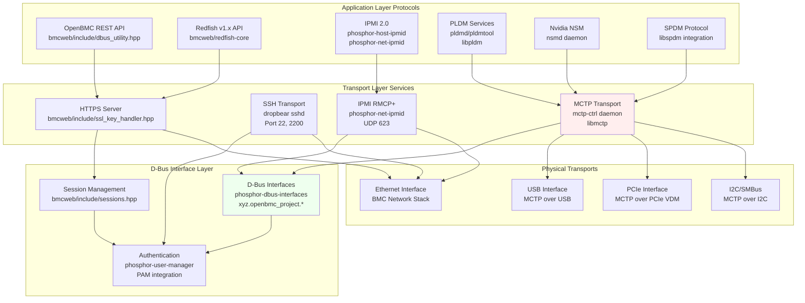

<!-- source: DeepWiki mcp.deepwiki.com · repo NVIDIA/nvbmc-docs · page 1 OpenBMC Overview · fetched 2026-10-26 -->

# OpenBMC Overview

Relevant source files

The following files were used as context for generating this wiki page:

- [README.md](README.md)
- [architecture/ipmi-architecture.md](architecture/ipmi-architecture.md)
- [architecture/user-management.md](architecture/user-management.md)
- [console.md](console.md)
- [features.md](features.md)
- [security/network-security-considerations.md](security/network-security-considerations.md)

## Purpose and Scope

This document provides an introduction to OpenBMC, its purpose as a Linux-based BMC (Baseboard Management Controller) firmware stack, and its high-level architecture. It covers the fundamental components, communication patterns, and development ecosystem that make up OpenBMC.

For specific implementation details on individual subsystems, see [Core Architecture](#3), [Management Interfaces](#4), and [Platform Protocols](#5). For Nvidia-specific implementations, see [Nvidia OpenBMC (NvBMC)](#6).

## What is OpenBMC

OpenBMC is an open-source firmware stack for Baseboard Management Controllers (BMCs) developed under the Linux Foundation. It provides a customizable, standards-based platform for out-of-band management of server systems.

Key characteristics of OpenBMC include:

- **Linux-based**: Built on standard Linux kernel with systemd process management
- **D-Bus Architecture**: Uses D-Bus as the central communication bus between services
- **Standards Compliance**: Implements industry standards like Redfish, IPMI 2.0, and PLDM
- **Yocto Build System**: Uses Yocto Project for cross-compilation and image generation
- **Modular Design**: Component-based architecture allowing customization per platform

OpenBMC serves as the management processor firmware that enables remote monitoring, control, and maintenance of server hardware independently of the host operating system.

**Sources:** [README.md:1-53](), [features.md:1-33]()

## Core Architecture Overview

OpenBMC follows a service-oriented architecture where individual daemons communicate through D-Bus interfaces. The system is built on standard Linux components with systemd managing service lifecycle.

### System Architecture Diagram

```mermaid
graph TB
    subgraph "External Management Interfaces"
        WebUI["bmcweb<br/>Web Interface"]
        REST["REST API<br/>phosphor-rest-server"]
        Redfish["Redfish API<br/>bmcweb/redfish"]
        SSH["SSH Console<br/>dropbear"]
        IPMI["IPMI Interface<br/>phosphor-net-ipmid"]
    end
    
    subgraph "Core Communication Layer"
        DBus["D-Bus System Bus<br/>dbus-broker"]
        ObjectMapper["Object Mapper<br/>phosphor-objmgr"]
    end
    
    subgraph "System Services"
        UserManager["User Management<br/>phosphor-user-manager"]
        StateManager["State Management<br/>phosphor-state-manager"]
        NetworkManager["Network Management<br/>phosphor-networkd"]
        Logging["Event Logging<br/>phosphor-logging"]
    end
    
    subgraph "Hardware Abstraction"
        SensorManager["Sensor Management<br/>phosphor-hwmon"]
        EntityManager["Entity Manager<br/>entity-manager"]
        GPIOManager["GPIO Control<br/>phosphor-gpio-util"]
        FanControl["Fan Control<br/>phosphor-fan-presence"]
    end
    
    subgraph "Platform Protocols"
        PLDMDaemon["PLDM Stack<br/>pldmd + libpldm"]
        MCTPDaemon["MCTP Transport<br/>mctp-ctrl"]
        NSMDaemon["NSM Daemon<br/>nsmd"]
    end
    
    subgraph "Linux Foundation"
        SystemD["systemd<br/>Process Manager"]
        Kernel["Linux Kernel<br/>Device Drivers"]
        PAM["PAM Authentication<br/>pam_unix + pam_ipmi"]
    end
    
    %% External to D-Bus connections
    WebUI --> DBus
    REST --> DBus
    Redfish --> DBus
    SSH --> PAM
    IPMI --> DBus
    
    %% D-Bus service connections
    DBus --> ObjectMapper
    DBus --> UserManager
    DBus --> StateManager
    DBus --> NetworkManager
    DBus --> Logging
    
    %% Hardware abstraction connections
    DBus --> SensorManager
    DBus --> EntityManager
    DBus --> GPIOManager
    DBus --> FanControl
    
    %% Protocol stack connections
    PLDMDaemon --> DBus
    PLDMDaemon --> MCTPDaemon
    NSMDaemon --> DBus
    NSMDaemon --> MCTPDaemon
    
    %% Foundation layer connections
    SystemD --> DBus
    SystemD --> UserManager
    SystemD --> StateManager
    UserManager --> PAM
    SensorManager --> Kernel
    EntityManager --> Kernel
    
    style DBus fill:#ffeeee
    style SystemD fill:#eeffee
    style WebUI fill:#eeeeff
```

**Sources:** [README.md:18-53](), [features.md:5-33](), [architecture/user-management.md:67-152]()

## Management Protocol Stack

OpenBMC implements multiple management protocols to provide comprehensive system management capabilities. Each protocol serves specific use cases and operates over different transport layers.

### Protocol Implementation Diagram

**Sources:** [features.md:5-33](), [security/network-security-considerations.md:129-264](), [architecture/ipmi-architecture.md:1-48]()

## Development Environment

OpenBMC uses the Yocto Project build system to create cross-compiled firmware images. The development workflow integrates multiple tools for source management, building, and testing.

### Key Development Components:

| Component | Purpose | Implementation |
|-----------|---------|----------------|
| **Yocto/BitBake** | Cross-compilation framework | `meta-openbmc` recipes and layers |
| **devtool** | Source modification workflow | Yocto development tool |
| **QEMU** | Hardware emulation | `qemu-system-arm` for BMC simulation |
| **Gerrit** | Code review system | `gerrit.openbmc-project.xyz` |
| **SDK** | Development toolkit | Cross-compilation toolchain |

The build system produces several artifacts:
- **BMC Images**: Complete firmware images (`obmc-phosphor-image`)
- **SDK**: Cross-compilation environment for application development  
- **Individual Packages**: Modular components for custom builds

**Sources:** [README.md:18-33](), [features.md:28-30]()

## Key System Features

OpenBMC provides comprehensive BMC functionality through its modular architecture:

### Core Management Capabilities

- **Remote System Control**: Power management, reset control, and system state monitoring
- **Hardware Monitoring**: Temperature, voltage, fan speed, and environmental sensors
- **Event Logging**: System event capture, storage, and retrieval through `phosphor-logging`
- **User Authentication**: Multi-protocol user management via `phosphor-user-manager` and PAM
- **Network Services**: HTTPS, SSH, IPMI, and service discovery protocols

### Standards Implementation

- **IPMI 2.0**: Full compliance with DCMI extensions via `phosphor-host-ipmid` and `phosphor-net-ipmid`
- **Redfish API**: Industry-standard REST API through `bmcweb/redfish-core`
- **PLDM**: Platform Level Data Model for modern device communication
- **SPDM**: Security Protocol and Data Model for device attestation

### Hardware Abstraction

- **Entity Management**: Dynamic hardware discovery through `entity-manager`
- **Sensor Framework**: Standardized sensor data collection via `phosphor-hwmon`
- **GPIO Control**: Hardware control interfaces through `phosphor-gpio-util`
- **Storage Management**: Flash memory and persistent storage handling

**Sources:** [features.md:1-73](), [console.md:1-49](), [architecture/user-management.md:30-66]()

## Communication Architecture

All OpenBMC services communicate through D-Bus interfaces defined in the `phosphor-dbus-interfaces` repository. This creates a uniform API layer that enables loose coupling between components and supports both local and remote management operations.

The `phosphor-objmgr` service provides object discovery and enumeration, allowing services to dynamically find and interact with hardware components and other system services. This architecture supports hot-plug events, dynamic configuration changes, and modular system composition.

**Sources:** [features.md:9-11](), [architecture/user-management.md:67-73]()

---

