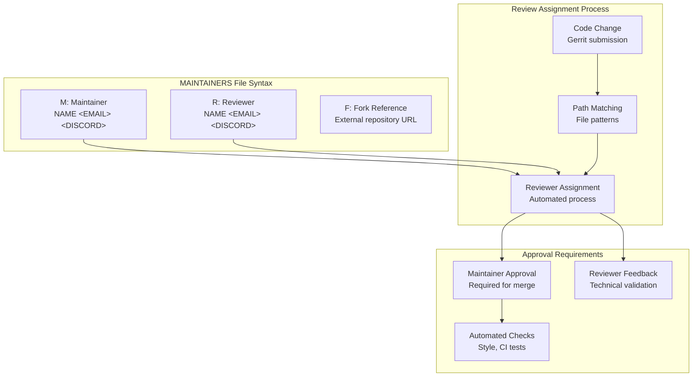
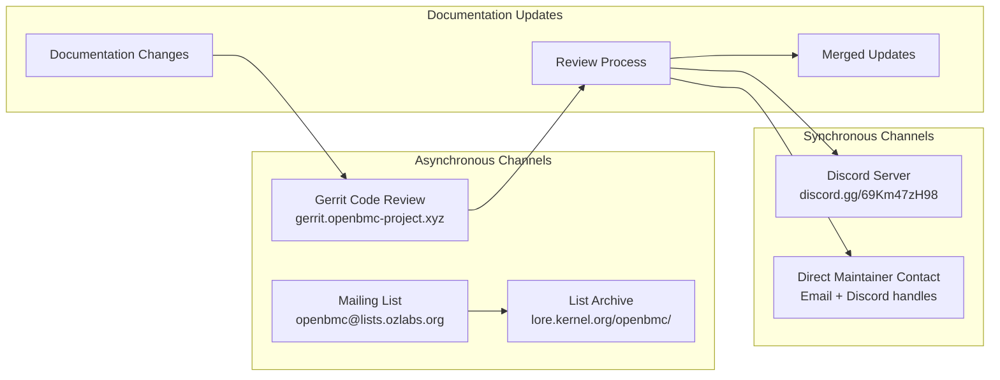
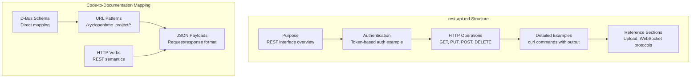

<!-- source: DeepWiki mcp.deepwiki.com · repo NVIDIA/nvbmc-docs · page 1.1 Project Structure and Documentation · fetched 2026-10-26 -->

# Project Structure and Documentation

Relevant source files

The following files were used as context for generating this wiki page:

- [MAINTAINERS](MAINTAINERS)
- [README.md](README.md)
- [console.md](console.md)
- [rest-api.md](rest-api.md)

This document describes how the OpenBMC documentation is organized, the maintainer structure for code review, and the contribution processes that govern project development. This covers the documentation infrastructure and governance processes that support the technical systems described throughout the rest of this wiki.

For information about the actual development workflow and building OpenBMC, see [Getting Started](#2). For code style and contribution guidelines, see [Development Guidelines](#7).

## Documentation Organization

The OpenBMC project maintains documentation across multiple repositories, with the main documentation repository serving as the central hub for project-wide information. The documentation is structured to serve different audiences: developers implementing OpenBMC services, system administrators deploying OpenBMC, and users consuming OpenBMC management interfaces.

### Documentation Repository Structure

```mermaid
graph TB
    subgraph "docs Repository Root"
        README["README.md<br/>Project overview"]
        CONTRIBUTING["CONTRIBUTING.md<br/>Contribution guidelines"]
        MAINTAINERS["MAINTAINERS<br/>Review assignments"]
        features["features.md<br/>Feature catalog"]
    end
    
    subgraph "Development Documentation"
        cheatsheet["cheatsheet.md<br/>Development tasks"]
        development["development/<br/>Tutorial directory"]
        kernel["kernel-development.md<br/>Kernel tasks"]
    end
    
    subgraph "Usage Documentation"
        rest_api["rest-api.md<br/>REST interface"]
        console_doc["console.md<br/>Host console"]
        host_mgmt["host-management.md<br/>Host operations"]
        redfish_cheat["REDFISH-cheatsheet.md<br/>Redfish commands"]
        rest_cheat["REST-cheatsheet.md<br/>REST commands"]
    end
    
    subgraph "Architecture Documentation"
        arch_dir["architecture/<br/>System design"]
        code_update["architecture/code-update<br/>Firmware updates"]
    end
    
    README --> development
    README --> rest_api
    README --> console_doc
    README --> host_mgmt
    README --> arch_dir
    CONTRIBUTING --> MAINTAINERS
    features --> arch_dir
```

**Sources:** [README.md:1-53](), [MAINTAINERS:1-57]()

### Documentation Types and Purposes

The documentation follows a clear categorization based on user intent and technical depth:

| Documentation Type | Purpose | Example Files | Target Audience |
|-------------------|---------|---------------|-----------------|
| **Development** | Code implementation guidance | `cheatsheet.md`, `development/`, `kernel-development.md` | OpenBMC developers |
| **Usage** | Operating OpenBMC systems | `rest-api.md`, `console.md`, `host-management.md` | System administrators |
| **Architecture** | System design and internals | `architecture/code-update` | Platform implementers |
| **Reference** | Quick command lookups | `REDFISH-cheatsheet.md`, `REST-cheatsheet.md` | All technical users |

The documentation architecture mirrors the layered approach of OpenBMC itself, with usage documentation mapping to external management interfaces, development documentation covering D-Bus services and internal APIs, and architecture documentation explaining the underlying system design.

**Sources:** [README.md:18-53]()

## Maintainer and Review System

OpenBMC uses a distributed maintainer model defined by `MAINTAINERS` files in each repository. This system ensures appropriate technical review and maintains code quality across the project's many components.

### MAINTAINERS File Structure

**Sources:** [MAINTAINERS:20-48]()

The `MAINTAINERS` file uses a structured format where each entry specifies role types and contact information:

- **M:** entries define maintainers who have approval authority for changes
- **R:** entries define reviewers who provide technical feedback but cannot approve changes  
- **F:** entries reference external repositories that have been forked

The current docs repository maintainers are:

| Role | Name | Email | Discord |
|------|------|-------|---------|
| Maintainer | Brad Bishop | `bradleyb@fuzziesquirrel.com` | `radsquirrel!` |
| Maintainer | Patrick Williams | `patrick@stwcx.xyz` | `stwcx!` |
| Reviewer | Adriana Kobylak | `anoo@us.ibm.com` | `anoo!` |
| Reviewer | Andrew Jeffery | `andrew@aj.id.au` | `arj!` |
| Reviewer | Gunnar Mills | `gmills@linux.vnet.ibm.com` | `GunnarM!` |

**Sources:** [MAINTAINERS:52-57]()

### Review Assignment Algorithm

The maintainer system operates through automated tooling that parses the `MAINTAINERS` file structure:

1. **Path Matching**: Changes are analyzed to determine which repository paths are modified
2. **Section Lookup**: The most specific `MAINTAINERS` section matching the changed paths is identified
3. **Reviewer Assignment**: All `R:` and `M:` entries from matching sections are added as reviewers
4. **Approval Enforcement**: At least one `M:` entry must approve before the change can merge

This system ensures that domain experts review changes while distributing the review workload across maintainers and reviewers.

**Sources:** [MAINTAINERS:8-18](), [MAINTAINERS:46-47]()

## Project Communication Infrastructure

OpenBMC maintains multiple communication channels that support both synchronous and asynchronous collaboration:

### Primary Communication Channels

**Sources:** [README.md:12-16]()

The communication infrastructure supports the documentation lifecycle:

- **Mailing List**: Technical discussions and announcements reach all project participants
- **Discord**: Real-time communication for quick questions and collaborative work sessions  
- **Gerrit**: All documentation changes go through the same code review process as source code
- **Archive**: Searchable history of all technical discussions for reference

## Documentation Standards and Patterns

OpenBMC documentation follows consistent patterns that make information easy to find and use across different technical domains.

### Technical Documentation Structure

Most technical documentation follows this pattern:

1. **Purpose Statement**: Clear scope definition with links to related documentation
2. **Quick Start**: Minimal example or command sequence  
3. **Detailed Examples**: Comprehensive usage scenarios with code snippets
4. **Reference Material**: Complete API listings, command tables, or parameter descriptions

For example, `rest-api.md` demonstrates this pattern:

**Sources:** [rest-api.md:1-11](), [rest-api.md:25-98]()

### Cross-Reference Patterns

Documentation maintains consistency through standardized cross-referencing:

- **Internal Links**: References to other wiki sections use numeric page IDs: `[Title](#page.id)`
- **Code References**: File paths and line numbers use bracketed syntax: `[path/file:start-end]()`  
- **Command Examples**: Consistent shell prompt and variable naming (`${bmc}`, `$token`)
- **API Examples**: Standardized JSON formatting and curl command structure

This systematic approach ensures that users can navigate between different documentation areas and understand how components interact across the entire OpenBMC system.

**Sources:** [rest-api.md:19-23](), [console.md:14-18](), [console.md:25-27]()

---

